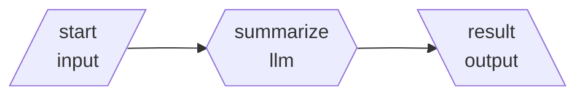
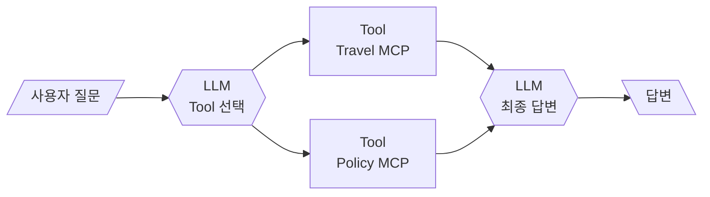

# Lab 01 · 첫 번째 워크플로우 실행과 실행 기록 읽기

- 관련 강의: [1단계 · AI 워크플로우의 개념과 전체 아키텍처](../../Lecture/64/01-STAGE1-AI-WORKFLOW-CONCEPT.md)
- 소요 시간: 약 35분
- 목표: 노드·연결·페이로드·실행 기록을 직접 눈으로 확인한다.

## 1. 설치 확인 (5분)

[사전 준비 안내](SETUP-WSL-OLLAMA.md)를 마친 상태에서 WSL 터미널에서 실행합니다.

```bash
cd ~/<수업 저장소>/Last3Mon/64/workflow-lab
uv run pytest -q          # 12 passed, 1 skipped
uv run miniflow check     # Reply (ollama, ...) 가 나오면 준비 완료
```

## 2. 가장 단순한 워크플로우 실행 (10분)

`flows/01-llm-only.json`을 열어 구조를 확인합니다.



```bash
uv run miniflow run flows/01-llm-only.json -i text="다음 주 화요일 10시에 기획 회의를 진행합니다. 각 팀은 진행 현황을 준비해 주세요."
```

출력 예시:

```text
Workflow: 01 LLM only
------------------------------------------------------------------------
[1/3] start          input        ok    0.0ms  {"text": "다음 주 화요일 ..."}
[2/3] summarize      llm          ok 7071.5ms  "다음 주 화요일 10시에 기획 회의가 진행됩니다. 각 팀은 ..."
[3/3] result         output       ok    0.1ms  "다음 주 화요일 10시에 기획 회의가 진행됩니다. 각 팀은 ..."
------------------------------------------------------------------------
Status: completed
Trace saved: runs/20261014-101500-01-llm-only.json
```

노트북의 Ollama 모델(`gemma3:4b`)이 요약을 만들었습니다. 요약 문장과 소요 시간은 실행할 때마다, 노트북마다 다릅니다.

같은 명령을 **Mock LLM**으로도 실행해 비교해 봅니다. Mock은 노드에 적어 둔 정해진 답을 돌려줍니다.

```bash
MINIFLOW_LLM=mock uv run miniflow run flows/01-llm-only.json -i text="다음 주 화요일 10시에 기획 회의를 진행합니다."
```

## 3. 실행 기록 읽기 (10분)

`runs/` 폴더에 생긴 JSON 파일을 열고 다음 질문에 답해 보세요.

1. `summarize` 노드의 `prompt` 필드에는 무엇이 들어 있나요? `{{input.text}}`는 어떻게 바뀌었나요?
2. `provider` 값은 무엇인가요? Mock으로 실행한 기록과 비교하면 무엇이 다른가요?
3. 각 노드의 `ms` 값을 보면 어느 노드가 가장 오래 걸렸나요? Mock으로 실행했을 때와 비교하면 얼마나 차이 나나요?

```bash
uv run miniflow show flows/01-llm-only.json
```

위 명령은 워크플로우를 Mermaid 문법으로 출력합니다. 출력을 [Mermaid Live Editor](https://mermaid.live)에 붙여 넣으면 그림으로 볼 수 있습니다.

## 4. 지난 프로젝트를 노드로 다시 그리기 (10분)

지난 실습 프로젝트 하나를 골라 **노드와 연결**로 다시 그립니다. 아래 예시를 참고하세요.

`mini_agent_03_mcp` (8월)를 워크플로우로 그리면:



다음 중 하나를 골라 `Last3Mon/64/my-work/LAB-01-MY-DIAGRAM.md` 파일에 Mermaid로 그려 보세요.

- `mini_agent_04_rag`: 질문 → 검색 → 답변 → 캐시
- `mini_agent_05_memory`: 질문 → 기억 조회 → 답변 → 기억 저장
- `mini_multi_agent_04_distributed_collaboration`: 계획 → 병렬 Agent 3개 → Join → 일정

그린 뒤, 각 노드가 LLM·Tool·Memory·데이터 처리 중 무엇인지 표시합니다.

## 확인

- [ ] `pytest`가 모두 통과했다.
- [ ] `01-llm-only.json`을 실행하고 실행 기록을 열어 보았다.
- [ ] 지난 프로젝트 하나를 노드와 연결로 그렸다.
