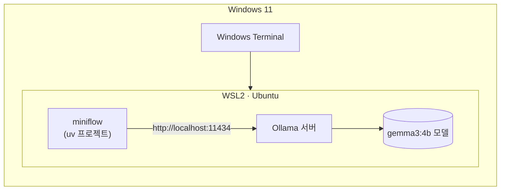

# 사전 준비 · WSL에서 실습 환경과 Ollama 로컬 LLM 준비

64일차 실습은 Windows 11의 **WSL(Ubuntu)** 에서 진행하고, LLM은 노트북에서 직접 실행하는 **Ollama**를 사용합니다. API 키가 필요 없고 사용량 제한도 없습니다.

> 모델 파일이 1~3GB입니다. 수업 중에 21명이 동시에 받으면 강의실 네트워크가 느려지므로 **수업 전날 4단계(모델 다운로드)까지 끝내 주세요.**



## 1. WSL 확인 (5분)

PowerShell에서 확인합니다.

```powershell
wsl --list --verbose
```

`Ubuntu`가 `VERSION 2`로 보이면 됩니다. 없으면 `wsl --install -d Ubuntu`로 설치하고 노트북을 다시 시작합니다.

이후 명령은 모두 **WSL(Ubuntu) 터미널**에서 실행합니다.

## 2. 노트북 메모리에 맞는 모델 고르기

WSL은 기본으로 **Windows 전체 메모리의 절반**까지만 사용합니다.

| 노트북 메모리 | WSL이 쓸 수 있는 메모리 | 사용할 모델 |
| --- | --- | --- |
| 8GB | 약 4GB | `gemma3:1b` |
| 16GB 이상 | 약 8GB 이상 | `gemma3:4b` (권장) |

내 노트북 메모리는 PowerShell에서 확인합니다.

```powershell
(Get-CimInstance Win32_ComputerSystem).TotalPhysicalMemory / 1GB
```

메모리가 부족하다는 오류가 나면 `C:\Users\<사용자>\.wslconfig` 파일을 만들어 상한을 올린 뒤 PowerShell에서 `wsl --shutdown` 하고 WSL을 다시 엽니다.

```ini
[wsl2]
memory=10GB
swap=4GB
```

## 3. 실습 코드와 uv 준비 (10분)

```bash
# uv (이미 설치되어 있으면 건너뜀)
curl -LsSf https://astral.sh/uv/install.sh | sh
source ~/.bashrc

# 실습 폴더는 WSL 홈(~) 아래에 둡니다. /mnt/c 아래는 느리고 권한 문제가 생깁니다.
cd ~
# 수업 저장소를 받는 방법은 강의 시간에 안내합니다.
cd ~/<수업 저장소>/Last3Mon/64/workflow-lab
uv sync
uv run pytest -q
```

`12 passed, 1 skipped`가 나오면 됩니다. (`skipped` 1개는 선택 기능인 Anthropic 연결 테스트로, 해당 패키지를 설치하지 않으면 건너뜁니다.)

## 4. Ollama 설치와 모델 다운로드 (10~20분)

```bash
curl -fsSL https://ollama.com/install.sh | sh
ollama --version

# 메모리 16GB 이상
ollama pull gemma3:4b
# 메모리 8GB
ollama pull gemma3:1b

ollama list
```

`ollama list`에 모델이 보이면 됩니다. 설치 스크립트가 Ollama 서버를 자동으로 실행합니다. `ollama list`에서 연결 오류가 나면 다른 터미널 창에서 `ollama serve`를 실행해 두세요.

## 5. miniflow와 Ollama 연결 (5분)

`~/.bashrc` 맨 아래에 추가합니다. 8GB 노트북은 모델 이름을 `gemma3:1b`로 바꿉니다.

```bash
cat >> ~/.bashrc <<'EOF'
export MINIFLOW_LLM=ollama
export OLLAMA_MODEL=gemma3:4b
EOF
source ~/.bashrc
```

연결을 확인합니다.

```bash
cd ~/<수업 저장소>/Last3Mon/64/workflow-lab
uv run miniflow check
```

```text
MINIFLOW_LLM : ollama
OLLAMA_HOST  : http://localhost:11434
OLLAMA_MODEL : gemma3:4b
Reply (ollama, 18.8s): Ready
```

첫 호출은 모델을 메모리에 올리느라 10~20초 걸립니다. 두 번째부터는 빨라집니다.

## 6. 이미 Windows나 Docker에 Ollama가 있는 경우

9월 실습에서 Docker로 Ollama를 실행해 둔 경우에는 WSL에 새로 설치하지 않고 그대로 써도 됩니다.

| 상황 | 설정 |
| --- | --- |
| Docker Desktop으로 실행한 Ollama (`11434` 포트 공개) | 컨테이너를 켜 두면 WSL에서도 `http://localhost:11434`로 연결됩니다. `uv run miniflow check`로 확인 |
| Windows용 Ollama 앱 | `.wslconfig`에 `networkingMode=mirrored`를 추가하고 `wsl --shutdown` 후 다시 열면 `localhost`로 연결됩니다 |

```ini
[wsl2]
networkingMode=mirrored
```

## 7. 문제 해결

| 증상 | 해결 |
| --- | --- |
| `Cannot reach Ollama at http://localhost:11434` | `ollama serve` 실행, 또는 6절의 연결 설정 확인 |
| `Model 'gemma3:4b' not found on Ollama` | `ollama pull gemma3:4b` |
| 응답이 1분 넘게 걸림, WSL이 멈춤 | 메모리 부족. `gemma3:1b`로 바꾸거나 `.wslconfig`의 `memory` 상향 |
| `uv: command not found` | `source ~/.bashrc` 또는 터미널 다시 열기 |
| 한글이 깨져 보임 | Windows Terminal 사용 (기본 UTF-8) |
| Ollama가 없거나 문제가 계속됨 | `export MINIFLOW_LLM=mock`으로 Mock LLM 사용 (결과는 정해진 답) |

## 확인

- [ ] `uv run pytest -q` → `12 passed, 1 skipped`
- [ ] `ollama list`에 모델이 보인다
- [ ] `uv run miniflow check`에서 `Reply (ollama, ...)`가 나온다
