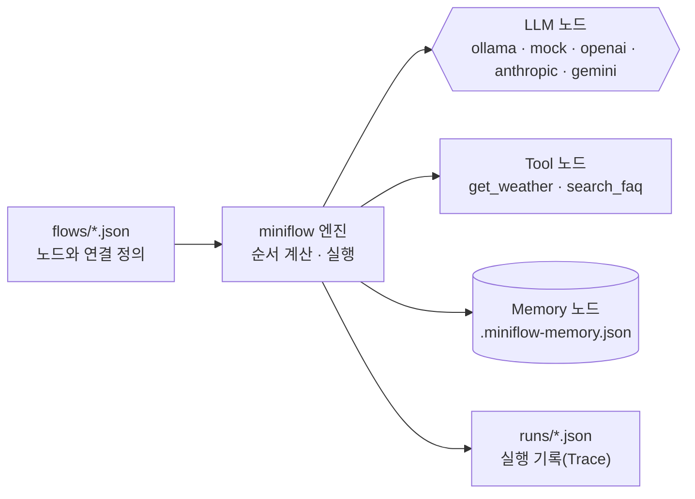

# workflow-lab: JSON으로 정의하는 미니 AI 워크플로우

노코드 워크플로우 도구는 화면에서 **노드를 놓고 선으로 연결**합니다. 이 실습에서는 같은 구조를 JSON 파일로 적고 `miniflow`로 실행합니다. 화면 대신 파일을 쓸 뿐, 노드·연결·데이터 전달이라는 개념은 같습니다.



## 1. 설치와 확인

```bash
cd Last3Mon/64/workflow-lab
uv sync
uv run miniflow tools
uv run pytest -q
```

## 2. 명령어

| 명령 | 하는 일 |
| --- | --- |
| `uv run miniflow run flows/01-llm-only.json -i text="..."` | 워크플로우 실행. 입력은 `-i 이름=값`으로 여러 개 전달 |
| `uv run miniflow validate flows/02-llm-tool.json` | 실행하지 않고 구조만 검사, 실행 순서 출력 |
| `uv run miniflow show flows/04-recommend-with-memory.json` | 워크플로우를 Mermaid 다이어그램으로 출력 |
| `uv run miniflow tools` | 사용할 수 있는 Tool 목록 |
| `uv run miniflow check` | 설정한 LLM에 연결되는지 확인 |
| `uv run miniflow memory` / `--clear` | Memory 내용 보기 / 지우기 |

실행할 때마다 각 노드의 입력·출력·소요 시간이 `runs/` 폴더에 JSON으로 저장됩니다.

## 3. 노드 종류

| type | 역할 | 필수 필드 |
| --- | --- | --- |
| `input` | 실행 시 받은 입력을 흐름에 넣음 | 없음 |
| `llm` | 프롬프트를 LLM에 보내고 답을 받음 | `prompt` (선택: `system`, `temperature`, `mock`) |
| `tool` | 등록된 함수를 호출해 데이터를 가져옴 | `tool`, `args` |
| `memory_read` | 저장된 기억을 키로 읽음 | `key` |
| `memory_write` | 기억을 키에 저장(기존 값과 병합) | `key`, `value` |
| `output` | 최종 결과를 만듦 | `value` |

## 4. 데이터 전달 규칙

앞 노드의 결과는 `{{...}}`로 꺼내 씁니다.

| 표현 | 의미 |
| --- | --- |
| `{{input.city}}` | 실행할 때 받은 입력 `city` |
| `{{nodes.weather.output}}` | `weather` 노드의 결과 전체 |
| `{{nodes.weather.output.temp_c}}` | 결과 안의 특정 값 |
| `{{nodes.faq.output.0.answer}}` | 목록의 첫 번째 항목 안의 값 |

## 5. LLM 선택

`MINIFLOW_LLM` 환경 변수로 LLM을 고릅니다. 수업 기본값은 노트북에서 실행하는 **Ollama**입니다. 준비 방법은 [SETUP-WSL-OLLAMA.md](../SETUP-WSL-OLLAMA.md)를 참고하세요.

| `MINIFLOW_LLM` | LLM | 필요한 것 |
| --- | --- | --- |
| `ollama` (수업 기본) | 로컬 모델 (`OLLAMA_MODEL`, 기본 `gemma3:4b`) | Ollama 설치, 모델 다운로드 |
| `mock` (설정하지 않았을 때) | 노드의 `mock` 설정대로 정해진 답 | 없음 (자동 테스트, Ollama가 안 될 때) |
| `openai` | OpenAI (`OPENAI_MODEL`) | `uv sync --extra openai`, `OPENAI_API_KEY` |
| `anthropic` | Anthropic Claude (`ANTHROPIC_MODEL`, 기본 `claude-opus-5-5`) | `uv sync --extra anthropic`, `ANTHROPIC_API_KEY` |
| `gemini` | Google Gemini (`GEMINI_MODEL`) | `uv sync --extra gemini`, `GEMINI_API_KEY` |

```bash
export MINIFLOW_LLM=ollama
export OLLAMA_MODEL=gemma3:4b               # 8GB 노트북은 gemma3:1b
export OLLAMA_HOST=http://localhost:11434   # 기본값이라 생략 가능
uv run miniflow check                       # 연결 확인
```
