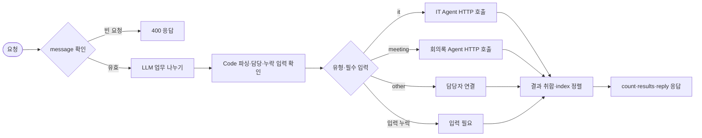

# Multi-Agent 설계서 · 사내 업무 도우미

- 이름:
- 사용한 CLI 에이전트: codex
- 이 파일을 `my-work/DESIGN.md`로 복사해 채웁니다.

## 1. 업무 분석표 (Lab 01 예제 1)

| 요청 | 업무 | 유형 (it · meeting · other) | 필요한 입력 | 요청에 있나 | 업무 관계 (독립 · 순서) |
| --- | --- | --- | --- | --- | --- |
| `composite` | ① T-1002 처리 상태 ② 회의록 할 일 정리 ③ 프린터 출력 안 됨 | it · meeting · it | ① 접수 번호, 요청한 사람 ② 회의록 원문 ③ 증상 | 모두 있음 (`user`, `notes`) | 셋 다 독립 |
| `two-it` | ① 비밀번호 분실 ② 메일함 용량 | it · it | 증상, 요청한 사람 | 있음 | 독립 (같은 Agent에 두 번) |
| `it-and-other` | ① 프린터 ② 회식 장소 추천 | it · other | ① 증상 ② (맡을 Agent 없음) | ① 있음 | 독립 |
| `meeting-no-notes` | ① 회의록 할 일 정리 | meeting | 회의록 원문 | 없음 | — |
| 내 업무에서 하나 | (64일차 Lab 03 내 시나리오에서 직접 채우기) |  |  |  |  |

## 2. Agent 목록과 계약 (Lab 02 예제 1)

| Agent | 맡는 업무 | 웹훅 | 입력 | 결과 | 실패할 때 돌려주는 것 |
| --- | --- | --- | --- | --- | --- |
| IT 문의 Agent | IT FAQ·접수 상태 | POST `/webhook/it-agent` | `question`, `user` 필수 | `route`, `answer`, `tools_used`, `sources` | 누락 시 400; 조회 불가·타인 접수는 담당자 연결 |
| 회의록 Agent | 요약·할 일 정리 | POST `/webhook/meeting-agent` | `notes` 필수, `title` 선택 | `route`, `title`, `count`, `summary`, `actions` | notes 누락 시 400 `notes are required` |

## 3. 흐름도 (mermaid)



## 4. 통합 응답 형식

```json
{"count": 0, "results": [{"index": 1, "type": "", "text": "", "agent": "", "route": "", "answer": ""}], "reply": ""}
```

## 5. 예외 경로 (Lab 03)

| 상황 | 라우터가 할 일 | 확인한 테스트 |
| --- | --- | --- |
| 필요한 입력이 없음 | 호출 전 notes·user 문자열의 공백까지 검사, 해당 업무만 입력 필요 | lab03, my-cases |
| 담당 Agent가 꺼짐 | HTTP 오류를 결과로 전달하고 담당자 연결, 다른 업무 유지. 요청당 timeout 60초 | lab03-down |
| 맡을 Agent가 없는 업무 | HTTP 호출 없이 담당자 연결 | lab02, lab03 |

## 6. 확장 계획 (Lab 03 과제, 측정값으로)

| 측정 | 값 (`runs/` 보고서) |
| --- | --- |
| IT 하나 | 평균 3.07초 (`lab02-20261020-114505.json`, 3회) |
| 회의록 하나 | 평균 2.80초 (`lab02-20261020-114505.json`, 3회) |
| 복합 요청 (업무 3개) | 평균 6.23초 (`lab02-20261020-114505.json`, 3회) |

- 직원 21명이 동시에 복합 요청을 보내면 라우터 실행 21개와 하위 Agent 실행 총 63개(IT 42개·회의록 21개)가 발생한다. 모두가 같은 순간에 실행된다는 뜻은 아니다. 라우터의 분리 모델 요청 21회 외에 Agent의 모델·도구 호출이 추가되어 OpenAI 요청 제한과 n8n 실행 슬롯의 대기가 우선 확인 대상이다. 실제 21명 부하 테스트는 하지 않았다.
- 첫 조치는 동시 실행 수 제한·대기열과 API 요청량 측정이다. CPU·메모리 사용량을 측정하지 않았으므로 서버 증설 효과는 단정하지 않는다. 실행 대기가 지속되면 작업자 수평 확장을 검토하고, 메모리·CPU 포화가 확인되면 수직 확장을 검토한다. 이번 실습에서는 환경을 바꾸지 않았다.
- 위 값은 기능 테스트 중의 HTTP 왕복 시간이며 일부 스위트를 동시에 실행했다. 개별 하위 Agent 구간을 계측하지 않아 복합 시간만으로 직렬·병렬 실행을 단정할 수 없다.

## 7. Router와 Supervisor 비교

| 항목 | Router | Supervisor |
| --- | --- | --- |
| 복합 요청 평균 | 6.23초 | 9.70초 |
| 결과 모양 | count / results / reply, 순서 index로 정렬 | reply / agents_used, 실제 Tool 기록에서 Agent 추출 |
| 3회 반복 | lab02 18/18 | lab02-challenge 15/15; 답 문장과 기한 표현은 달라질 수 있음 |
| Agent 추가 시 | 유형·입력 규칙·Switch·HTTP·결과 정규화 수정 | Tool·설명·시스템 지시·기록 매핑 수정 |

라우터용 테스트를 Supervisor에 적용한 비교 실험은 1/6 통과였다 (`runs/lab02-20261020-114334.json`). count/results가 없는 응답 계약 차이이며, Supervisor 전용 테스트 실패와 구분한다.

계약 직접 호출: IT 정상 200, 회의록 정상 200, notes 없는 회의록 400 `notes are required`를 확인했다.
