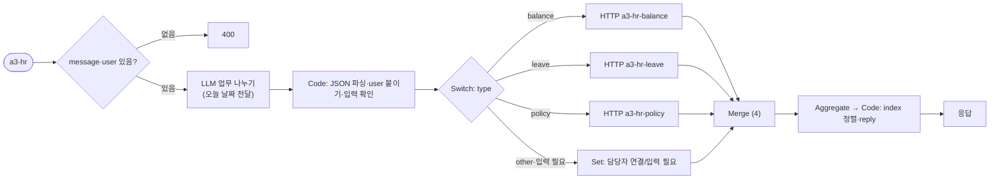
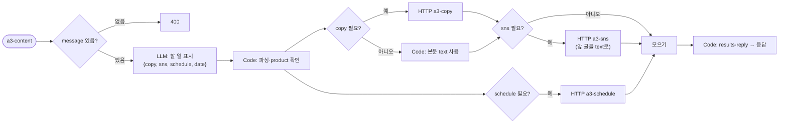

# 기획·계획서 · 업무 자동화 3종 (HR · 출장 · 마케팅)

- 작성일: 2026-10-20
- ✅ 진행 결과: 과제 3개로 나눠 `hr/` · `trip/` · `content/` 폴더에 완성 (각 폴더의 `SPEC.md` · `README.md` 참고). 공통 일정 Agent는 과제마다 하나씩(`a3-trip-schedule`, `a3-content-schedule`)으로 나눴다.
- 기준 구조: 68일차 라우터 (요청 한 문장 → 업무 나누기 → 담당 Agent HTTP 호출 → 결과 모으기)
- 만들 순서: **① HR 문의 창구 → ② 출장 준비 비서 → ③ 마케팅 콘텐츠 제작**
- 환경: n8n 2.42.6, OpenAI Credential `openAiCourse0001` (`gpt-4.1-mini`), 웹훅 `http://localhost:5678/webhook/<path>`

---

## 0. 공통 원칙

| 원칙 | 내용 |
| --- | --- |
| LLM이 할 일 | 문장을 업무로 나누기, 날짜·도시 같은 값 뽑기, 규정 설명, 글쓰기 |
| 규칙(Code)이 할 일 | 요청한 사람 확인, 금액 계산, 남은 연차 비교, 글자 수 자르기, 권한 검사 |
| LLM이 정하면 안 되는 값 | `user`(요청한 사람), 금액, 제품 이름·가격 → **웹훅 입력이나 Code**에서 가져온다 |
| 데이터 | 연습용 가짜 데이터를 각 Agent의 Code 노드에 넣는다 (67일차 data-api는 고치지 않음) |
| 응답 모양 (라우터 3개 공통) | `{count, results: [{index, type, text, agent, route, answer}], reply}` |
| route 값 | `자동 답변` · `접수 완료` · `등록 완료` · `거절` · `입력 필요` · `담당자 연결` 중 하나 |
| 실패 처리 | HTTP 호출은 모두 `neverError: true`, timeout 60초. Agent가 꺼지면 그 업무만 `담당자 연결` |
| 날짜 | 라우터가 오늘 날짜(`$now`)를 LLM에 알려 줘 "금요일" 같은 말을 `YYYY-MM-DD`로 바꾼다. 테스트는 날짜를 직접 적어 결과가 매번 같게 한다 |

### 파일 목록 (11개 워크플로우)

| 프로젝트 | 파일 (`my-work/auto3/`) | 웹훅 path |
| --- | --- | --- |
| 공통 | `a3-schedule.json` | `a3-schedule` |
| ① HR | `a3-hr-balance.json` · `a3-hr-leave.json` · `a3-hr-policy.json` · `a3-hr.json` | `a3-hr-balance` · `a3-hr-leave` · `a3-hr-policy` · `a3-hr` |
| ② 출장 | `a3-trip-policy.json` · `a3-trip-expense.json` · `a3-trip.json` | `a3-trip-policy` · `a3-trip-expense` · `a3-trip` |
| ③ 마케팅 | `a3-copy.json` · `a3-sns.json` · `a3-content.json` | `a3-copy` · `a3-sns` · `a3-content` |

테스트 파일: `my-work/auto3/cases/` 안에 `a3-hr.json` · `a3-trip.json` · `a3-content.json` · `a3-agents.json`(Agent 단독).

---

## 1. 공통 · 일정 Agent (`a3-schedule`)

②와 ③이 같이 쓴다. ① HR에서 휴가가 접수되면 일정 등록도 할 수 있다 (확장).

| 항목 | 내용 |
| --- | --- |
| 입력 | `title`, `date`(`YYYY-MM-DD`), `user` 필수. `end_date` 선택 |
| 결과 | `route`, `answer`, `event: {id, title, date, end_date, owner}`, `conflicts: [...]` |
| 규칙 | 입력 없음 → 400 `{"error": "title, date, user are required"}` · 날짜 모양이 틀림 → `입력 필요` · 오늘보다 이전 → `거절` · 같은 날 기존 일정이 있으면 등록은 하되 `conflicts`에 알려 줌 |
| LLM | 쓰지 않는다 (전부 Code) — 가장 단순한 Agent라 처음 만들기 좋다 |

가짜 기존 일정 (Code 안):

| owner | date | title |
| --- | --- | --- |
| 박서연 | 2026-10-23 | 주간 회의 |
| 이준호 | 2026-10-27 | 고객사 미팅 |
| 마케팅팀 | 2026-11-02 | 신제품 발표 |

노드: `Webhook → Has inputs?(If) → Check and save(Code) → Send result` / `→ Reject(400)`

---

## 2. ① 인사(HR) 문의 창구 (`a3-hr`)

### 2-1. 시나리오

> 박서연: "연차 몇 개 남았는지 알려 주고, 11월 6일 금요일에 연차 쓸게. 그리고 병가 쓰려면 진단서 필요해?"

### 2-2. 업무 분석표

| 요청 | 업무 | 유형 | 필요한 입력 | 업무 관계 |
| --- | --- | --- | --- | --- |
| 복합 | ① 남은 연차 ② 11/6 연차 신청 ③ 병가 증빙 규정 | balance · leave · policy | ① user ② user, 날짜, 종류 ③ 질문 | 독립 (②는 Agent 안에서 잔여 확인) |
| 남의 연차 | 이준호 연차 조회 | balance | user, 대상 | — (권한 없음 → 담당자 연결) |
| 날짜 없음 | "휴가 쓸게" | leave | 날짜 | 날짜 없음 → `입력 필요` |
| 범위 밖 | "월급 언제 들어와?" | other | — | 맡을 Agent 없음 → `담당자 연결` |

### 2-3. 담당 Agent 계약

| Agent | 웹훅 | 입력 | 결과 | 규칙 (Code) |
| --- | --- | --- | --- | --- |
| 연차 조회 | `a3-hr-balance` | `user`, `target`(선택, 없으면 user) | `route`, `answer`, `total`, `used`, `remaining` | `target ≠ user`면 숫자를 주지 않고 `담당자 연결`. 없는 사람 → `담당자 연결` |
| 휴가 신청 | `a3-hr-leave` | `user`, `start`, `end`(선택), `kind`(연차·반차) | `route`, `answer`, `request_id`, `days`, `remaining_after` | 반차 0.5일, 주말 제외 계산. 남은 연차보다 많으면 `거절`. 3일 전보다 늦으면 `거절`(규정 1). 통과하면 `접수 완료`, `request_id = L-2026-<번호>` |
| 규정 질문 | `a3-hr-policy` | `question`, `user` | `route`, `answer`, `sources` | 규정표에서 찾아 LLM이 설명. 규정에 없으면 지어내지 말고 `담당자 연결` |

가짜 데이터:

| 직원 | 총 연차 | 사용 | 남음 |
| --- | --- | --- | --- |
| 박서연 | 15 | 6 | 9 |
| 이준호 | 15 | 14.5 | 0.5 |
| 김민지 | 20 | 3 | 17 |

| 규정 번호 | 내용 |
| --- | --- |
| HR-1 | 연차는 사용일 3일 전까지 신청한다 |
| HR-2 | 반차는 0.5일로 계산한다 (오전 9–13시 / 오후 14–18시) |
| HR-3 | 병가는 연 3일까지 유급, 2일 이상 연속이면 진단서를 낸다 |
| HR-4 | 경조휴가: 본인 결혼 5일, 부모 사망 5일, 자녀 결혼 1일 |
| HR-5 | 남은 연차는 다음 해로 최대 5일까지 넘길 수 있다 |

### 2-4. 라우터 흐름



LLM 업무 나누기 결과 모양: `{"tasks": [{"type": "balance|leave|policy|other", "text": "...", "target": "", "start": "YYYY-MM-DD", "end": "", "kind": "연차|반차"}]}`

### 2-5. 테스트 계획 (`my-work/auto3/cases/a3-hr.json`)

| # | 케이스 | 요청 (user) | 기대 |
| --- | --- | --- | --- |
| 1 | 복합 3개 | 위 시나리오 (박서연) | `count: 3`, `results.0.answer`에 "9", `results.1.route: 접수 완료`, `results.2.answer`에 "진단서" |
| 2 | 남의 연차 | "이준호 연차 몇 개 남았어?" (박서연) | `results.0.route: 담당자 연결`, `not_contains`에 "0.5" |
| 3 | 잔여 부족 | "11월 10일부터 이틀 연차" (이준호) | `results.0.route: 거절` |
| 4 | 날짜 없음 | "휴가 쓸게요" (김민지) | `results.0.route: 입력 필요` |
| 5 | 범위 밖 | "월급 언제 들어와?" (김민지) | `results.0.route: 담당자 연결`, HTTP 호출 없음 |
| 6 | 빈 요청 | `message: ""` | `status: 400` |
| 7 | 규정에 없는 질문 | "육아휴직 몇 년까지 돼?" (박서연) | `route: 담당자 연결` (지어내지 않음) |

---

## 3. ② 출장 준비 비서 (`a3-trip`)

### 3-1. 시나리오

> 이준호: "11월 12일부터 14일까지 부산 출장 가. 숙소는 하루 얼마까지 돼? 출장비 신청하고 일정도 잡아 줘."

### 3-2. 업무 분석표

| 요청 | 업무 | 유형 | 필요한 입력 | 업무 관계 |
| --- | --- | --- | --- | --- |
| 복합 | ① 숙박 한도 ② 출장비 신청 ③ 일정 등록 | policy · expense · schedule | ① 도시 ② 도시, 시작·끝 날짜 ③ 제목, 날짜 | 독립 (도시·날짜를 셋이 함께 씀) |
| 장기 | 10박 출장비 | expense | 도시, 날짜 | 7박 넘음 → `담당자 연결` (팀장 결재) |
| 날짜 없음 | "대구 출장비 신청해 줘" | expense | 날짜 | `입력 필요` |

### 3-3. 담당 Agent 계약

| Agent | 웹훅 | 입력 | 결과 | 규칙 (Code) |
| --- | --- | --- | --- | --- |
| 출장 규정 | `a3-trip-policy` | `question`, `user` | `route`, `answer`, `sources` | 규정표 기반 설명 (LLM). 없으면 `담당자 연결` |
| 출장비 신청 | `a3-trip-expense` | `user`, `city`, `start`, `end`, `transport`(선택, 원) | `route`, `answer`, `request_id`, `amount`, `breakdown` | **금액은 Code가 계산**: 숙박 한도 × 박 + 일비 × 일 + 교통비. 7박 초과·100만 원 초과 → `담당자 연결`. `request_id = T-2026-<번호>` |
| 일정 | `a3-schedule` (공통) | `title`, `date`, `end_date`, `user` | `route`, `event` | 1절 |

가짜 규정표:

| 규정 | 내용 |
| --- | --- |
| TR-1 숙박 한도 (1박) | 서울 120,000원 · 부산·대구·광주·대전·인천·울산 100,000원 · 그 밖 80,000원 |
| TR-2 일비 | 하루 30,000원 (출발일·도착일 포함) |
| TR-3 교통 | KTX 일반실·고속버스 실비. 교통비를 모르면 0원으로 접수하고 나중에 영수증 첨부 |
| TR-4 결재 | 7박 초과 또는 총액 100만 원 초과면 팀장 결재 |
| TR-5 정산 | 복귀 후 5일 안에 영수증 제출 |

계산 예 (부산 11/12–14): 숙박 100,000 × 2박 + 일비 30,000 × 3일 = **290,000원**

### 3-4. 라우터 흐름

①과 같은 모양이다. 다른 점:
- LLM이 `city`, `start`, `end`를 **한 번만** 뽑고, Code가 세 업무에 똑같이 붙인다 (Agent마다 다르게 뽑지 않도록).
- 일정 업무의 `title`은 Code가 `"<도시> 출장"`으로 만든다.

### 3-5. 테스트 계획 (`my-work/auto3/cases/a3-trip.json`)

| # | 케이스 | 기대 |
| --- | --- | --- |
| 1 | 복합 3개 (위 시나리오) | `count: 3`, `results.0.answer`에 "100,000" 또는 "10만", `results.1.answer`에 "290,000", `results.2.route: 등록 완료` |
| 2 | 서울 1박 2일 | `answer`에 "180,000" (120,000 + 60,000) |
| 3 | 10박 | `route: 담당자 연결` |
| 4 | 날짜 없음 | `route: 입력 필요` |
| 5 | 지난 날짜 일정 | 일정 `route: 거절` |
| 6 | 일정 Agent 꺼짐 (`--down` 비슷하게) | 일정만 `담당자 연결`, 나머지 두 업무는 정상 |

---

## 4. ③ 마케팅 콘텐츠 제작 (`a3-content`)

### 4-1. 시나리오

> 김민지: "신제품 소개글 써 주고, 인스타랑 X용으로 줄여 줘. 11월 2일에 올리게 일정도 잡아 줘."
> (요청 본문에 `product: {"name": "루미 무선 이어폰", "price": 89000, "features": ["노이즈 캔슬링", "30시간 재생", "IPX5 방수"]}`)

### 4-2. 업무 분석표 — **순서가 있는 업무**

| 요청 | 업무 | 유형 | 필요한 입력 | 업무 관계 |
| --- | --- | --- | --- | --- |
| 복합 | ① 소개글 ② SNS 줄이기 ③ 게시 일정 | copy · sns · schedule | ① product ② **①의 결과 글** ③ 날짜 | **① → ② 순서**, ③은 독립 |
| SNS만 | "이 글 인스타용으로 줄여 줘" + `text` | sns | 원문 글 | 원문이 본문에 있으면 ①을 건너뜀 |
| 제품 정보 없음 | "소개글 써 줘" (product 없음) | copy | product | `입력 필요` (LLM이 제품을 지어내지 않음) |

### 4-3. 담당 Agent 계약

| Agent | 웹훅 | 입력 | 결과 | 규칙 |
| --- | --- | --- | --- | --- |
| 소개글 | `a3-copy` | `product{name, price, features}`, `tone`(선택), `user` | `route`, `text` | LLM이 씀. Code가 확인: 제품 이름이 들어 있음, **입력에 없는 가격·숫자를 쓰지 않음**(가격 숫자 비교), 300–600자. 실패하면 한 번 다시 쓰고, 또 실패하면 `담당자 연결` |
| SNS | `a3-sns` | `text`, `channels`(기본 `["instagram", "x"]`) | `route`, `posts: [{channel, text, length}]` | LLM이 줄임. Code가 글자 수 한도 확인 (X 140자, 인스타 300자, 해시태그 5개까지). 넘으면 Code가 자름 |
| 일정 | `a3-schedule` (공통) | `title: "<제품> 게시"`, `date`, `user` | `route`, `event` | 1절 (11/2 신제품 발표와 같은 날 → `conflicts`에 알림) |

### 4-4. 라우터 흐름 (①·②와 다름: 차례대로)



- 업무 나누기 LLM은 **무엇을 할지만** 정하고(`copy`, `sns`, `schedule` true/false와 날짜), 제품 정보는 건드리지 않는다.
- SNS Agent에 보내는 `text`는 LLM이 아니라 **소개글 Agent의 응답**에서 표현식으로 가져온다.

### 4-5. 테스트 계획 (`my-work/auto3/cases/a3-content.json`)

| # | 케이스 | 기대 |
| --- | --- | --- |
| 1 | 복합 3개 | `count: 3`, `results.0.answer`에 "루미", `results.1.answer`에 "instagram", `results.2.answer`에 "신제품 발표"(겹침 알림) |
| 2 | 가격 지어내기 금지 | product에 price 없음 → `not_contains`에 "원" 붙은 가격 (예: "99,000", "79,000") |
| 3 | SNS만 (text 있음) | `count: 1`, a3-copy 호출 없음 |
| 4 | product 없음 | `results.0.route: 입력 필요` |
| 5 | X 글자 수 | `posts`의 x `length` ≤ 140 (Agent 단독 테스트로) |
| 6 | 빈 요청 | `status: 400` |

---

## 5. 실행 계획 (단계별)

모든 명령은 `Last3Mon/68` 폴더에서 실행한다. 폴더 · 이름 규칙: 파일은 **`my-work/auto3/` 안에만**, 워크플로우 이름은 `auto3 · …`, 웹훅은 `a3-…` (다른 실습과 섞이지 않게). 강의 자료(`agents/`, `cases/`, `requests/`, `tools/`)는 고치지 않는다.

### 단계마다 같은 순서

```bash
uv run tools/flow.py check my-work/auto3/<파일>.json          # ✘ 0개까지
uv run tools/flow.py push  my-work/auto3/<파일>.json [...]    # 한 번에 여러 개 (n8n 재시작 1번)
uv run tools/flow.py test  my-work/auto3/cases/<케이스>.json --repeat 3
```
실패하면 `runs/<케이스>-<시각>.json`의 요청 · 응답을 읽고 고친다. 같은 곳을 3번 고쳐도 실패하면 멈추고 방법을 바꾼다.

### 단계표

| 단계 | 만들 것 (`my-work/auto3/`) | 확인 (`cases/` 는 `my-work/auto3/cases/`) | 끝났다는 기준 |
| --- | --- | --- | --- |
| 0 | 계획 확정 · 폴더 `my-work/auto3/cases/` | — | 이 문서 |
| 1 | `a3-schedule.json` (Code만, LLM 없음) | `a3-agents.json`의 일정 케이스: 등록 · 지난 날짜 거절 · 날짜 모양 틀림 · 400 · 같은 날 겹침 | 5개 × 3회 통과 |
| 2 | `a3-hr-balance.json` · `a3-hr-leave.json` · `a3-hr-policy.json` | `a3-agents.json`의 HR 케이스: 남은 연차 9 · 남의 연차 숨김 · 잔여 부족 거절 · 3일 전 규칙 · 규정 답 · 규정 없음 | 모두 × 3회 통과 |
| 3 | `a3-hr.json` 라우터 | `a3-hr.json` 7개 (2-5절) | 21/21 |
| 4 | `a3-trip-policy.json` · `a3-trip-expense.json` | `a3-agents.json`의 출장 케이스: 290,000 · 180,000 · 10박 담당자 연결 · 날짜 없음 | 모두 × 3회 통과 |
| 5 | `a3-trip.json` 라우터 | `a3-trip.json` 6개 (3-5절) + 일정 Agent 끈 상태 1회 (`flow.py off` → 확인 → `push`로 다시 켬) | 18/18 + 꺼짐 케이스 |
| 6 | `a3-copy.json` · `a3-sns.json` | `a3-agents.json`의 마케팅 케이스: 제품 이름 들어감 · 없는 가격 안 씀 · X ≤ 140자 · 400 | 모두 × 3회 통과 |
| 7 | `a3-content.json` 라우터 (차례대로 흐름) | `a3-content.json` 6개 (4-5절) | 18/18 |
| 8 | `TEST-REPORT.md` | 단계별 통과율 · 실패 원인 · 고친 점 · `tflow`로 본 라우터 그림 | 문서 |
| 9 | (선택) tflow로 확인 | `cd ~/vibe/tflow && uv run tflow ~/aio-01d4-stu/Last3Mon/68/my-work/auto3/a3-hr.json --md` | 그림이 2-4절 흐름도와 같음 |

### 테스트 날짜 기준 (오늘 2026-10-20 화)

| 날짜 | 요일 | 쓰는 곳 |
| --- | --- | --- |
| 2026-11-02 | 월 | 게시 일정 (신제품 발표와 겹침) |
| 2026-11-06 | 금 | HR 연차 신청 (3일 전 규칙 통과) |
| 2026-11-10 ~ 11 | 화 ~ 수 | 이준호 이틀 연차 (잔여 0.5 → 거절) |
| 2026-11-12 ~ 14 | 목 ~ 토 | 부산 출장 2박 3일 = 290,000원 |
| 2026-10-21 | 수 | 3일 전 규칙 위반 (거절) |
| 2026-10-01 | 목 | 지난 날짜 (일정 거절) |

> 날짜가 지나면 테스트 기대도 바뀌므로, 11월 이후에 다시 돌릴 때는 케이스의 날짜를 함께 옮긴다.

### 위험과 대비

| 위험 | 대비 |
| --- | --- |
| LLM이 날짜를 잘못 바꿈 ("다음 주 금요일") | 오늘 날짜를 시스템 메시지에 넣고, 테스트는 날짜를 직접 적는다. Code가 `YYYY-MM-DD` 모양을 검사해 틀리면 `입력 필요` |
| LLM이 금액·가격을 지어냄 | 금액은 Code만 계산, 가격은 입력값과 비교하는 검사 Code |
| 남의 정보 노출 | `user`는 웹훅 입력에서만 가져오고, 권한 검사는 Agent 안 Code에서 (라우터를 믿지 않음) |
| 순서 있는 흐름에서 앞 Agent 실패 | 소개글 실패 → SNS는 호출하지 않고 `입력 필요`, 일정은 그대로 진행 |
| 테스트가 가끔 실패 | `--repeat 3`으로 확인, 같은 곳을 3번 고쳐도 실패하면 멈추고 방법을 바꾼다 (AGENTS.md 1-6) |
