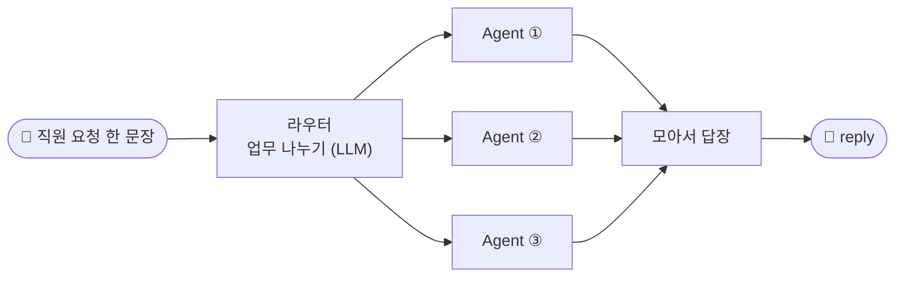

# 🚀 처음 실행 가이드 · auto3 업무 자동화 3종

n8n을 처음 보는 사람도 **10분 안에** 직접 질문해 보고 결과를 확인할 수 있게 쓴 안내입니다. 순서대로 따라 하세요.

| 과제 | 폴더 | 이런 말을 알아들어요 |
| --- | --- | --- |
| 🧑‍💼 인사(HR) 문의 창구 | [`hr/`](hr/README.md) | "연차 몇 개 남았어? 11월 6일 연차 쓸게. 병가에 진단서 필요해?" |
| 🧳 출장 준비 비서 | [`trip/`](trip/README.md) | "11월 12~14일 부산 출장. 숙소 한도는? 출장비 신청하고 일정 잡아 줘" |
| 🎨 마케팅 콘텐츠 제작 | [`content/`](content/README.md) | "소개글 써 주고 인스타랑 X용으로 줄여 줘. 11월 2일 게시 일정도" |

## 0. n8n이 뭔가요? (30초)

- **n8n** = 네모(노드)를 선으로 이어 일을 자동으로 처리하는 도구. 이어 놓은 한 묶음을 **워크플로우**라고 해요.
- **웹훅(Webhook)** = 워크플로우의 "초인종 주소". `http://localhost:5678/webhook/a3-hr`에 요청을 보내면 그 워크플로우가 실행돼요.
- 과제마다 워크플로우가 4개예요: 직원 요청을 받아 나누는 **라우터 1개** + 실제 일을 하는 **Agent 3개**. 라우터가 Agent를 HTTP로 불러요.



## 1. 준비 확인 (1분)

모든 명령은 **`~/aio-01d4-stu/Last3Mon/68` 폴더**에서 실행합니다.

```bash
cd ~/aio-01d4-stu/Last3Mon/68
uv run tools/flow.py doctor
```

`n8n container`, `n8n http://localhost:5678`, `credential 'OpenAI (.env)'` 줄이 ✔이면 됩니다.
✘가 나오면 → [6. 문제가 생기면](#6-문제가-생기면)

## 2. 워크플로우 올리기 (1분, 처음 한 번만)

```bash
uv run tools/flow.py push my-work/auto3/*/a3-*.json
```

`✔ pushed 'auto3 · …'`가 12줄 나오면 성공이에요. (n8n이 10초쯤 재시작됩니다. 한 과제만 올리려면 `my-work/auto3/hr/a3-*.json`처럼 폴더를 고르세요.)

## 3. 질문해 보기 (가장 쉬운 방법)

```bash
uv run my-work/auto3/ask.py --examples                       # 과제별 예시 문장 보기
uv run my-work/auto3/ask.py hr "연차 몇 개 남았어?"             # 한 번 묻기
uv run my-work/auto3/ask.py hr                                # 대화식 (빈 줄이면 끝)
uv run my-work/auto3/ask.py trip "11월 12일부터 14일까지 부산 출장비 신청해 줘" --user 이준호
uv run my-work/auto3/ask.py content "소개글 써 주고 인스타용으로 줄여 줘" --product product.json
```

이렇게 나와요:

```text
🙋 이준호 → 인사(HR) 문의 창구: 11월 10일 오후 반차 쓸게요. 그리고 결혼하면 휴가 며칠이야?
🤖 (5.7초)
이준호 님, 요청하신 2가지를 정리했어요.
1. 📝 [접수 완료] 2026-11-10(화) 오후 반차 0.5일 신청을 접수했습니다 (접수 번호 L-20261110-8MJI). …
2. ✅ [자동 답변] 본인 결혼 시 5일간 경조휴가를 사용할 수 있습니다. 연차에서 차감하지 않습니다 (HR-4).
```

| 표시 | 뜻 | 다음에 할 일 |
| --- | --- | --- |
| ✅ 자동 답변 | 바로 답함 | — |
| 📝 접수 완료 · 📅 등록 완료 | 신청 · 일정이 들어감 (번호 있음) | 번호를 기억해 두기 |
| ⛔ 거절 | 규칙에 안 맞음 (예: 연차 부족, 지난 날짜) | 이유를 읽고 바꿔서 다시 |
| ❓ 입력 필요 | 날짜 · 제품 같은 정보가 빠짐 | 예시대로 정보를 넣어 다시 |
| 🙋 담당자 연결 | 이 창구가 맡지 않는 일, 남의 정보, 결재가 필요한 일 | 담당자가 연락 |

**연습용 직원**: 박서연(연차 9일 남음) · 이준호(0.5일) · 김민지(17일). `--user`로 바꿔 보세요.

### 다른 방법 · 요청 파일 그대로 보내기

```bash
uv run tools/flow.py call a3-hr my-work/auto3/hr/requests/1-composite.json
uv run tools/flow.py call a3-trip my-work/auto3/trip/requests/2-long-trip.json
uv run tools/flow.py call a3-content my-work/auto3/content/requests/1-composite.json
```

과제 폴더의 `requests/`에 예시 요청이 3개씩 있어요. 열어서 문장을 바꿔 보내 보세요.

## 4. n8n 화면에서 보기 (브라우저)

1. http://localhost:5678 을 열고 로그인
2. **Overview**에서 이름이 `auto3 ·`로 시작하는 워크플로우를 고르기 (예: `auto3 · 인사(HR) 문의 창구`)
3. 화면의 색깔 메모가 길잡이예요: **1️⃣ 받기 → 2️⃣ 업무 나누기 → … → 7️⃣ 모아서 답장**, 그리고 **▶ 실행해 보기** 메모에 복사해 쓸 명령이 있어요
4. 3단계에서 질문한 뒤 화면 위 **Executions** 탭 → 맨 위 실행을 누르면, 노드마다 **들어온 값 · 나간 값**을 볼 수 있어요 (어디서 무엇이 정해졌는지 확인)

> ⚠️ 화면의 노드를 고쳐 저장하면 파일(`my-work/auto3/…json`)과 달라져요. 연습으로 고쳐 본 뒤에는 `uv run tools/flow.py push …`로 파일 내용을 다시 올리면 원래대로 돌아와요.

## 5. 제대로 되는지 한 번에 확인 (테스트)

```bash
uv run tools/flow.py test my-work/auto3/hr/cases/a3-hr.json             # 라우터 7개 케이스
uv run tools/flow.py test my-work/auto3/hr/cases/a3-hr-agents.json      # Agent 11개 케이스
uv run tools/flow.py test my-work/auto3/hr/cases/a3-hr.json --repeat 3  # LLM 답이 흔들리는지 3번
```

`hr`를 `trip`, `content`로 바꾸면 다른 과제예요. 마지막 줄 `Passed 7/7`이면 통과, 결과는 `runs/`에 저장돼요.

## 6. 문제가 생기면

| 보이는 것 | 이유 | 해결 |
| --- | --- | --- |
| `n8n에 연결하지 못했어요` / doctor의 n8n ✘ | n8n이 꺼져 있음 | `cd ~/aio-01d4-stu/Last3Mon/65/n8n && docker compose start` 후 10초 기다리기 |
| `워크플로우가 아직 n8n에 없어요` / HTTP 404 | 아직 push 안 함 | `uv run tools/flow.py push my-work/auto3/*/a3-*.json` |
| 답 대신 `담당 Agent가 응답하지 않아…` | 그 Agent만 꺼져 있음 (나머지는 정상) | 같은 push 명령으로 다시 켜기 |
| HTTP 500 · `n8n 안에서 오류` | LLM Credential · 인터넷 문제 | doctor의 credential 줄 확인, 브라우저 Executions에서 빨간 노드 확인 |
| ⛔ 거절이 계속 나옴 | 날짜가 지났거나 연차 부족 | 테스트 날짜는 2026년 11월 기준. 날짜를 앞으로 옮기기 |
| 처음 한 번이 느림 (5~10초) | LLM 호출 | 정상이에요 |

## 7. 더 알고 싶으면

- 과제별 **설계 · 요구** → 각 폴더의 `SPEC.md`
- 과제별 **흐름도 · 테스트 결과 · 고친 점** → 각 폴더의 `README.md`
- 워크플로우 JSON을 n8n 없이 트리로 보기 → `cd ~/vibe/tflow && uv run tflow ~/aio-01d4-stu/Last3Mon/68/my-work/auto3/hr/a3-hr.json`
