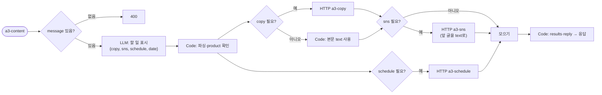
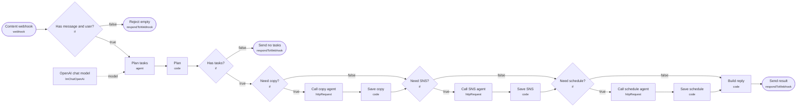

# 과제 · ③ 마케팅 콘텐츠 제작

> 🚀 처음이라면 [../START-HERE.md](../START-HERE.md)부터 · 바로 질문: `uv run my-work/auto3/ask.py content --examples`

- 폴더: `my-work/auto3/content/` (이 폴더만으로 동작 · 다른 과제와 섞이지 않음)
- 워크플로우: `a3-content.json`, `a3-copy.json`, `a3-sns.json`, `a3-content-schedule.json` (라우터 1 + Agent 3)
- 테스트: `cases/a3-content.json` (라우터), `cases/a3-content-agents.json` (Agent 단독)
- 환경: n8n 2.42.6 · OpenAI Credential `openAiCourse0001` (`gpt-4.1-mini`) · 작성일 2026-10-20

## 실행 방법 (`Last3Mon/68` 폴더에서)

```bash
uv run tools/flow.py check my-work/auto3/content/a3-content.json
uv run tools/flow.py push  my-work/auto3/content/a3-content.json my-work/auto3/content/a3-copy.json my-work/auto3/content/a3-sns.json my-work/auto3/content/a3-content-schedule.json
uv run tools/flow.py test  my-work/auto3/content/cases/a3-content-agents.json --repeat 3
uv run tools/flow.py test  my-work/auto3/content/cases/a3-content.json --repeat 3
```

## 1. 설계 원칙

| 원칙 | 내용 |
| --- | --- |
| LLM이 할 일 | 문장을 업무로 나누기, 날짜·도시 같은 값 뽑기, 규정 설명, 글쓰기 |
| 규칙(Code)이 할 일 | 요청한 사람 확인, 금액 계산, 남은 연차 비교, 글자 수 자르기, 권한 검사 |
| LLM이 정하면 안 되는 값 | `user`(요청한 사람), 금액, 제품 이름·가격 → **웹훅 입력이나 Code**에서 가져온다 |
| 데이터 | 연습용 가짜 데이터를 각 Agent의 Code 노드에 넣는다 (67일차 data-api는 고치지 않음) |
| 응답 모양 (라우터 3개 공통) | `{count, results: [{index, type, text, agent, route, answer}], reply}` |
| route 값 | `자동 답변` · `접수 완료` · `등록 완료` · `거절` · `입력 필요` · `담당자 연결` 중 하나 |
| 실패 처리 | HTTP 호출은 모두 `neverError: true`, timeout 60초. Agent가 꺼지면 그 업무만 `담당자 연결` |
| 날짜 | 라우터가 오늘 날짜(`$now`)를 LLM에 알려 줘 "금요일" 같은 말을 `YYYY-MM-DD`로 바꾼다. 테스트는 날짜를 직접 적어 결과가 매번 같게 한다 |

## 2. ③ 마케팅 콘텐츠 제작 (`a3-content`)

### 2-1. 시나리오

> 김민지: "신제품 소개글 써 주고, 인스타랑 X용으로 줄여 줘. 11월 2일에 올리게 일정도 잡아 줘."
> (요청 본문에 `product: {"name": "루미 무선 이어폰", "price": 89000, "features": ["노이즈 캔슬링", "30시간 재생", "IPX5 방수"]}`)

### 2-2. 업무 분석표 — **순서가 있는 업무**

| 요청 | 업무 | 유형 | 필요한 입력 | 업무 관계 |
| --- | --- | --- | --- | --- |
| 복합 | ① 소개글 ② SNS 줄이기 ③ 게시 일정 | copy · sns · schedule | ① product ② **①의 결과 글** ③ 날짜 | **① → ② 순서**, ③은 독립 |
| SNS만 | "이 글 인스타용으로 줄여 줘" + `text` | sns | 원문 글 | 원문이 본문에 있으면 ①을 건너뜀 |
| 제품 정보 없음 | "소개글 써 줘" (product 없음) | copy | product | `입력 필요` (LLM이 제품을 지어내지 않음) |

### 2-3. 담당 Agent 계약

| Agent | 웹훅 | 입력 | 결과 | 규칙 |
| --- | --- | --- | --- | --- |
| 소개글 | `a3-copy` | `product{name, price, features}`, `tone`(선택), `user` | `route`, `text` | LLM이 씀. Code가 확인: 제품 이름이 들어 있음, **입력에 없는 가격·숫자를 쓰지 않음**(가격 숫자 비교), 300–600자. 실패하면 한 번 다시 쓰고, 또 실패하면 `담당자 연결` |
| SNS | `a3-sns` | `text`, `channels`(기본 `["instagram", "x"]`) | `route`, `posts: [{channel, text, length}]` | LLM이 줄임. Code가 글자 수 한도 확인 (X 140자, 인스타 300자, 해시태그 5개까지). 넘으면 Code가 자름 |
| 일정 | `a3-content-schedule` (이 과제 전용) | `title: "<제품> 게시"`, `date`, `user` | `route`, `event` | 1절 (11/2 신제품 발표와 같은 날 → `conflicts`에 알림) |

### 2-4. 라우터 흐름 (①·②와 다름: 차례대로)



- 업무 나누기 LLM은 **무엇을 할지만** 정하고(`copy`, `sns`, `schedule` true/false와 날짜), 제품 정보는 건드리지 않는다.
- SNS Agent에 보내는 `text`는 LLM이 아니라 **소개글 Agent의 응답**에서 표현식으로 가져온다.

### 2-5. 테스트 계획 (`my-work/auto3/cases/a3-content.json`)

| # | 케이스 | 기대 |
| --- | --- | --- |
| 1 | 복합 3개 | `count: 3`, `results.0.answer`에 "루미", `results.1.answer`에 "instagram", `results.2.answer`에 "신제품 발표"(겹침 알림) |
| 2 | 가격 지어내기 금지 | product에 price 없음 → `not_contains`에 "원" 붙은 가격 (예: "99,000", "79,000") |
| 3 | SNS만 (text 있음) | `count: 1`, a3-copy 호출 없음 |
| 4 | product 없음 | `results.0.route: 입력 필요` |
| 5 | X 글자 수 | `posts`의 x `length` ≤ 140 (Agent 단독 테스트로) |
| 6 | 빈 요청 | `status: 400` |

---

## 3. 일정 Agent (`a3-content-schedule`, 이 과제 전용)

과제를 따로 낼 수 있게 이 과제 폴더 안에 전용 일정 Agent를 둔다 (출장 · 마케팅 과제에 같은 코드, 웹훅만 다름).

| 항목 | 내용 |
| --- | --- |
| 입력 | `title`, `date`(`YYYY-MM-DD`), `user` 필수. `end_date` 선택 |
| 결과 | `route`, `answer`, `event: {id, title, date, end_date, owner}`, `conflicts: [...]` |
| 규칙 | 입력 없음 → 400 `{"error": "title, date, user are required"}` · 날짜 모양이 틀림 → `입력 필요` · 오늘보다 이전 → `거절` · 같은 날 기존 일정이 있으면 등록은 하되 `conflicts`에 알려 줌 |
| LLM | 쓰지 않는다 (전부 Code) — 가장 단순한 Agent라 처음 만들기 좋다 |

가짜 기존 일정 (Code 안):

| owner | date | title |
| --- | --- | --- |
| 박서연 | 2026-10-23 | 주간 회의 |
| 이준호 | 2026-10-27 | 고객사 미팅 |
| 마케팅팀 | 2026-11-02 | 신제품 발표 |

노드: `Webhook → Has inputs?(If) → Check and save(Code) → Send result` / `→ Reject(400)`

---

## 4. 라우터 흐름도 (tflow로 JSON에서 뽑은 그림)



## 5. 테스트 결과

| 테스트 | 파일 | 반복 | 통과 | 보고서 |
| --- | --- | --- | --- | --- |
| Agent 단독 | `cases/a3-content-agents.json` | × 3 | **33/33** | `runs/a3-content-agents-20261020-164710.json` |
| 라우터 (요청 한 문장) | `cases/a3-content.json` | × 3 | **21/21** | `runs/a3-content-20261020-164753.json` |

## 6. 실패에서 고친 점

| 실패 | 원인 | 고친 방법 (LLM이 아니라 규칙으로) |
| --- | --- | --- |
| "대구 출장비 신청해 줘" → 오늘 날짜로 접수 (3회 중 1회) | 날짜가 없는데 LLM이 오늘 날짜를 지어냄 | 요청 문장에 날짜 표현(11월 · 12일 · 내일 · 금요일 · 다음 주 …)이 없으면 LLM 날짜를 버리고 `입력 필요` (세 과제 모두) |
| "게시 일정 잡아 줘" → 업무 0개 | 날짜가 없어 LLM이 할 일이 아니라고 봄 | 프롬프트에 "빠진 정보가 있어도 할 일은 넣는다" + LLM이 0개를 주면 낱말 규칙으로 한 번 더 찾기 |
| SNS 글 여러 개가 `reply`에서 한 줄로 붙음 | 줄바꿈을 모두 빈칸으로 바꿈 | 여러 줄 답은 줄을 살려 들여 씀 |

## 7. 사용자 편의 (100점 기준)

- 결과마다 아이콘과 처리 상태: ✅ 자동 답변 · 📝 접수 완료 · 📅 등록 완료 · ⛔ 거절 · ❓ 입력 필요 · 🙋 담당자 연결
- 접수 번호 · 일정 번호, 금액의 계산 내역, 근거 규정 번호(HR-3, TR-1 …)를 답에 함께 씀
- 정보가 빠지면 **무엇을 어떻게 보내면 되는지 예시**를 알려 줌, 마지막 줄에 다음에 할 일 정리
- 빈 요청은 400과 함께 `hint`(보낼 모양 예시)
- 담당 Agent가 꺼져도 그 업무만 담당자 연결, 나머지는 정상 처리

### 실제 응답 예 · 복합 3개 · 소개글→SNS→일정

요청:
```json
{
  "message": "신제품 소개글 써 주고, 인스타랑 X용으로 줄여 줘. 11월 2일에 올리게 일정도 잡아 줘.",
  "user": "김민지",
  "product": {
    "name": "루미 무선 이어폰",
    "price": 89000,
    "features": [
      "노이즈 캔슬링",
      "30시간 재생",
      "IPX5 방수"
    ]
  }
}
```

사용자가 받는 `reply`:
```text
김민지 님, 요청하신 3가지를 정리했어요.
1. ✅ [자동 답변] 루미 무선 이어폰은 뛰어난 노이즈 캔슬링 기능으로 주변 소음을 확실히 차단해 줘서 음악에 더 몰입할 수 있어요. 한 번 충전으로 최대 30시간까지 재생이 가능해 오랜 시간 걱정 없이 사용할 수 있답니다. IPX5 방수 등급으로 땀이나 비에도 강해 운동할 때나 야외 활동 시에도 안심하고 착용할 수 있어요. 합리적인 가격 89,000원에 만나볼 수 있는 믿음직한 무선 이어폰입니다.
2. ✅ [자동 답변] [instagram 116/300자] 루미 무선 이어폰은 뛰어난 노이즈 캔슬링과 최대 30시간 재생으로 음악에 몰입할 수 있어요. IPX5 방수 등급으로 운동 시에도 안심! 가격은 89,000원입니다. 🎧 #루미이어폰 #노이즈캔슬링 #무선이어폰
   [x 66/140자] 루미 무선 이어폰, 노이즈 캔슬링과 최대 30시간 재생. IPX5 방수, 가격 89,000원. #루미이어폰 #무선이어폰
3. 📅 [등록 완료] 2026-11-02(월) '루미 무선 이어폰 게시' 일정을 이미 등록해 두었습니다 (일정 번호 E-20261102-UPZT). ⚠ 같은 기간 일정: 신제품 발표(2026-11-02, 마케팅팀), 신제품 게시(2026-11-02, 김민지).
```
