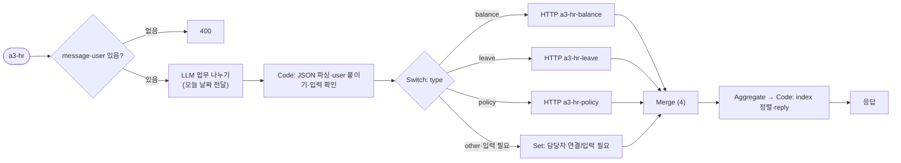
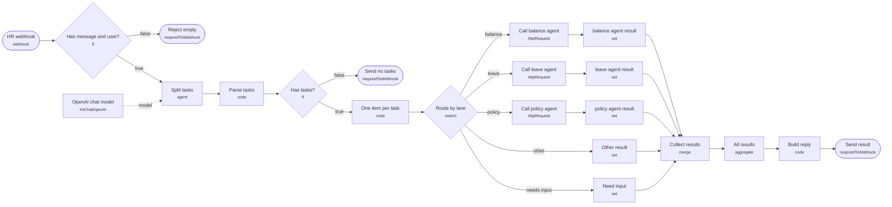

# 과제 · ① 인사(HR) 문의 창구

> 🚀 처음이라면 [../START-HERE.md](../START-HERE.md)부터 · 바로 질문: `uv run my-work/auto3/ask.py hr --examples`

- 폴더: `my-work/auto3/hr/` (이 폴더만으로 동작 · 다른 과제와 섞이지 않음)
- 워크플로우: `a3-hr.json`, `a3-hr-balance.json`, `a3-hr-leave.json`, `a3-hr-policy.json` (라우터 1 + Agent 3)
- 테스트: `cases/a3-hr.json` (라우터), `cases/a3-hr-agents.json` (Agent 단독)
- 환경: n8n 2.42.6 · OpenAI Credential `openAiCourse0001` (`gpt-4.1-mini`) · 작성일 2026-10-20

## 실행 방법 (`Last3Mon/68` 폴더에서)

```bash
uv run tools/flow.py check my-work/auto3/hr/a3-hr.json
uv run tools/flow.py push  my-work/auto3/hr/a3-hr.json my-work/auto3/hr/a3-hr-balance.json my-work/auto3/hr/a3-hr-leave.json my-work/auto3/hr/a3-hr-policy.json
uv run tools/flow.py test  my-work/auto3/hr/cases/a3-hr-agents.json --repeat 3
uv run tools/flow.py test  my-work/auto3/hr/cases/a3-hr.json --repeat 3
```

## 1. 설계 원칙

| 원칙 | 내용 |
| --- | --- |
| LLM이 할 일 | 문장을 업무로 나누기, 날짜·도시 같은 값 뽑기, 규정 설명, 글쓰기 |
| 규칙(Code)이 할 일 | 요청한 사람 확인, 금액 계산, 남은 연차 비교, 글자 수 자르기, 권한 검사 |
| LLM이 정하면 안 되는 값 | `user`(요청한 사람), 금액, 제품 이름·가격 → **웹훅 입력이나 Code**에서 가져온다 |
| 데이터 | 연습용 가짜 데이터를 각 Agent의 Code 노드에 넣는다 (67일차 data-api는 고치지 않음) |
| 응답 모양 (라우터 3개 공통) | `{count, results: [{index, type, text, agent, route, answer}], reply}` |
| route 값 | `자동 답변` · `접수 완료` · `등록 완료` · `거절` · `입력 필요` · `담당자 연결` 중 하나 |
| 실패 처리 | HTTP 호출은 모두 `neverError: true`, timeout 60초. Agent가 꺼지면 그 업무만 `담당자 연결` |
| 날짜 | 라우터가 오늘 날짜(`$now`)를 LLM에 알려 줘 "금요일" 같은 말을 `YYYY-MM-DD`로 바꾼다. 테스트는 날짜를 직접 적어 결과가 매번 같게 한다 |

## 2. ① 인사(HR) 문의 창구 (`a3-hr`)

### 2-1. 시나리오

> 박서연: "연차 몇 개 남았는지 알려 주고, 11월 6일 금요일에 연차 쓸게. 그리고 병가 쓰려면 진단서 필요해?"

### 2-2. 업무 분석표

| 요청 | 업무 | 유형 | 필요한 입력 | 업무 관계 |
| --- | --- | --- | --- | --- |
| 복합 | ① 남은 연차 ② 11/6 연차 신청 ③ 병가 증빙 규정 | balance · leave · policy | ① user ② user, 날짜, 종류 ③ 질문 | 독립 (②는 Agent 안에서 잔여 확인) |
| 남의 연차 | 이준호 연차 조회 | balance | user, 대상 | — (권한 없음 → 담당자 연결) |
| 날짜 없음 | "휴가 쓸게" | leave | 날짜 | 날짜 없음 → `입력 필요` |
| 범위 밖 | "월급 언제 들어와?" | other | — | 맡을 Agent 없음 → `담당자 연결` |

### 2-3. 담당 Agent 계약

| Agent | 웹훅 | 입력 | 결과 | 규칙 (Code) |
| --- | --- | --- | --- | --- |
| 연차 조회 | `a3-hr-balance` | `user`, `target`(선택, 없으면 user) | `route`, `answer`, `total`, `used`, `remaining` | `target ≠ user`면 숫자를 주지 않고 `담당자 연결`. 없는 사람 → `담당자 연결` |
| 휴가 신청 | `a3-hr-leave` | `user`, `start`, `end`(선택), `kind`(연차·반차) | `route`, `answer`, `request_id`, `days`, `remaining_after` | 반차 0.5일, 주말 제외 계산. 남은 연차보다 많으면 `거절`. 3일 전보다 늦으면 `거절`(규정 1). 통과하면 `접수 완료`, `request_id = L-2026-<번호>` |
| 규정 질문 | `a3-hr-policy` | `question`, `user` | `route`, `answer`, `sources` | 규정표에서 찾아 LLM이 설명. 규정에 없으면 지어내지 말고 `담당자 연결` |

가짜 데이터:

| 직원 | 총 연차 | 사용 | 남음 |
| --- | --- | --- | --- |
| 박서연 | 15 | 6 | 9 |
| 이준호 | 15 | 14.5 | 0.5 |
| 김민지 | 20 | 3 | 17 |

| 규정 번호 | 내용 |
| --- | --- |
| HR-1 | 연차는 사용일 3일 전까지 신청한다 |
| HR-2 | 반차는 0.5일로 계산한다 (오전 9–13시 / 오후 14–18시) |
| HR-3 | 병가는 연 3일까지 유급, 2일 이상 연속이면 진단서를 낸다 |
| HR-4 | 경조휴가: 본인 결혼 5일, 부모 사망 5일, 자녀 결혼 1일 |
| HR-5 | 남은 연차는 다음 해로 최대 5일까지 넘길 수 있다 |

### 2-4. 라우터 흐름



LLM 업무 나누기 결과 모양: `{"tasks": [{"type": "balance|leave|policy|other", "text": "...", "target": "", "start": "YYYY-MM-DD", "end": "", "kind": "연차|반차"}]}`

### 2-5. 테스트 계획 (`my-work/auto3/cases/a3-hr.json`)

| # | 케이스 | 요청 (user) | 기대 |
| --- | --- | --- | --- |
| 1 | 복합 3개 | 위 시나리오 (박서연) | `count: 3`, `results.0.answer`에 "9", `results.1.route: 접수 완료`, `results.2.answer`에 "진단서" |
| 2 | 남의 연차 | "이준호 연차 몇 개 남았어?" (박서연) | `results.0.route: 담당자 연결`, `not_contains`에 "0.5" |
| 3 | 잔여 부족 | "11월 10일부터 이틀 연차" (이준호) | `results.0.route: 거절` |
| 4 | 날짜 없음 | "휴가 쓸게요" (김민지) | `results.0.route: 입력 필요` |
| 5 | 범위 밖 | "월급 언제 들어와?" (김민지) | `results.0.route: 담당자 연결`, HTTP 호출 없음 |
| 6 | 빈 요청 | `message: ""` | `status: 400` |
| 7 | 규정에 없는 질문 | "육아휴직 몇 년까지 돼?" (박서연) | `route: 담당자 연결` (지어내지 않음) |

---

## 4. 라우터 흐름도 (tflow로 JSON에서 뽑은 그림)



## 5. 테스트 결과

| 테스트 | 파일 | 반복 | 통과 | 보고서 |
| --- | --- | --- | --- | --- |
| Agent 단독 | `cases/a3-hr-agents.json` | × 3 | **33/33** | `runs/a3-hr-agents-20261020-164548.json` |
| 라우터 (요청 한 문장) | `cases/a3-hr.json` | × 3 | **21/21** | `runs/a3-hr-20261020-164616.json` |

## 6. 실패에서 고친 점

| 실패 | 원인 | 고친 방법 (LLM이 아니라 규칙으로) |
| --- | --- | --- |
| "대구 출장비 신청해 줘" → 오늘 날짜로 접수 (3회 중 1회) | 날짜가 없는데 LLM이 오늘 날짜를 지어냄 | 요청 문장에 날짜 표현(11월 · 12일 · 내일 · 금요일 · 다음 주 …)이 없으면 LLM 날짜를 버리고 `입력 필요` (세 과제 모두) |
| "게시 일정 잡아 줘" → 업무 0개 | 날짜가 없어 LLM이 할 일이 아니라고 봄 | 프롬프트에 "빠진 정보가 있어도 할 일은 넣는다" + LLM이 0개를 주면 낱말 규칙으로 한 번 더 찾기 |
| SNS 글 여러 개가 `reply`에서 한 줄로 붙음 | 줄바꿈을 모두 빈칸으로 바꿈 | 여러 줄 답은 줄을 살려 들여 씀 |

## 7. 사용자 편의 (100점 기준)

- 결과마다 아이콘과 처리 상태: ✅ 자동 답변 · 📝 접수 완료 · 📅 등록 완료 · ⛔ 거절 · ❓ 입력 필요 · 🙋 담당자 연결
- 접수 번호 · 일정 번호, 금액의 계산 내역, 근거 규정 번호(HR-3, TR-1 …)를 답에 함께 씀
- 정보가 빠지면 **무엇을 어떻게 보내면 되는지 예시**를 알려 줌, 마지막 줄에 다음에 할 일 정리
- 빈 요청은 400과 함께 `hint`(보낼 모양 예시)
- 담당 Agent가 꺼져도 그 업무만 담당자 연결, 나머지는 정상 처리

### 실제 응답 예 · 복합 3개 · 조회·신청·규정

요청:
```json
{
  "message": "연차 몇 개 남았는지 알려 주고, 11월 6일 금요일에 연차 쓸게. 그리고 병가 쓰려면 진단서 필요해?",
  "user": "박서연"
}
```

사용자가 받는 `reply`:
```text
박서연 님, 요청하신 3가지를 정리했어요.
1. ✅ [자동 답변] 박서연 님의 남은 연차는 9일입니다 (올해 15일 중 6일 사용). 남은 연차는 다음 해로 최대 5일까지 넘길 수 있어요 (HR-5).
2. 📝 [접수 완료] 2026-11-06(금) 연차 1일 신청을 접수했습니다 (접수 번호 L-20261106-F004). 팀장 승인 후 확정되며, 승인되면 남은 연차는 8일이에요.
3. ✅ [자동 답변] 병가를 2일 이상 연속으로 쓸 경우 진단서를 제출해야 합니다. (HR-3)
```
