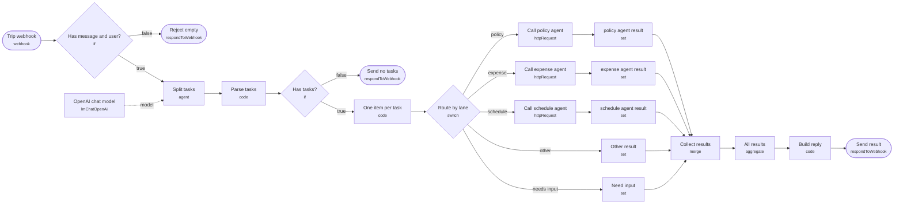

# 과제 · ② 출장 준비 비서

> 🚀 처음이라면 [../START-HERE.md](../START-HERE.md)부터 · 바로 질문: `uv run my-work/auto3/ask.py trip --examples`

- 폴더: `my-work/auto3/trip/` (이 폴더만으로 동작 · 다른 과제와 섞이지 않음)
- 워크플로우: `a3-trip.json`, `a3-trip-policy.json`, `a3-trip-expense.json`, `a3-trip-schedule.json` (라우터 1 + Agent 3)
- 테스트: `cases/a3-trip.json` (라우터), `cases/a3-trip-agents.json` (Agent 단독)
- 환경: n8n 2.42.6 · OpenAI Credential `openAiCourse0001` (`gpt-4.1-mini`) · 작성일 2026-10-20

## 실행 방법 (`Last3Mon/68` 폴더에서)

```bash
uv run tools/flow.py check my-work/auto3/trip/a3-trip.json
uv run tools/flow.py push  my-work/auto3/trip/a3-trip.json my-work/auto3/trip/a3-trip-policy.json my-work/auto3/trip/a3-trip-expense.json my-work/auto3/trip/a3-trip-schedule.json
uv run tools/flow.py test  my-work/auto3/trip/cases/a3-trip-agents.json --repeat 3
uv run tools/flow.py test  my-work/auto3/trip/cases/a3-trip.json --repeat 3
```

## 1. 설계 원칙

| 원칙 | 내용 |
| --- | --- |
| LLM이 할 일 | 문장을 업무로 나누기, 날짜·도시 같은 값 뽑기, 규정 설명, 글쓰기 |
| 규칙(Code)이 할 일 | 요청한 사람 확인, 금액 계산, 남은 연차 비교, 글자 수 자르기, 권한 검사 |
| LLM이 정하면 안 되는 값 | `user`(요청한 사람), 금액, 제품 이름·가격 → **웹훅 입력이나 Code**에서 가져온다 |
| 데이터 | 연습용 가짜 데이터를 각 Agent의 Code 노드에 넣는다 (67일차 data-api는 고치지 않음) |
| 응답 모양 (라우터 3개 공통) | `{count, results: [{index, type, text, agent, route, answer}], reply}` |
| route 값 | `자동 답변` · `접수 완료` · `등록 완료` · `거절` · `입력 필요` · `담당자 연결` 중 하나 |
| 실패 처리 | HTTP 호출은 모두 `neverError: true`, timeout 60초. Agent가 꺼지면 그 업무만 `담당자 연결` |
| 날짜 | 라우터가 오늘 날짜(`$now`)를 LLM에 알려 줘 "금요일" 같은 말을 `YYYY-MM-DD`로 바꾼다. 테스트는 날짜를 직접 적어 결과가 매번 같게 한다 |

## 2. ② 출장 준비 비서 (`a3-trip`)

### 2-1. 시나리오

> 이준호: "11월 12일부터 14일까지 부산 출장 가. 숙소는 하루 얼마까지 돼? 출장비 신청하고 일정도 잡아 줘."

### 2-2. 업무 분석표

| 요청 | 업무 | 유형 | 필요한 입력 | 업무 관계 |
| --- | --- | --- | --- | --- |
| 복합 | ① 숙박 한도 ② 출장비 신청 ③ 일정 등록 | policy · expense · schedule | ① 도시 ② 도시, 시작·끝 날짜 ③ 제목, 날짜 | 독립 (도시·날짜를 셋이 함께 씀) |
| 장기 | 10박 출장비 | expense | 도시, 날짜 | 7박 넘음 → `담당자 연결` (팀장 결재) |
| 날짜 없음 | "대구 출장비 신청해 줘" | expense | 날짜 | `입력 필요` |

### 2-3. 담당 Agent 계약

| Agent | 웹훅 | 입력 | 결과 | 규칙 (Code) |
| --- | --- | --- | --- | --- |
| 출장 규정 | `a3-trip-policy` | `question`, `user` | `route`, `answer`, `sources` | 규정표 기반 설명 (LLM). 없으면 `담당자 연결` |
| 출장비 신청 | `a3-trip-expense` | `user`, `city`, `start`, `end`, `transport`(선택, 원) | `route`, `answer`, `request_id`, `amount`, `breakdown` | **금액은 Code가 계산**: 숙박 한도 × 박 + 일비 × 일 + 교통비. 7박 초과·100만 원 초과 → `담당자 연결`. `request_id = T-2026-<번호>` |
| 일정 | `a3-trip-schedule` (이 과제 전용) | `title`, `date`, `end_date`, `user` | `route`, `event` | 1절 |

가짜 규정표:

| 규정 | 내용 |
| --- | --- |
| TR-1 숙박 한도 (1박) | 서울 120,000원 · 부산·대구·광주·대전·인천·울산 100,000원 · 그 밖 80,000원 |
| TR-2 일비 | 하루 30,000원 (출발일·도착일 포함) |
| TR-3 교통 | KTX 일반실·고속버스 실비. 교통비를 모르면 0원으로 접수하고 나중에 영수증 첨부 |
| TR-4 결재 | 7박 초과 또는 총액 100만 원 초과면 팀장 결재 |
| TR-5 정산 | 복귀 후 5일 안에 영수증 제출 |

계산 예 (부산 11/12–14): 숙박 100,000 × 2박 + 일비 30,000 × 3일 = **290,000원**

### 2-4. 라우터 흐름

①과 같은 모양이다. 다른 점:
- LLM이 `city`, `start`, `end`를 **한 번만** 뽑고, Code가 세 업무에 똑같이 붙인다 (Agent마다 다르게 뽑지 않도록).
- 일정 업무의 `title`은 Code가 `"<도시> 출장"`으로 만든다.

### 2-5. 테스트 계획 (`my-work/auto3/cases/a3-trip.json`)

| # | 케이스 | 기대 |
| --- | --- | --- |
| 1 | 복합 3개 (위 시나리오) | `count: 3`, `results.0.answer`에 "100,000" 또는 "10만", `results.1.answer`에 "290,000", `results.2.route: 등록 완료` |
| 2 | 서울 1박 2일 | `answer`에 "180,000" (120,000 + 60,000) |
| 3 | 10박 | `route: 담당자 연결` |
| 4 | 날짜 없음 | `route: 입력 필요` |
| 5 | 지난 날짜 일정 | 일정 `route: 거절` |
| 6 | 일정 Agent 꺼짐 (`--down` 비슷하게) | 일정만 `담당자 연결`, 나머지 두 업무는 정상 |

---

## 3. 일정 Agent (`a3-trip-schedule`, 이 과제 전용)

과제를 따로 낼 수 있게 이 과제 폴더 안에 전용 일정 Agent를 둔다 (출장 · 마케팅 과제에 같은 코드, 웹훅만 다름).

| 항목 | 내용 |
| --- | --- |
| 입력 | `title`, `date`(`YYYY-MM-DD`), `user` 필수. `end_date` 선택 |
| 결과 | `route`, `answer`, `event: {id, title, date, end_date, owner}`, `conflicts: [...]` |
| 규칙 | 입력 없음 → 400 `{"error": "title, date, user are required"}` · 날짜 모양이 틀림 → `입력 필요` · 오늘보다 이전 → `거절` · 같은 날 기존 일정이 있으면 등록은 하되 `conflicts`에 알려 줌 |
| LLM | 쓰지 않는다 (전부 Code) — 가장 단순한 Agent라 처음 만들기 좋다 |

가짜 기존 일정 (Code 안):

| owner | date | title |
| --- | --- | --- |
| 박서연 | 2026-10-23 | 주간 회의 |
| 이준호 | 2026-10-27 | 고객사 미팅 |
| 마케팅팀 | 2026-11-02 | 신제품 발표 |

노드: `Webhook → Has inputs?(If) → Check and save(Code) → Send result` / `→ Reject(400)`

---

## 4. 라우터 흐름도 (tflow로 JSON에서 뽑은 그림)



## 5. 테스트 결과

| 테스트 | 파일 | 반복 | 통과 | 보고서 |
| --- | --- | --- | --- | --- |
| Agent 단독 | `cases/a3-trip-agents.json` | × 3 | **33/33** | `runs/a3-trip-agents-20261020-164622.json` |
| 라우터 (요청 한 문장) | `cases/a3-trip.json` | × 3 | **24/24** | `runs/a3-trip-20261020-164652.json` |
| 일정 Agent 끈 상태 | `cases/a3-trip-down.json` | × 1 | **1/1** | `flow.py off` → test → `push`로 다시 켬 |

## 6. 실패에서 고친 점

| 실패 | 원인 | 고친 방법 (LLM이 아니라 규칙으로) |
| --- | --- | --- |
| "대구 출장비 신청해 줘" → 오늘 날짜로 접수 (3회 중 1회) | 날짜가 없는데 LLM이 오늘 날짜를 지어냄 | 요청 문장에 날짜 표현(11월 · 12일 · 내일 · 금요일 · 다음 주 …)이 없으면 LLM 날짜를 버리고 `입력 필요` (세 과제 모두) |
| "게시 일정 잡아 줘" → 업무 0개 | 날짜가 없어 LLM이 할 일이 아니라고 봄 | 프롬프트에 "빠진 정보가 있어도 할 일은 넣는다" + LLM이 0개를 주면 낱말 규칙으로 한 번 더 찾기 |
| SNS 글 여러 개가 `reply`에서 한 줄로 붙음 | 줄바꿈을 모두 빈칸으로 바꿈 | 여러 줄 답은 줄을 살려 들여 씀 |

## 7. 사용자 편의 (100점 기준)

- 결과마다 아이콘과 처리 상태: ✅ 자동 답변 · 📝 접수 완료 · 📅 등록 완료 · ⛔ 거절 · ❓ 입력 필요 · 🙋 담당자 연결
- 접수 번호 · 일정 번호, 금액의 계산 내역, 근거 규정 번호(HR-3, TR-1 …)를 답에 함께 씀
- 정보가 빠지면 **무엇을 어떻게 보내면 되는지 예시**를 알려 줌, 마지막 줄에 다음에 할 일 정리
- 빈 요청은 400과 함께 `hint`(보낼 모양 예시)
- 담당 Agent가 꺼져도 그 업무만 담당자 연결, 나머지는 정상 처리

### 실제 응답 예 · 복합 3개 · 규정·출장비·일정

요청:
```json
{
  "message": "11월 12일부터 14일까지 부산 출장 가. 숙소는 하루 얼마까지 돼? 출장비 신청하고 일정도 잡아 줘.",
  "user": "이준호"
}
```

사용자가 받는 `reply`:
```text
이준호 님, 요청하신 3가지를 정리했어요.
1. ✅ [자동 답변] 부산 숙소 하루 한도는 100,000원입니다(TR-1).
2. 📝 [접수 완료] 부산 출장 2026-11-12(목) ~ 2026-11-14(토), 2박 3일 출장비 290,000원 신청을 접수했습니다 (접수 번호 T-20261112-ENGQ). 숙박 100,000원 × 2박 + 일비 30,000원 × 3일 + 교통비 0원(영수증으로 나중에 정산, TR-3). 복귀 후 5일 안에 영수증을 내 주세요 (TR-5).
3. 📅 [등록 완료] 2026-11-12(목) ~ 2026-11-14(토) '부산 출장' 일정을 이미 등록해 두었습니다 (일정 번호 E-20261112-R61V). ⚠ 같은 기간 일정: 전사 워크숍(2026-11-13, 전사).
```
