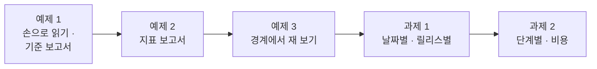
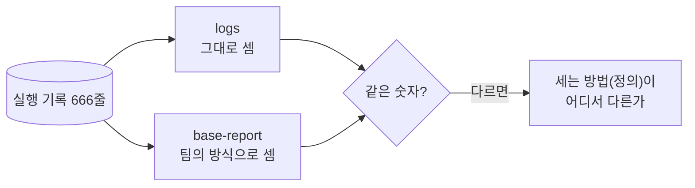
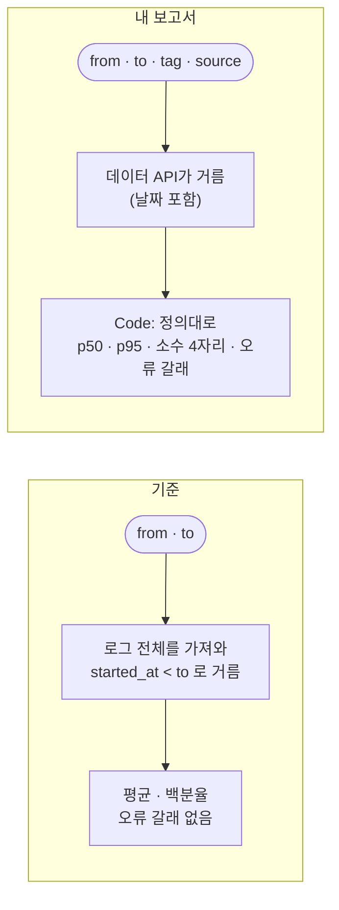
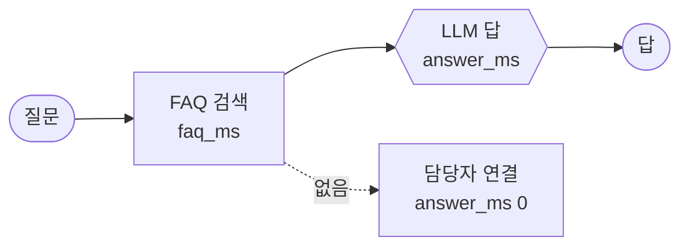

# Lab 01 · 실행 기록을 읽고, 지표로 만들기

- 관련 강의: [1단계 · 실행 기록 읽기](../../Lecture/77/01-STAGE1-READ-THE-LOG.md)
- 소요 시간: 50분 (2교시 한 시간) · 예제 1 10분 · 예제 2 15분 · 예제 3 7분 · 과제 1 8분 · 과제 2 10분
- 준비: [실습 준비](../../Lecture/77/00-DAY77-PREP.md)의 `doctor` → `ready`, 기준 보고서 `base-report` 게시
- 목표: 두 주 동안의 실행 기록을 먼저 **눈으로** 읽고, 팀이 쓰던 기준 보고서의 숫자가 왜 다른지 찾는다. 같은 질문에 늘 같은 숫자로 답하는 **지표 보고서**를 만들고(지표는 정의가 먼저), 경계(하루 · 빈 기간 · 거르기)에서 재 보고, 날짜별 · 릴리스별 · 단계별 · 비용으로 나눠 본다.



> 복사해 붙일 요청문은 없습니다. 막히면 `▶` 를 하나씩 펼칩니다. 연습이 끝나면 `uv run tools/flow.py ops --reset`.

## 시작하기 · 터미널 두 개

| 터미널 | 하는 일 |
| --- | --- |
| ① 에이전트 | `cd ~/aio-01d4-stu/Last3Mon/77` 후 `codex` (또는 `claude`, `agy`). 내가 쓴 요청문을 보낸다 |
| ② 확인 | `cd ~/aio-01d4-stu/Last3Mon/77` 에서 `logs` · `call` · `push` · `test`를 **내가** 실행한다 |

`cp templates/OPS-ANALYSIS-TEMPLATE.md my-work/OPS.md` 후 표를 채워 갑니다. 쓴 요청문은 `my-work/PROMPTS.md`에 모읍니다.

## 예제 1 · 손으로 읽기 · 팀의 기준 보고서 (10분, 에이전트 없이)

### 이 실습의 의도

**한 줄로:** 두 주 기록을 직접 훑어보고, 팀이 지난달 급히 만든 기준 보고서(`base-report`)에 같은 기간을 물어 **두 숫자가 다른지** 봅니다. 고치는 것은 예제 2부터이고, 여기서는 **읽고 비교해 적기만** 합니다.

> **생활 속 예 · 가게의 영수증 더미와 장부.** 가게 계산대 옆에 두 주 치 영수증이 쌓여 있습니다. 사장님이 "두 주 동안 몇 건 팔았지?"라고 물으면, 알바생 둘이 서로 다른 답을 할 수 있습니다. 한 사람은 마지막 날 영수증을 빼고 셌고, 한 사람은 넣고 셌다면요. 예제 1은 영수증(실행 기록)을 직접 넘겨 보고, 팀 장부(기준 보고서)가 어떻게 셌는지 비교하는 실습입니다.

**상황.** 데이터 API에 IT 헬프데스크의 두 주(10/19~10/30, 평일 10일) 실행 기록 666줄이 있습니다. 한 줄이 헬프데스크가 질문 하나에 답한 한 번의 실행입니다. 팀에는 지난달 만든 보고서 워크플로우 `base-report`가 있고, 운영 회의에서 이 숫자를 써 왔습니다. 그런데 이 보고서가 맞는지 아무도 확인하지 않았습니다.

**실험 넷.**

| 실험 | 명령 | 볼 것 |
| --- | --- | --- |
| ① 두 주를 훑기 | `logs --from 2026-10-19 --to 2026-10-30` | 실행 수 · 오류 수 · 갈래(`route`)마다 수, 마지막 다섯 줄 |
| ② 하루만 | `logs --from 2026-10-26 --to 2026-10-26` | 월요일 하루의 실행 · 오류 — 두 주의 오류와 비교 |
| ③ 기준에 두 주 | `call base-report requests/two-weeks.json` | ①과 같은 숫자인가? 어떤 칸이 있고 없나? |
| ④ 기준에 하루 | `call base-report requests/monday.json` | ②와 같은가? |

`logs`는 데이터 API의 기록을 **그대로** 세어 보여 주는 도구이고, `base-report`는 팀이 만든 워크플로우가 **자기 방식으로** 센 결과입니다. 둘이 다르면 어느 한쪽의 "세는 방법"이 다른 것입니다.

**끝나면 알게 되는 것.** 같은 기록이라도 **무엇을 넣고 빼는지 · 무엇으로 나누는지 · 몇 자리로 끊는지**에 따라 숫자가 달라집니다. 그것을 정해 둔 것이 지표의 **정의**이고, 예제 2에서 정의대로 다시 셉니다.

**적을 곳.** `my-work/OPS.md` 1.1 표 (질문 · 내 짐작 · 기준 보고서 · 다른 까닭).

```bash
# ① 두 주를 훑기
uv run tools/flow.py logs --from 2026-10-19 --to 2026-10-30 --last 5

# ② 하루만 (숫자만, --last 0)
uv run tools/flow.py logs --from 2026-10-26 --to 2026-10-26 --last 0

# ③ · ④ 팀의 기준 보고서에 같은 기간을
uv run tools/flow.py call base-report requests/two-weeks.json     # {"from": "2026-10-19", "to": "2026-10-30"}
uv run tools/flow.py call base-report requests/monday.json        # {"from": "2026-10-26", "to": "2026-10-26"}
```

### 이해하기

**실행 기록 한 줄에 무엇이 있나.** [AGENTS.md](AGENTS.md) 2절 "실행 기록 한 줄"입니다. 오늘 질문에 쓰는 칸은 이것뿐입니다.

| 칸 | 뜻 | 오늘 쓰는 곳 |
| --- | --- | --- |
| `started_at` | 실행이 시작된 때 (`2026-10-26T09:05:39`) | 기간 · 날짜별 · 시간대별 |
| `status` | `success` · `error` | 오류 수 · 오류율 |
| `route` | `자동 답변` · `담당자 연결` · `잠시 후`, 오류면 `null` | 갈래별 · 답 못 함 |
| `duration_ms` | 한 실행에 걸린 시간 | p50 · p95 |
| `error_node` · `error_message` | 오류가 난 노드 · 그 말 | 실패 묶음 (Lab 02) |
| `topic` · `release` · `repeat` | 질문 주제 · 버전 · 10분 안에 다시 물음 | 릴리스별 · 다시 묻는 주제 |
| `steps` · `cost_usd` · `llm_calls` | 단계마다 시간 · 비용 · LLM 호출 수 | 과제 2 |

**지표는 "정의 + 계산"입니다.** "오류율"이라는 말만으로는 숫자가 하나로 정해지지 않습니다. 기간의 끝날을 넣나? 0.0315로 쓰나 3.15로 쓰나? 몇 자리에서 끊나? 느린 정도는 평균인가 p95인가? 이것을 미리 정해 둔 것이 정의이고, 정의가 같아야 지난주와 이번 주, 내 숫자와 옆 사람 숫자를 비교할 수 있습니다.



**기대 결과.** `logs`의 두 주 · 하루 숫자와 기준 보고서의 숫자가 **다릅니다.** 어느 칸이 왜 다른지 `OPS.md` 1.1에 적습니다. 무엇이 다른지는 아래 실행 결과를 보기 전에 먼저 찾아 봅니다.

<details><summary>▶ 1단계 · 두 숫자가 다르면 무엇부터 보나</summary>

차이가 **얼마**인지 봅니다. 두 주 666과 기준의 숫자의 차이가 어느 하루의 실행 수와 같다면? `logs --from 2026-10-30 --to 2026-10-30 --last 0`으로 확인해 봅니다.
</details>

<details><summary>▶ 2단계 · 기준의 오류율은 무엇으로 나눴나</summary>

`logs`는 오류율을 `3.2%`로 보여 줍니다. 기준의 `error_rate`는 어떤 모양인가요? 백분율인가 비율인가, 몇 자리인가? 하루만 물었을 때의 `null`은 무엇을 0으로 나눈 것일까요?
</details>

### 실행 결과 · 손으로 읽기 · 기준 보고서

수업 준비 때(10/31) 강사 노트북에서 실제로 나온 출력입니다. 두 주 기록은 바뀌지 않으므로 숫자는 누가 돌려도 같습니다 (`call`의 시간만 다름).

이 예제는 **고치지 않습니다.** 같은 기간을 `logs`(그대로 셈)와 기준 보고서(팀의 방식)에 물어 비교합니다. 고치는 것은 예제 2입니다.

#### ① · ② `logs`로 두 주 · 하루

실행한 명령:

```bash
uv run tools/flow.py logs --from 2026-10-19 --to 2026-10-30 --last 5
uv run tools/flow.py logs --from 2026-10-26 --to 2026-10-26 --last 0
```

출력:

```text
666 run(s) · errors 21 (3.2%)
  route: 자동 답변 591 · 담당자 연결 34 · 오류 21 · 잠시 후 20
  2026-10-30T17:05:38  success 자동 답변   1311ms  프린터    인쇄 대기열이 안 비워져요
  2026-10-30T17:11:46  success 자동 답변   1175ms  메일    메일함 용량이 꽉 찼대요
  2026-10-30T17:20:51  success 담당자 연결    79ms  와이파이    회의실 와이파이가 안 잡혀요
  2026-10-30T17:24:39  success 자동 답변   1205ms  메일    첨부 파일이 너무 커서 안 보내져요
  2026-10-30T17:59:20  success 자동 답변   1076ms  메일    메일함 용량이 꽉 찼대요

70 run(s) · errors 16 (22.9%)
  route: 자동 답변 50 · 오류 16 · 담당자 연결 4
```

**왜 이렇게 나왔나**

- 두 주 666건 중 오류 21건(3.2%). 그런데 **하루(10/26 월요일)에 16건**이 몰려 있습니다. 그날의 오류율은 22.9%로, 두 주 평균의 7배쯤입니다. "두 주 동안 오류율 3%"라는 말만으로는 이 사실이 보이지 않습니다.
- 마지막 다섯 줄은 10/30(금) 저녁의 실행입니다. 담당자 연결 한 줄(와이파이, 79ms)이 눈에 띕니다. 답을 찾지 못해 바로 사람에게 넘긴 실행입니다 (Lab 02).

#### ③ · ④ 기준 보고서에 같은 기간

실행한 명령:

```bash
uv run tools/flow.py call base-report requests/two-weeks.json
uv run tools/flow.py call base-report requests/monday.json
```

출력:

```text
HTTP 200 · 1.2s
{ "total": 602, "errors": 21, "error_rate": 3.488372093023256, "avg_ms": 1249.2392026578073,
  "by_route": { "자동 답변": 529, "담당자 연결": 32, "잠시 후": 20 } }

HTTP 200 · 0.1s
{ "total": 0, "errors": 0, "error_rate": null, "avg_ms": null, "by_route": {} }
```

**왜 이렇게 나왔나**

| 칸 | `logs` | 기준 보고서 | 다른 까닭 |
| --- | --- | --- | --- |
| 두 주 실행 | 666 | **602** | 666 − 602 = 64 = 10/30 하루의 실행. 기준은 `started_at < to`로 걸러 **끝날을 뺐습니다** (`2026-10-30T09:…`는 `2026-10-30`보다 큰 글자) |
| 오류율 | 3.2% (0.0315) | **3.488…** | 백분율(×100)이고, 끊지 않았고, 분모가 602 |
| 느린 정도 | (p95는 예제 2) | 평균 1249.2ms | 평균만 있음. 대부분이 겪는 시간을 말하지 못함 |
| 오류로 끝난 실행 | 갈래 `오류` 21 | 갈래에 **없음** | `route`가 `null`인 줄을 건너뜀. 갈래를 더하면 581 ≠ 602 |
| 하루 (from = to) | 70 · 오류 16 | **0 · `null`** | 끝날을 빼니 하루를 물으면 아무것도 남지 않고, 0을 0으로 나눠 `null` |

- 기준 보고서는 "고장"이 아닙니다. 200을 주고, 숫자도 그럴듯합니다. **세는 방법이 다를 뿐**인데, 운영 회의에서는 이 숫자로 "두 주에 602건"이라고 말해 왔습니다.
- 이 차이를 `OPS.md` 1.1에 적습니다. 예제 2에서 정의를 정하고, 예제 3에서 경계를 더 재 봅니다.

## 예제 2 · 지표 보고서 (15분)

### 이 실습의 의도

**한 줄로:** 예제 1에서 본 차이를 없애기 위해, AGENTS.md 3절 정의대로 세는 **내 보고서**(`my-log-report`)를 만듭니다. Lab 01의 중심 실습이고, 오늘 만드는 모든 것이 이 보고서를 바탕으로 합니다.

> **생활 속 예 · 가게의 장부 쓰는 법.** 알바생마다 세는 법이 다르면 장부를 믿을 수 없습니다. 그래서 가게는 "마감일 영수증도 넣는다, 금액은 원 단위까지, 환불도 따로 적는다"처럼 **장부 쓰는 법**을 벽에 붙여 둡니다. 예제 2는 그 쓰는 법(정의)을 요청문에 그대로 넣어, 누가 만들어도 같은 숫자가 나오는 보고서를 만드는 실습입니다.

| 예제 1에서 본 것 | 정의 (AGENTS.md 3절) | 확인하는 케이스 |
| --- | --- | --- |
| 마지막 날이 빠짐 | 날짜는 **포함** (`from ≤ 날짜 ≤ to`, 데이터 API가 거름) | 두 주 · 첫 주 · 둘째 주 · 하루 |
| 오류율이 백분율 · 끊지 않음 | `errors / total`, 소수 4자리, 0건이면 0 | 두 주 · 둘째 주 |
| 평균만 있음 | `p50_ms` · `p95_ms` = 오름차순 `ceil(p × n)`번째 | 두 주 · 둘째 주 |
| 오류가 갈래에 없음 | `route`가 `null`이면 `"오류"` | 두 주 · 갈래별 |

**순서.** 같은 테스트를 **기준에 먼저** 돌려 0/5를 봄 (케이스마다 무엇이 틀렸는지) → 요청문을 써서 에이전트가 새 파일을 만들게 함 → push → 5/5.

**끝나면 알게 되는 것.** 정의를 요청문에 적으면 에이전트도 같은 숫자를 낸다는 것, p95가 평균과 어떻게 다른지, 숫자는 LLM이 아니라 Code가 세야 하는 까닭.

**만들 것**: 기간(`from` · `to`)을 받아 실행 기록을 가져와 지표를 계산해 돌려주는 워크플로우.

```bash
uv run tools/flow.py test cases/lab01.json --webhook base-report -v     # 고치기 전 (기준에 같은 테스트)
```

| 조건 | 값 |
| --- | --- |
| 파일 · 웹훅 | `my-work/log-report.json` (새로) · `my-log-report` |
| 지표 | `total`, `errors`, `error_rate`, `p50_ms`, `p95_ms`, `by_route` — **정의는 [AGENTS.md](AGENTS.md) 3절** |
| 계산 | Code 노드 하나 (LLM 없음) |
| 기대 결과 | `cases/lab01.json` (두 주 · 갈래별 · 첫 주 · 둘째 주 · 하루) |

### 이해하기

**지금 무엇이 문제인가.** 기준 보고서는 틀린 계산을 한 것이 아니라 **다른 정의**로 셌습니다. 그래서 고치는 일은 "버그 찾기"보다 "정의를 정해 그대로 세기"입니다. 정의가 요청문에 없으면 에이전트도 자기 방식(평균, 보간한 p95, 백분율…)으로 셉니다.



**p95란.** 실행 시간을 짧은 것부터 줄 세웠을 때 95%째에 있는 값입니다. "100명 중 95명은 이 시간 안에 답을 받았다"는 뜻입니다. 오늘 정의는 **가장 가까운 순위**(nearest-rank)입니다: n개를 오름차순으로 놓고 `ceil(0.95 × n)`번째. 예를 들어 값이 10개면 `ceil(9.5)` = 10번째, 666개면 `ceil(632.7)` = 633번째입니다. 평균은 아주 느린 몇 건에 끌려가고, 대부분의 사용자가 겪는 시간을 말하지 못합니다.

| 같은 기록 | 평균 | p50 | p95 |
| --- | --- | --- | --- |
| 1초 × 9건 + 10초 × 1건 | 1.9초 | 1초 | 10초 |

**왜 Code인가.** LLM에게 666줄을 주고 "오류율이 얼마야?"라고 물으면 틀릴 수 있고(세는 일은 LLM이 약함), 줄이 많을수록 돈이 듭니다 (75일차). 숫자는 Code가 정확하게, 빠르게(0.1초 안팎) 셉니다. LLM은 Lab 02 과제 2에서 **센 결과를 글로 설명**할 때만 씁니다.

**테스트 케이스.**

| 케이스 | 보내는 것 | 기대 |
| --- | --- | --- |
| 두 주 전체 | `two-weeks` | `total` 666 · `errors` 21 · `error_rate` 0.0315 · `p50_ms` 1205 · `p95_ms` 2537 |
| 두 주 · 갈래별 | `two-weeks` | 자동 답변 591 · 담당자 연결 34 · 잠시 후 20 · 오류 21 |
| 첫 주 | `week1` | 309 · 0 · 0 |
| 둘째 주 | `week2` | 357 · 21 · 0.0588 · p95 2598 |
| 10월 26일 하루 | `monday` | 70 · 16 |

**기대 결과.** 고치기 전(기준에 같은 테스트) 0/5, 고친 뒤 5/5.

<details><summary>▶ 1단계 · 정의를 요청문에</summary>

"p95를 구해 줘"만 쓰면 에이전트마다 계산이 다릅니다 (평균? 보간?). 3절의 정의를 그대로 요청문에 넣거나 "AGENTS.md 3절 정의대로"라고 씁니다. 반올림 자리, 0건일 때도.
</details>

<details><summary>▶ 2단계 · 거르기는 누가</summary>

기간 · `tag` · `source`로 거르는 일은 데이터 API(`POST /logs/query`)가 합니다 ([AGENTS.md](AGENTS.md) 2절). 워크플로우는 웹훅 본문을 그대로 넘기면 됩니다. 기준처럼 다 가져와서 직접 거르면 정의가 두 곳에 생깁니다.
</details>

<details><summary>▶ 빈칸 채우기 · 요청문(프롬프트) 뼈대</summary>

요청문에 꼭 들어갈 것: **① 파일 · 웹훅 ② 넘길 본문과 기본값 ③ 지표와 정의(반올림 · 0건) ④ 백분위 정의 ⑤ LLM 없음 · 기대 결과**. 아래 빈칸 4개(`____①`~`____④`)를 채워 `my-work/PROMPTS.md`에 쓴 뒤 에이전트에게 보냅니다.

```text
my-work/log-report.json 을 새로 만들어 줘. 웹훅 POST ____①, 이름 "77 Log report (my)".
Get logs(HTTP POST http://data-api:8800/logs/query) 에 웹훅 본문의 from · to · tag · source 를 넘기고, source 가 없으면 ____②.
Compute metrics(Code) 하나에서 AGENTS.md 3절 정의대로 total · errors · error_rate · p50_ms · p95_ms · by_route 를 계산해 줘.
error_rate 는 errors / total 을 소수 ____③자리 반올림, 0건이면 0.
p50 · p95 는 duration_ms 를 오름차순으로 놓고 ____④번째 값 (1부터 셈, 오류 실행도 포함). route 가 null 이면 by_route 의 "오류".
LLM 은 쓰지 않는다. 기대 결과 cases/lab01.json.
```

빈칸 힌트 (답이 아니라 **어디서 찾고 무엇을 생각하나**):

- ① AGENTS.md 3절 계약 표의 "로그 보고서" 줄입니다. 테스트 파일 `cases/lab01.json` 맨 위의 `webhook`과 같아야 합니다.
- ② `source`의 세 값(`all` · `seed` · `live`) 중, 요청에 `source`가 없을 때 두 주 기록과 오늘 기록을 **모두** 보는 값.
- ③ 3절 지표 표의 `error_rate` 줄. 테스트의 기대값 0.0315를 보면 몇 자리인지 보입니다.
- ④ 3절 지표 표의 `p50_ms` · `p95_ms` 줄의 굵은 글씨입니다. 위 "p95란"의 예와 같이.

채운 요청문은 수업 뒤 공개되는 정답본의 요청문 예와 비교합니다.
</details>

```bash
uv run tools/flow.py push my-work/log-report.json
uv run tools/flow.py test cases/lab01.json -v
uv run tools/flow.py call my-log-report requests/week2.json
```

### 실행 결과 · 지표 보고서

수업 준비 때(10/31) 강사 노트북에서 정답 워크플로우로 실제로 나온 출력입니다. 지표 숫자는 두 주 기록을 정의대로 센 것이라 누구에게나 같고, 시간만 조금씩 다릅니다.

#### 고치기 전 · 기준(`base-report`)에 같은 테스트

실행한 명령:

```bash
uv run tools/flow.py test cases/lab01.json --webhook base-report -v
```

출력 (결과 줄만, `-v`의 요청 · 응답은 줄임):

```text
✘ 두 주 전체 · 0.2s · total = 602 (expected 666); error_rate = 3.488372093023256 (expected 0.0315); p50_ms = null (expected 1205); p95_ms = null (expected 2537)
✘ 두 주 · 갈래별 · 0.1s · by_route.자동 답변 = 529 (expected 591); by_route.담당자 연결 = 32 (expected 34); by_route.오류 = null (expected 21)
✘ 첫 주 · 0.1s · total = 245 (expected 309)
✘ 둘째 주 · 0.1s · total = 293 (expected 357); error_rate = 7.167235494880546 (expected 0.0588); p95_ms = null (expected 2598)
✘ 10월 26일 하루 · 0.1s · total = 0 (expected 70); errors = 0 (expected 16)
Passed 0/5
```

**왜 이렇게 나왔나 (고치기 전)**

- **`total`이 모두 작음:** 602 · 245 · 293 · 0. 기간마다 **끝날의 실행 수만큼** 빠졌습니다 (첫 주 309 − 245 = 64 = 10/23, 둘째 주 357 − 293 = 64 = 10/30). 하루를 물으면 끝날이 곧 그날이라 0입니다.
- **`error_rate`가 3.488… · 7.167…:** 백분율에, 반올림이 없고, 분모도 줄어든 `total`입니다. 기대값 0.0315는 "비율, 소수 4자리"입니다.
- **`p50_ms` · `p95_ms`가 `null`:** 기준에는 그런 칸이 없습니다 (`avg_ms`만). `null`은 "그 칸이 없음"입니다.
- **`by_route.오류`가 `null`:** 오류로 끝난 실행을 갈래에서 건너뛰었습니다. 자동 답변 529 · 담당자 연결 32도 끝날이 빠진 만큼 작습니다.
- 0/5는 **예상한 결과**입니다. 다섯 케이스의 ✘가 모두 예제 1에서 찾은 정의의 차이 넷으로 설명됩니다.

#### 고친 뒤 · 내 `my-log-report`

실행한 명령:

```bash
uv run tools/flow.py push my-work/log-report.json
uv run tools/flow.py test cases/lab01.json -v
uv run tools/flow.py call my-log-report requests/week2.json
```

출력 (결과 줄과 `call`):

```text
✔ 두 주 전체 · 0.9s
✔ 두 주 · 갈래별 · 0.1s
✔ 첫 주 · 0.2s
✔ 둘째 주 · 0.1s
✔ 10월 26일 하루 · 0.0s
Passed 5/5

HTTP 200 · 0.1s
{ "total": 357, "errors": 21, "error_rate": 0.0588, "p50_ms": 1171, "p95_ms": 2598,
  "by_route": { "오류": 21, "자동 답변": 299, "담당자 연결": 17, "잠시 후": 20 } }
```

**고친 뒤 이렇게 나온 까닭**

| 케이스 | 고치기 전 (기준) | 고친 뒤 | 무엇이 바꿨나 |
| --- | --- | --- | --- |
| 두 주 실행 | 602 | 666 | 거르기를 데이터 API에 맡김 (날짜 **포함**) |
| 두 주 오류율 | 3.488… | 0.0315 | `errors / total`, 소수 4자리 |
| 두 주 p50 · p95 | 없음 | 1205 · 2537ms | 오름차순 `ceil(p × n)`번째 |
| 오류 갈래 | 없음 | 21 | `null` → `"오류"` |
| 하루 | 0 | 70 · 오류 16 | 끝날 포함 |

- **둘째 주 응답을 읽으면:** 357건 중 오류 21, 오류율 0.0588(5.88%). 갈래를 더하면 21 + 299 + 17 + 20 = 357로 `total`과 맞습니다. 기준에서는 맞지 않던 합입니다.
- **p50 1171 · p95 2598:** 절반은 1.2초 안에, 95%는 2.6초 안에 답을 받았습니다. 첫 주 p95(2525)와 비교하면 조금 느려졌습니다. 평균 하나로는 이런 비교가 어렵습니다.
- **0.1초 안팎:** 666줄을 Code 하나에서 셌습니다. LLM은 부르지 않았습니다.
- 이제 이 보고서가 오늘의 **기준 숫자**입니다. 과제 · Lab 02 · Lab 03은 모두 이 파일에 칸을 더해 갑니다.

## 예제 3 · 경계에서 재 보기 (7분, 에이전트 없이)

### 이 실습의 의도

**한 줄로:** 예제 2의 내 보고서와 기준 보고서에 **경계의 질문**(하루만 · 빈 기간 · 주말 · 기간 없음 · `source`)을 같이 던져, 평소에는 안 보이던 정의의 차이를 드러냅니다. 고치는 실습이 아니라 **재 보는** 실습입니다.

> **생활 속 예 · 줄자의 눈금 끝.** 줄자로 1m를 잴 때 "끝 눈금을 넣나"는 보통 상관없어 보입니다. 하지만 1cm짜리를 재면 그 한 칸이 전부입니다. 장부도 그렇습니다. 두 주를 셀 때는 그럴듯하던 장부가 "오늘 하루" · "손님이 없던 날"을 물으면 0이나 오류를 냅니다. 예제 3은 끝 눈금처럼 작은 경계에서 두 장부를 재 보는 실습입니다.

**상황.** 보통 기간(두 주 · 한 주)에서는 기준 보고서도 그럴듯한 숫자를 냅니다. 그런데 운영에서는 "오늘 하루만", "이번 주 아직 0건", "오늘 실습 기록만"처럼 경계의 질문을 자주 합니다. 같은 테스트 `cases/lab01-edges.json`을 두 보고서에 돌립니다.

| 경계 | 보내는 것 | 기대 (정의대로) |
| --- | --- | --- |
| 하루 · from = to | `monday` | 70건 · 오류 16 (끝날 포함) |
| 빈 기간 | 11/02~11/06 (기록 없음) | 200 · `total` 0 · `error_rate` 0 · `p95_ms` 0 |
| 주말 | 10/24~10/25 | 0건 |
| 기간을 비우면 | `{}` | 666 (전체) |
| `source: seed` | 두 주 · 두 주 기록만 | 666 |
| `source: live` | 오늘 실습 기록만 (아직 없음) | 0 · 오류율 0 |

**끝나면 알게 되는 것.** 정의는 경계에서 시험받는다는 것, 0으로 나누기 · 끝날 포함 · 거르기를 **처음부터** 정해 둬야 한다는 것. 그리고 테스트에 경계 케이스를 넣는 까닭.

**적을 곳.** `my-work/OPS.md` 1.2 표 (경계 · 내 보고서 · 기준 보고서 · 기준이 틀린 까닭).

```bash
uv run tools/flow.py test cases/lab01-edges.json -v                       # 내 보고서
uv run tools/flow.py test cases/lab01-edges.json --webhook base-report    # 같은 케이스를 기준에
```

### 이해하기

**경계(edge)란.** 값의 범위 끝에 있는 경우입니다: 0건, 1일, 첫날 · 마지막 날, 거르기를 했을 때 아무것도 남지 않는 경우. 프로그램의 실수는 대부분 경계에서 나옵니다. 보통 경우만 시험하면 "잘 된다"고 믿게 됩니다.

| 경계 | 정의가 없으면 생기는 일 |
| --- | --- |
| 끝날 | `<`와 `≤`의 차이로 하루가 통째로 빠짐 |
| 0건 | `0 / 0` → `NaN` → JSON의 `null` (화면에 빈칸, 다음 계산이 깨짐) |
| 거르기 | `source` · `tag`를 무시하면 늘 전체가 나옴 (오늘 실습 기록만 보고 싶어도) |

**`--webhook base-report`.** 같은 케이스 파일을 다른 웹훅에 돌리는 옵션입니다. 테스트 파일은 그대로 두고 두 워크플로우를 비교할 때 씁니다.

**기대 결과.** 내 보고서 6/6. 기준 보고서는 대부분 ✘ — 어느 케이스가 왜 ✘인지가 이 예제의 답입니다.

<details><summary>▶ 1단계 · `source: live`에 기준이 666을 낸다면</summary>

기준 보고서가 데이터 API에 무엇을 보내는지 봅니다: `uv run tools/flow.py diff reference/baseline-report.json my-work/log-report.json`. `Get logs` 노드의 본문을 비교해 보세요.
</details>

### 실행 결과 · 경계에서 재 보기

수업 준비 때(10/31) 강사 노트북에서 실제로 나온 출력입니다.

이 예제는 **고치지 않습니다.** 같은 케이스 파일을 내 보고서와 기준 보고서에 돌려 비교합니다. 기준을 고치지 않는 것은, 오늘은 기준과 **비교하는** 연습이기 때문입니다.

#### 내 보고서 (`my-log-report`)

실행한 명령:

```bash
uv run tools/flow.py test cases/lab01-edges.json -v
```

출력 (결과 줄만):

```text
✔ before: POST http://localhost:8800/logs-reset · HTTP 200 · 0.0s · {"cleared": 0}
✔ 하루 · from = to (포함) · 0.0s
✔ 빈 기간 · 0건이어도 200 · 0.1s
✔ 주말 · 실행이 없는 날 · 0.0s
✔ 기간을 비우면 전체 · 0.1s
✔ source seed · 두 주 기록만 · 0.0s
✔ source live · 오늘 실습 기록 (아직 없음) · 0.0s
Passed 6/6
```

**왜 이렇게 나왔나:** 첫 줄 `before`는 테스트가 먼저 오늘 실습 기록을 비운 것입니다 (`live`가 0이어야 하므로). 내 보고서는 거르기를 데이터 API에 맡기고, 0건이면 나누지 않으므로 경계에서도 정의대로입니다. 빈 기간 · 주말은 `total` 0 · `error_rate` 0 · `p95_ms` 0으로 200을 줍니다.

#### 같은 케이스를 기준에 (`base-report`)

실행한 명령:

```bash
uv run tools/flow.py test cases/lab01-edges.json --webhook base-report
```

출력:

```text
✘ 하루 · from = to (포함) · 0.1s · total = 0 (expected 70); errors = 0 (expected 16)
✘ 빈 기간 · 0건이어도 200 · 0.1s · error_rate = null (expected 0); p95_ms = null (expected 0)
✔ 주말 · 실행이 없는 날 · 0.1s
✔ 기간을 비우면 전체 · 0.0s
✘ source seed · 두 주 기록만 · 0.1s · total = 602 (expected 666)
✘ source live · 오늘 실습 기록 (아직 없음) · 0.1s · total = 666 (expected 0); error_rate = 3.153153153153153 (expected 0)
Passed 2/6
```

**왜 이렇게 나왔나 (케이스마다)**

| 경계 | 기준의 결과 | 까닭 |
| --- | --- | --- |
| 하루 | 0건 | `started_at < to`로 끝날을 뺌 → 하루를 물으면 그날이 통째로 빠짐 |
| 빈 기간 | 오류율 · p95 `null` | `0 / 0` = `NaN` → JSON으로 `null`. p95 칸은 원래 없음 |
| 주말 ✔ | 0건 | 실행이 없는 날이라 어떻게 세도 0 — **우연히** 맞음 |
| 기간 없음 ✔ | 666 | 거를 것이 없으면 끝날 문제도 없음 — 역시 우연 |
| `source: seed` | 602 | `source`는 맞았지만 끝날 문제가 그대로 |
| `source: live` | **666** · 3.15… | 기준은 `Get logs`에 늘 `{source: 'all'}`만 보내고 본문의 `source`를 **무시**. 오늘 기록만 묻는데 두 주 전체를 셈 |

- 기준이 맞은 두 케이스(주말 · 기간 없음)는 정의가 맞아서가 아니라 **경계가 문제를 가려서** 맞았습니다. 보통 경우만 시험하면 이렇게 "잘 된다"고 믿게 됩니다.
- `source: live`의 666은 Lab 03에서 위험합니다. "고친 뒤 오늘 기록만" 보려고 해도 두 주 전체를 보게 되기 때문입니다. 경계 케이스를 테스트에 넣어 두면 이런 일을 미리 막습니다.

## 과제 1 · 날짜별 · 릴리스별 (8분)

### 이 실습의 의도

**한 줄로:** 두 주 합계를 **날짜로** 나눠 오류가 언제 몰렸는지 보고, **릴리스로** 나눠 새 버전의 답이 도움이 됐는지(다시 묻는 비율) 봅니다.

> **생활 속 예 · 가계부의 월 합계와 날짜별 칸.** 한 달 지출이 늘었다는 것만으로는 무엇을 줄일지 모릅니다. 날짜별 칸을 보면 "15일에 한 번 크게 썼다"가 보입니다. 새로 바꾼 장보기 앱도 "그 앱으로 산 날만" 따로 봐야 좋아졌는지 압니다. 과제 1은 보고서에 날짜별 칸과 버전별 칸을 더하는 실습입니다.

팀장이 요청했습니다.

> "둘째 주에 오류가 늘었다는데, 매일 그런 건지 어느 날만 그런 건지 알고 싶어요. 그리고 지난주에 새 버전(1.1.0)과 카나리(1.2.0)를 내보냈잖아요. 버전마다 사람들이 같은 걸 다시 묻는 비율도 봐 주세요."

| 조건 | 값 |
| --- | --- |
| 날짜별 | `by_day` — 날짜마다 `total` · `errors` · `error_rate`, 날짜순 ([AGENTS.md](AGENTS.md) 3절) |
| 릴리스별 | `by_release` — `자동 답변`인 실행만, 릴리스마다 `answers` · `repeats` · `repeat_rate` (3절) |
| 기대 결과 | `cases/lab01-challenge.json`, `lab01.json`도 그대로 |

**먼저 생각해 보기 (2분)**: 다시 묻는 비율을 왜 `자동 답변`인 실행만으로 셀까요? 1.2.0은 몇 건이었나요 — 그 비율을 믿어도 될까요?

```bash
uv run tools/flow.py test cases/lab01-challenge.json -v     # 고치기 전
```

### 이해하기

**묶어서 세기(group by).** 같은 칸(날짜, 릴리스)의 값이 같은 줄끼리 모아 각각 셉니다. 오늘 보고서의 지표 대부분은 "무엇으로 묶고, 무엇을 세고, 무엇으로 나누나"의 세 가지로 정해집니다.

| 지표 | 묶는 칸 | 세는 것 | 나누는 것 |
| --- | --- | --- | --- |
| `by_day` | `started_at` 앞 10자 | 실행 · 오류 | 그날 실행 |
| `by_release` | `release` (자동 답변만) | 답 · 다시 물음 | 그 릴리스의 답 |

**분모를 고르는 일.** "다시 묻는 비율"의 분모가 전체 실행이면, 답을 못 한 실행(담당자 연결 · 오류)도 들어가 버전의 **답의 질**과 상관없는 것이 섞입니다. 답을 준 실행만 분모로 해야 "그 버전의 답이 도움이 됐나"를 잽니다.

**표본 크기.** 1.2.0은 카나리(일부 사용자만)라 답이 8건뿐입니다. 8건 중 5건이면 62.5%지만, 몇 건만 달라져도 크게 바뀝니다. 비율 옆에는 늘 **건수**를 같이 봅니다 (74일차 카나리).

**기대 결과.** 고치기 전 0/6, 고친 뒤 6/6. 10/26은 70건 중 오류 16, 날짜는 평일 10일.

<details><summary>▶ 1단계 · 날짜순으로</summary>

묶은 결과는 객체(`{"2026-10-19": {...}, ...}`)입니다. 키를 정렬해서 만들면 화면에도 날짜순으로 나옵니다.
</details>

<details><summary>▶ 빈칸 채우기 · 요청문(프롬프트) 뼈대</summary>

요청문에 꼭 들어갈 것: **① 묶는 칸 ② 거르는 조건(자동 답변만) ③ 세는 것 ④ 앞의 지표를 두기**. 아래 빈칸 4개를 채워 `my-work/PROMPTS.md`에 쓴 뒤 에이전트에게 보냅니다.

```text
my-work/log-report.json 의 Compute metrics 에 by_day 와 by_release 를 더해 줘.
by_day: started_at 앞 ____①자(날짜)로 묶어 {"2026-10-26": {total, errors, error_rate}}, 날짜순.
by_release: route 가 "____②" 인 실행만 release 로 묶어 {answers, repeats, repeat_rate}.
repeats 는 repeat 가 ____③ 인 수, repeat_rate = repeats / answers (소수 4자리).
앞의 지표는 ____④ 둔다. 기대 결과 cases/lab01-challenge.json, cases/lab01.json 도.
```

빈칸 힌트:

- ① `started_at`(`2026-10-26T09:05:39`)에서 날짜까지가 몇 글자인지 셉니다.
- ② `route`의 세 값 중 "답을 준" 갈래입니다.
- ③ AGENTS.md 2절 `repeat`의 값 중 "다시 물었다"는 쪽.
- ④ 같은 파일에 더하는 것이라 예제 2의 지표를 어떻게 하나요? `lab01` 5/5를 지켜야 합니다.
</details>

```bash
uv run tools/flow.py push my-work/log-report.json
uv run tools/flow.py test cases/lab01-challenge.json -v
uv run tools/flow.py test cases/lab01.json
```

### 실행 결과 · 날짜별 · 릴리스별

수업 준비 때(10/31) 강사 노트북에서 실제로 나온 출력입니다.

#### 고치기 전 · 예제 2의 보고서

실행한 명령:

```bash
uv run tools/flow.py test cases/lab01-challenge.json -v
```

출력 (결과 줄만):

```text
✘ 날짜별 · 월요일 · 0.1s · by_day.2026-10-26.total = null (expected 70); by_day.2026-10-26.errors = null (expected 16); by_day.2026-10-26.error_rate = null (expected 0.2286)
✘ 날짜별 · 목요일 · 0.1s · by_day.2026-10-29.total = null (expected 97); by_day.2026-10-29.errors = null (expected 5)
✘ 날짜는 10일 · 0.1s · by_day has none of ['"2026-10-19"']
✘ 릴리스별 다시 묻기 · 1.2.0 · 0.1s · by_release has none of ['"1.2.0": {"answers": 8, "repeats": 5, "repeat_rate": 0.625}']
✘ 릴리스별 다시 묻기 · 1.0.0 · 1.1.0 · 0.1s · by_release has none of ['"1.0.0": {"answers": 402, "repeats": 19, "repeat_rate": 0.0473}']
✘ 1.1.0 · 0.1s · by_release has none of ['"1.1.0": {"answers": 181, "repeats": 14, "repeat_rate": 0.0773}']
Passed 0/6
```

**왜 이렇게 나왔나 (고치기 전)**

- 예제 2의 보고서에는 `by_day` · `by_release` 칸이 아직 없습니다. 날짜 케이스는 `null`, 릴리스 케이스는 찾을 글자가 없다(`has none of`)고 합니다.
- 릴리스 케이스가 `equals`가 아니라 글자 찾기(`contains`)인 까닭: 키 `1.2.0`에 점이 있어 `by_release.1.2.0.answers`처럼 내려갈 수 없습니다. 그래서 JSON 글자 `"1.2.0": {"answers": 8, …}`를 통째로 찾습니다 (AGENTS.md 7절).
- 0/6은 **예상한 결과**입니다.

#### 고친 뒤

실행한 명령:

```bash
uv run tools/flow.py push my-work/log-report.json
uv run tools/flow.py test cases/lab01-challenge.json -v
uv run tools/flow.py test cases/lab01.json
```

출력 (결과 줄만):

```text
✔ 날짜별 · 월요일 · 1.0s
✔ 날짜별 · 목요일 · 0.1s
✔ 날짜는 10일 · 0.2s
✔ 릴리스별 다시 묻기 · 1.2.0 · 0.1s
✔ 릴리스별 다시 묻기 · 1.0.0 · 1.1.0 · 0.1s
✔ 1.1.0 · 0.0s
Passed 6/6
(lab01 5/5)
```

**고친 뒤 이렇게 나온 까닭**

| 볼 것 | 값 | 읽는 법 |
| --- | --- | --- |
| 10/26 (월) | 70건 · 오류 16 · 0.2286 | 두 주 오류 21건 중 16건이 이날 |
| 10/29 (목) | 97건 · 오류 5 | 나머지 5건은 목요일 |
| 날짜 | 평일 10일 (10/24 · 25 없음) | 주말에는 실행이 없음 |
| 1.0.0 | 답 402 · 다시 물음 19 · 4.73% | 기준 버전 |
| 1.1.0 | 답 181 · 다시 물음 14 · 7.73% | 새 버전 — 다시 묻는 비율이 올랐음 |
| 1.2.0 (카나리) | 답 **8** · 다시 물음 5 · 62.5% | 비율은 높지만 8건뿐 |

- 팀장의 첫 질문 "매일 그런가, 어느 날만 그런가"의 답: **월요일 하루**(16건)와 목요일(5건)입니다. 둘째 주 다른 날에는 오류가 없습니다. 어느 **시간**인지는 Lab 02 예제 2에서 봅니다.
- 둘째 질문 "버전마다 다시 묻는 비율"의 답: 1.1.0이 1.0.0보다 높고(7.73% > 4.73%), 1.2.0은 62.5%지만 **8건으로는 판단하기 이릅니다.** 비율과 함께 건수(`answers`)를 꼭 보고합니다.
- 1.0.0 + 1.1.0 + 1.2.0의 답 = 402 + 181 + 8 = 591 = 두 주 `자동 답변` 수. 분모를 "답을 준 실행"으로 정했으니 맞습니다.
- `lab01` 5/5: 같은 파일에 칸을 더했지만 앞의 지표는 그대로입니다.

## 과제 2 · 어느 단계가 느린가 · 얼마 들었나 (10분)

### 이 실습의 의도

**한 줄로:** 실행 전체의 p95만으로는 **어디가** 느린지 모릅니다. 단계(FAQ 검색 · LLM 답)마다 시간을 재고, 두 주 동안 LLM에 얼마를 썼는지(비용 · 실행당 비용 · 호출 수)를 보고서에 더합니다.

> **생활 속 예 · 택배의 구간별 시간.** 택배가 늦었다고 화내기 전에 배송 조회를 보면 "집하 → 허브 → 배송" 구간마다 시간이 찍혀 있습니다. 허브에서 하루를 묵었다면 기사님을 재촉해도 소용없습니다. 과제 2는 헬프데스크의 한 번의 실행을 구간(단계)으로 나눠 재고, 택배비(LLM 비용)도 함께 적는 실습입니다.

운영팀이 물었습니다.

> "p95가 2.5초쯤인데, FAQ 검색이 느린 건가요 LLM이 느린 건가요? 그리고 두 주에 LLM 비용이 얼마나 들었는지, 한 번에 얼마쯤인지도요."

| 조건 | 값 |
| --- | --- |
| 단계별 | `steps.faq_ms` · `steps.answer_ms` — 그 단계 값이 0보다 큰 실행만, `{runs, p50, p95}` ([AGENTS.md](AGENTS.md) 3절) |
| 비용 | `cost_usd`(합, 소수 5자리) · `cost_per_run`(실행당, 소수 6자리) · `llm_calls`(합) |
| 기대 결과 | `cases/lab01-challenge2.json`, `lab01` · `lab01-challenge`도 그대로 |

**먼저 생각해 보기 (2분)**: `잠시 후`로 끝난 실행은 FAQ도 LLM도 거치지 않아 두 단계 모두 0ms입니다. 이 실행들을 단계 p50에 넣으면 무슨 일이 생길까요?

```bash
uv run tools/flow.py test cases/lab01-challenge2.json -v     # 고치기 전
```

### 이해하기

**단계(step) 시간.** 한 실행의 `duration_ms`는 여러 단계의 합입니다. 오늘 헬프데스크는 `faq_ms`(FAQ 검색)와 `answer_ms`(LLM 답)를 기록합니다. 전체가 느릴 때 어느 단계가 늘었는지 보면 **고칠 곳**이 정해집니다 (72일차 timeout, 75일차 비용).



**거치지 않은 단계는 뺀다.** `잠시 후`(20건)는 두 단계 모두 0, `담당자 연결`(34건)은 답 단계가 0입니다. 0을 넣으면 "빠른 실행"처럼 보여 단계의 진짜 시간이 작게 나옵니다. 그래서 단계마다 **값이 0보다 큰** 실행만 모으고, 몇 건을 모았는지(`runs`)도 함께 씁니다.

**기간을 나누면 다른 문제가 보인다.** 두 주 전체의 FAQ 단계 p95는 작지만, 하루만 떼어 보면 다를 수 있습니다. 케이스에 "월요일 · FAQ 단계가 느림"이 있는 까닭입니다.

**비용.** 기록마다 `cost_usd`(그 실행의 LLM 비용)가 있습니다. 합은 두 주 예산을, 실행당 비용은 "질문 하나에 얼마"를 말합니다 (75일차 비용 · 예산). 0건이면 나누지 않고 0.

**기대 결과.** 고치기 전 0/5, 고친 뒤 5/5. 테스트 줄 끝에 `596 calls · $0.078360`처럼 보이는 것은 응답의 `llm_calls` · `cost_usd`를 flow.py가 함께 보여 주는 것입니다.

<details><summary>▶ 1단계 · 백분위 함수를 다시 쓰기</summary>

예제 2의 p50 · p95 계산(오름차순 · `ceil(p × n)`번째)을 단계 값에도 그대로 씁니다. 같은 정의를 두 번 쓰지 말고 같은 함수를 부르게 요청합니다.
</details>

<details><summary>▶ 빈칸 채우기 · 요청문(프롬프트) 뼈대</summary>

요청문에 꼭 들어갈 것: **① 단계 값을 모으는 조건 ② 비용 반올림 ③ 호출 수 ④ 앞의 테스트**. 아래 빈칸 4개를 채워 `my-work/PROMPTS.md`에 쓴 뒤 에이전트에게 보냅니다.

```text
my-work/log-report.json 의 Compute metrics 에 steps 와 비용을 더해 줘.
steps: faq_ms · answer_ms 마다, steps 의 그 값이 ____① 실행만 모아 {runs, p50, p95} (백분위 정의는 앞과 같음, 없으면 runs 0 · p50 0 · p95 0).
cost_usd: 실행마다 cost_usd 의 합, 소수 ____②자리 반올림. cost_per_run: cost_usd / total, 소수 6자리 (0건이면 0).
llm_calls: 실행마다 llm_calls 의 ____③.
앞의 지표는 그대로. 기대 결과 cases/lab01-challenge2.json, ____④ 도 그대로 통과.
```

빈칸 힌트:

- ① 위 "먼저 생각해 보기"의 답입니다. 거치지 않은 단계의 값은 얼마로 기록되나요?
- ② 3절의 `cost_usd` 줄. 기대값 0.07836의 자리 수를 셉니다.
- ③ 실행마다 `llm_calls`는 0 또는 1입니다. 두 주 전체로는?
- ④ 같은 파일을 고쳤으니 다시 돌려 볼 테스트 두 개.
</details>

```bash
uv run tools/flow.py push my-work/log-report.json
uv run tools/flow.py test cases/lab01-challenge2.json -v
uv run tools/flow.py test cases/lab01.json
uv run tools/flow.py test cases/lab01-challenge.json
```

### 실행 결과 · 단계별 · 비용

수업 준비 때(10/31) 강사 노트북에서 실제로 나온 출력입니다.

#### 고치기 전 · 과제 1까지의 보고서

실행한 명령:

```bash
uv run tools/flow.py test cases/lab01-challenge2.json -v
```

출력 (결과 줄만):

```text
✘ 두 주 · 단계별 p95 · 0.1s · steps.faq_ms.p95 = null (expected 39); steps.answer_ms.p95 = null (expected 2509); steps.answer_ms.p50 = null (expected 1179)
✘ 두 주 · 단계마다 잰 실행 수 · 0.1s · steps.faq_ms.runs = null (expected 646); steps.answer_ms.runs = null (expected 596)
✘ 월요일 · FAQ 단계가 느림 · 0.1s · steps.faq_ms.p95 = null (expected 1000); steps.answer_ms.p95 = null (expected 2482)
✘ 두 주 · 비용 · 0.1s · cost_usd = null (expected 0.07836); cost_per_run = null (expected 0.000118); llm_calls = null (expected 596)
✘ 빈 기간 · 비용 0 · 0.0s · cost_usd = null (expected 0); cost_per_run = null (expected 0); llm_calls = null (expected 0); steps.faq_ms.p95 = null (expected 0)
Passed 0/5
```

**왜 이렇게 나왔나 (고치기 전)**

- `steps` · `cost_usd` · `cost_per_run` · `llm_calls` 칸이 아직 없어 모두 `null`입니다. 기록 한 줄에는 `steps`와 `cost_usd`가 있지만, 보고서가 아직 세지 않았습니다.
- 0/5는 **예상한 결과**입니다.

#### 고친 뒤

실행한 명령:

```bash
uv run tools/flow.py push my-work/log-report.json
uv run tools/flow.py test cases/lab01-challenge2.json -v
uv run tools/flow.py test cases/lab01.json
uv run tools/flow.py test cases/lab01-challenge.json
```

출력 (결과 줄만):

```text
✔ 두 주 · 단계별 p95 · 0.9s · 596 calls · $0.078360
✔ 두 주 · 단계마다 잰 실행 수 · 0.1s · 596 calls · $0.078360
✔ 월요일 · FAQ 단계가 느림 · 0.2s · 50 calls · $0.006450
✔ 두 주 · 비용 · 0.1s · 596 calls · $0.078360
✔ 빈 기간 · 비용 0 · 0.0s · 0 calls · $0.000000
Passed 5/5
(lab01 5/5 · lab01-challenge 6/6)
```

**고친 뒤 이렇게 나온 까닭**

| 볼 것 | 두 주 | 월요일만 | 읽는 법 |
| --- | --- | --- | --- |
| FAQ 단계 p95 | **39ms** (646건) | **1000ms** | 평소 FAQ는 빠름. 월요일에는 timeout(1초)에 걸린 실행이 p95를 차지 |
| 답 단계 p50 · p95 | 1179 · **2509ms** (596건) | p95 2482ms | 평소 느린 것은 LLM 답 단계 |
| 비용 | 0.07836달러 | 0.00645달러 | 두 주 LLM 비용 |
| 실행당 비용 | 0.000118달러 | | 질문 하나에 약 0.0001달러 |
| LLM 호출 | 596 | 50 | 답을 준 실행마다 한 번 |

- **운영팀 질문의 답:** 평소 p95 2.5초의 대부분은 **LLM 답 단계**(p95 2509ms)입니다. FAQ 검색은 39ms입니다. 그런데 **월요일만** 떼어 보면 FAQ 단계 p95가 1000ms — 그날은 FAQ 검색이 문제였습니다. 같은 지표도 기간을 나누면 다른 고칠 곳이 보입니다 (Lab 02 · 03).
- **`runs` 646 · 596:** FAQ 단계는 `잠시 후` 20건을 뺀 646건, 답 단계는 답을 준 591건 + 답 도중 실패한 5건 = 596건입니다. 0인 값을 넣었다면 단계 p50이 작게 나왔을 것입니다.
- **테스트 줄 끝의 `596 calls · $0.078360`:** 응답에 `llm_calls` · `cost_usd`가 생기자 flow.py가 함께 보여 주는 것입니다 (75일차 기능). 빈 기간은 `0 calls · $0.000000`.
- `lab01` 5/5 · `lab01-challenge` 6/6: 앞의 지표는 그대로입니다.

## 막혔을 때

| 증상 | 할 일 |
| --- | --- |
| `total`이 맞지 않음 | `Get logs`가 웹훅 본문의 `from` · `to`를 넘기는지 (직접 거르지 않음), `source` 기본값이 `all`인지 |
| `p95_ms`가 1~2 다름 | 오름차순 · `ceil(p × n)`번째(1부터 셈) · 오류 실행도 포함하는지 |
| `error_rate`가 0.03149… | 소수 4자리 반올림 |
| 빈 기간에 `null` | 0건이면 나누지 않고 0 |
| `by_route.오류`가 없음 | `route`가 `null`인 실행을 `"오류"`로 |
| `by_release`를 `equals`로 못 찾음 | 키에 점(`1.2.0`)이 있어 케이스는 `contains`로 JSON 글자를 찾음 — 모양을 정확히 `{"answers", "repeats", "repeat_rate"}` 순서로 |
| 단계 p50이 너무 작음 | 0인 단계 값을 뺐는지 |
| 계속 안 됨 | `cp reference/lab01-example2-report.json my-work/log-report.json` 후 push (예제 2까지) |

## 확인

- [ ] 예제 1: `OPS.md` 1.1 (내 짐작 · 기준 보고서 · 다른 까닭).
- [ ] 예제 2: `cases/lab01.json` 5/5 (고치기 전 기준에 0/5).
- [ ] 예제 3: `cases/lab01-edges.json` 내 보고서 6/6, 기준이 ✘인 까닭을 `OPS.md` 1.2에.
- [ ] 과제 1: `cases/lab01-challenge.json` 6/6, `lab01`도 통과.
- [ ] 과제 2: `cases/lab01-challenge2.json` 5/5, `lab01` · `lab01-challenge`도 통과, `OPS.md` 2절.
- [ ] `my-work/PROMPTS.md`.
