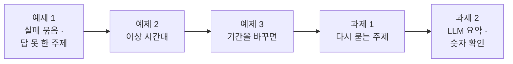
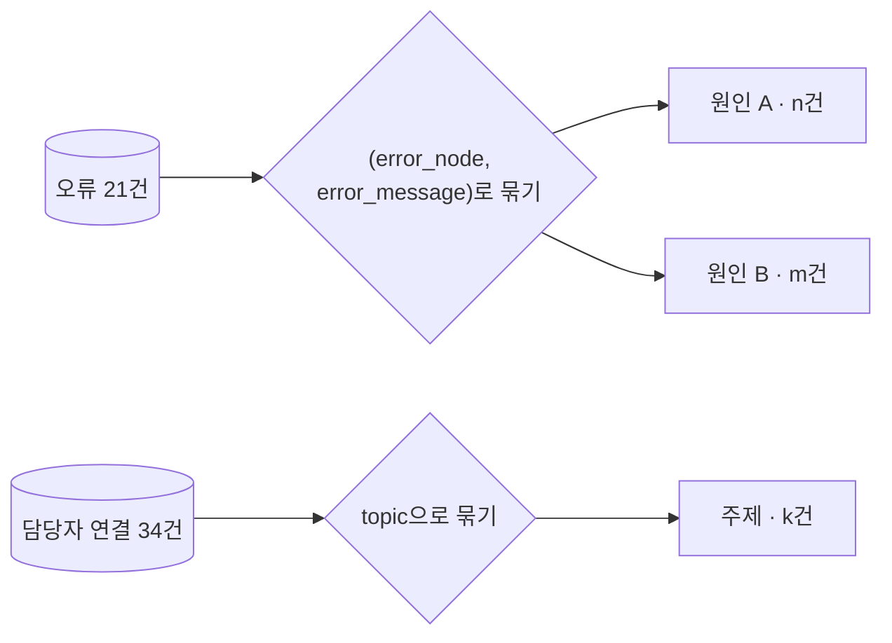
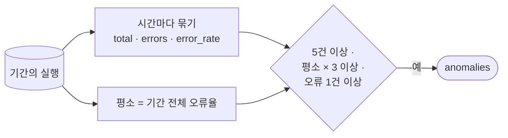
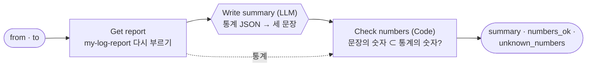

# Lab 02 · 문제를 숫자로 찾고, 요약하기

- 관련 강의: [2단계 · 문제 찾기](../../Lecture/77/02-STAGE2-FIND-PROBLEMS.md)
- 소요 시간: 50분 (4교시 한 시간) · 예제 1 12분 · 예제 2 10분 · 예제 3 6분 · 과제 1 10분 · 과제 2 12분
- 준비: Lab 01의 `my-work/log-report.json` (없으면 `cp reference/lab01-example2-report.json my-work/log-report.json` 후 push. 날짜별 · 단계별은 Lab 01 과제까지 끝낸 것)
- 목표: 지표에서 **어디를 먼저 고칠지** 정할 근거를 찾는다. 실패를 원인별로 묶고, 답하지 못한 질문의 주제를 세고, 평소와 다른 시간대를 찾고, 그 "평소"가 기간에 따라 어떻게 바뀌는지 잰다. 답했는데도 다시 묻는 주제를 찾고, 마지막으로 결과를 LLM이 글로 설명하되 **숫자는 Code가 확인**한다.



> 복사해 붙일 요청문은 없습니다. 막히면 `▶` 를 하나씩 펼칩니다. 오늘 Lab 02는 모두 `my-log-report`에 칸을 더하고(과제 2만 새 파일), 기대 숫자는 두 주 기록에서 늘 같습니다.

## 예제 1 · 실패를 묶고, 답하지 못한 주제를 세기 (12분)

### 이 실습의 의도

**한 줄로:** 오류 21건을 하나씩 보지 않고 **원인(노드 · 메시지)으로 묶어** 몇 개의 문제인지 세고, 오류는 아니지만 사용자에게는 실패인 `담당자 연결`을 **주제로 묶어** 무엇이 없는지 봅니다.

> **생활 속 예 · 반품 사유와 "찾는 물건 없음" 메모.** 가게에 반품이 21건 들어왔을 때 한 건씩 보면 21가지 일입니다. 사유로 묶으면 "사이즈 16건, 불량 5건" — 고칠 일은 둘입니다. 그리고 반품은 아니지만 손님이 "○○ 있어요?" 하고 빈손으로 간 메모가 34장인데 모두 같은 물건이라면, 그 물건을 들여놓는 것이 가장 큰 일입니다. 예제 1은 보고서에 반품 사유표와 "찾는 물건 없음" 표를 더하는 실습입니다.

| 더하는 칸 | 묶는 것 | 묶는 기준 | 답하는 질문 |
| --- | --- | --- | --- |
| `failures` | `status`가 `error`인 실행 | (`error_node`, `error_message`) | 무엇이 · 어디서 · 몇 번 고장 났나 |
| `unanswered_topics` | `route`가 `담당자 연결`인 실행 | `topic` | 무엇을 물었는데 답을 못 했나 |

**순서.** 지금 보고서에 `lab02` 테스트를 먼저 돌려 0/6을 봄 → 요청문 → push → 앞 세 케이스(예제 1) ✔, 뒤 셋(예제 2)은 아직 ✘.

**끝나면 알게 되는 것.** 고치는 단위는 "건"이 아니라 "원인"이라는 것, 오류율에 안 잡히는 실패(답 못 함)가 따로 있다는 것, 그리고 그 실패를 고칠 사람이 워크플로우 담당이 아닐 수도 있다는 것.

**적을 곳.** `my-work/OPS.md` 3.1 문제 목록 (순위 · 문제 · 숫자 · 영향 · 고칠 곳).

```bash
uv run tools/flow.py test cases/lab02.json -v      # 고치기 전 (Lab 01까지의 보고서)
```

| 조건 | 값 |
| --- | --- |
| 파일 · 웹훅 | `my-work/log-report.json` · `my-log-report` (칸을 더함) |
| 정의 | [AGENTS.md](AGENTS.md) 3절 `failures` · `unanswered_topics`, 많은 순 |
| 기대 결과 | `cases/lab02.json` 앞 세 케이스 |

### 이해하기

**왜 묶나.** 같은 원인의 실패는 한 번 고치면 함께 사라집니다. 오류 21건을 21개의 일로 보면 우선순위를 정할 수 없지만, (노드, 메시지)로 묶으면 몇 개의 원인인지와 원인마다 몇 건인지가 보입니다. 가장 큰 묶음이 가장 먼저 고칠 곳입니다.



**오류가 아닌 실패.** `담당자 연결`은 `status`가 `success`입니다. 워크플로우는 정상적으로 "모르겠으니 사람에게 넘긴다"를 했습니다. 그래서 오류율에는 잡히지 않습니다. 그런데 사용자는 답을 받지 못했고, 담당자는 그만큼 일을 더 합니다. 이런 실패는 **따로 세야** 보입니다.

**고칠 곳이 다르다.** 오류 묶음은 대개 워크플로우나 바깥 서비스(timeout · 사용량 한도)를 고칩니다. 답 못 한 주제는 대개 **콘텐츠**(FAQ에 항목이 없음)를 고칩니다. 같은 문제 목록 안에서도 고칠 사람이 다릅니다 (Lab 03 예제 1).

**테스트 케이스 (예제 1 부분).**

| 케이스 | 기대 |
| --- | --- |
| 가장 많은 실패 | `failures.0` = `Search FAQ` · `timeout of 1000ms exceeded` · 16 |
| 두 번째 실패 | `failures.1` = `Answer` · 5 |
| 답하지 못한 주제 | `unanswered_topics.0` = 와이파이 · 34 |

**기대 결과.** 고치기 전 0/6, 예제 1 뒤 3/6 (뒤 셋은 예제 2).

<details><summary>▶ 1단계 · 그 주제는 FAQ에 있나</summary>

답 못 한 주제가 나오면 FAQ에 있는지 직접 물어 봅니다: `curl -s 'localhost:8800/faq?q=와이파이'`. `results`가 비어 있다면, 워크플로우를 아무리 고쳐도 답할 수 없습니다.
</details>

<details><summary>▶ 빈칸 채우기 · 요청문(프롬프트) 뼈대</summary>

요청문에 꼭 들어갈 것: **① 실패를 묶는 기준 ② 답 못 함의 조건 ③ 묶는 칸 ④ 둘을 섞지 않기**. 아래 빈칸 4개를 채워 `my-work/PROMPTS.md`에 쓴 뒤 에이전트에게 보냅니다.

```text
my-work/log-report.json 의 Compute metrics 에 failures 와 unanswered_topics 를 더해 줘.
failures: status 가 error 인 실행을 (____①, error_message) 로 묶어 [{node, message, count}], 많은 순.
unanswered_topics: route 가 "____②" 인 실행을 ____③ 으로 묶어 [{topic, count}], 많은 순.
담당자 연결은 status 가 success 라 failures 에 ____④. 앞의 지표는 그대로. 기대 결과 cases/lab02.json 앞 세 케이스.
```

빈칸 힌트:

- ① 실행 기록 한 줄에서 "어느 노드에서" 실패했는지 적힌 칸입니다 (AGENTS.md 2절).
- ② `route`의 세 값 중 "사람에게 넘긴" 갈래.
- ③ "무엇을 물었나"가 적힌 칸.
- ④ 담당자 연결의 `status`는 무엇인가요? 그렇다면 `failures`에는?
</details>

```bash
uv run tools/flow.py push my-work/log-report.json
uv run tools/flow.py test cases/lab02.json -v
```

### 실행 결과 · 실패 묶음 · 답 못 한 주제

수업 준비 때(10/31) 강사 노트북에서 정답 워크플로우로 실제로 나온 출력입니다. 숫자는 두 주 기록에서 늘 같습니다.

#### 고치기 전 · Lab 01 과제 2까지의 보고서

실행한 명령:

```bash
uv run tools/flow.py test cases/lab02.json -v
```

출력 (결과 줄만):

```text
✘ 예제 1 · 가장 많은 실패 · 0.1s · 596 calls · $0.078360 · failures.0.node = null (expected Search FAQ); failures.0.message = null (expected timeout of 1000ms exceeded); failures.0.count = null (expected 16)
✘ 예제 1 · 두 번째 실패 · 0.1s · 596 calls · $0.078360 · failures.1.node = null (expected Answer); failures.1.count = null (expected 5)
✘ 예제 1 · 답하지 못한 주제 · 0.1s · 596 calls · $0.078360 · unanswered_topics.0.topic = null (expected 와이파이); unanswered_topics.0.count = null (expected 34)
✘ 예제 2 · 이상 시간대 1 · 0.1s · … · anomalies.0.hour = null (expected 2026-10-26T09); …
✘ 예제 2 · 이상 시간대 2 · 0.1s · … · anomalies.1.hour = null (expected 2026-10-29T15); …
✘ 예제 2 · 첫 주에는 없음 · 0.0s · … · anomalies = null (expected [])
Passed 0/6
```

**왜 이렇게 나왔나 (고치기 전)**

- Lab 01의 보고서는 "얼마나"(실행 · 오류율 · p95 · 비용)는 말하지만 "무엇이 · 언제"는 말하지 않습니다. `failures` · `unanswered_topics` · `anomalies` 칸이 없어 모두 `null`입니다.
- 줄 끝의 `596 calls · $0.078360`은 Lab 01 과제 2에서 더한 `llm_calls` · `cost_usd`가 그대로 있다는 표시입니다.
- 0/6은 **예상한 결과**입니다. 앞 셋은 예제 1, 뒤 셋은 예제 2에서 고칩니다.

#### 고친 뒤 · 예제 1

실행한 명령:

```bash
uv run tools/flow.py push my-work/log-report.json
uv run tools/flow.py test cases/lab02.json -v
```

출력 (결과 줄과, 두 주 응답의 해당 칸):

```text
✔ 예제 1 · 가장 많은 실패 · 0.9s · 596 calls · $0.078360
✔ 예제 1 · 두 번째 실패 · 0.1s · 596 calls · $0.078360
✔ 예제 1 · 답하지 못한 주제 · 0.3s · 596 calls · $0.078360
✘ 예제 2 · 이상 시간대 1 · 0.1s · … · anomalies.0.hour = null (expected 2026-10-26T09); …
✘ 예제 2 · 이상 시간대 2 · 0.1s · … · anomalies.1.hour = null (expected 2026-10-29T15); …
✘ 예제 2 · 첫 주에는 없음 · 0.1s · … · anomalies = null (expected [])
Passed 3/6

"failures": [ { "node": "Search FAQ", "message": "timeout of 1000ms exceeded", "count": 16 },
              { "node": "Answer", "message": "429 Rate limit reached for requests", "count": 5 } ],
"unanswered_topics": [ { "topic": "와이파이", "count": 34 } ]
```

**고친 뒤 이렇게 나온 까닭**

| 묶음 | 건수 | 뜻 | 고칠 곳 · 누가 |
| --- | --- | --- | --- |
| `Search FAQ` · timeout of 1000ms | **16** | FAQ 검색이 1초 안에 답하지 않아 끊김 | 워크플로우 (timeout · 재시도) — 에이전트 |
| `Answer` · 429 Rate limit | 5 | LLM 사용량 한도에 걸림 | 사용량 · 대체 경로 (75 · 72일차) |
| 담당자 연결 · 와이파이 | **34** | FAQ에 와이파이 항목이 없음 | 콘텐츠 (FAQ 더하기) — 사람 |

- **오류 21건 = 원인 2개**(16 + 5). 21개의 일이 아니라 두 가지 일입니다. 가장 큰 묶음(16)이 먼저입니다.
- **답 못 함 34건 = 주제 1개.** 담당자에게 넘긴 34건이 **모두 와이파이**입니다. 오류율(3.15%)에는 하나도 잡히지 않았지만, 건수로는 오류(21)보다 많습니다. 사용자에게는 이것이 가장 큰 실패입니다.
- `curl -s 'localhost:8800/faq?q=와이파이'`의 `results`가 비어 있는 것을 확인하면, 이 문제는 워크플로우가 아니라 **FAQ 내용**을 고쳐야 한다는 것이 분명해집니다 (Lab 03 예제 1).
- 남은 ✘ 셋은 예제 2(이상 시간대)입니다.

## 예제 2 · 평소와 다른 시간대 (10분)

### 이 실습의 의도

**한 줄로:** 시간마다 오류율을 보고, **평소보다 크게 높은** 시간만 `anomalies`로 뽑습니다. 예제 1의 원인 묶음이 "무엇이", 이상 시간대가 "언제" 고장 났는지를 말합니다.

> **생활 속 예 · 시간대별 매출표의 빈칸.** 하루 매출표를 시간대별로 보면, 평소 시간당 10건씩 팔리던 가게가 9시에만 0건이라면 그 시간에 무슨 일(카드 단말기 고장?)이 있었던 것입니다. 손님이 1명뿐인 새벽 시간의 0건은 이상하지 않고요. 예제 2는 "손님이 충분히 있었는데, 평소보다 훨씬 나빴던 시간"만 골라내는 실습입니다.

| 조건 | 왜 |
| --- | --- |
| 시간(`started_at` 앞 13자)으로 묶음 | `2026-10-26T09` = 10/26 9시대 |
| 실행 **5건 이상** | 1건 중 1건 실패(100%) 같은 작은 표본을 뺌 |
| 오류율 ≥ 그 기간 전체 오류율의 **3배** | 평소보다 "크게" 나쁜 시간만 |
| 오류 1건 이상 | 전체 오류율이 0일 때 3배(0) 조건만으로 다 뽑히는 것을 막음 |

**끝나면 알게 되는 것.** 이상 탐지의 기본 모양(묶기 → 비교 기준 → 문턱)과, 문턱을 정하는 것도 정의라는 것. 예제 1의 원인과 시간대를 맞춰 보면 장애의 모습이 보인다는 것.

**적을 곳.** `my-work/OPS.md` 3.1 문제 목록에 시간대를 더합니다.

| 조건 | 값 |
| --- | --- |
| 정의 | 실행 5건 이상 · 오류율 ≥ 전체 오류율의 3배 · 오류 1건 이상, 시간순 ([AGENTS.md](AGENTS.md) 3절) |
| 기대 결과 | `cases/lab02.json` 전체 (6/6) |

### 이해하기

**이상(anomaly)이란.** "평소"와 비교해 크게 다른 것입니다. 그래서 이상 탐지에는 늘 세 가지가 필요합니다: **무엇으로 묶나**(시간), **평소는 무엇인가**(그 기간 전체 오류율), **얼마나 달라야 이상인가**(3배, 5건 이상). 셋 다 사람이 정하는 정의입니다.



**원인과 시간을 맞춰 보기.** 예제 1의 원인 묶음은 둘(16 · 5)이었습니다. 이상 시간대가 둘이고 오류 수가 같다면, 두 원인이 각각 한 시간에 몰려 일어난 것입니다 — 하루 종일 조금씩이 아니라 **한 번의 사건**이었다는 뜻입니다.

**테스트 케이스 (예제 2 부분).**

| 케이스 | 기대 |
| --- | --- |
| 이상 시간대 1 | `2026-10-26T09` · 16건 · 오류 16 |
| 이상 시간대 2 | `2026-10-29T15` · 7건 · 오류 5 |
| 첫 주에는 없음 | `anomalies: []` |

<details><summary>▶ 1단계 · 왜 5건 이상</summary>

1건 중 1건 실패도 오류율 100%입니다. 표본이 작은 시간을 빼야 "진짜 이상"이 남습니다 (Lab 01 과제 1의 1.2.0 8건과 같은 질문).
</details>

<details><summary>▶ 빈칸 채우기 · 요청문(프롬프트) 뼈대</summary>

요청문에 꼭 들어갈 것: **① 묶는 단위 ② 표본 크기 ③ 비교 기준의 배수 ④ 순서**. 아래 빈칸 4개를 채워 `my-work/PROMPTS.md`에 쓴 뒤 에이전트에게 보냅니다.

```text
my-work/log-report.json 의 Compute metrics 에 anomalies 를 더해 줘.
started_at 앞 ____①자(예 2026-10-26T09)로 시간마다 묶어 {hour, total, errors, error_rate}.
실행이 ____②건 이상이고, error_rate 가 그 기간 전체 error_rate 의 ____③배 이상이고, 오류가 1건 이상인 시간만 ____④으로.
앞의 지표는 그대로. 기대 결과 cases/lab02.json 전체.
```

빈칸 힌트:

- ① `2026-10-26T09:05:39`에서 "시"까지가 몇 글자인지 셉니다.
- ② · ③ 위 조건 표에 있습니다.
- ④ 테스트가 `anomalies.0`과 `anomalies.1`을 어떤 순서로 기대하나요?
</details>

```bash
uv run tools/flow.py push my-work/log-report.json
uv run tools/flow.py test cases/lab02.json -v
uv run tools/flow.py test cases/lab01-challenge2.json
uv run tools/flow.py call my-log-report requests/two-weeks.json
```

### 실행 결과 · 이상 시간대

수업 준비 때(10/31) 강사 노트북에서 정답 워크플로우로 실제로 나온 출력입니다.

#### 고치기 전 · 예제 1의 보고서

고치기 전은 예제 1 고친 뒤와 같습니다: `cases/lab02.json` **3/6**, 뒤 세 케이스가 `anomalies = null`로 ✘. 시간마다 묶는 칸이 아직 없기 때문입니다.

#### 고친 뒤

실행한 명령:

```bash
uv run tools/flow.py push my-work/log-report.json
uv run tools/flow.py test cases/lab02.json -v
uv run tools/flow.py test cases/lab01-challenge2.json
uv run tools/flow.py call my-log-report requests/two-weeks.json
```

출력 (결과 줄과, 두 주 응답의 `anomalies`):

```text
✔ 예제 1 · 가장 많은 실패 · 0.9s · 596 calls · $0.078360
✔ 예제 1 · 두 번째 실패 · 0.1s · 596 calls · $0.078360
✔ 예제 1 · 답하지 못한 주제 · 0.2s · 596 calls · $0.078360
✔ 예제 2 · 이상 시간대 1 · 0.1s · 596 calls · $0.078360
✔ 예제 2 · 이상 시간대 2 · 0.1s · 596 calls · $0.078360
✔ 예제 2 · 첫 주에는 없음 · 0.0s · 292 calls · $0.038550
Passed 6/6
(lab01-challenge2 5/5)

"anomalies": [ { "hour": "2026-10-26T09", "total": 16, "errors": 16, "error_rate": 1 },
               { "hour": "2026-10-29T15", "total": 7, "errors": 5, "error_rate": 0.7143 } ]
```

**고친 뒤 이렇게 나온 까닭**

| 이상 시간대 | 실행 · 오류 | 오류율 | 문턱 (0.0315 × 3 = 0.0945) | 예제 1의 원인과 맞추면 |
| --- | --- | --- | --- | --- |
| 10/26 (월) 09시 | 16 · **16** | 100% | 넘음 | FAQ timeout 16건 |
| 10/29 (목) 15시 | 7 · 5 | 71.4% | 넘음 | 429 5건 |

- **16 + 5 = 21 = 두 주 오류 전부.** 오류가 두 주에 걸쳐 조금씩 난 것이 아니라 **두 번의 사건**이었습니다: 월요일 아침 9시에 FAQ 검색이 한 시간 동안 느렸고(그 시간의 질문 16개가 모두 실패), 목요일 오후 3시에 LLM 사용량 한도에 걸렸습니다.
- **첫 주 `[]`:** 첫 주는 오류가 0건이라 "오류 1건 이상" 조건에서 모두 빠졌습니다.
- 다른 시간에도 오류가 섞인 시간이 있었다면, 5건 미만이거나 문턱 아래라서 빠졌을 것입니다. 이 문턱이 "평소의 흔들림"과 "사건"을 가릅니다.
- `lab01-challenge2` 5/5: 단계 · 비용 칸은 그대로입니다. `OPS.md` 3.1의 문제 목록에 "언제"를 더합니다.

## 예제 3 · 기간을 바꾸면 이상이 바뀐다 (6분, 에이전트 없이)

### 이 실습의 의도

**한 줄로:** 예제 2의 규칙("그 기간 전체 오류율의 3배")은 그대로 두고, **기간만** 바꿔 이상 시간대가 어떻게 달라지는지 잽니다. 고치는 실습이 아니라 비교 기준을 **재 보는** 실습입니다.

> **생활 속 예 · "평소보다 많이 먹었다"의 평소.** 명절 연휴 동안 먹은 양을 기준으로 하면 오늘 저녁은 "적게" 먹은 것이고, 평일 기준이면 "많이" 먹은 것입니다. "평소보다 많다"는 말은 평소를 언제로 잡느냐에 달렸습니다. 예제 3은 같은 규칙으로 기간만 바꿔 보며, 평소(비교 기준)가 판정을 어떻게 바꾸는지 보는 실습입니다.

**상황.** 운영 회의에서 누구는 "이번 주", 누구는 "어제 하루", 누구는 "두 주"로 이상을 말합니다. 같은 보고서 · 같은 규칙인데 답이 다르면 서로 다른 말을 하게 됩니다. `cases/lab02-periods.json`이 다섯 기간을 묻습니다.

| 기간 | 그 기간 전체 오류율 | 문턱 (× 3) | 볼 것 |
| --- | --- | --- | --- |
| 첫 주 | ? | ? | 이상이 나오나 |
| 둘째 주 | ? | ? | 09시 · 15시 |
| 월요일만 | ? | ? | 15시(목요일)는 없어야 · 09시는? |
| 목요일만 | ? | ? | 15시만 |
| 두 주 | ? | ? | 둘 다 |

**끝나면 알게 되는 것.** 비교 기준이 바뀌면 같은 시간이 이상이 되기도 하고 아니기도 한다는 것, 그래서 보고에는 **어느 기간을 기준으로** 했는지를 함께 적어야 한다는 것.

**적을 곳.** `my-work/OPS.md` 3.2 표 (기간 · 전체 오류율 · 문턱 · 이상 시간대) — 위 표의 `?`를 채웁니다.

```bash
uv run tools/flow.py test cases/lab02-periods.json -v
```

### 이해하기

**비교 기준(baseline)의 선택.** "그 기간 전체"는 여러 선택 중 하나입니다. 지난주 같은 시간, 같은 요일 평균, 고정된 SLO(Lab 03) 등도 있습니다. 기간이 짧을수록 그 안의 사건 하나가 기준 자체를 끌어올립니다 — 하루 오류의 대부분이 한 시간에 몰리면, 그날 전체 오류율이 높아져 문턱도 높아집니다.

| 비교 기준 | 좋은 점 | 조심할 것 |
| --- | --- | --- |
| 그 기간 전체 (오늘) | 계산이 쉬움 | 기간이 바뀌면 판정이 바뀜, 사건이 기준을 끌어올림 |
| 지난 기간 같은 시간 | 계절 · 요일을 맞춤 | 지난 기간에도 사건이 있었으면 |
| 고정 기준 (SLO) | 늘 같은 잣대 | 정하는 사람이 필요 (Lab 03 예제 2) |

**기대 결과.** 5/5. 각 케이스의 `-v` 응답에서 `error_rate`와 `anomalies`를 읽어 `OPS.md` 3.2를 채웁니다.

<details><summary>▶ 1단계 · 첫 주에 이상이 하나도 없는 까닭</summary>

첫 주 전체 오류율이 0이면 문턱(× 3)도 0입니다. 그러면 모든 시간이 "문턱 이상"이 될 텐데, 왜 하나도 안 나올까요? 예제 2 조건 표의 마지막 줄을 봅니다.
</details>

### 실행 결과 · 기간을 바꾸면

수업 준비 때(10/31) 강사 노트북에서 실제로 나온 출력입니다.

이 예제는 **고치지 않습니다.** 예제 2의 보고서에 기간만 바꿔 다섯 번 묻습니다.

실행한 명령:

```bash
uv run tools/flow.py test cases/lab02-periods.json -v
```

출력 (결과 줄만):

```text
✔ 첫 주 · 오류 0 → 이상 없음 · 0.1s · 292 calls · $0.038550
✔ 둘째 주 · 기준 0.0588 × 3 · 0.1s · 304 calls · $0.039810
✔ 월요일만 · 기준 0.2286 × 3 · 0.0s · 50 calls · $0.006450
✔ 목요일만 · 15시만 · 0.1s · 71 calls · $0.009420
✔ 두 주 · 기준 0.0315 × 3 · 0.1s · 596 calls · $0.078360
Passed 5/5
```

**왜 이렇게 나왔나 (기간마다)**

| 기간 | 그 기간 전체 오류율 | 문턱 (× 3) | 이상 시간대 |
| --- | --- | --- | --- |
| 첫 주 | 0 | 0 | 없음 — 오류 1건 이상 조건 |
| 둘째 주 | 0.0588 | 0.1764 | 10/26 09시 · 10/29 15시 |
| 월요일만 | **0.2286** | **0.6858** | 10/26 09시 (100%만 넘음) |
| 목요일만 | 0.0515 | 0.1545 | 10/29 15시 |
| 두 주 | 0.0315 | 0.0945 | 둘 다 |

- **같은 규칙, 다른 문턱.** 문턱이 0.0945(두 주)에서 0.6858(월요일만)까지 일곱 배가 넘게 달라졌습니다. 월요일 하루만 보면 09시의 16건 오류가 그날 전체 오류율을 22.9%로 끌어올려, 문턱도 함께 올라갔습니다. 사건이 비교 기준 자체를 바꾼 것입니다.
- 이번 기록에서는 09시 · 15시가 워낙 뚜렷해(100% · 71%) 기간을 바꿔도 사라지지 않았습니다. 하지만 오류율이 30%쯤인 시간이 있었다면, 두 주 기준으로는 이상이고 월요일 기준으로는 아니었을 것입니다.
- **월요일만 보면** "하루 종일 22.9%"처럼 보이지만, 시간으로 나누면 09시 한 시간입니다. 보고에는 이상 시간대와 함께 **어느 기간을 기준으로** 했는지를 적습니다 (`OPS.md` 3.2).

## 과제 1 · 답했는데 다시 묻는 주제 (10분)

### 이 실습의 의도

**한 줄로:** 답은 했지만(`자동 답변`) 같은 사람이 10분 안에 같은 주제를 다시 물은(`repeat`) 비율을 **주제마다** 세어, 어느 주제의 답이 도움이 안 됐는지 찾습니다.

> **생활 속 예 · 교환하러 다시 온 손님.** 물건을 팔았는데(답함) 손님이 같은 날 다시 와서 "설명대로 했는데 안 돼요"라고 한다면, 판 것은 맞지만 설명서가 나쁜 것입니다. 많이 팔린 물건은 다시 오는 손님 **수**도 많으니, 몇 명 중 몇 명이 다시 왔는지 **비율**로 봐야 어느 설명서가 나쁜지 압니다. 과제 1은 주제별 "다시 온 손님 비율"을 세는 실습입니다.

팀장이 물었습니다.

> "답을 못 한 건 이제 알겠어요. 그런데 답을 했는데도 사람들이 다시 묻는 주제는 어디예요? 답이 엉터리인 FAQ를 먼저 고치고 싶어요."

| 조건 | 값 |
| --- | --- |
| 칸 | `repeat_topics` — `자동 답변`만, 주제마다 `answers` · `repeats` · `repeat_rate`, 다시 물음이 0인 주제는 뺌 ([AGENTS.md](AGENTS.md) 3절) |
| 순서 | `repeat_rate` 높은 순, 같으면 `repeats` 많은 순 |
| 기대 결과 | `cases/lab02-challenge.json`, `lab02`도 그대로 |

**먼저 생각해 보기 (2분)**: 다시 물은 **수**가 가장 많은 주제와 다시 묻는 **비율**이 가장 높은 주제가 다르다면, 어느 쪽을 먼저 고칠까요? 와이파이는 이 표에 나올까요?

```bash
uv run tools/flow.py test cases/lab02-challenge.json -v     # 고치기 전
```

### 이해하기

**수와 비율.** 많이 묻는 주제는 다시 묻는 수도 많습니다. 수로 정렬하면 "인기 있는 주제" 목록이 되고, 비율로 정렬해야 "답이 도움이 안 된 주제" 목록이 됩니다. 둘을 나란히 보는 것이 이 과제의 핵심입니다.

| 정렬 | 답하는 질문 |
| --- | --- |
| `repeats` (수) | 다시 물어서 생긴 일이 가장 많은 곳은? (담당자의 일) |
| `repeat_rate` (비율) | 답의 질이 가장 나쁜 곳은? (FAQ 내용) |

**Lab 01 과제 1과 무엇이 다른가.** 그때는 **릴리스**로 묶어 "어느 버전의 답이 나빠졌나"를 봤고, 이번에는 **주제**로 묶어 "어느 내용의 답이 나쁜가"를 봅니다. 분모(답한 수)를 고르는 방법은 같습니다.

**기대 결과.** 고치기 전 1/5 (마지막 케이스 "앞의 지표는 그대로"만 ✔), 고친 뒤 5/5.

<details><summary>▶ 1단계 · 마지막 케이스가 처음부터 ✔인 까닭</summary>

"앞의 지표는 그대로" 케이스는 `total` · `failures` · `anomalies`만 봅니다. 이미 있는 칸이라 고치기 전에도 ✔입니다. 고친 뒤에도 ✔여야 합니다 (회귀).
</details>

<details><summary>▶ 빈칸 채우기 · 요청문(프롬프트) 뼈대</summary>

요청문에 꼭 들어갈 것: **① 묶는 칸 ② 빼는 주제 ③ 정렬 ④ 비율의 분모**. 아래 빈칸 4개를 채워 `my-work/PROMPTS.md`에 쓴 뒤 에이전트에게 보냅니다.

```text
my-work/log-report.json 의 Compute metrics 에 repeat_topics 를 더해 줘.
route 가 "자동 답변" 인 실행만 ____① 으로 묶어 {topic, answers, repeats, repeat_rate}. repeats 가 ____② 인 주제는 뺀다.
정렬은 repeat_rate 가 ____③ 순, 같으면 repeats 가 많은 순. repeat_rate 는 repeats / ____④, 소수 4자리.
앞의 지표는 그대로. 기대 결과 cases/lab02-challenge.json, cases/lab02.json 도.
```

빈칸 힌트:

- ① "무엇을 물었나"의 칸.
- ② 다시 묻지 않은 주제는 문제 목록에 필요 없습니다.
- ③ 위 "수와 비율" 표에서 이 과제의 질문은 어느 줄인가요?
- ④ Lab 01 과제 1의 `repeat_rate`와 같은 분모.
</details>

```bash
uv run tools/flow.py push my-work/log-report.json
uv run tools/flow.py test cases/lab02-challenge.json -v
uv run tools/flow.py test cases/lab02.json
```

### 실행 결과 · 다시 묻는 주제

수업 준비 때(10/31) 강사 노트북에서 실제로 나온 출력입니다.

#### 고치기 전 · 예제 2의 보고서

실행한 명령:

```bash
uv run tools/flow.py test cases/lab02-challenge.json -v
```

출력 (결과 줄만):

```text
✘ 두 주 · 다시 묻는 비율이 가장 높은 주제 · 0.1s · … · repeat_topics.0.topic = null (expected 프린터); repeat_topics.0.answers = null (expected 81); repeat_topics.0.repeats = null (expected 8); …
✘ 두 주 · 수로는 비밀번호가 가장 많지만 비율은 2위 · 0.1s · … · repeat_topics.1.topic = null (expected 비밀번호); repeat_topics.1.repeats = null (expected 9); repeat_topics.1.repeat_rate = null (expected 0.0647)
✘ 두 주 · 다시 물은 주제는 6개 · 0.1s · … · repeat_topics.5.topic = null (expected 설치); repeat_topics.5.repeat_rate = null (expected 0.0328)
✘ 첫 주 · 설치는 다시 묻지 않음 · 0.0s · … · repeat_topics.0.topic = null (expected 프린터)
✔ 앞의 지표는 그대로 · 0.1s · 596 calls · $0.078360
Passed 1/5
```

**왜 이렇게 나왔나 (고치기 전)**

- `repeat_topics` 칸이 없어 넷은 `null`입니다.
- 마지막 "앞의 지표는 그대로"는 `total` 666 · `failures.0.count` 16 · `anomalies.0.hour`만 보는 회귀 케이스라, 이미 있는 칸으로 ✔입니다. 고친 뒤에도 ✔여야 합니다.
- 1/5는 **예상한 결과**입니다.

#### 고친 뒤

실행한 명령:

```bash
uv run tools/flow.py push my-work/log-report.json
uv run tools/flow.py test cases/lab02-challenge.json -v
uv run tools/flow.py test cases/lab02.json
```

출력 (결과 줄과, 두 주 응답의 `repeat_topics`):

```text
✔ 두 주 · 다시 묻는 비율이 가장 높은 주제 · 0.9s · 596 calls · $0.078360
✔ 두 주 · 수로는 비밀번호가 가장 많지만 비율은 2위 · 0.3s · 596 calls · $0.078360
✔ 두 주 · 다시 물은 주제는 6개 · 0.1s · 596 calls · $0.078360
✔ 첫 주 · 설치는 다시 묻지 않음 · 0.0s · 292 calls · $0.038550
✔ 앞의 지표는 그대로 · 0.1s · 596 calls · $0.078360
Passed 5/5
(lab02 6/6)

"repeat_topics": [ { "topic": "프린터", "answers": 81, "repeats": 8, "repeat_rate": 0.0988 },
                   { "topic": "비밀번호", "answers": 139, "repeats": 9, "repeat_rate": 0.0647 },
                   { "topic": "VPN", "answers": 124, "repeats": 8, "repeat_rate": 0.0645 },
                   { "topic": "접수 현황", "answers": 96, "repeats": 6, "repeat_rate": 0.0625 },
                   { "topic": "메일", "answers": 90, "repeats": 5, "repeat_rate": 0.0556 },
                   { "topic": "설치", "answers": 61, "repeats": 2, "repeat_rate": 0.0328 } ]
```

**고친 뒤 이렇게 나온 까닭**

| 볼 것 | 수로 보면 | 비율로 보면 |
| --- | --- | --- |
| 1위 | 비밀번호 9건 | **프린터 9.88%** (81건 중 8건) |
| 비밀번호 | 1위 (답 139건으로 가장 많이 물음) | 2위 6.47% |
| 마지막 | 설치 2건 | 설치 3.28% |

- **팀장 질문의 답:** 답의 질이 가장 나쁜 FAQ는 **프린터**입니다. 비밀번호는 다시 묻는 수가 가장 많지만, 그만큼 많이 묻는 주제라서입니다 (139건). 비율로는 프린터 FAQ를 먼저 고칩니다.
- **와이파이가 없는 까닭:** 와이파이는 답을 못 했으니(`담당자 연결`) `자동 답변`이 아닙니다. "답 못 함"(예제 1)과 "답했는데 도움이 안 됨"(과제 1)은 서로 다른 실패 목록입니다.
- **첫 주에는 설치가 없음:** 첫 주에는 설치를 다시 물은 사람이 없어(0건) 목록에서 빠졌습니다. 두 주의 설치 2건은 모두 둘째 주입니다.
- `lab02` 6/6: 앞의 칸은 그대로입니다. 비율 옆 건수(81 · 139)를 `OPS.md` 3.3에 함께 적습니다.

## 과제 2 · LLM 요약, 숫자는 Code가 확인 (12분)

### 이 실습의 의도

**한 줄로:** 보고서의 통계를 LLM이 **세 문장**으로 설명하게 하고, 그 글에 나온 숫자가 모두 통계에 있는지 **Code가** 확인합니다. 숫자는 Code가, 글은 LLM이.

> **생활 속 예 · 점장의 세 줄 보고와 계산기.** 점장이 본사에 "이번 주 반품 21건, 대부분 월요일 오전"이라고 세 줄로 보고합니다. 본사는 그 숫자를 장부와 계산기로 맞춰 봅니다. 말솜씨가 좋아도 숫자가 장부에 없으면 믿을 수 없습니다. 과제 2는 LLM에게 세 줄 보고를 쓰게 하고, 그 숫자를 Code(계산기)가 장부(통계)와 맞춰 보는 실습입니다.

> "숫자 표는 운영팀만 봐요. 팀장 회의에 올릴 세 문장 요약을 자동으로 만들어 주세요. 대신 AI가 숫자를 지어내면 안 됩니다."

| 조건 | 값 |
| --- | --- |
| 파일 · 웹훅 | `my-work/log-summary.json` (새로) · `my-log-summary` ([AGENTS.md](AGENTS.md) 3절) |
| 통계 | `my-log-report`를 **다시 불러** 받음 (지표를 또 계산하지 않음) |
| 요약 | LLM(`gpt-4.1-mini`)이 세 문장: 가장 큰 답 못 한 주제 · 가장 많은 실패 · 가장 나쁜 시간대 |
| 숫자 확인 | 요약의 숫자가 모두 통계에 있는지 Code가 → `numbers_ok`, `unknown_numbers` |
| 기대 결과 | `cases/lab02-challenge2.json` |

**먼저 생각해 보기 (2분)**: 71일차 답 검사("답의 숫자가 규정에 있나")와 무엇이 같고 무엇이 다른가요? 5.88%와 0.0588은 같은 숫자인가요? "10월 26일 09시"의 26과 9는 어디에 있는 숫자인가요?

```bash
uv run tools/flow.py test cases/lab02-challenge2.json -v     # 고치기 전 (웹훅이 아직 없음)
```

### 이해하기

**역할 나누기.** LLM은 글을 잘 쓰지만 세는 일과 숫자를 그대로 옮기는 일에 실수할 수 있습니다. 그래서 숫자는 Code가 세고(보고서), LLM은 **센 결과**만 받아 문장으로 바꾸고, 다시 Code가 문장의 숫자를 확인합니다. 숫자가 LLM을 거쳐 나왔다면 확인 없이는 쓰지 않습니다.



**다시 부르기.** 요약 워크플로우가 지표를 다시 계산하면 정의가 두 벌이 됩니다. 한쪽만 고치면 숫자가 어긋납니다. 이미 있는 웹훅(`my-log-report`)을 HTTP로 부르면 정의는 늘 한 곳입니다 (74 · 76일차와 같은 방법).

**LLM에게 무엇을 주나.** 기록 666줄이 아니라 **필요한 통계만**(전체 · 실패 · 답 못 한 주제 · 이상 시간대) JSON으로 줍니다. 짧고, 싸고, LLM이 셀 일이 없습니다 (75일차 "보내는 것 줄이기").

**"있는 숫자"의 규칙.** 통계의 값(17, 16), 비율의 ×100(0.0588 → 5.88), 키와 글자 속 숫자(`2026-10-26T09`의 26 · 09, 메시지 속 1000)를 모읍니다. 요약에서 뽑은 숫자가 그 안에 모두 있으면 `numbers_ok: true`, 하나라도 없으면 그 숫자를 `unknown_numbers`에.

**기대 결과.** 고치기 전 0/3 (404), 고친 뒤 3/3. LLM 글은 실행마다 조금 다를 수 있지만 `numbers_ok`는 `true`여야 합니다.

<details><summary>▶ 1단계 · 요약이 길거나 원인을 지어냄</summary>

지시문에 "정확히 세 문장, 통계에 있는 숫자만, 원인을 짐작하지 말 것, 다른 숫자를 더하지 말 것"을 씁니다. `temperature` 0.
</details>

<details><summary>▶ 빈칸 채우기 · 요청문(프롬프트) 뼈대</summary>

요청문에 꼭 들어갈 것: **① 통계를 받는 곳 ② 문장 수와 내용 ③ 모르는 숫자를 모으는 칸 ④ 확인 결과**. 아래 빈칸 4개를 채워 `my-work/PROMPTS.md`에 쓴 뒤 에이전트에게 보냅니다.

```text
my-work/log-summary.json 을 새로 만들어 줘. 웹훅 POST my-log-summary, 이름 "77 Log summary (my)".
Get report: 지표를 다시 계산하지 말고 HTTP POST http://localhost:5678/webhook/____① 로 부른다 (본문 from · to · tag · source 그대로, timeout 30000).
Write summary(AI Agent + OpenAI gpt-4.1-mini, temperature 0): 통계 중 total · errors · error_rate · failures · unanswered_topics · anomalies 만 JSON 으로 주고, 한국어 ____②문장으로
가장 많은 답 못 한 주제와 수 · 가장 많은 실패(노드 · 메시지 · 수) · 가장 나쁜 시간대(10월 26일 09시처럼). 통계에 없는 숫자와 짐작한 원인은 쓰지 않는다.
Check numbers(Code): 요약 글의 숫자를 모두 뽑아, 통계의 값 · 비율의 ×100 · 키와 글자 속 숫자(날짜 · 시간)에 있는지 본다. 없는 숫자는 ____③ 에, 하나도 없으면 numbers_ok ____④.
결과 {summary, numbers_ok, unknown_numbers, top_topic, worst_hour}. 기대 결과 cases/lab02-challenge2.json.
```

빈칸 힌트:

- ① 지표를 다시 계산하지 않고 부르는 내 웹훅입니다.
- ② 팀장 회의용 요약은 몇 문장인가요?
- ③ AGENTS.md 3절 계약의 "로그 요약" 결과 칸 중 하나.
- ④ 모르는 숫자가 하나도 없을 때의 `numbers_ok`.
</details>

```bash
uv run tools/flow.py push my-work/log-summary.json
uv run tools/flow.py test cases/lab02-challenge2.json -v
uv run tools/flow.py call my-log-summary requests/week2.json
```

`OPS.md` 3.4에 요약 하나와 `numbers_ok`를 적습니다.

### 실행 결과 · LLM 요약 · 숫자 확인

수업 준비 때(10/31) 강사 노트북에서 실제로 나온 출력입니다. LLM 글은 실행마다 조금 다를 수 있습니다.

#### 고치기 전 · 요약 웹훅이 아직 없음

실행한 명령:

```bash
uv run tools/flow.py test cases/lab02-challenge2.json -v
```

출력 (결과 줄만):

```text
✘ 요약 · 숫자는 통계에 있는 것만 · 0.0s · status 404 (expected 200); numbers_ok = null (expected true); top_topic = null (expected 와이파이); worst_hour = null (expected 2026-10-26T09)
✘ 요약 · 주제와 시간대를 말함 · 0.0s · status 404 (expected 200); summary has none of ['와이파이']
✘ 요약 · 날짜 · 0.0s · status 404 (expected 200); summary has none of ['10월 26일', '10-26', '26일']
Passed 0/3
```

**왜 이렇게 나왔나 (고치기 전)**

- `my-log-summary` 웹훅이 아직 없어 n8n이 404(찾을 수 없음)를 줬습니다. 모든 칸이 `null`, 요약 글도 없습니다.
- 셋째 케이스의 `['10월 26일', '10-26', '26일']`은 "셋 중 **하나라도** 있으면 ✔"입니다 (`contains`). LLM이 날짜를 어떻게 쓸지 몰라 여러 모양을 허용했습니다.
- 0/3은 **예상한 결과**입니다.

#### 고친 뒤

실행한 명령:

```bash
uv run tools/flow.py push my-work/log-summary.json
uv run tools/flow.py test cases/lab02-challenge2.json -v
uv run tools/flow.py call my-log-summary requests/week2.json
```

출력 (결과 줄과 `call`):

```text
✔ 요약 · 숫자는 통계에 있는 것만 · 3.4s
✔ 요약 · 주제와 시간대를 말함 · 2.6s
✔ 요약 · 날짜 · 1.7s
Passed 3/3

HTTP 200 · 1.8s
{
  "summary": "가장 많은 미응답 주제는 와이파이로 17건입니다. 가장 흔한 장애는 Search FAQ 노드에서 발생한 \"timeout of 1000ms exceeded\" 메시지로 16건입니다. 이상 징후가 가장 심한 시간대는 10월 26일 09시로, 총 16건 중 16건이 오류입니다.",
  "numbers_ok": true,
  "unknown_numbers": [],
  "top_topic": "와이파이",
  "worst_hour": "2026-10-26T09"
}
```

**고친 뒤 이렇게 나온 까닭**

| 요약에 나온 숫자 | 통계의 어디에 있나 |
| --- | --- |
| 17 (와이파이) | 둘째 주 `unanswered_topics.0.count` |
| 1000 | `failures.0.message` 글자 속 `timeout of 1000ms exceeded` |
| 16 (실패) · 16 · 16 | `failures.0.count` · `anomalies.0.total` · `anomalies.0.errors` |
| 10 · 26 · 09 | `anomalies.0.hour` 글자 `2026-10-26T09` 속 숫자 |

- 요약의 숫자 여섯 개가 모두 통계에 있어 `numbers_ok: true`, `unknown_numbers: []`입니다. 만약 LLM이 "약 20건"이나 "오류율 6%"라고 썼다면 20 · 6이 `unknown_numbers`에 들어가고 `numbers_ok`는 `false`가 됩니다.
- **둘째 주는 17건:** 두 주 전체 와이파이는 34건이고, 둘째 주만 물었으니 17건입니다. 요약은 보고서를 **같은 기간으로 다시 불러** 받은 숫자를 썼습니다. 정의가 한 곳(`my-log-report`)에만 있으니 숫자가 어긋나지 않습니다.
- **시간 1.7~3.4초:** 보고서(0.1초) + LLM 한 번입니다. 통계 JSON만 보냈으니 짧고 쌉니다.
- `top_topic` · `worst_hour`는 LLM이 아니라 Code가 통계에서 바로 뽑았습니다. 화면이나 다음 워크플로우(주간 보고)가 쓰는 값은 글이 아니라 이런 칸입니다.

## 막혔을 때

| 증상 | 할 일 |
| --- | --- |
| `failures`의 순서가 다름 | 많은 순으로 정렬, 같은 수면 순서는 상관없음 |
| `unanswered_topics`에 오류가 섞임 | `route`가 `담당자 연결`인 것만 (`null`은 오류) |
| `anomalies`가 너무 많음 · 없음 | 5건 이상 · 3배 · 오류 1건 이상 세 조건, 비교 기준은 **그 기간의** 전체 오류율 |
| `repeat_topics`의 비율이 조금 다름 | 분모가 그 주제의 `자동 답변` 수인지 (전체 실행 수가 아님) |
| `numbers_ok`가 늘 false | `unknown_numbers`를 봅니다. 날짜 · 시간 · 백분율 · 메시지 속 숫자를 "있는 숫자"에 넣었는지 |
| 요약이 404 · timeout | `my-log-report`가 push돼 있는지, Get report의 timeout 30초 |
| 계속 안 됨 | `reference/lab02-example1-problems.json`, `reference/lab02-example2-anomalies.json` |

## 확인

- [ ] 예제 1: `cases/lab02.json` 앞 세 케이스, `OPS.md` 3.1 문제 목록.
- [ ] 예제 2: `cases/lab02.json` 6/6, 원인과 시간대를 맞춰 봤다.
- [ ] 예제 3: `cases/lab02-periods.json` 5/5, `OPS.md` 3.2 (기간마다 문턱).
- [ ] 과제 1: `cases/lab02-challenge.json` 5/5, 수와 비율의 1위가 다른 까닭을 `OPS.md` 3.3에.
- [ ] 과제 2: `cases/lab02-challenge2.json` 3/3, 요약 하나를 `OPS.md` 3.4에.
