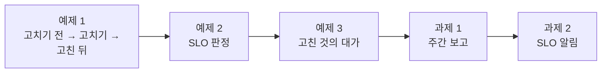
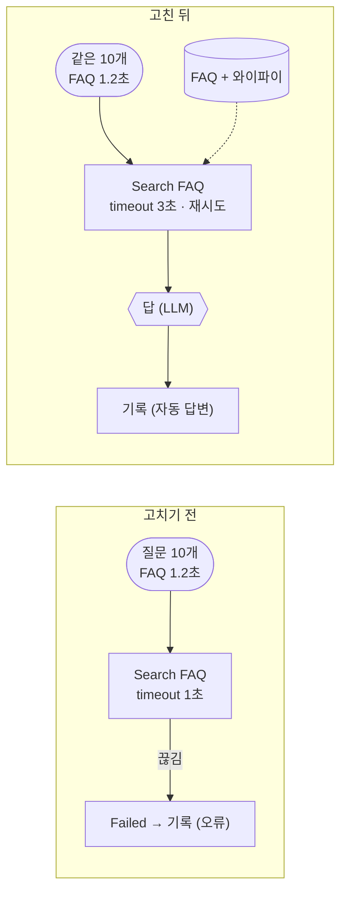
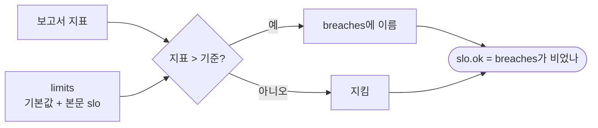
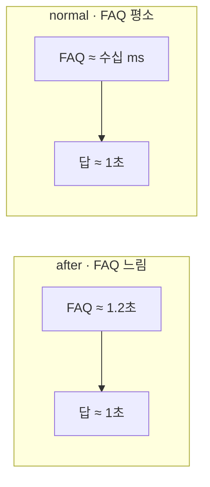
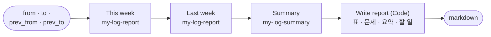

# Lab 03 · 고치고, 다시 돌려 재고, 보고하기

- 관련 강의: [3단계 · 고치고 다시 재기](../../Lecture/77/03-STAGE3-IMPROVE-AND-REMEASURE.md)
- 소요 시간: 50분 (6교시 한 시간) · 예제 1 14분 · 예제 2 8분 · 예제 3 6분 · 과제 1 12분 · 과제 2 10분
- 준비: Lab 02의 `my-work/log-report.json` (없으면 `cp reference/lab02-example2-anomalies.json my-work/log-report.json` 후 push), 요약 `my-work/log-summary.json` (과제 1에서 씀)
- 목표: Lab 02에서 찾은 문제 둘(FAQ 검색 timeout, 와이파이 FAQ 없음)을 **고치고**, 같은 질문을 **다시 돌려서** 고친 효과를 숫자로 확인한다. 운영 기준(SLO)으로 판정하고, 고친 것의 대가(느려짐)를 재고, 주간 보고와 SLO 알림을 자동으로 만든다.



> 복사해 붙일 요청문은 없습니다. 막히면 `▶` 를 하나씩 펼칩니다. 오늘 실습에서 남기는 기록은 `source: live`이고 `tag`(`before` · `after` · `normal`)로 나눕니다. 연습이 끝나면 `uv run tools/flow.py ops --reset`.

## 예제 1 · 고치기 전 · 후를 같은 질문으로 (14분)

### 이 실습의 의도

**한 줄로:** 두 주 동안 쓰던 헬프데스크로 월요일 아침처럼 FAQ가 느린 상황을 **다시 만들어** 기록을 남기고(`before`), Lab 02의 두 문제를 고친 뒤 **같은 질문**을 다시 보내(`after`) 내 보고서로 전 · 후를 비교합니다.

> **생활 속 예 · 카드 단말기 설정과 들여놓을 물건.** 월요일 아침 카드 단말기가 느려서 결제가 줄줄이 실패했고, 손님들은 없는 물건(와이파이 공유기)을 계속 찾았습니다. 단말기의 "기다리는 시간" 설정은 직원이 바꾸고, 없는 물건은 구매 담당이 들여놓습니다. 고친 뒤에는 **같은 손님 열 명**을 다시 받아 보고 정말 나아졌는지 장부로 확인합니다. 예제 1은 이 "고치기 전 → 고치기(두 사람) → 같은 손님으로 다시"를 하는 실습입니다.

| 단계 | 하는 일 | 남는 기록 |
| --- | --- | --- |
| ① 고치기 전 (에이전트 없이) | 제공 헬프데스크를 복사해 push, 느린 FAQ(1.2초)에서 질문 10개 | `tag before` 10줄 |
| ② 고치기 | 워크플로우: FAQ 검색 timeout · 재시도 (에이전트) · 데이터: 와이파이 FAQ 더하기 (나) | — |
| ③ 고친 뒤 | 같은 느린 FAQ에서 같은 10개 | `tag after` 10줄 |
| 비교 | 내 보고서에 `tag`로 물음 (`cases/lab03.json`) | — |

**끝나면 알게 되는 것.** 고친 효과는 **같은 조건 · 같은 질문**으로 다시 재야 알 수 있다는 것, 그리고 문제마다 고치는 곳(워크플로우 · 데이터)과 고치는 사람이 다르다는 것.

**적을 곳.** `my-work/OPS.md` 4.1 표 (고친 것 · 어디서 · 누가 · 고치기 전 · 고친 뒤).

```bash
# ① 고치기 전 (에이전트 없이)
cp reference/helpdesk-live.json my-work/helpdesk.json
uv run tools/flow.py push my-work/helpdesk.json
uv run tools/flow.py test cases/replay-before.json -v            # 느린 FAQ(1.2초)에서 10개, tag before
uv run tools/flow.py logs --tag before --source live --last 3
uv run tools/flow.py test cases/lab03.json -v                    # 보고서로 비교 (고친 뒤 기록은 아직 없음)
```

### 이해하기

**다시 돌려 보기(replay).** 운영 기록으로 문제를 찾았다면, 그 상황을 **다시 만들어** 고치기 전과 후를 같은 조건에서 잽니다. 오늘은 고장 스위치(`fault faq slow`, 1.2초)로 월요일 아침의 느린 FAQ를 만들고, 같은 질문 10개를 보냅니다. 조건이 다르면(FAQ가 빠른 날 고친 뒤를 재면) 고친 효과인지 운인지 알 수 없습니다.



**두 문제는 고치는 곳이 다르다.**

| 문제 (Lab 02) | 고치는 곳 | 누가 | 왜 |
| --- | --- | --- | --- |
| FAQ 검색이 1초에 끊김 (16건) | `my-work/helpdesk.json`의 Search FAQ | 에이전트 (요청문) | 워크플로우 설정 |
| 와이파이 FAQ가 없음 (34건) | 데이터 API의 FAQ (`requests/faq-wifi.json`) | 나 (`faq/add`) | 콘텐츠 — 워크플로우를 아무리 고쳐도 없는 답은 못 함 |

**`tag`로 나누기.** 헬프데스크는 본문의 `tag`를 기록에 그대로 남깁니다. 보고서에 `{"tag": "before", "source": "live"}`로 물으면 고치기 전 10줄만 셉니다. 두 주 기록(`seed`)과 섞이지 않게 `source: live`도 함께.

**`replay-before`가 10/10인 까닭.** 이 테스트는 질문을 보내고 "200이 오나"만 봅니다 (헬프데스크는 실패해도 "담당자에게 연결합니다"로 답함). 실패했는지는 **기록**과 **보고서**로 봅니다 — 사용자에게 보인 답과 실제로 일어난 일을 나눠 보는 것은 76일차와 같습니다.

**기대 결과.** 고치기 전: 기록 10줄 모두 오류, `lab03` 3/4. 고친 뒤: `replay-after` 10/10 (모두 `자동 답변`, 와이파이 답에 `CORP-WIFI`), `lab03` 4/4.

<details><summary>▶ 1단계 · timeout은 얼마로</summary>

기록의 `faq_ms`(평소 20~40ms)와 느릴 때(1.2초)를 봅니다. 1초에 끊으면 1.2초짜리는 모두 실패합니다. 늘리면 오류는 줄지만 사용자는 그만큼 기다립니다 (72일차, 예제 3).
</details>

<details><summary>▶ 2단계 · FAQ 더하기는 사람이</summary>

```bash
curl -s -XPOST localhost:8800/faq/add -H 'Content-Type: application/json' -d @requests/faq-wifi.json
curl -s 'localhost:8800/faq?q=와이파이'      # results에 FAQ-007이 나오나
```
워크플로우 안에서 `/faq/add`를 부르지 않습니다 (AGENTS.md 9절). 콘텐츠를 바꾸는 것은 사람의 결정입니다.
</details>

<details><summary>▶ 빈칸 채우기 · 요청문(프롬프트) 뼈대</summary>

요청문에 꼭 들어갈 것: **① 새 timeout ② 재시도 ③ 실패했을 때의 갈래 ④ 나머지는 그대로**. 아래 빈칸 4개를 채워 `my-work/PROMPTS.md`에 쓴 뒤 에이전트에게 보냅니다.

```text
my-work/helpdesk.json (제공 helpdesk-live 를 복사한 것) 의 Search FAQ 노드만 고쳐 줘.
options.timeout 을 1000 에서 ____① 으로, 그리고 retryOnFail ____②, maxTries 2, waitBetweenTries 300 (parameters 밖, 노드 바로 아래).
그래도 실패하면 지금처럼 오류 출력(onError ____③)으로 Failed → Log Failed 에 기록한다.
다른 노드와 로그 모양(steps 포함)은 ____④. 기대 결과 cases/replay-after.json (FAQ 가 1.2초 느린 동안 10/10), cases/lab03.json.
```

빈칸 힌트:

- ① 느릴 때 FAQ가 1.2초 걸립니다. 넉넉하게, 그러나 너무 길지 않게 (72일차 timeout · 76일차 3초).
- ② 76일차 접수 건 만들기 노드의 재시도 설정과 같은 칸입니다.
- ③ 제공 파일의 Search FAQ에 이미 있는 설정입니다. 실패도 **기록에 남아야** 다음 주 보고서에 보입니다.
- ④ 로그 모양이 바뀌면 보고서의 정의가 깨집니다.
</details>

```bash
# ② 고치기 (내가 하는 것)
curl -s -XPOST localhost:8800/faq/add -H 'Content-Type: application/json' -d @requests/faq-wifi.json

# ③ 고친 뒤
uv run tools/flow.py push my-work/helpdesk.json
uv run tools/flow.py test cases/replay-after.json -v             # 같은 10개, tag after (10/10 이어야)
uv run tools/flow.py test cases/lab03.json -v                    # 보고서로 전 · 후 비교
uv run tools/flow.py ops
```

### 실행 결과 · 고치기 전 · 고치기 · 고친 뒤

수업 준비 때(10/31) 강사 노트북에서 정답 워크플로우로 실제로 나온 출력입니다. 오늘 실습 기록의 시간(ms)은 실행마다 조금씩 다르고, 오류 수 · 갈래 · ✔ · ✘는 같아야 합니다.

#### 고치기 전 · 제공 헬프데스크 (FAQ timeout 1초, 와이파이 FAQ 없음)

실행한 명령:

```bash
cp reference/helpdesk-live.json my-work/helpdesk.json
uv run tools/flow.py push my-work/helpdesk.json
uv run tools/flow.py test cases/replay-before.json -v
uv run tools/flow.py logs --tag before --source live --last 3
uv run tools/flow.py test cases/lab03.json -v
```

출력 (결과 줄 · `logs`):

```text
✔ before: POST http://localhost:8800/logs-reset · HTTP 200 · 0.0s · {"cleared": 0}
✔ before: POST http://localhost:8800/faq-reset · HTTP 200 · 0.0s · {"cleared": 0}
✔ before: POST http://localhost:8800/admin/fault · HTTP 200 · 0.0s · {"faq": "slow", …, "slow_seconds": 1.2}
✔ before · 회의실 와이파이가 안  · 2.1s
✔ before · 사내 Wi-Fi 비밀번 · 1.2s
…  (10개 모두 ✔, 1.1~2.1s)
Passed 10/10
✔ after: POST http://localhost:8800/admin/fault · HTTP 200 · 0.0s · {"faq": "ok", …}

10 run(s) · errors 10 (100.0%)
  route: 오류 10
  2026-10-31T07:51:15  error   None    1034ms  프린터  Search FAQ  프린터 출력이 안 돼요
  2026-10-31T07:51:16  error   None    1035ms  메일  Search FAQ  메일함 용량이 꽉 찼대요
  2026-10-31T07:51:17  error   None    1032ms  설치  Search FAQ  새 프로그램 설치는 어떻게 신청하나요?

✔ 고치기 전 · 10건 모두 실패 · 0.1s · 0 calls · $0.000000
✔ 고치기 전 · FAQ timeout · 0.1s · 0 calls · $0.000000
✘ 고친 뒤 · 오류 없음 · 0.1s · 0 calls · $0.000000 · total = 0 (expected 10); by_route.자동 답변 = null (expected 10)
✔ 고친 뒤 · 답하지 못한 주제 없음 · 0.0s · 0 calls · $0.000000
Passed 3/4
```

**왜 이렇게 나왔나 (고치기 전)**

- **`replay-before` 10/10인데 기록은 10건 모두 오류:** 테스트는 처음에 오늘 기록 · 더한 FAQ를 비우고, FAQ를 1.2초 느리게 만든 뒤(`before` 세 줄) 질문을 보냅니다. 헬프데스크는 실패해도 "지금은 답할 수 없어 담당자에게 연결합니다"로 **200을 줍니다.** 그래서 테스트는 ✔이지만, 기록에는 `error` · `Search FAQ` · 약 1030ms(1초 timeout + 처리)가 남았습니다. 사용자에게 보인 것과 실제로 일어난 일을 나눠 보는 까닭입니다.
- 끝의 `after` 줄은 테스트가 고장 스위치를 `ok`로 되돌린 것입니다.
- **`lab03` 3/4:** 내 보고서에 `{"tag": "before", "source": "live"}`로 물어 "10건 모두 실패 · 원인 FAQ timeout 10건"이 ✔. "고친 뒤 · 오류 없음"은 고친 뒤 기록이 아직 0건이라 ✘(`total = 0`). "답하지 못한 주제 없음"은 0건이라 목록이 비어 **우연히** ✔입니다 — 고친 뒤 기록이 생긴 다음에 의미가 있습니다.
- 이 10건은 Lab 02에서 찾은 월요일 아침(09시 16건 모두 FAQ timeout)을 그대로 다시 만든 것입니다. 예상한 결과.

#### 고친 뒤 · timeout 3초 · 재시도 + 와이파이 FAQ

실행한 명령:

```bash
curl -s -XPOST localhost:8800/faq/add -H 'Content-Type: application/json' -d @requests/faq-wifi.json
uv run tools/flow.py push my-work/helpdesk.json
uv run tools/flow.py test cases/replay-after.json -v
uv run tools/flow.py test cases/lab03.json -v
uv run tools/flow.py ops
```

출력 (결과 줄 · `ops`):

```text
{"added": "FAQ-007", "size": 7}

✔ before: POST http://localhost:8800/logs-reset · HTTP 200 · 0.0s · {"cleared": 0}
✔ before: POST http://localhost:8800/admin/fault · HTTP 200 · 0.0s · {"faq": "slow", …, "slow_seconds": 1.2}
✔ after · 회의실 와이파이가 안  · 4.5s
✔ after · 사내 Wi-Fi 비밀번 · 2.4s
✔ after · 와이파이가 자주 끊겨요 · 2.4s
…  (10개 모두 ✔, 2.3~4.5s)
Passed 10/10

✔ 고치기 전 · 10건 모두 실패 · 0.1s · 0 calls · $0.000000
✔ 고치기 전 · FAQ timeout · 0.1s · 0 calls · $0.000000
✔ 고친 뒤 · 오류 없음 · 0.1s · 10 calls · $0.000000
✔ 고친 뒤 · 답하지 못한 주제 없음 · 0.0s · 10 calls · $0.000000
Passed 4/4

fault switch: all ok
live run logs: 20 (tag before 10 · tag after 10)
added FAQ: 1 (FAQ-007)
```

**고친 뒤 이렇게 나온 까닭**

| 볼 것 | 고치기 전 (`before`) | 고친 뒤 (`after`) | 무엇이 바꿨나 |
| --- | --- | --- | --- |
| 오류 | 10 / 10 | **0** / 10 | timeout 3초 — 1.2초 걸리는 FAQ를 기다림 |
| 갈래 | 오류 10 | 자동 답변 10 | FAQ 결과를 받아 LLM이 답함 |
| 와이파이 질문 5개 | 오류 | 자동 답변 (`CORP-WIFI` · `사번`) | FAQ-007을 데이터에 더함 |
| 한 건 시간 | 1.1~2.1초 | **2.3~4.5초** | FAQ 1.2초를 기다린 뒤 LLM 답 |

- **두 고침이 다 필요했습니다.** timeout만 늘렸다면 와이파이 질문 5개는 FAQ에 없어 `담당자 연결`이 됐을 것이고("답하지 못한 주제 없음" ✘), FAQ만 더했다면 1초에 끊겨 10개 모두 오류였을 것입니다. 하나는 워크플로우(에이전트), 하나는 콘텐츠(나)입니다.
- **첫 `before` 줄 `logs-reset` · `{"tag": "after"}`:** 테스트가 지난번 `after` 기록**만** 지우고 시작합니다 (`before` 기록 10줄은 그대로). 그래서 고치기 전에 `replay-after`를 한 번 돌려 실패했거나 여러 번 돌려도, 마지막 한 번의 10줄만 남아 `lab03`이 그 10줄로 셉니다. 처음 돌리면 `{"cleared": 0}`, 다시 돌리면 `{"cleared": 10}`. 예제 3의 `replay-normal`도 같은 방식(`tag: normal`)입니다.
- **`replay-after` 10/10은 `replay-before`와 뜻이 다릅니다.** 이번 테스트는 200만이 아니라 `route: 자동 답변` · `status: success`(와이파이는 답에 `CORP-WIFI`까지)를 확인합니다.
- **`10 calls · $0.000000`:** 고친 뒤 10건은 LLM을 한 번씩 불렀습니다. 제공 헬프데스크는 기록에 비용을 0으로 남기므로 `$0.000000`입니다 (두 주 기록에는 비용이 있음).
- **대신 느려졌습니다** (2.3~4.5초). 예제 2의 SLO와 예제 3에서 이 대가를 잽니다.

## 예제 2 · SLO로 판정하기 (8분)

### 이 실습의 의도

**한 줄로:** 보고서에 `unanswered_rate`와 `slo`(기준을 넘은 지표 `breaches`, 지켰는지 `ok`)를 더해, 매주 "약속을 지켰나"를 숫자 하나로 답하게 합니다.

> **생활 속 예 · "30분 안에 배달" 약속.** 피자 가게가 "빠르게 배달합니다"라고만 하면 늦어도 할 말이 없습니다. "30분 안에, 아니면 할인"이라고 **숫자로 약속**하면 매일 지켰는지가 분명해집니다. 예제 2는 헬프데스크에 "오류율 1% · 95%는 3초 안 · 답 못 함 2%"라는 약속을 정하고, 보고서가 지켰는지 판정하게 하는 실습입니다.

| 지표 | 기본 기준 (limits) | 둘째 주 (Lab 01 · 02에서) |
| --- | --- | --- |
| `error_rate` | 0.01 (1%) | 0.0588 |
| `p95_ms` | 3000 | 2598 |
| `unanswered_rate` | 0.02 (2%) | ? (이번에 더함) |

**끝나면 알게 되는 것.** SLO가 지표를 "좋다 · 나쁘다"에서 "지켰다 · 못 지켰다"로 바꾼다는 것, 기준은 본문으로 바꿀 수 있어야 한다는 것(누가 정하나), 그리고 고친 뒤에도 **다른 지표가 새로 어길 수 있다**는 것.

**적을 곳.** `my-work/OPS.md` 5절 SLO 표.

```bash
uv run tools/flow.py test cases/lab03-slo.json -v      # 고치기 전
```

| 조건 | 값 |
| --- | --- |
| 기본 기준 | 오류율 0.01 · p95 3000ms · 답 못 함 0.02 ([AGENTS.md](AGENTS.md) 3절), 본문 `slo`로 바꿀 수 있음 |
| 결과 | `unanswered_rate`, `slo: {ok, breaches, limits}` |
| 기대 결과 | `cases/lab03-slo.json` |

### 이해하기

**SLO(Service Level Objective, 서비스 수준 목표).** 사용자가 겪는 품질을 지표 하나와 숫자 하나로 정한 약속입니다. "빠르면 좋다"가 아니라 "p95 3초 안"처럼 정하면, 매주 지켰는지가 분명해지고 무엇부터 고칠지(어긴 지표)도 정해집니다. 기준은 사용자 · 팀장 · 비용(75일차)이 함께 정합니다.

| 용어 | 뜻 | 오늘 |
| --- | --- | --- |
| SLI (지표) | 무엇을 재나 | `error_rate` · `p95_ms` · `unanswered_rate` |
| SLO (목표) | 얼마를 지키나 | 0.01 · 3000 · 0.02 |
| breach (위반) | 목표를 넘음 | `breaches`에 지표 이름 |



**기준을 바꿀 수 있게.** 기준은 바뀝니다 (분기마다, 팀마다). 워크플로우에 고정하지 않고 본문의 `slo`로 덮어쓸 수 있으면, 같은 보고서로 "지금 기준이면?"과 "새 기준이면?"을 둘 다 물을 수 있습니다.

**기대 결과.** 고치기 전 0/4, 고친 뒤 4/4. 그리고 고친 뒤 기록(`tag after`)의 `slo.breaches`에 무엇이 남는지 봅니다.

<details><summary>▶ 1단계 · 같으면 지킨 것인가</summary>

"오류율 1% 이하"라면 정확히 0.01은 지킨 것입니다. 그래서 비교는 `>`(크면 위반)입니다.
</details>

<details><summary>▶ 빈칸 채우기 · 요청문(프롬프트) 뼈대</summary>

요청문에 꼭 들어갈 것: **① · ② 기본 기준 ③ 위반의 비교 ④ ok의 뜻**. 아래 빈칸 4개를 채워 `my-work/PROMPTS.md`에 쓴 뒤 에이전트에게 보냅니다.

```text
my-work/log-report.json 의 Compute metrics 에 unanswered_rate 와 slo 를 더해 줘.
unanswered_rate = "담당자 연결" 수 / total (소수 4자리).
기준 limits 는 기본 error_rate ____① · p95_ms ____② · unanswered_rate 0.02, 웹훅 본문에 slo 가 있으면 그 값으로 덮어쓴다 (본문은 $('Report webhook').first().json.body).
지표가 기준보다 ____③ 그 이름을 breaches 에 넣고, slo = {ok: breaches 가 ____④, breaches, limits}.
앞의 지표는 그대로. 기대 결과 cases/lab03-slo.json.
```

빈칸 힌트:

- ① · ② 위 조건 표와 AGENTS.md 3절의 `slo` 줄.
- ③ 위 ▶ 1단계.
- ④ 어긴 지표가 하나도 없을 때만 약속을 지킨 것입니다.
</details>

```bash
uv run tools/flow.py push my-work/log-report.json
uv run tools/flow.py test cases/lab03-slo.json -v
uv run tools/flow.py call my-log-report '{"tag": "after", "source": "live"}'
uv run tools/flow.py test cases/lab02-challenge.json
```

### 실행 결과 · SLO 판정

수업 준비 때(10/31) 강사 노트북에서 정답 워크플로우로 실제로 나온 출력입니다.

#### 고치기 전 · Lab 02까지의 보고서

실행한 명령:

```bash
uv run tools/flow.py test cases/lab03-slo.json -v
```

출력 (결과 줄만):

```text
✘ 둘째 주 · SLO 못 지킴 · 0.1s · 304 calls · $0.039810 · slo.ok = null (expected false); unanswered_rate = null (expected 0.0476); slo has none of ['"error_rate"', '"unanswered_rate"']
✘ 첫 주 · 답 못 함만 · 0.1s · 292 calls · $0.038550 · slo.ok = null (expected false); slo.breaches = null (expected ["unanswered_rate"])
✘ 기준을 바꾸면 · 첫 주 · 0.1s · 292 calls · $0.038550 · slo.ok = null (expected true)
✘ 고친 뒤 · 오류 · 답 못 함 기준은 지킴 · 0.1s · 10 calls · $0.000000 · unanswered_rate = null (expected 0)
Passed 0/4
```

**왜 이렇게 나왔나 (고치기 전)**

- 보고서에 `unanswered_rate` · `slo` 칸이 없어 모두 `null`입니다. 지표(오류율 · p95)는 있지만 "약속을 지켰나"를 말하는 칸이 없습니다.
- 넷째 케이스가 `10 calls`인 것은 예제 1의 고친 뒤 기록(`tag after`, 10건)을 물었기 때문입니다.
- 0/4는 **예상한 결과**입니다.

#### 고친 뒤

실행한 명령:

```bash
uv run tools/flow.py push my-work/log-report.json
uv run tools/flow.py test cases/lab03-slo.json -v
uv run tools/flow.py call my-log-report '{"tag": "after", "source": "live"}'
uv run tools/flow.py test cases/lab02-challenge.json
```

출력 (결과 줄과, 고친 뒤 기록에 물은 응답의 일부):

```text
✔ 둘째 주 · SLO 못 지킴 · 0.9s · 304 calls · $0.039810
✔ 첫 주 · 답 못 함만 · 0.1s · 292 calls · $0.038550
✔ 기준을 바꾸면 · 첫 주 · 0.1s · 292 calls · $0.038550
✔ 고친 뒤 · 오류 · 답 못 함 기준은 지킴 · 0.2s · 10 calls · $0.000000
Passed 4/4

HTTP 200 · 0.0s
{ "total": 10, "errors": 0, "error_rate": 0, "p50_ms": 2342, "p95_ms": 3560,
  "steps": { "faq_ms": { "runs": 10, "p50": 1238, "p95": 1278 }, "answer_ms": { "runs": 10, "p50": 1103, "p95": 2282 } },
  "unanswered_rate": 0,
  "slo": { "ok": false, "breaches": [ "p95_ms" ], "limits": { "error_rate": 0.01, "p95_ms": 3000, "unanswered_rate": 0.02 } } }
(lab02-challenge 5/5)
```

**고친 뒤 이렇게 나온 까닭**

| 기간 · 기록 | 오류율 | p95 | 답 못 함 | `breaches` |
| --- | --- | --- | --- | --- |
| 첫 주 | 0 | 2525 | 0.055 | `unanswered_rate` |
| 첫 주 · 기준 `unanswered_rate` 0.06 | 0 | 2525 | 0.055 | 없음 → `ok: true` |
| 둘째 주 | 0.0588 | 2598 | 0.0476 | `error_rate`, `unanswered_rate` |
| 고친 뒤 (`tag after`) | 0 | **3560** | 0 | **`p95_ms`** |

- **둘째 주는 두 약속을 어겼습니다:** 오류율 5.88%(기준 1%)와 답 못 함 4.76%(기준 2%). p95 2598ms는 3초 안입니다. Lab 02의 문제 둘(FAQ timeout · 와이파이)이 그대로 SLO 두 개에 대응합니다.
- **첫 주에도 답 못 함은 어겼습니다** (5.5%). 와이파이 FAQ는 첫 주에도 없었습니다. 기준을 0.06으로 바꾸면 지킨 것이 됩니다 — 같은 기록, 다른 약속. 기준을 바꾸는 것은 숫자 하나지만, **누가 · 왜** 바꾸는지가 중요합니다.
- **고친 뒤에는 새 약속을 어겼습니다.** 오류 0 · 답 못 함 0으로 두 약속은 지켰지만, p95가 **3560ms**로 3초를 넘었습니다. `steps`를 보면 FAQ 단계 p50이 1238ms — 느린 FAQ를 1.2초씩 기다렸기 때문입니다. 고침이 문제 하나를 다른 지표로 옮겼습니다 (예제 3).
- `lab02-challenge` 5/5: 앞의 칸은 그대로입니다.

## 예제 3 · 고친 것의 대가 (6분, 에이전트 없이)

### 이 실습의 의도

**한 줄로:** 예제 2에서 고친 뒤 기록이 p95를 어긴 까닭을 **단계 시간**(Lab 01 과제 2의 `steps`)으로 확인합니다. FAQ를 평소대로 돌려 같은 10개를 한 번 더 보내(`normal`), 느린 FAQ에서의 고친 뒤와 비교합니다.

> **생활 속 예 · 단말기 대기 시간을 늘린 대가.** 카드 단말기가 느린 날 "기다리는 시간"을 늘렸더니 결제 실패는 사라졌지만, 손님마다 계산이 1초씩 길어져 줄이 늘었습니다. 단말기가 정상인 날에는 기다릴 일이 없어 빠릅니다. 고친 것이 문제를 없앤 것인지, 다른 곳으로 옮긴 것인지 구분해야 합니다. 예제 3은 같은 손님 열 명을 "단말기가 느린 날"과 "정상인 날"에 받아 보고 비교하는 실습입니다.

| 기록 (`tag`) | FAQ | 헬프데스크 | 볼 것 |
| --- | --- | --- | --- |
| `before` | 느림 (1.2초) | 고치기 전 (timeout 1초) | 오류 · FAQ 단계 시간 |
| `after` | 느림 (1.2초) | 고친 뒤 (timeout 3초) | 오류 0, 대신 FAQ 단계 시간은? |
| `normal` (이번에) | 평소 | 고친 뒤 | FAQ 단계 시간 · p95 |

**끝나면 알게 되는 것.** timeout을 늘린 것은 "느린 FAQ를 **견디는**" 고침이지 "**빠르게** 하는" 고침이 아니라는 것. 고친 뒤에는 새로 나빠진 것을 찾아 함께 보고해야 한다는 것.

**적을 곳.** `my-work/OPS.md` 4.2 표 (기록 · FAQ 상태 · 오류 · FAQ 단계 p50 · p95)와 "새로 나빠진 것과 그 까닭".

```bash
uv run tools/flow.py test cases/replay-normal.json -v      # FAQ 평소, 같은 10개, tag normal
uv run tools/flow.py test cases/lab03-cost.json -v         # 세 기록을 단계 시간으로 비교
uv run tools/flow.py ops
```

### 이해하기

**전체 시간 = 단계 시간의 합.** 고친 뒤 한 번의 실행은 "FAQ를 기다린 시간 + LLM이 답한 시간"입니다. FAQ가 1.2초 느리면, 고친 헬프데스크는 그 1.2초를 **기다려 줍니다.** 그래서 오류는 사라지지만 전체 시간이 늘어 p95가 기준(3초)을 넘을 수 있습니다.



**왜 범위(range)로 확인하나.** 오늘 실습 기록의 시간은 실행마다 다릅니다. 그래서 `lab03-cost`는 "FAQ 단계 p50이 1150~3500ms 사이"처럼 **범위**로 봅니다. 두 주 기록처럼 늘 같은 숫자가 아니기 때문입니다.

**진짜 고침은 어디에.** FAQ 검색이 느린 원인(데이터 API · 검색 서버)을 고치는 것은 다른 팀의 일입니다. 오늘의 timeout은 그동안 사용자에게 "실패" 대신 "늦은 답"을 주는 **임시 조치**입니다. 보고서에는 둘을 나눠 적습니다.

**기대 결과.** `replay-normal` 10/10, `lab03-cost` 4/4. 각 케이스의 `-v` 응답에서 `steps.faq_ms.p50`과 `p95_ms`를 읽어 `OPS.md` 4.2를 채웁니다.

<details><summary>▶ 1단계 · 답 단계도 늘었나</summary>

`lab03-cost`의 마지막 케이스는 답 단계(`steps.answer_ms.p50`)를 봅니다. FAQ 속도와 상관없이 비슷하다면, 늘어난 시간은 모두 FAQ 단계에서 온 것입니다.
</details>

### 실행 결과 · 고친 것의 대가

수업 준비 때(10/31) 강사 노트북에서 실제로 나온 출력입니다. 시간은 실행마다 다르므로 `lab03-cost`는 범위로 확인합니다.

이 예제는 **고치지 않습니다.** 예제 1에서 고친 헬프데스크를 FAQ가 평소일 때 한 번 더 돌리고, 세 기록을 비교합니다.

#### 평소 FAQ로 같은 10개 (`tag normal`)

실행한 명령:

```bash
uv run tools/flow.py test cases/replay-normal.json -v
```

출력 (결과 줄만):

```text
✔ before: POST http://localhost:8800/logs-reset · HTTP 200 · 0.0s · {"cleared": 0}
✔ before: POST http://localhost:8800/admin/fault · HTTP 200 · 0.0s · {"faq": "ok", …}
✔ normal · 회의실 와이파이가 안  · 2.3s
✔ normal · 사내 Wi-Fi 비밀번 · 1.1s
…  (10개 모두 ✔, 0.8~2.3s)
Passed 10/10
```

**왜 이렇게 나왔나:** FAQ가 평소대로 빠르니 고친 헬프데스크가 기다릴 일이 없습니다. 같은 질문이 `after`(2.3~4.5초)보다 빠르게 0.8~2.3초에 답을 받았습니다. 와이파이 FAQ도 그대로 있어 10개 모두 `자동 답변`입니다.

#### 세 기록을 단계 시간으로 비교

실행한 명령:

```bash
uv run tools/flow.py test cases/lab03-cost.json -v
uv run tools/flow.py ops
```

출력 (결과 줄과 `ops`):

```text
✔ 고치기 전 · 느린 FAQ · 1초에 끊김 · 0.1s · 0 calls · $0.000000
✔ 고친 뒤 · 느린 FAQ · 기다려서 답함 · 0.1s · 10 calls · $0.000000
✔ 고친 뒤 · 평소 FAQ · 기다릴 일이 없음 · 0.0s · 10 calls · $0.000000
✔ 고친 뒤 · 답 단계는 FAQ 속도와 상관없음 · 0.1s · 10 calls · $0.000000
Passed 4/4

fault switch: all ok
live run logs: 30 (tag before 10 · tag after 10 · tag normal 10)
added FAQ: 1 (FAQ-007)
```

**왜 이렇게 나왔나 (기록마다, `-v` 응답에서 읽은 값)**

| 기록 | FAQ | 오류 | FAQ 단계 p50 · p95 | 답 단계 p50 | 전체 p95 | SLO |
| --- | --- | --- | --- | --- | --- | --- |
| `before` | 느림 | **10** | 1043 · 1098ms | 0 (답 못 함) | 1098ms | `error_rate` 어김 |
| `after` | 느림 | 0 | **1238** · 1278ms | 1103ms | **3560ms** | `p95_ms` 어김 |
| `normal` | 평소 | 0 | **17** · 39ms | 997ms | 2147ms | 지킴 |

- **늘어난 시간은 모두 FAQ 단계에서 왔습니다.** 답 단계는 1103ms · 997ms로 비슷합니다. `after`의 FAQ 단계 1238ms는 느린 FAQ의 1.2초를 그대로 기다린 시간입니다.
- **고친 것은 "견디기"였습니다.** timeout을 늘려 느린 FAQ에서도 실패하지 않게 했지만, 사용자는 그만큼 더 기다립니다. FAQ가 평소대로면 같은 헬프데스크가 17ms 만에 FAQ를 받고 SLO도 지킵니다. 진짜 고칠 곳은 FAQ 검색이 느려지는 원인(다른 팀)입니다.
- **`ops`의 30줄**은 세 기록이 `tag`로 나뉘어 있다는 표시입니다. 같은 헬프데스크 · 같은 질문이라도 `tag`가 다르니 보고서에서 섞이지 않습니다.
- `OPS.md` 4.2에 이 표와 "새로 나빠진 것: p95, 까닭: 느린 FAQ를 기다림"을 적습니다.

## 과제 1 · 주간 보고 (12분)

### 이 실습의 의도

**한 줄로:** 만든 보고서 · 요약을 **다시 불러** 매주 월요일 회의에 그대로 붙일 주간 보고(마크다운)를 만듭니다. 숫자 · 문제는 Code가, 요약은 LLM이, 다음 할 일은 규칙이 씁니다.

> **생활 속 예 · 주간 매출 보고서.** 가게 점장은 매주 "지난주 · 이번 주 매출표, 문제 세 가지, 세 줄 요약, 다음 주 할 일"을 본사에 보냅니다. 매주 같은 칸에 같은 방식으로 채우니 본사는 표만 보고도 비교합니다. "할 일"은 정해진 규칙(재고가 없으면 주문, 단말기 고장이면 수리 요청)대로 씁니다. 과제 1은 이 보고서를 자동으로 만드는 실습입니다.

> "매주 월요일 회의에 쓸 주간 보고를 자동으로 만들어 주세요. 지난주와 비교한 숫자, 문제 목록, 세 문장 요약, 다음 할 일. 그대로 붙여 넣을 수 있게 마크다운으로요."

| 조건 | 값 |
| --- | --- |
| 파일 · 웹훅 | `my-work/weekly.json` (새로) · `my-weekly` (입력 `from` · `to` · `prev_from` · `prev_to`) |
| 재료 | `my-log-report`(이번 주 · 지난주), `my-log-summary` — **만든 것을 다시 부른다** |
| 결과 | `markdown`(절: `## 숫자` · `## 문제` · `## 요약` · `## 다음 할 일`), `total`, `error_rate`, `slo_ok`, `numbers_ok` |
| 기대 결과 | `cases/lab03-challenge.json` |

**먼저 생각해 보기 (2분)**: "다음 할 일"을 LLM이 쓸까요, 규칙이 쓸까요? 문제 목록에서 정해진 할 일로 이어지는 것은 무엇인가요?

```bash
uv run tools/flow.py test cases/lab03-challenge.json -v     # 고치기 전 (웹훅이 아직 없음)
```

### 이해하기

**조립(composition).** 주간 보고는 새로 계산하지 않습니다. 이미 테스트로 확인한 웹훅 셋을 부르고(이번 주 보고서 · 지난주 보고서 · 요약), 받은 것을 표와 목록으로 **조립**만 합니다. 정의는 늘 한 곳이고, 보고서를 고치면 주간 보고도 함께 바뀝니다.



**누가 무엇을 쓰나.**

| 절 | 누가 | 왜 |
| --- | --- | --- |
| 숫자 (표) | Code | 숫자는 보고서 그대로, 사람이 읽게 `5.88%` |
| 문제 | Code | 실패 · 답 못 한 주제 · 이상 시간대를 목록으로 |
| 요약 | LLM (+ 숫자 확인) | 사람의 말로 — 확인 결과를 함께 |
| 다음 할 일 | 규칙 (Code) | "와이파이가 답 못 함 1위 → FAQ 추가"처럼 정해진 연결 |

**기대 결과.** 고치기 전 0/7 (404), 고친 뒤 7/7. 한 번 부르는 데 2~4초 (보고서 둘 + LLM 하나).

<details><summary>▶ 1단계 · 다시 쓰지 말고 부르기</summary>

지표 계산을 또 쓰면 정의가 두 벌이 됩니다. 이미 있는 웹훅을 HTTP로 부릅니다 (AGENTS.md 5절 "다른 내 웹훅을 부르기"). 세 웹훅이 모두 push돼 있어야 합니다.
</details>

<details><summary>▶ 2단계 · 표의 모양</summary>

`| 요청 | 309 | 357 |`처럼 지난주 · 이번 주를 나란히. 이상 시간대 `2026-10-26T09`는 사람이 읽게 `2026-10-26 09시`로.
</details>

<details><summary>▶ 빈칸 채우기 · 요청문(프롬프트) 뼈대</summary>

요청문에 꼭 들어갈 것: **① 요약을 받는 곳 ② 비율의 모양 ③ 할 일을 쓰는 방법 ④ 결과 칸**. 아래 빈칸 4개를 채워 `my-work/PROMPTS.md`에 쓴 뒤 에이전트에게 보냅니다.

```text
my-work/weekly.json 을 새로 만들어 줘. 웹훅 POST my-weekly, 본문 from · to · prev_from · prev_to, 이름 "77 Weekly report (my)".
This week · Last week: my-log-report 를 두 번 부른다 (이번 주 from · to, 지난주 prev_from · prev_to). Summary: ____① 를 이번 주로 부른다 (timeout 60000).
Write report(Code)가 마크다운을 만든다. ## 숫자: | 지표 | 지난주 | 이번 주 | 표 (요청 · 오류율 · p95 · 답 못 함 · SLO), 비율은 0.0588 을 ____②처럼.
## 문제: 실패 · 답하지 못한 질문 · 이상 시간대("2026-10-26 09시"). ## 요약: LLM 요약과 숫자 확인 결과.
## 다음 할 일: LLM 이 아니라 ____③으로 — 답 못 한 주제가 있으면 "FAQ에 '<주제>' 항목 추가", Search FAQ 실패가 있으면 timeout 점검, 429 가 있으면 사용량 한도 점검.
결과 {markdown, total, error_rate, slo_ok, ____④}. 기대 결과 cases/lab03-challenge.json.
```

빈칸 힌트:

- ① Lab 02 과제 2에서 만든 웹훅.
- ② 사람이 읽는 보고입니다. 0.0588을 백분율로 (소수 2자리).
- ③ 위 "누가 무엇을 쓰나" 표의 마지막 줄.
- ④ AGENTS.md 3절 "주간 보고" 결과 칸 중 요약의 확인 결과.
</details>

```bash
uv run tools/flow.py push my-work/weekly.json
uv run tools/flow.py test cases/lab03-challenge.json -v
uv run tools/flow.py call my-weekly requests/weekly.json
```

`markdown`을 `OPS.md` 6절에 붙입니다.

### 실행 결과 · 주간 보고

수업 준비 때(10/31) 강사 노트북에서 실제로 나온 출력입니다. 요약 글은 실행마다 조금 다를 수 있습니다.

#### 고치기 전 · 주간 보고 웹훅이 아직 없음

실행한 명령:

```bash
uv run tools/flow.py test cases/lab03-challenge.json -v
```

출력 (결과 줄만):

```text
✘ 주간 보고 · 숫자 · 0.0s · status 404 (expected 200); total = null (expected 357); error_rate = null (expected 0.0588); slo_ok = null (expected false); numbers_ok = null (expected true)
✘ 주간 보고 · 절 · 0.0s · status 404 (expected 200); markdown has none of ['## 숫자']
✘ 주간 보고 · 문제 절 · 0.0s · status 404 (expected 200); markdown has none of ['## 문제']
✘ 주간 보고 · 다음 할 일 · 0.0s · status 404 (expected 200); markdown has none of ['## 다음 할 일']
✘ 주간 보고 · 비교 숫자 · 0.0s · status 404 (expected 200); markdown has none of ['| 요청 | 309 | 357 |']
✘ 주간 보고 · 이상 시간대 · 0.0s · status 404 (expected 200); markdown has none of ['2026-10-26 09시']
✘ 주간 보고 · 와이파이 · 0.0s · status 404 (expected 200); markdown has none of ["FAQ에 '와이파이' 항목 추가"]
Passed 0/7
```

**왜 이렇게 나왔나 (고치기 전)**

- `my-weekly` 웹훅이 아직 없어 404입니다. 일곱 케이스가 숫자(`total` · `error_rate` · `slo_ok` · `numbers_ok`) 하나와, 마크다운의 절 · 표 줄 · 시간 표기 · 할 일 문장 여섯을 봅니다.
- 0/7은 **예상한 결과**입니다.

#### 고친 뒤

실행한 명령:

```bash
uv run tools/flow.py push my-work/weekly.json
uv run tools/flow.py test cases/lab03-challenge.json -v
uv run tools/flow.py call my-weekly requests/weekly.json
```

출력 (결과 줄과 `markdown`):

```text
✔ 주간 보고 · 숫자 · 3.6s
✔ 주간 보고 · 절 · 1.9s
✔ 주간 보고 · 문제 절 · 2.4s
✔ 주간 보고 · 다음 할 일 · 1.7s
✔ 주간 보고 · 비교 숫자 · 2.0s
✔ 주간 보고 · 이상 시간대 · 1.8s
✔ 주간 보고 · 와이파이 · 1.7s
Passed 7/7
```

```markdown
# IT 헬프데스크 주간 운영 보고 (2026-10-26 ~ 2026-10-30)

## 숫자

| 지표 | 지난주 | 이번 주 |
| --- | --- | --- |
| 요청 | 309 | 357 |
| 오류율 | 0% | 5.88% |
| p95 | 2525ms | 2598ms |
| 답 못 함 | 5.5% | 4.76% |
| SLO | 못 지킴 unanswered_rate | 못 지킴 error_rate, unanswered_rate |

## 문제

- 실패 16건 · Search FAQ · timeout of 1000ms exceeded
- 실패 5건 · Answer · 429 Rate limit reached for requests
- 답하지 못한 질문 17건 · 와이파이
- 이상 시간대 2026-10-26 09시 · 16/16 실패
- 이상 시간대 2026-10-29 15시 · 5/7 실패

## 요약 (LLM, 숫자 확인 통과)

가장 많은 미응답 주제는 와이파이로 17건입니다. 가장 흔한 장애는 Search FAQ 노드에서 발생한 "timeout of 1000ms exceeded" 메시지로 16건입니다. 가장 심각한 이상 시간대는 10월 26일 09시로 오류 16건, 전체 16건입니다.

## 다음 할 일

- FAQ에 '와이파이' 항목 추가
- FAQ 검색 timeout · 재시도 설정 점검 (72일차)
- LLM 사용량 한도 · 대체 경로 점검 (75 · 72일차)
```

**고친 뒤 이렇게 나온 까닭**

| 절 | 어디서 왔나 | 이 보고에서 |
| --- | --- | --- |
| 숫자 | 이번 주 · 지난주 `my-log-report` | 요청 309 → 357, 오류율 0% → 5.88% (`0.0588` → `5.88%`) |
| 문제 | 이번 주 보고서의 `failures` · `unanswered_topics` · `anomalies` | Lab 02에서 찾은 다섯 줄 그대로 |
| 요약 | `my-log-summary` (숫자 확인 통과) | 17 · 16 · 10월 26일 09시 |
| 다음 할 일 | 규칙 | 와이파이가 답 못 함 1위 → FAQ 추가, `Search FAQ` 실패 → timeout, 429 → 사용량 한도 |

- **지난주와 나란히 보니** 이번 주가 무엇이 나빠졌는지 바로 보입니다: 오류율이 0에서 5.88%로, SLO 위반이 하나에서 둘로. 답 못 함은 5.5%에서 4.76%로 조금 줄었지만 여전히 기준(2%) 위입니다.
- **다음 할 일 셋은 LLM이 쓴 것이 아닙니다.** 문제 목록에서 정해진 할 일로 이어지는 연결을 규칙으로 썼으니, 매주 같은 문제에는 같은 할 일이 나옵니다. 그리고 그 셋이 바로 Lab 03 예제 1에서 한 일(와이파이 FAQ · timeout)과 남은 일(429)입니다.
- **2~4초:** 보고서 두 번(각 0.1초) + 요약(LLM 한 번). 요약 글은 Lab 02 과제 2와 조금 다르지만 숫자 확인은 통과했습니다.

## 과제 2 · SLO를 어기면 알림 (10분)

### 이 실습의 의도

**한 줄로:** 기간을 받아 보고서의 SLO를 확인하고, **어겼으면** 76일차 알림 API에 high 알림을 남기되, 같은 알림을 10분 안에 또 보내지 않습니다.

> **생활 속 예 · 냉장고 온도 경보.** 가게 냉장고가 기준 온도를 넘으면 경보가 울려야 합니다. 하지만 1분마다 계속 울리면 직원은 곧 꺼 버립니다. 그래서 "한 번 울리고, 10분 안에는 다시 울리지 않되, 기록에는 남긴다"로 정합니다. 기준 안이면 울리지 않습니다. 과제 2는 SLO를 냉장고 온도처럼 지켜보는 경보를 만드는 실습입니다.

> "주간 보고는 월요일에나 봐요. SLO를 어기면 바로 알 수 있게 알림을 남겨 주세요. 대신 같은 걸로 계속 울리면 안 됩니다."

| 조건 | 값 |
| --- | --- |
| 파일 · 웹훅 | `my-work/slo-alert.json` (새로) · `my-slo-alert` (입력: 보고서와 같음 + `slo`) |
| 판정 | `my-log-report`를 불러 `slo.breaches` |
| 알림 | 어겼고 10분 안에 같은 알림이 없으면 `POST /alerts` (high · `slo`) → `sent`, 있으면 `suppressed`, 안 어겼으면 `none` ([AGENTS.md](AGENTS.md) 3절) |
| 기대 결과 | `cases/lab03-challenge2.json`, `lab03-slo`도 그대로 |

**먼저 생각해 보기 (2분)**: 76일차 Lab 02 과제 2(알림 폭주 막기)와 무엇이 같나요? 왜 보내지 않은 것(`suppressed`)도 결과에 남길까요?

```bash
uv run tools/flow.py test cases/lab03-challenge2.json -v     # 고치기 전 (웹훅이 아직 없음)
```

### 이해하기

**지표 → 판정 → 알림.** 보고서는 "얼마나", SLO는 "지켰나", 알림은 "누가 지금 알아야 하나"입니다. 셋을 이으면 사람이 매주 보고서를 열지 않아도 약속이 깨진 순간 압니다.

```mermaid
flowchart LR
  W(["기간 · slo"]) --> R["Get report<br/>my-log-report"] --> H["Recent alerts<br/>10분 안 slo 알림"] --> D{"Decide"}
  D -->|breaches 없음| N(["none"])
  D -->|있음 · 최근 알림 있음| S(["suppressed"])
  D -->|있음 · 최근 알림 없음| A["POST /alerts<br/>high · slo"] --> T(["sent"])
```



**알림 피로(alert fatigue).** 같은 원인으로 알림이 계속 오면 사람은 알림을 읽지 않게 되고, 정말 새로운 알림도 놓칩니다 (76일차). 그래서 같은 이유(`reason: slo`)의 알림이 10분 안에 있으면 보내지 않고, 대신 결과에 `suppressed`를 남겨 "확인은 했다"는 기록은 지킵니다.

**메시지에 숫자를.** "SLO 위반"만으로는 무엇을 할지 모릅니다. `SLO breach: error_rate 0.0588 > 0.01, unanswered_rate 0.0476 > 0.02`처럼 **어느 지표가 · 얼마로 · 기준이 얼마인데** 넘었는지를 한 줄에.

**기대 결과.** 고치기 전 0/6 (404, 알림 0개), 고친 뒤 6/6.

<details><summary>▶ 1단계 · 테스트가 알림을 비우고 시작</summary>

`cases/lab03-challenge2.json` 맨 위 `before`가 `/alerts-clear`를 부릅니다. 그래서 첫 케이스는 늘 `sent`, 같은 기간을 다시 물은 셋째 케이스는 `suppressed`여야 합니다. 워크플로우 안에서는 알림을 지우지 않습니다.
</details>

<details><summary>▶ 빈칸 채우기 · 요청문(프롬프트) 뼈대</summary>

요청문에 꼭 들어갈 것: **① 최근의 길이 ② 보내지 않을 때의 표시 ③ 알림 등급 ④ 결과의 모양**. 아래 빈칸 4개를 채워 `my-work/PROMPTS.md`에 쓴 뒤 에이전트에게 보냅니다.

```text
my-work/slo-alert.json 을 새로 만들어 줘. 웹훅 POST my-slo-alert, 본문 from · to · tag · source · slo, 이름 "77 SLO alert (my)".
Get report: my-log-report 를 부른다 (본문 그대로). Recent alerts: POST http://data-api:8800/alerts/list {workflow: "slo", reason: "slo", within: ____①}.
Decide(Code): breaches 가 없으면 alert "none", 있는데 10분 안의 같은 알림이 있으면 "____②", 아니면 "sent".
message 는 "SLO breach: error_rate 0.0588 > 0.01, …" 처럼 지표 · 값 · 기준. Send it?(If): sent 일 때만 POST /alerts {workflow: "slo", severity: "____③", reason: "slo", breaches, message}.
두 갈래 모두 같은 결과 {ok, breaches, alert, message, total} 로 ____④. 기대 결과 cases/lab03-challenge2.json.
```

빈칸 힌트:

- ① 10분을 초로.
- ② 76일차 Lab 02 과제 2에서 쓴 말과 같습니다.
- ③ 76일차 알림 등급: 문의를 잃는 중이면 critical, 처리할 수 있는 문제면? SLO 위반은 어느 쪽인가요?
- ④ `If`로 갈래가 나뉘어도, 부른 쪽이 받는 것은 늘 같은 모양이어야 합니다.
</details>

```bash
uv run tools/flow.py push my-work/slo-alert.json
uv run tools/flow.py test cases/lab03-challenge2.json -v
uv run tools/flow.py test cases/lab03-slo.json
uv run tools/flow.py ops
uv run tools/flow.py ops --reset          # 끝나면: 오늘 기록 · 더한 FAQ · 알림 비우기
```

마지막으로 `OPS.md`, [테스트 보고서](templates/TEST-REPORT-TEMPLATE.md)를 `my-work/TEST-REPORT.md`로 채웁니다.

### 실행 결과 · SLO 알림

수업 준비 때(10/31) 강사 노트북에서 실제로 나온 출력입니다.

#### 고치기 전 · SLO 알림 웹훅이 아직 없음

실행한 명령:

```bash
uv run tools/flow.py test cases/lab03-challenge2.json -v
```

출력 (결과 줄만):

```text
✔ before: POST http://localhost:8800/alerts-clear · HTTP 200 · 0.0s · {"cleared": 0}
✘ 둘째 주 · SLO 못 지킴 → 알림 · 0.0s · status 404 (expected 200); ok = null (expected false); breaches = null (expected ["error_rate", "unanswered_rate"]); alert = null (expected sent); message has none of ['error_rate 0.0588 > 0.01']
✘ 알림 확인 (high · slo) · 0.0s · workflow = null (expected slo); severity = null (expected high); reason = null (expected slo); message has none of ['unanswered_rate']
✘ 10분 안에 다시 확인 → 보내지 않음 · 0.0s · status 404 (expected 200); ok = null (expected false); alert = null (expected suppressed)
✘ slo 알림은 1개 · 0.0s · count = 0 (expected 1)
✘ 기준 안이면 알림 없음 · 0.0s · status 404 (expected 200); ok = null (expected true); breaches = null (expected []); alert = null (expected none)
✘ 그래도 알림은 1개 · 0.0s · count = 0 (expected 1)
Passed 0/6
```

**왜 이렇게 나왔나 (고치기 전)**

- 첫 줄은 테스트가 알림을 비운 것입니다. 그 뒤 `my-slo-alert`가 없어 404, 알림을 읽는 케이스(둘째 · 넷째 · 여섯째)는 데이터 API에 알림이 0개라 ✘입니다 (`latest`는 빈 `{}`, `count` 0).
- 둘째 주는 SLO를 어겼는데(예제 2) **아무도 모릅니다.** 주간 보고가 나오는 월요일까지 기다려야 합니다.
- 0/6은 **예상한 결과**입니다.

#### 고친 뒤

실행한 명령:

```bash
uv run tools/flow.py push my-work/slo-alert.json
uv run tools/flow.py test cases/lab03-challenge2.json -v
uv run tools/flow.py test cases/lab03-slo.json
uv run tools/flow.py ops
uv run tools/flow.py ops --reset
```

출력 (결과 줄과 `ops`):

```text
✔ before: POST http://localhost:8800/alerts-clear · HTTP 200 · 0.0s · {"cleared": 0}
✔ 둘째 주 · SLO 못 지킴 → 알림 · 1.0s
✔ 알림 확인 (high · slo) · 0.0s
✔ 10분 안에 다시 확인 → 보내지 않음 · 0.3s
✔ slo 알림은 1개 · 0.0s
✔ 기준 안이면 알림 없음 · 0.1s
✔ 그래도 알림은 1개 · 0.0s
Passed 6/6
(lab03-slo 4/4)

alerts: 1
  [high] slo · slo · - · SLO breach: error_rate 0.0588 > 0.01, unanswered_rate 0.0476

✔ live run logs, added FAQ, created tickets, DLQ and alerts emptied, fault switch all ok
```

**고친 뒤 이렇게 나온 까닭**

| 순서 | 물은 것 | 결과 | 까닭 |
| --- | --- | --- | --- |
| 1 | 둘째 주 | `sent` | 두 지표를 어겼고, 10분 안의 `slo` 알림이 없음 |
| 2 | 알림 확인 | high · `slo` · 메시지에 두 지표 | 1에서 남긴 알림 |
| 3 | 둘째 주 다시 | **`suppressed`** | 10분 안에 같은 알림(1)이 있음 |
| 4 | 알림 수 | 1 | 3은 보내지 않았음 |
| 5 | 첫 주 · 기준 0.06 | `none` | 어긴 지표가 없음 |
| 6 | 알림 수 | 1 | 5도 보내지 않았음 |

- **메시지 한 줄로 무엇을 할지 압니다:** `error_rate 0.0588 > 0.01, unanswered_rate 0.0476 …` — 어느 지표가 얼마로, 기준이 얼마인데 넘었는지. `ops`는 한 줄을 60자로 줄여 보여 줘서 뒤가 잘렸습니다 (전체는 `unanswered_rate 0.0476 > 0.02`).
- **`suppressed`도 결과입니다.** 같은 문제로 다시 확인한 것은 기록에 남고, 사람에게는 한 번만 갑니다. 10분이 지나도 어긴 상태라면 다시 `sent`가 됩니다.
- **1.0초 · 0.3초:** 보고서를 부르고(0.1초) 알림을 읽고 쓰는 것뿐이라 빠릅니다. n8n의 Schedule 트리거로 10분마다 돌려도 부담이 없습니다 (79일차 Ops Assistant로 이어짐).
- 마지막 `ops --reset`으로 오늘 기록 30줄 · 더한 FAQ · 알림을 비웠습니다.

## 막혔을 때

| 증상 | 할 일 |
| --- | --- |
| `replay-after`에서 와이파이만 실패 | FAQ를 더했는지 (`curl -s 'localhost:8800/faq?q=와이파이'`, `ops`의 `added FAQ`) |
| `replay-after`에서 모두 실패 | timeout을 늘렸는지, push했는지 (`fault faq slow`는 테스트가 켬) |
| `lab03`의 "고치기 전" 숫자가 10이 아님 | 실습 기록이 섞임: `replay-before`를 다시 (처음에 `/logs-reset` · `/faq-reset`을 부름) → FAQ 더하기 → `replay-after` |
| 고치기 전에 `replay-after`를 돌려 실패했다 | 고친 뒤 `replay-after`를 다시 돌리면 됨 — 테스트가 지난 `after` 기록만 지우고 시작 (`{"cleared": 10}`) |
| `lab03-cost`의 `normal`이 0건 | `replay-normal`을 먼저 돌렸는지 |
| SLO가 늘 `ok` | 비교가 `>`인지, `limits` 기본값 · 본문 `slo` 덮어쓰기 |
| 주간 보고가 timeout | 부르는 웹훅 셋(`my-log-report` · `my-log-summary`)이 모두 push돼 있는지, HTTP timeout 30~60초 |
| SLO 알림이 늘 `sent` | Recent alerts의 본문(`workflow` · `reason` · `within: 600`)과, Decide가 그 `count`를 보는지 |
| 계속 안 됨 | `reference/lab03-example1-helpdesk-fixed.json`, `reference/lab03-example2-slo.json` |

## 확인

- [ ] 예제 1: `replay-before` → 고치기(워크플로우 · FAQ) → `replay-after` 10/10, `cases/lab03.json` 4/4, `OPS.md` 4.1.
- [ ] 예제 2: `cases/lab03-slo.json` 4/4, 고친 뒤 남은 breach를 설명했다.
- [ ] 예제 3: `replay-normal` 10/10 · `lab03-cost` 4/4, `OPS.md` 4.2 (새로 나빠진 것).
- [ ] 과제 1: `cases/lab03-challenge.json` 7/7, 주간 보고 마크다운을 `OPS.md` 6절에.
- [ ] 과제 2: `cases/lab03-challenge2.json` 6/6, `lab03-slo`도 통과.
- [ ] `TEST-REPORT.md`, 끝나면 `uv run tools/flow.py ops --reset`.
