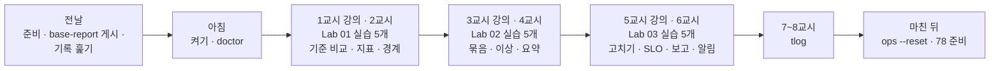
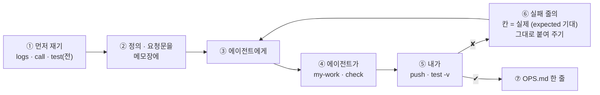

# 77일차 수강 안내 · 수업 준비부터 마칠 때까지

- 일자: 2026-11-02 (월) · 77일차
- 주제: 실행 로그 분석과 운영 데이터 기반 Workflow 개선 (기록 읽기 · 지표 → 문제 찾기 → 고치고 다시 재기)
- 실습 폴더: [Last3Mon/77](README.md) · 강의 자료: [Lecture/77](../../Lecture/77/README.md)
- 환경: 65일차 n8n 2.42.6 + **OpenAI API 키만**(`gpt-4.1-mini`, 요약 · 헬프데스크 답) + **77일차 판 데이터 API**(76일차 + 두 주 실행 기록 666줄 · 오늘 실습 기록 · FAQ 더하기) + CLI 코딩 에이전트 하나. **Ollama는 쓰지 않습니다.**
- 이 문서: 오늘 하루 내가 할 일을 수업 준비부터 마칠 때까지 순서대로 모은 수강 안내입니다. 수업 중에도 띄워 두고 어디까지 왔는지 확인하세요.



## 0. 하루 한눈에

| 교시 | 시간 | 할 일 | 문서 | 끝났다는 표시 |
| --- | --- | --- | --- | --- |
| 전날 | 약 10분 | 자료 받기 · n8n · 77일차 데이터 API · `base-report` 게시 · 기록 훑기 · doctor | [PREP](../../Lecture/77/00-DAY77-PREP.md) | `ready` |
| 1 | 09:00~09:50 | 개요 · 1단계 강의 (실행 기록 읽기와 지표) | [개요](../../Lecture/77/00-DAY77-OVERVIEW.md) 1~14장, [1단계](../../Lecture/77/01-STAGE1-READ-THE-LOG.md) | |
| 2 | 10:00~10:50 | Lab 01 실습 5개 (예제 1~3 · 과제 1~2) | [Lab 01](LAB-01-Q-READ-AND-MEASURE.md) | `lab01-challenge` 6/6 · `lab01-challenge2` 5/5 |
| 3 | 11:00~11:50 | 2단계 강의 (문제를 숫자로 찾기) | 개요 15~21장, [2단계](../../Lecture/77/02-STAGE2-FIND-PROBLEMS.md) | |
| 4 | 12:00~12:50 | Lab 02 실습 5개 | [Lab 02](LAB-02-Q-FIND-PROBLEMS.md) | `lab02-challenge` 5/5 · `lab02-challenge2` 3/3 |
| - | 13:00~14:00 | 점심 | | |
| 5 | 14:00~14:50 | 3단계 강의 (고치고 다시 재기) | 개요 22~28장, [3단계](../../Lecture/77/03-STAGE3-IMPROVE-AND-REMEASURE.md) | |
| 6 | 15:00~15:50 | Lab 03 실습 5개 | [Lab 03](LAB-03-Q-IMPROVE-AND-REMEASURE.md) | `lab03-challenge` 7/7 · `lab03-challenge2` 6/6, `OPS.md` |
| 7 | 16:00~16:50 | 바이브 코딩 `tlog`: 요청서 → TODO → SPEC → IMP-PLAN → 만들기 → 설치 | [VIBE-REQ-TLOG](VIBE-REQ-TLOG.md) → [VIBE-Q-TLOG](VIBE-Q-TLOG.md) | `Doc/*.md` · R1~R5 · R7 · R11~R14 · `pytest` |
| 8 | 17:00~17:50 | 바이브 코딩 발표 · **4단계 정리** (오늘의 의미 · 효과 · 회사에서 쓰는 법) · 78일차 예고 | [4단계 정리](../../Lecture/77/04-STAGE4-WRAPUP.md), [진행](../../Lecture/77/05-VIBE-CODING.md) | 최종 프로젝트 체크리스트 |

## 1. 전날 준비 (약 10분)

### 1.1 자료 받기

```bash
cd ~/aio-01d4-stu && git pull
```

### 1.2 n8n과 **77일차** 데이터 API 켜기 (Ollama는 끔)

```bash
sudo systemctl disable --now ollama 2>/dev/null   # WSL에 설치한 Ollama가 있으면 끄고 자동 시작도 끔
cd ~/aio-01d4-stu/Last3Mon/65/n8n
docker compose rm -sf ollama                      # Ollama 컨테이너가 있으면 지움 (없으면 그냥 지나감)
docker compose start
cd ~/aio-01d4-stu/Last3Mon/77/data-api
docker compose up -d --force-recreate             # 76일차 판을 77일차 판(+ 실행 기록 · FAQ 더하기)으로 바꿈
sleep 3                                           # 데이터 API가 뜰 때까지
curl -s 'localhost:8800/logs?limit=1'             # {"count": 666, "logs": [ ... ]}
```

- 76일차 연습을 되돌리지 않았어도 괜찮습니다: 데이터 API를 새로 띄우면 접수 건 · DLQ · 알림 · 고장 스위치가 처음으로 돌아갑니다. 두 주 실행 기록 666줄은 늘 그대로입니다.

### 1.3 기준 보고서 게시 · 준비 확인

```bash
cd ~/aio-01d4-stu/Last3Mon/77
uv run tools/flow.py push reference/baseline-report.json
uv run tools/flow.py logs --from 2026-10-26 --to 2026-10-26 --last 3   # 70 run(s) · errors 16
uv run tools/flow.py ops --reset
uv run tools/flow.py doctor        # 마지막 줄 ready
```

### 1.4 미리 읽기 (선택, 5분)

[PREP 3절](../../Lecture/77/00-DAY77-PREP.md): "두 주 동안 몇 번 실패했나?"에 옆 사람과 다른 숫자가 나왔다면 무엇이 달랐을까? 그리고 7교시 [요청서](VIBE-REQ-TLOG.md).

### 준비물

노트북과 충전기, WSL의 Docker, WSL 창 두 개, 브라우저 (n8n 화면), 숫자를 적을 `my-work/OPS.md`.

## 2. 수업 당일 아침 (09:00 전)

1. 노트북을 껐다 켰다면 1.2를 다시 합니다 (오늘 실습 기록 · 더한 FAQ는 처음으로 돌아갑니다 — 괜찮음). `base-report`는 n8n에 그대로 있습니다.
2. 터미널 두 개, 둘 다 `cd ~/aio-01d4-stu/Last3Mon/77`. ① 에이전트(`codex`/`claude`/`agy`), ② 확인(`logs` · `call` · `push` · `test` · `ops`).
3. 터미널 ②에서 `uv run tools/flow.py doctor` → `ready`, `uv run tools/flow.py ops`.
4. `cp templates/OPS-ANALYSIS-TEMPLATE.md my-work/OPS.md`, `my-work/PROMPTS.md`.

## 3. 실습할 때마다 같은 순서 (오늘은 "재기 → 정의 → 고치기 → 다시 재기")



- 숫자가 기대와 다르면 거의 언제나 **정의**(끝날 포함 · 반올림 · 분모 · 0건)가 다른 것입니다. `✘` 줄 끝의 `칸 = 실제 (expected 기대)`를 그대로 에이전트에게 붙여 줍니다.
- 오늘 보고서는 **한 파일**(`my-work/log-report.json`)에 칸을 더해 갑니다. 고칠 때마다 앞의 테스트도 다시 돌립니다 (회귀).
- 두 주 기록은 늘 같으므로 지표 숫자도 누구에게나 같습니다. 오늘 실습 기록(`source: live`)만 시간이 실행마다 다릅니다.

## 4. 1~2교시 · 1단계 · 실행 기록 읽기와 지표

1교시는 강의, 2교시는 [Lab 01](LAB-01-Q-READ-AND-MEASURE.md) (50분, 실습 5개).

| 순서 | 할 일 | 파일 · 웹훅 | 확인 (터미널 ②) |
| --- | --- | --- | --- |
| 예제 1 (10분, 에이전트 없이) | 두 주 · 하루를 `logs`로 훑고, 같은 기간을 팀의 기준 보고서에 | `base-report` | `logs --from … --to …`, `call base-report requests/two-weeks.json` · `monday.json` → `OPS.md` 1.1 |
| 예제 2 (15분) | 정의대로 세는 내 보고서: 실행 · 오류율 · p50 · p95 · 갈래 | `my-work/log-report.json` (새로) · `my-log-report` | `test cases/lab01.json --webhook base-report -v` (전), `push` → `test cases/lab01.json -v` |
| 예제 3 (7분, 에이전트 없이) | 경계에서 재 보기: 하루 · 빈 기간 · 주말 · `source` | (그대로) | `test cases/lab01-edges.json -v`, `--webhook base-report` → `OPS.md` 1.2 |
| 과제 1 (8분) | 날짜별 · 릴리스별 다시 묻는 비율 | `my-work/log-report.json` 고치기 | `test cases/lab01-challenge.json -v`, `lab01` |
| 과제 2 (10분) | 단계별 p50 · p95, 비용 · 실행당 비용 · 호출 수 | `my-work/log-report.json` 고치기 | `test cases/lab01-challenge2.json -v`, `lab01` · `lab01-challenge` |

(명령 앞에는 모두 `uv run tools/flow.py`가 붙습니다.)

## 5. 3~4교시 · 2단계 · 문제를 숫자로 찾기

3교시는 강의, 4교시는 [Lab 02](LAB-02-Q-FIND-PROBLEMS.md) (50분, 실습 5개).

| 순서 | 할 일 | 확인 |
| --- | --- | --- |
| 예제 1 (12분) | 실패를 (노드, 메시지)로 묶기 · 답 못 한 주제 세기 | `test cases/lab02.json -v` (전 · 후: 0/6 → 3/6), `curl -s 'localhost:8800/faq?q=와이파이'` → `OPS.md` 3.1 |
| 예제 2 (10분) | 이상 시간대: 5건 이상 · 전체 오류율의 3배 · 오류 1건 이상 | `test cases/lab02.json -v` 6/6, `lab01-challenge2`, `call my-log-report requests/two-weeks.json` |
| 예제 3 (6분, 에이전트 없이) | 기간을 바꾸면 문턱 · 이상이 바뀐다 | `test cases/lab02-periods.json -v` → `OPS.md` 3.2 |
| 과제 1 (10분) | 답했는데 다시 묻는 주제 (수와 비율) | `test cases/lab02-challenge.json -v`, `lab02` |
| 과제 2 (12분) | LLM 세 문장 요약, 숫자는 Code가 확인 | `my-work/log-summary.json` (새로), `test cases/lab02-challenge2.json -v`, `call my-log-summary requests/week2.json` |

## 6. 5~6교시 · 3단계 · 고치고 다시 재기

5교시는 강의, 6교시는 [Lab 03](LAB-03-Q-IMPROVE-AND-REMEASURE.md) (50분, 실습 5개).

| 순서 | 할 일 | 확인 |
| --- | --- | --- |
| 예제 1 (14분) | 제공 헬프데스크로 고치기 전(`before`) → timeout · 재시도(에이전트) + 와이파이 FAQ(나) → 고친 뒤(`after`) | `cp reference/helpdesk-live.json my-work/helpdesk.json`, `test cases/replay-before.json -v`, `curl … /faq/add`, `test cases/replay-after.json -v`, `test cases/lab03.json -v` |
| 예제 2 (8분) | SLO 판정: `unanswered_rate` · `slo.breaches` | `test cases/lab03-slo.json -v`, `call my-log-report '{"tag": "after", "source": "live"}'` |
| 예제 3 (6분, 에이전트 없이) | 고친 것의 대가: 평소 FAQ로 같은 10개(`normal`), 단계 시간으로 비교 | `test cases/replay-normal.json -v`, `test cases/lab03-cost.json -v`, `ops` → `OPS.md` 4.2 |
| 과제 1 (12분) | 주간 보고: 보고서 둘 + 요약을 다시 불러 마크다운 | `my-work/weekly.json` (새로), `test cases/lab03-challenge.json -v`, `call my-weekly requests/weekly.json` |
| 과제 2 (10분) | SLO를 어기면 high 알림, 10분 안 같은 알림은 `suppressed` | `my-work/slo-alert.json` (새로), `test cases/lab03-challenge2.json -v`, `lab03-slo`, `ops --reset` |

- 기록: `OPS.md` 전체, `TEST-REPORT.md`.

## 7. 7~8교시 · 바이브 코딩 `tlog`

[VIBE-REQ-TLOG](VIBE-REQ-TLOG.md)(요청서)를 **먼저** 읽고 [VIBE-Q-TLOG](VIBE-Q-TLOG.md)의 순서대로 갑니다: `Doc/TODO.md` → `Doc/SPEC.md` → `Doc/IMP-PLAN.md`(엔진 · TUI 단계) → 단계별 구현 → 확인 → `uv tool install` → 다른 폴더에서 사용. 요구는 14개(R1~R14)이고 50분 안에는 엔진 1 · 2단계 · TUI 1단계 · 설치까지, 나머지(R6 단계 · 비용, R8 기간 비교, R9 다른 기록 읽기, R10 주간 보고)는 `Doc/IMP-PLAN.md`의 다음 단계로 집에서 이어 갑니다. 만드는 것은 실행 기록(파일 또는 데이터 API)을 오늘 Lab의 정의 그대로 세어 **같은 숫자**를 내고, 실패 묶음 · 이상 시간대 · SLO 판정(종료 코드)을 보여 주고, TUI로 묶음을 골라 그 실행들을 보는 도구. 정답본 `VIBE-A-TLOG.md`는 수업이 끝나면 `git pull`로 받습니다.

```bash
mkdir -p ~/vibe/tlog/Doc && cd ~/vibe/tlog
git init
# 에이전트는 Doc/TODO.md를 쓴 뒤에 켭니다: codex (또는 claude, agy)
```

| 시간 | 단계 | 확인 |
| --- | --- | --- |
| 16:00~16:09 | 0 준비 · 1 요청서 → `Doc/TODO.md` (에이전트 없이) | 할 일 ①~⑫ · 꼭 / 나중 |
| 16:09~16:15 | 2 `Doc/SPEC.md` → VIBE-Q 요구 표(R1~R14)와 비교 · commit | 요구마다 확인 방법 (두 주 666 · 21 · 0.0315 · p95 2537, 종료 코드) |
| 16:15~16:20 | 3 `Doc/IMP-PLAN.md` (엔진 1~3단계 · TUI 1단계 · 설치) · commit | 단계마다 체크리스트 |
| 16:20~16:44 | 4 구현: 엔진 1단계(R1 · R2 · R5 · R12 · R13) → 엔진 2단계(R3 · R4 · R7) → TUI 1단계(R11), 막히면 5 문제 해결 팁 | 단계마다 `pytest` · 직접 실행 · commit |
| 16:44~16:50 | 6 확인 · 7 `uv tool install --editable .` · 8 다른 폴더에서 `tlog` | `tlog summary --url http://localhost:8800 --from 2026-10-26 --to 2026-10-30` = `my-log-report`의 숫자 |

- 8교시: 1~2명 발표 (10분) → [4단계 정리](../../Lecture/77/04-STAGE4-WRAPUP.md) (35분: 오늘 한 일의 의미 · 효과 · 산업에서의 응용 · 면접 질문 · 최종 프로젝트 체크리스트) → 78일차 예고.

## 8. 마친 뒤

| 할 일 | 이유 |
| --- | --- |
| `uv run tools/flow.py ops --reset`, `doctor` → `ready` | 오늘 실습 기록 · 더한 FAQ · 알림을 비워 내일 처음 상태로 |
| `PROMPTS.md`, `OPS.md`, `TEST-REPORT.md` 정리 | 최종 프로젝트 재료 (운영 지표 · 주간 보고) |
| `my-work/*.json`, `~/vibe/tlog` 지우지 않기 | 78일차 품질 검증 · 79일차 Ops Assistant(`tops`) |
| 78일차 준비: [00-DAY78-PREP](../../Lecture/78/00-DAY78-PREP.md) | 데이터 품질 검증 |

## 9. 막혔을 때 (오늘 공통)

| 증상 | 할 일 |
| --- | --- |
| doctor의 `run logs /logs (666 seeded runs)` ✘ | 데이터 API가 예전 판. 1.2의 77일차 `--force-recreate` · `sleep 3` |
| doctor에 `live run log(s) left` · `FAQ entr(ies) added` | `uv run tools/flow.py ops --reset` |
| `total`이 666 · 357이 아님 | `from` · `to`를 그대로 넘기는지 (직접 거르지 않음), `source` 기본값 `all` |
| `p95_ms`가 1~2 다름 | 오름차순 · `ceil(p × n)`번째 (1부터), 오류 실행 포함 |
| 비율이 0.03149… · 3.15 | 비율, 소수 4자리 반올림 |
| 앞에서 통과한 테스트가 깨짐 | 같은 파일에 칸을 더할 때 앞의 지표를 지웠는지 — `uv run tools/flow.py diff reference/<앞 단계>.json my-work/log-report.json` |
| `lab03` 숫자가 10이 아님 | `replay-before`부터 다시 (처음에 오늘 기록 · FAQ를 비움) |
| `call my-…`가 404 | push했는지, 웹훅 경로 |
| 같은 곳을 3번 고쳐도 실패 | 요청을 더 작게, 또는 `reference/`로 이어 가기 |

## 확인

- [ ] 전날 77일차 데이터 API, `base-report` 게시, `doctor` → `ready`
- [ ] Lab 01: `OPS.md` 1.1 · 1.2, `lab01` 5/5, `lab01-edges` 6/6, `lab01-challenge` 6/6, `lab01-challenge2` 5/5
- [ ] Lab 02: `lab02` 6/6, `lab02-periods` 5/5, `lab02-challenge` 5/5, `lab02-challenge2` 3/3, `OPS.md` 3절
- [ ] Lab 03: `replay-after` 10/10 · `lab03` 4/4, `lab03-slo` 4/4, `lab03-cost` 4/4, `lab03-challenge` 7/7, `lab03-challenge2` 6/6, `OPS.md` 4~6절
- [ ] `tlog`: `Doc/TODO.md` · `SPEC.md` · `IMP-PLAN.md` 먼저, 엔진 1 · 2단계 · TUI 1단계, `pytest`, 단계마다 commit, `uv tool install`
- [ ] `ops --reset`, 78일차 준비
