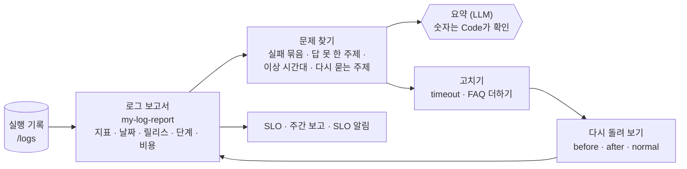

# 77일차 실습 · 실행 로그 분석과 운영 데이터 기반 Workflow 개선 (바이브 코딩)

- 일자: 2026-11-02 (월, 77일차)
- 교과목: 노코드 멀티 에이전트 워크플로우 설계 및 운영
- 단원: AI 워크플로우 운영 및 관리 역량 강화
- 강의 자료: [Lecture/77](../../Lecture/77/README.md)
- 하루 수강 안내: [LECTURE-77.md](LECTURE-77.md) (수업 준비부터 마칠 때까지 순서대로)
- 67~76일차처럼 CLI 코딩 에이전트에게 **내가 쓴 요청문**으로 워크플로우를 만들게 하고, **테스트로 확인**합니다. 오늘은 **두 주 동안의 실행 기록**을 정의대로 세어 지표로 만들고, 문제를 숫자로 찾고, 고친 뒤 같은 질문으로 다시 잽니다.

## 오늘 보는 것: 헬프데스크 두 주(10/19~10/30)의 실행 기록 666줄

데이터 API에 헬프데스크의 실행 기록이 쌓여 있습니다. 그 안에 운영팀이 아직 모르는 문제가 몇 개 숨어 있고, 팀이 쓰던 보고서(`base-report`)는 다른 정의로 세고 있었습니다. 감으로 말하지 않고 **정의된 지표로** 찾습니다.



## 일하는 방식 (67~76일차와 같음)

| 누가 | 무엇을 |
| --- | --- |
| 나 | 기록을 읽고 질문하기, 지표 정의 정하기, 기준과 비교, 문제의 순서 정하기, 콘텐츠(FAQ) 고치기, 고친 뒤 다시 재기 |
| CLI 에이전트 | [AGENTS.md](AGENTS.md) 규칙대로 워크플로우 JSON 작성, `check`로 형식 오류 고치기 |
| `tools/flow.py` | check · push · call · test(`--webhook`, `range`) · diff · **logs**(기록 훑어보기) · **ops**(오늘 기록 · 더한 FAQ · 알림, `--reset`) · fault · doctor (모두 `-v`) |

> **숫자는 Code가, 글은 LLM이.** LLM에게 666줄을 주고 "문제가 뭐야?"라고 묻지 않습니다. 그리고 숫자가 다르면 먼저 **정의**를 의심합니다.

## 실습 15개 (Lab마다 예제 3 · 과제 2)

| | 예제 1 | 예제 2 | 예제 3 | 과제 1 | 과제 2 |
| --- | --- | --- | --- | --- | --- |
| [Lab 01](LAB-01-Q-READ-AND-MEASURE.md) | 손으로 읽기 · 기준 보고서 (에이전트 없이) | 지표 보고서 | 경계에서 재 보기 (에이전트 없이) | 날짜별 · 릴리스별 | 단계별 · 비용 |
| [Lab 02](LAB-02-Q-FIND-PROBLEMS.md) | 실패 묶음 · 답 못 한 주제 | 이상 시간대 | 기간을 바꾸면 (에이전트 없이) | 답했는데 다시 묻는 주제 | LLM 요약 · 숫자 확인 |
| [Lab 03](LAB-03-Q-IMPROVE-AND-REMEASURE.md) | 고치기 전 → 고치기 → 고친 뒤 | SLO 판정 | 고친 것의 대가 (에이전트 없이) | 주간 보고 | SLO 알림 |

## 실습 문서 읽는 법

- 실습 문서(`LAB-0x-Q-*.md`, `VIBE-Q-TLOG.md`)에는 **복사해 붙일 요청문이 없습니다.** 실습마다 `### 이 실습의 의도`(한 줄 · 생활 속 예 · 상황 · 알게 되는 것 · 적을 곳)와 `### 이해하기`(왜 · 지금 → 바뀐 뒤 · 테스트 케이스 · 기대 결과)를 읽고, 막히면 `▶` 를 하나씩 펼칩니다. 요청문은 `▶ 빈칸 채우기`의 빈칸 4개(`____①`~`____④`)를 채워서 씁니다. 실습마다 끝에 `### 실행 결과`(실행한 명령, 고치기 전 · 후 출력과 그렇게 나온 까닭)가 있습니다.
- 쓴 요청문은 `my-work/PROMPTS.md`에, 숫자와 문제 목록은 `my-work/OPS.md`에, 테스트 결과는 `my-work/TEST-REPORT.md`에 모아 둡니다.

## 구성

```text
Last3Mon/77/
├── README.md
├── LECTURE-77.md                      # 하루 수강 안내
├── AGENTS.md                          # CLI 에이전트용 작업 규칙 (계약 · 지표 정의 3절)
├── LAB-01-Q-READ-AND-MEASURE.md       # 1단계 · 기록 읽기 · 기준 비교 · 지표 보고서 · 경계 · 날짜별 · 릴리스별 · 단계 · 비용
├── LAB-02-Q-FIND-PROBLEMS.md          # 2단계 · 실패 묶음 · 답 못 한 주제 · 이상 시간대 · 기간 · 다시 묻는 주제 · LLM 요약
├── LAB-03-Q-IMPROVE-AND-REMEASURE.md  # 3단계 · 고치고 다시 돌리기 · SLO · 고친 것의 대가 · 주간 보고 · SLO 알림
├── VIBE-REQ-TLOG.md                   # 7교시 바이브 코딩 요청서 (가장 먼저 읽기)
├── VIBE-Q-TLOG.md                     # 7교시 바이브 코딩 · tlog (실행 기록 분석 · SLO · TUI)
├── tools/flow.py
├── data-api/                          # 77일차 판 데이터 API (76일차 + 실행 기록 · FAQ 더하기)
│   └── data/run-logs.json             # 두 주 실행 기록 666줄
├── cases/                             # lab01 · lab01-edges · lab01-challenge(2) · lab02 · lab02-periods · lab02-challenge(2) ·
│                                      # replay-before · replay-after · replay-normal · lab03 · lab03-slo · lab03-cost · lab03-challenge(2)
├── requests/                          # 기간(two-weeks · week1 · week2 · monday) · weekly · faq-wifi(더할 FAQ)
├── reference/                         # baseline-report(팀의 기준) · helpdesk-live(제공) + 막혔을 때 이어 가는 워크플로우
├── templates/                         # 운영 분석표 · 테스트 보고서
├── my-work/
└── runs/
```

## 준비

[실습 준비](../../Lecture/77/00-DAY77-PREP.md)를 끝내 주세요. 요약:

```bash
cd ~/aio-01d4-stu/Last3Mon/65/n8n && docker compose start   # Ollama는 쓰지 않음 · 처음 한 번 PREP 1절대로 끄기
cd ~/aio-01d4-stu/Last3Mon/77/data-api && docker compose up -d --force-recreate && sleep 3   # 77일차 판 (실행 기록)
cd ~/aio-01d4-stu/Last3Mon/77 && uv run tools/flow.py push reference/baseline-report.json
uv run tools/flow.py doctor                                                          # 마지막 줄 ready
```

## `flow.py` 명령 (오늘 더해진 것)

| 명령 | 하는 일 | 수업 준비 때 |
| --- | --- | --- |
| `uv run tools/flow.py logs --from 2026-10-26 --to 2026-10-26 --last 10` | 기간의 실행 수 · 오류 수 · 갈래, 마지막 N줄 (`-v`면 마지막 줄의 모든 칸) | 70 run(s) · errors 16 (22.9%) |
| `uv run tools/flow.py logs --tag after --source live` | 오늘 실습에서 남긴 기록만 | |
| `uv run tools/flow.py call base-report requests/two-weeks.json` | 팀의 기준 보고서 | 602건 (끝날이 빠짐) |
| `uv run tools/flow.py test cases/lab01.json --webhook base-report` | 같은 케이스를 다른 웹훅에 | 0/5 |
| `uv run tools/flow.py ops` · `ops --reset` | 오늘 기록(`tag`마다) · 더한 FAQ · 알림 · 고장 스위치 · 모두 비우기 | |
| `uv run tools/flow.py fault faq slow --seconds 1.2` · `fault all ok` | FAQ를 느리게 (테스트가 켜고 끔) | |

> 오늘 LLM은 Lab 02 과제 2의 요약과 Lab 03 헬프데스크의 답에만 씁니다 (`gpt-4.1-mini`). 지표 · 묶음 · 이상 · SLO는 모두 Code가 0.1초 안팎에 셉니다.
