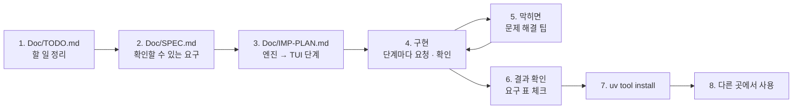

# 7교시 바이브 코딩 · `tlog` 만들기

> **먼저 [VIBE-REQ-TLOG.md](VIBE-REQ-TLOG.md)(요청서)를 읽고 `~/vibe/tlog/Doc/TODO.md`를 직접 쓴 뒤** 이 문서를 엽니다. 아래 1~8을 차례로 갑니다. 이 문서의 요구 표는 **내 SPEC을 쓴 뒤에** 비교하는 데 쓰고, 에이전트에게 통째로 붙여 넣지 않습니다.



- 시간: 16:00~16:50 (50분) · 발표와 정리는 8교시 · 50분 안에 못 한 단계는 집에서 `Doc/IMP-PLAN.md`의 다음 단계로 이어 갑니다
- 도구: CLI 코딩 에이전트(codex / claude / agy), Python + uv + [Textual](https://textual.textualize.io/), 표준 라이브러리 `json` · `urllib.request`
- 결과물: 실행 기록을 **파일에서도 데이터 API에서도** 읽어, 오늘 Lab의 정의(AGENTS.md 3절) 그대로 세어 **n8n `my-log-report`와 같은 숫자**를 내고, 실패 묶음 · 답 못 한 주제 · 이상 시간대 · 다시 묻는 주제를 보여 주고, **SLO를 판정해 종료 코드로** 알리고, 지난 기간과 비교하고, 주간 보고를 마크다운으로 뽑고, TUI로 묶음을 골라 그 실행들을 보는 도구. 76일차 `tretry` 기록도 같은 모양으로 읽습니다. `uv tool install`로 설치해 **어느 폴더에서나** `tlog`. 오늘 n8n 워크플로우로 한 일을 **터미널 어디서나.**

```text
$ tlog summary --url http://localhost:8800 --from 2026-10-26 --to 2026-10-30
357 runs · errors 21 (5.88%) · p50 1171ms · p95 2598ms
route: 자동 답변 299 · 오류 21 · 잠시 후 20 · 담당자 연결 17
  2026-10-26    70 runs  errors  16  22.86%
  …
$ tlog slo --url http://localhost:8800 --from 2026-10-26 --to 2026-10-30; echo $?
✘ error_rate         0.0588 (limit 0.01)
✔ p95_ms               2598 (limit 3000)
✘ unanswered_rate    0.0476 (limit 0.02)
SLO breach: error_rate, unanswered_rate
4

$ tlog ui --url http://localhost:8800 --from 2026-10-19 --to 2026-10-30
┌ tlog · http://localhost:8800 · 2026-10-19 ~ 2026-10-30 ─────────────────────────────────┐
│ 666 runs · errors 21 (3.15%) · p50 1205ms · p95 2537ms · unanswered 5.11% · SLO breach … │
│ count node        message              │ started_at           status route  ms  topic     │
│    16 Search FAQ  timeout of 1000ms ex… │ 2026-10-26T09:05:39  error  오류  1060 비밀번호  │
│     5 Answer      429 Rate limit reac… │ …                                                  │
│ [t] failures / hours / slow · [r] reload · [q] quit                                       │
└───────────────────────────────────────────────────────────────────────────────────────────┘
```

> 요청문은 **직접** 씁니다. 단계마다 `▶` 를 펼치면 생각할 거리가 나옵니다. 정답 요청문은 없습니다.
>
> **테스트에서 진짜 n8n · 데이터 API를 부르지 않습니다.** 두 주 기록의 사본과, 테스트 안의 작은 가짜 데이터 API로 시험합니다.

## 시간 (50분)

| 시간 | 단계 | 결과 |
| --- | --- | --- |
| 16:00~16:09 | 0 준비 · 1 `Doc/TODO.md` (요청서 읽고 직접) | 할 일 ①~⑫ · 꼭 / 나중 |
| 16:09~16:15 | 2 `Doc/SPEC.md` → 아래 요구 표와 비교 · 고치기 | 요구마다 확인 방법 |
| 16:15~16:20 | 3 `Doc/IMP-PLAN.md` (엔진 단계 · TUI 단계) | 단계마다 체크리스트 |
| 16:20~16:44 | 4 구현: **엔진 1단계 → 엔진 2단계 → TUI 1단계** (막히면 5) | 단계마다 `pytest` · 직접 실행 · commit |
| 16:44~16:50 | 6 확인 · 7 `uv tool install` · 8 다른 폴더에서 | `tlog summary --url …` = `my-log-report`의 숫자 |

50분 안 목표: **R1 · R2 · R5 · R12 · R13(엔진 1단계) + R3 · R4 · R7(엔진 2단계) + R11(TUI 1단계) + R14(설치)**. R6 · R8 · R9 · R10은 IMP-PLAN의 다음 단계로 8교시 뒤 · 집에서 이어 갑니다.

## 0. 준비 (1분)

```bash
mkdir -p ~/vibe/tlog/Doc && cd ~/vibe/tlog
git init
# 에이전트는 Doc/TODO.md를 쓴 뒤에 켭니다: codex (또는 claude, agy)
```

## 1. `Doc/TODO.md` · 만들고 싶은 것과 할 일 정리 (8분, 에이전트 없이)

[VIBE-REQ-TLOG.md](VIBE-REQ-TLOG.md)의 "할 일" 틀대로 씁니다. 요청의 말 ①~⑫를 **내 말로** 옮기고, 꼭 · 나중을 표시하고, 걱정되는 것과 50분 안에 못 할 것을 적습니다. "어떻게"는 아직 쓰지 않습니다.

<details><summary>▶ TODO와 SPEC은 무엇이 다른가</summary>

TODO는 **내가 이해한 것**(무엇을 · 왜)입니다. SPEC은 그것을 **확인할 수 있게** 바꾼 것(됐다 · 안 됐다를 말하는 방법)입니다. 오늘 확인 방법은 대부분 **숫자**입니다: 두 주 666 · 21 · 0.0315 · 1205 · 2537처럼, n8n이 낸 숫자와 같은지.
</details>

`git add Doc/TODO.md && git commit -m "TODO"`

## 2. `Doc/SPEC.md` · 확인할 수 있는 요구로 (6분)

TODO의 할 일마다 **확인 방법**(기대 숫자 · 종료 코드 · JSON 칸)을 붙여 SPEC을 만듭니다. 에이전트에게 "TODO.md를 읽고 SPEC.md 초안을 써 줘. 요구마다 확인 방법을 붙여"라고 시켜도 됩니다. 그러면 **반드시 내가 읽고 고칩니다.**

```markdown
# tlog SPEC

## 1. 요구 (확인할 수 있게)
| 번호 | 요구 | 요청의 어느 말 | 확인 방법 | 꼭 · 나중 |
| --- | --- | --- | --- | --- |
| R1 | | ① | | 꼭 |

## 2. 숨은 요구
## 3. 범위 밖 (하지 않을 것)
## 4. 정해 둘 것 (지표 정의 = AGENTS.md 3절, 반올림 방법, 종료 코드 번호, 기본 SLO, 읽을 파일 모양)
```

<details><summary>▶ 확인 방법은 n8n이 낸 숫자로</summary>

"오류율을 보여 준다"는 확인 방법이 아닙니다. "두 주(10/19~10/30) → `error_rate` 0.0315, 둘째 주 → 0.0588, 10/26 하루 → 실행 70 · 오류 16, 빈 기간 → 0 (null 아님)"이 확인 방법입니다. 오늘 Lab 01의 `cases/lab01.json` · `lab01-edges.json`에 있는 숫자를 그대로 가져오면 됩니다 — 정의가 같으면 숫자도 같아야 합니다.
</details>

쓴 뒤 아래 표와 비교합니다. 빠진 요구, 내가 더 뽑은 요구를 `Doc/SPEC.md` 끝 "VIBE-Q와 비교"에 한 줄씩 적고 SPEC을 고칩니다.

### 요구 사항 (요청서에서 뽑은 것, 14개)

| 번호 | 요구 | 요청서의 말 | 확인 방법 | 50분 |
| --- | --- | --- | --- | --- |
| R1 | `--file`(JSON 목록 · `{"logs": [...]}` · JSON Lines) 또는 `--url`(데이터 API `POST /logs/query`)로 읽기, `--from` · `--to`(날짜 **포함**) · `--tag` · `--source`로 거르기 | ① | 파일 · API 둘 다 10/26 하루 → 70줄, `--source live` → 오늘 기록만 | 꼭 |
| R2 | `tlog summary`: `total` · `errors` · `error_rate`(소수 4자리, JavaScript `Math.round`처럼) · `p50_ms` · `p95_ms`(`ceil(p × n)`번째) · `by_route`(`null` → `오류`) · `by_day` · `by_release`, 0건이면 0 | ② | 두 주 666 · 21 · 0.0315 · 1205 · 2537 · 갈래 591 · 34 · 20 · 21, 빈 기간 0 · 0 · 0 | 꼭 |
| R3 | `tlog problems`: `failures`(노드 · 메시지, 많은 순) · `unanswered_topics` · `repeat_topics`(비율 높은 순) | ③ | 두 주 → Search FAQ timeout 16 · Answer 429 5, 와이파이 34, 프린터 9.88% | 꼭 |
| R4 | `anomalies`: 시간마다, 5건 이상 · 그 기간 오류율의 3배 이상 · 오류 1건 이상, 시간순 | ④ | 두 주 → 10/26 09시 · 10/29 15시, 첫 주 → 없음 | 꼭 |
| R5 | `--json`: AGENTS.md 3절과 **같은 칸 이름**으로 | ⑤ · ② | 같은 기간 `my-log-report` 응답과 칸을 하나씩 비교 → 다른 칸 0개 | 꼭 |
| R6 | `steps`(단계마다 값 > 0인 실행만 `{runs, p50, p95}`) · `cost_usd` · `cost_per_run` · `llm_calls` | ⑥ | 두 주 FAQ p95 39 (646) · 답 p95 2509 (596) · 0.07836 · 0.000118 · 596, 10/26 FAQ p95 1000 | 나중 |
| R7 | `tlog slo [--error-rate] [--p95] [--unanswered]`: 기준(기본 0.01 · 3000 · 0.02)보다 **크면** 위반, 위반이면 종료 코드 4 | ⑦ | 둘째 주 → `error_rate, unanswered_rate` · 종료 코드 4, 첫 주 `--unanswered 0.06` → 0 | 꼭 |
| R8 | `tlog compare --prev-from --prev-to`: 지표를 나란히 + 차이 | ⑧ | 첫 주 → 둘째 주: 실행 309 → 357 (+48), p95 2525 → 2598 | 나중 |
| R9 | 76일차 `tretry` 기록(시도마다 한 줄)을 실행 한 줄 모양으로 바꿔 읽기 | ⑨ | 시도 7줄(실행 3번: 다 실패 · 성공 · 대체) → 실행 3 · 오류 1 · 갈래 `성공` · `대체` | 나중 |
| R10 | `tlog weekly --prev-from --prev-to`: 마크다운 (숫자 표 · 문제 · 할 일 규칙, LLM 없음) | ⑩ | `\| 요청 \| 309 \| 357 \|` · `2026-10-26 09시 · 16/16` · `FAQ에 '와이파이' 항목 추가` | 나중 |
| R11 | `tlog ui`: 위 요약 한 줄, 왼쪽 실패 묶음(`[t]`로 시간대 · 느린 실행), 고르면 오른쪽에 그 실행들, `[r]` 다시 읽기 | ⑪ | `run_test`: 첫 줄이 16건 묶음 · 오른쪽 16줄, `down` → 5줄, `t` → 첫 줄 `2026-10-26T09` | 꼭 |
| R12 | 종료 코드 0 됨 · 1 로그를 못 읽음 · 2 쓰는 법이 틀림 · 4 SLO 위반 | ⑫ | 출처 없음 → 2, 없는 파일 → 1, 둘째 주 `slo` → 4 | 꼭 |
| R13 | 테스트는 n8n · 데이터 API 없이: 두 주 기록의 사본, 테스트 안의 가짜 데이터 API | 끝 | `uv run pytest -q`가 10초 안, 두 주 숫자 = n8n 숫자 | 꼭 |
| R14 | `uv tool install`로 설치해 **어느 폴더에서나** `tlog` | 첫 문단 | `cd /tmp && tlog --help`, `uv tool list`에 `tlog` | 꼭 |

숨은 요구 (요청서에 직접 없지만 없으면 안 되는 것):

| 숨은 요구 | 어디서 나왔나 |
| --- | --- |
| **정의는 한 곳**(엔진 모듈 하나). 화면 · JSON · SLO · 주간 보고는 그 함수를 부르기만 | ② — 정의가 두 곳이면 오늘 팀 보고서처럼 어긋남 |
| 파일에서 거르는 규칙 = 데이터 API가 거르는 규칙 (끝날 포함) | ① |
| 반올림을 n8n(JavaScript)과 같게 (half up) | ② — Python `round`는 짝수 쪽으로 반올림 |
| 빈 기간 · 0건에서 `null` · 0으로 나누기 오류가 없게 | ② · 오늘 Lab 01 예제 3 |
| 반쯤 쓰인 JSON Lines 줄은 건너뛰기 | ⑨ — tretry가 기록 중에 죽었을 때 |
| 읽는 층(`load`) · 세는 층(`metrics`) · 보여 주는 층(cli · TUI)을 나눔 | ⑨ · ⑪ — 기록 모양이 늘어도 세는 곳은 그대로 |

범위 밖 (오늘 하지 않음): LLM 요약(오늘 n8n Lab 02 과제 2에서 함), n8n 공개 API에서 실행 기록 가져오기(선택), 알림 보내기(오늘 n8n Lab 03 과제 2), 실시간 따라 읽기(`tail -f`).

`git add Doc/SPEC.md && git commit -m "SPEC"`

## 3. `Doc/IMP-PLAN.md` · 구현 계획 (5분)

SPEC의 요구를 **단계**로 나눕니다. 첫 원칙: **엔진(세는 곳)을 먼저, 화면(TUI)은 나중에.** 화면은 엔진 함수를 불러 표에 넣기만 하면 되게 만듭니다. 에이전트에게 "SPEC.md를 읽고 IMP-PLAN.md를 엔진 단계와 TUI 단계로 나눠 써 줘. 단계마다 체크리스트와 확인 명령"이라고 시켜도 됩니다 (내가 읽고 고침).

```markdown
# tlog IMP-PLAN

## 엔진 1단계 · 읽기 · 정의대로 세기 · JSON · 종료 코드 (R1 · R2 · R5 · R12 · R13)
- [ ] load.py: read(file, url, from, to, tag, source), 날짜 포함, JSON · JSON Lines, 데이터 API는 POST /logs/query
- [ ] metrics.py: pct(nearest rank) · rate(4자리, half up, 0건 0) · summary(rows)
- [ ] cli: tlog summary [--json], 종료 코드 0 · 1 · 2
- [ ] tests: 두 주 사본 → 666 · 21 · 0.0315 · 1205 · 2537, 빈 기간 0, 가짜 데이터 API
- 확인: uv run pytest -q, uv run tlog summary --file … --from 2026-10-19 --to 2026-10-30

## 엔진 2단계 · 문제 · 이상 · SLO (R3 · R4 · R7)
## TUI 1단계 · 묶음 고르기 (R11)
## 설치 (R14)
## 엔진 3단계 · 단계 · 비용 · 비교 · tretry · 주간 보고 (R6 · R8 · R9 · R10)
```

<details><summary>▶ 왜 엔진 먼저인가</summary>

- 엔진은 **화면 없이 테스트**할 수 있습니다 (`pytest`, `tlog summary`). 숫자가 n8n과 같은지가 오늘의 핵심인데, 화면부터 만들면 눈으로만 봅니다.
- 밤마다 돌릴 SLO 판정은 화면 없이 돌아갑니다. 종료 코드(R12)가 cron · CI의 다음 일을 정합니다 (74일차 게이트와 같음).
- TUI는 엔진의 묶음을 표에 넣기만 합니다. 묶는 규칙(R3 · R4)이 정해져야 TUI를 만들 수 있습니다.
</details>

<details><summary>▶ 단계 크기</summary>

한 단계 = 에이전트 요청 한두 번 + 확인 한 번 + commit 한 번 (10분 안팎). 오늘 Lab에서 보고서를 한 번에 다 만들지 않고 "지표 → 날짜 · 릴리스 → 단계 · 비용 → 묶음 → 이상 → SLO"로 한 칸씩 더한 것과 같습니다.
</details>

`git add Doc/IMP-PLAN.md && git commit -m "IMP-PLAN"`

## 4. 구현 시작 (24분: 엔진 1단계 → 엔진 2단계 → TUI 1단계)

이제 에이전트를 켭니다. 단계마다 긴 요청문은 필요 없습니다. 할 일은 SPEC · IMP-PLAN에 있으니까요.

**처음 한 번:**

```text
Doc/SPEC.md 와 Doc/IMP-PLAN.md 를 읽고 체크 안 된 첫 단계만 만들어 줘. uv 프로젝트, 명령 이름 tlog, 코드와 화면 글자는 영어.
끝나면 IMP-PLAN 체크를 표시하고 확인 명령을 알려 줘. 다음 단계는 내가 말할 때까지 하지 마.
```

**그다음 단계마다 (같은 한 줄):**

```text
확인했고 commit 했어. 다음 단계.
```

→ 내가 확인 → commit → 한 줄. 그냥 "계속"만 치면 여러 단계를 한꺼번에 하거나 체크 · 확인 명령을 빼먹기 쉽습니다. 틀렸을 때만 **무엇이 틀렸는지 · SPEC의 어느 요구인지 · 어디만 고칠지 · 무엇으로 확인할지**를 적어 고쳐 달라고 합니다. 대화가 길어지면 새 세션에서 처음 요청을 다시 보냅니다.

> **규모가 큰 프로젝트일수록 다단계로** 진행합니다. `tlog`도 요구가 14개라 한 번에 시키면 에이전트가 수백 줄을 한꺼번에 쓰고, 숫자가 n8n과 다를 때 어디가 다른지 찾기 어렵습니다. 단계마다 ① 그 단계만 요청 ② 직접 확인 ③ IMP-PLAN 체크 ④ `git commit`.

<details><summary>▶ 엔진 1단계 · 같은 숫자가 나오는지 어떻게 보나</summary>

두 주 기록의 사본(`~/aio-01d4-stu/Last3Mon/77/data-api/data/run-logs.json`을 `tests/data/`에 복사)으로 테스트를 쓰고, 기대 숫자는 오늘 `cases/lab01.json`에서 가져옵니다. 수업 중이라면 n8n에도 물어 봅니다: `uv run ~/aio-01d4-stu/Last3Mon/77/tools/flow.py call my-log-report requests/week2.json`과 `tlog summary --url http://localhost:8800 --from 2026-10-26 --to 2026-10-30 --json`.
</details>

<details><summary>▶ 엔진 1단계 · 반올림이 1 다를 때</summary>

0.03153…은 어느 방법으로도 0.0315지만, 정확히 반에 걸린 값은 Python `round`(짝수 쪽)와 JavaScript `Math.round`(위로)가 다릅니다. n8n Code 노드는 JavaScript이므로 `floor(x × 10^d + 0.5) / 10^d`로 맞춥니다.
</details>

<details><summary>▶ 엔진 2단계 · 이상 시간대의 "평소"</summary>

"전체 오류율의 3배"의 전체는 **그 기간의** 오류율입니다 (오늘 Lab 02 예제 3). 그리고 오류율이 0인 기간에서 3배(0) 조건만으로 모든 시간이 뽑히지 않게 "오류 1건 이상"을 함께.
</details>

<details><summary>▶ 엔진 2단계 · SLO 위반의 종료 코드</summary>

"프로그램이 실패했다"(1 · 2)와 "SLO를 어겼다"(4)를 다른 번호로 둡니다. cron이 1이면 "도구를 고쳐라", 4면 "서비스를 봐라"로 다르게 알릴 수 있습니다.
</details>

<details><summary>▶ TUI 1단계 · 화면 나누기</summary>

묶기(엔진)와 화면을 나눕니다 (`tretry` · `tcost`와 같음). 왼쪽 표의 줄을 고르면(`RowHighlighted`) 오른쪽 표를 그 묶음의 실행으로 다시 채웁니다. `[t]`는 왼쪽 표만 다른 묶음(시간대 · 느린 실행)으로 바꿉니다.
</details>

<details><summary>▶ 다음 단계들 (8교시 뒤 · 집에서)</summary>

- 단계 · 비용(R6): 단계 값이 0인 실행은 뺌 (오늘 Lab 01 과제 2).
- 비교(R8): 같은 함수로 두 기간을 세고 칸마다 차이.
- tretry(R9): 시도 줄을 `final`까지 묶어 실행 하나로. 성공 · 대체 · 실패를 갈래로, 시간은 마지막 시도의 시작 + 걸린 시간.
- 주간 보고(R10): 오늘 n8n Lab 03 과제 1의 마크다운과 같은 모양, 요약 절 없이.
</details>

## 5. 바이브 코딩으로 문제 해결 팁

| 이럴 때 | 이렇게 |
| --- | --- |
| 에이전트가 "다 됐다"고 함 | **직접 실행**합니다 (`uv run tlog summary --file … --from … --to …`, `uv run pytest -q`). 확인 방법은 SPEC에 있습니다 |
| 숫자가 n8n과 1~2 다름 | "AGENTS.md 3절 정의 그대로: 끝날 포함, `ceil(p × n)`번째, 소수 4자리 half up" — 어느 칸이 다른지 칸 이름과 두 값을 붙여 줍니다 |
| 빈 기간에 `ZeroDivisionError` · `null` | "0건이면 비율 · 백분위 · 실행당 비용 모두 0" |
| 파일과 API의 숫자가 다름 | "파일 거르기 규칙을 데이터 API와 같게 (from ≤ started_at[:10] ≤ to)" |
| 테스트가 데이터 API를 부름 | "테스트 안의 가짜 서버(http.server)로, 진짜 API는 확인 단계에서만" |
| 세는 코드가 cli · 화면에 흩어짐 | "metrics.py 하나에, 나머지는 부르기만" |
| `slo`가 늘 0 | "기준보다 크면 위반(>), 위반이면 종료 코드 4" |
| tretry 기록이 시도마다 실행으로 셈 | "final 줄까지 묶어 실행 하나로" |
| 화면이 이상한데 오류가 안 보임 | `uv add --dev textual-dev` 뒤 다른 터미널에서 `uv run textual console` |
| 같은 곳을 3번 고쳐도 안 됨 | 멈추고 `git diff` · `git checkout .`로 되돌린 뒤, 단계를 **더 작게** 나눠 다시 요청 |
| 설치한 `tlog`가 고친 내용을 모름 | `uv tool install --force .` 로 다시 설치 (또는 처음부터 `--editable`) |

## 6. 결과 확인

`Doc/SPEC.md` 1절 표의 확인 방법대로 **내가** 하나씩 하고 체크합니다. 오늘 50분 안 목표만:

```bash
cd ~/vibe/tlog
uv run pytest -q                                                                  # R13: 10초 안
F=~/aio-01d4-stu/Last3Mon/77/data-api/data/run-logs.json
uv run tlog summary --file $F --from 2026-10-19 --to 2026-10-30                   # R1 · R2: 666 · 21 · 3.15% · 1205 · 2537
uv run tlog summary --url http://localhost:8800 --from 2026-10-26 --to 2026-10-26 # R1: 70 · 16 (API)
uv run tlog summary --file $F --from 2026-11-02 --to 2026-11-06                   # R2: 0 runs (null 아님)
uv run tlog problems --file $F --from 2026-10-19 --to 2026-10-30                  # R3 · R4
uv run tlog slo --url http://localhost:8800 --from 2026-10-26 --to 2026-10-30; echo "exit $?"   # R7: 4
uv run tlog summary; echo "exit $?"                                               # R12: 2
uv run tlog summary --url http://localhost:8800 --from 2026-10-26 --to 2026-10-30 --json > /tmp/tlog.json
(cd ~/aio-01d4-stu/Last3Mon/77 && uv run tools/flow.py call my-log-report requests/week2.json)   # R5: 숫자 비교
uv run tlog ui --url http://localhost:8800 --from 2026-10-19 --to 2026-10-30      # R11
```

- [ ] R1 파일 · API, 날짜 포함.
- [ ] R2 n8n과 같은 숫자, 빈 기간 0.
- [ ] R3 실패 묶음 · 답 못 한 주제 · 다시 묻는 주제.
- [ ] R4 이상 시간대.
- [ ] R5 `--json` 칸 이름 · 값이 `my-log-report`와 같음.
- [ ] R7 SLO · 종료 코드 4.
- [ ] R11 TUI.
- [ ] R12 종료 코드 0 · 1 · 2 · 4.
- [ ] R13 n8n 없이 도는 테스트.
- [ ] (이어서) R6 · R8 · R9 · R10.

## 7. `uv tool install`로 설치

`pyproject.toml`에 명령이 등록되어 있는지 먼저 봅니다.

```toml
[project.scripts]
tlog = "tlog.cli:main"
```

```bash
cd ~/vibe/tlog
uv tool install --editable .        # 고친 내용이 바로 반영됨 (수업 중 권함)
uv tool list                        # tlog 가 보이는가
which tlog                          # ~/.local/bin/tlog
# 명령을 못 찾으면: uv tool update-shell 뒤 터미널을 새로 엶
```

- 지우기: `uv tool uninstall tlog`.

## 8. 다른 곳에서 사용

설치했으면 오늘 Lab과 내 기록에 씁니다.

```bash
cd ~
export TLOG_URL=http://localhost:8800                                  # --url 을 매번 쓰지 않게
tlog summary --tag after --source live                                 # 오늘 Lab 03에서 고친 뒤 기록
tlog slo --tag after --source live; echo "exit $?"                     # (ops --reset 전이면) 고친 뒤 p95 위반 → 4
tlog compare --from 2026-10-26 --to 2026-10-30 --prev-from 2026-10-19 --prev-to 2026-10-23   # (R8)
tlog weekly --from 2026-10-26 --to 2026-10-30 --prev-from 2026-10-19 --prev-to 2026-10-23 > ~/weekly.md   # (R10)
tlog summary --file ~/.tretry/log.jsonl                                # (R9) 76일차 tretry 기록
# 밤마다: 0 3 * * * tlog slo --from $(date +%F) --to $(date +%F) || echo "SLO" | mail ...
```

- `~/vibe/tlog`는 지우지 마세요. 79일차 `tops`에서 다시 씁니다.

## 발표 (8교시, 3분)

| 내용 | |
| --- | --- |
| TODO → SPEC | 내 SPEC과 VIBE-Q 요구 표가 달랐던 곳 (빠뜨린 요구, 더 뽑은 요구) |
| IMP-PLAN | 엔진 · TUI를 어떻게 나눴나, 어디까지 체크했나 |
| 요청문 | 처음 요청 · 틀렸을 때 고쳐 달라고 한 요청문 하나 |
| 막힌 곳 | 5절의 어느 팁으로 풀었나 (숫자가 다름 · 빈 기간 · 반올림 · 테스트가 API를 부름) |
| 시연 | `tlog summary` 와 `my-log-report` 의 숫자 비교, `tlog slo` 종료 코드, `tlog ui` |

## 확인

- [ ] `Doc/TODO.md` → `Doc/SPEC.md` → `Doc/IMP-PLAN.md`를 에이전트 전에 (또는 에이전트와 함께 쓰고 내가 고쳐서) 만들고 commit했다.
- [ ] IMP-PLAN의 엔진 1 · 2단계와 TUI 1단계를 체크했다 (단계마다 commit).
- [ ] R1 · R2 · R3 · R4 · R5 · R7 · R11 · R12 · R13 확인, `uv run pytest -q`, n8n과 같은 숫자.
- [ ] R14 `uv tool install`, 다른 폴더에서 `tlog`.
- [ ] 남은 요구는 IMP-PLAN에 체크 안 된 채로 남겨 두었다 (다음에 이어 감).
