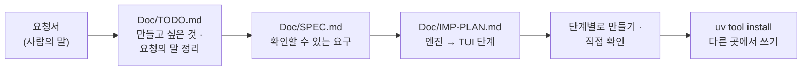

# 7교시 바이브 코딩 · 요청서 `tlog` (가장 먼저 읽기)

- 순서: **이 요청서** → 내 정리 `~/vibe/tlog/Doc/TODO.md` (8분) → [VIBE-Q-TLOG.md](VIBE-Q-TLOG.md)의 순서대로 `Doc/SPEC.md` → `Doc/IMP-PLAN.md` → 단계별로 만들기 → 설치 · 다른 곳에서 쓰기 → 수업이 끝나면 `VIBE-A-TLOG.md`(정답본)로 확인
- 이 문서는 **만들어 달라는 사람의 말**입니다. 요구 사항 표도, 단계도 없습니다. 그것을 뽑아 내는 것이 첫 일입니다. 72일차 `tbench`부터 76일차 `tretry`까지와 같은 순서입니다.



> **생활 속 예 · 주머니 속 계산기와 장부.** 오늘 가게 장부(n8n 보고서)를 만들었습니다. 그런데 사장님이 밤에 집에서 "어제 몇 시에 문제가 있었지?"를 보려면 가게 컴퓨터를 켜야 합니다. 같은 장부 쓰는 법으로 **주머니 속 계산기**에서도 같은 숫자가 나오면 어디서든 볼 수 있습니다. `tlog`는 오늘 만든 보고서와 **같은 정의**로 터미널에서 세는 계산기입니다.

## 왜 요청서부터인가

요구 사항 표를 통째로 에이전트에게 주고 "이대로 만들어 줘"라고 하면, 무엇이 만들어지든 **내가 판단할 기준이 없습니다.** 실무에서는 요구 사항 표가 오지 않고, 이 요청서 같은 **사람의 말**이 옵니다. 오늘 Lab 01 예제 1에서 팀의 보고서와 숫자를 먼저 비교해 본 것과 같습니다: 무엇이 맞는 숫자인지 정해야 맞았는지 말할 수 있습니다.

| 단계 | 누가 | 결과 |
| --- | --- | --- |
| 요청 → 할 일 목록 | **나** | `Doc/TODO.md`: 요청의 말 ①~⑫를 내 말로, 만들고 싶은 것 |
| 할 일 → 요구 | **나** (에이전트와 다듬어도 됨) | `Doc/SPEC.md`: 요구마다 "됐다 / 안 됐다"를 말할 수 있는 확인 방법 |
| 요구 → 단계 | **나** (에이전트와 다듬어도 됨) | `Doc/IMP-PLAN.md`: 엔진 단계와 화면(TUI) 단계로 나눈 순서 |
| 단계 → 코드 | 에이전트 | 처음 요청 한 번 + 단계마다 한 줄, `Doc/*.md`를 읽게 함 |
| 확인 | **나** | 직접 `uv run tlog …`, `pytest`, n8n `my-log-report`와 숫자 비교, 요구 표에 체크 |

## 요청 (운영 담당에게서 온 메시지, 그대로)

> 오늘 n8n으로 로그 보고서 · 문제 찾기 · SLO · 주간 보고까지 만들었잖아요. 정말 좋은데, 밤에 집에서 노트북으로 "아까 몇 시에 무슨 일이 있었지?"를 보려면 매번 n8n을 켜고 웹훅을 불러야 해요. 그리고 n8n 밖에도 로그가 있어요. 76일차에 만든 `tretry` 기록 같은 거요. **어느 폴더에서나** `tlog`라고 치면 로그를 볼 수 있는 작은 도구가 있으면 좋겠어요.
>
> ① 로그를 **파일에서도**, **데이터 API에서도** 읽어 주세요. 기간(시작일 · 끝일)과 태그 · 출처로 거를 수 있게요. 끝일도 **넣어서** 세 주세요. 오늘 팀 보고서가 끝날을 빼서 큰일 날 뻔했잖아요.
>
> ② 실행 수 · 오류 수 · 오류율 · p50 · p95, 갈래마다 수를 보여 주세요. **오늘 n8n 보고서와 똑같은 숫자**가 나와야 해요. 다르면 회의에서 또 "어느 숫자가 맞나"로 싸워요.
>
> ③ 실패를 **원인으로 묶어서** 많은 순으로, 그리고 사람에게 넘긴 질문의 주제, 답했는데 다시 묻는 주제도요.
>
> ④ **평소보다 크게 나빴던 시간**을 찾아 주세요. 오늘 Lab 02에서 정한 그 규칙으로요.
>
> ⑤ 다른 프로그램이 읽을 수 있게 **JSON으로도** 주세요. 칸 이름은 n8n 보고서와 같게요. 그래야 둘을 바로 비교할 수 있어요.
>
> ⑥ 어느 **단계**가 느린지, LLM에 **얼마** 들었는지도 보고 싶어요.
>
> ⑦ **SLO를 지켰는지** 판정해 주세요. 기준은 바꿀 수 있게요. 그리고 이걸 밤마다 자동으로 돌릴 거라, 어기면 **종료 코드로** 알려 주세요. 그래야 cron이나 CI가 알람을 울려요.
>
> ⑧ **지난주와 이번 주를 나란히** 보고 싶어요. 얼마나 늘고 줄었는지요.
>
> ⑨ 76일차 **`tretry` 기록**(`~/.tretry/log.jsonl`)도 읽어 주세요. 모양이 다르지만 같은 방식으로 보고 싶어요.
>
> ⑩ 오늘 만든 **주간 보고**처럼 마크다운으로 뽑아 주세요. 여기서는 LLM 없이 숫자 · 문제 · 할 일만이면 돼요.
>
> ⑪ **화면에서** 보고 싶어요. 위에 요약 한 줄, 왼쪽에 실패 묶음 — 하나를 고르면 오른쪽에 그 실행들이 보이게요. 실패 묶음 말고 시간대별 · 느린 실행으로도 바꿔 볼 수 있게요.
>
> ⑫ 스크립트에서 쓸 거라 **종료 코드**가 중요해요. 됐다 · 로그를 못 읽었다 · 쓰는 법이 틀렸다 · SLO를 어겼다를 서로 다른 번호로요.
>
> 아, 시험할 때 **진짜 n8n이나 데이터 API가 없어도** 돌아가야 해요. 그리고 오늘 두 주 기록으로 **n8n과 같은 숫자인지** 꼭 확인해 주세요.

## 함께 받은 것

| 파일 · 자료 | 메모 |
| --- | --- |
| 오늘 데이터 API `http://localhost:8800` | `POST /logs/query` 본문 `{"from", "to", "tag", "source"}` → `{"count", "logs"}` (날짜 포함) |
| `~/aio-01d4-stu/Last3Mon/77/data-api/data/run-logs.json` | 두 주 기록 666줄 (파일로 읽기 · 테스트용 사본) |
| [AGENTS.md](AGENTS.md) 2 · 3절 | 기록 한 줄의 모양, **지표 정의** (오늘의 정의서) |
| 내 `my-log-report` | 같은 기간을 물어 숫자를 비교할 상대: `uv run tools/flow.py call my-log-report requests/week2.json` |
| 76일차 `tretry` 기록 | `~/.tretry/log.jsonl` (없으면 `tretry --tries 2 --backoff 0 -- false`로 한 줄 만들기) |
| Python 표준 라이브러리 | `json`, `urllib.request`. TUI는 Textual |

## 할 일 · 요청을 내 할 일 목록으로 (8분, 에이전트 없이)

`~/vibe/tlog/Doc/TODO.md`를 만들고 요청의 말 ①~⑫와 맨 끝 부탁을 **내 말로** 한 줄씩 옮깁니다. 아직 "어떻게"는 쓰지 않습니다. **무엇을 · 왜**만 씁니다. 에이전트에게 맡기지 않고 직접 씁니다.

```markdown
# tlog TODO

## 만들고 싶은 것 (한 문단)
어느 폴더에서나 `tlog`로 실행 기록(파일 · 데이터 API)을 오늘 n8n 보고서와 같은 정의로 세어 ...

## 요청의 말 → 할 일
| # | 요청의 말 (짧게) | 할 일 (내 말) | 꼭 · 나중 |
| --- | --- | --- | --- |
| ① | 파일 · API, 기간 · 태그, 끝날 포함 | | 꼭 |
| ② | n8n과 똑같은 숫자 | | |
| ... | | | |
| 끝 | n8n 없이 시험 · 같은 숫자 확인 | | |

## 요청에 없지만 걱정되는 것
## 오늘 50분 안에 못 할 것 같은 것
```

예 하나만 보여 드립니다.

| 요청의 말 | TODO에 쓸 할 일 (내 말) | 다음 단계(SPEC)에서 바뀔 모양 |
| --- | --- | --- |
| ② "오늘 n8n 보고서와 똑같은 숫자" | "AGENTS.md 3절 정의 그대로: 끝날 포함, 소수 4자리, p95는 `ceil(p × n)`번째, 오류 갈래" | R2: 두 주 → 666 · 21 · 0.0315 · p50 1205 · p95 2537, 같은 기간 `my-log-report` 응답과 칸이 모두 같음 |

<details><summary>▶ 1단계 · 꼭 할 것과 나중에 할 것</summary>

요청의 말이 열두 개입니다. 50분 안에 다 만들기 어렵습니다. 담당자가 가장 아파하는 것은 "n8n과 똑같은 숫자"(회의에서 싸우지 않기)와 "밤마다 자동으로 SLO"입니다. 그리고 문제 찾기 · 화면 · 주간 보고를 만들려면 먼저 무엇이 있어야 하나요? (읽기 → 정의대로 세기 → JSON → 묶기 · 이상 → SLO → 화면)
</details>

<details><summary>▶ 2단계 · 걱정되는 것 (숨은 요구의 씨앗)</summary>

- ① "끝일도 넣어서": 파일에서 읽을 때는 내가 거르고, 데이터 API에서 읽을 때는 API가 거릅니다. 두 곳의 규칙이 같아야 합니다.
- ② "똑같은 숫자": 반올림은 어떻게? Python의 `round(0.5)`는 0, JavaScript의 `Math.round(0.5)`는 1입니다. n8n의 Code 노드는 JavaScript입니다. p95의 계산 방법(보간이냐 순위냐)도.
- ② 기록이 0건이면? 오늘 팀 보고서는 `null`을 냈습니다.
- ⑥ "단계": 그 단계를 거치지 않은 실행(0ms)을 넣을까요?
- ⑦ "종료 코드로": SLO 위반은 "프로그램이 실패한 것"과 다른 번호여야 cron이 둘을 구분합니다.
- ⑨ "모양이 다르지만": `tretry`는 시도마다 한 줄, 헬프데스크는 실행마다 한 줄입니다. 읽을 때 **같은 모양으로 바꾸는 층**을 하나 둡니다.
- 끝 "n8n 없이 시험": 데이터 API를 대신할 작은 가짜 서버, 두 주 기록의 사본.
</details>

## 그다음

[VIBE-Q-TLOG.md](VIBE-Q-TLOG.md)를 엽니다. 거기서 `Doc/TODO.md` → `Doc/SPEC.md` → `Doc/IMP-PLAN.md` → 단계별 구현 → 확인 → `uv tool install` → 다른 곳에서 사용 순서로 갑니다. VIBE-Q의 요구 표는 **내 SPEC을 쓴 뒤에** 비교하는 데 씁니다.
