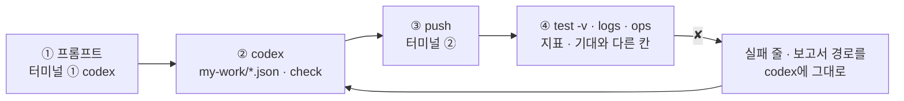
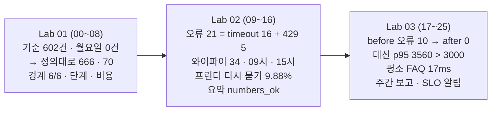

# 77일차 Lab 테스트 결과 · 실제로 만든 시나리오와 `test -v` 결과

> **정답 자료** · 77일차 n8n 워크플로우를 **만드는 프롬프트(codex) → push → `call` · `test -v` · `logs` · `ops` 결과**를 학생이 가는 순서대로 한 문서에 모았습니다. 수업이 끝난 뒤 공개합니다.

- 실행: 2026-10-31, 실습을 Lab마다 5개(예제 3 + 과제 2)로 늘린 뒤 강사 노트북의 65일차 n8n 2.42.6 + 77일차 판 데이터 API(76일차 + 두 주 실행 기록 666줄 · 오늘 실습 기록 · FAQ 더하기), OpenAI `gpt-4.1-mini`(요약 · 헬프데스크 답), 케이스 파일마다 **한 번씩**, 모두 26단계 (00~25)
- 명령: `~/aio-01d4-stu/Last3Mon/77`에서 `uv run tools/flow.py ...`. 아래 단계마다 **실행한 명령**과 **화면에 나온 출력 전부**를 그대로 붙이고, 그 아래 **쉽게 말하면**으로 결과를 풀어 썼습니다 (특히 ✘가 나온 까닭과 그것이 예상한 것인지). 같은 출력이 `NN-<이름>.txt`에, 그 단계 첫 `test`의 보고서가 `NN-<이름>.json`에 있습니다 (00 · 01단계는 보고서 없음).
- 지표는 두 주 기록을 정의대로 계산한 값이라 **늘 같습니다.** 실행마다 다른 것은 시간, LLM 요약 글, 오늘 실습 기록의 단계 시간(ms)뿐입니다. 이번 실행에서 정답의 잘못으로 실패한 케이스는 없습니다. ✘는 모두 "고치기 전" 단계에서 본 것입니다.
- "고치기 전" 상태: 00단계에서 `my-*` 워크플로우를 모두 **게시 해제**(`off`)하고 `ops --reset`으로 오늘 기록 · 더한 FAQ를 비워 학생이 처음 여는 상태와 같게 했습니다.

## `-v`가 보여 주는 것

```text
✔ 둘째 주 · 0.1s                                       ← 케이스 · 시간
    → request  POST /webhook/my-log-report              ← 보낸 요청 JSON
      { "from": "2026-10-26", "to": "2026-10-30" }
    ← response HTTP 200                                 ← 받은 응답 JSON (지표)
      { "total": 357, "errors": 21, "error_rate": 0.0588, "p50_ms": 1171, "p95_ms": 2598, "by_route": { … } }
```

오늘은 응답의 **지표**(무엇을 세었나)와, 기대와 다를 때 `✘` 줄 끝의 `칸 = 실제 (expected 기대)`를 봅니다. 숫자가 다르면 거의 언제나 **정의**(포함/제외 · 반올림 · 분모)가 다른 것입니다.

## 이 문서 하나로 따라가기

단계마다 **① codex에 넣는 프롬프트 → ② codex가 `my-work/*.json`을 쓰고 `check` → ③ 내가 `push` → ④ 내가 `test -v` · `logs` · `ops`** 순서입니다. 에이전트 없이 하는 예제(Lab 01 예제 1 · 3, Lab 02 예제 3, Lab 03 예제 3)와 고치기 전 단계는 프롬프트가 없습니다.



- **프롬프트는 정답본(`LAB-0x-A-*.md`)의 요청문 예**를 그대로 썼습니다 (실습 문서 빈칸 채우기 뼈대의 `____`를 채운 글자).
- **이 기록의 워크플로우는 수업 준비 때 만든 정답 파일**입니다. 프롬프트를 codex에 보내 다시 만들어 재지는 않았습니다 (68일차부터 수업 준비는 정답 워크플로우만 실행).
- 학생은 `push my-work/log-report.json`을 거듭 고쳐 push하고, 이 기록은 같은 웹훅(`my-log-report`)의 단계별 정답 파일을 차례로 push했습니다. 그래서 `test` 명령과 결과 모양은 같습니다.

## 시나리오 한눈에



| 단계 | 내용 |
| --- | --- |
| 00 | 수업 준비 · 처음 상태 · 기준 보고서 게시 · doctor |
| 01 | Lab 01 예제 1 · 손으로 읽기 · 팀의 기준 보고서 |
| 02 | Lab 01 예제 2 하기 전 → `lab01` 0/5 (기준에) |
| 03 | Lab 01 예제 2 · 지표 보고서 → 5/5 |
| 04 | Lab 01 예제 3 · 경계에서 재 보기 → 내 보고서 6/6 · 기준 2/6 |
| 05 | Lab 01 과제 1 하기 전 → `lab01-challenge` 0/6 |
| 06 | Lab 01 과제 1 · 날짜별 · 릴리스별 → 6/6 |
| 07 | Lab 01 과제 2 하기 전 → `lab01-challenge2` 0/5 |
| 08 | Lab 01 과제 2 · 어느 단계가 느린가 · 얼마 들었나 → 5/5 |
| 09 | Lab 02 하기 전 → `lab02` 0/6 |
| 10 | Lab 02 예제 1 · 실패 묶음 · 답 못 한 주제 → `lab02` 3/6 |
| 11 | Lab 02 예제 2 · 이상 시간대 → `lab02` 6/6 |
| 12 | Lab 02 예제 3 · 기간을 바꾸면 이상이 바뀐다 → 5/5 |
| 13 | Lab 02 과제 1 하기 전 → `lab02-challenge` 1/5 |
| 14 | Lab 02 과제 1 · 답했는데 다시 묻는 주제 → 5/5 |
| 15 | Lab 02 과제 2 하기 전 → `lab02-challenge2` 0/3 |
| 16 | Lab 02 과제 2 · LLM 요약, 숫자는 Code가 확인 → 3/3 |
| 17 | Lab 03 예제 1 · 고치기 전 → `replay-before` 10/10 · `lab03` 3/4 |
| 18 | Lab 03 예제 1 · 고치기 (timeout · FAQ 더하기) → `replay-after` 10/10 · `lab03` 4/4 |
| 19 | Lab 03 예제 2 하기 전 → `lab03-slo` 0/4 |
| 20 | Lab 03 예제 2 · SLO로 판정 → 4/4 |
| 21 | Lab 03 예제 3 · 고친 것의 대가 → `replay-normal` 10/10 · `lab03-cost` 4/4 |
| 22 | Lab 03 과제 1 하기 전 → `lab03-challenge` 0/7 |
| 23 | Lab 03 과제 1 · 주간 보고 → 7/7 |
| 24 | Lab 03 과제 2 하기 전 → `lab03-challenge2` 0/6 |
| 25 | Lab 03 과제 2 · SLO를 어기면 알림 → 6/6 |

## 준비

### 00 · 수업 준비 · 처음 상태 · 기준 보고서 게시 · doctor

실행한 명령:

```bash
uv run tools/flow.py ops --reset
uv run tools/flow.py off my-log-report my-log-summary my-weekly my-slo-alert my-helpdesk
uv run tools/flow.py push reference/baseline-report.json
uv run tools/flow.py doctor
```

출력 (그대로):

```text
✔ live run logs, added FAQ, created tickets, DLQ and alerts emptied, fault switch all ok

✔ unpublished my-log-report (id wfed832ca6c81732)
✔ unpublished my-weekly (id w269ccf31103289f)
✔ unpublished my-slo-alert (id w46a402ba838f33c)
✔ unpublished my-helpdesk (id wc5ae6e8bcdf8e39)
✔ n8n restarted. Turn it back on with: uv run tools/flow.py push <the workflow file>

✔ pushed '77 Log report (team baseline, provided)' (id w3f6d15ae763203b)
   POST http://localhost:5678/webhook/base-report

! n8n install folder /Users/mcchae/day65-n8n
   → day 65 SETUP-N8N 5단계 (get.n8n.io 설치). 다른 곳에 설치했다면 Last3Mon/65/n8n/.env 에 N8N_HOME=<폴더>
✔ n8n container day65-n8n-n8n-1
✔ n8n http://localhost:5678
✔ data API http://localhost:8800
✔ dead letter queue /dlq · alerts · fault switch dlq (day 76 data API)
✔ run logs /logs (666 seeded runs) · FAQ additions /faq-extra (day 77 data API)
✔ n8n → http://data-api:8800
✔ credential 'OpenAI (.env)' (openAiCourse0001)
✔ node catalog (for check)
✔ CLI coding agent: codex, claude, agy
ready
```

**쉽게 말하면**

- 오늘 실습 기록(`live`) · 더한 FAQ · 접수 건 · DLQ · 알림을 비우고 고장 스위치를 모두 `ok`로 돌렸습니다.
- 앞서 게시한 `my-log-report` · `my-log-summary` · `my-weekly` · `my-slo-alert` · `my-helpdesk`를 내려 학생이 처음 여는 상태를 만들고, 팀의 기준 보고서 `base-report`만 게시했습니다.
- `run logs /logs (666 seeded runs)` ✔는 데이터 API가 77일차 판이라는 뜻입니다. `ready`.

## Lab 01 · 실행 기록을 읽고, 지표로 만들기

### 01 · Lab 01 예제 1 · 손으로 읽기 · 팀의 기준 보고서

실행한 명령:

```bash
uv run tools/flow.py logs --from 2026-10-19 --to 2026-10-30 --last 5
uv run tools/flow.py logs --from 2026-10-26 --to 2026-10-26 --last 0
uv run tools/flow.py call base-report requests/two-weeks.json
uv run tools/flow.py call base-report requests/monday.json
```

출력 (그대로):

```text
666 run(s) · errors 21 (3.2%)
  route: 자동 답변 591 · 담당자 연결 34 · 오류 21 · 잠시 후 20
  2026-10-30T17:05:38  success 자동 답변   1311ms  프린터    인쇄 대기열이 안 비워져요
  2026-10-30T17:11:46  success 자동 답변   1175ms  메일    메일함 용량이 꽉 찼대요
  2026-10-30T17:20:51  success 담당자 연결    79ms  와이파이    회의실 와이파이가 안 잡혀요
  2026-10-30T17:24:39  success 자동 답변   1205ms  메일    첨부 파일이 너무 커서 안 보내져요
  2026-10-30T17:59:20  success 자동 답변   1076ms  메일    메일함 용량이 꽉 찼대요

70 run(s) · errors 16 (22.9%)
  route: 자동 답변 50 · 오류 16 · 담당자 연결 4

HTTP 200 · 1.2s
{
  "total": 602,
  "errors": 21,
  "error_rate": 3.488372093023256,
  "avg_ms": 1249.2392026578073,
  "by_route": {
    "자동 답변": 529,
    "담당자 연결": 32,
    "잠시 후": 20
  }
}

HTTP 200 · 0.1s
{
  "total": 0,
  "errors": 0,
  "error_rate": null,
  "avg_ms": null,
  "by_route": {}
}
```

**쉽게 말하면**

- `logs`로 두 주를 보면 666건 · 오류 21 (3.2%), 월요일(10/26) 하루는 70건 · 오류 16 (22.9%) — 오류의 대부분이 하루에 몰려 있습니다.
- 같은 기간을 팀의 기준 보고서로 물으면 두 주가 **602건**, 오류율 **3.488…**(백분율인데 반올림 없음), 평균 1249.2ms, 갈래에 `오류`가 없습니다. 월요일 하루는 **0건**, 오류율 `null`.
- 602 = 666 − 10/30의 64건: 기준이 `to`를 **포함하지 않고**(`started_at < to`) 비교해 마지막 날이 통째로 빠졌습니다. 같은 기록인데 세는 법(정의)이 다르면 숫자가 다릅니다. 예상한 결과.

### 02 · Lab 01 예제 2 하기 전 → `lab01` 0/5 (기준에)

실행한 명령:

```bash
uv run tools/flow.py test cases/lab01.json --webhook base-report -v
```

출력 (그대로):

```text
POST http://localhost:5678/webhook/base-report · 5 case(s) × 1
✘ 두 주 전체 · 0.2s · total = 602 (expected 666); error_rate = 3.488372093023256 (expected 0.0315); p50_ms = null (expected 1205); p95_ms = null (expected 2537)
    → request  POST /webhook/base-report
      {
        "from": "2026-10-19",
        "to": "2026-10-30"
      }
    ← response HTTP 200
      {
        "total": 602,
        "errors": 21,
        "error_rate": 3.488372093023256,
        "avg_ms": 1249.2392026578073,
        "by_route": {
          "자동 답변": 529,
          "담당자 연결": 32,
          "잠시 후": 20
        }
      }
✘ 두 주 · 갈래별 · 0.1s · by_route.자동 답변 = 529 (expected 591); by_route.담당자 연결 = 32 (expected 34); by_route.오류 = null (expected 21)
    → request  POST /webhook/base-report
      {
        "from": "2026-10-19",
        "to": "2026-10-30"
      }
    ← response HTTP 200
      {
        "total": 602,
        "errors": 21,
        "error_rate": 3.488372093023256,
        "avg_ms": 1249.2392026578073,
        "by_route": {
          "자동 답변": 529,
          "담당자 연결": 32,
          "잠시 후": 20
        }
      }
✘ 첫 주 · 0.1s · total = 245 (expected 309)
    → request  POST /webhook/base-report
      {
        "from": "2026-10-19",
        "to": "2026-10-23"
      }
    ← response HTTP 200
      {
        "total": 245,
        "errors": 0,
        "error_rate": 0,
        "avg_ms": 1317.1551020408162,
        "by_route": {
          "자동 답변": 230,
          "담당자 연결": 15
        }
      }
✘ 둘째 주 · 0.1s · total = 293 (expected 357); error_rate = 7.167235494880546 (expected 0.0588); p95_ms = null (expected 2598)
    → request  POST /webhook/base-report
      {
        "from": "2026-10-26",
        "to": "2026-10-30"
      }
    ← response HTTP 200
      {
        "total": 293,
        "errors": 21,
        "error_rate": 7.167235494880546,
        "avg_ms": 1173.1399317406144,
        "by_route": {
          "자동 답변": 237,
          "담당자 연결": 15,
          "잠시 후": 20
        }
      }
✘ 10월 26일 하루 · 0.1s · total = 0 (expected 70); errors = 0 (expected 16)
    → request  POST /webhook/base-report
      {
        "from": "2026-10-26",
        "to": "2026-10-26"
      }
    ← response HTTP 200
      {
        "total": 0,
        "errors": 0,
        "error_rate": null,
        "avg_ms": null,
        "by_route": {}
      }
Passed 0/5
report: runs/lab01-20261031-074859.json
```

**쉽게 말하면**

- 기준 보고서에 오늘의 테스트를 돌리면 다섯 케이스 모두 ✘. 마지막 날이 빠져 `total` 602 · 245 · 293 · 0, 오류율이 백분율 · 반올림 없음, `p50_ms` · `p95_ms` 칸이 없음(`null`), `by_route.오류`가 없음.
- 기준이 '틀린 계산'을 한 것이 아니라 **정의가 다른** 것입니다. 오늘의 정의는 AGENTS.md 3절. 예상한 결과.

### 03 · Lab 01 예제 2 · 지표 보고서 → 5/5

codex에 입력하는 프롬프트 (터미널 ①, 학생이 만들 파일 `my-work/log-report.json` · 이 기록에서 push한 같은 역할의 정답 `reference/lab01-example2-report.json`):

```text
my-work/log-report.json 을 새로 만들어 줘. 웹훅 POST my-log-report, 이름 "77 Log report (my)".
Get logs(HTTP POST http://data-api:8800/logs/query) 에 웹훅 본문의 from · to · tag · source 를 넘기고, source 가 없으면 all.
Compute metrics(Code) 하나에서 AGENTS.md 3절 정의대로 total · errors · error_rate · p50_ms · p95_ms · by_route 를 계산해 줘.
error_rate 는 errors / total 을 소수 4자리 반올림, 0건이면 0.
p50 · p95 는 duration_ms 를 오름차순으로 놓고 ceil(p × n)번째 값 (1부터 셈, 오류 실행도 포함). route 가 null 이면 by_route 의 "오류".
LLM 은 쓰지 않는다. 기대 결과 cases/lab01.json.
```

실행한 명령:

```bash
uv run tools/flow.py push reference/lab01-example2-report.json
uv run tools/flow.py test cases/lab01.json -v
uv run tools/flow.py call my-log-report requests/week2.json
```

출력 (그대로):

```text
✔ pushed '77 Log report (reference)' (id w1971efa15af33a8)
   POST http://localhost:5678/webhook/my-log-report

POST http://localhost:5678/webhook/my-log-report · 5 case(s) × 1
✔ 두 주 전체 · 0.9s
    → request  POST /webhook/my-log-report
      {
        "from": "2026-10-19",
        "to": "2026-10-30"
      }
    ← response HTTP 200
      {
        "total": 666,
        "errors": 21,
        "error_rate": 0.0315,
        "p50_ms": 1205,
        "p95_ms": 2537,
        "by_route": {
          "자동 답변": 591,
          "담당자 연결": 34,
          "오류": 21,
          "잠시 후": 20
        }
      }
✔ 두 주 · 갈래별 · 0.1s
    → request  POST /webhook/my-log-report
      {
        "from": "2026-10-19",
        "to": "2026-10-30"
      }
    ← response HTTP 200
      {
        "total": 666,
        "errors": 21,
        "error_rate": 0.0315,
        "p50_ms": 1205,
        "p95_ms": 2537,
        "by_route": {
          "자동 답변": 591,
          "담당자 연결": 34,
          "오류": 21,
          "잠시 후": 20
        }
      }
✔ 첫 주 · 0.2s
    → request  POST /webhook/my-log-report
      {
        "from": "2026-10-19",
        "to": "2026-10-23"
      }
    ← response HTTP 200
      {
        "total": 309,
        "errors": 0,
        "error_rate": 0,
        "p50_ms": 1252,
        "p95_ms": 2525,
        "by_route": {
          "자동 답변": 292,
          "담당자 연결": 17
        }
      }
✔ 둘째 주 · 0.1s
    → request  POST /webhook/my-log-report
      {
        "from": "2026-10-26",
        "to": "2026-10-30"
      }
    ← response HTTP 200
      {
        "total": 357,
        "errors": 21,
        "error_rate": 0.0588,
        "p50_ms": 1171,
        "p95_ms": 2598,
        "by_route": {
          "오류": 21,
          "자동 답변": 299,
          "담당자 연결": 17,
          "잠시 후": 20
        }
      }
✔ 10월 26일 하루 · 0.0s
    → request  POST /webhook/my-log-report
      {
        "from": "2026-10-26",
        "to": "2026-10-26"
      }
    ← response HTTP 200
      {
        "total": 70,
        "errors": 16,
        "error_rate": 0.2286,
        "p50_ms": 1082,
        "p95_ms": 2468,
        "by_route": {
          "오류": 16,
          "자동 답변": 50,
          "담당자 연결": 4
        }
      }
Passed 5/5
report: runs/lab01-20261031-074912.json

HTTP 200 · 0.1s
{
  "total": 357,
  "errors": 21,
  "error_rate": 0.0588,
  "p50_ms": 1171,
  "p95_ms": 2598,
  "by_route": {
    "오류": 21,
    "자동 답변": 299,
    "담당자 연결": 17,
    "잠시 후": 20
  }
}
```

**쉽게 말하면**

- 정의대로 계산하자 두 주 666 · 오류 21 · 0.0315 · p50 1205 · p95 2537, 갈래 591 · 34 · 20 · 오류 21. 첫 주 309 · 오류 0, 둘째 주 357 · 21 · 0.0588 · p95 2598, 월요일 70 · 16.
- 계산은 Code 한 곳, 0.1초 안팎. LLM은 쓰지 않았습니다. 예상한 결과.

### 04 · Lab 01 예제 3 · 경계에서 재 보기 → 내 보고서 6/6 · 기준 2/6

실행한 명령:

```bash
uv run tools/flow.py test cases/lab01-edges.json -v
uv run tools/flow.py test cases/lab01-edges.json --webhook base-report
```

출력 (그대로):

```text
✔ before: POST http://localhost:8800/logs-reset · HTTP 200 · 0.0s · {"cleared": 0}
    → request  POST http://localhost:8800/logs-reset
      {}
    ← response HTTP 200
      {
        "cleared": 0
      }
POST http://localhost:5678/webhook/my-log-report · 6 case(s) × 1
✔ 하루 · from = to (포함) · 0.0s
    → request  POST /webhook/my-log-report
      {
        "from": "2026-10-26",
        "to": "2026-10-26"
      }
    ← response HTTP 200
      {
        "total": 70,
        "errors": 16,
        "error_rate": 0.2286,
        "p50_ms": 1082,
        "p95_ms": 2468,
        "by_route": {
          "오류": 16,
          "자동 답변": 50,
          "담당자 연결": 4
        }
      }
✔ 빈 기간 · 0건이어도 200 · 0.1s
    → request  POST /webhook/my-log-report
      {
        "from": "2026-11-02",
        "to": "2026-11-06"
      }
    ← response HTTP 200
      {
        "total": 0,
        "errors": 0,
        "error_rate": 0,
        "p50_ms": 0,
        "p95_ms": 0,
        "by_route": {}
      }
✔ 주말 · 실행이 없는 날 · 0.0s
    → request  POST /webhook/my-log-report
      {
        "from": "2026-10-24",
        "to": "2026-10-25"
      }
    ← response HTTP 200
      {
        "total": 0,
        "errors": 0,
        "error_rate": 0,
        "p50_ms": 0,
        "p95_ms": 0,
        "by_route": {}
      }
✔ 기간을 비우면 전체 · 0.1s
    → request  POST /webhook/my-log-report
      {}
    ← response HTTP 200
      {
        "total": 666,
        "errors": 21,
        "error_rate": 0.0315,
        "p50_ms": 1205,
        "p95_ms": 2537,
        "by_route": {
          "자동 답변": 591,
          "담당자 연결": 34,
          "오류": 21,
          "잠시 후": 20
        }
      }
✔ source seed · 두 주 기록만 · 0.0s
    → request  POST /webhook/my-log-report
      {
        "from": "2026-10-19",
        "to": "2026-10-30",
        "source": "seed"
      }
    ← response HTTP 200
      {
        "total": 666,
        "errors": 21,
        "error_rate": 0.0315,
        "p50_ms": 1205,
        "p95_ms": 2537,
        "by_route": {
          "자동 답변": 591,
          "담당자 연결": 34,
          "오류": 21,
          "잠시 후": 20
        }
      }
✔ source live · 오늘 실습 기록 (아직 없음) · 0.0s
    → request  POST /webhook/my-log-report
      {
        "source": "live"
      }
    ← response HTTP 200
      {
        "total": 0,
        "errors": 0,
        "error_rate": 0,
        "p50_ms": 0,
        "p95_ms": 0,
        "by_route": {}
      }
Passed 6/6
report: runs/lab01-edges-20261031-074913.json

✔ before: POST http://localhost:8800/logs-reset · HTTP 200 · 0.0s · {"cleared": 0}
POST http://localhost:5678/webhook/base-report · 6 case(s) × 1
✘ 하루 · from = to (포함) · 0.1s · total = 0 (expected 70); errors = 0 (expected 16)
✘ 빈 기간 · 0건이어도 200 · 0.1s · error_rate = null (expected 0); p95_ms = null (expected 0)
✔ 주말 · 실행이 없는 날 · 0.1s
✔ 기간을 비우면 전체 · 0.0s
✘ source seed · 두 주 기록만 · 0.1s · total = 602 (expected 666)
✘ source live · 오늘 실습 기록 (아직 없음) · 0.1s · total = 666 (expected 0); error_rate = 3.153153153153153 (expected 0)
Passed 2/6
report: runs/lab01-edges-20261031-074913.json
```

**쉽게 말하면**

- 내 보고서: 하루(from = to) 70건, 빈 기간 · 주말 0건이어도 200 · 오류율 0 · p95 0, 기간을 비우면 666, `source: seed` 666, `source: live` 0 — 모두 ✔.
- 같은 테스트를 기준에: 하루 **0건**, 빈 기간 오류율 · p95 `null`(0으로 나눔), `seed` 602, `live`인데 **666**(기준은 `source`를 무시하고 늘 전체를 가져옴). ✔ 둘은 주말 · 기간 비우기뿐.
- 보통 날에는 둘 다 '그럴듯한' 숫자를 냅니다. **경계(하루 · 빈 기간 · 거르기)** 에서 정의의 차이가 드러납니다. 예상한 결과.

### 05 · Lab 01 과제 1 하기 전 → `lab01-challenge` 0/6

실행한 명령:

```bash
uv run tools/flow.py test cases/lab01-challenge.json -v
```

출력 (그대로):

```text
POST http://localhost:5678/webhook/my-log-report · 6 case(s) × 1
✘ 날짜별 · 월요일 · 0.1s · by_day.2026-10-26.total = null (expected 70); by_day.2026-10-26.errors = null (expected 16); by_day.2026-10-26.error_rate = null (expected 0.2286)
    → request  POST /webhook/my-log-report
      {
        "from": "2026-10-19",
        "to": "2026-10-30"
      }
    ← response HTTP 200
      {
        "total": 666,
        "errors": 21,
        "error_rate": 0.0315,
        "p50_ms": 1205,
        "p95_ms": 2537,
        "by_route": {
          "자동 답변": 591,
          "담당자 연결": 34,
          "오류": 21,
          "잠시 후": 20
        }
      }
✘ 날짜별 · 목요일 · 0.1s · by_day.2026-10-29.total = null (expected 97); by_day.2026-10-29.errors = null (expected 5)
    → request  POST /webhook/my-log-report
      {
        "from": "2026-10-19",
        "to": "2026-10-30"
      }
    ← response HTTP 200
      {
        "total": 666,
        "errors": 21,
        "error_rate": 0.0315,
        "p50_ms": 1205,
        "p95_ms": 2537,
        "by_route": {
          "자동 답변": 591,
          "담당자 연결": 34,
          "오류": 21,
          "잠시 후": 20
        }
      }
✘ 날짜는 10일 · 0.1s · by_day has none of ['"2026-10-19"']
    → request  POST /webhook/my-log-report
      {
        "from": "2026-10-19",
        "to": "2026-10-30"
      }
    ← response HTTP 200
      {
        "total": 666,
        "errors": 21,
        "error_rate": 0.0315,
        "p50_ms": 1205,
        "p95_ms": 2537,
        "by_route": {
          "자동 답변": 591,
          "담당자 연결": 34,
          "오류": 21,
          "잠시 후": 20
        }
      }
✘ 릴리스별 다시 묻기 · 1.2.0 · 0.1s · by_release has none of ['"1.2.0": {"answers": 8, "repeats": 5, "repeat_rate": 0.625}']
    → request  POST /webhook/my-log-report
      {
        "from": "2026-10-19",
        "to": "2026-10-30"
      }
    ← response HTTP 200
      {
        "total": 666,
        "errors": 21,
        "error_rate": 0.0315,
        "p50_ms": 1205,
        "p95_ms": 2537,
        "by_route": {
          "자동 답변": 591,
          "담당자 연결": 34,
          "오류": 21,
          "잠시 후": 20
        }
      }
✘ 릴리스별 다시 묻기 · 1.0.0 · 1.1.0 · 0.1s · by_release has none of ['"1.0.0": {"answers": 402, "repeats": 19, "repeat_rate": 0.0473}']
    → request  POST /webhook/my-log-report
      {
        "from": "2026-10-19",
        "to": "2026-10-30"
      }
    ← response HTTP 200
      {
        "total": 666,
        "errors": 21,
        "error_rate": 0.0315,
        "p50_ms": 1205,
        "p95_ms": 2537,
        "by_route": {
          "자동 답변": 591,
          "담당자 연결": 34,
          "오류": 21,
          "잠시 후": 20
        }
      }
✘ 1.1.0 · 0.1s · by_release has none of ['"1.1.0": {"answers": 181, "repeats": 14, "repeat_rate": 0.0773}']
    → request  POST /webhook/my-log-report
      {
        "from": "2026-10-19",
        "to": "2026-10-30"
      }
    ← response HTTP 200
      {
        "total": 666,
        "errors": 21,
        "error_rate": 0.0315,
        "p50_ms": 1205,
        "p95_ms": 2537,
        "by_route": {
          "자동 답변": 591,
          "담당자 연결": 34,
          "오류": 21,
          "잠시 후": 20
        }
      }
Passed 0/6
report: runs/lab01-challenge-20261031-074914.json
```

**쉽게 말하면**

- 예제 2의 보고서에는 `by_day` · `by_release`가 없어 모두 `null` / 글자 없음. 예상한 결과.

### 06 · Lab 01 과제 1 · 날짜별 · 릴리스별 → 6/6

codex에 입력하는 프롬프트 (터미널 ①, 학생이 만들 파일 `my-work/log-report.json` · 이 기록에서 push한 같은 역할의 정답 `answers/77-lab01-challenge-day-release.json`):

```text
my-work/log-report.json 의 Compute metrics 에 by_day 와 by_release 를 더해 줘.
by_day: started_at 앞 10자(날짜)로 묶어 {"2026-10-26": {total, errors, error_rate}}, 날짜순.
by_release: route 가 "자동 답변" 인 실행만 release 로 묶어 {answers, repeats, repeat_rate}.
repeats 는 repeat 가 true 인 수, repeat_rate = repeats / answers (소수 4자리).
앞의 지표는 그대로 둔다. 기대 결과 cases/lab01-challenge.json, cases/lab01.json 도.
```

실행한 명령:

```bash
uv run tools/flow.py push answers/77-lab01-challenge-day-release.json
uv run tools/flow.py test cases/lab01-challenge.json -v
uv run tools/flow.py test cases/lab01.json
```

출력 (그대로):

```text
! unpublished '77 Log report (reference)' (w1971efa15af33a8): it used the same webhook path
✔ pushed '77 Log report + days and releases (answer)' (id w5ee2fc1d2930303)
   POST http://localhost:5678/webhook/my-log-report

POST http://localhost:5678/webhook/my-log-report · 6 case(s) × 1
✔ 날짜별 · 월요일 · 1.0s
    → request  POST /webhook/my-log-report
      {
        "from": "2026-10-19",
        "to": "2026-10-30"
      }
    ← response HTTP 200
      {
        "total": 666,
        "errors": 21,
        "error_rate": 0.0315,
        "p50_ms": 1205,
        "p95_ms": 2537,
        "by_route": {
          "자동 답변": 591,
          "담당자 연결": 34,
          "오류": 21,
          "잠시 후": 20
        },
        "by_day": {
          "2026-10-19": {
            "total": 73,
            "errors": 0,
            "error_rate": 0
          },
          "2026-10-20": {
            "total": 57,
            "errors": 0,
            "error_rate": 0
          },
          "2026-10-21": {
            "total": 60,
            "errors": 0,
            "error_rate": 0
          },
          "2026-10-22": {
            "total": 55,
            "errors": 0,
            "error_rate": 0
          },
          "2026-10-23": {
            "total": 64,
            "errors": 0,
            "error_rate": 0
          },
          "2026-10-26": {
            "total": 70,
            "errors": 16,
            "error_rate": 0.2286
          },
          "2026-10-27": {
            "total": 62,
            "errors": 0,
            "error_rate": 0
          },
          "2026-10-28": {
            "total": 64,
            "errors": 0,
            "error_rate": 0
          },
          "2026-10-29": {
            "total": 97,
            "errors": 5,
            "error_rate": 0.0515
          },
          "2026-10-30": {
            "total": 64,
            "errors": 0,
            "error_rate": 0
          }
        },
        "by_release": {
          "1.0.0": {
            "answers": 402,
            "repeats": 19,
            "repeat_rate": 0.0473
          },
          "1.1.0": {
            "answers": 181,
            "repeats": 14,
            "repeat_rate": 0.0773
          },
          "1.2.0": {
            "answers": 8,
            "repeats": 5,
            "repeat_rate": 0.625
          }
        }
      }
✔ 날짜별 · 목요일 · 0.1s
    → request  POST /webhook/my-log-report
      {
        "from": "2026-10-19",
        "to": "2026-10-30"
      }
    ← response HTTP 200
      {
        "total": 666,
        "errors": 21,
        "error_rate": 0.0315,
        "p50_ms": 1205,
        "p95_ms": 2537,
        "by_route": {
          "자동 답변": 591,
          "담당자 연결": 34,
          "오류": 21,
          "잠시 후": 20
        },
        "by_day": {
          "2026-10-19": {
            "total": 73,
            "errors": 0,
            "error_rate": 0
          },
          "2026-10-20": {
            "total": 57,
            "errors": 0,
            "error_rate": 0
          },
          "2026-10-21": {
            "total": 60,
            "errors": 0,
            "error_rate": 0
          },
          "2026-10-22": {
            "total": 55,
            "errors": 0,
            "error_rate": 0
          },
          "2026-10-23": {
            "total": 64,
            "errors": 0,
            "error_rate": 0
          },
          "2026-10-26": {
            "total": 70,
            "errors": 16,
            "error_rate": 0.2286
          },
          "2026-10-27": {
            "total": 62,
            "errors": 0,
            "error_rate": 0
          },
          "2026-10-28": {
            "total": 64,
            "errors": 0,
            "error_rate": 0
          },
          "2026-10-29": {
            "total": 97,
            "errors": 5,
            "error_rate": 0.0515
          },
          "2026-10-30": {
            "total": 64,
            "errors": 0,
            "error_rate": 0
          }
        },
        "by_release": {
          "1.0.0": {
            "answers": 402,
            "repeats": 19,
            "repeat_rate": 0.0473
          },
          "1.1.0": {
            "answers": 181,
            "repeats": 14,
            "repeat_rate": 0.0773
          },
          "1.2.0": {
            "answers": 8,
            "repeats": 5,
            "repeat_rate": 0.625
          }
        }
      }
✔ 날짜는 10일 · 0.2s
    → request  POST /webhook/my-log-report
      {
        "from": "2026-10-19",
        "to": "2026-10-30"
      }
    ← response HTTP 200
      {
        "total": 666,
        "errors": 21,
        "error_rate": 0.0315,
        "p50_ms": 1205,
        "p95_ms": 2537,
        "by_route": {
          "자동 답변": 591,
          "담당자 연결": 34,
          "오류": 21,
          "잠시 후": 20
        },
        "by_day": {
          "2026-10-19": {
            "total": 73,
            "errors": 0,
            "error_rate": 0
          },
          "2026-10-20": {
            "total": 57,
            "errors": 0,
            "error_rate": 0
          },
          "2026-10-21": {
            "total": 60,
            "errors": 0,
            "error_rate": 0
          },
          "2026-10-22": {
            "total": 55,
            "errors": 0,
            "error_rate": 0
          },
          "2026-10-23": {
            "total": 64,
            "errors": 0,
            "error_rate": 0
          },
          "2026-10-26": {
            "total": 70,
            "errors": 16,
            "error_rate": 0.2286
          },
          "2026-10-27": {
            "total": 62,
            "errors": 0,
            "error_rate": 0
          },
          "2026-10-28": {
            "total": 64,
            "errors": 0,
            "error_rate": 0
          },
          "2026-10-29": {
            "total": 97,
            "errors": 5,
            "error_rate": 0.0515
          },
          "2026-10-30": {
            "total": 64,
            "errors": 0,
            "error_rate": 0
          }
        },
        "by_release": {
          "1.0.0": {
            "answers": 402,
            "repeats": 19,
            "repeat_rate": 0.0473
          },
          "1.1.0": {
            "answers": 181,
            "repeats": 14,
            "repeat_rate": 0.0773
          },
          "1.2.0": {
            "answers": 8,
            "repeats": 5,
            "repeat_rate": 0.625
          }
        }
      }
✔ 릴리스별 다시 묻기 · 1.2.0 · 0.1s
    → request  POST /webhook/my-log-report
      {
        "from": "2026-10-19",
        "to": "2026-10-30"
      }
    ← response HTTP 200
      {
        "total": 666,
        "errors": 21,
        "error_rate": 0.0315,
        "p50_ms": 1205,
        "p95_ms": 2537,
        "by_route": {
          "자동 답변": 591,
          "담당자 연결": 34,
          "오류": 21,
          "잠시 후": 20
        },
        "by_day": {
          "2026-10-19": {
            "total": 73,
            "errors": 0,
            "error_rate": 0
          },
          "2026-10-20": {
            "total": 57,
            "errors": 0,
            "error_rate": 0
          },
          "2026-10-21": {
            "total": 60,
            "errors": 0,
            "error_rate": 0
          },
          "2026-10-22": {
            "total": 55,
            "errors": 0,
            "error_rate": 0
          },
          "2026-10-23": {
            "total": 64,
            "errors": 0,
            "error_rate": 0
          },
          "2026-10-26": {
            "total": 70,
            "errors": 16,
            "error_rate": 0.2286
          },
          "2026-10-27": {
            "total": 62,
            "errors": 0,
            "error_rate": 0
          },
          "2026-10-28": {
            "total": 64,
            "errors": 0,
            "error_rate": 0
          },
          "2026-10-29": {
            "total": 97,
            "errors": 5,
            "error_rate": 0.0515
          },
          "2026-10-30": {
            "total": 64,
            "errors": 0,
            "error_rate": 0
          }
        },
        "by_release": {
          "1.0.0": {
            "answers": 402,
            "repeats": 19,
            "repeat_rate": 0.0473
          },
          "1.1.0": {
            "answers": 181,
            "repeats": 14,
            "repeat_rate": 0.0773
          },
          "1.2.0": {
            "answers": 8,
            "repeats": 5,
            "repeat_rate": 0.625
          }
        }
      }
✔ 릴리스별 다시 묻기 · 1.0.0 · 1.1.0 · 0.1s
    → request  POST /webhook/my-log-report
      {
        "from": "2026-10-19",
        "to": "2026-10-30"
      }
    ← response HTTP 200
      {
        "total": 666,
        "errors": 21,
        "error_rate": 0.0315,
        "p50_ms": 1205,
        "p95_ms": 2537,
        "by_route": {
          "자동 답변": 591,
          "담당자 연결": 34,
          "오류": 21,
          "잠시 후": 20
        },
        "by_day": {
          "2026-10-19": {
            "total": 73,
            "errors": 0,
            "error_rate": 0
          },
          "2026-10-20": {
            "total": 57,
            "errors": 0,
            "error_rate": 0
          },
          "2026-10-21": {
            "total": 60,
            "errors": 0,
            "error_rate": 0
          },
          "2026-10-22": {
            "total": 55,
            "errors": 0,
            "error_rate": 0
          },
          "2026-10-23": {
            "total": 64,
            "errors": 0,
            "error_rate": 0
          },
          "2026-10-26": {
            "total": 70,
            "errors": 16,
            "error_rate": 0.2286
          },
          "2026-10-27": {
            "total": 62,
            "errors": 0,
            "error_rate": 0
          },
          "2026-10-28": {
            "total": 64,
            "errors": 0,
            "error_rate": 0
          },
          "2026-10-29": {
            "total": 97,
            "errors": 5,
            "error_rate": 0.0515
          },
          "2026-10-30": {
            "total": 64,
            "errors": 0,
            "error_rate": 0
          }
        },
        "by_release": {
          "1.0.0": {
            "answers": 402,
            "repeats": 19,
            "repeat_rate": 0.0473
          },
          "1.1.0": {
            "answers": 181,
            "repeats": 14,
            "repeat_rate": 0.0773
          },
          "1.2.0": {
            "answers": 8,
            "repeats": 5,
            "repeat_rate": 0.625
          }
        }
      }
✔ 1.1.0 · 0.0s
    → request  POST /webhook/my-log-report
      {
        "from": "2026-10-19",
        "to": "2026-10-30"
      }
    ← response HTTP 200
      {
        "total": 666,
        "errors": 21,
        "error_rate": 0.0315,
        "p50_ms": 1205,
        "p95_ms": 2537,
        "by_route": {
          "자동 답변": 591,
          "담당자 연결": 34,
          "오류": 21,
          "잠시 후": 20
        },
        "by_day": {
          "2026-10-19": {
            "total": 73,
            "errors": 0,
            "error_rate": 0
          },
          "2026-10-20": {
            "total": 57,
            "errors": 0,
            "error_rate": 0
          },
          "2026-10-21": {
            "total": 60,
            "errors": 0,
            "error_rate": 0
          },
          "2026-10-22": {
            "total": 55,
            "errors": 0,
            "error_rate": 0
          },
          "2026-10-23": {
            "total": 64,
            "errors": 0,
            "error_rate": 0
          },
          "2026-10-26": {
            "total": 70,
            "errors": 16,
            "error_rate": 0.2286
          },
          "2026-10-27": {
            "total": 62,
            "errors": 0,
            "error_rate": 0
          },
          "2026-10-28": {
            "total": 64,
            "errors": 0,
            "error_rate": 0
          },
          "2026-10-29": {
            "total": 97,
            "errors": 5,
            "error_rate": 0.0515
          },
          "2026-10-30": {
            "total": 64,
            "errors": 0,
            "error_rate": 0
          }
        },
        "by_release": {
          "1.0.0": {
            "answers": 402,
            "repeats": 19,
            "repeat_rate": 0.0473
          },
          "1.1.0": {
            "answers": 181,
            "repeats": 14,
            "repeat_rate": 0.0773
          },
          "1.2.0": {
            "answers": 8,
            "repeats": 5,
            "repeat_rate": 0.625
          }
        }
      }
Passed 6/6
report: runs/lab01-challenge-20261031-074930.json

POST http://localhost:5678/webhook/my-log-report · 5 case(s) × 1
✔ 두 주 전체 · 0.1s
✔ 두 주 · 갈래별 · 0.1s
✔ 첫 주 · 0.1s
✔ 둘째 주 · 0.1s
✔ 10월 26일 하루 · 0.1s
Passed 5/5
report: runs/lab01-20261031-074930.json
```

**쉽게 말하면**

- 날짜별: 10/26 70건 · 오류 16 · 0.2286, 10/29 97건 · 오류 5. 날짜는 평일 10일 (주말 없음).
- 릴리스별(자동 답변만): 1.0.0 402건 · 다시 묻기 19 (4.73%), 1.1.0 181 · 14 (7.73%), 카나리 1.2.0 **8건** · 5 (62.5%). 1.2.0은 비율이 높지만 8건뿐 — 표본이 작아 믿기 이릅니다.
- `lab01` 5/5 그대로. 예상한 결과.

### 07 · Lab 01 과제 2 하기 전 → `lab01-challenge2` 0/5

실행한 명령:

```bash
uv run tools/flow.py test cases/lab01-challenge2.json -v
```

출력 (그대로):

```text
POST http://localhost:5678/webhook/my-log-report · 5 case(s) × 1
✘ 두 주 · 단계별 p95 · 0.1s · steps.faq_ms.p95 = null (expected 39); steps.answer_ms.p95 = null (expected 2509); steps.answer_ms.p50 = null (expected 1179)
    → request  POST /webhook/my-log-report
      {
        "from": "2026-10-19",
        "to": "2026-10-30"
      }
    ← response HTTP 200
      {
        "total": 666,
        "errors": 21,
        "error_rate": 0.0315,
        "p50_ms": 1205,
        "p95_ms": 2537,
        "by_route": {
          "자동 답변": 591,
          "담당자 연결": 34,
          "오류": 21,
          "잠시 후": 20
        },
        "by_day": {
          "2026-10-19": {
            "total": 73,
            "errors": 0,
            "error_rate": 0
          },
          "2026-10-20": {
            "total": 57,
            "errors": 0,
            "error_rate": 0
          },
          "2026-10-21": {
            "total": 60,
            "errors": 0,
            "error_rate": 0
          },
          "2026-10-22": {
            "total": 55,
            "errors": 0,
            "error_rate": 0
          },
          "2026-10-23": {
            "total": 64,
            "errors": 0,
            "error_rate": 0
          },
          "2026-10-26": {
            "total": 70,
            "errors": 16,
            "error_rate": 0.2286
          },
          "2026-10-27": {
            "total": 62,
            "errors": 0,
            "error_rate": 0
          },
          "2026-10-28": {
            "total": 64,
            "errors": 0,
            "error_rate": 0
          },
          "2026-10-29": {
            "total": 97,
            "errors": 5,
            "error_rate": 0.0515
          },
          "2026-10-30": {
            "total": 64,
            "errors": 0,
            "error_rate": 0
          }
        },
        "by_release": {
          "1.0.0": {
            "answers": 402,
            "repeats": 19,
            "repeat_rate": 0.0473
          },
          "1.1.0": {
            "answers": 181,
            "repeats": 14,
            "repeat_rate": 0.0773
          },
          "1.2.0": {
            "answers": 8,
            "repeats": 5,
            "repeat_rate": 0.625
          }
        }
      }
✘ 두 주 · 단계마다 잰 실행 수 · 0.1s · steps.faq_ms.runs = null (expected 646); steps.answer_ms.runs = null (expected 596)
    → request  POST /webhook/my-log-report
      {
        "from": "2026-10-19",
        "to": "2026-10-30"
      }
    ← response HTTP 200
      {
        "total": 666,
        "errors": 21,
        "error_rate": 0.0315,
        "p50_ms": 1205,
        "p95_ms": 2537,
        "by_route": {
          "자동 답변": 591,
          "담당자 연결": 34,
          "오류": 21,
          "잠시 후": 20
        },
        "by_day": {
          "2026-10-19": {
            "total": 73,
            "errors": 0,
            "error_rate": 0
          },
          "2026-10-20": {
            "total": 57,
            "errors": 0,
            "error_rate": 0
          },
          "2026-10-21": {
            "total": 60,
            "errors": 0,
            "error_rate": 0
          },
          "2026-10-22": {
            "total": 55,
            "errors": 0,
            "error_rate": 0
          },
          "2026-10-23": {
            "total": 64,
            "errors": 0,
            "error_rate": 0
          },
          "2026-10-26": {
            "total": 70,
            "errors": 16,
            "error_rate": 0.2286
          },
          "2026-10-27": {
            "total": 62,
            "errors": 0,
            "error_rate": 0
          },
          "2026-10-28": {
            "total": 64,
            "errors": 0,
            "error_rate": 0
          },
          "2026-10-29": {
            "total": 97,
            "errors": 5,
            "error_rate": 0.0515
          },
          "2026-10-30": {
            "total": 64,
            "errors": 0,
            "error_rate": 0
          }
        },
        "by_release": {
          "1.0.0": {
            "answers": 402,
            "repeats": 19,
            "repeat_rate": 0.0473
          },
          "1.1.0": {
            "answers": 181,
            "repeats": 14,
            "repeat_rate": 0.0773
          },
          "1.2.0": {
            "answers": 8,
            "repeats": 5,
            "repeat_rate": 0.625
          }
        }
      }
✘ 월요일 · FAQ 단계가 느림 · 0.1s · steps.faq_ms.p95 = null (expected 1000); steps.answer_ms.p95 = null (expected 2482)
    → request  POST /webhook/my-log-report
      {
        "from": "2026-10-26",
        "to": "2026-10-26"
      }
    ← response HTTP 200
      {
        "total": 70,
        "errors": 16,
        "error_rate": 0.2286,
        "p50_ms": 1082,
        "p95_ms": 2468,
        "by_route": {
          "오류": 16,
          "자동 답변": 50,
          "담당자 연결": 4
        },
        "by_day": {
          "2026-10-26": {
            "total": 70,
            "errors": 16,
            "error_rate": 0.2286
          }
        },
        "by_release": {
          "1.0.0": {
            "answers": 50,
            "repeats": 1,
            "repeat_rate": 0.02
          }
        }
      }
✘ 두 주 · 비용 · 0.1s · cost_usd = null (expected 0.07836); cost_per_run = null (expected 0.000118); llm_calls = null (expected 596)
    → request  POST /webhook/my-log-report
      {
        "from": "2026-10-19",
        "to": "2026-10-30"
      }
    ← response HTTP 200
      {
        "total": 666,
        "errors": 21,
        "error_rate": 0.0315,
        "p50_ms": 1205,
        "p95_ms": 2537,
        "by_route": {
          "자동 답변": 591,
          "담당자 연결": 34,
          "오류": 21,
          "잠시 후": 20
        },
        "by_day": {
          "2026-10-19": {
            "total": 73,
            "errors": 0,
            "error_rate": 0
          },
          "2026-10-20": {
            "total": 57,
            "errors": 0,
            "error_rate": 0
          },
          "2026-10-21": {
            "total": 60,
            "errors": 0,
            "error_rate": 0
          },
          "2026-10-22": {
            "total": 55,
            "errors": 0,
            "error_rate": 0
          },
          "2026-10-23": {
            "total": 64,
            "errors": 0,
            "error_rate": 0
          },
          "2026-10-26": {
            "total": 70,
            "errors": 16,
            "error_rate": 0.2286
          },
          "2026-10-27": {
            "total": 62,
            "errors": 0,
            "error_rate": 0
          },
          "2026-10-28": {
            "total": 64,
            "errors": 0,
            "error_rate": 0
          },
          "2026-10-29": {
            "total": 97,
            "errors": 5,
            "error_rate": 0.0515
          },
          "2026-10-30": {
            "total": 64,
            "errors": 0,
            "error_rate": 0
          }
        },
        "by_release": {
          "1.0.0": {
            "answers": 402,
            "repeats": 19,
            "repeat_rate": 0.0473
          },
          "1.1.0": {
            "answers": 181,
            "repeats": 14,
            "repeat_rate": 0.0773
          },
          "1.2.0": {
            "answers": 8,
            "repeats": 5,
            "repeat_rate": 0.625
          }
        }
      }
✘ 빈 기간 · 비용 0 · 0.0s · cost_usd = null (expected 0); cost_per_run = null (expected 0); llm_calls = null (expected 0); steps.faq_ms.p95 = null (expected 0)
    → request  POST /webhook/my-log-report
      {
        "from": "2026-11-02",
        "to": "2026-11-06"
      }
    ← response HTTP 200
      {
        "total": 0,
        "errors": 0,
        "error_rate": 0,
        "p50_ms": 0,
        "p95_ms": 0,
        "by_route": {},
        "by_day": {},
        "by_release": {}
      }
Passed 0/5
report: runs/lab01-challenge2-20261031-074930.json
```

**쉽게 말하면**

- `steps` · `cost_usd` · `cost_per_run` · `llm_calls`가 없어 모두 `null`. 예상한 결과.

### 08 · Lab 01 과제 2 · 어느 단계가 느린가 · 얼마 들었나 → 5/5

codex에 입력하는 프롬프트 (터미널 ①, 학생이 만들 파일 `my-work/log-report.json` · 이 기록에서 push한 같은 역할의 정답 `answers/77-lab01-challenge2-steps-cost.json`):

```text
my-work/log-report.json 의 Compute metrics 에 steps 와 비용을 더해 줘.
steps: faq_ms · answer_ms 마다, steps 의 그 값이 0보다 큰 실행만 모아 {runs, p50, p95} (백분위 정의는 앞과 같음, 없으면 runs 0 · p50 0 · p95 0).
cost_usd: 실행마다 cost_usd 의 합, 소수 5자리 반올림. cost_per_run: cost_usd / total, 소수 6자리 (0건이면 0).
llm_calls: 실행마다 llm_calls 의 합.
앞의 지표는 그대로. 기대 결과 cases/lab01-challenge2.json, lab01 · lab01-challenge 도 그대로 통과.
```

실행한 명령:

```bash
uv run tools/flow.py push answers/77-lab01-challenge2-steps-cost.json
uv run tools/flow.py test cases/lab01-challenge2.json -v
uv run tools/flow.py test cases/lab01.json
uv run tools/flow.py test cases/lab01-challenge.json
```

출력 (그대로):

```text
! unpublished '77 Log report + days and releases (answer)' (w5ee2fc1d2930303): it used the same webhook path
✔ pushed '77 Log report + steps and cost (answer)' (id w0c1a020313bbffc)
   POST http://localhost:5678/webhook/my-log-report

POST http://localhost:5678/webhook/my-log-report · 5 case(s) × 1
✔ 두 주 · 단계별 p95 · 0.9s · 596 calls · $0.078360
    → request  POST /webhook/my-log-report
      {
        "from": "2026-10-19",
        "to": "2026-10-30"
      }
    ← response HTTP 200
      {
        "total": 666,
        "errors": 21,
        "error_rate": 0.0315,
        "p50_ms": 1205,
        "p95_ms": 2537,
        "by_route": {
          "자동 답변": 591,
          "담당자 연결": 34,
          "오류": 21,
          "잠시 후": 20
        },
        "by_day": {
          "2026-10-19": {
            "total": 73,
            "errors": 0,
            "error_rate": 0
          },
          "2026-10-20": {
            "total": 57,
            "errors": 0,
            "error_rate": 0
          },
          "2026-10-21": {
            "total": 60,
            "errors": 0,
            "error_rate": 0
          },
          "2026-10-22": {
            "total": 55,
            "errors": 0,
            "error_rate": 0
          },
          "2026-10-23": {
            "total": 64,
            "errors": 0,
            "error_rate": 0
          },
          "2026-10-26": {
            "total": 70,
            "errors": 16,
            "error_rate": 0.2286
          },
          "2026-10-27": {
            "total": 62,
            "errors": 0,
            "error_rate": 0
          },
          "2026-10-28": {
            "total": 64,
            "errors": 0,
            "error_rate": 0
          },
          "2026-10-29": {
            "total": 97,
            "errors": 5,
            "error_rate": 0.0515
          },
          "2026-10-30": {
            "total": 64,
            "errors": 0,
            "error_rate": 0
          }
        },
        "by_release": {
          "1.0.0": {
            "answers": 402,
            "repeats": 19,
            "repeat_rate": 0.0473
          },
          "1.1.0": {
            "answers": 181,
            "repeats": 14,
            "repeat_rate": 0.0773
          },
          "1.2.0": {
            "answers": 8,
            "repeats": 5,
            "repeat_rate": 0.625
          }
        },
        "steps": {
          "faq_ms": {
            "runs": 646,
            "p50": 27,
            "p95": 39
          },
          "answer_ms": {
            "runs": 596,
            "p50": 1179,
            "p95": 2509
          }
        },
        "cost_usd": 0.07836,
        "cost_per_run": 0.000118,
        "llm_calls": 596
      }
✔ 두 주 · 단계마다 잰 실행 수 · 0.1s · 596 calls · $0.078360
    → request  POST /webhook/my-log-report
      {
        "from": "2026-10-19",
        "to": "2026-10-30"
      }
    ← response HTTP 200
      {
        "total": 666,
        "errors": 21,
        "error_rate": 0.0315,
        "p50_ms": 1205,
        "p95_ms": 2537,
        "by_route": {
          "자동 답변": 591,
          "담당자 연결": 34,
          "오류": 21,
          "잠시 후": 20
        },
        "by_day": {
          "2026-10-19": {
            "total": 73,
            "errors": 0,
            "error_rate": 0
          },
          "2026-10-20": {
            "total": 57,
            "errors": 0,
            "error_rate": 0
          },
          "2026-10-21": {
            "total": 60,
            "errors": 0,
            "error_rate": 0
          },
          "2026-10-22": {
            "total": 55,
            "errors": 0,
            "error_rate": 0
          },
          "2026-10-23": {
            "total": 64,
            "errors": 0,
            "error_rate": 0
          },
          "2026-10-26": {
            "total": 70,
            "errors": 16,
            "error_rate": 0.2286
          },
          "2026-10-27": {
            "total": 62,
            "errors": 0,
            "error_rate": 0
          },
          "2026-10-28": {
            "total": 64,
            "errors": 0,
            "error_rate": 0
          },
          "2026-10-29": {
            "total": 97,
            "errors": 5,
            "error_rate": 0.0515
          },
          "2026-10-30": {
            "total": 64,
            "errors": 0,
            "error_rate": 0
          }
        },
        "by_release": {
          "1.0.0": {
            "answers": 402,
            "repeats": 19,
            "repeat_rate": 0.0473
          },
          "1.1.0": {
            "answers": 181,
            "repeats": 14,
            "repeat_rate": 0.0773
          },
          "1.2.0": {
            "answers": 8,
            "repeats": 5,
            "repeat_rate": 0.625
          }
        },
        "steps": {
          "faq_ms": {
            "runs": 646,
            "p50": 27,
            "p95": 39
          },
          "answer_ms": {
            "runs": 596,
            "p50": 1179,
            "p95": 2509
          }
        },
        "cost_usd": 0.07836,
        "cost_per_run": 0.000118,
        "llm_calls": 596
      }
✔ 월요일 · FAQ 단계가 느림 · 0.2s · 50 calls · $0.006450
    → request  POST /webhook/my-log-report
      {
        "from": "2026-10-26",
        "to": "2026-10-26"
      }
    ← response HTTP 200
      {
        "total": 70,
        "errors": 16,
        "error_rate": 0.2286,
        "p50_ms": 1082,
        "p95_ms": 2468,
        "by_route": {
          "오류": 16,
          "자동 답변": 50,
          "담당자 연결": 4
        },
        "by_day": {
          "2026-10-26": {
            "total": 70,
            "errors": 16,
            "error_rate": 0.2286
          }
        },
        "by_release": {
          "1.0.0": {
            "answers": 50,
            "repeats": 1,
            "repeat_rate": 0.02
          }
        },
        "steps": {
          "faq_ms": {
            "runs": 70,
            "p50": 31,
            "p95": 1000
          },
          "answer_ms": {
            "runs": 50,
            "p50": 1169,
            "p95": 2482
          }
        },
        "cost_usd": 0.00645,
        "cost_per_run": 9.2e-05,
        "llm_calls": 50
      }
✔ 두 주 · 비용 · 0.1s · 596 calls · $0.078360
    → request  POST /webhook/my-log-report
      {
        "from": "2026-10-19",
        "to": "2026-10-30"
      }
    ← response HTTP 200
      {
        "total": 666,
        "errors": 21,
        "error_rate": 0.0315,
        "p50_ms": 1205,
        "p95_ms": 2537,
        "by_route": {
          "자동 답변": 591,
          "담당자 연결": 34,
          "오류": 21,
          "잠시 후": 20
        },
        "by_day": {
          "2026-10-19": {
            "total": 73,
            "errors": 0,
            "error_rate": 0
          },
          "2026-10-20": {
            "total": 57,
            "errors": 0,
            "error_rate": 0
          },
          "2026-10-21": {
            "total": 60,
            "errors": 0,
            "error_rate": 0
          },
          "2026-10-22": {
            "total": 55,
            "errors": 0,
            "error_rate": 0
          },
          "2026-10-23": {
            "total": 64,
            "errors": 0,
            "error_rate": 0
          },
          "2026-10-26": {
            "total": 70,
            "errors": 16,
            "error_rate": 0.2286
          },
          "2026-10-27": {
            "total": 62,
            "errors": 0,
            "error_rate": 0
          },
          "2026-10-28": {
            "total": 64,
            "errors": 0,
            "error_rate": 0
          },
          "2026-10-29": {
            "total": 97,
            "errors": 5,
            "error_rate": 0.0515
          },
          "2026-10-30": {
            "total": 64,
            "errors": 0,
            "error_rate": 0
          }
        },
        "by_release": {
          "1.0.0": {
            "answers": 402,
            "repeats": 19,
            "repeat_rate": 0.0473
          },
          "1.1.0": {
            "answers": 181,
            "repeats": 14,
            "repeat_rate": 0.0773
          },
          "1.2.0": {
            "answers": 8,
            "repeats": 5,
            "repeat_rate": 0.625
          }
        },
        "steps": {
          "faq_ms": {
            "runs": 646,
            "p50": 27,
            "p95": 39
          },
          "answer_ms": {
            "runs": 596,
            "p50": 1179,
            "p95": 2509
          }
        },
        "cost_usd": 0.07836,
        "cost_per_run": 0.000118,
        "llm_calls": 596
      }
✔ 빈 기간 · 비용 0 · 0.0s · 0 calls · $0.000000
    → request  POST /webhook/my-log-report
      {
        "from": "2026-11-02",
        "to": "2026-11-06"
      }
    ← response HTTP 200
      {
        "total": 0,
        "errors": 0,
        "error_rate": 0,
        "p50_ms": 0,
        "p95_ms": 0,
        "by_route": {},
        "by_day": {},
        "by_release": {},
        "steps": {
          "faq_ms": {
            "runs": 0,
            "p50": 0,
            "p95": 0
          },
          "answer_ms": {
            "runs": 0,
            "p50": 0,
            "p95": 0
          }
        },
        "cost_usd": 0,
        "cost_per_run": 0,
        "llm_calls": 0
      }
Passed 5/5
report: runs/lab01-challenge2-20261031-074945.json

POST http://localhost:5678/webhook/my-log-report · 5 case(s) × 1
✔ 두 주 전체 · 0.1s · 596 calls · $0.078360
✔ 두 주 · 갈래별 · 0.1s · 596 calls · $0.078360
✔ 첫 주 · 0.1s · 292 calls · $0.038550
✔ 둘째 주 · 0.1s · 304 calls · $0.039810
✔ 10월 26일 하루 · 0.0s · 50 calls · $0.006450
Passed 5/5
report: runs/lab01-20261031-074945.json

POST http://localhost:5678/webhook/my-log-report · 6 case(s) × 1
✔ 날짜별 · 월요일 · 0.1s · 596 calls · $0.078360
✔ 날짜별 · 목요일 · 0.1s · 596 calls · $0.078360
✔ 날짜는 10일 · 0.1s · 596 calls · $0.078360
✔ 릴리스별 다시 묻기 · 1.2.0 · 0.1s · 596 calls · $0.078360
✔ 릴리스별 다시 묻기 · 1.0.0 · 1.1.0 · 0.1s · 596 calls · $0.078360
✔ 1.1.0 · 0.1s · 596 calls · $0.078360
Passed 6/6
report: runs/lab01-challenge-20261031-074946.json
```

**쉽게 말하면**

- 두 주: FAQ 단계 p95 **39ms**(646건), 답 단계 p50 1179 · p95 **2509ms**(596건) — 평소 느린 것은 LLM 답 단계입니다.
- 월요일만: FAQ 단계 p95가 **1000ms** — timeout(1초)에 걸린 실행이 p95를 차지했습니다. 같은 지표도 기간을 나누면 다른 문제가 보입니다.
- 비용: 두 주 0.07836달러, 실행당 0.000118달러, LLM 호출 596번. 빈 기간은 모두 0. 테스트 줄 끝의 `596 calls · $0.078360`은 응답의 `llm_calls` · `cost_usd`를 flow.py가 보여 준 것입니다 (75일차 기능).
- `lab01` 5/5 · `lab01-challenge` 6/6 그대로. 예상한 결과.

## Lab 02 · 문제를 숫자로 찾고, 요약하기

### 09 · Lab 02 하기 전 → `lab02` 0/6

실행한 명령:

```bash
uv run tools/flow.py test cases/lab02.json -v
```

출력 (그대로):

```text
POST http://localhost:5678/webhook/my-log-report · 6 case(s) × 1
✘ 예제 1 · 가장 많은 실패 · 0.1s · 596 calls · $0.078360 · failures.0.node = null (expected Search FAQ); failures.0.message = null (expected timeout of 1000ms exceeded); failures.0.count = null (expected 16)
    → request  POST /webhook/my-log-report
      {
        "from": "2026-10-19",
        "to": "2026-10-30"
      }
    ← response HTTP 200
      {
        "total": 666,
        "errors": 21,
        "error_rate": 0.0315,
        "p50_ms": 1205,
        "p95_ms": 2537,
        "by_route": {
          "자동 답변": 591,
          "담당자 연결": 34,
          "오류": 21,
          "잠시 후": 20
        },
        "by_day": {
          "2026-10-19": {
            "total": 73,
            "errors": 0,
            "error_rate": 0
          },
          "2026-10-20": {
            "total": 57,
            "errors": 0,
            "error_rate": 0
          },
          "2026-10-21": {
            "total": 60,
            "errors": 0,
            "error_rate": 0
          },
          "2026-10-22": {
            "total": 55,
            "errors": 0,
            "error_rate": 0
          },
          "2026-10-23": {
            "total": 64,
            "errors": 0,
            "error_rate": 0
          },
          "2026-10-26": {
            "total": 70,
            "errors": 16,
            "error_rate": 0.2286
          },
          "2026-10-27": {
            "total": 62,
            "errors": 0,
            "error_rate": 0
          },
          "2026-10-28": {
            "total": 64,
            "errors": 0,
            "error_rate": 0
          },
          "2026-10-29": {
            "total": 97,
            "errors": 5,
            "error_rate": 0.0515
          },
          "2026-10-30": {
            "total": 64,
            "errors": 0,
            "error_rate": 0
          }
        },
        "by_release": {
          "1.0.0": {
            "answers": 402,
            "repeats": 19,
            "repeat_rate": 0.0473
          },
          "1.1.0": {
            "answers": 181,
            "repeats": 14,
            "repeat_rate": 0.0773
          },
          "1.2.0": {
            "answers": 8,
            "repeats": 5,
            "repeat_rate": 0.625
          }
        },
        "steps": {
          "faq_ms": {
            "runs": 646,
            "p50": 27,
            "p95": 39
          },
          "answer_ms": {
            "runs": 596,
            "p50": 1179,
            "p95": 2509
          }
        },
        "cost_usd": 0.07836,
        "cost_per_run": 0.000118,
        "llm_calls": 596
      }
✘ 예제 1 · 두 번째 실패 · 0.1s · 596 calls · $0.078360 · failures.1.node = null (expected Answer); failures.1.count = null (expected 5)
    → request  POST /webhook/my-log-report
      {
        "from": "2026-10-19",
        "to": "2026-10-30"
      }
    ← response HTTP 200
      {
        "total": 666,
        "errors": 21,
        "error_rate": 0.0315,
        "p50_ms": 1205,
        "p95_ms": 2537,
        "by_route": {
          "자동 답변": 591,
          "담당자 연결": 34,
          "오류": 21,
          "잠시 후": 20
        },
        "by_day": {
          "2026-10-19": {
            "total": 73,
            "errors": 0,
            "error_rate": 0
          },
          "2026-10-20": {
            "total": 57,
            "errors": 0,
            "error_rate": 0
          },
          "2026-10-21": {
            "total": 60,
            "errors": 0,
            "error_rate": 0
          },
          "2026-10-22": {
            "total": 55,
            "errors": 0,
            "error_rate": 0
          },
          "2026-10-23": {
            "total": 64,
            "errors": 0,
            "error_rate": 0
          },
          "2026-10-26": {
            "total": 70,
            "errors": 16,
            "error_rate": 0.2286
          },
          "2026-10-27": {
            "total": 62,
            "errors": 0,
            "error_rate": 0
          },
          "2026-10-28": {
            "total": 64,
            "errors": 0,
            "error_rate": 0
          },
          "2026-10-29": {
            "total": 97,
            "errors": 5,
            "error_rate": 0.0515
          },
          "2026-10-30": {
            "total": 64,
            "errors": 0,
            "error_rate": 0
          }
        },
        "by_release": {
          "1.0.0": {
            "answers": 402,
            "repeats": 19,
            "repeat_rate": 0.0473
          },
          "1.1.0": {
            "answers": 181,
            "repeats": 14,
            "repeat_rate": 0.0773
          },
          "1.2.0": {
            "answers": 8,
            "repeats": 5,
            "repeat_rate": 0.625
          }
        },
        "steps": {
          "faq_ms": {
            "runs": 646,
            "p50": 27,
            "p95": 39
          },
          "answer_ms": {
            "runs": 596,
            "p50": 1179,
            "p95": 2509
          }
        },
        "cost_usd": 0.07836,
        "cost_per_run": 0.000118,
        "llm_calls": 596
      }
✘ 예제 1 · 답하지 못한 주제 · 0.1s · 596 calls · $0.078360 · unanswered_topics.0.topic = null (expected 와이파이); unanswered_topics.0.count = null (expected 34)
    → request  POST /webhook/my-log-report
      {
        "from": "2026-10-19",
        "to": "2026-10-30"
      }
    ← response HTTP 200
      {
        "total": 666,
        "errors": 21,
        "error_rate": 0.0315,
        "p50_ms": 1205,
        "p95_ms": 2537,
        "by_route": {
          "자동 답변": 591,
          "담당자 연결": 34,
          "오류": 21,
          "잠시 후": 20
        },
        "by_day": {
          "2026-10-19": {
            "total": 73,
            "errors": 0,
            "error_rate": 0
          },
          "2026-10-20": {
            "total": 57,
            "errors": 0,
            "error_rate": 0
          },
          "2026-10-21": {
            "total": 60,
            "errors": 0,
            "error_rate": 0
          },
          "2026-10-22": {
            "total": 55,
            "errors": 0,
            "error_rate": 0
          },
          "2026-10-23": {
            "total": 64,
            "errors": 0,
            "error_rate": 0
          },
          "2026-10-26": {
            "total": 70,
            "errors": 16,
            "error_rate": 0.2286
          },
          "2026-10-27": {
            "total": 62,
            "errors": 0,
            "error_rate": 0
          },
          "2026-10-28": {
            "total": 64,
            "errors": 0,
            "error_rate": 0
          },
          "2026-10-29": {
            "total": 97,
            "errors": 5,
            "error_rate": 0.0515
          },
          "2026-10-30": {
            "total": 64,
            "errors": 0,
            "error_rate": 0
          }
        },
        "by_release": {
          "1.0.0": {
            "answers": 402,
            "repeats": 19,
            "repeat_rate": 0.0473
          },
          "1.1.0": {
            "answers": 181,
            "repeats": 14,
            "repeat_rate": 0.0773
          },
          "1.2.0": {
            "answers": 8,
            "repeats": 5,
            "repeat_rate": 0.625
          }
        },
        "steps": {
          "faq_ms": {
            "runs": 646,
            "p50": 27,
            "p95": 39
          },
          "answer_ms": {
            "runs": 596,
            "p50": 1179,
            "p95": 2509
          }
        },
        "cost_usd": 0.07836,
        "cost_per_run": 0.000118,
        "llm_calls": 596
      }
✘ 예제 2 · 이상 시간대 1 · 0.1s · 596 calls · $0.078360 · anomalies.0.hour = null (expected 2026-10-26T09); anomalies.0.total = null (expected 16); anomalies.0.errors = null (expected 16)
    → request  POST /webhook/my-log-report
      {
        "from": "2026-10-19",
        "to": "2026-10-30"
      }
    ← response HTTP 200
      {
        "total": 666,
        "errors": 21,
        "error_rate": 0.0315,
        "p50_ms": 1205,
        "p95_ms": 2537,
        "by_route": {
          "자동 답변": 591,
          "담당자 연결": 34,
          "오류": 21,
          "잠시 후": 20
        },
        "by_day": {
          "2026-10-19": {
            "total": 73,
            "errors": 0,
            "error_rate": 0
          },
          "2026-10-20": {
            "total": 57,
            "errors": 0,
            "error_rate": 0
          },
          "2026-10-21": {
            "total": 60,
            "errors": 0,
            "error_rate": 0
          },
          "2026-10-22": {
            "total": 55,
            "errors": 0,
            "error_rate": 0
          },
          "2026-10-23": {
            "total": 64,
            "errors": 0,
            "error_rate": 0
          },
          "2026-10-26": {
            "total": 70,
            "errors": 16,
            "error_rate": 0.2286
          },
          "2026-10-27": {
            "total": 62,
            "errors": 0,
            "error_rate": 0
          },
          "2026-10-28": {
            "total": 64,
            "errors": 0,
            "error_rate": 0
          },
          "2026-10-29": {
            "total": 97,
            "errors": 5,
            "error_rate": 0.0515
          },
          "2026-10-30": {
            "total": 64,
            "errors": 0,
            "error_rate": 0
          }
        },
        "by_release": {
          "1.0.0": {
            "answers": 402,
            "repeats": 19,
            "repeat_rate": 0.0473
          },
          "1.1.0": {
            "answers": 181,
            "repeats": 14,
            "repeat_rate": 0.0773
          },
          "1.2.0": {
            "answers": 8,
            "repeats": 5,
            "repeat_rate": 0.625
          }
        },
        "steps": {
          "faq_ms": {
            "runs": 646,
            "p50": 27,
            "p95": 39
          },
          "answer_ms": {
            "runs": 596,
            "p50": 1179,
            "p95": 2509
          }
        },
        "cost_usd": 0.07836,
        "cost_per_run": 0.000118,
        "llm_calls": 596
      }
✘ 예제 2 · 이상 시간대 2 · 0.1s · 596 calls · $0.078360 · anomalies.1.hour = null (expected 2026-10-29T15); anomalies.1.total = null (expected 7); anomalies.1.errors = null (expected 5)
    → request  POST /webhook/my-log-report
      {
        "from": "2026-10-19",
        "to": "2026-10-30"
      }
    ← response HTTP 200
      {
        "total": 666,
        "errors": 21,
        "error_rate": 0.0315,
        "p50_ms": 1205,
        "p95_ms": 2537,
        "by_route": {
          "자동 답변": 591,
          "담당자 연결": 34,
          "오류": 21,
          "잠시 후": 20
        },
        "by_day": {
          "2026-10-19": {
            "total": 73,
            "errors": 0,
            "error_rate": 0
          },
          "2026-10-20": {
            "total": 57,
            "errors": 0,
            "error_rate": 0
          },
          "2026-10-21": {
            "total": 60,
            "errors": 0,
            "error_rate": 0
          },
          "2026-10-22": {
            "total": 55,
            "errors": 0,
            "error_rate": 0
          },
          "2026-10-23": {
            "total": 64,
            "errors": 0,
            "error_rate": 0
          },
          "2026-10-26": {
            "total": 70,
            "errors": 16,
            "error_rate": 0.2286
          },
          "2026-10-27": {
            "total": 62,
            "errors": 0,
            "error_rate": 0
          },
          "2026-10-28": {
            "total": 64,
            "errors": 0,
            "error_rate": 0
          },
          "2026-10-29": {
            "total": 97,
            "errors": 5,
            "error_rate": 0.0515
          },
          "2026-10-30": {
            "total": 64,
            "errors": 0,
            "error_rate": 0
          }
        },
        "by_release": {
          "1.0.0": {
            "answers": 402,
            "repeats": 19,
            "repeat_rate": 0.0473
          },
          "1.1.0": {
            "answers": 181,
            "repeats": 14,
            "repeat_rate": 0.0773
          },
          "1.2.0": {
            "answers": 8,
            "repeats": 5,
            "repeat_rate": 0.625
          }
        },
        "steps": {
          "faq_ms": {
            "runs": 646,
            "p50": 27,
            "p95": 39
          },
          "answer_ms": {
            "runs": 596,
            "p50": 1179,
            "p95": 2509
          }
        },
        "cost_usd": 0.07836,
        "cost_per_run": 0.000118,
        "llm_calls": 596
      }
✘ 예제 2 · 첫 주에는 없음 · 0.0s · 292 calls · $0.038550 · anomalies = null (expected [])
    → request  POST /webhook/my-log-report
      {
        "from": "2026-10-19",
        "to": "2026-10-23"
      }
    ← response HTTP 200
      {
        "total": 309,
        "errors": 0,
        "error_rate": 0,
        "p50_ms": 1252,
        "p95_ms": 2525,
        "by_route": {
          "자동 답변": 292,
          "담당자 연결": 17
        },
        "by_day": {
          "2026-10-19": {
            "total": 73,
            "errors": 0,
            "error_rate": 0
          },
          "2026-10-20": {
            "total": 57,
            "errors": 0,
            "error_rate": 0
          },
          "2026-10-21": {
            "total": 60,
            "errors": 0,
            "error_rate": 0
          },
          "2026-10-22": {
            "total": 55,
            "errors": 0,
            "error_rate": 0
          },
          "2026-10-23": {
            "total": 64,
            "errors": 0,
            "error_rate": 0
          }
        },
        "by_release": {
          "1.0.0": {
            "answers": 292,
            "repeats": 16,
            "repeat_rate": 0.0548
          }
        },
        "steps": {
          "faq_ms": {
            "runs": 309,
            "p50": 27,
            "p95": 39
          },
          "answer_ms": {
            "runs": 292,
            "p50": 1200,
            "p95": 2470
          }
        },
        "cost_usd": 0.03855,
        "cost_per_run": 0.000125,
        "llm_calls": 292
      }
Passed 0/6
report: runs/lab02-20261031-074946.json
```

**쉽게 말하면**

- Lab 01까지의 보고서에는 `failures` · `unanswered_topics` · `anomalies`가 없어 모두 `null`. 예상한 결과.

### 10 · Lab 02 예제 1 · 실패 묶음 · 답 못 한 주제 → `lab02` 3/6

codex에 입력하는 프롬프트 (터미널 ①, 학생이 만들 파일 `my-work/log-report.json` · 이 기록에서 push한 같은 역할의 정답 `reference/lab02-example1-problems.json`):

```text
my-work/log-report.json 의 Compute metrics 에 failures 와 unanswered_topics 를 더해 줘.
failures: status 가 error 인 실행을 (error_node, error_message) 로 묶어 [{node, message, count}], 많은 순.
unanswered_topics: route 가 "담당자 연결" 인 실행을 topic 으로 묶어 [{topic, count}], 많은 순.
담당자 연결은 status 가 success 라 failures 에 넣지 않는다. 앞의 지표는 그대로. 기대 결과 cases/lab02.json 앞 세 케이스.
```

실행한 명령:

```bash
uv run tools/flow.py push reference/lab02-example1-problems.json
uv run tools/flow.py test cases/lab02.json -v
```

출력 (그대로):

```text
! unpublished '77 Log report + steps and cost (answer)' (w0c1a020313bbffc): it used the same webhook path
✔ pushed '77 Log report + failures and unanswered topics (reference)' (id w51c62bb8e6f4e90)
   POST http://localhost:5678/webhook/my-log-report

POST http://localhost:5678/webhook/my-log-report · 6 case(s) × 1
✔ 예제 1 · 가장 많은 실패 · 0.9s · 596 calls · $0.078360
    → request  POST /webhook/my-log-report
      {
        "from": "2026-10-19",
        "to": "2026-10-30"
      }
    ← response HTTP 200
      {
        "total": 666,
        "errors": 21,
        "error_rate": 0.0315,
        "p50_ms": 1205,
        "p95_ms": 2537,
        "by_route": {
          "자동 답변": 591,
          "담당자 연결": 34,
          "오류": 21,
          "잠시 후": 20
        },
        "by_day": {
          "2026-10-19": {
            "total": 73,
            "errors": 0,
            "error_rate": 0
          },
          "2026-10-20": {
            "total": 57,
            "errors": 0,
            "error_rate": 0
          },
          "2026-10-21": {
            "total": 60,
            "errors": 0,
            "error_rate": 0
          },
          "2026-10-22": {
            "total": 55,
            "errors": 0,
            "error_rate": 0
          },
          "2026-10-23": {
            "total": 64,
            "errors": 0,
            "error_rate": 0
          },
          "2026-10-26": {
            "total": 70,
            "errors": 16,
            "error_rate": 0.2286
          },
          "2026-10-27": {
            "total": 62,
            "errors": 0,
            "error_rate": 0
          },
          "2026-10-28": {
            "total": 64,
            "errors": 0,
            "error_rate": 0
          },
          "2026-10-29": {
            "total": 97,
            "errors": 5,
            "error_rate": 0.0515
          },
          "2026-10-30": {
            "total": 64,
            "errors": 0,
            "error_rate": 0
          }
        },
        "by_release": {
          "1.0.0": {
            "answers": 402,
            "repeats": 19,
            "repeat_rate": 0.0473
          },
          "1.1.0": {
            "answers": 181,
            "repeats": 14,
            "repeat_rate": 0.0773
          },
          "1.2.0": {
            "answers": 8,
            "repeats": 5,
            "repeat_rate": 0.625
          }
        },
        "steps": {
          "faq_ms": {
            "runs": 646,
            "p50": 27,
            "p95": 39
          },
          "answer_ms": {
            "runs": 596,
            "p50": 1179,
            "p95": 2509
          }
        },
        "cost_usd": 0.07836,
        "cost_per_run": 0.000118,
        "llm_calls": 596,
        "failures": [
          {
            "node": "Search FAQ",
            "message": "timeout of 1000ms exceeded",
            "count": 16
          },
          {
            "node": "Answer",
            "message": "429 Rate limit reached for requests",
            "count": 5
          }
        ],
        "unanswered_topics": [
          {
            "topic": "와이파이",
            "count": 34
          }
        ]
      }
✔ 예제 1 · 두 번째 실패 · 0.1s · 596 calls · $0.078360
    → request  POST /webhook/my-log-report
      {
        "from": "2026-10-19",
        "to": "2026-10-30"
      }
    ← response HTTP 200
      {
        "total": 666,
        "errors": 21,
        "error_rate": 0.0315,
        "p50_ms": 1205,
        "p95_ms": 2537,
        "by_route": {
          "자동 답변": 591,
          "담당자 연결": 34,
          "오류": 21,
          "잠시 후": 20
        },
        "by_day": {
          "2026-10-19": {
            "total": 73,
            "errors": 0,
            "error_rate": 0
          },
          "2026-10-20": {
            "total": 57,
            "errors": 0,
            "error_rate": 0
          },
          "2026-10-21": {
            "total": 60,
            "errors": 0,
            "error_rate": 0
          },
          "2026-10-22": {
            "total": 55,
            "errors": 0,
            "error_rate": 0
          },
          "2026-10-23": {
            "total": 64,
            "errors": 0,
            "error_rate": 0
          },
          "2026-10-26": {
            "total": 70,
            "errors": 16,
            "error_rate": 0.2286
          },
          "2026-10-27": {
            "total": 62,
            "errors": 0,
            "error_rate": 0
          },
          "2026-10-28": {
            "total": 64,
            "errors": 0,
            "error_rate": 0
          },
          "2026-10-29": {
            "total": 97,
            "errors": 5,
            "error_rate": 0.0515
          },
          "2026-10-30": {
            "total": 64,
            "errors": 0,
            "error_rate": 0
          }
        },
        "by_release": {
          "1.0.0": {
            "answers": 402,
            "repeats": 19,
            "repeat_rate": 0.0473
          },
          "1.1.0": {
            "answers": 181,
            "repeats": 14,
            "repeat_rate": 0.0773
          },
          "1.2.0": {
            "answers": 8,
            "repeats": 5,
            "repeat_rate": 0.625
          }
        },
        "steps": {
          "faq_ms": {
            "runs": 646,
            "p50": 27,
            "p95": 39
          },
          "answer_ms": {
            "runs": 596,
            "p50": 1179,
            "p95": 2509
          }
        },
        "cost_usd": 0.07836,
        "cost_per_run": 0.000118,
        "llm_calls": 596,
        "failures": [
          {
            "node": "Search FAQ",
            "message": "timeout of 1000ms exceeded",
            "count": 16
          },
          {
            "node": "Answer",
            "message": "429 Rate limit reached for requests",
            "count": 5
          }
        ],
        "unanswered_topics": [
          {
            "topic": "와이파이",
            "count": 34
          }
        ]
      }
✔ 예제 1 · 답하지 못한 주제 · 0.3s · 596 calls · $0.078360
    → request  POST /webhook/my-log-report
      {
        "from": "2026-10-19",
        "to": "2026-10-30"
      }
    ← response HTTP 200
      {
        "total": 666,
        "errors": 21,
        "error_rate": 0.0315,
        "p50_ms": 1205,
        "p95_ms": 2537,
        "by_route": {
          "자동 답변": 591,
          "담당자 연결": 34,
          "오류": 21,
          "잠시 후": 20
        },
        "by_day": {
          "2026-10-19": {
            "total": 73,
            "errors": 0,
            "error_rate": 0
          },
          "2026-10-20": {
            "total": 57,
            "errors": 0,
            "error_rate": 0
          },
          "2026-10-21": {
            "total": 60,
            "errors": 0,
            "error_rate": 0
          },
          "2026-10-22": {
            "total": 55,
            "errors": 0,
            "error_rate": 0
          },
          "2026-10-23": {
            "total": 64,
            "errors": 0,
            "error_rate": 0
          },
          "2026-10-26": {
            "total": 70,
            "errors": 16,
            "error_rate": 0.2286
          },
          "2026-10-27": {
            "total": 62,
            "errors": 0,
            "error_rate": 0
          },
          "2026-10-28": {
            "total": 64,
            "errors": 0,
            "error_rate": 0
          },
          "2026-10-29": {
            "total": 97,
            "errors": 5,
            "error_rate": 0.0515
          },
          "2026-10-30": {
            "total": 64,
            "errors": 0,
            "error_rate": 0
          }
        },
        "by_release": {
          "1.0.0": {
            "answers": 402,
            "repeats": 19,
            "repeat_rate": 0.0473
          },
          "1.1.0": {
            "answers": 181,
            "repeats": 14,
            "repeat_rate": 0.0773
          },
          "1.2.0": {
            "answers": 8,
            "repeats": 5,
            "repeat_rate": 0.625
          }
        },
        "steps": {
          "faq_ms": {
            "runs": 646,
            "p50": 27,
            "p95": 39
          },
          "answer_ms": {
            "runs": 596,
            "p50": 1179,
            "p95": 2509
          }
        },
        "cost_usd": 0.07836,
        "cost_per_run": 0.000118,
        "llm_calls": 596,
        "failures": [
          {
            "node": "Search FAQ",
            "message": "timeout of 1000ms exceeded",
            "count": 16
          },
          {
            "node": "Answer",
            "message": "429 Rate limit reached for requests",
            "count": 5
          }
        ],
        "unanswered_topics": [
          {
            "topic": "와이파이",
            "count": 34
          }
        ]
      }
✘ 예제 2 · 이상 시간대 1 · 0.1s · 596 calls · $0.078360 · anomalies.0.hour = null (expected 2026-10-26T09); anomalies.0.total = null (expected 16); anomalies.0.errors = null (expected 16)
    → request  POST /webhook/my-log-report
      {
        "from": "2026-10-19",
        "to": "2026-10-30"
      }
    ← response HTTP 200
      {
        "total": 666,
        "errors": 21,
        "error_rate": 0.0315,
        "p50_ms": 1205,
        "p95_ms": 2537,
        "by_route": {
          "자동 답변": 591,
          "담당자 연결": 34,
          "오류": 21,
          "잠시 후": 20
        },
        "by_day": {
          "2026-10-19": {
            "total": 73,
            "errors": 0,
            "error_rate": 0
          },
          "2026-10-20": {
            "total": 57,
            "errors": 0,
            "error_rate": 0
          },
          "2026-10-21": {
            "total": 60,
            "errors": 0,
            "error_rate": 0
          },
          "2026-10-22": {
            "total": 55,
            "errors": 0,
            "error_rate": 0
          },
          "2026-10-23": {
            "total": 64,
            "errors": 0,
            "error_rate": 0
          },
          "2026-10-26": {
            "total": 70,
            "errors": 16,
            "error_rate": 0.2286
          },
          "2026-10-27": {
            "total": 62,
            "errors": 0,
            "error_rate": 0
          },
          "2026-10-28": {
            "total": 64,
            "errors": 0,
            "error_rate": 0
          },
          "2026-10-29": {
            "total": 97,
            "errors": 5,
            "error_rate": 0.0515
          },
          "2026-10-30": {
            "total": 64,
            "errors": 0,
            "error_rate": 0
          }
        },
        "by_release": {
          "1.0.0": {
            "answers": 402,
            "repeats": 19,
            "repeat_rate": 0.0473
          },
          "1.1.0": {
            "answers": 181,
            "repeats": 14,
            "repeat_rate": 0.0773
          },
          "1.2.0": {
            "answers": 8,
            "repeats": 5,
            "repeat_rate": 0.625
          }
        },
        "steps": {
          "faq_ms": {
            "runs": 646,
            "p50": 27,
            "p95": 39
          },
          "answer_ms": {
            "runs": 596,
            "p50": 1179,
            "p95": 2509
          }
        },
        "cost_usd": 0.07836,
        "cost_per_run": 0.000118,
        "llm_calls": 596,
        "failures": [
          {
            "node": "Search FAQ",
            "message": "timeout of 1000ms exceeded",
            "count": 16
          },
          {
            "node": "Answer",
            "message": "429 Rate limit reached for requests",
            "count": 5
          }
        ],
        "unanswered_topics": [
          {
            "topic": "와이파이",
            "count": 34
          }
        ]
      }
✘ 예제 2 · 이상 시간대 2 · 0.1s · 596 calls · $0.078360 · anomalies.1.hour = null (expected 2026-10-29T15); anomalies.1.total = null (expected 7); anomalies.1.errors = null (expected 5)
    → request  POST /webhook/my-log-report
      {
        "from": "2026-10-19",
        "to": "2026-10-30"
      }
    ← response HTTP 200
      {
        "total": 666,
        "errors": 21,
        "error_rate": 0.0315,
        "p50_ms": 1205,
        "p95_ms": 2537,
        "by_route": {
          "자동 답변": 591,
          "담당자 연결": 34,
          "오류": 21,
          "잠시 후": 20
        },
        "by_day": {
          "2026-10-19": {
            "total": 73,
            "errors": 0,
            "error_rate": 0
          },
          "2026-10-20": {
            "total": 57,
            "errors": 0,
            "error_rate": 0
          },
          "2026-10-21": {
            "total": 60,
            "errors": 0,
            "error_rate": 0
          },
          "2026-10-22": {
            "total": 55,
            "errors": 0,
            "error_rate": 0
          },
          "2026-10-23": {
            "total": 64,
            "errors": 0,
            "error_rate": 0
          },
          "2026-10-26": {
            "total": 70,
            "errors": 16,
            "error_rate": 0.2286
          },
          "2026-10-27": {
            "total": 62,
            "errors": 0,
            "error_rate": 0
          },
          "2026-10-28": {
            "total": 64,
            "errors": 0,
            "error_rate": 0
          },
          "2026-10-29": {
            "total": 97,
            "errors": 5,
            "error_rate": 0.0515
          },
          "2026-10-30": {
            "total": 64,
            "errors": 0,
            "error_rate": 0
          }
        },
        "by_release": {
          "1.0.0": {
            "answers": 402,
            "repeats": 19,
            "repeat_rate": 0.0473
          },
          "1.1.0": {
            "answers": 181,
            "repeats": 14,
            "repeat_rate": 0.0773
          },
          "1.2.0": {
            "answers": 8,
            "repeats": 5,
            "repeat_rate": 0.625
          }
        },
        "steps": {
          "faq_ms": {
            "runs": 646,
            "p50": 27,
            "p95": 39
          },
          "answer_ms": {
            "runs": 596,
            "p50": 1179,
            "p95": 2509
          }
        },
        "cost_usd": 0.07836,
        "cost_per_run": 0.000118,
        "llm_calls": 596,
        "failures": [
          {
            "node": "Search FAQ",
            "message": "timeout of 1000ms exceeded",
            "count": 16
          },
          {
            "node": "Answer",
            "message": "429 Rate limit reached for requests",
            "count": 5
          }
        ],
        "unanswered_topics": [
          {
            "topic": "와이파이",
            "count": 34
          }
        ]
      }
✘ 예제 2 · 첫 주에는 없음 · 0.1s · 292 calls · $0.038550 · anomalies = null (expected [])
    → request  POST /webhook/my-log-report
      {
        "from": "2026-10-19",
        "to": "2026-10-23"
      }
    ← response HTTP 200
      {
        "total": 309,
        "errors": 0,
        "error_rate": 0,
        "p50_ms": 1252,
        "p95_ms": 2525,
        "by_route": {
          "자동 답변": 292,
          "담당자 연결": 17
        },
        "by_day": {
          "2026-10-19": {
            "total": 73,
            "errors": 0,
            "error_rate": 0
          },
          "2026-10-20": {
            "total": 57,
            "errors": 0,
            "error_rate": 0
          },
          "2026-10-21": {
            "total": 60,
            "errors": 0,
            "error_rate": 0
          },
          "2026-10-22": {
            "total": 55,
            "errors": 0,
            "error_rate": 0
          },
          "2026-10-23": {
            "total": 64,
            "errors": 0,
            "error_rate": 0
          }
        },
        "by_release": {
          "1.0.0": {
            "answers": 292,
            "repeats": 16,
            "repeat_rate": 0.0548
          }
        },
        "steps": {
          "faq_ms": {
            "runs": 309,
            "p50": 27,
            "p95": 39
          },
          "answer_ms": {
            "runs": 292,
            "p50": 1200,
            "p95": 2470
          }
        },
        "cost_usd": 0.03855,
        "cost_per_run": 0.000125,
        "llm_calls": 292,
        "failures": [],
        "unanswered_topics": [
          {
            "topic": "와이파이",
            "count": 17
          }
        ]
      }
Passed 3/6
report: runs/lab02-20261031-075001.json
```

**쉽게 말하면**

- 오류 21건이 원인 둘로 묶였습니다: `Search FAQ · timeout of 1000ms exceeded` **16건**, `Answer · 429 Rate limit reached` 5건.
- 담당자에게 넘긴 34건은 모두 **와이파이** — 오류가 아닌 실패이고, FAQ에 와이파이 항목이 없어서입니다.
- 남은 ✘ 셋은 예제 2(이상 시간대). 예상한 결과.

### 11 · Lab 02 예제 2 · 이상 시간대 → `lab02` 6/6

codex에 입력하는 프롬프트 (터미널 ①, 학생이 만들 파일 `my-work/log-report.json` · 이 기록에서 push한 같은 역할의 정답 `reference/lab02-example2-anomalies.json`):

```text
my-work/log-report.json 의 Compute metrics 에 anomalies 를 더해 줘.
started_at 앞 13자(예 2026-10-26T09)로 시간마다 묶어 {hour, total, errors, error_rate}.
실행이 5건 이상이고, error_rate 가 그 기간 전체 error_rate 의 3배 이상이고, 오류가 1건 이상인 시간만 시간순으로.
앞의 지표는 그대로. 기대 결과 cases/lab02.json 전체.
```

실행한 명령:

```bash
uv run tools/flow.py push reference/lab02-example2-anomalies.json
uv run tools/flow.py test cases/lab02.json -v
uv run tools/flow.py test cases/lab01-challenge2.json
uv run tools/flow.py call my-log-report requests/two-weeks.json
```

출력 (그대로):

```text
! unpublished '77 Log report + failures and unanswered topics (reference)' (w51c62bb8e6f4e90): it used the same webhook path
✔ pushed '77 Log report + anomalies (reference)' (id w4957bb6724af44d)
   POST http://localhost:5678/webhook/my-log-report

POST http://localhost:5678/webhook/my-log-report · 6 case(s) × 1
✔ 예제 1 · 가장 많은 실패 · 0.9s · 596 calls · $0.078360
    → request  POST /webhook/my-log-report
      {
        "from": "2026-10-19",
        "to": "2026-10-30"
      }
    ← response HTTP 200
      {
        "total": 666,
        "errors": 21,
        "error_rate": 0.0315,
        "p50_ms": 1205,
        "p95_ms": 2537,
        "by_route": {
          "자동 답변": 591,
          "담당자 연결": 34,
          "오류": 21,
          "잠시 후": 20
        },
        "by_day": {
          "2026-10-19": {
            "total": 73,
            "errors": 0,
            "error_rate": 0
          },
          "2026-10-20": {
            "total": 57,
            "errors": 0,
            "error_rate": 0
          },
          "2026-10-21": {
            "total": 60,
            "errors": 0,
            "error_rate": 0
          },
          "2026-10-22": {
            "total": 55,
            "errors": 0,
            "error_rate": 0
          },
          "2026-10-23": {
            "total": 64,
            "errors": 0,
            "error_rate": 0
          },
          "2026-10-26": {
            "total": 70,
            "errors": 16,
            "error_rate": 0.2286
          },
          "2026-10-27": {
            "total": 62,
            "errors": 0,
            "error_rate": 0
          },
          "2026-10-28": {
            "total": 64,
            "errors": 0,
            "error_rate": 0
          },
          "2026-10-29": {
            "total": 97,
            "errors": 5,
            "error_rate": 0.0515
          },
          "2026-10-30": {
            "total": 64,
            "errors": 0,
            "error_rate": 0
          }
        },
        "by_release": {
          "1.0.0": {
            "answers": 402,
            "repeats": 19,
            "repeat_rate": 0.0473
          },
          "1.1.0": {
            "answers": 181,
            "repeats": 14,
            "repeat_rate": 0.0773
          },
          "1.2.0": {
            "answers": 8,
            "repeats": 5,
            "repeat_rate": 0.625
          }
        },
        "steps": {
          "faq_ms": {
            "runs": 646,
            "p50": 27,
            "p95": 39
          },
          "answer_ms": {
            "runs": 596,
            "p50": 1179,
            "p95": 2509
          }
        },
        "cost_usd": 0.07836,
        "cost_per_run": 0.000118,
        "llm_calls": 596,
        "failures": [
          {
            "node": "Search FAQ",
            "message": "timeout of 1000ms exceeded",
            "count": 16
          },
          {
            "node": "Answer",
            "message": "429 Rate limit reached for requests",
            "count": 5
          }
        ],
        "unanswered_topics": [
          {
            "topic": "와이파이",
            "count": 34
          }
        ],
        "anomalies": [
          {
            "hour": "2026-10-26T09",
            "total": 16,
            "errors": 16,
            "error_rate": 1
          },
          {
            "hour": "2026-10-29T15",
            "total": 7,
            "errors": 5,
            "error_rate": 0.7143
          }
        ]
      }
✔ 예제 1 · 두 번째 실패 · 0.1s · 596 calls · $0.078360
    → request  POST /webhook/my-log-report
      {
        "from": "2026-10-19",
        "to": "2026-10-30"
      }
    ← response HTTP 200
      {
        "total": 666,
        "errors": 21,
        "error_rate": 0.0315,
        "p50_ms": 1205,
        "p95_ms": 2537,
        "by_route": {
          "자동 답변": 591,
          "담당자 연결": 34,
          "오류": 21,
          "잠시 후": 20
        },
        "by_day": {
          "2026-10-19": {
            "total": 73,
            "errors": 0,
            "error_rate": 0
          },
          "2026-10-20": {
            "total": 57,
            "errors": 0,
            "error_rate": 0
          },
          "2026-10-21": {
            "total": 60,
            "errors": 0,
            "error_rate": 0
          },
          "2026-10-22": {
            "total": 55,
            "errors": 0,
            "error_rate": 0
          },
          "2026-10-23": {
            "total": 64,
            "errors": 0,
            "error_rate": 0
          },
          "2026-10-26": {
            "total": 70,
            "errors": 16,
            "error_rate": 0.2286
          },
          "2026-10-27": {
            "total": 62,
            "errors": 0,
            "error_rate": 0
          },
          "2026-10-28": {
            "total": 64,
            "errors": 0,
            "error_rate": 0
          },
          "2026-10-29": {
            "total": 97,
            "errors": 5,
            "error_rate": 0.0515
          },
          "2026-10-30": {
            "total": 64,
            "errors": 0,
            "error_rate": 0
          }
        },
        "by_release": {
          "1.0.0": {
            "answers": 402,
            "repeats": 19,
            "repeat_rate": 0.0473
          },
          "1.1.0": {
            "answers": 181,
            "repeats": 14,
            "repeat_rate": 0.0773
          },
          "1.2.0": {
            "answers": 8,
            "repeats": 5,
            "repeat_rate": 0.625
          }
        },
        "steps": {
          "faq_ms": {
            "runs": 646,
            "p50": 27,
            "p95": 39
          },
          "answer_ms": {
            "runs": 596,
            "p50": 1179,
            "p95": 2509
          }
        },
        "cost_usd": 0.07836,
        "cost_per_run": 0.000118,
        "llm_calls": 596,
        "failures": [
          {
            "node": "Search FAQ",
            "message": "timeout of 1000ms exceeded",
            "count": 16
          },
          {
            "node": "Answer",
            "message": "429 Rate limit reached for requests",
            "count": 5
          }
        ],
        "unanswered_topics": [
          {
            "topic": "와이파이",
            "count": 34
          }
        ],
        "anomalies": [
          {
            "hour": "2026-10-26T09",
            "total": 16,
            "errors": 16,
            "error_rate": 1
          },
          {
            "hour": "2026-10-29T15",
            "total": 7,
            "errors": 5,
            "error_rate": 0.7143
          }
        ]
      }
✔ 예제 1 · 답하지 못한 주제 · 0.2s · 596 calls · $0.078360
    → request  POST /webhook/my-log-report
      {
        "from": "2026-10-19",
        "to": "2026-10-30"
      }
    ← response HTTP 200
      {
        "total": 666,
        "errors": 21,
        "error_rate": 0.0315,
        "p50_ms": 1205,
        "p95_ms": 2537,
        "by_route": {
          "자동 답변": 591,
          "담당자 연결": 34,
          "오류": 21,
          "잠시 후": 20
        },
        "by_day": {
          "2026-10-19": {
            "total": 73,
            "errors": 0,
            "error_rate": 0
          },
          "2026-10-20": {
            "total": 57,
            "errors": 0,
            "error_rate": 0
          },
          "2026-10-21": {
            "total": 60,
            "errors": 0,
            "error_rate": 0
          },
          "2026-10-22": {
            "total": 55,
            "errors": 0,
            "error_rate": 0
          },
          "2026-10-23": {
            "total": 64,
            "errors": 0,
            "error_rate": 0
          },
          "2026-10-26": {
            "total": 70,
            "errors": 16,
            "error_rate": 0.2286
          },
          "2026-10-27": {
            "total": 62,
            "errors": 0,
            "error_rate": 0
          },
          "2026-10-28": {
            "total": 64,
            "errors": 0,
            "error_rate": 0
          },
          "2026-10-29": {
            "total": 97,
            "errors": 5,
            "error_rate": 0.0515
          },
          "2026-10-30": {
            "total": 64,
            "errors": 0,
            "error_rate": 0
          }
        },
        "by_release": {
          "1.0.0": {
            "answers": 402,
            "repeats": 19,
            "repeat_rate": 0.0473
          },
          "1.1.0": {
            "answers": 181,
            "repeats": 14,
            "repeat_rate": 0.0773
          },
          "1.2.0": {
            "answers": 8,
            "repeats": 5,
            "repeat_rate": 0.625
          }
        },
        "steps": {
          "faq_ms": {
            "runs": 646,
            "p50": 27,
            "p95": 39
          },
          "answer_ms": {
            "runs": 596,
            "p50": 1179,
            "p95": 2509
          }
        },
        "cost_usd": 0.07836,
        "cost_per_run": 0.000118,
        "llm_calls": 596,
        "failures": [
          {
            "node": "Search FAQ",
            "message": "timeout of 1000ms exceeded",
            "count": 16
          },
          {
            "node": "Answer",
            "message": "429 Rate limit reached for requests",
            "count": 5
          }
        ],
        "unanswered_topics": [
          {
            "topic": "와이파이",
            "count": 34
          }
        ],
        "anomalies": [
          {
            "hour": "2026-10-26T09",
            "total": 16,
            "errors": 16,
            "error_rate": 1
          },
          {
            "hour": "2026-10-29T15",
            "total": 7,
            "errors": 5,
            "error_rate": 0.7143
          }
        ]
      }
✔ 예제 2 · 이상 시간대 1 · 0.1s · 596 calls · $0.078360
    → request  POST /webhook/my-log-report
      {
        "from": "2026-10-19",
        "to": "2026-10-30"
      }
    ← response HTTP 200
      {
        "total": 666,
        "errors": 21,
        "error_rate": 0.0315,
        "p50_ms": 1205,
        "p95_ms": 2537,
        "by_route": {
          "자동 답변": 591,
          "담당자 연결": 34,
          "오류": 21,
          "잠시 후": 20
        },
        "by_day": {
          "2026-10-19": {
            "total": 73,
            "errors": 0,
            "error_rate": 0
          },
          "2026-10-20": {
            "total": 57,
            "errors": 0,
            "error_rate": 0
          },
          "2026-10-21": {
            "total": 60,
            "errors": 0,
            "error_rate": 0
          },
          "2026-10-22": {
            "total": 55,
            "errors": 0,
            "error_rate": 0
          },
          "2026-10-23": {
            "total": 64,
            "errors": 0,
            "error_rate": 0
          },
          "2026-10-26": {
            "total": 70,
            "errors": 16,
            "error_rate": 0.2286
          },
          "2026-10-27": {
            "total": 62,
            "errors": 0,
            "error_rate": 0
          },
          "2026-10-28": {
            "total": 64,
            "errors": 0,
            "error_rate": 0
          },
          "2026-10-29": {
            "total": 97,
            "errors": 5,
            "error_rate": 0.0515
          },
          "2026-10-30": {
            "total": 64,
            "errors": 0,
            "error_rate": 0
          }
        },
        "by_release": {
          "1.0.0": {
            "answers": 402,
            "repeats": 19,
            "repeat_rate": 0.0473
          },
          "1.1.0": {
            "answers": 181,
            "repeats": 14,
            "repeat_rate": 0.0773
          },
          "1.2.0": {
            "answers": 8,
            "repeats": 5,
            "repeat_rate": 0.625
          }
        },
        "steps": {
          "faq_ms": {
            "runs": 646,
            "p50": 27,
            "p95": 39
          },
          "answer_ms": {
            "runs": 596,
            "p50": 1179,
            "p95": 2509
          }
        },
        "cost_usd": 0.07836,
        "cost_per_run": 0.000118,
        "llm_calls": 596,
        "failures": [
          {
            "node": "Search FAQ",
            "message": "timeout of 1000ms exceeded",
            "count": 16
          },
          {
            "node": "Answer",
            "message": "429 Rate limit reached for requests",
            "count": 5
          }
        ],
        "unanswered_topics": [
          {
            "topic": "와이파이",
            "count": 34
          }
        ],
        "anomalies": [
          {
            "hour": "2026-10-26T09",
            "total": 16,
            "errors": 16,
            "error_rate": 1
          },
          {
            "hour": "2026-10-29T15",
            "total": 7,
            "errors": 5,
            "error_rate": 0.7143
          }
        ]
      }
✔ 예제 2 · 이상 시간대 2 · 0.1s · 596 calls · $0.078360
    → request  POST /webhook/my-log-report
      {
        "from": "2026-10-19",
        "to": "2026-10-30"
      }
    ← response HTTP 200
      {
        "total": 666,
        "errors": 21,
        "error_rate": 0.0315,
        "p50_ms": 1205,
        "p95_ms": 2537,
        "by_route": {
          "자동 답변": 591,
          "담당자 연결": 34,
          "오류": 21,
          "잠시 후": 20
        },
        "by_day": {
          "2026-10-19": {
            "total": 73,
            "errors": 0,
            "error_rate": 0
          },
          "2026-10-20": {
            "total": 57,
            "errors": 0,
            "error_rate": 0
          },
          "2026-10-21": {
            "total": 60,
            "errors": 0,
            "error_rate": 0
          },
          "2026-10-22": {
            "total": 55,
            "errors": 0,
            "error_rate": 0
          },
          "2026-10-23": {
            "total": 64,
            "errors": 0,
            "error_rate": 0
          },
          "2026-10-26": {
            "total": 70,
            "errors": 16,
            "error_rate": 0.2286
          },
          "2026-10-27": {
            "total": 62,
            "errors": 0,
            "error_rate": 0
          },
          "2026-10-28": {
            "total": 64,
            "errors": 0,
            "error_rate": 0
          },
          "2026-10-29": {
            "total": 97,
            "errors": 5,
            "error_rate": 0.0515
          },
          "2026-10-30": {
            "total": 64,
            "errors": 0,
            "error_rate": 0
          }
        },
        "by_release": {
          "1.0.0": {
            "answers": 402,
            "repeats": 19,
            "repeat_rate": 0.0473
          },
          "1.1.0": {
            "answers": 181,
            "repeats": 14,
            "repeat_rate": 0.0773
          },
          "1.2.0": {
            "answers": 8,
            "repeats": 5,
            "repeat_rate": 0.625
          }
        },
        "steps": {
          "faq_ms": {
            "runs": 646,
            "p50": 27,
            "p95": 39
          },
          "answer_ms": {
            "runs": 596,
            "p50": 1179,
            "p95": 2509
          }
        },
        "cost_usd": 0.07836,
        "cost_per_run": 0.000118,
        "llm_calls": 596,
        "failures": [
          {
            "node": "Search FAQ",
            "message": "timeout of 1000ms exceeded",
            "count": 16
          },
          {
            "node": "Answer",
            "message": "429 Rate limit reached for requests",
            "count": 5
          }
        ],
        "unanswered_topics": [
          {
            "topic": "와이파이",
            "count": 34
          }
        ],
        "anomalies": [
          {
            "hour": "2026-10-26T09",
            "total": 16,
            "errors": 16,
            "error_rate": 1
          },
          {
            "hour": "2026-10-29T15",
            "total": 7,
            "errors": 5,
            "error_rate": 0.7143
          }
        ]
      }
✔ 예제 2 · 첫 주에는 없음 · 0.0s · 292 calls · $0.038550
    → request  POST /webhook/my-log-report
      {
        "from": "2026-10-19",
        "to": "2026-10-23"
      }
    ← response HTTP 200
      {
        "total": 309,
        "errors": 0,
        "error_rate": 0,
        "p50_ms": 1252,
        "p95_ms": 2525,
        "by_route": {
          "자동 답변": 292,
          "담당자 연결": 17
        },
        "by_day": {
          "2026-10-19": {
            "total": 73,
            "errors": 0,
            "error_rate": 0
          },
          "2026-10-20": {
            "total": 57,
            "errors": 0,
            "error_rate": 0
          },
          "2026-10-21": {
            "total": 60,
            "errors": 0,
            "error_rate": 0
          },
          "2026-10-22": {
            "total": 55,
            "errors": 0,
            "error_rate": 0
          },
          "2026-10-23": {
            "total": 64,
            "errors": 0,
            "error_rate": 0
          }
        },
        "by_release": {
          "1.0.0": {
            "answers": 292,
            "repeats": 16,
            "repeat_rate": 0.0548
          }
        },
        "steps": {
          "faq_ms": {
            "runs": 309,
            "p50": 27,
            "p95": 39
          },
          "answer_ms": {
            "runs": 292,
            "p50": 1200,
            "p95": 2470
          }
        },
        "cost_usd": 0.03855,
        "cost_per_run": 0.000125,
        "llm_calls": 292,
        "failures": [],
        "unanswered_topics": [
          {
            "topic": "와이파이",
            "count": 17
          }
        ],
        "anomalies": []
      }
Passed 6/6
report: runs/lab02-20261031-075015.json

POST http://localhost:5678/webhook/my-log-report · 5 case(s) × 1
✔ 두 주 · 단계별 p95 · 0.1s · 596 calls · $0.078360
✔ 두 주 · 단계마다 잰 실행 수 · 0.1s · 596 calls · $0.078360
✔ 월요일 · FAQ 단계가 느림 · 0.0s · 50 calls · $0.006450
✔ 두 주 · 비용 · 0.1s · 596 calls · $0.078360
✔ 빈 기간 · 비용 0 · 0.0s · 0 calls · $0.000000
Passed 5/5
report: runs/lab01-challenge2-20261031-075015.json

HTTP 200 · 0.1s
{
  "total": 666,
  "errors": 21,
  "error_rate": 0.0315,
  "p50_ms": 1205,
  "p95_ms": 2537,
  "by_route": {
    "자동 답변": 591,
    "담당자 연결": 34,
    "오류": 21,
    "잠시 후": 20
  },
  "by_day": {
    "2026-10-19": {
      "total": 73,
      "errors": 0,
      "error_rate": 0
    },
    "2026-10-20": {
      "total": 57,
      "errors": 0,
      "error_rate": 0
    },
    "2026-10-21": {
      "total": 60,
      "errors": 0,
      "error_rate": 0
    },
    "2026-10-22": {
      "total": 55,
      "errors": 0,
      "error_rate": 0
    },
    "2026-10-23": {
      "total": 64,
      "errors": 0,
      "error_rate": 0
    },
    "2026-10-26": {
      "total": 70,
      "errors": 16,
      "error_rate": 0.2286
    },
    "2026-10-27": {
      "total": 62,
      "errors": 0,
      "error_rate": 0
    },
    "2026-10-28": {
      "total": 64,
      "errors": 0,
      "error_rate": 0
    },
    "2026-10-29": {
      "total": 97,
      "errors": 5,
      "error_rate": 0.0515
    },
    "2026-10-30": {
      "total": 64,
      "errors": 0,
      "error_rate": 0
    }
  },
  "by_release": {
    "1.0.0": {
      "answers": 402,
      "repeats": 19,
      "repeat_rate": 0.0473
    },
    "1.1.0": {
      "answers": 181,
      "repeats": 14,
      "repeat_rate": 0.0773
    },
    "1.2.0": {
      "answers": 8,
      "repeats": 5,
      "repeat_rate": 0.625
    }
  },
  "steps": {
    "faq_ms": {
      "runs": 646,
      "p50": 27,
      "p95": 39
    },
    "answer_ms": {
      "runs": 596,
      "p50": 1179,
      "p95": 2509
    }
  },
  "cost_usd": 0.07836,
  "cost_per_run": 0.000118,
  "llm_calls": 596,
  "failures": [
    {
      "node": "Search FAQ",
      "message": "timeout of 1000ms exceeded",
      "count": 16
    },
    {
      "node": "Answer",
      "message": "429 Rate limit reached for requests",
      "count": 5
    }
  ],
  "unanswered_topics": [
    {
      "topic": "와이파이",
      "count": 34
    }
  ],
  "anomalies": [
    {
      "hour": "2026-10-26T09",
      "total": 16,
      "errors": 16,
      "error_rate": 1
    },
    {
      "hour": "2026-10-29T15",
      "total": 7,
      "errors": 5,
      "error_rate": 0.7143
    }
  ]
}
```

**쉽게 말하면**

- 두 주 오류율 0.0315의 3배(0.0945) 이상 · 5건 이상인 시간: **10/26 09시 16건 중 16건**, **10/29 15시 7건 중 5건**. 첫 주는 없음 (`[]`).
- 16 + 5 = 21 — 오류 21건이 두 시간에 모두 들어 있습니다. 실패 묶음과 맞춰 보면 09시는 FAQ timeout, 15시는 429입니다.
- `lab01-challenge2` 5/5 그대로. 예상한 결과.

### 12 · Lab 02 예제 3 · 기간을 바꾸면 이상이 바뀐다 → 5/5

실행한 명령:

```bash
uv run tools/flow.py test cases/lab02-periods.json -v
```

출력 (그대로):

```text
POST http://localhost:5678/webhook/my-log-report · 5 case(s) × 1
✔ 첫 주 · 오류 0 → 이상 없음 · 0.1s · 292 calls · $0.038550
    → request  POST /webhook/my-log-report
      {
        "from": "2026-10-19",
        "to": "2026-10-23"
      }
    ← response HTTP 200
      {
        "total": 309,
        "errors": 0,
        "error_rate": 0,
        "p50_ms": 1252,
        "p95_ms": 2525,
        "by_route": {
          "자동 답변": 292,
          "담당자 연결": 17
        },
        "by_day": {
          "2026-10-19": {
            "total": 73,
            "errors": 0,
            "error_rate": 0
          },
          "2026-10-20": {
            "total": 57,
            "errors": 0,
            "error_rate": 0
          },
          "2026-10-21": {
            "total": 60,
            "errors": 0,
            "error_rate": 0
          },
          "2026-10-22": {
            "total": 55,
            "errors": 0,
            "error_rate": 0
          },
          "2026-10-23": {
            "total": 64,
            "errors": 0,
            "error_rate": 0
          }
        },
        "by_release": {
          "1.0.0": {
            "answers": 292,
            "repeats": 16,
            "repeat_rate": 0.0548
          }
        },
        "steps": {
          "faq_ms": {
            "runs": 309,
            "p50": 27,
            "p95": 39
          },
          "answer_ms": {
            "runs": 292,
            "p50": 1200,
            "p95": 2470
          }
        },
        "cost_usd": 0.03855,
        "cost_per_run": 0.000125,
        "llm_calls": 292,
        "failures": [],
        "unanswered_topics": [
          {
            "topic": "와이파이",
            "count": 17
          }
        ],
        "anomalies": []
      }
✔ 둘째 주 · 기준 0.0588 × 3 · 0.1s · 304 calls · $0.039810
    → request  POST /webhook/my-log-report
      {
        "from": "2026-10-26",
        "to": "2026-10-30"
      }
    ← response HTTP 200
      {
        "total": 357,
        "errors": 21,
        "error_rate": 0.0588,
        "p50_ms": 1171,
        "p95_ms": 2598,
        "by_route": {
          "오류": 21,
          "자동 답변": 299,
          "담당자 연결": 17,
          "잠시 후": 20
        },
        "by_day": {
          "2026-10-26": {
            "total": 70,
            "errors": 16,
            "error_rate": 0.2286
          },
          "2026-10-27": {
            "total": 62,
            "errors": 0,
            "error_rate": 0
          },
          "2026-10-28": {
            "total": 64,
            "errors": 0,
            "error_rate": 0
          },
          "2026-10-29": {
            "total": 97,
            "errors": 5,
            "error_rate": 0.0515
          },
          "2026-10-30": {
            "total": 64,
            "errors": 0,
            "error_rate": 0
          }
        },
        "by_release": {
          "1.0.0": {
            "answers": 110,
            "repeats": 3,
            "repeat_rate": 0.0273
          },
          "1.1.0": {
            "answers": 181,
            "repeats": 14,
            "repeat_rate": 0.0773
          },
          "1.2.0": {
            "answers": 8,
            "repeats": 5,
            "repeat_rate": 0.625
          }
        },
        "steps": {
          "faq_ms": {
            "runs": 337,
            "p50": 28,
            "p95": 40
          },
          "answer_ms": {
            "runs": 304,
            "p50": 1162,
            "p95": 2532
          }
        },
        "cost_usd": 0.03981,
        "cost_per_run": 0.000112,
        "llm_calls": 304,
        "failures": [
          {
            "node": "Search FAQ",
            "message": "timeout of 1000ms exceeded",
            "count": 16
          },
          {
            "node": "Answer",
            "message": "429 Rate limit reached for requests",
            "count": 5
          }
        ],
        "unanswered_topics": [
          {
            "topic": "와이파이",
            "count": 17
          }
        ],
        "anomalies": [
          {
            "hour": "2026-10-26T09",
            "total": 16,
            "errors": 16,
            "error_rate": 1
          },
          {
            "hour": "2026-10-29T15",
            "total": 7,
            "errors": 5,
            "error_rate": 0.7143
          }
        ]
      }
✔ 월요일만 · 기준 0.2286 × 3 · 0.0s · 50 calls · $0.006450
    → request  POST /webhook/my-log-report
      {
        "from": "2026-10-26",
        "to": "2026-10-26"
      }
    ← response HTTP 200
      {
        "total": 70,
        "errors": 16,
        "error_rate": 0.2286,
        "p50_ms": 1082,
        "p95_ms": 2468,
        "by_route": {
          "오류": 16,
          "자동 답변": 50,
          "담당자 연결": 4
        },
        "by_day": {
          "2026-10-26": {
            "total": 70,
            "errors": 16,
            "error_rate": 0.2286
          }
        },
        "by_release": {
          "1.0.0": {
            "answers": 50,
            "repeats": 1,
            "repeat_rate": 0.02
          }
        },
        "steps": {
          "faq_ms": {
            "runs": 70,
            "p50": 31,
            "p95": 1000
          },
          "answer_ms": {
            "runs": 50,
            "p50": 1169,
            "p95": 2482
          }
        },
        "cost_usd": 0.00645,
        "cost_per_run": 9.2e-05,
        "llm_calls": 50,
        "failures": [
          {
            "node": "Search FAQ",
            "message": "timeout of 1000ms exceeded",
            "count": 16
          }
        ],
        "unanswered_topics": [
          {
            "topic": "와이파이",
            "count": 4
          }
        ],
        "anomalies": [
          {
            "hour": "2026-10-26T09",
            "total": 16,
            "errors": 16,
            "error_rate": 1
          }
        ]
      }
✔ 목요일만 · 15시만 · 0.1s · 71 calls · $0.009420
    → request  POST /webhook/my-log-report
      {
        "from": "2026-10-29",
        "to": "2026-10-29"
      }
    ← response HTTP 200
      {
        "total": 97,
        "errors": 5,
        "error_rate": 0.0515,
        "p50_ms": 1150,
        "p95_ms": 2533,
        "by_route": {
          "자동 답변": 66,
          "담당자 연결": 6,
          "잠시 후": 20,
          "오류": 5
        },
        "by_day": {
          "2026-10-29": {
            "total": 97,
            "errors": 5,
            "error_rate": 0.0515
          }
        },
        "by_release": {
          "1.1.0": {
            "answers": 66,
            "repeats": 5,
            "repeat_rate": 0.0758
          }
        },
        "steps": {
          "faq_ms": {
            "runs": 77,
            "p50": 24,
            "p95": 38
          },
          "answer_ms": {
            "runs": 71,
            "p50": 1100,
            "p95": 2539
          }
        },
        "cost_usd": 0.00942,
        "cost_per_run": 9.7e-05,
        "llm_calls": 71,
        "failures": [
          {
            "node": "Answer",
            "message": "429 Rate limit reached for requests",
            "count": 5
          }
        ],
        "unanswered_topics": [
          {
            "topic": "와이파이",
            "count": 6
          }
        ],
        "anomalies": [
          {
            "hour": "2026-10-29T15",
            "total": 7,
            "errors": 5,
            "error_rate": 0.7143
          }
        ]
      }
✔ 두 주 · 기준 0.0315 × 3 · 0.1s · 596 calls · $0.078360
    → request  POST /webhook/my-log-report
      {
        "from": "2026-10-19",
        "to": "2026-10-30"
      }
    ← response HTTP 200
      {
        "total": 666,
        "errors": 21,
        "error_rate": 0.0315,
        "p50_ms": 1205,
        "p95_ms": 2537,
        "by_route": {
          "자동 답변": 591,
          "담당자 연결": 34,
          "오류": 21,
          "잠시 후": 20
        },
        "by_day": {
          "2026-10-19": {
            "total": 73,
            "errors": 0,
            "error_rate": 0
          },
          "2026-10-20": {
            "total": 57,
            "errors": 0,
            "error_rate": 0
          },
          "2026-10-21": {
            "total": 60,
            "errors": 0,
            "error_rate": 0
          },
          "2026-10-22": {
            "total": 55,
            "errors": 0,
            "error_rate": 0
          },
          "2026-10-23": {
            "total": 64,
            "errors": 0,
            "error_rate": 0
          },
          "2026-10-26": {
            "total": 70,
            "errors": 16,
            "error_rate": 0.2286
          },
          "2026-10-27": {
            "total": 62,
            "errors": 0,
            "error_rate": 0
          },
          "2026-10-28": {
            "total": 64,
            "errors": 0,
            "error_rate": 0
          },
          "2026-10-29": {
            "total": 97,
            "errors": 5,
            "error_rate": 0.0515
          },
          "2026-10-30": {
            "total": 64,
            "errors": 0,
            "error_rate": 0
          }
        },
        "by_release": {
          "1.0.0": {
            "answers": 402,
            "repeats": 19,
            "repeat_rate": 0.0473
          },
          "1.1.0": {
            "answers": 181,
            "repeats": 14,
            "repeat_rate": 0.0773
          },
          "1.2.0": {
            "answers": 8,
            "repeats": 5,
            "repeat_rate": 0.625
          }
        },
        "steps": {
          "faq_ms": {
            "runs": 646,
            "p50": 27,
            "p95": 39
          },
          "answer_ms": {
            "runs": 596,
            "p50": 1179,
            "p95": 2509
          }
        },
        "cost_usd": 0.07836,
        "cost_per_run": 0.000118,
        "llm_calls": 596,
        "failures": [
          {
            "node": "Search FAQ",
            "message": "timeout of 1000ms exceeded",
            "count": 16
          },
          {
            "node": "Answer",
            "message": "429 Rate limit reached for requests",
            "count": 5
          }
        ],
        "unanswered_topics": [
          {
            "topic": "와이파이",
            "count": 34
          }
        ],
        "anomalies": [
          {
            "hour": "2026-10-26T09",
            "total": 16,
            "errors": 16,
            "error_rate": 1
          },
          {
            "hour": "2026-10-29T15",
            "total": 7,
            "errors": 5,
            "error_rate": 0.7143
          }
        ]
      }
Passed 5/5
report: runs/lab02-periods-20261031-075016.json
```

**쉽게 말하면**

- 같은 규칙(전체 오류율 × 3)이라도 '전체'가 기간마다 다릅니다: 첫 주 0 → 이상 없음, 둘째 주 0.0588 → 09시 · 15시, 월요일만 0.2286 → 09시만, 목요일만 0.0515 → 15시만, 두 주 0.0315 → 둘 다.
- 월요일 하루만 보면 오류율 22.9%라 '하루 종일 나빴다'처럼 보이지만, 시간으로 나누면 09시 한 시간입니다. 비교 기준을 정하는 것도 정의입니다. 예상한 결과.

### 13 · Lab 02 과제 1 하기 전 → `lab02-challenge` 1/5

실행한 명령:

```bash
uv run tools/flow.py test cases/lab02-challenge.json -v
```

출력 (그대로):

```text
POST http://localhost:5678/webhook/my-log-report · 5 case(s) × 1
✘ 두 주 · 다시 묻는 비율이 가장 높은 주제 · 0.1s · 596 calls · $0.078360 · repeat_topics.0.topic = null (expected 프린터); repeat_topics.0.answers = null (expected 81); repeat_topics.0.repeats = null (expected 8); repeat_topics.0.repeat_rate = null (expected 0.0988)
    → request  POST /webhook/my-log-report
      {
        "from": "2026-10-19",
        "to": "2026-10-30"
      }
    ← response HTTP 200
      {
        "total": 666,
        "errors": 21,
        "error_rate": 0.0315,
        "p50_ms": 1205,
        "p95_ms": 2537,
        "by_route": {
          "자동 답변": 591,
          "담당자 연결": 34,
          "오류": 21,
          "잠시 후": 20
        },
        "by_day": {
          "2026-10-19": {
            "total": 73,
            "errors": 0,
            "error_rate": 0
          },
          "2026-10-20": {
            "total": 57,
            "errors": 0,
            "error_rate": 0
          },
          "2026-10-21": {
            "total": 60,
            "errors": 0,
            "error_rate": 0
          },
          "2026-10-22": {
            "total": 55,
            "errors": 0,
            "error_rate": 0
          },
          "2026-10-23": {
            "total": 64,
            "errors": 0,
            "error_rate": 0
          },
          "2026-10-26": {
            "total": 70,
            "errors": 16,
            "error_rate": 0.2286
          },
          "2026-10-27": {
            "total": 62,
            "errors": 0,
            "error_rate": 0
          },
          "2026-10-28": {
            "total": 64,
            "errors": 0,
            "error_rate": 0
          },
          "2026-10-29": {
            "total": 97,
            "errors": 5,
            "error_rate": 0.0515
          },
          "2026-10-30": {
            "total": 64,
            "errors": 0,
            "error_rate": 0
          }
        },
        "by_release": {
          "1.0.0": {
            "answers": 402,
            "repeats": 19,
            "repeat_rate": 0.0473
          },
          "1.1.0": {
            "answers": 181,
            "repeats": 14,
            "repeat_rate": 0.0773
          },
          "1.2.0": {
            "answers": 8,
            "repeats": 5,
            "repeat_rate": 0.625
          }
        },
        "steps": {
          "faq_ms": {
            "runs": 646,
            "p50": 27,
            "p95": 39
          },
          "answer_ms": {
            "runs": 596,
            "p50": 1179,
            "p95": 2509
          }
        },
        "cost_usd": 0.07836,
        "cost_per_run": 0.000118,
        "llm_calls": 596,
        "failures": [
          {
            "node": "Search FAQ",
            "message": "timeout of 1000ms exceeded",
            "count": 16
          },
          {
            "node": "Answer",
            "message": "429 Rate limit reached for requests",
            "count": 5
          }
        ],
        "unanswered_topics": [
          {
            "topic": "와이파이",
            "count": 34
          }
        ],
        "anomalies": [
          {
            "hour": "2026-10-26T09",
            "total": 16,
            "errors": 16,
            "error_rate": 1
          },
          {
            "hour": "2026-10-29T15",
            "total": 7,
            "errors": 5,
            "error_rate": 0.7143
          }
        ]
      }
✘ 두 주 · 수로는 비밀번호가 가장 많지만 비율은 2위 · 0.1s · 596 calls · $0.078360 · repeat_topics.1.topic = null (expected 비밀번호); repeat_topics.1.repeats = null (expected 9); repeat_topics.1.repeat_rate = null (expected 0.0647)
    → request  POST /webhook/my-log-report
      {
        "from": "2026-10-19",
        "to": "2026-10-30"
      }
    ← response HTTP 200
      {
        "total": 666,
        "errors": 21,
        "error_rate": 0.0315,
        "p50_ms": 1205,
        "p95_ms": 2537,
        "by_route": {
          "자동 답변": 591,
          "담당자 연결": 34,
          "오류": 21,
          "잠시 후": 20
        },
        "by_day": {
          "2026-10-19": {
            "total": 73,
            "errors": 0,
            "error_rate": 0
          },
          "2026-10-20": {
            "total": 57,
            "errors": 0,
            "error_rate": 0
          },
          "2026-10-21": {
            "total": 60,
            "errors": 0,
            "error_rate": 0
          },
          "2026-10-22": {
            "total": 55,
            "errors": 0,
            "error_rate": 0
          },
          "2026-10-23": {
            "total": 64,
            "errors": 0,
            "error_rate": 0
          },
          "2026-10-26": {
            "total": 70,
            "errors": 16,
            "error_rate": 0.2286
          },
          "2026-10-27": {
            "total": 62,
            "errors": 0,
            "error_rate": 0
          },
          "2026-10-28": {
            "total": 64,
            "errors": 0,
            "error_rate": 0
          },
          "2026-10-29": {
            "total": 97,
            "errors": 5,
            "error_rate": 0.0515
          },
          "2026-10-30": {
            "total": 64,
            "errors": 0,
            "error_rate": 0
          }
        },
        "by_release": {
          "1.0.0": {
            "answers": 402,
            "repeats": 19,
            "repeat_rate": 0.0473
          },
          "1.1.0": {
            "answers": 181,
            "repeats": 14,
            "repeat_rate": 0.0773
          },
          "1.2.0": {
            "answers": 8,
            "repeats": 5,
            "repeat_rate": 0.625
          }
        },
        "steps": {
          "faq_ms": {
            "runs": 646,
            "p50": 27,
            "p95": 39
          },
          "answer_ms": {
            "runs": 596,
            "p50": 1179,
            "p95": 2509
          }
        },
        "cost_usd": 0.07836,
        "cost_per_run": 0.000118,
        "llm_calls": 596,
        "failures": [
          {
            "node": "Search FAQ",
            "message": "timeout of 1000ms exceeded",
            "count": 16
          },
          {
            "node": "Answer",
            "message": "429 Rate limit reached for requests",
            "count": 5
          }
        ],
        "unanswered_topics": [
          {
            "topic": "와이파이",
            "count": 34
          }
        ],
        "anomalies": [
          {
            "hour": "2026-10-26T09",
            "total": 16,
            "errors": 16,
            "error_rate": 1
          },
          {
            "hour": "2026-10-29T15",
            "total": 7,
            "errors": 5,
            "error_rate": 0.7143
          }
        ]
      }
✘ 두 주 · 다시 물은 주제는 6개 · 0.1s · 596 calls · $0.078360 · repeat_topics.5.topic = null (expected 설치); repeat_topics.5.repeat_rate = null (expected 0.0328)
    → request  POST /webhook/my-log-report
      {
        "from": "2026-10-19",
        "to": "2026-10-30"
      }
    ← response HTTP 200
      {
        "total": 666,
        "errors": 21,
        "error_rate": 0.0315,
        "p50_ms": 1205,
        "p95_ms": 2537,
        "by_route": {
          "자동 답변": 591,
          "담당자 연결": 34,
          "오류": 21,
          "잠시 후": 20
        },
        "by_day": {
          "2026-10-19": {
            "total": 73,
            "errors": 0,
            "error_rate": 0
          },
          "2026-10-20": {
            "total": 57,
            "errors": 0,
            "error_rate": 0
          },
          "2026-10-21": {
            "total": 60,
            "errors": 0,
            "error_rate": 0
          },
          "2026-10-22": {
            "total": 55,
            "errors": 0,
            "error_rate": 0
          },
          "2026-10-23": {
            "total": 64,
            "errors": 0,
            "error_rate": 0
          },
          "2026-10-26": {
            "total": 70,
            "errors": 16,
            "error_rate": 0.2286
          },
          "2026-10-27": {
            "total": 62,
            "errors": 0,
            "error_rate": 0
          },
          "2026-10-28": {
            "total": 64,
            "errors": 0,
            "error_rate": 0
          },
          "2026-10-29": {
            "total": 97,
            "errors": 5,
            "error_rate": 0.0515
          },
          "2026-10-30": {
            "total": 64,
            "errors": 0,
            "error_rate": 0
          }
        },
        "by_release": {
          "1.0.0": {
            "answers": 402,
            "repeats": 19,
            "repeat_rate": 0.0473
          },
          "1.1.0": {
            "answers": 181,
            "repeats": 14,
            "repeat_rate": 0.0773
          },
          "1.2.0": {
            "answers": 8,
            "repeats": 5,
            "repeat_rate": 0.625
          }
        },
        "steps": {
          "faq_ms": {
            "runs": 646,
            "p50": 27,
            "p95": 39
          },
          "answer_ms": {
            "runs": 596,
            "p50": 1179,
            "p95": 2509
          }
        },
        "cost_usd": 0.07836,
        "cost_per_run": 0.000118,
        "llm_calls": 596,
        "failures": [
          {
            "node": "Search FAQ",
            "message": "timeout of 1000ms exceeded",
            "count": 16
          },
          {
            "node": "Answer",
            "message": "429 Rate limit reached for requests",
            "count": 5
          }
        ],
        "unanswered_topics": [
          {
            "topic": "와이파이",
            "count": 34
          }
        ],
        "anomalies": [
          {
            "hour": "2026-10-26T09",
            "total": 16,
            "errors": 16,
            "error_rate": 1
          },
          {
            "hour": "2026-10-29T15",
            "total": 7,
            "errors": 5,
            "error_rate": 0.7143
          }
        ]
      }
✘ 첫 주 · 설치는 다시 묻지 않음 · 0.0s · 292 calls · $0.038550 · repeat_topics.0.topic = null (expected 프린터)
    → request  POST /webhook/my-log-report
      {
        "from": "2026-10-19",
        "to": "2026-10-23"
      }
    ← response HTTP 200
      {
        "total": 309,
        "errors": 0,
        "error_rate": 0,
        "p50_ms": 1252,
        "p95_ms": 2525,
        "by_route": {
          "자동 답변": 292,
          "담당자 연결": 17
        },
        "by_day": {
          "2026-10-19": {
            "total": 73,
            "errors": 0,
            "error_rate": 0
          },
          "2026-10-20": {
            "total": 57,
            "errors": 0,
            "error_rate": 0
          },
          "2026-10-21": {
            "total": 60,
            "errors": 0,
            "error_rate": 0
          },
          "2026-10-22": {
            "total": 55,
            "errors": 0,
            "error_rate": 0
          },
          "2026-10-23": {
            "total": 64,
            "errors": 0,
            "error_rate": 0
          }
        },
        "by_release": {
          "1.0.0": {
            "answers": 292,
            "repeats": 16,
            "repeat_rate": 0.0548
          }
        },
        "steps": {
          "faq_ms": {
            "runs": 309,
            "p50": 27,
            "p95": 39
          },
          "answer_ms": {
            "runs": 292,
            "p50": 1200,
            "p95": 2470
          }
        },
        "cost_usd": 0.03855,
        "cost_per_run": 0.000125,
        "llm_calls": 292,
        "failures": [],
        "unanswered_topics": [
          {
            "topic": "와이파이",
            "count": 17
          }
        ],
        "anomalies": []
      }
✔ 앞의 지표는 그대로 · 0.1s · 596 calls · $0.078360
    → request  POST /webhook/my-log-report
      {
        "from": "2026-10-19",
        "to": "2026-10-30"
      }
    ← response HTTP 200
      {
        "total": 666,
        "errors": 21,
        "error_rate": 0.0315,
        "p50_ms": 1205,
        "p95_ms": 2537,
        "by_route": {
          "자동 답변": 591,
          "담당자 연결": 34,
          "오류": 21,
          "잠시 후": 20
        },
        "by_day": {
          "2026-10-19": {
            "total": 73,
            "errors": 0,
            "error_rate": 0
          },
          "2026-10-20": {
            "total": 57,
            "errors": 0,
            "error_rate": 0
          },
          "2026-10-21": {
            "total": 60,
            "errors": 0,
            "error_rate": 0
          },
          "2026-10-22": {
            "total": 55,
            "errors": 0,
            "error_rate": 0
          },
          "2026-10-23": {
            "total": 64,
            "errors": 0,
            "error_rate": 0
          },
          "2026-10-26": {
            "total": 70,
            "errors": 16,
            "error_rate": 0.2286
          },
          "2026-10-27": {
            "total": 62,
            "errors": 0,
            "error_rate": 0
          },
          "2026-10-28": {
            "total": 64,
            "errors": 0,
            "error_rate": 0
          },
          "2026-10-29": {
            "total": 97,
            "errors": 5,
            "error_rate": 0.0515
          },
          "2026-10-30": {
            "total": 64,
            "errors": 0,
            "error_rate": 0
          }
        },
        "by_release": {
          "1.0.0": {
            "answers": 402,
            "repeats": 19,
            "repeat_rate": 0.0473
          },
          "1.1.0": {
            "answers": 181,
            "repeats": 14,
            "repeat_rate": 0.0773
          },
          "1.2.0": {
            "answers": 8,
            "repeats": 5,
            "repeat_rate": 0.625
          }
        },
        "steps": {
          "faq_ms": {
            "runs": 646,
            "p50": 27,
            "p95": 39
          },
          "answer_ms": {
            "runs": 596,
            "p50": 1179,
            "p95": 2509
          }
        },
        "cost_usd": 0.07836,
        "cost_per_run": 0.000118,
        "llm_calls": 596,
        "failures": [
          {
            "node": "Search FAQ",
            "message": "timeout of 1000ms exceeded",
            "count": 16
          },
          {
            "node": "Answer",
            "message": "429 Rate limit reached for requests",
            "count": 5
          }
        ],
        "unanswered_topics": [
          {
            "topic": "와이파이",
            "count": 34
          }
        ],
        "anomalies": [
          {
            "hour": "2026-10-26T09",
            "total": 16,
            "errors": 16,
            "error_rate": 1
          },
          {
            "hour": "2026-10-29T15",
            "total": 7,
            "errors": 5,
            "error_rate": 0.7143
          }
        ]
      }
Passed 1/5
report: runs/lab02-challenge-20261031-075016.json
```

**쉽게 말하면**

- `repeat_topics`가 없어 넷 ✘. '앞의 지표는 그대로' 케이스만 ✔ (이미 있는 지표를 확인하는 케이스). 예상한 결과.

### 14 · Lab 02 과제 1 · 답했는데 다시 묻는 주제 → 5/5

codex에 입력하는 프롬프트 (터미널 ①, 학생이 만들 파일 `my-work/log-report.json` · 이 기록에서 push한 같은 역할의 정답 `answers/77-lab02-challenge-repeat-topics.json`):

```text
my-work/log-report.json 의 Compute metrics 에 repeat_topics 를 더해 줘.
route 가 "자동 답변" 인 실행만 topic 으로 묶어 {topic, answers, repeats, repeat_rate}. repeats 가 0 인 주제는 뺀다.
정렬은 repeat_rate 가 높은 순, 같으면 repeats 가 많은 순. repeat_rate 는 repeats / answers, 소수 4자리.
앞의 지표는 그대로. 기대 결과 cases/lab02-challenge.json, cases/lab02.json 도.
```

실행한 명령:

```bash
uv run tools/flow.py push answers/77-lab02-challenge-repeat-topics.json
uv run tools/flow.py test cases/lab02-challenge.json -v
uv run tools/flow.py test cases/lab02.json
```

출력 (그대로):

```text
! unpublished '77 Log report + anomalies (reference)' (w4957bb6724af44d): it used the same webhook path
✔ pushed '77 Log report + repeat topics (answer)' (id wf3d06e3d30eeee6)
   POST http://localhost:5678/webhook/my-log-report

POST http://localhost:5678/webhook/my-log-report · 5 case(s) × 1
✔ 두 주 · 다시 묻는 비율이 가장 높은 주제 · 0.9s · 596 calls · $0.078360
    → request  POST /webhook/my-log-report
      {
        "from": "2026-10-19",
        "to": "2026-10-30"
      }
    ← response HTTP 200
      {
        "total": 666,
        "errors": 21,
        "error_rate": 0.0315,
        "p50_ms": 1205,
        "p95_ms": 2537,
        "by_route": {
          "자동 답변": 591,
          "담당자 연결": 34,
          "오류": 21,
          "잠시 후": 20
        },
        "by_day": {
          "2026-10-19": {
            "total": 73,
            "errors": 0,
            "error_rate": 0
          },
          "2026-10-20": {
            "total": 57,
            "errors": 0,
            "error_rate": 0
          },
          "2026-10-21": {
            "total": 60,
            "errors": 0,
            "error_rate": 0
          },
          "2026-10-22": {
            "total": 55,
            "errors": 0,
            "error_rate": 0
          },
          "2026-10-23": {
            "total": 64,
            "errors": 0,
            "error_rate": 0
          },
          "2026-10-26": {
            "total": 70,
            "errors": 16,
            "error_rate": 0.2286
          },
          "2026-10-27": {
            "total": 62,
            "errors": 0,
            "error_rate": 0
          },
          "2026-10-28": {
            "total": 64,
            "errors": 0,
            "error_rate": 0
          },
          "2026-10-29": {
            "total": 97,
            "errors": 5,
            "error_rate": 0.0515
          },
          "2026-10-30": {
            "total": 64,
            "errors": 0,
            "error_rate": 0
          }
        },
        "by_release": {
          "1.0.0": {
            "answers": 402,
            "repeats": 19,
            "repeat_rate": 0.0473
          },
          "1.1.0": {
            "answers": 181,
            "repeats": 14,
            "repeat_rate": 0.0773
          },
          "1.2.0": {
            "answers": 8,
            "repeats": 5,
            "repeat_rate": 0.625
          }
        },
        "steps": {
          "faq_ms": {
            "runs": 646,
            "p50": 27,
            "p95": 39
          },
          "answer_ms": {
            "runs": 596,
            "p50": 1179,
            "p95": 2509
          }
        },
        "cost_usd": 0.07836,
        "cost_per_run": 0.000118,
        "llm_calls": 596,
        "failures": [
          {
            "node": "Search FAQ",
            "message": "timeout of 1000ms exceeded",
            "count": 16
          },
          {
            "node": "Answer",
            "message": "429 Rate limit reached for requests",
            "count": 5
          }
        ],
        "unanswered_topics": [
          {
            "topic": "와이파이",
            "count": 34
          }
        ],
        "anomalies": [
          {
            "hour": "2026-10-26T09",
            "total": 16,
            "errors": 16,
            "error_rate": 1
          },
          {
            "hour": "2026-10-29T15",
            "total": 7,
            "errors": 5,
            "error_rate": 0.7143
          }
        ],
        "repeat_topics": [
          {
            "topic": "프린터",
            "answers": 81,
            "repeats": 8,
            "repeat_rate": 0.0988
          },
          {
            "topic": "비밀번호",
            "answers": 139,
            "repeats": 9,
            "repeat_rate": 0.0647
          },
          {
            "topic": "VPN",
            "answers": 124,
            "repeats": 8,
            "repeat_rate": 0.0645
          },
          {
            "topic": "접수 현황",
            "answers": 96,
            "repeats": 6,
            "repeat_rate": 0.0625
          },
          {
            "topic": "메일",
            "answers": 90,
            "repeats": 5,
            "repeat_rate": 0.0556
          },
          {
            "topic": "설치",
            "answers": 61,
            "repeats": 2,
            "repeat_rate": 0.0328
          }
        ]
      }
✔ 두 주 · 수로는 비밀번호가 가장 많지만 비율은 2위 · 0.3s · 596 calls · $0.078360
    → request  POST /webhook/my-log-report
      {
        "from": "2026-10-19",
        "to": "2026-10-30"
      }
    ← response HTTP 200
      {
        "total": 666,
        "errors": 21,
        "error_rate": 0.0315,
        "p50_ms": 1205,
        "p95_ms": 2537,
        "by_route": {
          "자동 답변": 591,
          "담당자 연결": 34,
          "오류": 21,
          "잠시 후": 20
        },
        "by_day": {
          "2026-10-19": {
            "total": 73,
            "errors": 0,
            "error_rate": 0
          },
          "2026-10-20": {
            "total": 57,
            "errors": 0,
            "error_rate": 0
          },
          "2026-10-21": {
            "total": 60,
            "errors": 0,
            "error_rate": 0
          },
          "2026-10-22": {
            "total": 55,
            "errors": 0,
            "error_rate": 0
          },
          "2026-10-23": {
            "total": 64,
            "errors": 0,
            "error_rate": 0
          },
          "2026-10-26": {
            "total": 70,
            "errors": 16,
            "error_rate": 0.2286
          },
          "2026-10-27": {
            "total": 62,
            "errors": 0,
            "error_rate": 0
          },
          "2026-10-28": {
            "total": 64,
            "errors": 0,
            "error_rate": 0
          },
          "2026-10-29": {
            "total": 97,
            "errors": 5,
            "error_rate": 0.0515
          },
          "2026-10-30": {
            "total": 64,
            "errors": 0,
            "error_rate": 0
          }
        },
        "by_release": {
          "1.0.0": {
            "answers": 402,
            "repeats": 19,
            "repeat_rate": 0.0473
          },
          "1.1.0": {
            "answers": 181,
            "repeats": 14,
            "repeat_rate": 0.0773
          },
          "1.2.0": {
            "answers": 8,
            "repeats": 5,
            "repeat_rate": 0.625
          }
        },
        "steps": {
          "faq_ms": {
            "runs": 646,
            "p50": 27,
            "p95": 39
          },
          "answer_ms": {
            "runs": 596,
            "p50": 1179,
            "p95": 2509
          }
        },
        "cost_usd": 0.07836,
        "cost_per_run": 0.000118,
        "llm_calls": 596,
        "failures": [
          {
            "node": "Search FAQ",
            "message": "timeout of 1000ms exceeded",
            "count": 16
          },
          {
            "node": "Answer",
            "message": "429 Rate limit reached for requests",
            "count": 5
          }
        ],
        "unanswered_topics": [
          {
            "topic": "와이파이",
            "count": 34
          }
        ],
        "anomalies": [
          {
            "hour": "2026-10-26T09",
            "total": 16,
            "errors": 16,
            "error_rate": 1
          },
          {
            "hour": "2026-10-29T15",
            "total": 7,
            "errors": 5,
            "error_rate": 0.7143
          }
        ],
        "repeat_topics": [
          {
            "topic": "프린터",
            "answers": 81,
            "repeats": 8,
            "repeat_rate": 0.0988
          },
          {
            "topic": "비밀번호",
            "answers": 139,
            "repeats": 9,
            "repeat_rate": 0.0647
          },
          {
            "topic": "VPN",
            "answers": 124,
            "repeats": 8,
            "repeat_rate": 0.0645
          },
          {
            "topic": "접수 현황",
            "answers": 96,
            "repeats": 6,
            "repeat_rate": 0.0625
          },
          {
            "topic": "메일",
            "answers": 90,
            "repeats": 5,
            "repeat_rate": 0.0556
          },
          {
            "topic": "설치",
            "answers": 61,
            "repeats": 2,
            "repeat_rate": 0.0328
          }
        ]
      }
✔ 두 주 · 다시 물은 주제는 6개 · 0.1s · 596 calls · $0.078360
    → request  POST /webhook/my-log-report
      {
        "from": "2026-10-19",
        "to": "2026-10-30"
      }
    ← response HTTP 200
      {
        "total": 666,
        "errors": 21,
        "error_rate": 0.0315,
        "p50_ms": 1205,
        "p95_ms": 2537,
        "by_route": {
          "자동 답변": 591,
          "담당자 연결": 34,
          "오류": 21,
          "잠시 후": 20
        },
        "by_day": {
          "2026-10-19": {
            "total": 73,
            "errors": 0,
            "error_rate": 0
          },
          "2026-10-20": {
            "total": 57,
            "errors": 0,
            "error_rate": 0
          },
          "2026-10-21": {
            "total": 60,
            "errors": 0,
            "error_rate": 0
          },
          "2026-10-22": {
            "total": 55,
            "errors": 0,
            "error_rate": 0
          },
          "2026-10-23": {
            "total": 64,
            "errors": 0,
            "error_rate": 0
          },
          "2026-10-26": {
            "total": 70,
            "errors": 16,
            "error_rate": 0.2286
          },
          "2026-10-27": {
            "total": 62,
            "errors": 0,
            "error_rate": 0
          },
          "2026-10-28": {
            "total": 64,
            "errors": 0,
            "error_rate": 0
          },
          "2026-10-29": {
            "total": 97,
            "errors": 5,
            "error_rate": 0.0515
          },
          "2026-10-30": {
            "total": 64,
            "errors": 0,
            "error_rate": 0
          }
        },
        "by_release": {
          "1.0.0": {
            "answers": 402,
            "repeats": 19,
            "repeat_rate": 0.0473
          },
          "1.1.0": {
            "answers": 181,
            "repeats": 14,
            "repeat_rate": 0.0773
          },
          "1.2.0": {
            "answers": 8,
            "repeats": 5,
            "repeat_rate": 0.625
          }
        },
        "steps": {
          "faq_ms": {
            "runs": 646,
            "p50": 27,
            "p95": 39
          },
          "answer_ms": {
            "runs": 596,
            "p50": 1179,
            "p95": 2509
          }
        },
        "cost_usd": 0.07836,
        "cost_per_run": 0.000118,
        "llm_calls": 596,
        "failures": [
          {
            "node": "Search FAQ",
            "message": "timeout of 1000ms exceeded",
            "count": 16
          },
          {
            "node": "Answer",
            "message": "429 Rate limit reached for requests",
            "count": 5
          }
        ],
        "unanswered_topics": [
          {
            "topic": "와이파이",
            "count": 34
          }
        ],
        "anomalies": [
          {
            "hour": "2026-10-26T09",
            "total": 16,
            "errors": 16,
            "error_rate": 1
          },
          {
            "hour": "2026-10-29T15",
            "total": 7,
            "errors": 5,
            "error_rate": 0.7143
          }
        ],
        "repeat_topics": [
          {
            "topic": "프린터",
            "answers": 81,
            "repeats": 8,
            "repeat_rate": 0.0988
          },
          {
            "topic": "비밀번호",
            "answers": 139,
            "repeats": 9,
            "repeat_rate": 0.0647
          },
          {
            "topic": "VPN",
            "answers": 124,
            "repeats": 8,
            "repeat_rate": 0.0645
          },
          {
            "topic": "접수 현황",
            "answers": 96,
            "repeats": 6,
            "repeat_rate": 0.0625
          },
          {
            "topic": "메일",
            "answers": 90,
            "repeats": 5,
            "repeat_rate": 0.0556
          },
          {
            "topic": "설치",
            "answers": 61,
            "repeats": 2,
            "repeat_rate": 0.0328
          }
        ]
      }
✔ 첫 주 · 설치는 다시 묻지 않음 · 0.0s · 292 calls · $0.038550
    → request  POST /webhook/my-log-report
      {
        "from": "2026-10-19",
        "to": "2026-10-23"
      }
    ← response HTTP 200
      {
        "total": 309,
        "errors": 0,
        "error_rate": 0,
        "p50_ms": 1252,
        "p95_ms": 2525,
        "by_route": {
          "자동 답변": 292,
          "담당자 연결": 17
        },
        "by_day": {
          "2026-10-19": {
            "total": 73,
            "errors": 0,
            "error_rate": 0
          },
          "2026-10-20": {
            "total": 57,
            "errors": 0,
            "error_rate": 0
          },
          "2026-10-21": {
            "total": 60,
            "errors": 0,
            "error_rate": 0
          },
          "2026-10-22": {
            "total": 55,
            "errors": 0,
            "error_rate": 0
          },
          "2026-10-23": {
            "total": 64,
            "errors": 0,
            "error_rate": 0
          }
        },
        "by_release": {
          "1.0.0": {
            "answers": 292,
            "repeats": 16,
            "repeat_rate": 0.0548
          }
        },
        "steps": {
          "faq_ms": {
            "runs": 309,
            "p50": 27,
            "p95": 39
          },
          "answer_ms": {
            "runs": 292,
            "p50": 1200,
            "p95": 2470
          }
        },
        "cost_usd": 0.03855,
        "cost_per_run": 0.000125,
        "llm_calls": 292,
        "failures": [],
        "unanswered_topics": [
          {
            "topic": "와이파이",
            "count": 17
          }
        ],
        "anomalies": [],
        "repeat_topics": [
          {
            "topic": "프린터",
            "answers": 45,
            "repeats": 4,
            "repeat_rate": 0.0889
          },
          {
            "topic": "VPN",
            "answers": 59,
            "repeats": 4,
            "repeat_rate": 0.0678
          },
          {
            "topic": "비밀번호",
            "answers": 69,
            "repeats": 4,
            "repeat_rate": 0.058
          },
          {
            "topic": "접수 현황",
            "answers": 40,
            "repeats": 2,
            "repeat_rate": 0.05
          },
          {
            "topic": "메일",
            "answers": 42,
            "repeats": 2,
            "repeat_rate": 0.0476
          }
        ]
      }
✔ 앞의 지표는 그대로 · 0.1s · 596 calls · $0.078360
    → request  POST /webhook/my-log-report
      {
        "from": "2026-10-19",
        "to": "2026-10-30"
      }
    ← response HTTP 200
      {
        "total": 666,
        "errors": 21,
        "error_rate": 0.0315,
        "p50_ms": 1205,
        "p95_ms": 2537,
        "by_route": {
          "자동 답변": 591,
          "담당자 연결": 34,
          "오류": 21,
          "잠시 후": 20
        },
        "by_day": {
          "2026-10-19": {
            "total": 73,
            "errors": 0,
            "error_rate": 0
          },
          "2026-10-20": {
            "total": 57,
            "errors": 0,
            "error_rate": 0
          },
          "2026-10-21": {
            "total": 60,
            "errors": 0,
            "error_rate": 0
          },
          "2026-10-22": {
            "total": 55,
            "errors": 0,
            "error_rate": 0
          },
          "2026-10-23": {
            "total": 64,
            "errors": 0,
            "error_rate": 0
          },
          "2026-10-26": {
            "total": 70,
            "errors": 16,
            "error_rate": 0.2286
          },
          "2026-10-27": {
            "total": 62,
            "errors": 0,
            "error_rate": 0
          },
          "2026-10-28": {
            "total": 64,
            "errors": 0,
            "error_rate": 0
          },
          "2026-10-29": {
            "total": 97,
            "errors": 5,
            "error_rate": 0.0515
          },
          "2026-10-30": {
            "total": 64,
            "errors": 0,
            "error_rate": 0
          }
        },
        "by_release": {
          "1.0.0": {
            "answers": 402,
            "repeats": 19,
            "repeat_rate": 0.0473
          },
          "1.1.0": {
            "answers": 181,
            "repeats": 14,
            "repeat_rate": 0.0773
          },
          "1.2.0": {
            "answers": 8,
            "repeats": 5,
            "repeat_rate": 0.625
          }
        },
        "steps": {
          "faq_ms": {
            "runs": 646,
            "p50": 27,
            "p95": 39
          },
          "answer_ms": {
            "runs": 596,
            "p50": 1179,
            "p95": 2509
          }
        },
        "cost_usd": 0.07836,
        "cost_per_run": 0.000118,
        "llm_calls": 596,
        "failures": [
          {
            "node": "Search FAQ",
            "message": "timeout of 1000ms exceeded",
            "count": 16
          },
          {
            "node": "Answer",
            "message": "429 Rate limit reached for requests",
            "count": 5
          }
        ],
        "unanswered_topics": [
          {
            "topic": "와이파이",
            "count": 34
          }
        ],
        "anomalies": [
          {
            "hour": "2026-10-26T09",
            "total": 16,
            "errors": 16,
            "error_rate": 1
          },
          {
            "hour": "2026-10-29T15",
            "total": 7,
            "errors": 5,
            "error_rate": 0.7143
          }
        ],
        "repeat_topics": [
          {
            "topic": "프린터",
            "answers": 81,
            "repeats": 8,
            "repeat_rate": 0.0988
          },
          {
            "topic": "비밀번호",
            "answers": 139,
            "repeats": 9,
            "repeat_rate": 0.0647
          },
          {
            "topic": "VPN",
            "answers": 124,
            "repeats": 8,
            "repeat_rate": 0.0645
          },
          {
            "topic": "접수 현황",
            "answers": 96,
            "repeats": 6,
            "repeat_rate": 0.0625
          },
          {
            "topic": "메일",
            "answers": 90,
            "repeats": 5,
            "repeat_rate": 0.0556
          },
          {
            "topic": "설치",
            "answers": 61,
            "repeats": 2,
            "repeat_rate": 0.0328
          }
        ]
      }
Passed 5/5
report: runs/lab02-challenge-20261031-075031.json

POST http://localhost:5678/webhook/my-log-report · 6 case(s) × 1
✔ 예제 1 · 가장 많은 실패 · 0.1s · 596 calls · $0.078360
✔ 예제 1 · 두 번째 실패 · 0.1s · 596 calls · $0.078360
✔ 예제 1 · 답하지 못한 주제 · 0.1s · 596 calls · $0.078360
✔ 예제 2 · 이상 시간대 1 · 0.1s · 596 calls · $0.078360
✔ 예제 2 · 이상 시간대 2 · 0.1s · 596 calls · $0.078360
✔ 예제 2 · 첫 주에는 없음 · 0.0s · 292 calls · $0.038550
Passed 6/6
report: runs/lab02-20261031-075031.json
```

**쉽게 말하면**

- 다시 묻는 **비율**은 프린터가 1위(81건 중 8건, 9.88%), **수**로는 비밀번호가 가장 많지만(9건) 비율은 6.47%로 2위. 다시 물은 주제는 6개, 마지막은 설치 3.28%. 와이파이는 답을 못 했으니(담당자 연결) 여기 없습니다.
- 첫 주에는 설치를 다시 묻지 않았습니다 (둘째 주에만 2건). `lab02` 6/6 그대로. 예상한 결과.

### 15 · Lab 02 과제 2 하기 전 → `lab02-challenge2` 0/3

실행한 명령:

```bash
uv run tools/flow.py test cases/lab02-challenge2.json -v
```

출력 (그대로):

```text
POST http://localhost:5678/webhook/my-log-summary · 3 case(s) × 1
✘ 요약 · 숫자는 통계에 있는 것만 · 0.0s · status 404 (expected 200); numbers_ok = null (expected true); top_topic = null (expected 와이파이); worst_hour = null (expected 2026-10-26T09)
    → request  POST /webhook/my-log-summary
      {
        "from": "2026-10-19",
        "to": "2026-10-30"
      }
    ← response HTTP 404
      {
        "code": 404,
        "message": "The requested webhook \"POST my-log-summary\" is not registered.",
        "hint": "The workflow must be active for a production URL to run successfully. You can activate the workflow using the toggle in the top-right of the editor. Note that unlike test URL calls, production URL calls aren't shown on the canvas (only in the executions list)"
      }
✘ 요약 · 주제와 시간대를 말함 · 0.0s · status 404 (expected 200); summary has none of ['와이파이']
    → request  POST /webhook/my-log-summary
      {
        "from": "2026-10-19",
        "to": "2026-10-30"
      }
    ← response HTTP 404
      {
        "code": 404,
        "message": "The requested webhook \"POST my-log-summary\" is not registered.",
        "hint": "The workflow must be active for a production URL to run successfully. You can activate the workflow using the toggle in the top-right of the editor. Note that unlike test URL calls, production URL calls aren't shown on the canvas (only in the executions list)"
      }
✘ 요약 · 날짜 · 0.0s · status 404 (expected 200); summary has none of ['10월 26일', '10-26', '26일']
    → request  POST /webhook/my-log-summary
      {
        "from": "2026-10-19",
        "to": "2026-10-30"
      }
    ← response HTTP 404
      {
        "code": 404,
        "message": "The requested webhook \"POST my-log-summary\" is not registered.",
        "hint": "The workflow must be active for a production URL to run successfully. You can activate the workflow using the toggle in the top-right of the editor. Note that unlike test URL calls, production URL calls aren't shown on the canvas (only in the executions list)"
      }
Passed 0/3
report: runs/lab02-challenge2-20261031-075032.json
```

**쉽게 말하면**

- `my-log-summary` 웹훅이 아직 없어 404. 예상한 결과.

### 16 · Lab 02 과제 2 · LLM 요약, 숫자는 Code가 확인 → 3/3

codex에 입력하는 프롬프트 (터미널 ①, 학생이 만들 파일 `my-work/log-summary.json` · 이 기록에서 push한 같은 역할의 정답 `answers/77-lab02-challenge2-summary.json`):

```text
my-work/log-summary.json 을 새로 만들어 줘. 웹훅 POST my-log-summary, 이름 "77 Log summary (my)".
Get report: 지표를 다시 계산하지 말고 HTTP POST http://localhost:5678/webhook/my-log-report 로 부른다 (본문 from · to · tag · source 그대로, timeout 30000).
Write summary(AI Agent + OpenAI gpt-4.1-mini, temperature 0): 통계 중 total · errors · error_rate · failures · unanswered_topics · anomalies 만 JSON 으로 주고, 한국어 3문장으로
가장 많은 답 못 한 주제와 수 · 가장 많은 실패(노드 · 메시지 · 수) · 가장 나쁜 시간대(10월 26일 09시처럼). 통계에 없는 숫자와 짐작한 원인은 쓰지 않는다.
Check numbers(Code): 요약 글의 숫자를 모두 뽑아, 통계의 값 · 비율의 ×100 · 키와 글자 속 숫자(날짜 · 시간)에 있는지 본다. 없는 숫자는 unknown_numbers 에, 하나도 없으면 numbers_ok true.
결과 {summary, numbers_ok, unknown_numbers, top_topic, worst_hour}. 기대 결과 cases/lab02-challenge2.json.
```

실행한 명령:

```bash
uv run tools/flow.py push answers/77-lab02-challenge2-summary.json
uv run tools/flow.py test cases/lab02-challenge2.json -v
uv run tools/flow.py call my-log-summary requests/week2.json
```

출력 (그대로):

```text
✔ pushed '77 Log summary (answer)' (id w9c86d93226f0b0f)
   POST http://localhost:5678/webhook/my-log-summary

POST http://localhost:5678/webhook/my-log-summary · 3 case(s) × 1
✔ 요약 · 숫자는 통계에 있는 것만 · 3.4s
    → request  POST /webhook/my-log-summary
      {
        "from": "2026-10-19",
        "to": "2026-10-30"
      }
    ← response HTTP 200
      {
        "summary": "가장 많은 미응답 주제는 와이파이로 34건입니다. 가장 흔한 장애는 Search FAQ 노드에서 발생한 \"timeout of 1000ms exceeded\" 메시지로 16건입니다. 가장 심각한 이상 현상은 10월 26일 09시에 발생했으며, 오류 16건과 총 16건의 요청이 있었습니다.",
        "numbers_ok": true,
        "unknown_numbers": [],
        "top_topic": "와이파이",
        "worst_hour": "2026-10-26T09"
      }
✔ 요약 · 주제와 시간대를 말함 · 2.6s
    → request  POST /webhook/my-log-summary
      {
        "from": "2026-10-19",
        "to": "2026-10-30"
      }
    ← response HTTP 200
      {
        "summary": "가장 많은 미응답 주제는 와이파이로 34건입니다. 가장 흔한 장애는 Search FAQ 노드에서 발생한 \"timeout of 1000ms exceeded\" 메시지로 16건입니다. 가장 심각한 이상 징후는 10월 26일 09시에 발생했으며, 오류 16건과 총 16건의 요청이 있었습니다.",
        "numbers_ok": true,
        "unknown_numbers": [],
        "top_topic": "와이파이",
        "worst_hour": "2026-10-26T09"
      }
✔ 요약 · 날짜 · 1.7s
    → request  POST /webhook/my-log-summary
      {
        "from": "2026-10-19",
        "to": "2026-10-30"
      }
    ← response HTTP 200
      {
        "summary": "가장 많은 미응답 주제는 와이파이로 34건입니다. 가장 흔한 장애는 Search FAQ 노드에서 발생한 \"timeout of 1000ms exceeded\" 메시지로 16건입니다. 가장 심각한 이상 징후는 10월 26일 09시에 발생했으며, 오류 16건과 총 16건이 보고되었습니다.",
        "numbers_ok": true,
        "unknown_numbers": [],
        "top_topic": "와이파이",
        "worst_hour": "2026-10-26T09"
      }
Passed 3/3
report: runs/lab02-challenge2-20261031-075051.json

HTTP 200 · 1.8s
{
  "summary": "가장 많은 미응답 주제는 와이파이로 17건입니다. 가장 흔한 장애는 Search FAQ 노드에서 발생한 \"timeout of 1000ms exceeded\" 메시지로 16건입니다. 이상 징후가 가장 심한 시간대는 10월 26일 09시로, 총 16건 중 16건이 오류입니다.",
  "numbers_ok": true,
  "unknown_numbers": [],
  "top_topic": "와이파이",
  "worst_hour": "2026-10-26T09"
}
```

**쉽게 말하면**

- 요약(둘째 주): "가장 많은 미응답 주제는 와이파이로 17건입니다. 가장 흔한 장애는 Search FAQ 노드에서 발생한 \"timeout of 1000ms exceeded\" 메시지로 16건입니다. 이상 징후가 가장 심한 시간대는 10월 26일 09시로, 총 16건 중 16건이 오류입니다."
- `numbers_ok: true`, `unknown_numbers: []` — 17 · 1000 · 16 · 10 · 26 · 09가 모두 통계(값 · 메시지 · 시간 글자)에 있습니다. 요약은 1.7~3.4초 (LLM 한 번), 통계는 `my-log-report`를 다시 불러 받았습니다.
- LLM 글은 실행마다 조금 다를 수 있습니다. 숫자 확인이 그 차이를 잡습니다. 예상한 결과.

## Lab 03 · 고치고, 다시 돌려 재고, 보고하기

### 17 · Lab 03 예제 1 · 고치기 전 → `replay-before` 10/10 · `lab03` 3/4

실행한 명령:

```bash
uv run tools/flow.py push reference/helpdesk-live.json
uv run tools/flow.py test cases/replay-before.json -v
uv run tools/flow.py logs --tag before --source live --last 3
uv run tools/flow.py test cases/lab03.json -v
```

출력 (그대로):

```text
✔ pushed '77 Live helpdesk (provided)' (id wb754efbe6b67af7)
   POST http://localhost:5678/webhook/my-helpdesk

✔ before: POST http://localhost:8800/logs-reset · HTTP 200 · 0.0s · {"cleared": 0}
    → request  POST http://localhost:8800/logs-reset
      {}
    ← response HTTP 200
      {
        "cleared": 0
      }
✔ before: POST http://localhost:8800/faq-reset · HTTP 200 · 0.0s · {"cleared": 0}
    → request  POST http://localhost:8800/faq-reset
      {}
    ← response HTTP 200
      {
        "cleared": 0
      }
✔ before: POST http://localhost:8800/admin/fault · HTTP 200 · 0.0s · {"faq": "slow", "tickets": "ok", "prompts": "ok", "usage": "ok", "dlq": "ok", "slow_seconds": 1.2}
    → request  POST http://localhost:8800/admin/fault
      {
        "faq": "slow",
        "slow_seconds": 1.2
      }
    ← response HTTP 200
      {
        "faq": "slow",
        "tickets": "ok",
        "prompts": "ok",
        "usage": "ok",
        "dlq": "ok",
        "slow_seconds": 1.2
      }
POST http://localhost:5678/webhook/my-helpdesk · 10 case(s) × 1
✔ before · 회의실 와이파이가 안  · 2.1s
    → request  POST /webhook/my-helpdesk
      {
        "question": "회의실 와이파이가 안 잡혀요",
        "user": "이준호",
        "tag": "before"
      }
    ← response HTTP 200
      {
        "route": "담당자 연결",
        "status": "error",
        "topic": "와이파이",
        "answer": "지금은 답할 수 없어 담당자에게 연결합니다.",
        "error": "timeout of 1000ms exceeded"
      }
✔ before · 사내 Wi-Fi 비밀번 · 1.2s
    → request  POST /webhook/my-helpdesk
      {
        "question": "사내 Wi-Fi 비밀번호가 뭐예요?",
        "user": "박서연",
        "tag": "before"
      }
    ← response HTTP 200
      {
        "route": "담당자 연결",
        "status": "error",
        "topic": "와이파이",
        "answer": "지금은 답할 수 없어 담당자에게 연결합니다.",
        "error": "timeout of 1000ms exceeded"
      }
✔ before · 와이파이가 자주 끊겨요 · 1.2s
    → request  POST /webhook/my-helpdesk
      {
        "question": "와이파이가 자주 끊겨요",
        "user": "최유진",
        "tag": "before"
      }
    ← response HTTP 200
      {
        "route": "담당자 연결",
        "status": "error",
        "topic": "와이파이",
        "answer": "지금은 답할 수 없어 담당자에게 연결합니다.",
        "error": "timeout of 1000ms exceeded"
      }
✔ before · 노트북이 와이파이에 연 · 1.1s
    → request  POST /webhook/my-helpdesk
      {
        "question": "노트북이 와이파이에 연결이 안 돼요",
        "user": "한지훈",
        "tag": "before"
      }
    ← response HTTP 200
      {
        "route": "담당자 연결",
        "status": "error",
        "topic": "와이파이",
        "answer": "지금은 답할 수 없어 담당자에게 연결합니다.",
        "error": "timeout of 1000ms exceeded"
      }
✔ before · 손님용 wifi도 있나 · 1.1s
    → request  POST /webhook/my-helpdesk
      {
        "question": "손님용 wifi도 있나요?",
        "user": "김민지",
        "tag": "before"
      }
    ← response HTTP 200
      {
        "route": "담당자 연결",
        "status": "error",
        "topic": "와이파이",
        "answer": "지금은 답할 수 없어 담당자에게 연결합니다.",
        "error": "timeout of 1000ms exceeded"
      }
✔ before · VPN이 자꾸 끊겨요 · 1.1s
    → request  POST /webhook/my-helpdesk
      {
        "question": "VPN이 자꾸 끊겨요",
        "user": "정우성",
        "tag": "before"
      }
    ← response HTTP 200
      {
        "route": "담당자 연결",
        "status": "error",
        "topic": "VPN",
        "answer": "지금은 답할 수 없어 담당자에게 연결합니다.",
        "error": "timeout of 1000ms exceeded"
      }
✔ before · 비밀번호를 잊어버렸어요 · 1.1s
    → request  POST /webhook/my-helpdesk
      {
        "question": "비밀번호를 잊어버렸어요",
        "user": "오세훈",
        "tag": "before"
      }
    ← response HTTP 200
      {
        "route": "담당자 연결",
        "status": "error",
        "topic": "비밀번호",
        "answer": "지금은 답할 수 없어 담당자에게 연결합니다.",
        "error": "timeout of 1000ms exceeded"
      }
✔ before · 프린터 출력이 안 돼요 · 1.1s
    → request  POST /webhook/my-helpdesk
      {
        "question": "프린터 출력이 안 돼요",
        "user": "윤하늘",
        "tag": "before"
      }
    ← response HTTP 200
      {
        "route": "담당자 연결",
        "status": "error",
        "topic": "프린터",
        "answer": "지금은 답할 수 없어 담당자에게 연결합니다.",
        "error": "timeout of 1000ms exceeded"
      }
✔ before · 메일함 용량이 꽉 찼대 · 1.1s
    → request  POST /webhook/my-helpdesk
      {
        "question": "메일함 용량이 꽉 찼대요",
        "user": "강민수",
        "tag": "before"
      }
    ← response HTTP 200
      {
        "route": "담당자 연결",
        "status": "error",
        "topic": "메일",
        "answer": "지금은 답할 수 없어 담당자에게 연결합니다.",
        "error": "timeout of 1000ms exceeded"
      }
✔ before · 새 프로그램 설치는 어 · 1.1s
    → request  POST /webhook/my-helpdesk
      {
        "question": "새 프로그램 설치는 어떻게 신청하나요?",
        "user": "서지아",
        "tag": "before"
      }
    ← response HTTP 200
      {
        "route": "담당자 연결",
        "status": "error",
        "topic": "설치",
        "answer": "지금은 답할 수 없어 담당자에게 연결합니다.",
        "error": "timeout of 1000ms exceeded"
      }
Passed 10/10
report: runs/replay-before-20261031-075117.json
✔ after: POST http://localhost:8800/admin/fault · HTTP 200 · 0.0s · {"faq": "ok", "tickets": "ok", "prompts": "ok", "usage": "ok", "dlq": "ok", "slow_seconds": 1.2}
    → request  POST http://localhost:8800/admin/fault
      {
        "faq": "ok",
        "tickets": "ok"
      }
    ← response HTTP 200
      {
        "faq": "ok",
        "tickets": "ok",
        "prompts": "ok",
        "usage": "ok",
        "dlq": "ok",
        "slow_seconds": 1.2
      }

10 run(s) · errors 10 (100.0%)
  route: 오류 10
  2026-10-31T07:51:15  error   None    1034ms  프린터  Search FAQ  프린터 출력이 안 돼요
  2026-10-31T07:51:16  error   None    1035ms  메일  Search FAQ  메일함 용량이 꽉 찼대요
  2026-10-31T07:51:17  error   None    1032ms  설치  Search FAQ  새 프로그램 설치는 어떻게 신청하나요?

POST http://localhost:5678/webhook/my-log-report · 4 case(s) × 1
✔ 고치기 전 · 10건 모두 실패 · 0.1s · 0 calls · $0.000000
    → request  POST /webhook/my-log-report
      {
        "tag": "before",
        "source": "live"
      }
    ← response HTTP 200
      {
        "total": 10,
        "errors": 10,
        "error_rate": 1,
        "p50_ms": 1043,
        "p95_ms": 1098,
        "by_route": {
          "오류": 10
        },
        "by_day": {
          "2026-10-31": {
            "total": 10,
            "errors": 10,
            "error_rate": 1
          }
        },
        "by_release": {},
        "steps": {
          "faq_ms": {
            "runs": 10,
            "p50": 1043,
            "p95": 1098
          },
          "answer_ms": {
            "runs": 0,
            "p50": 0,
            "p95": 0
          }
        },
        "cost_usd": 0,
        "cost_per_run": 0,
        "llm_calls": 0,
        "failures": [
          {
            "node": "Search FAQ",
            "message": "timeout of 1000ms exceeded",
            "count": 10
          }
        ],
        "unanswered_topics": [],
        "anomalies": [],
        "repeat_topics": []
      }
✔ 고치기 전 · FAQ timeout · 0.1s · 0 calls · $0.000000
    → request  POST /webhook/my-log-report
      {
        "tag": "before",
        "source": "live"
      }
    ← response HTTP 200
      {
        "total": 10,
        "errors": 10,
        "error_rate": 1,
        "p50_ms": 1043,
        "p95_ms": 1098,
        "by_route": {
          "오류": 10
        },
        "by_day": {
          "2026-10-31": {
            "total": 10,
            "errors": 10,
            "error_rate": 1
          }
        },
        "by_release": {},
        "steps": {
          "faq_ms": {
            "runs": 10,
            "p50": 1043,
            "p95": 1098
          },
          "answer_ms": {
            "runs": 0,
            "p50": 0,
            "p95": 0
          }
        },
        "cost_usd": 0,
        "cost_per_run": 0,
        "llm_calls": 0,
        "failures": [
          {
            "node": "Search FAQ",
            "message": "timeout of 1000ms exceeded",
            "count": 10
          }
        ],
        "unanswered_topics": [],
        "anomalies": [],
        "repeat_topics": []
      }
✘ 고친 뒤 · 오류 없음 · 0.1s · 0 calls · $0.000000 · total = 0 (expected 10); by_route.자동 답변 = null (expected 10)
    → request  POST /webhook/my-log-report
      {
        "tag": "after",
        "source": "live"
      }
    ← response HTTP 200
      {
        "total": 0,
        "errors": 0,
        "error_rate": 0,
        "p50_ms": 0,
        "p95_ms": 0,
        "by_route": {},
        "by_day": {},
        "by_release": {},
        "steps": {
          "faq_ms": {
            "runs": 0,
            "p50": 0,
            "p95": 0
          },
          "answer_ms": {
            "runs": 0,
            "p50": 0,
            "p95": 0
          }
        },
        "cost_usd": 0,
        "cost_per_run": 0,
        "llm_calls": 0,
        "failures": [],
        "unanswered_topics": [],
        "anomalies": [],
        "repeat_topics": []
      }
✔ 고친 뒤 · 답하지 못한 주제 없음 · 0.0s · 0 calls · $0.000000
    → request  POST /webhook/my-log-report
      {
        "tag": "after",
        "source": "live"
      }
    ← response HTTP 200
      {
        "total": 0,
        "errors": 0,
        "error_rate": 0,
        "p50_ms": 0,
        "p95_ms": 0,
        "by_route": {},
        "by_day": {},
        "by_release": {},
        "steps": {
          "faq_ms": {
            "runs": 0,
            "p50": 0,
            "p95": 0
          },
          "answer_ms": {
            "runs": 0,
            "p50": 0,
            "p95": 0
          }
        },
        "cost_usd": 0,
        "cost_per_run": 0,
        "llm_calls": 0,
        "failures": [],
        "unanswered_topics": [],
        "anomalies": [],
        "repeat_topics": []
      }
Passed 3/4
report: runs/lab03-20261031-075118.json
```

**쉽게 말하면**

- 제공 헬프데스크(FAQ timeout 1초, 와이파이 FAQ 없음)를 FAQ가 1.2초 느린 상태에서 10번 불렀습니다. `replay-before`는 '200이 오는가'만 보므로 10/10이지만, 기록을 보면 **10건 모두 오류**(`Search FAQ`, 1032~1035ms).
- `lab03` 3/4: 고치기 전 둘 ✔, '고친 뒤 · 오류 없음'은 고친 뒤 기록이 아직 없어 ✘ (`total = 0`). '답하지 못한 주제 없음'은 기록이 0건이라 빈 목록 — 우연히 ✔입니다. 예상한 결과.

### 18 · Lab 03 예제 1 · 고치기 (timeout · FAQ 더하기) → `replay-after` 10/10 · `lab03` 4/4

> 11/02 고침: 이 기록(10/31) 뒤에 `cases/replay-after.json` · `replay-normal.json`의 `before` 맨 앞에 `logs-reset` (`{"tag": "after"}` · `{"tag": "normal"}`)을 더했습니다. 지금 돌리면 결과 줄 맨 위에 `✔ before: POST http://localhost:8800/logs-reset · … · {"cleared": 0}`이 한 줄 더 나옵니다 (다시 돌리면 `{"cleared": 10}`). 나머지 결과는 같습니다.

codex에 입력하는 프롬프트 (터미널 ①, 학생이 만들 파일 `my-work/helpdesk.json` · 이 기록에서 push한 같은 역할의 정답 `reference/lab03-example1-helpdesk-fixed.json`):

```text
my-work/helpdesk.json (제공 helpdesk-live 를 복사한 것) 의 Search FAQ 노드만 고쳐 줘.
options.timeout 을 1000 에서 3000 으로, 그리고 retryOnFail true, maxTries 2, waitBetweenTries 300 (parameters 밖, 노드 바로 아래).
그래도 실패하면 지금처럼 오류 출력(onError continueErrorOutput)으로 Failed → Log Failed 에 기록한다.
다른 노드와 로그 모양(steps 포함)은 그대로. 기대 결과 cases/replay-after.json (FAQ 가 1.2초 느린 동안 10/10), cases/lab03.json.
```

실행한 명령:

```bash
uv run tools/flow.py push reference/lab03-example1-helpdesk-fixed.json
curl -s -XPOST localhost:8800/faq/add -H 'Content-Type: application/json' -d @requests/faq-wifi.json
uv run tools/flow.py test cases/replay-after.json -v
uv run tools/flow.py test cases/lab03.json -v
uv run tools/flow.py ops
```

출력 (그대로):

```text
! unpublished '77 Live helpdesk (provided)' (wb754efbe6b67af7): it used the same webhook path
✔ pushed '77 Live helpdesk fixed (reference)' (id wc5ae6e8bcdf8e39)
   POST http://localhost:5678/webhook/my-helpdesk

{"added": "FAQ-007", "size": 7}

✔ before: POST http://localhost:8800/admin/fault · HTTP 200 · 0.0s · {"faq": "slow", "tickets": "ok", "prompts": "ok", "usage": "ok", "dlq": "ok", "slow_seconds": 1.2}
    → request  POST http://localhost:8800/admin/fault
      {
        "faq": "slow",
        "slow_seconds": 1.2
      }
    ← response HTTP 200
      {
        "faq": "slow",
        "tickets": "ok",
        "prompts": "ok",
        "usage": "ok",
        "dlq": "ok",
        "slow_seconds": 1.2
      }
POST http://localhost:5678/webhook/my-helpdesk · 10 case(s) × 1
✔ after · 회의실 와이파이가 안  · 4.5s
    → request  POST /webhook/my-helpdesk
      {
        "question": "회의실 와이파이가 안 잡혀요",
        "user": "이준호",
        "tag": "after"
      }
    ← response HTTP 200
      {
        "route": "자동 답변",
        "status": "success",
        "topic": "와이파이",
        "answer": "회의실에서 와이파이가 잡히지 않으면 가까운 공유기 번호를 IT 포털에 신고해 주세요. 사내 와이파이는 'CORP-WIFI'에 사번으로 로그인합니다.",
        "error": null
      }
✔ after · 사내 Wi-Fi 비밀번 · 2.4s
    → request  POST /webhook/my-helpdesk
      {
        "question": "사내 Wi-Fi 비밀번호가 뭐예요?",
        "user": "박서연",
        "tag": "after"
      }
    ← response HTTP 200
      {
        "route": "자동 답변",
        "status": "success",
        "topic": "와이파이",
        "answer": "사내 와이파이는 'CORP-WIFI'에 사번으로 로그인합니다. 비밀번호는 별도로 없으며, 사번으로 인증합니다. 회의실에서 연결이 안 되면 가까운 공유기 번호를 IT 포털에 신고해 주세요.",
        "error": null
      }
✔ after · 와이파이가 자주 끊겨요 · 2.4s
    → request  POST /webhook/my-helpdesk
      {
        "question": "와이파이가 자주 끊겨요",
        "user": "최유진",
        "tag": "after"
      }
    ← response HTTP 200
      {
        "route": "자동 답변",
        "status": "success",
        "topic": "와이파이",
        "answer": "사내 와이파이는 'CORP-WIFI'에 사번으로 로그인합니다. 회의실 등 특정 장소에서 와이파이가 자주 끊기면 가까운 공유기 번호를 IT 포털에 신고해 주세요.",
        "error": null
      }
✔ after · 노트북이 와이파이에 연 · 2.3s
    → request  POST /webhook/my-helpdesk
      {
        "question": "노트북이 와이파이에 연결이 안 돼요",
        "user": "한지훈",
        "tag": "after"
      }
    ← response HTTP 200
      {
        "route": "자동 답변",
        "status": "success",
        "topic": "와이파이",
        "answer": "사내 와이파이는 'CORP-WIFI'에 사번으로 로그인합니다. 회의실에서 와이파이가 잡히지 않으면 가까운 공유기 번호를 IT 포털에 신고해 주세요.",
        "error": null
      }
✔ after · 손님용 wifi도 있나 · 2.9s
    → request  POST /webhook/my-helpdesk
      {
        "question": "손님용 wifi도 있나요?",
        "user": "김민지",
        "tag": "after"
      }
    ← response HTTP 200
      {
        "route": "자동 답변",
        "status": "success",
        "topic": "와이파이",
        "answer": "손님용 와이파이에 대한 안내는 제공되지 않습니다. 사내 와이파이는 'CORP-WIFI'에 사번으로 로그인하여 사용합니다. 추가 문의 사항은 IT 포털에 문의해 주세요.",
        "error": null
      }
✔ after · VPN이 자꾸 끊겨요 · 2.4s
    → request  POST /webhook/my-helpdesk
      {
        "question": "VPN이 자꾸 끊겨요",
        "user": "정우성",
        "tag": "after"
      }
    ← response HTTP 200
      {
        "route": "자동 답변",
        "status": "success",
        "topic": "VPN",
        "answer": "VPN 클라이언트를 최신 버전으로 업데이트하고, 인증서 만료 여부를 확인한 뒤 다시 접속합니다.",
        "error": null
      }
✔ after · 비밀번호를 잊어버렸어요 · 2.3s
    → request  POST /webhook/my-helpdesk
      {
        "question": "비밀번호를 잊어버렸어요",
        "user": "오세훈",
        "tag": "after"
      }
    ← response HTTP 200
      {
        "route": "자동 답변",
        "status": "success",
        "topic": "비밀번호",
        "answer": "사내 포털 로그인 화면의 '비밀번호 찾기'에서 휴대폰 인증 후 새 비밀번호를 설정합니다.",
        "error": null
      }
✔ after · 프린터 출력이 안 돼요 · 2.3s
    → request  POST /webhook/my-helpdesk
      {
        "question": "프린터 출력이 안 돼요",
        "user": "윤하늘",
        "tag": "after"
      }
    ← response HTTP 200
      {
        "route": "자동 답변",
        "status": "success",
        "topic": "프린터",
        "answer": "프린터 전원과 네트워크 연결을 확인하고, 인쇄 대기열을 비운 뒤 다시 출력합니다.",
        "error": null
      }
✔ after · 메일함 용량이 꽉 찼대 · 2.6s
    → request  POST /webhook/my-helpdesk
      {
        "question": "메일함 용량이 꽉 찼대요",
        "user": "강민수",
        "tag": "after"
      }
    ← response HTTP 200
      {
        "route": "자동 답변",
        "status": "success",
        "topic": "메일",
        "answer": "오래된 메일과 큰 첨부 파일을 보관함으로 옮기거나 삭제해 용량을 확보합니다.",
        "error": null
      }
✔ after · 새 프로그램 설치는 어 · 2.4s
    → request  POST /webhook/my-helpdesk
      {
        "question": "새 프로그램 설치는 어떻게 신청하나요?",
        "user": "서지아",
        "tag": "after"
      }
    ← response HTTP 200
      {
        "route": "자동 답변",
        "status": "success",
        "topic": "설치",
        "answer": "새 프로그램 설치는 IT 포털의 '소프트웨어 신청' 메뉴에서 승인 요청을 올리면 승인 후 원격으로 설치됩니다.",
        "error": null
      }
Passed 10/10
report: runs/replay-after-20261031-075158.json
✔ after: POST http://localhost:8800/admin/fault · HTTP 200 · 0.0s · {"faq": "ok", "tickets": "ok", "prompts": "ok", "usage": "ok", "dlq": "ok", "slow_seconds": 1.2}
    → request  POST http://localhost:8800/admin/fault
      {
        "faq": "ok",
        "tickets": "ok"
      }
    ← response HTTP 200
      {
        "faq": "ok",
        "tickets": "ok",
        "prompts": "ok",
        "usage": "ok",
        "dlq": "ok",
        "slow_seconds": 1.2
      }

POST http://localhost:5678/webhook/my-log-report · 4 case(s) × 1
✔ 고치기 전 · 10건 모두 실패 · 0.1s · 0 calls · $0.000000
    → request  POST /webhook/my-log-report
      {
        "tag": "before",
        "source": "live"
      }
    ← response HTTP 200
      {
        "total": 10,
        "errors": 10,
        "error_rate": 1,
        "p50_ms": 1043,
        "p95_ms": 1098,
        "by_route": {
          "오류": 10
        },
        "by_day": {
          "2026-10-31": {
            "total": 10,
            "errors": 10,
            "error_rate": 1
          }
        },
        "by_release": {},
        "steps": {
          "faq_ms": {
            "runs": 10,
            "p50": 1043,
            "p95": 1098
          },
          "answer_ms": {
            "runs": 0,
            "p50": 0,
            "p95": 0
          }
        },
        "cost_usd": 0,
        "cost_per_run": 0,
        "llm_calls": 0,
        "failures": [
          {
            "node": "Search FAQ",
            "message": "timeout of 1000ms exceeded",
            "count": 10
          }
        ],
        "unanswered_topics": [],
        "anomalies": [],
        "repeat_topics": []
      }
✔ 고치기 전 · FAQ timeout · 0.1s · 0 calls · $0.000000
    → request  POST /webhook/my-log-report
      {
        "tag": "before",
        "source": "live"
      }
    ← response HTTP 200
      {
        "total": 10,
        "errors": 10,
        "error_rate": 1,
        "p50_ms": 1043,
        "p95_ms": 1098,
        "by_route": {
          "오류": 10
        },
        "by_day": {
          "2026-10-31": {
            "total": 10,
            "errors": 10,
            "error_rate": 1
          }
        },
        "by_release": {},
        "steps": {
          "faq_ms": {
            "runs": 10,
            "p50": 1043,
            "p95": 1098
          },
          "answer_ms": {
            "runs": 0,
            "p50": 0,
            "p95": 0
          }
        },
        "cost_usd": 0,
        "cost_per_run": 0,
        "llm_calls": 0,
        "failures": [
          {
            "node": "Search FAQ",
            "message": "timeout of 1000ms exceeded",
            "count": 10
          }
        ],
        "unanswered_topics": [],
        "anomalies": [],
        "repeat_topics": []
      }
✔ 고친 뒤 · 오류 없음 · 0.1s · 10 calls · $0.000000
    → request  POST /webhook/my-log-report
      {
        "tag": "after",
        "source": "live"
      }
    ← response HTTP 200
      {
        "total": 10,
        "errors": 0,
        "error_rate": 0,
        "p50_ms": 2342,
        "p95_ms": 3560,
        "by_route": {
          "자동 답변": 10
        },
        "by_day": {
          "2026-10-31": {
            "total": 10,
            "errors": 0,
            "error_rate": 0
          }
        },
        "by_release": {
          "1.1.0": {
            "answers": 10,
            "repeats": 0,
            "repeat_rate": 0
          }
        },
        "steps": {
          "faq_ms": {
            "runs": 10,
            "p50": 1238,
            "p95": 1278
          },
          "answer_ms": {
            "runs": 10,
            "p50": 1103,
            "p95": 2282
          }
        },
        "cost_usd": 0,
        "cost_per_run": 0,
        "llm_calls": 10,
        "failures": [],
        "unanswered_topics": [],
        "anomalies": [],
        "repeat_topics": []
      }
✔ 고친 뒤 · 답하지 못한 주제 없음 · 0.0s · 10 calls · $0.000000
    → request  POST /webhook/my-log-report
      {
        "tag": "after",
        "source": "live"
      }
    ← response HTTP 200
      {
        "total": 10,
        "errors": 0,
        "error_rate": 0,
        "p50_ms": 2342,
        "p95_ms": 3560,
        "by_route": {
          "자동 답변": 10
        },
        "by_day": {
          "2026-10-31": {
            "total": 10,
            "errors": 0,
            "error_rate": 0
          }
        },
        "by_release": {
          "1.1.0": {
            "answers": 10,
            "repeats": 0,
            "repeat_rate": 0
          }
        },
        "steps": {
          "faq_ms": {
            "runs": 10,
            "p50": 1238,
            "p95": 1278
          },
          "answer_ms": {
            "runs": 10,
            "p50": 1103,
            "p95": 2282
          }
        },
        "cost_usd": 0,
        "cost_per_run": 0,
        "llm_calls": 10,
        "failures": [],
        "unanswered_topics": [],
        "anomalies": [],
        "repeat_topics": []
      }
Passed 4/4
report: runs/lab03-20261031-075159.json

fault switch: all ok
live run logs: 20 (tag before 10 · tag after 10)
added FAQ: 1 (FAQ-007)
created tickets: 0
DLQ: 0 (parked 0)
alerts: 0
```

**쉽게 말하면**

- 워크플로우는 에이전트가(timeout 3초 · 재시도 2), 와이파이 FAQ는 내가 데이터에 더했습니다(`faq/add` → `FAQ-007`). 고치는 곳이 둘입니다.
- 같은 10개를 같은 느린 FAQ에서: 10건 모두 `자동 답변`, 와이파이 답에 `CORP-WIFI` · `사번`. 대신 한 건에 2.3~4.5초 — FAQ를 1.2초 기다리기 때문입니다.
- `lab03` 4/4 (고치기 전 10 오류 · 고친 뒤 0 오류 · 답 못 한 주제 없음). `ops`: 오늘 기록 before 10 · after 10, 더한 FAQ 1. 예상한 결과.

### 19 · Lab 03 예제 2 하기 전 → `lab03-slo` 0/4

실행한 명령:

```bash
uv run tools/flow.py test cases/lab03-slo.json -v
```

출력 (그대로):

```text
POST http://localhost:5678/webhook/my-log-report · 4 case(s) × 1
✘ 둘째 주 · SLO 못 지킴 · 0.1s · 304 calls · $0.039810 · slo.ok = null (expected false); unanswered_rate = null (expected 0.0476); slo has none of ['"error_rate"', '"unanswered_rate"']
    → request  POST /webhook/my-log-report
      {
        "from": "2026-10-26",
        "to": "2026-10-30"
      }
    ← response HTTP 200
      {
        "total": 357,
        "errors": 21,
        "error_rate": 0.0588,
        "p50_ms": 1171,
        "p95_ms": 2598,
        "by_route": {
          "오류": 21,
          "자동 답변": 299,
          "담당자 연결": 17,
          "잠시 후": 20
        },
        "by_day": {
          "2026-10-26": {
            "total": 70,
            "errors": 16,
            "error_rate": 0.2286
          },
          "2026-10-27": {
            "total": 62,
            "errors": 0,
            "error_rate": 0
          },
          "2026-10-28": {
            "total": 64,
            "errors": 0,
            "error_rate": 0
          },
          "2026-10-29": {
            "total": 97,
            "errors": 5,
            "error_rate": 0.0515
          },
          "2026-10-30": {
            "total": 64,
            "errors": 0,
            "error_rate": 0
          }
        },
        "by_release": {
          "1.0.0": {
            "answers": 110,
            "repeats": 3,
            "repeat_rate": 0.0273
          },
          "1.1.0": {
            "answers": 181,
            "repeats": 14,
            "repeat_rate": 0.0773
          },
          "1.2.0": {
            "answers": 8,
            "repeats": 5,
            "repeat_rate": 0.625
          }
        },
        "steps": {
          "faq_ms": {
            "runs": 337,
            "p50": 28,
            "p95": 40
          },
          "answer_ms": {
            "runs": 304,
            "p50": 1162,
            "p95": 2532
          }
        },
        "cost_usd": 0.03981,
        "cost_per_run": 0.000112,
        "llm_calls": 304,
        "failures": [
          {
            "node": "Search FAQ",
            "message": "timeout of 1000ms exceeded",
            "count": 16
          },
          {
            "node": "Answer",
            "message": "429 Rate limit reached for requests",
            "count": 5
          }
        ],
        "unanswered_topics": [
          {
            "topic": "와이파이",
            "count": 17
          }
        ],
        "anomalies": [
          {
            "hour": "2026-10-26T09",
            "total": 16,
            "errors": 16,
            "error_rate": 1
          },
          {
            "hour": "2026-10-29T15",
            "total": 7,
            "errors": 5,
            "error_rate": 0.7143
          }
        ],
        "repeat_topics": [
          {
            "topic": "프린터",
            "answers": 36,
            "repeats": 4,
            "repeat_rate": 0.1111
          },
          {
            "topic": "설치",
            "answers": 24,
            "repeats": 2,
            "repeat_rate": 0.0833
          },
          {
            "topic": "비밀번호",
            "answers": 70,
            "repeats": 5,
            "repeat_rate": 0.0714
          },
          {
            "topic": "접수 현황",
            "answers": 56,
            "repeats": 4,
            "repeat_rate": 0.0714
          },
          {
            "topic": "메일",
            "answers": 48,
            "repeats": 3,
            "repeat_rate": 0.0625
          },
          {
            "topic": "VPN",
            "answers": 65,
            "repeats": 4,
            "repeat_rate": 0.0615
          }
        ]
      }
✘ 첫 주 · 답 못 함만 · 0.1s · 292 calls · $0.038550 · slo.ok = null (expected false); slo.breaches = null (expected ["unanswered_rate"])
    → request  POST /webhook/my-log-report
      {
        "from": "2026-10-19",
        "to": "2026-10-23"
      }
    ← response HTTP 200
      {
        "total": 309,
        "errors": 0,
        "error_rate": 0,
        "p50_ms": 1252,
        "p95_ms": 2525,
        "by_route": {
          "자동 답변": 292,
          "담당자 연결": 17
        },
        "by_day": {
          "2026-10-19": {
            "total": 73,
            "errors": 0,
            "error_rate": 0
          },
          "2026-10-20": {
            "total": 57,
            "errors": 0,
            "error_rate": 0
          },
          "2026-10-21": {
            "total": 60,
            "errors": 0,
            "error_rate": 0
          },
          "2026-10-22": {
            "total": 55,
            "errors": 0,
            "error_rate": 0
          },
          "2026-10-23": {
            "total": 64,
            "errors": 0,
            "error_rate": 0
          }
        },
        "by_release": {
          "1.0.0": {
            "answers": 292,
            "repeats": 16,
            "repeat_rate": 0.0548
          }
        },
        "steps": {
          "faq_ms": {
            "runs": 309,
            "p50": 27,
            "p95": 39
          },
          "answer_ms": {
            "runs": 292,
            "p50": 1200,
            "p95": 2470
          }
        },
        "cost_usd": 0.03855,
        "cost_per_run": 0.000125,
        "llm_calls": 292,
        "failures": [],
        "unanswered_topics": [
          {
            "topic": "와이파이",
            "count": 17
          }
        ],
        "anomalies": [],
        "repeat_topics": [
          {
            "topic": "프린터",
            "answers": 45,
            "repeats": 4,
            "repeat_rate": 0.0889
          },
          {
            "topic": "VPN",
            "answers": 59,
            "repeats": 4,
            "repeat_rate": 0.0678
          },
          {
            "topic": "비밀번호",
            "answers": 69,
            "repeats": 4,
            "repeat_rate": 0.058
          },
          {
            "topic": "접수 현황",
            "answers": 40,
            "repeats": 2,
            "repeat_rate": 0.05
          },
          {
            "topic": "메일",
            "answers": 42,
            "repeats": 2,
            "repeat_rate": 0.0476
          }
        ]
      }
✘ 기준을 바꾸면 · 첫 주 · 0.1s · 292 calls · $0.038550 · slo.ok = null (expected true)
    → request  POST /webhook/my-log-report
      {
        "from": "2026-10-19",
        "to": "2026-10-23",
        "slo": {
          "unanswered_rate": 0.06
        }
      }
    ← response HTTP 200
      {
        "total": 309,
        "errors": 0,
        "error_rate": 0,
        "p50_ms": 1252,
        "p95_ms": 2525,
        "by_route": {
          "자동 답변": 292,
          "담당자 연결": 17
        },
        "by_day": {
          "2026-10-19": {
            "total": 73,
            "errors": 0,
            "error_rate": 0
          },
          "2026-10-20": {
            "total": 57,
            "errors": 0,
            "error_rate": 0
          },
          "2026-10-21": {
            "total": 60,
            "errors": 0,
            "error_rate": 0
          },
          "2026-10-22": {
            "total": 55,
            "errors": 0,
            "error_rate": 0
          },
          "2026-10-23": {
            "total": 64,
            "errors": 0,
            "error_rate": 0
          }
        },
        "by_release": {
          "1.0.0": {
            "answers": 292,
            "repeats": 16,
            "repeat_rate": 0.0548
          }
        },
        "steps": {
          "faq_ms": {
            "runs": 309,
            "p50": 27,
            "p95": 39
          },
          "answer_ms": {
            "runs": 292,
            "p50": 1200,
            "p95": 2470
          }
        },
        "cost_usd": 0.03855,
        "cost_per_run": 0.000125,
        "llm_calls": 292,
        "failures": [],
        "unanswered_topics": [
          {
            "topic": "와이파이",
            "count": 17
          }
        ],
        "anomalies": [],
        "repeat_topics": [
          {
            "topic": "프린터",
            "answers": 45,
            "repeats": 4,
            "repeat_rate": 0.0889
          },
          {
            "topic": "VPN",
            "answers": 59,
            "repeats": 4,
            "repeat_rate": 0.0678
          },
          {
            "topic": "비밀번호",
            "answers": 69,
            "repeats": 4,
            "repeat_rate": 0.058
          },
          {
            "topic": "접수 현황",
            "answers": 40,
            "repeats": 2,
            "repeat_rate": 0.05
          },
          {
            "topic": "메일",
            "answers": 42,
            "repeats": 2,
            "repeat_rate": 0.0476
          }
        ]
      }
✘ 고친 뒤 · 오류 · 답 못 함 기준은 지킴 · 0.1s · 10 calls · $0.000000 · unanswered_rate = null (expected 0)
    → request  POST /webhook/my-log-report
      {
        "tag": "after",
        "source": "live"
      }
    ← response HTTP 200
      {
        "total": 10,
        "errors": 0,
        "error_rate": 0,
        "p50_ms": 2342,
        "p95_ms": 3560,
        "by_route": {
          "자동 답변": 10
        },
        "by_day": {
          "2026-10-31": {
            "total": 10,
            "errors": 0,
            "error_rate": 0
          }
        },
        "by_release": {
          "1.1.0": {
            "answers": 10,
            "repeats": 0,
            "repeat_rate": 0
          }
        },
        "steps": {
          "faq_ms": {
            "runs": 10,
            "p50": 1238,
            "p95": 1278
          },
          "answer_ms": {
            "runs": 10,
            "p50": 1103,
            "p95": 2282
          }
        },
        "cost_usd": 0,
        "cost_per_run": 0,
        "llm_calls": 10,
        "failures": [],
        "unanswered_topics": [],
        "anomalies": [],
        "repeat_topics": []
      }
Passed 0/4
report: runs/lab03-slo-20261031-075159.json
```

**쉽게 말하면**

- 보고서에 `unanswered_rate` · `slo`가 없어 모두 `null`. 예상한 결과.

### 20 · Lab 03 예제 2 · SLO로 판정 → 4/4

codex에 입력하는 프롬프트 (터미널 ①, 학생이 만들 파일 `my-work/log-report.json` · 이 기록에서 push한 같은 역할의 정답 `reference/lab03-example2-slo.json`):

```text
my-work/log-report.json 의 Compute metrics 에 unanswered_rate 와 slo 를 더해 줘.
unanswered_rate = "담당자 연결" 수 / total (소수 4자리).
기준 limits 는 기본 error_rate 0.01 · p95_ms 3000 · unanswered_rate 0.02, 웹훅 본문에 slo 가 있으면 그 값으로 덮어쓴다 (본문은 $('Report webhook').first().json.body).
지표가 기준보다 크면 그 이름을 breaches 에 넣고, slo = {ok: breaches 가 비었으면 true, breaches, limits}.
앞의 지표는 그대로. 기대 결과 cases/lab03-slo.json.
```

실행한 명령:

```bash
uv run tools/flow.py push reference/lab03-example2-slo.json
uv run tools/flow.py test cases/lab03-slo.json -v
uv run tools/flow.py call my-log-report '{"tag": "after", "source": "live"}'
uv run tools/flow.py test cases/lab02-challenge.json
```

출력 (그대로):

```text
! unpublished '77 Log report + repeat topics (answer)' (wf3d06e3d30eeee6): it used the same webhook path
✔ pushed '77 Log report + SLO (reference)' (id wfed832ca6c81732)
   POST http://localhost:5678/webhook/my-log-report

POST http://localhost:5678/webhook/my-log-report · 4 case(s) × 1
✔ 둘째 주 · SLO 못 지킴 · 0.9s · 304 calls · $0.039810
    → request  POST /webhook/my-log-report
      {
        "from": "2026-10-26",
        "to": "2026-10-30"
      }
    ← response HTTP 200
      {
        "total": 357,
        "errors": 21,
        "error_rate": 0.0588,
        "p50_ms": 1171,
        "p95_ms": 2598,
        "by_route": {
          "오류": 21,
          "자동 답변": 299,
          "담당자 연결": 17,
          "잠시 후": 20
        },
        "by_day": {
          "2026-10-26": {
            "total": 70,
            "errors": 16,
            "error_rate": 0.2286
          },
          "2026-10-27": {
            "total": 62,
            "errors": 0,
            "error_rate": 0
          },
          "2026-10-28": {
            "total": 64,
            "errors": 0,
            "error_rate": 0
          },
          "2026-10-29": {
            "total": 97,
            "errors": 5,
            "error_rate": 0.0515
          },
          "2026-10-30": {
            "total": 64,
            "errors": 0,
            "error_rate": 0
          }
        },
        "by_release": {
          "1.0.0": {
            "answers": 110,
            "repeats": 3,
            "repeat_rate": 0.0273
          },
          "1.1.0": {
            "answers": 181,
            "repeats": 14,
            "repeat_rate": 0.0773
          },
          "1.2.0": {
            "answers": 8,
            "repeats": 5,
            "repeat_rate": 0.625
          }
        },
        "steps": {
          "faq_ms": {
            "runs": 337,
            "p50": 28,
            "p95": 40
          },
          "answer_ms": {
            "runs": 304,
            "p50": 1162,
            "p95": 2532
          }
        },
        "cost_usd": 0.03981,
        "cost_per_run": 0.000112,
        "llm_calls": 304,
        "failures": [
          {
            "node": "Search FAQ",
            "message": "timeout of 1000ms exceeded",
            "count": 16
          },
          {
            "node": "Answer",
            "message": "429 Rate limit reached for requests",
            "count": 5
          }
        ],
        "unanswered_topics": [
          {
            "topic": "와이파이",
            "count": 17
          }
        ],
        "anomalies": [
          {
            "hour": "2026-10-26T09",
            "total": 16,
            "errors": 16,
            "error_rate": 1
          },
          {
            "hour": "2026-10-29T15",
            "total": 7,
            "errors": 5,
            "error_rate": 0.7143
          }
        ],
        "repeat_topics": [
          {
            "topic": "프린터",
            "answers": 36,
            "repeats": 4,
            "repeat_rate": 0.1111
          },
          {
            "topic": "설치",
            "answers": 24,
            "repeats": 2,
            "repeat_rate": 0.0833
          },
          {
            "topic": "비밀번호",
            "answers": 70,
            "repeats": 5,
            "repeat_rate": 0.0714
          },
          {
            "topic": "접수 현황",
            "answers": 56,
            "repeats": 4,
            "repeat_rate": 0.0714
          },
          {
            "topic": "메일",
            "answers": 48,
            "repeats": 3,
            "repeat_rate": 0.0625
          },
          {
            "topic": "VPN",
            "answers": 65,
            "repeats": 4,
            "repeat_rate": 0.0615
          }
        ],
        "unanswered_rate": 0.0476,
        "slo": {
          "ok": false,
          "breaches": [
            "error_rate",
            "unanswered_rate"
          ],
          "limits": {
            "error_rate": 0.01,
            "p95_ms": 3000,
            "unanswered_rate": 0.02
          }
        }
      }
✔ 첫 주 · 답 못 함만 · 0.1s · 292 calls · $0.038550
    → request  POST /webhook/my-log-report
      {
        "from": "2026-10-19",
        "to": "2026-10-23"
      }
    ← response HTTP 200
      {
        "total": 309,
        "errors": 0,
        "error_rate": 0,
        "p50_ms": 1252,
        "p95_ms": 2525,
        "by_route": {
          "자동 답변": 292,
          "담당자 연결": 17
        },
        "by_day": {
          "2026-10-19": {
            "total": 73,
            "errors": 0,
            "error_rate": 0
          },
          "2026-10-20": {
            "total": 57,
            "errors": 0,
            "error_rate": 0
          },
          "2026-10-21": {
            "total": 60,
            "errors": 0,
            "error_rate": 0
          },
          "2026-10-22": {
            "total": 55,
            "errors": 0,
            "error_rate": 0
          },
          "2026-10-23": {
            "total": 64,
            "errors": 0,
            "error_rate": 0
          }
        },
        "by_release": {
          "1.0.0": {
            "answers": 292,
            "repeats": 16,
            "repeat_rate": 0.0548
          }
        },
        "steps": {
          "faq_ms": {
            "runs": 309,
            "p50": 27,
            "p95": 39
          },
          "answer_ms": {
            "runs": 292,
            "p50": 1200,
            "p95": 2470
          }
        },
        "cost_usd": 0.03855,
        "cost_per_run": 0.000125,
        "llm_calls": 292,
        "failures": [],
        "unanswered_topics": [
          {
            "topic": "와이파이",
            "count": 17
          }
        ],
        "anomalies": [],
        "repeat_topics": [
          {
            "topic": "프린터",
            "answers": 45,
            "repeats": 4,
            "repeat_rate": 0.0889
          },
          {
            "topic": "VPN",
            "answers": 59,
            "repeats": 4,
            "repeat_rate": 0.0678
          },
          {
            "topic": "비밀번호",
            "answers": 69,
            "repeats": 4,
            "repeat_rate": 0.058
          },
          {
            "topic": "접수 현황",
            "answers": 40,
            "repeats": 2,
            "repeat_rate": 0.05
          },
          {
            "topic": "메일",
            "answers": 42,
            "repeats": 2,
            "repeat_rate": 0.0476
          }
        ],
        "unanswered_rate": 0.055,
        "slo": {
          "ok": false,
          "breaches": [
            "unanswered_rate"
          ],
          "limits": {
            "error_rate": 0.01,
            "p95_ms": 3000,
            "unanswered_rate": 0.02
          }
        }
      }
✔ 기준을 바꾸면 · 첫 주 · 0.1s · 292 calls · $0.038550
    → request  POST /webhook/my-log-report
      {
        "from": "2026-10-19",
        "to": "2026-10-23",
        "slo": {
          "unanswered_rate": 0.06
        }
      }
    ← response HTTP 200
      {
        "total": 309,
        "errors": 0,
        "error_rate": 0,
        "p50_ms": 1252,
        "p95_ms": 2525,
        "by_route": {
          "자동 답변": 292,
          "담당자 연결": 17
        },
        "by_day": {
          "2026-10-19": {
            "total": 73,
            "errors": 0,
            "error_rate": 0
          },
          "2026-10-20": {
            "total": 57,
            "errors": 0,
            "error_rate": 0
          },
          "2026-10-21": {
            "total": 60,
            "errors": 0,
            "error_rate": 0
          },
          "2026-10-22": {
            "total": 55,
            "errors": 0,
            "error_rate": 0
          },
          "2026-10-23": {
            "total": 64,
            "errors": 0,
            "error_rate": 0
          }
        },
        "by_release": {
          "1.0.0": {
            "answers": 292,
            "repeats": 16,
            "repeat_rate": 0.0548
          }
        },
        "steps": {
          "faq_ms": {
            "runs": 309,
            "p50": 27,
            "p95": 39
          },
          "answer_ms": {
            "runs": 292,
            "p50": 1200,
            "p95": 2470
          }
        },
        "cost_usd": 0.03855,
        "cost_per_run": 0.000125,
        "llm_calls": 292,
        "failures": [],
        "unanswered_topics": [
          {
            "topic": "와이파이",
            "count": 17
          }
        ],
        "anomalies": [],
        "repeat_topics": [
          {
            "topic": "프린터",
            "answers": 45,
            "repeats": 4,
            "repeat_rate": 0.0889
          },
          {
            "topic": "VPN",
            "answers": 59,
            "repeats": 4,
            "repeat_rate": 0.0678
          },
          {
            "topic": "비밀번호",
            "answers": 69,
            "repeats": 4,
            "repeat_rate": 0.058
          },
          {
            "topic": "접수 현황",
            "answers": 40,
            "repeats": 2,
            "repeat_rate": 0.05
          },
          {
            "topic": "메일",
            "answers": 42,
            "repeats": 2,
            "repeat_rate": 0.0476
          }
        ],
        "unanswered_rate": 0.055,
        "slo": {
          "ok": true,
          "breaches": [],
          "limits": {
            "error_rate": 0.01,
            "p95_ms": 3000,
            "unanswered_rate": 0.06
          }
        }
      }
✔ 고친 뒤 · 오류 · 답 못 함 기준은 지킴 · 0.2s · 10 calls · $0.000000
    → request  POST /webhook/my-log-report
      {
        "tag": "after",
        "source": "live"
      }
    ← response HTTP 200
      {
        "total": 10,
        "errors": 0,
        "error_rate": 0,
        "p50_ms": 2342,
        "p95_ms": 3560,
        "by_route": {
          "자동 답변": 10
        },
        "by_day": {
          "2026-10-31": {
            "total": 10,
            "errors": 0,
            "error_rate": 0
          }
        },
        "by_release": {
          "1.1.0": {
            "answers": 10,
            "repeats": 0,
            "repeat_rate": 0
          }
        },
        "steps": {
          "faq_ms": {
            "runs": 10,
            "p50": 1238,
            "p95": 1278
          },
          "answer_ms": {
            "runs": 10,
            "p50": 1103,
            "p95": 2282
          }
        },
        "cost_usd": 0,
        "cost_per_run": 0,
        "llm_calls": 10,
        "failures": [],
        "unanswered_topics": [],
        "anomalies": [],
        "repeat_topics": [],
        "unanswered_rate": 0,
        "slo": {
          "ok": false,
          "breaches": [
            "p95_ms"
          ],
          "limits": {
            "error_rate": 0.01,
            "p95_ms": 3000,
            "unanswered_rate": 0.02
          }
        }
      }
Passed 4/4
report: runs/lab03-slo-20261031-075213.json

HTTP 200 · 0.0s
{
  "total": 10,
  "errors": 0,
  "error_rate": 0,
  "p50_ms": 2342,
  "p95_ms": 3560,
  "by_route": {
    "자동 답변": 10
  },
  "by_day": {
    "2026-10-31": {
      "total": 10,
      "errors": 0,
      "error_rate": 0
    }
  },
  "by_release": {
    "1.1.0": {
      "answers": 10,
      "repeats": 0,
      "repeat_rate": 0
    }
  },
  "steps": {
    "faq_ms": {
      "runs": 10,
      "p50": 1238,
      "p95": 1278
    },
    "answer_ms": {
      "runs": 10,
      "p50": 1103,
      "p95": 2282
    }
  },
  "cost_usd": 0,
  "cost_per_run": 0,
  "llm_calls": 10,
  "failures": [],
  "unanswered_topics": [],
  "anomalies": [],
  "repeat_topics": [],
  "unanswered_rate": 0,
  "slo": {
    "ok": false,
    "breaches": [
      "p95_ms"
    ],
    "limits": {
      "error_rate": 0.01,
      "p95_ms": 3000,
      "unanswered_rate": 0.02
    }
  }
}

POST http://localhost:5678/webhook/my-log-report · 5 case(s) × 1
✔ 두 주 · 다시 묻는 비율이 가장 높은 주제 · 0.1s · 596 calls · $0.078360
✔ 두 주 · 수로는 비밀번호가 가장 많지만 비율은 2위 · 0.1s · 596 calls · $0.078360
✔ 두 주 · 다시 물은 주제는 6개 · 0.1s · 596 calls · $0.078360
✔ 첫 주 · 설치는 다시 묻지 않음 · 0.1s · 292 calls · $0.038550
✔ 앞의 지표는 그대로 · 0.1s · 596 calls · $0.078360
Passed 5/5
report: runs/lab02-challenge-20261031-075213.json
```

**쉽게 말하면**

- 둘째 주: 오류율 0.0588 > 0.01, 답 못 함 0.0476 > 0.02 → `breaches: [error_rate, unanswered_rate]`, p95 2598은 3000 안. 첫 주: 답 못 함 0.055만 어김. 기준을 0.06으로 바꾸면 첫 주는 지킴.
- 고친 뒤 기록(`tag after`): 오류 0 · 답 못 함 0이지만 **p95 3560ms > 3000** → `breaches: [p95_ms]`. 오류를 없앤 대가로 느려졌습니다 (FAQ를 1.2초 기다림, 단계 FAQ p50 1238ms).
- `lab02-challenge` 5/5 그대로. 예상한 결과.

### 21 · Lab 03 예제 3 · 고친 것의 대가 → `replay-normal` 10/10 · `lab03-cost` 4/4

> 11/02 고침: 이 기록(10/31) 뒤에 `cases/replay-after.json` · `replay-normal.json`의 `before` 맨 앞에 `logs-reset` (`{"tag": "after"}` · `{"tag": "normal"}`)을 더했습니다. 지금 돌리면 결과 줄 맨 위에 `✔ before: POST http://localhost:8800/logs-reset · … · {"cleared": 0}`이 한 줄 더 나옵니다 (다시 돌리면 `{"cleared": 10}`). 나머지 결과는 같습니다.

실행한 명령:

```bash
uv run tools/flow.py test cases/replay-normal.json -v
uv run tools/flow.py test cases/lab03-cost.json -v
uv run tools/flow.py ops
```

출력 (그대로):

```text
✔ before: POST http://localhost:8800/admin/fault · HTTP 200 · 0.0s · {"faq": "ok", "tickets": "ok", "prompts": "ok", "usage": "ok", "dlq": "ok", "slow_seconds": 1.2}
    → request  POST http://localhost:8800/admin/fault
      {
        "faq": "ok"
      }
    ← response HTTP 200
      {
        "faq": "ok",
        "tickets": "ok",
        "prompts": "ok",
        "usage": "ok",
        "dlq": "ok",
        "slow_seconds": 1.2
      }
POST http://localhost:5678/webhook/my-helpdesk · 10 case(s) × 1
✔ normal · 회의실 와이파이가 안  · 2.3s
    → request  POST /webhook/my-helpdesk
      {
        "question": "회의실 와이파이가 안 잡혀요",
        "user": "이준호",
        "tag": "normal"
      }
    ← response HTTP 200
      {
        "route": "자동 답변",
        "status": "success",
        "topic": "와이파이",
        "answer": "회의실에서 와이파이가 잡히지 않으면 가까운 공유기 번호를 IT 포털에 신고해 주세요. 사내 와이파이는 'CORP-WIFI'에 사번으로 로그인합니다.",
        "error": null
      }
✔ normal · 사내 Wi-Fi 비밀번 · 1.1s
    → request  POST /webhook/my-helpdesk
      {
        "question": "사내 Wi-Fi 비밀번호가 뭐예요?",
        "user": "박서연",
        "tag": "normal"
      }
    ← response HTTP 200
      {
        "route": "자동 답변",
        "status": "success",
        "topic": "와이파이",
        "answer": "사내 와이파이는 'CORP-WIFI'에 사번으로 로그인합니다. 비밀번호는 별도로 없으며, 사번으로 인증합니다. 회의실에서 연결이 안 되면 가까운 공유기 번호를 IT 포털에 신고해 주세요.",
        "error": null
      }
✔ normal · 와이파이가 자주 끊겨요 · 1.2s
    → request  POST /webhook/my-helpdesk
      {
        "question": "와이파이가 자주 끊겨요",
        "user": "최유진",
        "tag": "normal"
      }
    ← response HTTP 200
      {
        "route": "자동 답변",
        "status": "success",
        "topic": "와이파이",
        "answer": "사내 와이파이는 'CORP-WIFI'에 사번으로 로그인합니다. 회의실 등 특정 장소에서 와이파이가 자주 끊기면 가까운 공유기 번호를 IT 포털에 신고해 주세요.",
        "error": null
      }
✔ normal · 노트북이 와이파이에 연 · 0.9s
    → request  POST /webhook/my-helpdesk
      {
        "question": "노트북이 와이파이에 연결이 안 돼요",
        "user": "한지훈",
        "tag": "normal"
      }
    ← response HTTP 200
      {
        "route": "자동 답변",
        "status": "success",
        "topic": "와이파이",
        "answer": "사내 와이파이는 'CORP-WIFI'에 사번으로 로그인합니다. 회의실에서 와이파이가 잡히지 않으면 가까운 공유기 번호를 IT 포털에 신고해 주세요.",
        "error": null
      }
✔ normal · 손님용 wifi도 있나 · 1.2s
    → request  POST /webhook/my-helpdesk
      {
        "question": "손님용 wifi도 있나요?",
        "user": "김민지",
        "tag": "normal"
      }
    ← response HTTP 200
      {
        "route": "자동 답변",
        "status": "success",
        "topic": "와이파이",
        "answer": "손님용 와이파이에 대한 안내는 제공되지 않습니다. 사내 와이파이는 'CORP-WIFI'에 사번으로 로그인하여 사용합니다. 추가 문의 사항은 IT 포털에 문의해 주세요.",
        "error": null
      }
✔ normal · VPN이 자꾸 끊겨요 · 0.9s
    → request  POST /webhook/my-helpdesk
      {
        "question": "VPN이 자꾸 끊겨요",
        "user": "정우성",
        "tag": "normal"
      }
    ← response HTTP 200
      {
        "route": "자동 답변",
        "status": "success",
        "topic": "VPN",
        "answer": "VPN 클라이언트를 최신 버전으로 업데이트하고, 인증서 만료 여부를 확인한 뒤 다시 접속합니다.",
        "error": null
      }
✔ normal · 비밀번호를 잊어버렸어요 · 0.8s
    → request  POST /webhook/my-helpdesk
      {
        "question": "비밀번호를 잊어버렸어요",
        "user": "오세훈",
        "tag": "normal"
      }
    ← response HTTP 200
      {
        "route": "자동 답변",
        "status": "success",
        "topic": "비밀번호",
        "answer": "사내 포털 로그인 화면의 '비밀번호 찾기'에서 휴대폰 인증 후 새 비밀번호를 설정합니다.",
        "error": null
      }
✔ normal · 프린터 출력이 안 돼요 · 1.2s
    → request  POST /webhook/my-helpdesk
      {
        "question": "프린터 출력이 안 돼요",
        "user": "윤하늘",
        "tag": "normal"
      }
    ← response HTTP 200
      {
        "route": "자동 답변",
        "status": "success",
        "topic": "프린터",
        "answer": "프린터 전원과 네트워크 연결을 확인하고, 인쇄 대기열을 비운 뒤 다시 출력합니다.",
        "error": null
      }
✔ normal · 메일함 용량이 꽉 찼대 · 1.0s
    → request  POST /webhook/my-helpdesk
      {
        "question": "메일함 용량이 꽉 찼대요",
        "user": "강민수",
        "tag": "normal"
      }
    ← response HTTP 200
      {
        "route": "자동 답변",
        "status": "success",
        "topic": "메일",
        "answer": "오래된 메일과 큰 첨부 파일을 보관함으로 옮기거나 삭제해 용량을 확보합니다.",
        "error": null
      }
✔ normal · 새 프로그램 설치는 어 · 1.1s
    → request  POST /webhook/my-helpdesk
      {
        "question": "새 프로그램 설치는 어떻게 신청하나요?",
        "user": "서지아",
        "tag": "normal"
      }
    ← response HTTP 200
      {
        "route": "자동 답변",
        "status": "success",
        "topic": "설치",
        "answer": "새 프로그램 설치는 IT 포털의 '소프트웨어 신청' 메뉴에서 승인 요청을 올리면 승인 후 원격으로 설치됩니다.",
        "error": null
      }
Passed 10/10
report: runs/replay-normal-20261031-075225.json

POST http://localhost:5678/webhook/my-log-report · 4 case(s) × 1
✔ 고치기 전 · 느린 FAQ · 1초에 끊김 · 0.1s · 0 calls · $0.000000
    → request  POST /webhook/my-log-report
      {
        "tag": "before",
        "source": "live"
      }
    ← response HTTP 200
      {
        "total": 10,
        "errors": 10,
        "error_rate": 1,
        "p50_ms": 1043,
        "p95_ms": 1098,
        "by_route": {
          "오류": 10
        },
        "by_day": {
          "2026-10-31": {
            "total": 10,
            "errors": 10,
            "error_rate": 1
          }
        },
        "by_release": {},
        "steps": {
          "faq_ms": {
            "runs": 10,
            "p50": 1043,
            "p95": 1098
          },
          "answer_ms": {
            "runs": 0,
            "p50": 0,
            "p95": 0
          }
        },
        "cost_usd": 0,
        "cost_per_run": 0,
        "llm_calls": 0,
        "failures": [
          {
            "node": "Search FAQ",
            "message": "timeout of 1000ms exceeded",
            "count": 10
          }
        ],
        "unanswered_topics": [],
        "anomalies": [],
        "repeat_topics": [],
        "unanswered_rate": 0,
        "slo": {
          "ok": false,
          "breaches": [
            "error_rate"
          ],
          "limits": {
            "error_rate": 0.01,
            "p95_ms": 3000,
            "unanswered_rate": 0.02
          }
        }
      }
✔ 고친 뒤 · 느린 FAQ · 기다려서 답함 · 0.1s · 10 calls · $0.000000
    → request  POST /webhook/my-log-report
      {
        "tag": "after",
        "source": "live"
      }
    ← response HTTP 200
      {
        "total": 10,
        "errors": 0,
        "error_rate": 0,
        "p50_ms": 2342,
        "p95_ms": 3560,
        "by_route": {
          "자동 답변": 10
        },
        "by_day": {
          "2026-10-31": {
            "total": 10,
            "errors": 0,
            "error_rate": 0
          }
        },
        "by_release": {
          "1.1.0": {
            "answers": 10,
            "repeats": 0,
            "repeat_rate": 0
          }
        },
        "steps": {
          "faq_ms": {
            "runs": 10,
            "p50": 1238,
            "p95": 1278
          },
          "answer_ms": {
            "runs": 10,
            "p50": 1103,
            "p95": 2282
          }
        },
        "cost_usd": 0,
        "cost_per_run": 0,
        "llm_calls": 10,
        "failures": [],
        "unanswered_topics": [],
        "anomalies": [],
        "repeat_topics": [],
        "unanswered_rate": 0,
        "slo": {
          "ok": false,
          "breaches": [
            "p95_ms"
          ],
          "limits": {
            "error_rate": 0.01,
            "p95_ms": 3000,
            "unanswered_rate": 0.02
          }
        }
      }
✔ 고친 뒤 · 평소 FAQ · 기다릴 일이 없음 · 0.0s · 10 calls · $0.000000
    → request  POST /webhook/my-log-report
      {
        "tag": "normal",
        "source": "live"
      }
    ← response HTTP 200
      {
        "total": 10,
        "errors": 0,
        "error_rate": 0,
        "p50_ms": 1015,
        "p95_ms": 2147,
        "by_route": {
          "자동 답변": 10
        },
        "by_day": {
          "2026-10-31": {
            "total": 10,
            "errors": 0,
            "error_rate": 0
          }
        },
        "by_release": {
          "1.1.0": {
            "answers": 10,
            "repeats": 0,
            "repeat_rate": 0
          }
        },
        "steps": {
          "faq_ms": {
            "runs": 10,
            "p50": 17,
            "p95": 39
          },
          "answer_ms": {
            "runs": 10,
            "p50": 997,
            "p95": 2108
          }
        },
        "cost_usd": 0,
        "cost_per_run": 0,
        "llm_calls": 10,
        "failures": [],
        "unanswered_topics": [],
        "anomalies": [],
        "repeat_topics": [],
        "unanswered_rate": 0,
        "slo": {
          "ok": true,
          "breaches": [],
          "limits": {
            "error_rate": 0.01,
            "p95_ms": 3000,
            "unanswered_rate": 0.02
          }
        }
      }
✔ 고친 뒤 · 답 단계는 FAQ 속도와 상관없음 · 0.1s · 10 calls · $0.000000
    → request  POST /webhook/my-log-report
      {
        "tag": "normal",
        "source": "live"
      }
    ← response HTTP 200
      {
        "total": 10,
        "errors": 0,
        "error_rate": 0,
        "p50_ms": 1015,
        "p95_ms": 2147,
        "by_route": {
          "자동 답변": 10
        },
        "by_day": {
          "2026-10-31": {
            "total": 10,
            "errors": 0,
            "error_rate": 0
          }
        },
        "by_release": {
          "1.1.0": {
            "answers": 10,
            "repeats": 0,
            "repeat_rate": 0
          }
        },
        "steps": {
          "faq_ms": {
            "runs": 10,
            "p50": 17,
            "p95": 39
          },
          "answer_ms": {
            "runs": 10,
            "p50": 997,
            "p95": 2108
          }
        },
        "cost_usd": 0,
        "cost_per_run": 0,
        "llm_calls": 10,
        "failures": [],
        "unanswered_topics": [],
        "anomalies": [],
        "repeat_topics": [],
        "unanswered_rate": 0,
        "slo": {
          "ok": true,
          "breaches": [],
          "limits": {
            "error_rate": 0.01,
            "p95_ms": 3000,
            "unanswered_rate": 0.02
          }
        }
      }
Passed 4/4
report: runs/lab03-cost-20261031-075226.json

fault switch: all ok
live run logs: 30 (tag before 10 · tag after 10 · tag normal 10)
added FAQ: 1 (FAQ-007)
created tickets: 0
DLQ: 0 (parked 0)
alerts: 0
```

**쉽게 말하면**

- FAQ를 평소대로 돌리고(`fault faq ok`) 같은 10개를 `tag normal`로 다시 보냈습니다. 한 건 0.8~2.3초.
- 단계 시간으로 비교: 고치기 전(느린 FAQ) FAQ p50 1043ms · 오류 10, 고친 뒤(느린 FAQ) FAQ p50 **1238ms** · 오류 0 · p95 3560, 고친 뒤(평소 FAQ) FAQ p50 **17ms** · 오류 0 · p95 2147. 답 단계 p50은 1103 · 997ms로 비슷합니다.
- timeout을 늘린 것은 '느린 FAQ를 견디는' 고침이지 '빠르게' 하는 고침이 아닙니다. FAQ가 느린 동안 사용자는 그만큼 기다립니다. `ops`: before 10 · after 10 · normal 10. 예상한 결과.

### 22 · Lab 03 과제 1 하기 전 → `lab03-challenge` 0/7

실행한 명령:

```bash
uv run tools/flow.py test cases/lab03-challenge.json -v
```

출력 (그대로):

```text
POST http://localhost:5678/webhook/my-weekly · 7 case(s) × 1
✘ 주간 보고 · 숫자 · 0.0s · status 404 (expected 200); total = null (expected 357); error_rate = null (expected 0.0588); slo_ok = null (expected false); numbers_ok = null (expected true)
    → request  POST /webhook/my-weekly
      {
        "from": "2026-10-26",
        "to": "2026-10-30",
        "prev_from": "2026-10-19",
        "prev_to": "2026-10-23"
      }
    ← response HTTP 404
      {
        "code": 404,
        "message": "The requested webhook \"POST my-weekly\" is not registered.",
        "hint": "The workflow must be active for a production URL to run successfully. You can activate the workflow using the toggle in the top-right of the editor. Note that unlike test URL calls, production URL calls aren't shown on the canvas (only in the executions list)"
      }
✘ 주간 보고 · 절 · 0.0s · status 404 (expected 200); markdown has none of ['## 숫자']
    → request  POST /webhook/my-weekly
      {
        "from": "2026-10-26",
        "to": "2026-10-30",
        "prev_from": "2026-10-19",
        "prev_to": "2026-10-23"
      }
    ← response HTTP 404
      {
        "code": 404,
        "message": "The requested webhook \"POST my-weekly\" is not registered.",
        "hint": "The workflow must be active for a production URL to run successfully. You can activate the workflow using the toggle in the top-right of the editor. Note that unlike test URL calls, production URL calls aren't shown on the canvas (only in the executions list)"
      }
✘ 주간 보고 · 문제 절 · 0.0s · status 404 (expected 200); markdown has none of ['## 문제']
    → request  POST /webhook/my-weekly
      {
        "from": "2026-10-26",
        "to": "2026-10-30",
        "prev_from": "2026-10-19",
        "prev_to": "2026-10-23"
      }
    ← response HTTP 404
      {
        "code": 404,
        "message": "The requested webhook \"POST my-weekly\" is not registered.",
        "hint": "The workflow must be active for a production URL to run successfully. You can activate the workflow using the toggle in the top-right of the editor. Note that unlike test URL calls, production URL calls aren't shown on the canvas (only in the executions list)"
      }
✘ 주간 보고 · 다음 할 일 · 0.0s · status 404 (expected 200); markdown has none of ['## 다음 할 일']
    → request  POST /webhook/my-weekly
      {
        "from": "2026-10-26",
        "to": "2026-10-30",
        "prev_from": "2026-10-19",
        "prev_to": "2026-10-23"
      }
    ← response HTTP 404
      {
        "code": 404,
        "message": "The requested webhook \"POST my-weekly\" is not registered.",
        "hint": "The workflow must be active for a production URL to run successfully. You can activate the workflow using the toggle in the top-right of the editor. Note that unlike test URL calls, production URL calls aren't shown on the canvas (only in the executions list)"
      }
✘ 주간 보고 · 비교 숫자 · 0.0s · status 404 (expected 200); markdown has none of ['| 요청 | 309 | 357 |']
    → request  POST /webhook/my-weekly
      {
        "from": "2026-10-26",
        "to": "2026-10-30",
        "prev_from": "2026-10-19",
        "prev_to": "2026-10-23"
      }
    ← response HTTP 404
      {
        "code": 404,
        "message": "The requested webhook \"POST my-weekly\" is not registered.",
        "hint": "The workflow must be active for a production URL to run successfully. You can activate the workflow using the toggle in the top-right of the editor. Note that unlike test URL calls, production URL calls aren't shown on the canvas (only in the executions list)"
      }
✘ 주간 보고 · 이상 시간대 · 0.0s · status 404 (expected 200); markdown has none of ['2026-10-26 09시']
    → request  POST /webhook/my-weekly
      {
        "from": "2026-10-26",
        "to": "2026-10-30",
        "prev_from": "2026-10-19",
        "prev_to": "2026-10-23"
      }
    ← response HTTP 404
      {
        "code": 404,
        "message": "The requested webhook \"POST my-weekly\" is not registered.",
        "hint": "The workflow must be active for a production URL to run successfully. You can activate the workflow using the toggle in the top-right of the editor. Note that unlike test URL calls, production URL calls aren't shown on the canvas (only in the executions list)"
      }
✘ 주간 보고 · 와이파이 · 0.0s · status 404 (expected 200); markdown has none of ["FAQ에 '와이파이' 항목 추가"]
    → request  POST /webhook/my-weekly
      {
        "from": "2026-10-26",
        "to": "2026-10-30",
        "prev_from": "2026-10-19",
        "prev_to": "2026-10-23"
      }
    ← response HTTP 404
      {
        "code": 404,
        "message": "The requested webhook \"POST my-weekly\" is not registered.",
        "hint": "The workflow must be active for a production URL to run successfully. You can activate the workflow using the toggle in the top-right of the editor. Note that unlike test URL calls, production URL calls aren't shown on the canvas (only in the executions list)"
      }
Passed 0/7
report: runs/lab03-challenge-20261031-075226.json
```

**쉽게 말하면**

- `my-weekly`가 아직 없어 404. 예상한 결과.

### 23 · Lab 03 과제 1 · 주간 보고 → 7/7

codex에 입력하는 프롬프트 (터미널 ①, 학생이 만들 파일 `my-work/weekly.json` · 이 기록에서 push한 같은 역할의 정답 `answers/77-lab03-challenge-weekly.json`):

```text
my-work/weekly.json 을 새로 만들어 줘. 웹훅 POST my-weekly, 본문 from · to · prev_from · prev_to, 이름 "77 Weekly report (my)".
This week · Last week: my-log-report 를 두 번 부른다 (이번 주 from · to, 지난주 prev_from · prev_to). Summary: my-log-summary 를 이번 주로 부른다 (timeout 60000).
Write report(Code)가 마크다운을 만든다. ## 숫자: | 지표 | 지난주 | 이번 주 | 표 (요청 · 오류율 · p95 · 답 못 함 · SLO), 비율은 0.0588 을 5.88%처럼.
## 문제: 실패 · 답하지 못한 질문 · 이상 시간대("2026-10-26 09시"). ## 요약: LLM 요약과 숫자 확인 결과.
## 다음 할 일: LLM 이 아니라 규칙으로 — 답 못 한 주제가 있으면 "FAQ에 '<주제>' 항목 추가", Search FAQ 실패가 있으면 timeout 점검, 429 가 있으면 사용량 한도 점검.
결과 {markdown, total, error_rate, slo_ok, numbers_ok}. 기대 결과 cases/lab03-challenge.json.
```

실행한 명령:

```bash
uv run tools/flow.py push answers/77-lab03-challenge-weekly.json
uv run tools/flow.py test cases/lab03-challenge.json -v
uv run tools/flow.py call my-weekly requests/weekly.json
```

출력 (그대로):

```text
✔ pushed '77 Weekly report (answer)' (id w269ccf31103289f)
   POST http://localhost:5678/webhook/my-weekly

POST http://localhost:5678/webhook/my-weekly · 7 case(s) × 1
✔ 주간 보고 · 숫자 · 3.6s
    → request  POST /webhook/my-weekly
      {
        "from": "2026-10-26",
        "to": "2026-10-30",
        "prev_from": "2026-10-19",
        "prev_to": "2026-10-23"
      }
    ← response HTTP 200
      {
        "markdown": "# IT 헬프데스크 주간 운영 보고 (2026-10-26 ~ 2026-10-30)\n\n## 숫자\n\n| 지표 | 지난주 | 이번 주 |\n| --- | --- | --- |\n| 요청 | 309 | 357 |\n| 오류율 | 0% | 5.88% |\n| p95 | 2525ms | 2598ms |\n| 답 못 함 | 5.5% | 4.76% |\n| SLO | 못 지킴 unanswered_rate | 못 지킴 error_rate, unanswered_rate |\n\n## 문제\n\n- 실패 16건 · Search FAQ · timeout of 1000ms exceeded\n- 실패 5건 · Answer · 429 Rate limit reached for requests\n- 답하지 못한 질문 17건 · 와이파이\n- 이상 시간대 2026-10-26 09시 · 16/16 실패\n- 이상 시간대 2026-10-29 15시 · 5/7 실패\n\n## 요약 (LLM, 숫자 확인 통과)\n\n가장 많은 미응답 주제는 와이파이로 17건입니다. 가장 흔한 장애는 Search FAQ 노드에서 발생한 \"timeout of 1000ms exceeded\" 메시지로 16건입니다. 이상 징후가 가장 심한 시간대는 10월 26일 09시로 오류 16건, 전체 16건입니다.\n\n## 다음 할 일\n\n- FAQ에 '와이파이' 항목 추가\n- FAQ 검색 timeout · 재시도 설정 점검 (72일차)\n- LLM 사용량 한도 · 대체 경로 점검 (75 · 72일차)",
        "total": 357,
        "error_rate": 0.0588,
        "slo_ok": false,
        "numbers_ok": true
      }
✔ 주간 보고 · 절 · 1.9s
    → request  POST /webhook/my-weekly
      {
        "from": "2026-10-26",
        "to": "2026-10-30",
        "prev_from": "2026-10-19",
        "prev_to": "2026-10-23"
      }
    ← response HTTP 200
      {
        "markdown": "# IT 헬프데스크 주간 운영 보고 (2026-10-26 ~ 2026-10-30)\n\n## 숫자\n\n| 지표 | 지난주 | 이번 주 |\n| --- | --- | --- |\n| 요청 | 309 | 357 |\n| 오류율 | 0% | 5.88% |\n| p95 | 2525ms | 2598ms |\n| 답 못 함 | 5.5% | 4.76% |\n| SLO | 못 지킴 unanswered_rate | 못 지킴 error_rate, unanswered_rate |\n\n## 문제\n\n- 실패 16건 · Search FAQ · timeout of 1000ms exceeded\n- 실패 5건 · Answer · 429 Rate limit reached for requests\n- 답하지 못한 질문 17건 · 와이파이\n- 이상 시간대 2026-10-26 09시 · 16/16 실패\n- 이상 시간대 2026-10-29 15시 · 5/7 실패\n\n## 요약 (LLM, 숫자 확인 통과)\n\n가장 많은 미응답 주제는 와이파이로 17건입니다. 가장 흔한 장애는 Search FAQ 노드에서 발생한 \"timeout of 1000ms exceeded\" 메시지로 16건입니다. 이상 징후가 가장 심한 시간대는 10월 26일 09시로, 총 16건 중 16건이 오류입니다.\n\n## 다음 할 일\n\n- FAQ에 '와이파이' 항목 추가\n- FAQ 검색 timeout · 재시도 설정 점검 (72일차)\n- LLM 사용량 한도 · 대체 경로 점검 (75 · 72일차)",
        "total": 357,
        "error_rate": 0.0588,
        "slo_ok": false,
        "numbers_ok": true
      }
✔ 주간 보고 · 문제 절 · 2.4s
    → request  POST /webhook/my-weekly
      {
        "from": "2026-10-26",
        "to": "2026-10-30",
        "prev_from": "2026-10-19",
        "prev_to": "2026-10-23"
      }
    ← response HTTP 200
      {
        "markdown": "# IT 헬프데스크 주간 운영 보고 (2026-10-26 ~ 2026-10-30)\n\n## 숫자\n\n| 지표 | 지난주 | 이번 주 |\n| --- | --- | --- |\n| 요청 | 309 | 357 |\n| 오류율 | 0% | 5.88% |\n| p95 | 2525ms | 2598ms |\n| 답 못 함 | 5.5% | 4.76% |\n| SLO | 못 지킴 unanswered_rate | 못 지킴 error_rate, unanswered_rate |\n\n## 문제\n\n- 실패 16건 · Search FAQ · timeout of 1000ms exceeded\n- 실패 5건 · Answer · 429 Rate limit reached for requests\n- 답하지 못한 질문 17건 · 와이파이\n- 이상 시간대 2026-10-26 09시 · 16/16 실패\n- 이상 시간대 2026-10-29 15시 · 5/7 실패\n\n## 요약 (LLM, 숫자 확인 통과)\n\n가장 많은 미응답 주제는 와이파이로 17건입니다. 가장 흔한 장애는 Search FAQ 노드에서 발생한 \"timeout of 1000ms exceeded\" 메시지로 16건입니다. 이상 징후가 가장 심한 시간대는 10월 26일 09시로, 총 16건 중 16건이 오류입니다.\n\n## 다음 할 일\n\n- FAQ에 '와이파이' 항목 추가\n- FAQ 검색 timeout · 재시도 설정 점검 (72일차)\n- LLM 사용량 한도 · 대체 경로 점검 (75 · 72일차)",
        "total": 357,
        "error_rate": 0.0588,
        "slo_ok": false,
        "numbers_ok": true
      }
✔ 주간 보고 · 다음 할 일 · 1.7s
    → request  POST /webhook/my-weekly
      {
        "from": "2026-10-26",
        "to": "2026-10-30",
        "prev_from": "2026-10-19",
        "prev_to": "2026-10-23"
      }
    ← response HTTP 200
      {
        "markdown": "# IT 헬프데스크 주간 운영 보고 (2026-10-26 ~ 2026-10-30)\n\n## 숫자\n\n| 지표 | 지난주 | 이번 주 |\n| --- | --- | --- |\n| 요청 | 309 | 357 |\n| 오류율 | 0% | 5.88% |\n| p95 | 2525ms | 2598ms |\n| 답 못 함 | 5.5% | 4.76% |\n| SLO | 못 지킴 unanswered_rate | 못 지킴 error_rate, unanswered_rate |\n\n## 문제\n\n- 실패 16건 · Search FAQ · timeout of 1000ms exceeded\n- 실패 5건 · Answer · 429 Rate limit reached for requests\n- 답하지 못한 질문 17건 · 와이파이\n- 이상 시간대 2026-10-26 09시 · 16/16 실패\n- 이상 시간대 2026-10-29 15시 · 5/7 실패\n\n## 요약 (LLM, 숫자 확인 통과)\n\n가장 많은 미응답 주제는 와이파이로 17건입니다. 가장 흔한 장애는 Search FAQ 노드에서 발생한 \"timeout of 1000ms exceeded\" 메시지로 16건입니다. 가장 심각한 이상 징후는 10월 26일 09시에 발생했으며, 오류 16건과 총 16건의 요청이 있었습니다.\n\n## 다음 할 일\n\n- FAQ에 '와이파이' 항목 추가\n- FAQ 검색 timeout · 재시도 설정 점검 (72일차)\n- LLM 사용량 한도 · 대체 경로 점검 (75 · 72일차)",
        "total": 357,
        "error_rate": 0.0588,
        "slo_ok": false,
        "numbers_ok": true
      }
✔ 주간 보고 · 비교 숫자 · 2.0s
    → request  POST /webhook/my-weekly
      {
        "from": "2026-10-26",
        "to": "2026-10-30",
        "prev_from": "2026-10-19",
        "prev_to": "2026-10-23"
      }
    ← response HTTP 200
      {
        "markdown": "# IT 헬프데스크 주간 운영 보고 (2026-10-26 ~ 2026-10-30)\n\n## 숫자\n\n| 지표 | 지난주 | 이번 주 |\n| --- | --- | --- |\n| 요청 | 309 | 357 |\n| 오류율 | 0% | 5.88% |\n| p95 | 2525ms | 2598ms |\n| 답 못 함 | 5.5% | 4.76% |\n| SLO | 못 지킴 unanswered_rate | 못 지킴 error_rate, unanswered_rate |\n\n## 문제\n\n- 실패 16건 · Search FAQ · timeout of 1000ms exceeded\n- 실패 5건 · Answer · 429 Rate limit reached for requests\n- 답하지 못한 질문 17건 · 와이파이\n- 이상 시간대 2026-10-26 09시 · 16/16 실패\n- 이상 시간대 2026-10-29 15시 · 5/7 실패\n\n## 요약 (LLM, 숫자 확인 통과)\n\n가장 많은 미응답 주제는 와이파이로 17건입니다. 가장 흔한 장애는 Search FAQ 노드에서 발생한 \"timeout of 1000ms exceeded\" 메시지로 16건입니다. 이상 징후가 가장 심한 시간대는 10월 26일 09시로 오류 16건, 전체 16건입니다.\n\n## 다음 할 일\n\n- FAQ에 '와이파이' 항목 추가\n- FAQ 검색 timeout · 재시도 설정 점검 (72일차)\n- LLM 사용량 한도 · 대체 경로 점검 (75 · 72일차)",
        "total": 357,
        "error_rate": 0.0588,
        "slo_ok": false,
        "numbers_ok": true
      }
✔ 주간 보고 · 이상 시간대 · 1.8s
    → request  POST /webhook/my-weekly
      {
        "from": "2026-10-26",
        "to": "2026-10-30",
        "prev_from": "2026-10-19",
        "prev_to": "2026-10-23"
      }
    ← response HTTP 200
      {
        "markdown": "# IT 헬프데스크 주간 운영 보고 (2026-10-26 ~ 2026-10-30)\n\n## 숫자\n\n| 지표 | 지난주 | 이번 주 |\n| --- | --- | --- |\n| 요청 | 309 | 357 |\n| 오류율 | 0% | 5.88% |\n| p95 | 2525ms | 2598ms |\n| 답 못 함 | 5.5% | 4.76% |\n| SLO | 못 지킴 unanswered_rate | 못 지킴 error_rate, unanswered_rate |\n\n## 문제\n\n- 실패 16건 · Search FAQ · timeout of 1000ms exceeded\n- 실패 5건 · Answer · 429 Rate limit reached for requests\n- 답하지 못한 질문 17건 · 와이파이\n- 이상 시간대 2026-10-26 09시 · 16/16 실패\n- 이상 시간대 2026-10-29 15시 · 5/7 실패\n\n## 요약 (LLM, 숫자 확인 통과)\n\n가장 많은 미응답 주제는 와이파이로 17건입니다. 가장 흔한 장애는 Search FAQ 노드에서 발생한 \"timeout of 1000ms exceeded\" 메시지로 16건입니다. 이상 징후가 가장 심한 시간대는 10월 26일 09시로, 총 16건 중 16건이 오류입니다.\n\n## 다음 할 일\n\n- FAQ에 '와이파이' 항목 추가\n- FAQ 검색 timeout · 재시도 설정 점검 (72일차)\n- LLM 사용량 한도 · 대체 경로 점검 (75 · 72일차)",
        "total": 357,
        "error_rate": 0.0588,
        "slo_ok": false,
        "numbers_ok": true
      }
✔ 주간 보고 · 와이파이 · 1.7s
    → request  POST /webhook/my-weekly
      {
        "from": "2026-10-26",
        "to": "2026-10-30",
        "prev_from": "2026-10-19",
        "prev_to": "2026-10-23"
      }
    ← response HTTP 200
      {
        "markdown": "# IT 헬프데스크 주간 운영 보고 (2026-10-26 ~ 2026-10-30)\n\n## 숫자\n\n| 지표 | 지난주 | 이번 주 |\n| --- | --- | --- |\n| 요청 | 309 | 357 |\n| 오류율 | 0% | 5.88% |\n| p95 | 2525ms | 2598ms |\n| 답 못 함 | 5.5% | 4.76% |\n| SLO | 못 지킴 unanswered_rate | 못 지킴 error_rate, unanswered_rate |\n\n## 문제\n\n- 실패 16건 · Search FAQ · timeout of 1000ms exceeded\n- 실패 5건 · Answer · 429 Rate limit reached for requests\n- 답하지 못한 질문 17건 · 와이파이\n- 이상 시간대 2026-10-26 09시 · 16/16 실패\n- 이상 시간대 2026-10-29 15시 · 5/7 실패\n\n## 요약 (LLM, 숫자 확인 통과)\n\n가장 많은 미응답 주제는 와이파이로 17건입니다. 가장 흔한 장애는 Search FAQ 노드에서 발생한 \"timeout of 1000ms exceeded\" 메시지로 16건입니다. 이상 징후가 가장 심한 시간대는 10월 26일 09시로, 총 16건 중 16건이 오류입니다.\n\n## 다음 할 일\n\n- FAQ에 '와이파이' 항목 추가\n- FAQ 검색 timeout · 재시도 설정 점검 (72일차)\n- LLM 사용량 한도 · 대체 경로 점검 (75 · 72일차)",
        "total": 357,
        "error_rate": 0.0588,
        "slo_ok": false,
        "numbers_ok": true
      }
Passed 7/7
report: runs/lab03-challenge-20261031-075252.json

HTTP 200 · 1.9s
{
  "markdown": "# IT 헬프데스크 주간 운영 보고 (2026-10-26 ~ 2026-10-30)\n\n## 숫자\n\n| 지표 | 지난주 | 이번 주 |\n| --- | --- | --- |\n| 요청 | 309 | 357 |\n| 오류율 | 0% | 5.88% |\n| p95 | 2525ms | 2598ms |\n| 답 못 함 | 5.5% | 4.76% |\n| SLO | 못 지킴 unanswered_rate | 못 지킴 error_rate, unanswered_rate |\n\n## 문제\n\n- 실패 16건 · Search FAQ · timeout of 1000ms exceeded\n- 실패 5건 · Answer · 429 Rate limit reached for requests\n- 답하지 못한 질문 17건 · 와이파이\n- 이상 시간대 2026-10-26 09시 · 16/16 실패\n- 이상 시간대 2026-10-29 15시 · 5/7 실패\n\n## 요약 (LLM, 숫자 확인 통과)\n\n가장 많은 미응답 주제는 와이파이로 17건입니다. 가장 흔한 장애는 Search FAQ 노드에서 발생한 \"timeout of 1000ms exceeded\" 메시지로 16건입니다. 가장 심각한 이상 시간대는 10월 26일 09시로 오류 16건, 전체 16건입니다.\n\n## 다음 할 일\n\n- FAQ에 '와이파이' 항목 추가\n- FAQ 검색 timeout · 재시도 설정 점검 (72일차)\n- LLM 사용량 한도 · 대체 경로 점검 (75 · 72일차)",
  "total": 357,
  "error_rate": 0.0588,
  "slo_ok": false,
  "numbers_ok": true
}
```

**쉽게 말하면**

- 보고: `| 요청 | 309 | 357 |`, 오류율 0% → 5.88%, p95 2525 → 2598ms, 답 못 함 5.5% → 4.76%, SLO 지난주 '못 지킴 unanswered_rate' · 이번 주 '못 지킴 error_rate, unanswered_rate'.
- 문제: 실패 16 · 5, 답 못 한 와이파이 17, 이상 시간대 10/26 09시 16/16 · 10/29 15시 5/7. 요약은 숫자 확인 통과. 다음 할 일 셋은 규칙이 썼습니다 (와이파이 FAQ · timeout · 사용량 한도).
- 한 번 부르는 데 1.7~3.6초 (보고서 두 번 + 요약 한 번). 예상한 결과.

### 24 · Lab 03 과제 2 하기 전 → `lab03-challenge2` 0/6

실행한 명령:

```bash
uv run tools/flow.py test cases/lab03-challenge2.json -v
```

출력 (그대로):

```text
✔ before: POST http://localhost:8800/alerts-clear · HTTP 200 · 0.0s · {"cleared": 0}
    → request  POST http://localhost:8800/alerts-clear
      {}
    ← response HTTP 200
      {
        "cleared": 0
      }
POST http://localhost:5678/webhook/my-slo-alert · 6 case(s) × 1
✘ 둘째 주 · SLO 못 지킴 → 알림 · 0.0s · status 404 (expected 200); ok = null (expected false); breaches = null (expected ["error_rate", "unanswered_rate"]); alert = null (expected sent); message has none of ['error_rate 0.0588 > 0.01']
    → request  POST /webhook/my-slo-alert
      {
        "from": "2026-10-26",
        "to": "2026-10-30"
      }
    ← response HTTP 404
      {
        "code": 404,
        "message": "The requested webhook \"POST my-slo-alert\" is not registered.",
        "hint": "The workflow must be active for a production URL to run successfully. You can activate the workflow using the toggle in the top-right of the editor. Note that unlike test URL calls, production URL calls aren't shown on the canvas (only in the executions list)"
      }
✘ 알림 확인 (high · slo) · 0.0s · workflow = null (expected slo); severity = null (expected high); reason = null (expected slo); message has none of ['unanswered_rate']
    → request  POST http://localhost:8800/alerts/latest
      {}
    ← response HTTP 200
      {}
✘ 10분 안에 다시 확인 → 보내지 않음 · 0.0s · status 404 (expected 200); ok = null (expected false); alert = null (expected suppressed)
    → request  POST /webhook/my-slo-alert
      {
        "from": "2026-10-26",
        "to": "2026-10-30"
      }
    ← response HTTP 404
      {
        "code": 404,
        "message": "The requested webhook \"POST my-slo-alert\" is not registered.",
        "hint": "The workflow must be active for a production URL to run successfully. You can activate the workflow using the toggle in the top-right of the editor. Note that unlike test URL calls, production URL calls aren't shown on the canvas (only in the executions list)"
      }
✘ slo 알림은 1개 · 0.0s · count = 0 (expected 1)
    → request  POST http://localhost:8800/alerts/list
      {
        "workflow": "slo"
      }
    ← response HTTP 200
      {
        "count": 0,
        "alerts": []
      }
✘ 기준 안이면 알림 없음 · 0.0s · status 404 (expected 200); ok = null (expected true); breaches = null (expected []); alert = null (expected none)
    → request  POST /webhook/my-slo-alert
      {
        "from": "2026-10-19",
        "to": "2026-10-23",
        "slo": {
          "unanswered_rate": 0.06
        }
      }
    ← response HTTP 404
      {
        "code": 404,
        "message": "The requested webhook \"POST my-slo-alert\" is not registered.",
        "hint": "The workflow must be active for a production URL to run successfully. You can activate the workflow using the toggle in the top-right of the editor. Note that unlike test URL calls, production URL calls aren't shown on the canvas (only in the executions list)"
      }
✘ 그래도 알림은 1개 · 0.0s · count = 0 (expected 1)
    → request  POST http://localhost:8800/alerts/list
      {
        "workflow": "slo"
      }
    ← response HTTP 200
      {
        "count": 0,
        "alerts": []
      }
Passed 0/6
report: runs/lab03-challenge2-20261031-075255.json
```

**쉽게 말하면**

- `my-slo-alert`가 아직 없어 404, 알림도 0개. 예상한 결과.

### 25 · Lab 03 과제 2 · SLO를 어기면 알림 → 6/6

codex에 입력하는 프롬프트 (터미널 ①, 학생이 만들 파일 `my-work/slo-alert.json` · 이 기록에서 push한 같은 역할의 정답 `answers/77-lab03-challenge2-slo-alert.json`):

```text
my-work/slo-alert.json 을 새로 만들어 줘. 웹훅 POST my-slo-alert, 본문 from · to · tag · source · slo, 이름 "77 SLO alert (my)".
Get report: my-log-report 를 부른다 (본문 그대로). Recent alerts: POST http://data-api:8800/alerts/list {workflow: "slo", reason: "slo", within: 600}.
Decide(Code): breaches 가 없으면 alert "none", 있는데 10분 안의 같은 알림이 있으면 "suppressed", 아니면 "sent".
message 는 "SLO breach: error_rate 0.0588 > 0.01, …" 처럼 지표 · 값 · 기준. Send it?(If): sent 일 때만 POST /alerts {workflow: "slo", severity: "high", reason: "slo", breaches, message}.
두 갈래 모두 같은 결과 {ok, breaches, alert, message, total} 로 응답. 기대 결과 cases/lab03-challenge2.json.
```

실행한 명령:

```bash
uv run tools/flow.py push answers/77-lab03-challenge2-slo-alert.json
uv run tools/flow.py test cases/lab03-challenge2.json -v
uv run tools/flow.py test cases/lab03-slo.json
uv run tools/flow.py ops
uv run tools/flow.py ops --reset
uv run tools/flow.py doctor
```

출력 (그대로):

```text
✔ pushed '77 SLO alert (answer)' (id w46a402ba838f33c)
   POST http://localhost:5678/webhook/my-slo-alert

✔ before: POST http://localhost:8800/alerts-clear · HTTP 200 · 0.0s · {"cleared": 0}
    → request  POST http://localhost:8800/alerts-clear
      {}
    ← response HTTP 200
      {
        "cleared": 0
      }
POST http://localhost:5678/webhook/my-slo-alert · 6 case(s) × 1
✔ 둘째 주 · SLO 못 지킴 → 알림 · 1.0s
    → request  POST /webhook/my-slo-alert
      {
        "from": "2026-10-26",
        "to": "2026-10-30"
      }
    ← response HTTP 200
      {
        "ok": false,
        "breaches": [
          "error_rate",
          "unanswered_rate"
        ],
        "alert": "sent",
        "message": "SLO breach: error_rate 0.0588 > 0.01, unanswered_rate 0.0476 > 0.02",
        "total": 357
      }
✔ 알림 확인 (high · slo) · 0.0s
    → request  POST http://localhost:8800/alerts/latest
      {}
    ← response HTTP 200
      {
        "workflow": "slo",
        "severity": "high",
        "reason": "slo",
        "breaches": [
          "error_rate",
          "unanswered_rate"
        ],
        "message": "SLO breach: error_rate 0.0588 > 0.01, unanswered_rate 0.0476 > 0.02",
        "at": 1793400787.7696092
      }
✔ 10분 안에 다시 확인 → 보내지 않음 · 0.3s
    → request  POST /webhook/my-slo-alert
      {
        "from": "2026-10-26",
        "to": "2026-10-30"
      }
    ← response HTTP 200
      {
        "ok": false,
        "breaches": [
          "error_rate",
          "unanswered_rate"
        ],
        "alert": "suppressed",
        "message": "SLO breach: error_rate 0.0588 > 0.01, unanswered_rate 0.0476 > 0.02",
        "total": 357
      }
✔ slo 알림은 1개 · 0.0s
    → request  POST http://localhost:8800/alerts/list
      {
        "workflow": "slo"
      }
    ← response HTTP 200
      {
        "count": 1,
        "alerts": [
          {
            "workflow": "slo",
            "severity": "high",
            "reason": "slo",
            "breaches": [
              "error_rate",
              "unanswered_rate"
            ],
            "message": "SLO breach: error_rate 0.0588 > 0.01, unanswered_rate 0.0476 > 0.02",
            "at": 1793400787.7696092
          }
        ]
      }
✔ 기준 안이면 알림 없음 · 0.1s
    → request  POST /webhook/my-slo-alert
      {
        "from": "2026-10-19",
        "to": "2026-10-23",
        "slo": {
          "unanswered_rate": 0.06
        }
      }
    ← response HTTP 200
      {
        "ok": true,
        "breaches": [],
        "alert": "none",
        "message": "",
        "total": 309
      }
✔ 그래도 알림은 1개 · 0.0s
    → request  POST http://localhost:8800/alerts/list
      {
        "workflow": "slo"
      }
    ← response HTTP 200
      {
        "count": 1,
        "alerts": [
          {
            "workflow": "slo",
            "severity": "high",
            "reason": "slo",
            "breaches": [
              "error_rate",
              "unanswered_rate"
            ],
            "message": "SLO breach: error_rate 0.0588 > 0.01, unanswered_rate 0.0476 > 0.02",
            "at": 1793400787.7696092
          }
        ]
      }
Passed 6/6
report: runs/lab03-challenge2-20261031-075308.json

POST http://localhost:5678/webhook/my-log-report · 4 case(s) × 1
✔ 둘째 주 · SLO 못 지킴 · 0.1s · 304 calls · $0.039810
✔ 첫 주 · 답 못 함만 · 0.1s · 292 calls · $0.038550
✔ 기준을 바꾸면 · 첫 주 · 0.1s · 292 calls · $0.038550
✔ 고친 뒤 · 오류 · 답 못 함 기준은 지킴 · 0.1s · 10 calls · $0.000000
Passed 4/4
report: runs/lab03-slo-20261031-075308.json

fault switch: all ok
live run logs: 30 (tag before 10 · tag after 10 · tag normal 10)
added FAQ: 1 (FAQ-007)
created tickets: 0
DLQ: 0 (parked 0)
alerts: 1
  [high] slo · slo · - · SLO breach: error_rate 0.0588 > 0.01, unanswered_rate 0.0476

✔ live run logs, added FAQ, created tickets, DLQ and alerts emptied, fault switch all ok

! n8n install folder /Users/mcchae/day65-n8n
   → day 65 SETUP-N8N 5단계 (get.n8n.io 설치). 다른 곳에 설치했다면 Last3Mon/65/n8n/.env 에 N8N_HOME=<폴더>
✔ n8n container day65-n8n-n8n-1
✔ n8n http://localhost:5678
✔ data API http://localhost:8800
✔ dead letter queue /dlq · alerts · fault switch dlq (day 76 data API)
✔ run logs /logs (666 seeded runs) · FAQ additions /faq-extra (day 77 data API)
✔ n8n → http://data-api:8800
✔ credential 'OpenAI (.env)' (openAiCourse0001)
✔ node catalog (for check)
✔ CLI coding agent: codex, claude, agy
ready
```

**쉽게 말하면**

- 둘째 주 확인 → `alert: sent`, 알림 `[high] slo · SLO breach: error_rate 0.0588 > 0.01, unanswered_rate 0.0476 …`. 10분 안에 다시 확인 → `suppressed`, 알림은 1개 그대로.
- 기준 안(첫 주, 답 못 함 기준 0.06)이면 `alert: none`. `lab03-slo` 4/4 그대로.
- 마지막 `ops --reset`으로 오늘 기록 · 더한 FAQ · 알림을 비우고 `doctor`. 예상한 결과.

## 다시 돌려 보기

강사 노트북에서 같은 순서를 다시 돌리려면 (강사 저장소 `~/work/AIO-01D4/Last3Mon/77`, 정답 파일이 있는 곳):

```bash
cd ~/work/AIO-01D4/Last3Mon/77
uv run tools/flow.py ops --reset
uv run tools/flow.py push reference/baseline-report.json reference/lab03-example2-slo.json
uv run tools/flow.py test cases/lab01-edges.json -v && uv run tools/flow.py test cases/lab01-edges.json --webhook base-report
uv run tools/flow.py test cases/lab02-periods.json -v
uv run tools/flow.py push answers/77-lab02-challenge2-summary.json && uv run tools/flow.py test cases/lab02-challenge2.json -v
uv run tools/flow.py push reference/helpdesk-live.json && uv run tools/flow.py test cases/replay-before.json
uv run tools/flow.py push reference/lab03-example1-helpdesk-fixed.json
curl -s -XPOST localhost:8800/faq/add -H 'Content-Type: application/json' -d @requests/faq-wifi.json
uv run tools/flow.py test cases/replay-after.json && uv run tools/flow.py test cases/replay-normal.json && uv run tools/flow.py test cases/lab03-cost.json -v
uv run tools/flow.py push answers/77-lab03-challenge-weekly.json answers/77-lab03-challenge2-slo-alert.json
uv run tools/flow.py test cases/lab03-challenge.json && uv run tools/flow.py test cases/lab03-challenge2.json -v
uv run tools/flow.py ops --reset && uv run tools/flow.py doctor
```

- 결과의 ✔ · ✘(판정)는 같게 나와야 합니다. 두 주 기록의 지표는 늘 같고, 시간 · LLM 요약 글 · 오늘 실습 기록의 단계 시간은 다를 수 있습니다.
