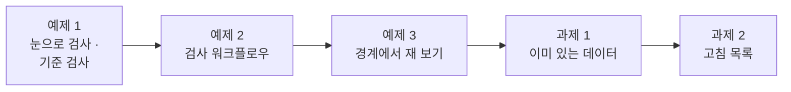
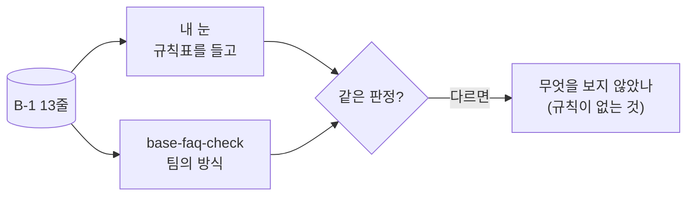
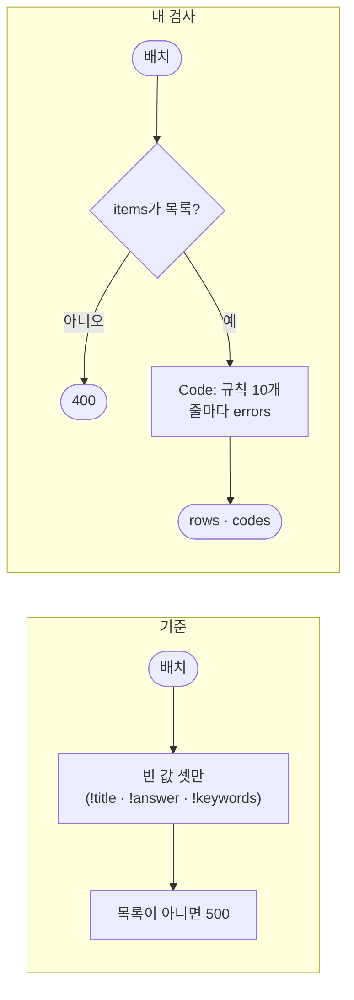
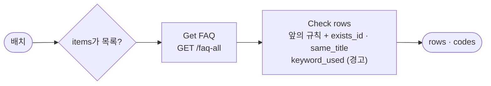
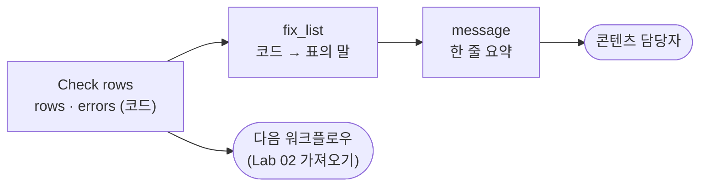

# Lab 01 · 품질 규칙 · 눈으로 검사하고, 규칙으로 바꾸기

- 관련 강의: [1단계 · 품질 규칙](../../Lecture/78/01-STAGE1-QUALITY-RULES.md)
- 소요 시간: 50분 (2교시 한 시간) · 예제 1 10분 · 예제 2 15분 · 예제 3 7분 · 과제 1 8분 · 과제 2 10분
- 준비: [실습 준비](../../Lecture/78/00-DAY78-PREP.md)의 `doctor` → `ready`, 기준 검사 `base-faq-check` · 기준 가져오기 `base-faq-import` 게시
- 목표: 콘텐츠 담당자가 보낸 FAQ 배치를 먼저 **눈으로** 검사하고, 팀이 쓰던 기준 검사가 무엇을 놓치는지 찾는다. 같은 배치에 늘 같은 판정을 내리는 **검사 워크플로우**를 만들고(규칙은 말이 먼저), 경계(40자 · 공백 · 전화번호 꼴 · 비슷한 주소)에서 재 보고, 이미 있는 FAQ와 맞춰 보고, 보낸 사람에게 돌려줄 **고침 목록**을 만든다.



> 복사해 붙일 요청문은 없습니다. 막히면 `▶` 를 하나씩 펼칩니다. 연습이 끝나면 `uv run tools/flow.py quality --reset`.

## 시작하기 · 터미널 두 개

| 터미널 | 하는 일 |
| --- | --- |
| ① 에이전트 | `cd ~/aio-01d4-stu/Last3Mon/78` 후 `codex` (또는 `claude`, `agy`). 내가 쓴 요청문을 보낸다 |
| ② 확인 | `cd ~/aio-01d4-stu/Last3Mon/78` 에서 `call` · `push` · `test` · `quality`를 **내가** 실행한다 |

`cp templates/QUALITY-RULES-TEMPLATE.md my-work/QUALITY.md` 후 표를 채워 갑니다. 쓴 요청문은 `my-work/PROMPTS.md`에 모읍니다.

## 예제 1 · 눈으로 검사 · 팀의 기준 검사 (10분, 에이전트 없이)

### 이 실습의 의도

**한 줄로:** 배치 B-1의 13줄을 직접 읽고 "넣어도 되나"를 내 눈으로 정한 뒤, 팀이 지난달 급히 만든 기준 검사(`base-faq-check`)의 판정과 **비교**합니다. 고치는 것은 예제 2부터이고, 여기서는 **읽고 비교해 적기만** 합니다.

> **생활 속 예 · 식당 주방의 식재료 검수.** 아침마다 납품 상자가 들어오면 주방장이 뚜껑을 열어 봅니다. 상한 채소, 라벨이 없는 고기, 주문하지 않은 물건을 골라냅니다. 그런데 새로 온 알바생은 "상자가 비어 있지 않으면 받는다"만 알고 있습니다. 예제 1은 주방장의 눈(내 검사)과 알바생의 기준(기준 검사)이 같은 상자를 어떻게 다르게 받는지 보는 실습입니다.

**상황.** 77일차에 와이파이 FAQ 한 줄이 답 못 한 질문 34건을 풀었습니다. 그래서 콘텐츠 담당자가 FAQ를 한꺼번에(배치로) 보내기 시작했습니다. 첫 배치 B-1(`requests/faq-batch-1.json`, 13줄)이 왔습니다. 팀에는 지난달 만든 검사 `base-faq-check`가 있고, 지금까지 이 검사를 통과하면 FAQ에 넣어 왔습니다.

**실험 둘.**

| 실험 | 하는 것 | 볼 것 |
| --- | --- | --- |
| ① 눈으로 | `requests/faq-batch-1.json`을 열어 13줄을 읽음 | 줄마다 넣어도 되나 · 이유 한 마디 |
| ② 기준 검사 | `call base-faq-check requests/faq-batch-1.json` | 기준이 나쁘다고 한 줄은 몇 개인가? ①과 같은가? |

**끝나면 알게 되는 것.** "나쁜 FAQ"는 빈 값만이 아닙니다. 형식(id) · 길이 · 중복 · **개인정보** · **바깥 링크** · 질문과 다른 답까지 여러 종류이고, 그중 무엇을 **규칙으로** 잡을 수 있는지가 이 Lab의 출발점입니다.

**적을 곳.** `my-work/QUALITY.md` 1절 표 (줄 id · 내 눈 · 이유 · 기준 검사는 · 규칙으로 바꾸면).

```bash
# ① 눈으로 (편집기로 열거나)
python3 -m json.tool requests/faq-batch-1.json | less

# ② 팀의 기준 검사에 같은 배치를
uv run tools/flow.py call base-faq-check requests/faq-batch-1.json
```

### 이해하기

**FAQ 한 줄에 무엇이 있나.** [AGENTS.md](AGENTS.md) 2절 "배치"입니다.

| 칸 | 뜻 | 나쁘면 생기는 일 |
| --- | --- | --- |
| `id` | `FAQ-` + 숫자 3자리 | 다른 FAQ를 덮어씀 · 찾을 수 없음 |
| `title` | 질문의 주제 (40자 이내) | 검색에 걸리지 않음 · 화면이 깨짐 |
| `keywords` | 검색에 쓰는 낱말 목록 | 아무 질문에도 나오지 않음 |
| `answer` | 직원에게 보여 줄 답 (10~300자) | 빈 답 · 개인 전화번호 노출 · 위험한 링크 |

**품질 검사는 "규칙 + 판정"입니다.** "나쁜 FAQ"라는 말만으로는 판정이 하나로 정해지지 않습니다. 공백만 있는 제목은 빈 값인가? `01012345678`도 전화번호인가? `intra.example.com.evil.io`는 사내 주소인가? 이것을 미리 정해 둔 것이 **품질 규칙**이고, 규칙이 같아야 오늘 배치와 다음 주 배치, 내 판정과 옆 사람의 판정을 비교할 수 있습니다. 77일차의 "지표는 정의가 먼저"와 같은 말입니다.



**기대 결과.** 내 눈으로는 나쁜 줄이 기준 검사보다 **많습니다.** 어느 줄을 기준이 놓쳤는지 `QUALITY.md` 1절에 적습니다. 답은 아래 실행 결과를 보기 전에 먼저 찾아 봅니다.

<details><summary>▶ 1단계 · 무엇을 보며 읽나</summary>

[AGENTS.md](AGENTS.md) 3절 "FAQ 품질 규칙" 표를 옆에 두고 줄마다 코드 하나씩 대어 봅니다. 답 안의 숫자와 `@`, `http`를 특히 봅니다.
</details>

<details><summary>▶ 2단계 · 규칙으로 못 잡는 줄</summary>

FAQ-113의 제목과 답을 함께 읽어 보세요. 빈 값도, 길이도, 형식도 문제없는데 넣으면 안 되는 줄입니다. 이런 줄은 Lab 02 예제 2(LLM 검사)에서 다룹니다.
</details>

### 실행 결과 · 눈으로 검사 · 기준 검사

수업 준비 때(11/01) 강사 노트북에서 실제로 나온 출력입니다. 배치 파일과 규칙은 바뀌지 않으므로 판정은 누가 돌려도 같습니다 (시간만 다름).

이 예제는 **고치지 않습니다.** 같은 배치를 내 눈(규칙표)과 기준 검사에 대어 비교합니다. 고치는 것은 예제 2입니다.

#### ① 눈으로 · AGENTS.md 3절 규칙표를 들고

13줄을 규칙표에 대어 본 결과입니다 (강사가 직접 읽은 것).

| 줄 | id | 넣어도 되나 | 이유 한 마디 | 규칙 |
| --- | --- | --- | --- | --- |
| 1 | FAQ-101 | 예 | | |
| 2 | FAQ-102 | 예 | | |
| 3 | FAQ-103 | 아니오 | 제목이 비었음 | `title_missing` |
| 4 | FAQ-10 | 아니오 | id가 두 자리 | `id_format` |
| 5 | FAQ-105 | 아니오 | 답이 비었음 | `answer_missing` |
| 6 | FAQ-106 | 아니오 | 같은 문장을 여섯 번, 300자 넘음 | `answer_too_long` |
| 7 | FAQ-102 | 아니오 | 2째 줄과 id가 같음 | `duplicate_in_batch` |
| 8 | FAQ-108 | 아니오 | 키워드가 빈 목록 | `keywords_missing` |
| 9 | FAQ-109 | 아니오 | 답에 개인 휴대전화 `010-1234-5678` | `pii` |
| 10 | FAQ-110 | 아니오 | 답에 `http://bit.ly/…` (바깥 링크) | `external_link` |
| 11 | FAQ-003 | ? | 이미 있는 FAQ-003(VPN)을 덮어씀 | (과제 1) |
| 12 | FAQ-112 | ? | 이미 있는 "VPN 접속 오류"와 제목이 같음 | (과제 1) |
| 13 | FAQ-113 | 아니오 | 제목은 "프린터 토너"인데 답은 메일함 이야기 | 규칙으로는 못 잡음 (Lab 02 예제 2) |

- 눈으로는 **8줄이 분명히 나쁘고**, 2줄은 이미 있는 FAQ를 알아야 판단할 수 있고(과제 1), 1줄은 뜻을 읽어야 압니다(LLM). 좋은 줄은 2줄뿐입니다.

#### ② 팀의 기준 검사에 같은 배치

실행한 명령:

```bash
uv run tools/flow.py call base-faq-check requests/faq-batch-1.json
```

출력 (줄마다 판정을 한 줄로 줄임, 실제는 `rows` 목록):

```text
HTTP 200 · 0.9s
{ "batch": "B-1", "total": 13, "valid": 10, "invalid": 3,
  "rows": [ FAQ-101 ok · FAQ-102 ok · FAQ-103 title_missing · FAQ-10 ok · FAQ-105 answer_missing ·
            FAQ-106 ok · FAQ-102 ok · FAQ-108 keywords_missing · FAQ-109 ok · FAQ-110 ok ·
            FAQ-003 ok · FAQ-112 ok · FAQ-113 ok ],
  "codes": { "title_missing": 1, "answer_missing": 1, "keywords_missing": 1 } }
```

**왜 이렇게 나왔나**

- 기준은 13줄 중 **10줄을 통과**시켰습니다. 나쁘다고 한 것은 빈 값 셋(제목 · 답 · 키워드)뿐입니다. 기준의 Code에는 규칙이 이 셋밖에 없습니다.
- 눈으로 나쁜 8줄 중 **5줄을 놓쳤습니다**: id 두 자리(FAQ-10), 300자 넘는 답(FAQ-106), 배치 안 중복(둘째 FAQ-102), **개인 전화번호**(FAQ-109), **바깥 링크**(FAQ-110). 이 판정대로 넣으면 직원이 보안 사고를 물을 때 김민지 님의 휴대전화가 화면에 나옵니다.
- 기준이 "틀린 계산"을 한 것이 아니라 **규칙이 없는** 것입니다. 오늘의 규칙은 AGENTS.md 3절이고, 예제 2에서 그대로 만듭니다.
- 0.9초는 n8n이 막 다시 켜진 뒤의 첫 실행이라서입니다 (두 번째부터 0.1초 안팎).

## 예제 2 · 검사 워크플로우 (15분)

### 이 실습의 의도

**한 줄로:** 예제 1에서 본 차이를 없애기 위해, AGENTS.md 3절 규칙대로 판정하는 **내 검사**(`my-faq-check`)를 만듭니다. Lab 01의 중심 실습이고, 오늘 만드는 가져오기 · 보고서가 모두 이 검사를 부릅니다.

> **생활 속 예 · 검수 기준표.** 주방장마다 보는 눈이 다르면 같은 상자가 어떤 날은 받히고 어떤 날은 반품됩니다. 그래서 식당은 "라벨 없는 고기는 반품, 냉장품은 5도 이하, 유통기한 3일 미만은 반품"처럼 **검수 기준표**를 벽에 붙입니다. 예제 2는 그 기준표(규칙)를 요청문에 그대로 넣어, 누가 만들어도 같은 판정을 내리는 검사를 만드는 실습입니다.

| 예제 1에서 본 것 | 규칙 (AGENTS.md 3절) | 확인하는 케이스 |
| --- | --- | --- |
| 빈 값만 봄 | 제목 · 답 · 키워드가 비었으면 각각 코드 | 빈 값 |
| 형식 · 길이를 안 봄 | `id_format` · `title_too_long` · `answer_too_long` | 형식 |
| 배치 안 중복 · 개인정보 · 바깥 링크를 안 봄 | `duplicate_in_batch` · `pii` · `external_link` | 중복 · 개인정보 · 링크 |
| 목록이 아닌 본문에 멈춤 (500) | `items`가 목록이 아니면 **400** | 목록이 아닌 본문 |

**순서.** 같은 테스트를 **기준에 먼저** 돌려 몇 개가 ✘인지 봄 → 요청문을 써서 에이전트가 새 파일을 만들게 함 → push → 5/5.

**끝나면 알게 되는 것.** 규칙을 요청문에 적으면 에이전트도 같은 판정을 낸다는 것, 줄마다 **이유(코드)**를 붙여야 사람이 고칠 수 있다는 것, 규칙은 LLM이 아니라 Code가 확인해야 하는 까닭.

**만들 것**: 배치를 받아 줄마다 규칙을 대어 `ok` · `errors`를 붙여 돌려주는 워크플로우. 아무것도 넣지 않습니다 (넣는 것은 Lab 02).

```bash
uv run tools/flow.py test cases/lab01.json --webhook base-faq-check -v     # 고치기 전 (기준에 같은 테스트)
```

| 조건 | 값 |
| --- | --- |
| 파일 · 웹훅 | `my-work/faq-check.json` (새로) · `my-faq-check` |
| 규칙 | `id_format` · `title_missing` · `title_too_long` · `keywords_missing` · `answer_missing` · `answer_too_short` · `answer_too_long` · `duplicate_in_batch` · `pii` · `external_link` — **[AGENTS.md](AGENTS.md) 3절** |
| 계산 | Code 노드 하나 (LLM 없음) |
| 기대 결과 | `cases/lab01.json` (빈 값 · 형식 · 중복 · 개인정보 · 링크 · B-2 · 목록이 아닌 본문) |

### 이해하기

**지금 무엇이 문제인가.** 기준 검사는 틀린 판정을 한 것이 아니라 **규칙이 셋뿐**이었습니다. 그래서 고치는 일은 "버그 찾기"보다 "규칙을 정해 그대로 대기"입니다. 규칙이 요청문에 없으면 에이전트도 자기 방식(빈 값만, 공백은 값으로, `http`면 다 막기…)으로 판정합니다.



**오류 코드를 붙이는 까닭.** "B-1은 나쁘다"로는 아무도 고칠 수 없습니다. "FAQ-109는 `pii`(답에 개인 전화번호)"라고 해야 콘텐츠 담당자가 그 줄을 고칩니다. 코드는 짧은 영어로 정해 두고(`pii`), 사람이 읽는 말은 과제 2에서 붙입니다. 코드가 같아야 배치마다 "가장 흔한 문제"를 셀 수 있습니다 (Lab 03).

| 같은 줄 | 기준 검사 | 내 검사 |
| --- | --- | --- |
| 답에 `010-1234-5678` | `ok` | `pii` |
| 답에 `http://bit.ly/…` | `ok` | `external_link` |
| `id`가 `FAQ-10` | `ok` | `id_format` |

**왜 Code인가.** 길이 · 형식 · 중복 · 전화번호 꼴은 **정해진 답이 있는** 판정입니다. Code는 같은 줄에 늘 같은 판정을 0.1초 안에 냅니다. LLM에게 "이 FAQ가 괜찮아?"라고 물으면 날마다 답이 다를 수 있고 줄마다 돈이 듭니다 (75일차). LLM은 규칙으로 알 수 없는 것(답이 질문에 맞나)에만, Lab 02 예제 2에서 씁니다.

**테스트 케이스.**

| 케이스 | 보내는 것 | 기대 |
| --- | --- | --- |
| 빈 값 (제목 · 답 · 키워드) | B-1 | 3째 줄 `title_missing` · 5째 `answer_missing` · 8째 `keywords_missing` |
| 형식 (id · 답 길이) | B-1 | 4째 `id_format` · 6째 `answer_too_long` |
| 배치 안 중복 · 개인정보 · 바깥 링크 | B-1 | 7째 `duplicate_in_batch` · 9째 `pii` · 10째 `external_link`, 1째 `ok` |
| B-2 · 메일 주소만 걸림 | B-2 | 10줄 중 9줄 통과, 사내 링크(7째)는 통과 |
| 목록이 아닌 본문 | `not-a-list` | HTTP 400 |

(케이스 파일은 0부터 세므로 3째 줄이 `rows.2`입니다.)

**기대 결과.** 고치기 전(기준에 같은 테스트) 1/5, 고친 뒤 5/5.

<details><summary>▶ 1단계 · 규칙을 요청문에</summary>

"나쁜 FAQ를 찾아 줘"만 쓰면 에이전트마다 판정이 다릅니다. 3절의 규칙 표를 그대로 요청문에 넣거나 "AGENTS.md 3절 FAQ 품질 규칙대로"라고 씁니다. 공백만 있는 값, 경계 글자 수도.
</details>

<details><summary>▶ 2단계 · 목록이 아닌 본문은 누가</summary>

Code에 들어가기 **전에** IF로 `Array.isArray($json.body.items)`를 봅니다 ([AGENTS.md](AGENTS.md) 5절). Code 안에서 `items.map`이 터지면 n8n은 500을 돌려주고, 부른 쪽은 무엇이 틀렸는지 모릅니다.
</details>

<details><summary>▶ 빈칸 채우기 · 요청문(프롬프트) 뼈대</summary>

요청문에 꼭 들어갈 것: **① 파일 · 웹훅 ② 모양이 틀린 본문의 처리 ③ 규칙과 경계(공백 · 글자 수) ④ 헷갈리는 규칙(전화번호 꼴 · 사내 주소) ⑤ 결과 모양 · LLM 없음 · 기대 결과**. 아래 빈칸 4개(`____①`~`____④`)를 채워 `my-work/PROMPTS.md`에 쓴 뒤 에이전트에게 보냅니다.

```text
my-work/faq-check.json 을 새로 만들어 줘. 웹훅 POST ____①, 이름 "78 FAQ check (my)".
Is a list?(IF): 본문 items 가 목록이 아니면 Reject body 로 HTTP ____② {"error": "items must be a list"}.
Check rows(Code) 하나에서 줄마다 AGENTS.md 3절 FAQ 품질 규칙대로 errors 를 붙인다. 공백만 있는 값은 빈 값, 글자 수는 ____③ 센다.
pii 는 하이픈 없는 휴대전화도, external_link 는 호스트가 ____④ 이 아니면.
결과 {batch, total, valid, invalid, rows: [{id, ok, errors, warnings}], codes}, rows 는 들어온 순서 그대로. LLM 은 쓰지 않는다. 기대 결과 cases/lab01.json.
```

빈칸 힌트 (답이 아니라 **어디서 찾고 무엇을 생각하나**):

- ① AGENTS.md 3절 계약 표의 "FAQ 검사" 줄입니다. 테스트 파일 `cases/lab01.json` 맨 위의 `webhook`과 같아야 합니다.
- ② "목록이 아닌 본문" 케이스의 기대 HTTP 상태입니다. 기준 검사는 여기서 무엇을 돌려줬나요?
- ③ 3절 규칙 표 아래 줄("공백만 있는 값은…")입니다. 공백 세 칸짜리 제목, 앞에 공백이 붙은 답을 생각해 봅니다.
- ④ 3절 `external_link` 줄의 굵은 글씨입니다. 예제 3에서 이 말이 왜 필요한지 봅니다.

채운 요청문은 수업 뒤 공개되는 정답본의 요청문 예와 비교합니다.
</details>

```bash
uv run tools/flow.py push my-work/faq-check.json
uv run tools/flow.py test cases/lab01.json -v
uv run tools/flow.py call my-faq-check requests/faq-batch-1.json
```

### 실행 결과 · 검사 워크플로우

수업 준비 때(11/01) 강사 노트북에서 정답 워크플로우로 실제로 나온 출력입니다. 판정은 규칙대로라 누구에게나 같고, 시간만 조금씩 다릅니다.

#### 고치기 전 · 기준(`base-faq-check`)에 같은 테스트

실행한 명령:

```bash
uv run tools/flow.py test cases/lab01.json --webhook base-faq-check -v
```

출력 (결과 줄만, `-v`의 요청 · 응답은 줄임):

```text
POST http://localhost:5678/webhook/base-faq-check · 5 case(s) × 1
✔ 빈 값 (제목 · 답 · 키워드) · 0.0s
✘ 형식 (id · 답 길이) · 0.1s · rows.3.errors has none of ['id_format']; rows.5.errors has none of ['answer_too_long']
✘ 배치 안 중복 · 개인정보 · 바깥 링크 · 0.0s · rows.6.errors has none of ['duplicate_in_batch']; rows.8.errors has none of ['pii']; rows.9.errors has none of ['external_link']
✘ 배치 2 · 메일 주소만 걸림, 사내 링크는 통과 · 0.1s · valid = 10 (expected 9); codes.pii = null (expected 1); rows.8.ok = true (expected false)
✘ 목록이 아닌 본문 → 400 · 0.1s · status 500 (expected 400)
Passed 1/5
```

**왜 이렇게 나왔나 (고치기 전)**

- **빈 값 ✔:** 기준이 가진 규칙 셋이 바로 이 케이스입니다. 맞은 것은 이것뿐입니다.
- **형식 · 중복 · 개인정보 · 링크 ✘:** 그런 규칙이 없으니 `errors`에 해당 코드가 없습니다 ("has none of"). 예제 1에서 눈으로 찾은 다섯 줄 그대로입니다.
- **B-2 ✘:** B-2의 FAQ-209는 답에 메일 주소(`security.desk@example.com`)가 있습니다. 기준은 10줄 모두 통과시켜 `valid` 10, `pii` 코드 없음.
- **목록이 아닌 본문 → 500:** `items`가 글자(`"FAQ-101"`)인데 기준 Code가 `.map`을 부르다 오류가 나서 n8n이 500을 돌려줍니다. 부른 쪽은 "서버가 고장났다"로 알고, 본문이 틀렸다는 것을 모릅니다.
- 1/5는 **예상한 결과**입니다.

#### 고친 뒤 · 내 `my-faq-check`

실행한 명령:

```bash
uv run tools/flow.py push my-work/faq-check.json
uv run tools/flow.py test cases/lab01.json -v
uv run tools/flow.py call my-faq-check requests/faq-batch-1.json
```

출력 (결과 줄과 `call`, `rows`는 줄마다 한 줄로 줄임):

```text
✔ 빈 값 (제목 · 답 · 키워드) · 0.9s
✔ 형식 (id · 답 길이) · 0.0s
✔ 배치 안 중복 · 개인정보 · 바깥 링크 · 0.1s
✔ 배치 2 · 메일 주소만 걸림, 사내 링크는 통과 · 0.0s
✔ 목록이 아닌 본문 → 400 · 0.1s
Passed 5/5

HTTP 200 · 0.1s
{ "batch": "B-1", "total": 13, "valid": 5, "invalid": 8,
  "rows": [ FAQ-101 ok · FAQ-102 ok · FAQ-103 title_missing · FAQ-10 id_format · FAQ-105 answer_missing ·
            FAQ-106 answer_too_long · FAQ-102 duplicate_in_batch · FAQ-108 keywords_missing ·
            FAQ-109 pii · FAQ-110 external_link · FAQ-003 ok · FAQ-112 ok · FAQ-113 ok ],
  "codes": { "title_missing": 1, "id_format": 1, "answer_missing": 1, "answer_too_long": 1,
             "duplicate_in_batch": 1, "keywords_missing": 1, "pii": 1, "external_link": 1 } }
```

**고친 뒤 이렇게 나온 까닭**

| 줄 · 케이스 | 고치기 전 (기준) | 고친 뒤 | 무엇이 바꿨나 |
| --- | --- | --- | --- |
| B-1 통과 | 10줄 | 5줄 | 규칙 3개 → 10개 (AGENTS.md 3절) |
| FAQ-10 · FAQ-106 | ok | `id_format` · `answer_too_long` | 형식 · 길이 규칙 |
| 둘째 FAQ-102 | ok | `duplicate_in_batch` | 앞에 나온 id를 기억 (`seen`) |
| FAQ-109 · B-2 FAQ-209 | ok | `pii` | 휴대전화 꼴 · 메일 주소 꼴 |
| FAQ-110 | ok | `external_link` | 호스트가 `intra.example.com`이 아닌 링크 |
| 목록이 아닌 본문 | 500 | 400 | Code 앞의 IF |

- **눈과 맞춰 보면:** 눈으로 분명히 나쁜 8줄과 워크플로우의 `invalid` 8줄이 **같은 줄**입니다. 남은 통과 5줄 중 FAQ-003 · FAQ-112는 과제 1(이미 있는 데이터), FAQ-113은 Lab 02 예제 2(LLM)에서 걸러집니다.
- **B-2의 7째 줄(FAQ-207)은 통과:** 답에 `https://intra.example.com/msg`가 있지만 사내 주소입니다. "링크면 다 막기"가 아니라는 것이 B-2 케이스로 확인됩니다.
- **`codes`:** 코드마다 몇 줄인지 셉니다. 지금은 모두 1이지만, 배치가 쌓이면 "가장 흔한 문제"가 됩니다 (Lab 03 과제 1).
- **0.1초:** 13줄을 Code 하나에서 판정했습니다. LLM은 부르지 않았습니다.
- 이제 이 검사가 오늘의 **기준 판정**입니다. 과제 · Lab 02 가져오기 · Lab 03 보고서가 모두 이 검사를 부르거나 이 결과를 씁니다.

## 예제 3 · 경계에서 재 보기 (7분, 에이전트 없이)

### 이 실습의 의도

**한 줄로:** 예제 2의 내 검사와 기준 검사에 **경계의 줄**(40자 · 41자 · 공백만 · 10자 · 9자 · 하이픈 없는 전화번호 · 사무실 번호 · 사내 주소처럼 보이는 바깥 주소 · 소문자 id)을 같이 보내, 평소에는 안 보이던 규칙의 차이를 드러냅니다. 고치는 실습이 아니라 **재 보는** 실습입니다.

> **생활 속 예 · 냉장고 온도 5도.** 검수 기준표에 "냉장품 5도 이하"라고 적혀 있습니다. 4도와 8도는 누구나 판정합니다. 하지만 딱 5도는? 5.1도는? 온도계가 없으면 "차갑네" 하고 받습니다. 예제 3은 딱 기준선에 걸린 줄들로 두 검사를 재 보는 실습입니다.

**상황.** 보통 줄(빈 제목, 긴 답)에서는 사람도 기준 검사도 판정이 쉽습니다. 그런데 실제 배치에는 경계의 줄이 섞여 옵니다: 딱 40자인 제목, 공백만 친 제목, `01012345678`처럼 하이픈을 뺀 번호, `intra.example.com.evil.io`처럼 앞부분만 사내 주소인 링크. 같은 테스트 `cases/lab01-edges.json`(배치 `requests/faq-edges.json`, 10줄)을 두 검사에 돌립니다.

| 경계 | 줄 | 기대 (규칙대로) |
| --- | --- | --- |
| 제목 40자 · 41자 | FAQ-401 · 402 | 40자는 통과, 41자는 `title_too_long` |
| 공백만 있는 제목 | FAQ-403 | `title_missing` |
| 답 10자 · 9자 | FAQ-404 · 405 | 10자는 통과, 9자는 `answer_too_short` |
| 하이픈 없는 휴대전화 · 사무실 번호 | FAQ-406 · 407 | `01012345678`은 `pii`, `02-123-4567`은 통과 |
| 사내 주소 · 사내 주소처럼 보이는 바깥 주소 | FAQ-408 · 409 | `https://intra.example.com/help`는 통과, `http://intra.example.com.evil.io/edu`는 `external_link` |
| 소문자 id | `faq-410` | `id_format` |

**끝나면 알게 되는 것.** 규칙은 경계에서 시험받는다는 것, "넘으면"과 "이상이면", 공백, 꼴(정규식)을 **처음부터** 말로 정해 둬야 한다는 것. 그리고 테스트에 경계 줄을 넣는 까닭.

**적을 곳.** `my-work/QUALITY.md` 3절 표 (경계 · 내 검사 · 기준 검사 · 규칙에서 정한 말).

```bash
uv run tools/flow.py test cases/lab01-edges.json -v                          # 내 검사
uv run tools/flow.py test cases/lab01-edges.json --webhook base-faq-check    # 같은 케이스를 기준에
```

### 이해하기

**경계(edge)란.** 값의 범위 끝에 있는 경우입니다: 딱 기준선의 길이, 빈 값처럼 보이는 공백, 비슷하지만 다른 꼴. 검사의 실수는 대부분 경계에서 나옵니다. 보통 줄만 시험하면 "잘 된다"고 믿게 됩니다.

| 경계 | 규칙이 말로 정해져 있지 않으면 생기는 일 |
| --- | --- |
| 딱 40자 | `>`와 `≥`의 차이로 멀쩡한 제목이 막히거나, 41자가 들어감 |
| 공백만 | `"   "`는 빈 문자열이 아니라서 "제목 있음"으로 통과 |
| 전화번호 꼴 | `010-1234-5678`만 찾으면 `01012345678`이 그대로 나감 |
| 비슷한 주소 | "`intra.example.com`으로 시작하나"만 보면 `intra.example.com.evil.io`가 사내 주소로 통과 |

**사내 주소처럼 보이는 바깥 주소.** 링크의 **호스트**(주소에서 `://` 뒤, 첫 `/` 앞)가 무엇인지가 중요합니다. `http://intra.example.com.evil.io/edu`의 호스트는 `intra.example.com.evil.io`이고, 이것은 `evil.io`라는 **바깥** 회사의 주소입니다. 피싱 메일이 자주 쓰는 수법이라 73일차 보안과도 이어집니다. 그래서 AGENTS.md 3절은 "호스트가 **정확히** `intra.example.com`"이라고 씁니다.

**`--webhook base-faq-check`.** 같은 케이스 파일을 다른 웹훅에 돌리는 옵션입니다. 테스트 파일은 그대로 두고 두 워크플로우를 비교할 때 씁니다 (77일차와 같음).

**기대 결과.** 내 검사 6/6. 기준 검사는 대부분 ✘ — 어느 케이스가 왜 ✘인지가 이 예제의 답입니다. 내 검사가 ✘라면 요청문에 경계의 말이 빠진 것입니다: 에이전트에게 실패한 케이스를 보여 주고 3절의 말을 다시 짚어 고칩니다.

<details><summary>▶ 1단계 · 내 검사가 FAQ-409를 통과시켰다면</summary>

`Check rows`의 링크 규칙을 봅니다. `/https?:\/\/(?!intra\.example\.com)/`처럼 "뒤에 `intra.example.com`이 오나"만 보면 `.evil.io`가 더 붙은 주소도 통과합니다. 호스트가 그 뒤에서 **끝나는지**(다음 글자가 `/` · 공백 · 끝인지)까지 봐야 합니다.
</details>

### 실행 결과 · 경계에서 재 보기

수업 준비 때(11/01) 강사 노트북에서 실제로 나온 출력입니다.

이 예제는 **고치지 않습니다.** 같은 케이스 파일을 내 검사와 기준 검사에 돌려 비교합니다. 기준을 고치지 않는 것은, 오늘은 기준과 **비교하는** 연습이기 때문입니다.

#### 내 검사 (`my-faq-check`)

실행한 명령:

```bash
uv run tools/flow.py test cases/lab01-edges.json -v
```

출력 (결과 줄만):

```text
POST http://localhost:5678/webhook/my-faq-check · 6 case(s) × 1
✔ 제목 40자는 통과, 41자는 너무 김 · 0.1s
✔ 공백만 있는 제목은 빈 값 · 0.1s
✔ 답 10자는 통과, 9자는 너무 짧음 · 0.0s
✔ 하이픈 없는 휴대전화도 개인정보, 사무실 번호는 통과 · 0.1s
✔ 사내 주소는 통과, 사내 주소처럼 보이는 바깥 링크는 막음 · 0.0s
✔ 소문자 id · 합계 10줄 중 4줄 통과 · 0.1s
Passed 6/6
```

**왜 이렇게 나왔나:** 내 검사는 3절의 말("40자 **넘으면**", "앞뒤 공백을 뺀 뒤", "`-` · `.` · 공백 없어도", "호스트가 **정확히**")을 그대로 Code로 옮겼으므로 경계에서도 규칙대로입니다. 10줄 중 통과는 4줄(40자 제목 · 10자 답 · 사무실 번호 · 사내 주소)입니다.

#### 같은 케이스를 기준에 (`base-faq-check`)

실행한 명령:

```bash
uv run tools/flow.py test cases/lab01-edges.json --webhook base-faq-check
```

출력:

```text
POST http://localhost:5678/webhook/base-faq-check · 6 case(s) × 1
✘ 제목 40자는 통과, 41자는 너무 김 · 0.0s · rows.1.ok = true (expected false); rows.1.errors has none of ['title_too_long']
✘ 공백만 있는 제목은 빈 값 · 0.1s · rows.2.errors has none of ['title_missing']
✘ 답 10자는 통과, 9자는 너무 짧음 · 0.0s · rows.4.errors has none of ['answer_too_short']
✘ 하이픈 없는 휴대전화도 개인정보, 사무실 번호는 통과 · 0.1s · rows.5.errors has none of ['pii']
✘ 사내 주소는 통과, 사내 주소처럼 보이는 바깥 링크는 막음 · 0.0s · rows.8.errors has none of ['external_link']
✘ 소문자 id · 합계 10줄 중 4줄 통과 · 0.1s · valid = 10 (expected 4); rows.9.errors has none of ['id_format']
Passed 0/6
```

**왜 이렇게 나왔나 (케이스마다)**

| 경계 | 기준의 결과 | 까닭 |
| --- | --- | --- |
| 41자 제목 | 통과 | 길이 규칙이 없음 |
| 공백만 있는 제목 | 통과 | `!r.title` — `"   "`는 빈 문자열이 아니라 "있음" |
| 9자 답 | 통과 | 길이 규칙이 없음 |
| `01012345678` | 통과 | 전화번호 규칙이 없음 |
| `intra.example.com.evil.io` | 통과 | 링크 규칙이 없음 |
| `faq-410` | 통과 | 형식 규칙이 없음 → 10줄 모두 통과 |

- 기준은 **하나도** 맞지 않았습니다. 77일차 기준 보고서는 "우연히" 맞는 경계가 둘 있었지만, 기준 검사는 경계에 대한 말이 아예 없어 모두 통과시킵니다.
- 이 표가 말하는 것: 같은 줄을 보고도 **규칙의 말 한 마디**(넘으면 · 공백 · 꼴 · 정확히)에 따라 판정이 갈립니다. 내 검사가 6/6인 것은 요청문에 그 말을 넣었기 때문입니다. 수업 준비 때 강사의 첫 판도 `intra.example.com.evil.io`를 통과시켰습니다 — "뒤에 `intra.example.com`이 오나"만 보고 끝나는지는 보지 않았기 때문입니다 (▶ 1단계).

## 과제 1 · 이미 있는 데이터와 맞춰 보기 (8분)

### 이 실습의 의도

**한 줄로:** 배치 안만 보던 검사에 **이미 있는 FAQ**(처음 6개 + 오늘 더한 것)를 맞춰 보아, 같은 id로 덮어쓰거나 같은 제목이 둘이 되는 줄을 막습니다.

> **생활 속 예 · 냉장고에 이미 있는 것.** 납품 상자만 보면 멀쩡한 우유입니다. 그런데 냉장고에 어제 받은 우유가 아직 그대로라면? 같은 칸에 넣으면 날짜가 섞이고, 어느 것을 먼저 쓸지 헷갈립니다. 과제 1은 상자를 받기 전에 냉장고(이미 있는 FAQ)를 먼저 열어 보는 실습입니다.

**상황.** B-1의 FAQ-003("VPN 접속 오류 (새 판)")은 이미 있는 FAQ-003을 덮어쓰고, FAQ-112의 제목 "VPN 접속 오류"는 이미 있는 FAQ-003의 제목과 같습니다. 둘 다 배치 안만 보면 멀쩡합니다. 한편 키워드가 겹치는 것(`vpn`)은 흔하고 나쁘지 않아서, 막지 말고 **알려만** 주기로 했습니다.

| 칸 | 정의 (AGENTS.md 3절) |
| --- | --- |
| `exists_id` (오류) | 이미 있는 FAQ와 `id`가 같음 |
| `same_title` (오류) | 이미 있는 FAQ와 제목이 같음 (앞뒤 공백을 뺀 뒤) |
| `keyword_used:<낱말>` (**경고**) | 이미 있는 FAQ가 쓰는 키워드 (대소문자 무시) — 통과는 시킴 |

**끝나면 알게 되는 것.** 검사는 **들어오는 데이터만이 아니라 이미 있는 데이터와의 관계**도 본다는 것 (참조 무결성). 오류와 경고를 나누는 까닭.

**적을 곳.** `my-work/QUALITY.md` 2절 "워크플로우가 놓친 줄"을 다시.

```bash
uv run tools/flow.py test cases/lab01-challenge.json -v    # 고치기 전 (예제 2의 검사)
```

### 이해하기

**지금 무엇이 없나.** 예제 2의 검사는 배치 하나만 받아 그 안에서 판정합니다. 이미 있는 FAQ를 모르니 "덮어씀"과 "같은 제목"을 볼 수 없습니다. 그래서 검사 앞에 FAQ 전체를 가져오는 노드 하나가 더 필요합니다.



**오류와 경고.** `errors`가 하나라도 있으면 그 줄은 들어가지 못합니다. `warnings`는 통과에 영향이 없고 사람이 보고 판단합니다. 모든 것을 오류로 막으면 콘텐츠 담당자는 아무것도 넣지 못하고, 모든 것을 통과시키면 검사가 의미 없습니다. "막을 것"과 "알릴 것"을 나누는 것도 규칙입니다.

**테스트 케이스.**

| 케이스 | 기대 |
| --- | --- |
| 이미 있는 id (FAQ-003) | 11째 줄 `exists_id` |
| 이미 있는 제목 · 쓰인 키워드는 경고 | 12째 줄 `same_title`, `warnings`에 `keyword_used:vpn` |
| 배치 1 · 통과 3건 | 13줄 중 3줄 통과 (예제 2는 5줄) |
| 막 더한 FAQ도 기존 데이터 | 테스트가 먼저 FAQ 한 줄을 더하고 같은 id를 보냄 → `exists_id` |

**기대 결과.** 고치기 전 0/4, 고친 뒤 4/4, `lab01` 5/5 그대로.

<details><summary>▶ 1단계 · 이미 있는 FAQ는 어디서</summary>

[AGENTS.md](AGENTS.md) 2절 데이터 API 표의 첫 줄입니다. 처음 6개만이 아니라 **오늘 더한 것까지** 돌려주는 주소여야 "막 더한 FAQ" 케이스가 통과합니다.
</details>

<details><summary>▶ 빈칸 채우기 · 요청문(프롬프트) 뼈대</summary>

요청문에 꼭 들어갈 것: **① 가져올 곳 ② 새 오류 코드 ③ 오류가 아닌 것 ④ 앞의 규칙**. 아래 빈칸 4개를 채웁니다.

```text
my-work/faq-check.json 에 이미 있는 데이터와 맞춰 보기를 더해 줘.
Is a list? 와 Check rows 사이에 Get FAQ(HTTP GET http://data-api:8800/____①) 를 둔다.
이미 있는 id 면 errors 에 exists_id, 이미 있는 제목이면 ____②.
이미 있는 FAQ 가 쓰는 키워드는 errors 가 아니라 ____③ 에 keyword_used:<낱말> (대소문자 무시) — 통과는 시킨다.
앞의 규칙은 ____④. 기대 결과 cases/lab01-challenge.json, cases/lab01.json 도.
```

빈칸 힌트:

- ① AGENTS.md 2절 데이터 API 표에서 "지금 FAQ 전체"를 돌려주는 주소입니다.
- ② 3절 규칙 표의 `(Lab 01 과제)` 줄 두 코드 중 제목에 대한 것.
- ③ 3절 규칙 표의 `keyword_used` 줄에서 굵은 글씨. 결과의 어느 칸에 넣나요?
- ④ 같은 Code에 더하는 것이니, 예제 2의 규칙은 어떻게 둬야 `lab01`이 계속 통과할까요?
</details>

```bash
uv run tools/flow.py push my-work/faq-check.json
uv run tools/flow.py test cases/lab01-challenge.json -v
uv run tools/flow.py test cases/lab01.json
```

### 실행 결과 · 이미 있는 데이터와 맞춰 보기

수업 준비 때(11/01) 강사 노트북에서 실제로 나온 출력입니다.

#### 고치기 전 · 예제 2의 검사

실행한 명령:

```bash
uv run tools/flow.py test cases/lab01-challenge.json -v
```

출력 (결과 줄만):

```text
✔ before: POST http://localhost:8800/faq-reset · HTTP 200 · 0.0s · {"cleared": 0}
POST http://localhost:5678/webhook/my-faq-check · 4 case(s) × 1
✘ 이미 있는 id (FAQ-003) · 0.1s · rows.10.errors has none of ['exists_id']
✘ 이미 있는 제목 · 쓰인 키워드는 경고 · 0.1s · rows.11.errors has none of ['same_title']; rows.11.warnings has none of ['keyword_used:vpn']
✘ 배치 1 · 통과 3건 · 0.0s · valid = 5 (expected 3); invalid = 8 (expected 10)
✔ before: POST http://localhost:8800/faq/add · HTTP 200 · 0.0s · {"added": "FAQ-201", "size": 7}
✘ 막 더한 FAQ도 기존 데이터 · 0.1s · rows.0.errors has none of ['exists_id']
Passed 0/4
✔ after: POST http://localhost:8800/faq-reset · HTTP 200 · 0.0s · {"cleared": 1}
```

**왜 이렇게 나왔나 (고치기 전)**

- 예제 2의 검사는 이미 있는 FAQ를 **읽지 않습니다.** 그래서 FAQ-003(덮어씀) · FAQ-112(같은 제목)를 통과시키고, 통과가 3이 아니라 5입니다.
- 넷째 케이스 앞의 `before: POST /faq/add`는 **케이스 하나만의 준비**입니다: 테스트가 FAQ-201을 먼저 더하고, 같은 id를 보내 "막 더한 것도 기존 데이터인가"를 봅니다. `size` 7 = 처음 6개 + 1.
- 맨 끝 `after`는 더한 FAQ를 다시 비웁니다 (`cleared` 1). 0/4는 예상한 결과.

#### 고친 뒤

실행한 명령:

```bash
uv run tools/flow.py push my-work/faq-check.json
uv run tools/flow.py test cases/lab01-challenge.json -v
uv run tools/flow.py test cases/lab01.json
```

출력 (결과 줄만):

```text
POST http://localhost:5678/webhook/my-faq-check · 4 case(s) × 1
✔ 이미 있는 id (FAQ-003) · 0.9s
✔ 이미 있는 제목 · 쓰인 키워드는 경고 · 0.0s
✔ 배치 1 · 통과 3건 · 0.1s
✔ before: POST http://localhost:8800/faq/add · HTTP 200 · 0.0s · {"added": "FAQ-201", "size": 7}
✔ 막 더한 FAQ도 기존 데이터 · 0.0s
Passed 4/4

(lab01) Passed 5/5
```

**고친 뒤 이렇게 나온 까닭**

| 줄 | 고치기 전 | 고친 뒤 | 무엇이 바꿨나 |
| --- | --- | --- | --- |
| 11째 FAQ-003 | ok | `exists_id` | `Get FAQ`(`/faq-all`)로 이미 있는 id를 앎 |
| 12째 FAQ-112 | ok | `same_title`, 경고 `keyword_used:vpn` | 이미 있는 제목 · 키워드 |
| B-1 통과 | 5 | 3 (FAQ-101 · 102 · 113) | 위 두 줄이 빠짐 |
| 막 더한 FAQ-201 | ok | `exists_id` | `/faq-all`은 더한 것까지 돌려줌 |

- **경고는 통과에 영향이 없습니다:** FAQ-112는 `same_title` 때문에 막혔고, `keyword_used:vpn`은 그와 따로 붙은 알림입니다. 키워드만 겹치는 줄은 통과합니다.
- **남은 통과 3줄:** FAQ-101 · FAQ-102는 좋은 줄이고, FAQ-113(토너 · 메일함)은 아직 규칙으로 못 잡습니다 (Lab 02 예제 2).
- `lab01` 5/5: 앞의 규칙은 그대로입니다. 이 검사가 앞으로 Lab 02 가져오기가 부르는 판입니다.

## 과제 2 · 보낸 사람에게 돌려줄 고침 목록 (10분)

### 이 실습의 의도

**한 줄로:** 검사 결과에 **사람이 읽는 고침 목록**(`fix_list`)과 한 줄 요약(`message`)을 더해, 콘텐츠 담당자가 배치를 받아 들고 바로 고칠 수 있게 합니다.

> **생활 속 예 · 반품 사유서.** 주방장이 상자를 돌려보낼 때 "안 받아요"만 말하면 납품업체는 무엇이 잘못됐는지 모릅니다. 그래서 반품 사유서에 "3번 상자 · 라벨 없음, 7번 상자 · 냉장 온도 9도"처럼 적어 줍니다. 다음 납품이 나아지는 것은 사유서 덕분입니다. 과제 2는 검사 결과를 반품 사유서로 만드는 실습입니다.

**상황.** 콘텐츠 담당자는 n8n도 오류 코드도 모릅니다. `{"errors": ["pii"]}`를 받으면 "pii가 뭐지?"부터 묻습니다. 팀장이 요청했습니다: "배치를 돌려보낼 때 줄 번호와 고칠 것을 사람 말로 붙여 주세요. 그리고 맨 위에 한 줄로 몇 줄 통과했는지."

| 칸 | 정의 (AGENTS.md 3절 "고침 목록") |
| --- | --- |
| `fix_list` | 통과하지 못한 줄만 줄 순서대로 `{row (1부터), id, codes, fix}` |
| `fix` | 코드마다 3절 표의 말 그대로 (예: `pii` → "개인 전화번호 · 메일 주소를 빼고 IT 포털 안내로 바꿔 주세요") |
| `message` | `"B-1: 13줄 중 3줄 통과, 10줄 고칠 것"` |

**끝나면 알게 되는 것.** 검사의 결과는 기계(다음 워크플로우)와 사람(보낸 사람) **둘 다** 읽는다는 것. 같은 코드에 늘 같은 말을 쓰는 까닭과, 그래도 고치는 것은 사람이라는 원칙.

**적을 곳.** `my-work/QUALITY.md` 4절.

```bash
uv run tools/flow.py test cases/lab01-challenge2.json -v    # 고치기 전 (과제 1까지의 검사)
```

### 이해하기

**코드와 말을 나누는 까닭.** 코드(`pii`)는 짧고 바뀌지 않아서 기계가 셉니다 (Lab 03 `top_codes`). 말("개인 전화번호 · 메일 주소를 빼고…")은 사람이 읽고 고칩니다. 둘을 한 표로 묶어 두면, 말을 고쳐도 코드는 그대로라 보고서가 깨지지 않습니다.



**왜 LLM으로 만들지 않나.** "이 오류를 친절하게 설명해 줘"를 LLM에게 맡기면 그럴듯하지만, 같은 코드에 날마다 다른 말이 나오고 줄마다 돈이 듭니다. 고칠 것이 이미 정해져 있으면(코드마다 한 문장) 표로 충분합니다. 77일차 주간 보고의 "다음 할 일을 규칙으로"와 같습니다.

**고쳐 주지 않는 까닭.** `fix_list`는 **고칠 것을 알려 줄 뿐** 고치지 않습니다. 워크플로우가 빈 제목을 짐작해서 채워 넣으면, 틀린 FAQ가 "검사를 통과한 FAQ"로 들어가고 아무도 그 사실을 모릅니다 (README의 원칙: 고치는 것은 사람).

**테스트 케이스.**

| 케이스 | 기대 |
| --- | --- |
| B-1 · 고칠 줄 10개, 줄 순서대로 | 첫 항목은 3째 줄 FAQ-103, 열째 항목은 FAQ-112, 열한째는 없음 |
| 고칠 것은 사람이 읽는 말로 | "제목을 써 주세요" · "개인 전화번호…" · "이미 있는 id…" |
| 한 줄 요약 | `"B-1: 13줄 중 3줄 통과, 10줄 고칠 것"` |
| B-2 · 메일 주소 한 줄만 | FAQ-209 하나, `"B-2: 10줄 중 9줄 통과, 1줄 고칠 것"` |
| 앞의 칸은 그대로 | 통과 3 · 고칠 것 10, `exists_id` |

**기대 결과.** 고치기 전 1/5 (앞의 칸만 ✔), 고친 뒤 5/5, `lab01` · `lab01-challenge` · `lab01-edges`도 그대로.

<details><summary>▶ 1단계 · 줄 번호는 어디서</summary>

`rows`는 들어온 줄과 같은 순서입니다 (AGENTS.md 4절). `rows.map((r, i) => …)`의 `i + 1`이 사람이 세는 줄 번호이고, 통과한 줄을 거르는 것은 그 **뒤에** 합니다. 먼저 거르면 번호가 당겨집니다.
</details>

<details><summary>▶ 빈칸 채우기 · 요청문(프롬프트) 뼈대</summary>

요청문에 꼭 들어갈 것: **① 순서와 번호 ② 말의 출처 ③ 요약 글자 ④ 하지 않을 것**. 아래 빈칸 4개를 채웁니다.

```text
my-work/faq-check.json 의 결과에 보낸 사람에게 돌려줄 고침 목록을 더해 줘.
fix_list: 통과하지 못한 줄만 ____① {row (1부터), id, codes (그 줄의 errors), fix}.
fix 는 코드마다 AGENTS.md 3절 "고침 목록" 표의 말을 ____② 쓴다 (LLM 으로 만들지 않는다).
message: "<batch>: <total>줄 중 <valid>줄 통과, <invalid>줄 ____③".
나쁜 줄을 고쳐 주지는 않는다 — 고치는 것은 ____④. 앞의 칸은 그대로. 기대 결과 cases/lab01-challenge2.json, lab01 · lab01-challenge 도.
```

빈칸 힌트:

- ① 보낸 사람이 자기 파일에서 줄을 찾으려면 `fix_list`가 어떤 순서여야 하나요?
- ② 3절 "고침 목록" 표의 말을 어떻게 쓰나요? 바꿔 쓰거나 LLM에게 맡기면 테스트가 통과할까요?
- ③ 테스트의 `message` 기대값을 글자 그대로 봅니다.
- ④ README "일하는 방식" 표에서 "나쁜 데이터를 고치기"는 누구의 일인가요?
</details>

```bash
uv run tools/flow.py push my-work/faq-check.json
uv run tools/flow.py test cases/lab01-challenge2.json -v
uv run tools/flow.py test cases/lab01.json
uv run tools/flow.py test cases/lab01-challenge.json
uv run tools/flow.py test cases/lab01-edges.json
```

### 실행 결과 · 고침 목록

수업 준비 때(11/01) 강사 노트북에서 실제로 나온 출력입니다.

#### 고치기 전 · 과제 1까지의 검사

실행한 명령:

```bash
uv run tools/flow.py test cases/lab01-challenge2.json -v
```

출력 (결과 줄만):

```text
✔ before: POST http://localhost:8800/faq-reset · HTTP 200 · 0.0s · {"cleared": 0}
POST http://localhost:5678/webhook/my-faq-check · 5 case(s) × 1
✘ B-1 · 고칠 줄 10개, 줄 순서대로 · 0.0s · fix_list.0.row = null (expected 3); fix_list.0.id = null (expected FAQ-103); fix_list.9.id = null (expected FAQ-112)
✘ 고칠 것은 사람이 읽는 말로 · 0.1s · fix_list.0.fix has none of ['제목을 써 주세요']; fix_list.6.fix has none of ['개인 전화번호']; fix_list.8.fix has none of ['이미 있는 id']
✘ 한 줄 요약 · 0.0s · message = null (expected B-1: 13줄 중 3줄 통과, 10줄 고칠 것)
✘ B-2 · 메일 주소 한 줄만 · 0.1s · fix_list.0.id = null (expected FAQ-209); fix_list.0.codes.0 = null (expected pii); message = null (expected B-2: 10줄 중 9줄 통과, 1줄 고칠 것)
✔ 앞의 칸은 그대로 · 0.0s
Passed 1/5
```

**왜 이렇게 나왔나 (고치기 전):** 과제 1의 검사에는 `fix_list` · `message` 칸이 없어 모두 `null`입니다. "앞의 칸은 그대로"는 이미 있는 칸(통과 3 · 고칠 것 10 · `exists_id`)을 보는 케이스라 지금도 ✔입니다. 1/5는 예상한 결과.

#### 고친 뒤

실행한 명령:

```bash
uv run tools/flow.py push my-work/faq-check.json
uv run tools/flow.py test cases/lab01-challenge2.json -v
uv run tools/flow.py test cases/lab01.json
uv run tools/flow.py test cases/lab01-challenge.json
uv run tools/flow.py test cases/lab01-edges.json
```

출력 (결과 줄, `-v`로 본 B-1 응답의 `fix_list` 앞부분과 `message`):

```text
✔ B-1 · 고칠 줄 10개, 줄 순서대로 · 0.9s
✔ 고칠 것은 사람이 읽는 말로 · 0.1s
✔ 한 줄 요약 · 0.1s
✔ B-2 · 메일 주소 한 줄만 · 0.1s
✔ 앞의 칸은 그대로 · 0.2s
Passed 5/5

"fix_list": [
  {"row": 3, "id": "FAQ-103", "codes": ["title_missing"], "fix": ["제목을 써 주세요"]},
  {"row": 4, "id": "FAQ-10", "codes": ["id_format"], "fix": ["id를 FAQ-숫자 3자리로 (예: FAQ-104)"]},
  {"row": 5, "id": "FAQ-105", "codes": ["answer_missing"], "fix": ["답을 써 주세요"]},
  …
  {"row": 9, "id": "FAQ-109", "codes": ["pii"], "fix": ["개인 전화번호 · 메일 주소를 빼고 IT 포털 안내로 바꿔 주세요"]},
  …
  {"row": 12, "id": "FAQ-112", "codes": ["same_title"], "fix": ["같은 제목의 FAQ가 이미 있습니다. 제목을 바꾸거나 기존 FAQ와 합쳐 주세요"]}],
"message": "B-1: 13줄 중 3줄 통과, 10줄 고칠 것"

(lab01) Passed 5/5 · (lab01-challenge) Passed 4/4 · (lab01-edges) Passed 6/6
```

**고친 뒤 이렇게 나온 까닭**

| 칸 | 고치기 전 | 고친 뒤 | 무엇이 바꿨나 |
| --- | --- | --- | --- |
| `fix_list` | 없음 | 고칠 줄 10개, 3째 줄부터 12째 줄까지 순서대로 | 통과하지 못한 줄만, 번호(`row`)를 먼저 붙이고 거름 |
| `fix` | 없음 | 코드마다 3절 표의 말 | 표를 그대로 Code에 (LLM 없음) |
| `message` | 없음 | `B-1: 13줄 중 3줄 통과, 10줄 고칠 것` | 3절의 글자 그대로 |
| B-2 | — | FAQ-209 하나, `10줄 중 9줄 통과` | 같은 검사, 다른 배치 |

- **`row`는 1부터, 줄 순서 그대로:** 콘텐츠 담당자가 자기 파일의 3째 줄을 바로 엽니다. 1 · 2 · 13째 줄(통과)은 목록에 없습니다.
- **한 줄에 코드가 둘이면 말도 둘:** 오늘 B-1에는 없지만, 제목도 비고 키워드도 비면 `fix`가 두 문장입니다.
- **앞의 테스트가 모두 그대로:** `lab01` 5/5 · `lab01-challenge` 4/4 · `lab01-edges` 6/6. 결과에 칸을 더했을 뿐 판정은 바뀌지 않았습니다.
- **고쳐 주지 않았습니다:** FAQ-103의 제목을 워크플로우가 지어 넣지 않았습니다. 고칠 것을 알려 줄 뿐이고, 고친 배치는 사람이 다시 보냅니다 (Lab 03 예제 2).

## 막혔을 때

| 증상 | 할 일 |
| --- | --- |
| 목록이 아닌 본문에 500 | Code 앞에 IF(`Array.isArray($json.body.items)`) → 400 응답 |
| 공백 제목이 통과 | `String(r?.title ?? '').trim()`으로 앞뒤 공백을 뺀 뒤 판정 |
| 40자 제목이 막힘 · 41자가 통과 | "40자 **넘으면**" — `> 40` |
| `01012345678`이 통과 | 하이픈 · 점 · 공백이 **없어도** 되는 꼴 (`[-. ]?`) |
| FAQ-409가 통과 | 호스트가 `intra.example.com`에서 **끝나는지**까지 (▶ 예제 3의 1단계) |
| `exists_id`가 안 붙음 | `Get FAQ`가 `/faq-all`(더한 것 포함)을 부르는지, `Check rows`가 `$('Get FAQ')`를 읽는지 |
| `fix_list`의 번호가 당겨짐 | 줄 번호를 붙인 **뒤에** 통과한 줄을 거름 |
| `message`가 다름 | 쉼표 · 띄어쓰기까지 3절 그대로 |
| 계속 안 됨 | `cp reference/lab01-example2-check.json my-work/faq-check.json` 후 push (예제 2까지) |

## 확인

- [ ] 예제 1: `QUALITY.md` 1절 (내 눈 · 기준 검사 · 규칙으로 바꾸면).
- [ ] 예제 2: `cases/lab01.json` 5/5 (고치기 전 기준에 1/5).
- [ ] 예제 3: `cases/lab01-edges.json` 내 검사 6/6, 기준이 ✘인 까닭을 `QUALITY.md` 3절에.
- [ ] 과제 1: `cases/lab01-challenge.json` 4/4, `lab01`도 통과.
- [ ] 과제 2: `cases/lab01-challenge2.json` 5/5, `lab01` · `lab01-challenge` · `lab01-edges`도 통과, `QUALITY.md` 4절.
- [ ] `my-work/PROMPTS.md`.
