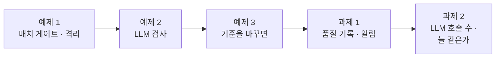
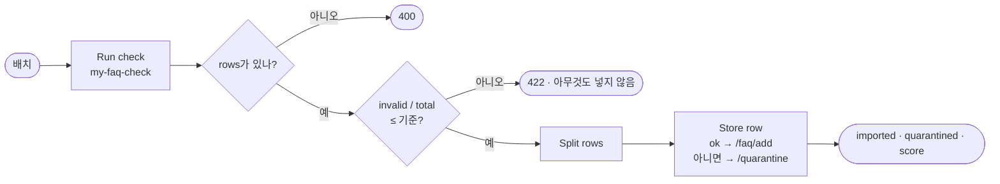
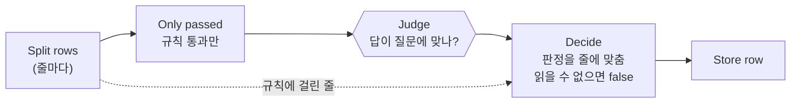
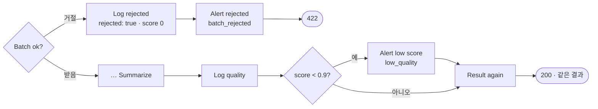

# Lab 02 · 품질 게이트 · 막고, 격리하고, 알리기

- 관련 강의: [2단계 · 품질 게이트](../../Lecture/78/02-STAGE2-QUALITY-GATE.md)
- 소요 시간: 50분 (4교시 한 시간) · 예제 1 12분 · 예제 2 10분 · 예제 3 6분 · 과제 1 10분 · 과제 2 12분
- 준비: Lab 01의 `my-faq-check`(과제 2까지)가 게시돼 있음, 기준 가져오기 `base-faq-import` 게시
- 목표: 검사를 통과한 줄만 FAQ에 넣는 **가져오기 게이트**를 만든다. 나쁜 줄이 많은 배치는 통째로 거절하고, 나머지 나쁜 줄은 이유와 함께 **격리함**에 둔다. 규칙으로 못 잡는 줄은 **LLM 검사**로 거르고, 거절 기준을 바꾸면 무엇이 달라지는지 재 보고, 배치마다 **품질 기록 · 알림**을 남기고, LLM을 몇 번 부르는지 숫자로 본다.



> 복사해 붙일 요청문은 없습니다. 막히면 `▶` 를 하나씩 펼칩니다. 상태를 보는 명령은 `uv run tools/flow.py quality`, 처음으로는 `uv run tools/flow.py quality --reset`.

## 예제 1 · 배치 게이트와 격리 (12분)

### 이 실습의 의도

**한 줄로:** 팀이 쓰던 기준 가져오기(`base-faq-import`)가 나쁜 줄까지 FAQ에 넣는 것을 먼저 보고, Lab 01의 검사를 불러 **통과한 줄만 넣고, 나쁜 줄은 격리하고, 너무 나쁜 배치는 통째로 거절하는** 내 가져오기(`my-faq-import`)를 만듭니다.

> **생활 속 예 · 식당의 반품과 보류 칸.** 주방장은 상자를 받을 때 두 번 판단합니다. 상자 열에 일곱이 상했으면 **트럭째 돌려보냅니다** (하나하나 골라낼 시간에 다시 받는 게 낫습니다). 대부분 괜찮으면 좋은 것만 냉장고에 넣고, 이상한 것은 **보류 칸**에 사유를 붙여 둡니다. 예제 1은 "트럭째 반품"(배치 게이트)과 "보류 칸"(격리함)을 만드는 실습입니다.

**상황.** 기준 가져오기는 검사 없이 모든 줄을 `/faq/add`로 보냅니다. 데이터 API가 답 없는 줄 정도는 막아 주지만, 개인 전화번호 · 메일 주소 · 바깥 링크가 든 FAQ는 그대로 들어갑니다. 직원이 질문하면 헬프데스크가 그 답을 그대로 보여 줍니다.

| 단계 | 규칙 (AGENTS.md 3절 "가져오기 게이트") |
| --- | --- |
| 검사 | 규칙을 다시 쓰지 않고 `my-faq-check`를 부름 |
| 배치 게이트 | 나쁜 줄 비율(`invalid / total`)이 기준(기본 **0.3**)을 **넘으면** 422, 아무것도 넣지 않음 |
| 줄 게이트 | 통과한 줄만 `/faq/add`, 나머지는 이유(`errors`)와 함께 `/quarantine` |
| 결과 | `imported` · `quarantined` · `score`(= `imported / total`) · `max_invalid_ratio`(쓴 기준) |

**순서.** 같은 테스트를 기준에 먼저 → `quality`로 무엇이 들어갔나 봄 → 요청문 → push → 6개 중 앞 넷과 FAQ-305 ✔ (FAQ-210은 예제 2).

**끝나면 알게 되는 것.** 검사(무엇이 나쁜가)와 게이트(그래서 무엇을 하나)는 다른 일이라는 것. 나쁜 데이터는 **버리지 않고 이유와 함께 격리**해야 고칠 수 있다는 것.

**적을 곳.** `my-work/QUALITY.md` 5절 첫 줄 (0.3 · B-1).

```bash
uv run tools/flow.py test cases/lab02.json --webhook base-faq-import -v    # 고치기 전 (기준에 같은 테스트)
uv run tools/flow.py quality                                              # 무엇이 들어갔나
```

### 이해하기

**지금 무엇이 문제인가.** 기준 가져오기는 "검사"가 없습니다. 데이터 API는 모양(답 · 키워드가 있나)만 보고, **내용**(개인정보 · 링크)은 보지 않습니다. 그래서 고치는 일은 가져오기 앞에 Lab 01의 검사를 세우고, 그 판정으로 **갈래를 나누는** 것입니다.



**왜 배치를 통째로 거절하나.** 13줄 중 10줄이 나쁘면, 좋은 3줄만 넣는 것보다 **보낸 사람에게 돌려보내는** 게 낫습니다. 나쁜 줄이 그만큼 많으면 배치를 만드는 방법 자체가 잘못됐을 가능성이 크고, 격리함에 10줄이 쌓이면 사람이 하나하나 봐야 합니다. 기준(0.3)은 "열 줄 중 세 줄까지는 골라내 받는다"는 팀의 약속입니다. 예제 3에서 이 기준을 바꿔 봅니다.

**격리함(quarantine).** 넣지 않은 줄을 **이유와 함께** 보관하는 곳입니다. 버리면 무엇이 왜 빠졌는지 아무도 모르고, 고친 뒤 다시 넣을 수도 없습니다 (Lab 03 예제 2). 76일차의 DLQ(실패한 요청을 두는 곳)와 같은 생각입니다.

| | 버리기 | 격리 |
| --- | --- | --- |
| 무엇이 빠졌나 | 모름 | `row` 그대로 |
| 왜 | 모름 | `errors` |
| 고쳐서 다시 | 못 함 | 고친 줄을 다시 보냄 → 격리함에서 뺌 |

**규칙을 다시 쓰지 않는 까닭.** 가져오기 안에 규칙을 한 벌 더 쓰면, Lab 01에서 규칙을 고칠 때 두 곳을 고쳐야 하고 언젠가 어긋납니다. 77일차 요약이 보고서를 **부른** 것처럼, 가져오기는 검사를 **부릅니다** (AGENTS.md 5절 "다른 내 웹훅을 부르기").

**테스트 케이스.**

| 케이스 | 보내는 것 | 기대 |
| --- | --- | --- |
| 나쁜 배치는 통째로 거절 | B-1 | 422, `invalid_ratio` 0.3 이상 |
| 배치 2 · 통과한 줄만 넣고 나쁜 줄은 격리 | B-2 | 거절 아님, FAQ-201은 넣고 FAQ-209는 격리 |
| FAQ에 들어갔고 메일 주소는 안 들어감 | (FAQ 목록) | FAQ-208 있음, `security.desk` 없음 |
| 격리함에 이유와 함께 | (격리함) | `"pii"` |
| LLM · 제목과 답이 다른 줄 | B-2 | FAQ-210 격리 · `llm_mismatch` 1 — **예제 2** |
| LLM · 규칙에 걸린 줄은 그대로 | B-3 | 5줄 넣고 FAQ-305 격리 |

**기대 결과.** 기준에 0/6, 내 가져오기 5/6 (FAQ-210 케이스만 ✘ — 예제 2에서).

<details><summary>▶ 1단계 · 검사 결과에서 무엇을 쓰나</summary>

`Run check`의 응답에 `total` · `invalid` · `rows`가 있습니다. 배치 게이트는 `invalid / total`, 줄 게이트는 `rows[i].ok`. 줄의 원래 내용(`row`)은 검사 결과에 없으니 웹훅 본문의 `items[i]`와 짝지어야 합니다 (`Split rows`).
</details>

<details><summary>▶ 2단계 · 넣기와 격리를 IF로 가르면</summary>

[AGENTS.md](AGENTS.md) 5절 "줄을 나눠 저장하기 — 한 줄로"를 읽어 보세요. HTTP 노드 **하나**에서 주소를 표현식으로 고르면, 갈래를 다시 합치지 않아도 되고 예제 2에서 LLM을 더해도 격리 수가 틀리지 않습니다.
</details>

<details><summary>▶ 빈칸 채우기 · 요청문(프롬프트) 뼈대</summary>

요청문에 꼭 들어갈 것: **① 부를 검사 ② 기준과 기본값 ③ 거절의 모양 ④ 저장하는 노드 ⑤ 결과 모양 · 기대 결과**. 아래 빈칸 4개를 채웁니다.

```text
my-work/faq-import.json 을 새로 만들어 줘. 웹훅 POST my-faq-import, 이름 "78 FAQ import (my)".
Run check: 규칙을 다시 쓰지 말고 HTTP POST http://localhost:5678/webhook/____① 로 부른다 (본문 그대로, neverError, timeout 30000).
Batch ok?(IF): invalid / total 이 기준 이하일 때만 받는다. 기준은 본문 max_invalid_ratio, 없으면 ____②. 넘으면 HTTP ____③ {error: "batch rejected", batch, invalid_ratio (4자리), max_invalid_ratio, codes}.
Split rows → Store row: 줄마다 ok 면 POST /faq/add, 아니면 POST /quarantine {items: [{batch, row, errors}]} — IF 로 가르지 말고 HTTP 노드 ____④에서 주소를 표현식으로.
Summarize: {batch, total, imported, quarantined, rejected: false, score (imported / total, 4자리), max_invalid_ratio, codes, imported_ids, quarantined_ids}. 기대 결과 cases/lab02.json 앞 네 케이스.
```

빈칸 힌트:

- ① Lab 01에서 만든 웹훅입니다. 규칙을 여기 다시 쓰지 않습니다.
- ② AGENTS.md 3절 "가져오기 게이트" 표의 배치 게이트 줄에서 굵은 숫자. 본문에 기준이 없을 때 씁니다.
- ③ 같은 표의 배치 게이트 줄, 또는 3절 계약 표 "FAQ 가져오기"의 거절 응답. 400과 무엇이 다른가요?
- ④ AGENTS.md 5절의 수업 준비 메모를 봅니다. 노드가 몇 개여야 Merge가 필요 없나요?
</details>

```bash
uv run tools/flow.py push my-work/faq-import.json
uv run tools/flow.py test cases/lab02.json -v
uv run tools/flow.py quality
```

### 실행 결과 · 배치 게이트와 격리

수업 준비 때(11/01) 강사 노트북에서 정답 워크플로우로 실제로 나온 출력입니다. 검사 · 게이트는 규칙대로라 누구에게나 같고, 시간만 다릅니다.

#### 고치기 전 · 기준(`base-faq-import`)에 같은 테스트

실행한 명령:

```bash
uv run tools/flow.py test cases/lab02.json --webhook base-faq-import -v
uv run tools/flow.py quality
```

출력 (결과 줄과, `-v`로 본 첫 두 응답):

```text
✘ 나쁜 배치는 통째로 거절 (422) · 0.1s · status 200 (expected 422); invalid_ratio = null (expected 0.3..1)
✘ 배치 2 · 통과한 줄만 넣고 나쁜 줄은 격리 · 1.1s · quarantined_ids has none of ['FAQ-209']
✘ FAQ에 들어갔고 메일 주소는 안 들어감 · 0.0s · faqs must not have ['security.desk']
✘ 격리함에 이유와 함께 · 0.0s · items has none of ['"pii"']
✘ LLM · 제목과 답이 다른 줄 (FAQ-210) · 1.1s · imported = 10 (expected 8); quarantined = 0 (expected 2); codes.llm_mismatch = null (expected 1); quarantined_ids has none of ['FAQ-210']
✘ LLM · 규칙에 걸린 줄은 그대로 (FAQ-305) · 0.1s · imported = 6 (expected 5); quarantined_ids has none of ['FAQ-305']
Passed 0/6
✔ after: POST http://localhost:8800/faq-reset · HTTP 200 · 0.0s · {"cleared": 16}

← B-1  HTTP 200 {"batch": "B-1", "total": 13, "imported": 12, "quarantined": 0, "rejected": false, "score": 0.9231,
                "imported_ids": ["FAQ-101", "FAQ-102", "FAQ-103", "FAQ-10", "FAQ-106", "FAQ-102", "FAQ-108", "FAQ-109", "FAQ-110", "FAQ-003", "FAQ-112", "FAQ-113"]}
← B-2  HTTP 200 {"batch": "B-2", "total": 10, "imported": 10, "quarantined": 0, "score": 1, ...}

FAQ: 6  (nothing added)
quarantine: 0
```

**왜 이렇게 나왔나 (고치기 전)**

- **B-1을 13줄 중 12줄 넣었습니다.** 빠진 것은 답이 빈 FAQ-105 하나뿐인데, 그것도 기준이 막은 게 아니라 데이터 API의 `/faq/add`가 "답이 필요하다"며 거절한 것입니다. 제목 없는 FAQ-103, 개인 전화번호 FAQ-109, 바깥 링크 FAQ-110, 그리고 **이미 있던 FAQ-003(VPN)과 같은 id를 한 벌 더** 넣었습니다 (FAQ 목록에 FAQ-003이 둘 — 검색이 어느 답을 줄지 모름). 기준의 `score` 0.9231은 "잘 들어갔다"는 숫자로 보이지만 실제로는 나쁜 줄이 대부분입니다.
- **B-2도 10줄 모두** 넣었습니다: 메일 주소가 든 FAQ-209, 답이 다른 FAQ-210까지. 그래서 "메일 주소는 안 들어감" 케이스가 `security.desk`를 FAQ 목록에서 찾았습니다.
- **격리함이 0:** 기준에는 격리라는 갈래가 없습니다. 무엇을 넣지 않았는지 기록이 없습니다.
- 끝의 `after: faq-reset`이 테스트가 넣은 16줄을 비워서, 바로 뒤 `quality`는 다시 FAQ 6입니다. 테스트가 끝날 때 상태를 되돌리는 것도 테스트의 일입니다.
- 0/6은 **예상한 결과**입니다.

#### 고친 뒤 · 내 `my-faq-import` (예제 1)

실행한 명령:

```bash
uv run tools/flow.py push my-work/faq-import.json
uv run tools/flow.py test cases/lab02.json -v
uv run tools/flow.py quality
```

출력 (결과 줄과 `-v`의 응답 둘):

```text
✔ 나쁜 배치는 통째로 거절 (422) · 0.9s
✔ 배치 2 · 통과한 줄만 넣고 나쁜 줄은 격리 · 1.4s
✔ FAQ에 들어갔고 메일 주소는 안 들어감 · 0.0s
✔ 격리함에 이유와 함께 · 0.0s
✘ LLM · 제목과 답이 다른 줄 (FAQ-210) · 1.2s · imported = 9 (expected 8); quarantined = 1 (expected 2); codes.llm_mismatch = null (expected 1); quarantined_ids has none of ['FAQ-210']
✔ LLM · 규칙에 걸린 줄은 그대로 (FAQ-305) · 0.1s
Passed 5/6

← B-1  HTTP 422 {"error": "batch rejected", "batch": "B-1", "invalid_ratio": 0.7692, "max_invalid_ratio": 0.3,
                "codes": {"title_missing": 1, "id_format": 1, "answer_missing": 1, "answer_too_long": 1, "duplicate_in_batch": 1,
                          "keywords_missing": 1, "pii": 1, "external_link": 1, "exists_id": 1, "same_title": 1}}
← B-2  HTTP 200 {"batch": "B-2", "total": 10, "imported": 9, "quarantined": 1, "rejected": false, "score": 0.9,
                "max_invalid_ratio": 0.3, "codes": {"pii": 1}, "quarantined_ids": ["FAQ-209"], ...}

FAQ: 6  (nothing added)
quarantine: 2
```

**고친 뒤 이렇게 나온 까닭**

| 배치 | 고치기 전 (기준) | 고친 뒤 | 무엇이 바꿨나 |
| --- | --- | --- | --- |
| B-1 | 12줄 넣음 (FAQ-003이 둘) | **422**, 아무것도 넣지 않음 | 나쁜 줄 10/13 = 0.7692 > 0.3 (배치 게이트) |
| B-2 | 10줄 넣음 (메일 주소 포함) | 9줄 넣고 FAQ-209 격리 | 줄 게이트 + `pii` |
| B-3 | 6줄 넣음 (답 "짧") | 5줄 넣고 FAQ-305 격리 | `answer_too_short` |
| 격리함 | 없음 | 줄마다 `row` · `errors` | `/quarantine` |

- **B-1의 `invalid_ratio` 0.7692:** Lab 01 과제 2까지의 검사로 13줄 중 10줄이 나쁩니다. 422 본문의 `codes`를 그대로 콘텐츠 담당자에게 돌려주면 무엇을 고칠지 압니다 (고침 목록은 `my-faq-check`를 부르면 나옴).
- **FAQ-210 ✘ 하나:** 규칙은 모두 통과했으므로 아직 들어갑니다 (`imported` 9). 예제 2에서 LLM이 막습니다. **예상한 ✘**입니다.
- **`quality`의 격리함 2줄:** 마지막 두 케이스가 남긴 B-2의 FAQ-209와 B-3의 FAQ-305입니다. 테스트가 FAQ는 비웠지만 격리함은 사람이 볼 곳이라 그대로 둡니다.
- **1~1.4초:** 검사 웹훅을 한 번 부르고(0.1초), 줄마다 HTTP 한 번씩. LLM은 아직 없습니다.

## 예제 2 · LLM 검사 (10분)

### 이 실습의 의도

**한 줄로:** 규칙을 모두 통과했지만 **답이 제목의 질문에 답하지 않는** 줄(FAQ-210 "모니터 밝기 조절"인데 답은 연차 휴가)을 LLM에게 물어 거릅니다. 규칙을 통과한 줄에만 묻습니다.

> **생활 속 예 · 맛보기.** 검수 기준표로 무게 · 온도 · 유통기한은 잴 수 있습니다. 하지만 "이 소스, 주문한 맛이 맞나?"는 기준표로 못 잽니다. 주방장이 한 숟가락 맛봅니다. 그런데 상한 것까지 맛볼 필요는 없습니다 — 이미 기준표에서 떨어진 것은 맛보지 않습니다. 예제 2는 기준표를 통과한 것만 맛보는(LLM 검사) 실습입니다.

**상황.** B-2의 FAQ-210은 제목 · 키워드 · 길이 · 형식이 모두 멀쩡합니다. 그런데 답이 연차 휴가 이야기입니다. 이런 줄이 들어가면 "모니터 밝기"를 물은 직원이 연차 휴가 안내를 받습니다. 규칙(Code)으로는 "뜻이 맞나"를 알 수 없습니다.

| 노드 | 하는 일 |
| --- | --- |
| `Only passed` (Code) | 규칙을 **통과한** 줄만 남김 |
| `Judge` (AI Agent + `gpt-4.1-mini`, temperature 0) | 제목과 답만 보고 `{"match": true/false, "reason"}` |
| `Decide` (Code) | `match`가 `false`이거나 읽을 수 없으면 `llm_mismatch`로 격리 |

**끝나면 알게 되는 것.** **규칙은 Code가, 뜻은 LLM이** — 둘을 나누는 선. LLM 판정을 읽을 수 없을 때 넣지 않는 쪽으로(fail-closed, 73일차) 정하는 까닭. 줄마다 1초쯤 걸린다는 것.

**적을 곳.** `my-work/QUALITY.md` 6절 (B-2 · B-3의 줄 · 규칙 통과 · LLM이 막은 줄).

### 이해하기

**지금 무엇이 없나.** 예제 1의 가져오기는 검사 결과의 `ok`만 봅니다. FAQ-210은 `ok`이므로 들어갑니다. 그래서 `Split rows`와 `Store row` 사이에 "통과한 줄만 LLM에게 묻고, 그 판정으로 `ok`를 다시 정하는" 세 노드를 넣습니다.



**규칙을 통과한 줄에만 묻는 까닭.** 규칙에 걸린 줄은 이미 격리됩니다. 그 줄을 LLM에게 물어도 결과는 같고, 돈과 시간만 듭니다 (75일차: LLM 호출 하나가 1~2초와 비용). B-2는 10줄 중 9줄만, B-3은 6줄 중 5줄만 묻습니다. 과제 2에서 이 수를 응답에 넣어 확인합니다.

**판정을 읽을 수 없으면.** LLM이 JSON이 아닌 말을 하거나, 오류가 나면 그 줄을 **넣지 않습니다** (`match: false`). "모르면 넣지 않는다"가 품질 게이트의 기본입니다. 반대로 "모르면 넣는다"로 하면 LLM이 멈춘 날 모든 줄이 검사 없이 들어갑니다.

**`Decide`가 줄을 맞추는 법.** `Judge`는 `Only passed`가 넘긴 줄 수만큼 결과를 냅니다. `Decide`는 `$('Judge').all()[i]`를 `$('Only passed').all()[i]`와 짝짓고, 그다음 `Split rows`의 줄 순서대로 판정을 다시 끼워 넣습니다. 그래야 결과의 `imported_ids` · `quarantined_ids`가 들어온 순서와 맞습니다.

**기대 결과.** `lab02` 6/6. B-2 가져오기가 1초 안팎에서 **8~12초**로 늘어납니다 (9줄 × LLM 한 번).

<details><summary>▶ 1단계 · 지시문</summary>

LLM에게는 **제목과 답만** 줍니다. "답이 제목의 질문에 답하나? 문체는 보지 말 것. JSON만"이라고 씁니다. 규칙이 이미 본 것(길이 · 형식)을 다시 묻지 않습니다.
</details>

<details><summary>▶ 빈칸 채우기 · 요청문(프롬프트) 뼈대</summary>

요청문에 꼭 들어갈 것: **① 누구에게 묻나 ② 읽을 수 없을 때 ③ 붙일 코드 ④ LLM 오류일 때**. 아래 빈칸 4개를 채웁니다.

```text
my-work/faq-import.json 에 LLM 검사를 더해 줘.
Split rows 뒤에 Only passed(Code) 로 규칙을 ____① 줄만 Judge(AI Agent + OpenAI gpt-4.1-mini, temperature 0) 에게 보낸다.
지시문: 제목과 답만 주고 "답이 제목의 질문에 답하나?" 를 {"match": true|false, "reason"} JSON 으로만.
Decide(Code): Judge 의 i번째 결과를 Only passed 의 i번째 줄과 맞추고, 읽을 수 없으면 match ____②. match 가 false 면 errors 에 ____③.
Judge 의 onError 는 ____④. 규칙에 걸린 줄은 LLM 에 보내지 않고 그대로 격리. 앞의 칸은 그대로. 기대 결과 cases/lab02.json 전체.
```

빈칸 힌트:

- ① AGENTS.md 3절 "가져오기 게이트" 표의 LLM 검사 줄. 어떤 줄만 LLM에게 보내나요?
- ② "모르면 넣지 않는다"를 `match` 값으로 쓰면.
- ③ AGENTS.md 3절 규칙 표의 마지막 코드.
- ④ AGENTS.md 5절 "LLM 검사" 셋째 줄. LLM이 멈춰도 워크플로우가 멈추지 않게.
</details>

```bash
uv run tools/flow.py push my-work/faq-import.json
uv run tools/flow.py test cases/lab02.json -v
```

### 실행 결과 · LLM 검사

수업 준비 때(11/01) 강사 노트북에서 실제로 나온 출력입니다. LLM(`gpt-4.1-mini`, temperature 0)을 부르므로 시간은 그때그때 다릅니다.

#### 고치기 전 · 예제 1의 가져오기

예제 1의 실행 결과 그대로입니다: `lab02` 5/6, FAQ-210이 `imported_ids`에 들어가 `llm_mismatch`가 없음.

#### 고친 뒤

실행한 명령:

```bash
uv run tools/flow.py push my-work/faq-import.json
uv run tools/flow.py test cases/lab02.json -v
```

출력 (결과 줄과 `-v`의 B-2 · B-3 응답):

```text
✔ 나쁜 배치는 통째로 거절 (422) · 1.0s
✔ 배치 2 · 통과한 줄만 넣고 나쁜 줄은 격리 · 9.3s
✔ FAQ에 들어갔고 메일 주소는 안 들어감 · 0.0s
✔ 격리함에 이유와 함께 · 0.0s
✔ LLM · 제목과 답이 다른 줄 (FAQ-210) · 8.4s
✔ LLM · 규칙에 걸린 줄은 그대로 (FAQ-305) · 4.4s
Passed 6/6

← B-2  {"total": 10, "imported": 8, "quarantined": 2, "score": 0.8, "codes": {"pii": 1, "llm_mismatch": 1},
        "imported_ids": ["FAQ-201", …, "FAQ-208"], "quarantined_ids": ["FAQ-209", "FAQ-210"]}
← B-3  {"total": 6, "imported": 5, "quarantined": 1, "score": 0.8333, "codes": {"answer_too_short": 1},
        "quarantined_ids": ["FAQ-305"]}
```

**고친 뒤 이렇게 나온 까닭**

| 줄 · 케이스 | 고치기 전 (예제 1) | 고친 뒤 | 무엇이 바꿨나 |
| --- | --- | --- | --- |
| FAQ-210 (밝기 · 연차 휴가) | 넣음 | 격리 `llm_mismatch` | `Judge`가 `match: false` |
| B-2 | 9줄 · `score` 0.9 | 8줄 · 0.8 | 위 한 줄 |
| B-3 | 5줄 | 5줄 (같음) | 5줄 모두 질문에 맞는 답 · FAQ-305는 규칙에서 이미 격리 |
| B-2 시간 | 1.4초 | 9.3초 | 규칙을 통과한 9줄 × LLM 한 번 |

- **FAQ-305는 LLM에 가지 않았습니다:** 답이 "짧" 한 글자라 규칙(`answer_too_short`)에서 걸렸습니다. LLM에게 물었다면 돈을 쓰고도 같은 결과입니다. 과제 2에서 몇 번 불렀는지 숫자로 봅니다.
- **LLM이 막은 것은 FAQ-210 하나:** B-2의 다른 8줄과 B-3의 5줄은 모두 `match: true`. "규칙은 통과했지만 뜻이 틀린 줄"은 드뭅니다. 그 드문 줄을 위해 줄마다 1초쯤을 씁니다 — 이 대가를 알고 쓰는 것이 중요합니다.
- **시간 9초:** 직원이 기다리는 헬프데스크 답이라면 너무 깁니다. 하지만 가져오기는 콘텐츠 담당자가 배치를 보낼 때 한 번 도는 일이라 괜찮다고 판단했습니다. 같은 LLM 검사도 **어디에 쓰느냐**에 따라 허용 시간이 다릅니다.

## 예제 3 · 기준을 바꾸면 (6분, 에이전트 없이)

### 이 실습의 의도

**한 줄로:** 예제 1에서 정한 거절 기준(0.3)을 본문의 `max_invalid_ratio`로 **0.8 · 0.1 · 0.05**로 바꿔 보내, 같은 배치가 받히기도 하고 거절되기도 하는 것을 봅니다. 워크플로우는 고치지 않습니다.

> **생활 속 예 · 반품 기준을 느슨하게 하면.** "상자 열에 셋까지는 골라 받는다"를 "열에 여덟까지"로 바꾸면 트럭을 돌려보내는 일은 줄지만, 보류 칸이 넘치고 주방장이 하루 종일 골라내야 합니다. "열에 하나도 안 된다"로 바꾸면 보류 칸은 비지만 거의 모든 트럭이 돌아갑니다. 예제 3은 반품 기준을 바꿔 가며 무엇이 늘고 주는지 재 보는 실습입니다.

**상황.** 팀에서 "0.3은 너무 엄하다"와 "B-2도 한 줄 나쁘면 돌려보내자"는 말이 나왔습니다. 말로 다투기 전에, 같은 배치를 기준만 바꿔 보내 결과를 재 봅니다. `cases/lab02-gate.json`을 예제 2의 내 가져오기에 돌립니다.

| 실험 | 보내는 것 | 기준 | 기대 |
| --- | --- | --- | --- |
| ① B-1 기본 | `faq-batch-1.json` | 0.3 (없음) | 거절 · `invalid_ratio` 0.7692 |
| ② B-1 느슨하게 | `faq-batch-1-loose.json` | 0.8 | 받음 · 넣는 것 2줄 · 격리 11줄 |
| ③ FAQ만 처음으로 | `/faq-reset` | — | ②가 넣은 2줄을 비움 (격리함은 그대로) |
| ④ B-2 엄하게 | `faq-batch-2-strict.json` | 0.05 | 거절 (아무것도 넣지 않음) |
| ⑤ B-2 · 딱 같음 | `faq-batch-2-limit-0.1.json` | 0.1 | 나쁜 줄 10% = 기준 → 받음 |
| ⑥ 격리함 | — | — | 13줄 (B-1 11 + B-2 2) |

**끝나면 알게 되는 것.** 기준은 **맞고 틀리는 값이 아니라 고르는 값**이고, 고르면 대가가 따른다는 것 (거절된 배치 수 ↔ 격리함의 줄 수 ↔ 사람의 일). "넘으면"과 "같으면"의 경계. 기준을 바꿔도 워크플로우를 고치지 않게 하려면 기준을 **입력**으로 받아야 한다는 것.

**적을 곳.** `my-work/QUALITY.md` 5절 표 넷째 줄까지, 그리고 "우리 팀의 기준과 그 이유".

```bash
uv run tools/flow.py test cases/lab02-gate.json -v
uv run tools/flow.py quality
```

### 이해하기

**기준 하나가 두 실수를 맞바꿉니다.**

| 기준 | 잘못 받는 일 (나쁜 배치를 받음) | 잘못 돌려보내는 일 (괜찮은 배치를 거절) |
| --- | --- | --- |
| 느슨하게 (0.8) | 늘어남 — 격리함이 넘치고 사람이 골라냄 | 줄어듦 |
| 엄하게 (0.05) | 줄어듦 | 늘어남 — 한 줄 실수로 배치 전체가 돌아감 |

77일차의 SLO 기준과 같습니다. 기준을 낮추면 알림(일)이 늘고, 높이면 문제를 놓칩니다. 그래서 기준은 **팀이 정하고 적어 두는** 값입니다.

**경계 · 딱 같으면.** AGENTS.md 3절은 "기준을 **넘으면** 거절, 같으면 통과"라고 씁니다. B-2는 10줄 중 1줄이 나빠 `invalid_ratio`가 정확히 0.1입니다. 기준 0.05면 거절하고, 0.1이면 받습니다. Lab 01 예제 3의 "40자는 통과"와 같은 종류의 경계입니다.

**③ FAQ를 비우고 ④를 ⑤보다 먼저 하는 까닭.** ②에서 B-1의 FAQ-102("회의실 예약")가 들어가면, B-2의 FAQ-201도 제목이 "회의실 예약"이라 `same_title`(Lab 01 과제 1)로 나빠집니다. 그러면 B-2의 나쁜 줄이 2줄(0.2)이 되어 ⑤가 거절됩니다. 또 ⑤가 B-2를 넣은 **뒤에** 엄한 기준을 보내면 9줄이 `exists_id`라 비율이 0.9가 됩니다. 실험을 하나씩 떼어 보려고 FAQ를 비우고, 아무것도 넣지 않는 ④를 먼저 합니다. 이것도 배울 점입니다: **앞 배치가 넣은 데이터가 다음 배치의 판정을 바꿉니다.**

**기대 결과.** 6/6. `quality`에 격리함 13줄.

<details><summary>▶ 1단계 · 6/6이 아니라면</summary>

예제 1의 요청문에 "기준은 본문 `max_invalid_ratio`, 없으면 0.3"과 "응답에 `max_invalid_ratio`"가 들어갔는지 봅니다. 0.3을 IF 안에 숫자로 박아 두면 ②와 ④가 바뀌지 않습니다. 이 예제는 에이전트 없이 하는 실험이지만, 실패하면 예제 1의 가져오기로 돌아가 고칩니다.
</details>

### 실행 결과 · 기준을 바꾸면

수업 준비 때(11/01) 강사 노트북에서 실제로 나온 출력입니다 (예제 2의 가져오기, LLM 포함).

이 예제는 **고치지 않습니다.** 같은 배치를 본문의 기준(`max_invalid_ratio`)만 바꿔 보냅니다.

실행한 명령:

```bash
uv run tools/flow.py test cases/lab02-gate.json -v
uv run tools/flow.py quality
```

출력 (결과 줄, `-v`의 응답 요약, `quality`):

```text
POST http://localhost:5678/webhook/my-faq-import · 6 case(s) × 1
✔ B-1 · 기본 기준 0.3 → 거절 · 0.1s
✔ B-1 · 기준을 0.8로 풀면 → 받음, 넣는 것은 2줄 · 9.0s
✔ FAQ만 처음으로 (B-1이 넣은 2줄을 비움, 격리함은 그대로) · 0.0s
✔ B-2 · 기준 0.05 → 거절 · 0.1s
✔ B-2 · 기준 0.1 · 나쁜 줄이 딱 10% → 받음 · 8.7s
✔ 격리함이 13줄 (B-1 11 + B-2 2) · 0.0s
Passed 6/6

← ① B-1 기준 0.3   HTTP 422 {"invalid_ratio": 0.7692, "max_invalid_ratio": 0.3}
← ② B-1 기준 0.8   HTTP 200 {"total": 13, "imported": 2, "quarantined": 11, "score": 0.1538, "max_invalid_ratio": 0.8,
                              "imported_ids": ["FAQ-101", "FAQ-102"], "codes": {…, "llm_mismatch": 1}}
← ④ B-2 기준 0.05  HTTP 422 {"invalid_ratio": 0.1, "max_invalid_ratio": 0.05, "codes": {"pii": 1}}
← ⑤ B-2 기준 0.1   HTTP 200 {"imported": 8, "quarantined": 2, "score": 0.8, "max_invalid_ratio": 0.1}

FAQ: 14  (FAQ-202, FAQ-201, FAQ-203, FAQ-204, FAQ-205, FAQ-207, FAQ-208, FAQ-206)
quarantine: 13
```

**왜 이렇게 나왔나 (실험마다)**

| 실험 | 기준 | 결과 | 까닭 |
| --- | --- | --- | --- |
| ① B-1 | 0.3 | 거절 | 0.7692 > 0.3 |
| ② B-1 | 0.8 | **받음 · 넣음 2 · 격리 11** | 0.7692 ≤ 0.8. 규칙을 통과한 3줄 중 FAQ-113(토너 · 메일함)은 LLM이 막음 |
| ④ B-2 | 0.05 | 거절 | 0.1 > 0.05 — 메일 주소 한 줄 때문에 9줄도 못 들어감 |
| ⑤ B-2 | 0.1 | 받음 | 0.1 = 0.1, "넘으면 거절"이라 같으면 받음 |
| ⑥ 격리함 | | 13줄 | ②의 11줄 + ⑤의 2줄 (④는 아무것도 남기지 않음) |

- **② 느슨한 기준의 대가:** B-1을 받았지만 넣은 것은 2줄, `score` 0.1538입니다. 격리함에 11줄이 쌓였고, 사람이 11줄을 하나씩 열어 봐야 합니다. 거절했다면 콘텐츠 담당자가 고침 목록(Lab 01 과제 2)을 받아 한 번에 고쳐 다시 보냈을 일입니다.
- **④ 엄한 기준의 대가:** B-2는 9줄이 멀쩡한데 한 줄 때문에 모두 돌아갔습니다. 그날 직원들은 회의실 예약 · 출입증 FAQ를 못 봅니다.
- **⑤ 경계:** 같은 B-2가 0.05에서는 거절, 0.1에서는 받힘. "넘으면"을 "이상이면"으로 쓰면 결과가 바뀝니다. Lab 01 예제 3과 같은 종류의 경계입니다.
- **③을 넣은 까닭 (실험 설계):** ②가 넣은 FAQ-102("회의실 예약")를 그대로 두면 B-2의 FAQ-201이 `same_title`로 나빠져 비율이 0.2가 됩니다. ④를 ⑤보다 먼저 한 것도, ⑤가 B-2를 넣은 뒤에 ④를 보내면 9줄이 `exists_id`라 비율이 0.9가 되기 때문입니다 (수업 준비 때 실제로 겪음). **앞 배치가 넣은 데이터가 다음 배치의 판정을 바꿉니다.**
- **`quality`의 FAQ 14:** 처음 6 + ⑤의 8줄. 테스트에 `after`가 없어 남아 있습니다 (다음 과제의 테스트가 비움).
- 결론을 `QUALITY.md` 5절에: 강사는 **0.3을 그대로** 두었습니다 — "열에 셋까지는 골라 받고, 그보다 나쁘면 돌려보내 고치게 한다." 정답은 없고, 팀이 정해 적어 두는 것이 답입니다.

## 과제 1 · 품질 기록과 알림 (10분)

### 이 실습의 의도

**한 줄로:** 가져오기가 끝날 때마다 **품질 기록**(`/quality-log`) 한 줄을 남기고, 배치를 거절했거나 점수가 0.9 미만이면 **알림**을 보냅니다. 거절한 배치도 기록합니다.

> **생활 속 예 · 검수 일지와 사장님 호출.** 주방장은 상자마다 검수 일지에 "몇 개 받음 · 몇 개 반품 · 이유"를 적습니다. 일지가 있어야 "요즘 그 납품업체가 나빠졌다"를 말할 수 있습니다. 트럭째 반품한 날이나 절반 넘게 보류한 날은 사장님께 바로 전화합니다. 과제 1은 검수 일지(품질 기록)와 사장님 호출(알림)을 붙이는 실습입니다.

**상황.** 지금은 가져오기 결과가 부른 사람의 화면에만 남고 사라집니다. 팀장이 요청했습니다: "배치마다 점수를 남겨 주세요. 다음 주에 추세를 보겠습니다 (Lab 03 과제 1). 거절했거나 점수가 낮으면 바로 알려 주세요."

| 언제 | 무엇을 (AGENTS.md 3절) |
| --- | --- |
| 배치마다 (거절도) | `/quality-log` 한 줄 `{batch, dataset: "faq", total, valid, quarantined, rejected, score, codes}` |
| 거절 | `/alerts` `reason: "batch_rejected"` |
| `score` < 0.9 | `/alerts` `reason: "low_quality"` |

**끝나면 알게 되는 것.** 품질은 한 번 재고 끝나는 것이 아니라 **기록이 쌓여야** 관리된다는 것. 알림을 보내도 부른 쪽이 받는 결과는 바뀌지 않아야 한다는 것 (곁가지).

**적을 곳.** `my-work/QUALITY.md` 7절.

```bash
uv run tools/flow.py test cases/lab02-challenge.json -v    # 고치기 전 (예제 2의 가져오기)
```

### 이해하기

**두 갈래 모두 기록.** 거절 갈래(422)와 받는 갈래(200) **둘 다** 기록을 남깁니다. 거절을 기록하지 않으면 품질 보고서에서 "가장 나쁜 배치"가 사라집니다.



**`Result again`이 필요한 까닭.** `Log quality` · `Alert low score`는 HTTP 노드라 그 출력은 **데이터 API의 응답**(`{"stored": 1}`)입니다. 그대로 응답하면 부른 쪽은 가져오기 결과를 잃습니다. 그래서 끝에서 `Summarize`의 결과를 다시 꺼냅니다 (Lab 03 예제 2에서도 씀).

**테스트 케이스.**

| 케이스 | 기대 |
| --- | --- |
| 거절도 품질 기록 | B-1 → 422 |
| 배치 2 가져오기 | `score` 0.8 |
| 품질 기록 두 줄 (거절 · 0.8) | 첫 줄 `rejected: true`, 둘째 줄 `score` 0.8 · `valid` 8 · `quarantined` 2 |
| 알림 두 건 | `batch_rejected` |
| 알림에 낮은 점수 | `low_quality` |

**기대 결과.** 고치기 전 2/5 (가져오기 두 케이스는 원래 됨), 고친 뒤 5/5, `lab02` 6/6 그대로.

<details><summary>▶ 빈칸 채우기 · 요청문(프롬프트) 뼈대</summary>

요청문에 꼭 들어갈 것: **① 거절도 기록 ② 알림 이유 ③ 낮은 점수의 기준 ④ 응답**. 아래 빈칸 4개를 채웁니다.

```text
my-work/faq-import.json 에 품질 기록과 알림을 더해 줘.
배치마다 POST http://data-api:8800/quality-log 한 줄 {batch, dataset: "faq", total, valid: imported, quarantined, rejected, score, codes} — 거절된 배치도 ____① 으로.
거절이면 POST /alerts {workflow: "faq-import", severity: "high", reason: "____②", batch, message}.
받은 배치의 score 가 ____③ 미만이면 reason "low_quality" 알림.
알림을 보내도 응답은 ____④ (Summarize 의 결과를 다시). 기대 결과 cases/lab02-challenge.json, cases/lab02.json 도.
```

빈칸 힌트:

- ① 거절된 배치의 기록에서 `rejected`와 `score`는 무엇인가요? (3절 `score` 줄)
- ② 3절 "가져오기 게이트" 표의 마지막 줄. 테스트가 이 글자를 찾습니다.
- ③ 같은 줄의 숫자.
- ④ 위 "Result again이 필요한 까닭".
</details>

```bash
uv run tools/flow.py push my-work/faq-import.json
uv run tools/flow.py test cases/lab02-challenge.json -v
uv run tools/flow.py test cases/lab02.json
uv run tools/flow.py quality
```

### 실행 결과 · 품질 기록과 알림

수업 준비 때(11/01) 강사 노트북에서 실제로 나온 출력입니다.

#### 고치기 전 · 예제 2의 가져오기

실행한 명령:

```bash
uv run tools/flow.py test cases/lab02-challenge.json -v
```

출력 (결과 줄만):

```text
✔ 거절도 품질 기록 · 0.1s
✔ 배치 2 가져오기 · 8.7s
✘ 품질 기록 두 줄 (거절 · 0.8) · 0.0s · count = 0 (expected 2); items.0.rejected = null (expected true); items.1.score = null (expected 0.8); items.1.valid = null (expected 8); items.1.quarantined = null (expected 2)
✘ 알림 두 건 (거절 · 낮은 점수) · 0.0s · count = 0 (expected 2); alerts has none of ['batch_rejected']
✘ 알림에 낮은 점수 · 0.0s · alerts has none of ['low_quality']
Passed 2/5
```

**왜 이렇게 나왔나 (고치기 전):** 앞 두 케이스는 가져오기 자체(422 · `score` 0.8)라 예제 2로도 됩니다. 뒤 셋은 `/quality-log/list` · `/alerts/list`를 보는데, 예제 2는 아무것도 남기지 않으니 `count` 0. 예상한 결과.

#### 고친 뒤

실행한 명령:

```bash
uv run tools/flow.py push my-work/faq-import.json
uv run tools/flow.py test cases/lab02-challenge.json -v
uv run tools/flow.py test cases/lab02.json
uv run tools/flow.py quality
```

출력 (결과 줄과 `quality`):

```text
✔ 거절도 품질 기록 · 1.3s
✔ 배치 2 가져오기 · 9.4s
✔ 품질 기록 두 줄 (거절 · 0.8) · 0.0s
✔ 알림 두 건 (거절 · 낮은 점수) · 0.0s
✔ 알림에 낮은 점수 · 0.0s
Passed 5/5

(lab02) Passed 6/6

FAQ: 6  (nothing added)
quarantine: 3
quality log: 4
alerts: 4
```

**고친 뒤 이렇게 나온 까닭**

| 배치 | 응답 | 품질 기록 | 알림 |
| --- | --- | --- | --- |
| B-1 | 422 (그대로) | `rejected: true` · `score` 0 | `batch_rejected` |
| B-2 | 200 · `score` 0.8 (그대로) | `valid` 8 · `quarantined` 2 · 0.8 | `low_quality` (0.8 < 0.9) |

- **응답은 바뀌지 않았습니다:** 기록 · 알림은 곁가지이고, 끝의 `Result again`이 `Summarize`의 결과를 다시 꺼내 응답합니다. 그래서 `lab02` 6/6이 그대로입니다.
- **`quality`의 기록 4 · 알림 4 · 격리 3:** 뒤이어 돌린 `lab02`가 남긴 것입니다. `lab02`의 `before`가 기록 · 알림을 비운 뒤 B-1(거절) · B-2(0.8) · B-2 다시(0.8) · B-3(0.8333)을 보내 기록 4줄, 네 배치 모두 거절이거나 0.9 미만이라 알림 4건. 격리함 3줄은 둘째 B-2의 FAQ-209 · 210과 B-3의 FAQ-305입니다. 테스트마다 `before`가 무엇을 비우는지 읽어 보면 숫자가 맞습니다.
- **B-2가 알림을 받는 까닭:** 10줄 중 2줄을 격리하면 0.8. 열 줄에 한 줄 넘게 막혔다는 것은 "사람이 격리함을 볼 일이 생겼다"는 뜻이라 기준 0.9를 썼습니다.

## 과제 2 · LLM을 몇 번 부르나 · 늘 같은가 (12분)

### 이 실습의 의도

**한 줄로:** 가져오기 결과에 LLM에게 보낸 줄 수(`llm_calls`)를 더해 "규칙을 통과한 줄에만 묻는다"를 **숫자로** 확인하고, 같은 테스트를 세 번 돌려 LLM 판정이 **늘 같은지** 봅니다.

> **생활 속 예 · 맛보기 횟수와 맛보는 사람.** 사장님이 묻습니다. "오늘 맛보기를 몇 번 했지? 상한 것까지 맛본 건 아니지?" 그리고 "어제 맛본 사람과 오늘 맛본 사람의 판정이 같나?" 맛보기(LLM)는 비싸고, 사람마다 · 날마다 다를 수 있기 때문입니다. 과제 2는 맛보기 횟수를 일지에 적고, 같은 상자를 세 번 맛보게 하는 실습입니다.

**상황.** 예제 2에서 B-2 가져오기가 1초에서 10초 안팎으로 늘었습니다. 팀장이 묻습니다: "LLM을 줄마다 부르는 거죠? 정말 통과한 줄에만? 그리고 LLM이 오늘은 FAQ-210을 막고 내일은 넣으면 곤란합니다."

| 칸 | 정의 (AGENTS.md 3절) |
| --- | --- |
| `llm_calls` | LLM 검사에 보낸 줄 수 (= 규칙을 통과한 줄 수) |
| 거절된 배치 | 422 본문에도 `llm_calls: 0` |

**끝나면 알게 되는 것.** LLM 비용은 **부른 횟수**로 설명할 수 있다는 것 (75일차). temperature 0이어도 "늘 같은가"는 **재 봐야** 안다는 것. 같은 배치를 다시 보내면 무엇이 달라지는지(이미 넣은 FAQ).

**적을 곳.** `my-work/QUALITY.md` 6절 (`llm_calls` · 세 번 돌려 같았나 · 다시 보내면).

```bash
uv run tools/flow.py test cases/lab02-challenge2.json -v    # 고치기 전 (과제 1까지의 가져오기)
```

### 이해하기

**호출 수로 비용을 말한다.** 줄 하나에 LLM 한 번이므로, `llm_calls`는 곧 이 배치의 LLM 비용입니다. B-2(10줄)는 9번, B-3(6줄)은 5번, 거절된 B-1(13줄)은 0번. "규칙을 앞에 두면 LLM 비용이 줄어든다"를 말이 아니라 숫자로 보입니다.

| 배치 | 줄 | 규칙에 걸림 | `llm_calls` | LLM 없이 모든 줄을 물었다면 |
| --- | --- | --- | --- | --- |
| B-1 (거절) | 13 | 10 | 0 | 13 |
| B-2 | 10 | 1 | 9 | 10 |
| B-3 | 6 | 1 | 5 | 6 |

**늘 같은가 — 세 번 돌리기.** `test`를 세 번 돌립니다. 테스트 파일의 `before`가 매번 FAQ · 격리함을 비우므로, 세 번 모두 **같은 처음 상태**에서 같은 배치를 보냅니다. 세 번 모두 FAQ-210이 막히고 `llm_calls` · `imported`가 같으면 "늘 같다"고 말할 수 있습니다.

**`--repeat`를 쓰면 안 되는 까닭.** `--repeat 2`는 `before`를 한 번만 하고 같은 배치를 **연달아** 보냅니다. 두 번째 B-2는 첫 번째가 넣은 FAQ-201~208과 id가 같아 모두 `exists_id`(Lab 01 과제 1) → 나쁜 줄 9/10 → **거절**됩니다. 판정이 흔들린 것이 아니라 **데이터가 바뀐** 것입니다. 마지막 명령(`--no-before --repeat 2`)으로 이것도 직접 봅니다.

**기대 결과.** 고치기 전 0/3, 고친 뒤 3/3 × 세 번, `lab02` · `lab02-challenge`도 그대로. 마지막 `--no-before`는 거절이 나오는 것이 정상입니다.

<details><summary>▶ 빈칸 채우기 · 요청문(프롬프트) 뼈대</summary>

요청문에 꼭 들어갈 것: **① 무엇을 세나 ② 거절일 때 ③ 이 칸의 뜻 ④ 확인 방법**. 아래 빈칸 4개를 채웁니다.

```text
my-work/faq-import.json 의 결과에 llm_calls 를 더해 줘.
llm_calls = LLM 검사에 보낸 줄 수 (Only passed 의 줄 ____①). 거절된 배치(422)의 본문에도 llm_calls ____②.
LLM 은 규칙을 ____③ 줄에만 부른다는 것을 숫자로 보이게 하는 칸이다. 다른 칸은 그대로.
기대 결과 cases/lab02-challenge2.json 을 ____④ 돌려 늘 같은지, lab02 · lab02-challenge 도.
```

빈칸 힌트:

- ① `Only passed`가 넘긴 것의 무엇인가요?
- ② 거절된 배치는 LLM 앞에서 끝납니다.
- ③ 3절 "가져오기 게이트" 표의 LLM 검사 줄.
- ④ "늘 같은가"를 보려면 테스트를 몇 번, 어떻게 돌리나요? (`--repeat`가 아닌 까닭은 위에)
</details>

```bash
uv run tools/flow.py push my-work/faq-import.json
uv run tools/flow.py test cases/lab02-challenge2.json -v
uv run tools/flow.py test cases/lab02-challenge2.json
uv run tools/flow.py test cases/lab02-challenge2.json
uv run tools/flow.py test cases/lab02-challenge2.json --no-before --repeat 2   # 같은 배치를 연달아 다시 보내면
uv run tools/flow.py test cases/lab02.json
uv run tools/flow.py test cases/lab02-challenge.json
```

### 실행 결과 · LLM 호출 수 · 늘 같은가

수업 준비 때(11/01) 강사 노트북에서 실제로 나온 출력입니다.

#### 고치기 전 · 과제 1까지의 가져오기

실행한 명령:

```bash
uv run tools/flow.py test cases/lab02-challenge2.json -v
```

출력 (결과 줄만):

```text
✘ 거절된 배치는 LLM을 부르지 않음 · 0.1s · llm_calls = null (expected 0)
✘ B-2 · 규칙을 통과한 9줄만 LLM에 · 8.6s · llm_calls = null (expected 9)
✘ B-3 · 5줄만 LLM에 · 4.3s · llm_calls = null (expected 5)
Passed 0/3
```

**왜 이렇게 나왔나 (고치기 전):** 가져오기 자체는 되지만(시간 8.6 · 4.3초) `llm_calls` 칸이 없습니다. 몇 번 불렀는지는 시간으로 짐작할 뿐입니다. 예상한 결과.

#### 고친 뒤 · 세 번 돌리기

실행한 명령:

```bash
uv run tools/flow.py push my-work/faq-import.json
uv run tools/flow.py test cases/lab02-challenge2.json -v
uv run tools/flow.py test cases/lab02-challenge2.json
uv run tools/flow.py test cases/lab02-challenge2.json
```

출력 (세 번의 결과 줄과 첫 번째의 응답):

```text
✔ 거절된 배치는 LLM을 부르지 않음 · 1.1s     ✔ · 0.1s     ✔ · 0.1s
✔ B-2 · 규칙을 통과한 9줄만 LLM에 · 9.4s     ✔ · 8.1s     ✔ · 7.6s
✔ B-3 · 5줄만 LLM에 · 4.1s                   ✔ · 4.4s     ✔ · 4.0s
Passed 3/3                                   Passed 3/3   Passed 3/3

← B-1  HTTP 422 {"invalid_ratio": 0.7692, "max_invalid_ratio": 0.3, …, "llm_calls": 0}
← B-2  HTTP 200 {"imported": 8, "quarantined": 2, "quarantined_ids": ["FAQ-209", "FAQ-210"], "llm_calls": 9}
← B-3  HTTP 200 {"imported": 5, "quarantined": 1, "quarantined_ids": ["FAQ-305"], "llm_calls": 5}
```

**고친 뒤 이렇게 나온 까닭**

| 배치 | 줄 | `llm_calls` | 세 번 모두 | 시간 (세 번) |
| --- | --- | --- | --- | --- |
| B-1 (거절) | 13 | 0 | 같음 | 0.1초 안팎 |
| B-2 | 10 | 9 | FAQ-210만 막음 · 넣음 8 | 9.4 · 8.1 · 7.6초 |
| B-3 | 6 | 5 | 넣음 5 | 4.1 · 4.4 · 4.0초 |

- **호출 수 = 규칙을 통과한 줄 수:** 9 = 10 − 1(FAQ-209), 5 = 6 − 1(FAQ-305). 거절된 B-1은 0. "규칙을 앞에 둔다"가 이제 숫자로 보입니다. 75일차처럼 호출당 비용을 알면 배치의 LLM 비용을 바로 셀 수 있습니다.
- **세 번 모두 같은 판정:** temperature 0에서 이 13줄은 세 번 모두 같은 판정이었습니다. 다만 "세 번 같았다"는 "늘 같다"의 증거일 뿐 보증은 아닙니다. 판정이 갈리는 줄이 생기면 그 줄은 사람이 보도록 격리하는 쪽이 안전합니다 (읽을 수 없으면 `false`와 같은 생각).
- **시간은 매번 다릅니다:** 같은 9번의 호출이 7.6~9.4초. 시간이 아니라 `llm_calls`로 비용을 말하는 까닭입니다.

#### 같은 배치를 연달아 다시 보내면 (`--no-before --repeat 2`)

실행한 명령:

```bash
uv run tools/flow.py test cases/lab02-challenge2.json --no-before --repeat 2
```

출력:

```text
POST http://localhost:5678/webhook/my-faq-import · 3 case(s) × 2
✔ 거절된 배치는 LLM을 부르지 않음 #1 · 0.1s
✔ 거절된 배치는 LLM을 부르지 않음 #2 · 0.1s
✘ B-2 · 규칙을 통과한 9줄만 LLM에 #1 · 0.1s · status 422 (expected 200); llm_calls = 0 (expected 9); imported = null (expected 8); quarantined_ids has none of ['FAQ-210']
✘ B-2 · 규칙을 통과한 9줄만 LLM에 #2 · 0.1s · status 422 (expected 200); llm_calls = 0 (expected 9); imported = null (expected 8); quarantined_ids has none of ['FAQ-210']
✘ B-3 · 5줄만 LLM에 #1 · 0.1s · status 422 (expected 200); llm_calls = 0 (expected 5); imported = null (expected 5)
✘ B-3 · 5줄만 LLM에 #2 · 0.1s · status 422 (expected 200); llm_calls = 0 (expected 5); imported = null (expected 5)
Passed 2/6
```

**왜 이렇게 나왔나:** `--no-before`라 바로 앞 실행이 넣은 FAQ-201~208 · FAQ-301 · 302 · 303 · 304 · 306이 그대로 있습니다. B-2를 다시 보내면 FAQ-201~208의 8줄이 `exists_id`(Lab 01 과제 1), FAQ-209는 `pii` → 나쁜 줄 9/10 = 0.9로 **거절**됩니다 (FAQ-210은 지난번에 격리돼 FAQ에 없으니 규칙은 통과). B-3도 5줄이 `exists_id` + FAQ-305 → 6/6으로 거절. 거절이니 LLM은 한 번도 부르지 않습니다(`llm_calls` 0). LLM 판정이 흔들린 것이 아니라 **데이터가 바뀐** 것입니다. 그래서 "늘 같은가"는 `--repeat`가 아니라 처음 상태(`before`)에서 세 번 돌려 봅니다. 이 ✘는 **예상한 결과**이고, 같은 배치를 두 번 보내도 FAQ가 두 벌 생기지 않는다는 확인이기도 합니다.

뒤이어 `lab02` 6/6 · `lab02-challenge` 5/5 그대로 (`answers/16`).

## 막혔을 때

| 증상 | 할 일 |
| --- | --- |
| B-1이 422가 아님 | `Batch ok?`가 `invalid / total <= 기준`인지 (`<`가 아니라 `<=`), 기준 기본값 0.3 |
| 422 본문에 `invalid_ratio`가 없음 | `Reject batch`의 응답에 `$('Run check')`의 값으로 |
| 격리 수가 틀림 | 넣기 · 격리를 IF로 갈랐다가 합쳤는지 → HTTP 노드 하나로 (AGENTS.md 5절) |
| `security.desk`가 FAQ에 | `Store row`의 주소 표현식이 `ok`를 보는지 |
| FAQ-210이 들어감 | `Judge`에 제목과 답이 다 가는지, `Decide`가 `match === true`일 때만 `ok` |
| `Decide`에서 줄이 어긋남 | `Judge`의 i번째는 `Only passed`의 i번째 (`Split rows`가 아님) |
| 품질 기록에 거절이 없음 | 거절 갈래에도 `Log rejected` |
| 응답이 `{"stored": 1}` | 끝에 `Result again` (Summarize를 다시) |
| `llm_calls`가 `null` | 거절 응답과 받는 응답 **둘 다**에 |
| 두 번째 실행이 거절 | `--repeat`로 같은 배치를 연달아 보냄 → `test`를 따로 세 번 |
| 계속 안 됨 | `cp reference/lab02-example2-import.json my-work/faq-import.json` 후 push (예제 2까지) |

## 확인

- [ ] 예제 1: `cases/lab02.json` 5/6 (고치기 전 기준에 0/6), `quality`로 격리함 확인.
- [ ] 예제 2: `cases/lab02.json` 6/6.
- [ ] 예제 3: `cases/lab02-gate.json` 6/6, `QUALITY.md` 5절과 우리 팀의 기준.
- [ ] 과제 1: `cases/lab02-challenge.json` 5/5, `lab02`도 통과, `QUALITY.md` 7절.
- [ ] 과제 2: `cases/lab02-challenge2.json` 3/3 × 세 번, `QUALITY.md` 6절.
- [ ] `my-work/PROMPTS.md`.
