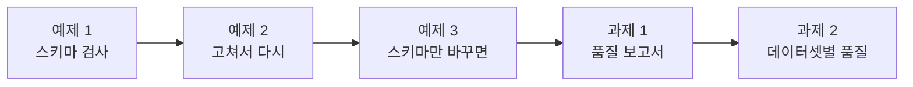
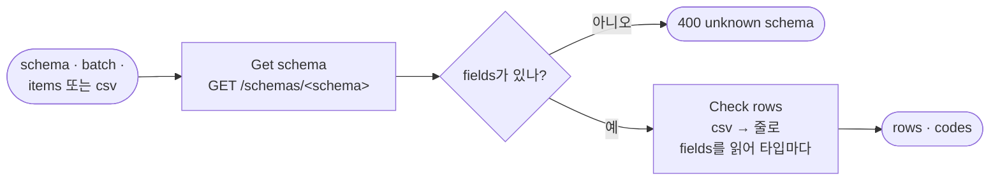
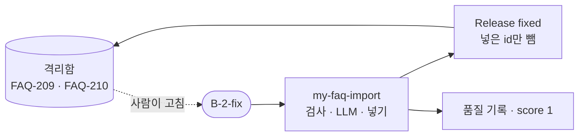
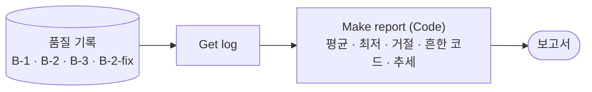
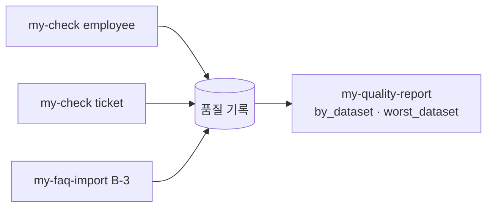

# Lab 03 · 품질 관리 · 스키마로 넓히고, 고쳐서 다시, 추세로 보기

- 관련 강의: [3단계 · 품질 관리](../../Lecture/78/03-STAGE3-QUALITY-MANAGEMENT.md)
- 소요 시간: 50분 (6교시 한 시간) · 예제 1 14분 · 예제 2 8분 · 예제 3 6분 · 과제 1 12분 · 과제 2 10분
- 준비: Lab 02의 `my-faq-import`(과제 2까지)가 게시돼 있음
- 목표: FAQ에만 맞춘 규칙을 **스키마**(규칙을 적은 데이터)로 넓혀 직원 CSV도 같은 워크플로우로 검사한다. 고친 줄을 다시 넣으면 격리함에서 빼고, **새 스키마**를 더해도 워크플로우를 고치지 않는 것을 확인한다. 품질 기록으로 **보고서**(평균 · 가장 나쁜 배치 · 흔한 문제 · 추세)를 만들고, 데이터셋마다 나눠 본다.



> 복사해 붙일 요청문은 없습니다. 막히면 `▶` 를 하나씩 펼칩니다. 연습이 끝나면 `uv run tools/flow.py quality --reset`.

## 예제 1 · 스키마 검사 (14분)

### 이 실습의 의도

**한 줄로:** 인사팀이 새 직원 9명을 CSV로 보냈습니다. FAQ 검사로는 읽지도 못합니다. 규칙을 코드에 쓰지 않고 데이터 API의 **스키마**(`/schemas/employee`)에서 읽어 판정하는 검사(`my-check`)를 만들어, 같은 워크플로우로 FAQ도 직원도 검사합니다.

> **생활 속 예 · 품목마다 다른 검수 카드.** 채소 · 고기 · 생선은 보는 것이 다릅니다 (채소는 무른 곳, 고기는 온도와 라벨, 생선은 눈 색). 품목마다 주방장을 따로 두지 않고, 품목마다 **검수 카드**를 만들어 두면 한 사람이 카드를 바꿔 들고 무엇이든 검수합니다. 예제 1은 검수 카드(스키마)를 읽어 판정하는 검사를 만드는 실습입니다.

**상황.** `requests/employees-new.json`은 `{"schema": "employee", "batch": "HR-1", "csv": "name,dept,email,phone,joined\n…"}` 꼴입니다. Lab 01의 `my-faq-check`에 보내면 `items`가 없어 400입니다. FAQ용 규칙을 복사해 직원용 Code를 하나 더 만들 수도 있지만, 그러면 데이터가 늘 때마다 워크플로우가 늘어납니다.

| 스키마의 칸 (`/schemas/employee`) | 뜻 |
| --- | --- |
| `key` | 배치 안에서 겹치면 안 되는 칸 (`email`) |
| `fields.<이름>.type` | `string` · `enum` · `email` · `phone` · `date` · `pattern` · `list` |
| `required` · `min` · `max` · `values` · `pattern` | 타입마다 확인할 것 |

**순서.** FAQ 검사에 직원 CSV를 먼저 보내 봄 → 요청문 → push → 4/4.

**끝나면 알게 되는 것.** 규칙을 **데이터로** 두면(스키마) 검사 하나로 여러 데이터를 볼 수 있다는 것. 스키마로 되는 규칙(형식 · 목록 · 필수)과 안 되는 규칙(개인정보 · 이미 있는 데이터 · 뜻)의 경계.

**적을 곳.** `my-work/QUALITY.md` 8절 표.

```bash
uv run tools/flow.py call my-faq-check requests/employees-new.json     # 고치기 전 · FAQ 검사에 직원 CSV
uv run tools/flow.py test cases/lab03.json -v                          # 고치기 전 · my-check가 아직 없음
```

### 이해하기

**지금 무엇이 문제인가.** Lab 01의 검사는 FAQ의 칸 이름(`title` · `answer`)과 규칙이 Code 안에 박혀 있습니다. 직원 데이터는 칸도 규칙도 다릅니다. 고치는 일은 "규칙을 Code 밖(스키마)으로 꺼내고, Code는 스키마를 읽어 타입마다 같은 방식으로 판정하게" 하는 것입니다.



**스키마(schema)란.** 데이터의 모양을 적은 데이터입니다: 어떤 칸이 있고, 칸마다 타입은 무엇이고, 꼭 있어야 하나. 업계에서는 JSON Schema · 데이터베이스의 테이블 정의 · Great Expectations의 기대값 등이 같은 일을 합니다. 오늘 스키마는 AGENTS.md 3절 "스키마" 표의 작은 판입니다.

| 직원 CSV의 줄 | 스키마의 규칙 | 코드 |
| --- | --- | --- |
| `minsu.kang@example` | `email` 형식 | `bad_format:email` |
| `마케팅팀` | `enum` — 여섯 팀 중 하나 | `not_allowed:dept` |
| `2026-13-01` | `date` — 실제 있는 날짜 | `bad_format:joined` |
| 이름이 빈 줄 | `required` | `missing:name` |
| 같은 메일이 두 번 | `key` | `duplicate_in_batch` |

**CSV.** 첫 줄이 열 이름이고 쉼표로 나눕니다 (오늘은 따옴표 없음). `row`는 사람이 세는 번호(1부터, 열 이름 줄 제외)입니다.

**테스트 케이스.**

| 케이스 | 기대 |
| --- | --- |
| 직원 CSV · 9줄 중 4줄 통과 | `schema` employee, 7째 줄(사무실 번호 `02-123-4567`)은 통과 |
| 직원 CSV · 줄마다 이유 | 위 표의 코드들 |
| 같은 워크플로우로 FAQ 스키마 | B-3을 `schema: faq`로 → 6줄 중 5줄, 5째 줄 `too_short:answer` |
| 모르는 스키마 | 400 |

**기대 결과.** 고치기 전: FAQ 검사는 400, `lab03` 0/4 (웹훅이 없음). 고친 뒤 4/4.

<details><summary>▶ 1단계 · 타입마다 한 번씩</summary>

`for (const [name, f] of Object.entries(schema.fields))`로 칸을 돌며, 비었으면 `required`만 보고 다음 칸으로, 아니면 `f.type`마다 확인합니다. 칸 이름(`email`)을 Code에 쓰지 않는 것이 핵심입니다.
</details>

<details><summary>▶ 2단계 · `2026-13-01`이 통과한다면</summary>

`YYYY-MM-DD` 꼴만 보면 13월도 통과합니다. `new Date(v + 'T00:00:00Z').toISOString().slice(0, 10) === v`처럼 실제 있는 날짜인지까지 봅니다 (예제 3의 `2026-02-30`도).
</details>

<details><summary>▶ 빈칸 채우기 · 요청문(프롬프트) 뼈대</summary>

요청문에 꼭 들어갈 것: **① 모르는 스키마 ② CSV 읽기 ③ 규칙의 출처 ④ 줄 번호 · 결과 모양 · 기대 결과**. 아래 빈칸 4개를 채웁니다.

```text
my-work/check.json 을 새로 만들어 줘. 웹훅 POST my-check, 이름 "78 Schema check (my)".
Get schema: HTTP GET http://data-api:8800/schemas/<본문 schema> (neverError). 스키마가 없으면(fields 가 없음) HTTP ____① {error: "unknown schema", schema}.
Check rows(Code): 본문 csv 가 있으면 첫 줄을 ____②으로 쉼표로 나눠 줄로 바꾸고, items 가 있으면 그대로.
필드 규칙은 코드에 쓰지 말고 스키마의 ____③ 를 읽어 AGENTS.md 3절 타입 표대로 (required · string · enum · email · phone · date · pattern · list), 키는 배치 안 중복.
결과 {schema, batch, total, valid, invalid, rows: [{row (____④), key, ok, errors}], codes}. 기대 결과 cases/lab03.json.
```

빈칸 힌트:

- ① 테스트의 "모르는 스키마" 케이스가 기대하는 상태.
- ② CSV의 첫 줄은 무엇인가요?
- ③ 규칙을 Code에 쓰지 않으면, 스키마 JSON의 어느 칸을 읽나요?
- ④ AGENTS.md 3절 스키마 표 아래 줄.
</details>

```bash
uv run tools/flow.py push my-work/check.json
uv run tools/flow.py test cases/lab03.json -v
```

### 실행 결과 · 스키마 검사

수업 준비 때(11/01) 강사 노트북에서 정답 워크플로우로 실제로 나온 출력입니다. 판정은 스키마대로라 누구에게나 같습니다.

#### 고치기 전 · FAQ 검사에 직원 CSV, 그리고 `my-check`가 없을 때

실행한 명령:

```bash
uv run tools/flow.py call my-faq-check requests/employees-new.json
uv run tools/flow.py test cases/lab03.json -v
```

출력:

```text
HTTP 400 · 0.0s
{"error": "items must be a list"}

POST http://localhost:5678/webhook/my-check · 4 case(s) × 1
✘ 직원 CSV · 9줄 중 4줄 통과 · 0.0s · status 404 (expected 200); schema = null (expected employee); total = null (expected 9); valid = null (expected 4); rows.6.ok = null (expected true)
✘ 직원 CSV · 줄마다 이유 · 0.0s · status 404 (expected 200); rows.2.errors has none of ['bad_format:email']; …
✘ 같은 워크플로우로 FAQ 스키마 · 0.0s · status 404 (expected 200); schema = null (expected faq); …
✘ 모르는 스키마 → 400 · 0.0s · status 404 (expected 400)
Passed 0/4
```

**왜 이렇게 나왔나 (고치기 전)**

- **FAQ 검사는 400:** 직원 배치에는 `items`가 없고 `csv` 글자가 있습니다. Lab 01의 검사는 `items` 목록만 압니다. 칸 이름(`title` · `answer`)도 규칙도 FAQ에 박혀 있어, 설령 줄로 바꿔 넣어도 모든 줄이 `title_missing`일 것입니다 (예제 3에서 접수 건으로 확인).
- **`lab03` 404:** `my-check` 웹훅이 아직 없습니다. 0/4는 예상한 결과.

#### 고친 뒤 · 내 `my-check`

실행한 명령:

```bash
uv run tools/flow.py push my-work/check.json
uv run tools/flow.py test cases/lab03.json -v
```

출력 (결과 줄과 `-v`의 직원 응답을 줄마다 한 줄로):

```text
✔ 직원 CSV · 9줄 중 4줄 통과 · 0.9s
✔ 직원 CSV · 줄마다 이유 · 0.0s
✔ 같은 워크플로우로 FAQ 스키마 · 0.1s
✔ 모르는 스키마 → 400 · 0.0s
Passed 4/4

{ "schema": "employee", "batch": "HR-1", "total": 9, "valid": 4, "invalid": 5,
  "rows": [ 1 sehoon.oh@example.com ok · 2 haneul.yoon@example.com ok · 3 minsu.kang@example bad_format:email ·
            4 jia.seo@example.com not_allowed:dept · 5 doyun.lim@example.com bad_format:joined ·
            6 noname@example.com missing:name · 7 sua.bae@example.com ok · 8 sua.bae@example.com duplicate_in_batch ·
            9 daeun.jung@example.com ok ],
  "codes": { "bad_format:email": 1, "not_allowed:dept": 1, "bad_format:joined": 1, "missing:name": 1, "duplicate_in_batch": 1 } }
FAQ 스키마로 B-3:  6줄 중 5줄 · 5 FAQ-305 too_short:answer
```

**고친 뒤 이렇게 나온 까닭**

| 줄 | 값 | 판정 | 스키마의 어느 규칙 |
| --- | --- | --- | --- |
| 2 | `phone` 빈칸 | 통과 | `phone`은 `required: false` — 비었으면 형식을 보지 않음 |
| 3 | `minsu.kang@example` | `bad_format:email` | `email` — `@` 뒤에 점이 있는 도메인 |
| 4 | `마케팅팀` | `not_allowed:dept` | `enum` 여섯 팀 |
| 5 | `2026-13-01` | `bad_format:joined` | `date` — 13월은 없음 |
| 6 | 이름 빈칸 | `missing:name` | `required` |
| 7 | `02-123-4567` | 통과 | `phone` 꼴 `0\d{1,2}-\d{3,4}-\d{4}` (사무실 번호도 맞음) |
| 8 | 7째와 같은 메일 | `duplicate_in_batch` | `key: email` |

- **같은 워크플로우, 다른 스키마:** B-3을 `schema: faq`로 보내면 6줄 중 5줄, FAQ-305가 `too_short:answer`. Lab 01 검사의 `answer_too_short`와 같은 판정을 **스키마의 `min: 10`**으로 냈습니다.
- **스키마로 안 되는 것:** FAQ 스키마 검사는 개인정보 · 바깥 링크 · 이미 있는 FAQ를 보지 않습니다 (B-3에는 그런 줄이 없어 결과가 같았을 뿐). 그래서 FAQ는 Lab 01의 검사를 계속 씁니다. `QUALITY.md` 8절에 이 경계를 적습니다.
- **`row`는 1부터:** CSV의 열 이름 줄을 빼고 사람이 세는 번호입니다 (케이스 파일은 0부터 세므로 3째 줄이 `rows.2`).

## 예제 2 · 고쳐서 다시 넣기 (8분)

### 이 실습의 의도

**한 줄로:** 콘텐츠 담당자가 격리된 B-2의 두 줄(FAQ-209 메일 주소 · FAQ-210 다른 답)을 고쳐 다시 보냈습니다(`faq-batch-2-fixed.json`). 넣는 것은 지금 가져오기로도 되지만, **격리함에 옛 줄이 남습니다.** 넣은 줄을 격리함에서 빼는 노드를 더합니다.

> **생활 속 예 · 보류 칸 비우기.** 납품업체가 라벨을 붙여 다시 가져온 고기를 냉장고에 넣었는데, 보류 칸의 옛 상자에 "라벨 없음" 쪽지가 그대로 붙어 있습니다. 다음 날 아침 주방장은 "아직 해결 안 됐네" 하고 또 전화합니다. 예제 2는 다시 받은 것을 보류 칸에서 치우는 실습입니다.

**상황.** 테스트가 먼저 B-2를 가져와 격리함에 2줄을 만들고, 고친 배치를 보냅니다. 격리함은 "사람이 볼 일"의 목록입니다. 해결된 줄이 남아 있으면 목록을 믿을 수 없습니다.

| 노드 | 하는 일 |
| --- | --- |
| `Release fixed` (HTTP) | `POST /quarantine/remove {ids: imported_ids}` — 이번에 넣은 줄만 |
| `Result again` (Code) | 응답은 가져오기 결과 그대로 (Lab 02 과제 1과 같음) |

**끝나면 알게 되는 것.** 격리 → 사람이 고침 → 다시 넣음 → 격리함에서 뺌, 이 **되돌림 고리**가 품질 관리의 한 바퀴라는 것. 고쳤는데 또 틀린 줄은 격리함에 남아야 한다는 것.

**적을 곳.** `my-work/QUALITY.md` 9절 (B-2-fix 줄).

```bash
uv run tools/flow.py test cases/lab03-fix.json -v    # 고치기 전 (Lab 02 과제 2까지의 가져오기)
uv run tools/flow.py quality
```

### 이해하기



**넣은 줄만 빼는 까닭.** 고친 줄이 또 규칙이나 LLM에 걸리면 그 줄은 다시 격리됩니다 (같은 배치 · 같은 id면 바뀜 — AGENTS.md 2절). 이번에 **넣은** id만 빼야, 아직 해결되지 않은 줄이 목록에서 사라지지 않습니다.

**테스트 케이스.**

| 케이스 | 기대 |
| --- | --- |
| 고친 두 줄 다시 가져오기 | 넣음 2 · 격리 0 · `score` 1 |
| 격리함이 비었나 | `size` 0 |
| FAQ에 FAQ-209 · FAQ-210 | FAQ 16개 (처음 6 + B-2 8 + 고친 2) |
| 품질 기록 · 점수 1 | 둘째 줄 `score` 1 |

**기대 결과.** 고치기 전 3/4 (격리함만 ✘ — 2줄 그대로), 고친 뒤 4/4.

<details><summary>▶ 빈칸 채우기 · 요청문(프롬프트) 뼈대</summary>

요청문에 꼭 들어갈 것: **① 뺄 id ② 걸린 줄 ③ 앞의 기록 ④ 응답**. 아래 빈칸 4개를 채웁니다.

```text
my-work/faq-import.json 에서 고쳐서 다시 넣은 줄을 격리함에서 빼 줘.
Summarize 뒤에 Release fixed: POST http://data-api:8800/quarantine/remove {ids: ____①}.
넣은 줄만 뺀다 — 이번에도 걸린 줄은 격리함에 ____②. 품질 기록 · 알림은 ____③.
응답은 Summarize 의 결과를 ____④ (Release fixed 의 응답이 아님). 기대 결과 cases/lab03-fix.json.
```

빈칸 힌트:

- ① `Summarize`의 결과 칸 중 이번에 넣은 id 목록.
- ② 고쳤는데 또 틀린 줄은 격리함에서 어떻게 되어야 하나요?
- ③ Lab 02 과제 1에서 더한 것.
- ④ HTTP 노드 뒤에서 응답하면 무엇이 나가나요? (Lab 02 과제 1의 "Result again")
</details>

```bash
uv run tools/flow.py push my-work/faq-import.json
uv run tools/flow.py test cases/lab03-fix.json -v
uv run tools/flow.py quality
```

### 실행 결과 · 고쳐서 다시 넣기

수업 준비 때(11/01) 강사 노트북에서 실제로 나온 출력입니다.

#### 고치기 전 · Lab 02 과제 2까지의 가져오기

실행한 명령:

```bash
uv run tools/flow.py test cases/lab03-fix.json -v
uv run tools/flow.py quality
```

출력 (결과 줄과 `quality`):

```text
✔ before: POST /webhook/my-faq-import · HTTP 200 · 8.4s · {"batch": "B-2", "total": 10, "imported": 8, "quarantined": 2, …
POST http://localhost:5678/webhook/my-faq-import · 4 case(s) × 1
✔ 고친 두 줄 다시 가져오기 · 2.5s
✘ 격리함이 비었나 · 0.0s · size = 2 (expected 0)
✔ FAQ에 FAQ-209 · FAQ-210 · 0.0s
✔ 품질 기록 · 점수 1 · 0.0s
Passed 3/4

FAQ: 6  (nothing added)
quarantine: 2
quality log: 2
alerts: 1
```

**왜 이렇게 나왔나 (고치기 전)**

- `before`가 B-2를 가져와 FAQ-209 · FAQ-210을 격리했습니다. 고친 배치(B-2-fix)는 두 줄 모두 규칙 · LLM을 통과해 **넣는 것은 됩니다** (`score` 1, FAQ 16개).
- 그런데 **격리함에 옛 두 줄이 그대로**입니다 (`size` 2). 고친 배치의 `batch`는 `B-2-fix`라 "같은 배치 · 같은 id면 바꿈"에도 해당하지 않습니다. 격리함만 보면 FAQ-209 · 210이 아직 문제인 것처럼 보입니다.
- `quality`의 알림 1: B-2(0.8)의 `low_quality`. B-2-fix는 1이라 알림이 없습니다. 3/4는 예상한 결과.

#### 고친 뒤

실행한 명령:

```bash
uv run tools/flow.py push my-work/faq-import.json
uv run tools/flow.py test cases/lab03-fix.json -v
uv run tools/flow.py quality
```

출력:

```text
✔ before: POST /webhook/my-faq-import · HTTP 200 · 10.7s · {"batch": "B-2", "total": 10, "imported": 8, "quarantined": 2, …
✔ 고친 두 줄 다시 가져오기 · 2.0s
✔ 격리함이 비었나 · 0.0s
✔ FAQ에 FAQ-209 · FAQ-210 · 0.0s
✔ 품질 기록 · 점수 1 · 0.0s
Passed 4/4

FAQ: 6  (nothing added)
quarantine: 0
quality log: 2
alerts: 1
```

**고친 뒤 이렇게 나온 까닭**

| | 고치기 전 | 고친 뒤 | 무엇이 바꿨나 |
| --- | --- | --- | --- |
| 넣은 줄 | FAQ-209 · 210 | 같음 | (가져오기는 원래 됨) |
| 격리함 | 2줄 (해결된 줄이 남음) | 0 | `Release fixed` → `/quarantine/remove {ids: imported_ids}` |
| 응답 | `score` 1 | 같음 | `Result again` |
| 품질 기록 | B-2 0.8 · B-2-fix 1 | 같음 | (Lab 02 과제 1 그대로) |

- **되돌림 고리가 한 바퀴:** 격리(B-2) → 사람이 고침(B-2-fix) → 다시 넣음 → 격리함에서 뺌. 품질 기록에는 0.8 → 1이 남아 과제 1의 추세가 됩니다.
- **넣은 줄만 뺐습니다:** 고친 FAQ-210의 답이 또 틀렸다면 `imported_ids`에 없으니 격리함에 남았을 것입니다.
- `quality`의 FAQ 6: 테스트의 `after`가 FAQ를 비웠습니다. 기록 · 알림은 그대로 남습니다.

## 예제 3 · 스키마만 바꾸면 (6분, 에이전트 없이)

### 이 실습의 의도

**한 줄로:** 데이터 API에 세 번째 스키마 `ticket`(접수 건)이 있습니다. 예제 1의 `my-check`를 **고치지 않고** 접수 건 9줄을 보내, 새 데이터셋이 스키마만으로 검사되는 것을 봅니다. 같은 줄을 FAQ 검사에 보내 비교합니다.

> **생활 속 예 · 새 품목의 검수 카드 한 장.** 식당이 디저트를 시작해 생크림이 들어오기 시작했습니다. 주방장을 새로 뽑지 않고 "생크림 카드"를 한 장 더 만들면 내일부터 같은 사람이 검수합니다. 예제 3은 카드 한 장(스키마)만 더해 새 품목을 검수하는 실습입니다.

**상황.** 헬프데스크 팀이 76일차부터 만든 접수 건을 다른 시스템에서 옮겨 오려 합니다 (`requests/tickets-new.json`, `{"schema": "ticket", "items": [...]}` 9줄). 스키마 `ticket`은 수업 전에 데이터 API에 들어 있습니다 (`/schemas/ticket`).

| 칸 | 규칙 (`/schemas/ticket`) |
| --- | --- |
| `ticket_id` (key) | `pattern` `^T-\d{4}$` |
| `title` | `string` 4~40자 |
| `requester` | `string` 필수, 20자 이내 |
| `priority` | `enum` `low` · `normal` · `high` |
| `opened` | `date` |
| `contact` | `phone`, **선택** (없어도 됨, 있으면 형식) |

**끝나면 알게 되는 것.** 규칙을 데이터로 두면 새 데이터셋에 **워크플로우를 고치지 않는다**는 것 (설정으로 넓히기). 그리고 FAQ 검사처럼 규칙이 코드에 박힌 검사는 다른 데이터에 쓸 수 없다는 것.

**적을 곳.** `my-work/QUALITY.md` 8절 아래 "새 스키마 ticket".

```bash
uv run tools/flow.py call my-faq-check requests/tickets-new.json    # 같은 줄을 FAQ 검사에
uv run tools/flow.py test cases/lab03-schema.json -v                # 내 스키마 검사 (고치지 않음)
```

### 이해하기

**코드에 박힌 규칙 · 데이터로 둔 규칙.**

| | FAQ 검사 (`my-faq-check`) | 스키마 검사 (`my-check`) |
| --- | --- | --- |
| 규칙이 있는 곳 | Code 안 | 데이터 API의 스키마 |
| 새 데이터셋 | Code를 하나 더 · 고쳐서 push | 스키마 파일 하나 (워크플로우 그대로) |
| 잘하는 것 | 데이터에 맞춘 규칙 (개인정보 · 이미 있는 FAQ · 고침 말) | 모양 · 형식 · 목록 · 필수 · 중복 |

둘 중 하나만 고르는 것이 아닙니다. 모양은 스키마로 넓게, 그 데이터만의 규칙은 Code로 깊게. 이 경계를 `QUALITY.md` 8절에 적습니다.

**선택 칸.** `contact`는 `required: false`입니다. 없으면 통과(9째 줄), 있는데 형식이 틀리면 `bad_format:contact`(6째 줄)입니다. "없어도 된다"와 "아무거나 돼도 된다"는 다릅니다.

**테스트 케이스.**

| 케이스 | 기대 |
| --- | --- |
| 스키마 목록에 ticket이 있다 | `/schemas/list`에 `ticket` |
| 새 스키마 ticket · 9줄 중 2줄 통과 | 1째 · 9째 줄만 |
| 형식 · 목록 · 날짜 · 길이 | `bad_format:ticket_id` · `not_allowed:priority` · `bad_format:opened`(2월 30일) · `too_short:title` |
| 선택 칸 형식 · 중복 · 빈 칸 | `bad_format:contact` · `duplicate_in_batch` · `missing:requester`, 9째 줄 통과 |
| 직원 CSV는 그대로 | 9줄 중 4줄 |

**기대 결과.** FAQ 검사는 9줄 모두 나쁨(칸 이름이 다르니 `id_format` · `title_missing`…). 스키마 검사는 고치지 않고 5/5.

<details><summary>▶ 1단계 · 5/5가 아니라면</summary>

예제 1의 Code가 칸 이름이나 타입을 직원 · FAQ에만 맞춰 썼는지 봅니다 (예: `pattern`을 `id`에만, `min`을 `answer`에만). 스키마의 `fields`를 돌며 타입마다 판정하면 새 스키마에도 그대로 됩니다. 실패하면 예제 1로 돌아가 고칩니다.
</details>

### 실행 결과 · 스키마만 바꾸면

수업 준비 때(11/01) 강사 노트북에서 실제로 나온 출력입니다 (예제 1의 `my-check`, 고치지 않음).

이 예제는 **고치지 않습니다.** 새 스키마의 데이터를 두 검사에 보냅니다.

#### 같은 줄을 FAQ 검사에

실행한 명령:

```bash
uv run tools/flow.py call my-faq-check requests/tickets-new.json
```

출력 (줄마다 한 줄로, `fix_list`는 줄임):

```text
HTTP 200 · 0.1s
{ "batch": "TK-1", "total": 9, "valid": 0, "invalid": 9,
  "rows": [ 1 "" id_format,keywords_missing,answer_missing ·
            2~9 "" id_format,keywords_missing,answer_missing,duplicate_in_batch ],
  "codes": { "id_format": 9, "keywords_missing": 9, "answer_missing": 9, "duplicate_in_batch": 8 },
  "message": "TK-1: 9줄 중 0줄 통과, 9줄 고칠 것" }
```

**왜 이렇게 나왔나:** 접수 건에는 `id` · `keywords` · `answer` 칸이 없습니다. FAQ 검사는 그 칸만 보므로 9줄 모두 "id 형식 · 키워드 없음 · 답 없음"입니다. `id`가 모두 빈 글자라 둘째 줄부터 `duplicate_in_batch`까지 붙었습니다. 판정이 틀린 것이 아니라 **다른 데이터에 FAQ 규칙을 댄** 것입니다. `fix_list`의 "답을 써 주세요"는 접수 건에는 말이 되지 않습니다.

#### 내 스키마 검사 (`my-check`, 고치지 않음)

실행한 명령:

```bash
uv run tools/flow.py test cases/lab03-schema.json -v
```

출력 (결과 줄과 `-v`의 접수 건 응답을 줄마다 한 줄로):

```text
POST http://localhost:5678/webhook/my-check · 5 case(s) × 1
✔ 스키마 목록에 ticket이 있다 · 0.0s
✔ 새 스키마 ticket · 워크플로우는 그대로 · 9줄 중 2줄 통과 · 0.1s
✔ 형식 · 목록 · 날짜 · 길이 · 0.1s
✔ 선택 칸 형식 · 중복 · 빈 칸, 선택 칸이 없어도 통과 · 0.0s
✔ 직원 CSV는 그대로 9줄 중 4줄 · 0.1s
Passed 5/5

{ "schema": "ticket", "batch": "TK-1", "total": 9, "valid": 2, "invalid": 7,
  "rows": [ 1 T-2001 ok · 2 T-12 bad_format:ticket_id · 3 T-2003 not_allowed:priority · 4 T-2004 bad_format:opened ·
            5 T-2005 too_short:title · 6 T-2006 bad_format:contact · 7 T-2001 duplicate_in_batch ·
            8 T-2008 missing:requester · 9 T-2009 ok ] }
```

**왜 이렇게 나왔나 (줄마다)**

| 줄 | 값 | 판정 | 규칙 |
| --- | --- | --- | --- |
| 2 | `T-12` | `bad_format:ticket_id` | `pattern ^T-\d{4}$` |
| 3 | `urgent` | `not_allowed:priority` | `enum` low · normal · high |
| 4 | `2026-02-30` | `bad_format:opened` | `date` — 2월 30일은 없음 |
| 5 | `프린터` (3자) | `too_short:title` | `min: 4` |
| 6 | `010-12-3456` | `bad_format:contact` | 선택 칸이지만 **있으면** 형식 |
| 7 | 1째와 같은 `T-2001` | `duplicate_in_batch` | `key: ticket_id` |
| 8 | `requester` 빈칸 | `missing:requester` | `required` |
| 9 | `contact` 없음 | 통과 | 선택 칸이라 없어도 됨 |

- **워크플로우를 한 줄도 고치지 않았습니다.** 데이터 API에 `ticket.json` 한 장이 있었을 뿐입니다. 직원 CSV(9줄 중 4줄)도 그대로입니다.
- 같은 접수 건 9줄을 FAQ 검사는 "모두 나쁨", 스키마 검사는 "2줄 통과 · 줄마다 다른 이유"로 봤습니다. **규칙이 데이터에 맞아야** 판정이 쓸모 있습니다.
- 이것이 "규칙을 데이터로 둔다"의 효과입니다. 실제로는 스키마를 바꾸는 것도 사람이 검토해야 하는 일(스키마 변경 = 규칙 변경)이라, 스키마 파일을 저장소에 두고 리뷰합니다 (74일차 배포 관문과 같은 생각).

## 과제 1 · 품질 보고서 (12분)

### 이 실습의 의도

**한 줄로:** Lab 02 과제 1부터 쌓인 품질 기록으로 **보고서**(`my-quality-report`)를 만듭니다: 배치 수 · 평균 점수 · 가장 나쁜 배치 · 거절 수 · 가장 흔한 문제 · 추세.

> **생활 속 예 · 한 달 검수 일지 정리.** 월말에 사장님이 묻습니다. "이번 달 납품은 어땠어? 제일 나빴던 날은? 반품 이유는 뭐가 제일 많았어? 나아지고 있어?" 일지를 한 장씩 넘기며 말로 답하면 사람마다 답이 다릅니다. 과제 1은 일지를 늘 같은 방식으로 정리하는 보고서를 만드는 실습입니다.

**상황.** 테스트가 먼저 B-1(거절) · B-2 · B-3 · B-2-fix를 차례로 가져와 기록 네 줄을 만듭니다. 팀장이 회의에서 쓸 숫자입니다.

| 칸 | 정의 (AGENTS.md 3절 "품질 보고서") |
| --- | --- |
| `count` · `batches` | 기록 줄 수 · `[{batch, score, rejected, total}]` 넣은 순서 |
| `avg_score` | 평균, 소수 4자리 (0건이면 0) |
| `worst_batch` | 가장 낮은 `score` (같으면 먼저 나온 것) |
| `rejected_batches` | 거절 수 |
| `top_codes` | `codes`를 모두 더해 많은 순 (같으면 코드 글자순) |
| `trend` | 마지막 − 첫 > 0.05 `좋아짐`, < −0.05 `나빠짐`, 아니면 `그대로` |

**끝나면 알게 되는 것.** 품질도 77일차 지표처럼 **정의가 먼저**라는 것 (거절을 평균에 넣나, 같으면 무엇을 고르나). 숫자는 Code가 세고, 말은 사람이 한다는 것.

**적을 곳.** `my-work/QUALITY.md` 9절 표와 "회의에 어떻게 말할까".

```bash
uv run tools/flow.py test cases/lab03-challenge.json -v    # 고치기 전 (my-quality-report가 아직 없음)
```

### 이해하기



**거절을 평균에 넣는 까닭.** B-1은 거절이라 `score` 0입니다. 평균에서 빼면 0.8778, 넣으면 0.6583입니다. 뺀 숫자는 "받은 배치는 괜찮았다"이고, 넣은 숫자는 "보내온 배치는 그만큼이었다"입니다. 오늘은 **넣습니다** — 콘텐츠 담당자가 보내는 배치의 품질을 보는 보고서이기 때문입니다. 무엇을 넣었는지는 보고서와 함께 말합니다.

**같으면 무엇을 고르나.** B-2와 B-3이 같은 점수라면? `top_codes`에서 `pii`와 `title_missing`이 같은 수라면? 정하지 않으면 실행마다 순서가 바뀔 수 있습니다. 그래서 "먼저 나온 것" · "코드 글자순"으로 정합니다.

**테스트 케이스.**

| 케이스 | 기대 |
| --- | --- |
| 배치 네 개 · 평균 · 가장 나쁜 배치 | 4 · 0.6583 · B-1 · 거절 1 |
| 가장 많은 이유 · 흐름 | `pii` 2, `좋아짐` (0 → 1) |
| 배치마다 점수 순서 | 0.8 · 0.8333 · B-2-fix |
| 다른 데이터셋으로 거르기 | `employee` → 0건 · 평균 0 |

**기대 결과.** 고치기 전 0/4 (404), 고친 뒤 4/4.

<details><summary>▶ 빈칸 채우기 · 요청문(프롬프트) 뼈대</summary>

요청문에 꼭 들어갈 것: **① 반올림 ② 같을 때 (배치) ③ 같을 때 (코드) ④ 추세의 나머지**. 아래 빈칸 4개를 채웁니다.

```text
my-work/quality-report.json 을 새로 만들어 줘. 웹훅 POST my-quality-report, 이름 "78 Quality report (my)".
Get log: HTTP GET http://data-api:8800/quality-log. 본문에 dataset 이 있으면 그 데이터셋만.
Make report(Code) 하나에서 AGENTS.md 3절 "품질 보고서" 정의대로 count · batches · avg_score (소수 ____①자리, 0건이면 0) · worst_batch (같으면 ____②) · rejected_batches.
top_codes: 모든 기록의 codes 를 더해 많은 순, 같으면 코드 ____③. trend: 마지막 score − 첫 score 가 0.05 넘으면 좋아짐, −0.05 미만이면 나빠짐, 아니면 ____④.
LLM 은 쓰지 않는다. 기대 결과 cases/lab03-challenge.json.
```

빈칸 힌트:

- ① 테스트의 0.6583은 몇 자리인가요?
- ② · ③ 3절 표의 괄호 안.
- ④ 차이가 ±0.05 안이거나 기록이 1건뿐이면.
</details>

```bash
uv run tools/flow.py push my-work/quality-report.json
uv run tools/flow.py test cases/lab03-challenge.json -v
uv run tools/flow.py call my-quality-report '{}'
```

### 실행 결과 · 품질 보고서

수업 준비 때(11/01) 강사 노트북에서 실제로 나온 출력입니다. 테스트의 `before`가 네 배치를 가져오므로 LLM을 부르는 데 15초쯤 걸립니다.

#### 고치기 전 · `my-quality-report`가 없을 때

실행한 명령:

```bash
uv run tools/flow.py test cases/lab03-challenge.json -v
```

출력 (`before`와 결과 줄):

```text
! before: POST /webhook/my-faq-import · HTTP 422 · 0.1s (allow_fail: rejected on purpose) · {"error": "batch rejected", "batch": "B-1", …
✔ before: POST /webhook/my-faq-import · HTTP 200 · 8.4s · {"batch": "B-2", …, "score": 0.8, …
✔ before: POST /webhook/my-faq-import · HTTP 200 · 4.6s · {"batch": "B-3", …, "score": 0.8333, …
✔ before: POST /webhook/my-faq-import · HTTP 200 · 1.9s · {"batch": "B-2-fix", …, "score": 1, …
POST http://localhost:5678/webhook/my-quality-report · 4 case(s) × 1
✘ 배치 네 개 · 평균 · 가장 나쁜 배치 · 0.0s · status 404 (expected 200); count = null (expected 4); avg_score = null (expected 0.6583); …
✘ 가장 많은 이유 · 흐름 · 0.0s · status 404 (expected 200); …
✘ 배치마다 점수 순서 · 0.0s · status 404 (expected 200); …
✘ 다른 데이터셋으로 거르기 · 0.0s · status 404 (expected 200); …
Passed 0/4
```

**왜 이렇게 나왔나 (고치기 전)**

- **첫 줄의 `!`:** B-1은 일부러 거절되는 배치라 `before`에 `"allow_fail": true`가 있습니다. 422여도 테스트를 멈추지 않고 `!`(일부러 거절)로 표시합니다. 거절도 품질 기록에 남아야 보고서에 "가장 나쁜 배치"가 생깁니다.
- 기록 네 줄은 생겼지만 보고서 웹훅이 없어 404. 0/4는 예상한 결과.

#### 고친 뒤

실행한 명령:

```bash
uv run tools/flow.py push my-work/quality-report.json
uv run tools/flow.py test cases/lab03-challenge.json -v
uv run tools/flow.py call my-quality-report '{}'
```

출력 (결과 줄과 `call`):

```text
✔ 배치 네 개 · 평균 · 가장 나쁜 배치 · 0.0s
✔ 가장 많은 이유 · 흐름 · 0.1s
✔ 배치마다 점수 순서 · 0.0s
✔ 다른 데이터셋으로 거르기 · 0.1s
Passed 4/4

HTTP 200 · 0.0s
{ "count": 4,
  "batches": [ {"batch": "B-1", "score": 0, "rejected": true, "total": 13}, {"batch": "B-2", "score": 0.8, …},
               {"batch": "B-3", "score": 0.8333, …}, {"batch": "B-2-fix", "score": 1, …} ],
  "avg_score": 0.6583, "worst_batch": "B-1", "rejected_batches": 1,
  "top_codes": [ {"code": "pii", "count": 2}, {"code": "answer_missing", "count": 1}, {"code": "answer_too_long", "count": 1}, … ],
  "trend": "좋아짐" }
```

**고친 뒤 이렇게 나온 까닭**

| 칸 | 값 | 어떻게 |
| --- | --- | --- |
| `avg_score` | 0.6583 | (0 + 0.8 + 0.8333 + 1) / 4, 거절도 넣음 |
| `worst_batch` | B-1 | `score` 0 |
| `top_codes` 1위 | `pii` 2 | B-1의 FAQ-109(전화) + B-2의 FAQ-209(메일) |
| `top_codes` 2위부터 | 1건씩, 글자순 | `answer_missing` · `answer_too_long` · `answer_too_short` · … |
| `trend` | `좋아짐` | 1(B-2-fix) − 0(B-1) = 1 > 0.05 |

- **회의에 말한다면:** "배치 넷, 평균 0.66(거절 포함). 가장 흔한 문제는 개인정보 2건 — 콘텐츠 담당자에게 '전화번호 · 메일 대신 IT 포털'을 안내하자. 추세는 좋아짐."
- **`trend`의 함정:** 첫 기록이 거절(0)이고 마지막이 고친 두 줄(1)이라 "좋아짐"이 크게 나옵니다. 고친 두 줄짜리 배치와 13줄짜리 배치를 같은 무게로 비교한 것입니다. 숫자는 정의대로 맞지만, **무엇과 무엇을 비교했는지**를 함께 말해야 합니다 (77일차 표본 크기와 같은 이야기).
- **`dataset: employee`로 거르면 0건 · 평균 0:** 0으로 나누지 않습니다.

## 과제 2 · 데이터셋별 품질 (10분)

### 이 실습의 의도

**한 줄로:** 스키마 검사(`my-check`)도 검사할 때마다 품질 기록을 남기게 하고, 보고서에 **데이터셋마다**(`faq` · `employee` · `ticket`) 평균 · 가장 나쁜 배치 · 가장 흔한 문제와 **가장 손볼 데이터셋**을 더합니다.

> **생활 속 예 · 납품업체별 성적표.** 한 달 평균만 보면 "괜찮다"인데, 업체별로 나누면 채소 가게는 늘 좋고 생선 가게만 절반이 반품입니다. 사장님이 전화할 곳은 생선 가게입니다. 과제 2는 검수 일지를 품목(데이터셋)별 성적표로 나누는 실습입니다.

**상황.** 지금 품질 기록은 FAQ 가져오기만 남깁니다. 직원 CSV · 접수 건은 검사 결과가 부른 사람의 화면에만 있다가 사라집니다. 팀장이 요청했습니다: "인사팀 · 헬프데스크 데이터도 같은 보고서에서 보고 싶어요. 어느 데이터가 제일 나쁜지."

| 바꿀 곳 | 무엇을 (AGENTS.md 3절) |
| --- | --- |
| `my-check` | 검사가 끝나면 `/quality-log` 한 줄 `{batch, dataset: <schema>, total, valid, quarantined: invalid, rejected: false, score, codes}`, 응답은 그대로 |
| `my-quality-report` | `by_dataset` (데이터셋마다 `{count, avg_score, worst_batch, top_code}`) · `worst_dataset` |

**끝나면 알게 되는 것.** 같은 기록 모양을 쓰면 **다른 워크플로우의 품질도 한 보고서**에서 본다는 것. 전체 평균이 가리는 것을 나눠 보면 보인다는 것 (77일차 기간별 · 시간대별과 같은 생각).

**적을 곳.** `my-work/QUALITY.md` 9절 "가장 손볼 데이터셋과 그 이유".

```bash
uv run tools/flow.py test cases/lab03-challenge2.json -v    # 고치기 전 (예제 1의 검사 · 과제 1의 보고서)
```

### 이해하기



**전체 평균이 가리는 것.** 세 기록의 평균은 (0.4444 + 0.2222 + 0.8333) / 3 = 0.5만큼입니다. 이것만으로는 무엇을 고칠지 모릅니다. 나누면 접수 건(0.2222)이 가장 나쁘고, 직원 CSV는 메일 형식이 가장 흔한 문제입니다.

**테스트 케이스.** 테스트가 먼저 직원 CSV · 접수 건을 검사하고 B-3을 가져옵니다.

| 케이스 | 기대 |
| --- | --- |
| 검사도 품질 기록 | 기록 3줄 — `employee` 0.4444 · `ticket` · `faq` |
| 데이터셋마다 나눠 보기 | `employee` 0.4444 · `ticket` 0.2222 · `faq` 0.8333 |
| 가장 나쁜 데이터셋 · 그 이유 | `ticket`, 직원의 `top_code` `bad_format:email` |
| 한 데이터셋만 (앞의 칸은 그대로) | `{"dataset": "ticket"}` → 1건 · TK-1 · `그대로` |

**기대 결과.** 고치기 전 0/4, 고친 뒤 4/4, `lab03` · `lab03-challenge`도 그대로.

<details><summary>▶ 빈칸 채우기 · 요청문(프롬프트) 뼈대</summary>

요청문에 꼭 들어갈 것: **① 데이터셋 이름 ② 순서 ③ 가장 손볼 곳 ④ 앞의 것**. 두 워크플로우를 한 요청문에서 고칩니다.

```text
두 워크플로우를 고쳐 줘.
① my-work/check.json: 검사가 끝나면 POST http://data-api:8800/quality-log 한 줄 {batch, dataset: ____①, total, valid, quarantined: invalid, rejected: false, score: valid / total (4자리), codes}. 응답은 검사 결과 그대로.
② my-work/quality-report.json: by_dataset — 모든 기록을 dataset 마다 {count, avg_score, worst_batch, top_code} (____② 순서), worst_dataset — avg_score 가 가장 ____③ 데이터셋.
본문의 dataset 거르기와 앞의 칸은 ____④. 기대 결과 cases/lab03-challenge2.json, lab03 · lab03-challenge 도.
```

빈칸 힌트:

- ① 검사 결과의 어느 칸이 `employee` · `ticket`인가요?
- ② 보고서가 늘 같은 순서로 나오려면.
- ③ `avg_score`가 어때야 "가장 손볼"인가요?
- ④ 과제 1의 테스트가 계속 통과하려면.
</details>

```bash
uv run tools/flow.py push my-work/check.json my-work/quality-report.json
uv run tools/flow.py test cases/lab03-challenge2.json -v
uv run tools/flow.py test cases/lab03.json
uv run tools/flow.py test cases/lab03-challenge.json
uv run tools/flow.py quality
```

### 실행 결과 · 데이터셋별 품질

수업 준비 때(11/01) 강사 노트북에서 실제로 나온 출력입니다.

#### 고치기 전 · 예제 1의 검사 · 과제 1의 보고서

실행한 명령:

```bash
uv run tools/flow.py test cases/lab03-challenge2.json -v
```

출력 (`before`와 결과 줄):

```text
✔ before: POST /webhook/my-check · HTTP 200 · 0.1s · {"schema": "employee", "batch": "HR-1", "total": 9, "valid": 4, …
✔ before: POST /webhook/my-check · HTTP 200 · 0.1s · {"schema": "ticket", "batch": "TK-1", "total": 9, "valid": 2, …
✔ before: POST /webhook/my-faq-import · HTTP 200 · 4.0s · {"batch": "B-3", …, "score": 0.8333, …
✘ 검사도 품질 기록 (직원 · 티켓 · FAQ) · 0.0s · count = 1 (expected 3); items.0.dataset = faq (expected employee); items.0.score = 0.8333 (expected 0.4444); …
✘ 데이터셋마다 나눠 보기 · 0.2s · count = 1 (expected 3); by_dataset.employee.avg_score = null (expected 0.4444); …
✘ 가장 나쁜 데이터셋 · 그 이유 · 0.1s · worst_dataset = null (expected ticket); by_dataset.employee.top_code = null (expected bad_format:email)
✘ 한 데이터셋만 (앞의 칸은 그대로) · 0.0s · count = 0 (expected 1); worst_batch = null (expected TK-1)
Passed 0/4
```

**왜 이렇게 나왔나 (고치기 전)**

- 검사 두 번(직원 · 접수 건)은 **결과만 돌려주고 기록을 남기지 않았습니다.** 기록은 B-3 가져오기의 한 줄뿐이라 `count` 1, 첫 줄이 `faq`.
- 과제 1의 보고서에는 `by_dataset` · `worst_dataset`이 없어 `null`. `ticket`으로 거르면 기록이 없어 0건. 0/4는 예상한 결과.

#### 고친 뒤

실행한 명령:

```bash
uv run tools/flow.py push my-work/check.json my-work/quality-report.json
uv run tools/flow.py test cases/lab03-challenge2.json -v
uv run tools/flow.py test cases/lab03.json
uv run tools/flow.py test cases/lab03-challenge.json
uv run tools/flow.py quality
```

출력 (결과 줄, `-v`의 보고서에서 `by_dataset`, `quality`):

```text
✔ 검사도 품질 기록 (직원 · 티켓 · FAQ) · 0.0s
✔ 데이터셋마다 나눠 보기 · 0.1s
✔ 가장 나쁜 데이터셋 · 그 이유 · 0.0s
✔ 한 데이터셋만 (앞의 칸은 그대로) · 0.1s
Passed 4/4

"avg_score": 0.5, "worst_batch": "TK-1", "trend": "좋아짐",
"by_dataset": {
  "employee": {"count": 1, "avg_score": 0.4444, "worst_batch": "HR-1", "top_code": "bad_format:email"},
  "ticket":   {"count": 1, "avg_score": 0.2222, "worst_batch": "TK-1", "top_code": "bad_format:contact"},
  "faq":      {"count": 1, "avg_score": 0.8333, "worst_batch": "B-3",  "top_code": "answer_too_short"} },
"worst_dataset": "ticket"

(lab03) Passed 4/4 · (lab03-challenge) Passed 4/4
quality log: 4
```

**고친 뒤 이렇게 나온 까닭**

| 데이터셋 | 기록 | `avg_score` | `top_code` | 읽는 법 |
| --- | --- | --- | --- | --- |
| `employee` | HR-1 | 0.4444 (4/9) | `bad_format:email` | 다섯 가지 문제가 1건씩 — 글자순 첫째가 메일 |
| `ticket` | TK-1 | 0.2222 (2/9) | `bad_format:contact` | 일곱 가지가 1건씩, 가장 나쁨 → `worst_dataset` |
| `faq` | B-3 | 0.8333 (5/6) | `answer_too_short` | FAQ-305 한 줄 |

- **검사도 기록:** `my-check`의 `Log quality`가 `dataset`에 스키마 이름을 넣었습니다. 가져오기와 같은 기록 모양이라 보고서를 고치지 않고도 `count` 3이 됐습니다.
- **전체 평균 0.5가 가리는 것:** 셋을 섞으면 "절반쯤 괜찮다"이지만, 나누면 접수 건이 0.2222로 가장 손볼 곳입니다. 헬프데스크 팀에 "옮기기 전에 접수 건 일곱 줄을 고쳐 달라"고 말할 근거입니다.
- **섞은 `trend`는 뜻이 없습니다:** 전체 `trend`가 `좋아짐`(0.4444 → 0.8333)이지만, 이것은 직원 CSV와 FAQ를 비교한 것입니다. 추세는 **같은 데이터셋 안에서** 봐야 합니다 (`{"dataset": "faq"}`처럼 걸러서). `top_code`가 1건씩 같은 수일 때 글자순 첫째라는 것도 함께 말해야 오해가 없습니다.
- `lab03` · `lab03-challenge`가 그대로 4/4입니다. `lab03-challenge`의 `quality log: 4`는 그 테스트가 마지막에 남긴 네 배치입니다 (`my-check`는 그 테스트에서 부르지 않음).

## 막혔을 때

| 증상 | 할 일 |
| --- | --- |
| 모르는 스키마에 500 | `Get schema`에 `neverError`, 다음 IF에서 `fields`가 있는지 |
| CSV 줄이 하나 더 | 끝 줄바꿈 — `csv.trim()` 뒤에 나눔 |
| `2026-13-01` · `2026-02-30`이 통과 | 실제 있는 날짜인지 (▶ 예제 1의 2단계) |
| 빈 `phone`이 `bad_format` | 비었으면 `required`만 보고 다음 칸으로 |
| 격리함이 비지 않음 | `Release fixed`에 `imported_ids` |
| 응답이 `{"removed": …}` | 끝에 `Result again` |
| `avg_score`가 0.8778 | 거절 배치(`score` 0)도 평균에 |
| `top_codes` 순서가 바뀜 | 같은 수면 코드 글자순 |
| 기록이 1줄 (FAQ만) | `my-check`에 `Log quality`를 더하고 **push** (두 파일 모두) |
| `by_dataset`이 비어 있음 | 거르기 **전**의 모든 기록으로 나눔 |
| 계속 안 됨 | `cp reference/lab03-example1-schema-check.json my-work/check.json` 후 push (예제 1까지) |

## 확인

- [ ] 예제 1: `cases/lab03.json` 4/4 (고치기 전 FAQ 검사는 400, `lab03` 0/4), `QUALITY.md` 8절.
- [ ] 예제 2: `cases/lab03-fix.json` 4/4 (고치기 전 3/4).
- [ ] 예제 3: `cases/lab03-schema.json` 5/5 (워크플로우를 고치지 않음).
- [ ] 과제 1: `cases/lab03-challenge.json` 4/4, `QUALITY.md` 9절.
- [ ] 과제 2: `cases/lab03-challenge2.json` 4/4, `lab03` · `lab03-challenge`도 통과.
- [ ] `my-work/PROMPTS.md`, 끝나면 `uv run tools/flow.py quality --reset`.
