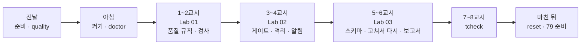
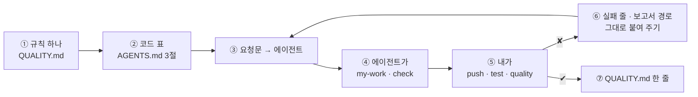

# 78일차 수강 안내 · 수업 준비부터 마칠 때까지

- 일자: 2026-11-03 (화) · 78일차
- 주제: 데이터 품질 검증 자동화와 품질 관리 Workflow (규칙 → 검사 → 게이트 · 격리 → 기록 · 추세)
- 실습 폴더: [Last3Mon/78](README.md) · 강의 자료: [Lecture/78](../../Lecture/78/README.md)
- 환경: 65일차 n8n 2.42.6 + **OpenAI API 키만**(`gpt-4.1-mini`) + **78일차 판 데이터 API**(격리함 · 스키마 · 품질 기록) + CLI 코딩 에이전트 하나. **Ollama는 쓰지 않습니다.**
- 이 문서: 오늘 하루 내가 할 일을 수업 준비부터 마칠 때까지 순서대로 모은 수강 안내입니다. 수업 중에도 띄워 두고 어디까지 왔는지 확인하세요.



## 0. 하루 한눈에

| 교시 | 시간 | 할 일 | 문서 | 끝났다는 표시 |
| --- | --- | --- | --- | --- |
| 전날 | 약 10분 | 자료 받기 · n8n · 78일차 데이터 API · 기준 검사 · 기준 가져오기 게시 · quality · doctor | [PREP](../../Lecture/78/00-DAY78-PREP.md) | `ready` |
| 1 | 09:00~09:50 | 개요 · 1단계 강의 (품질 규칙) | [개요](../../Lecture/78/00-DAY78-OVERVIEW.md) 1~14장, [1단계](../../Lecture/78/01-STAGE1-QUALITY-RULES.md) | |
| 2 | 10:00~10:50 | Lab 01 실습 5개 (예제 1~3 · 과제 1~2) | [Lab 01](LAB-01-Q-QUALITY-RULES.md) | `lab01-challenge` 4/4 · `lab01-challenge2` 5/5 |
| 3 | 11:00~11:50 | 2단계 강의 (품질 게이트) | 개요 15~21장, [2단계](../../Lecture/78/02-STAGE2-QUALITY-GATE.md) | |
| 4 | 12:00~12:50 | Lab 02 실습 5개 | [Lab 02](LAB-02-Q-QUALITY-GATE.md) | `lab02-challenge` 5/5 · `lab02-challenge2` 3/3 × 3 |
| - | 13:00~14:00 | 점심 | | |
| 5 | 14:00~14:50 | 3단계 강의 (품질 관리) | 개요 22~28장, [3단계](../../Lecture/78/03-STAGE3-QUALITY-MANAGEMENT.md) | |
| 6 | 15:00~15:50 | Lab 03 실습 5개 | [Lab 03](LAB-03-Q-QUALITY-MANAGEMENT.md) | `lab03-challenge` 4/4 · `lab03-challenge2` 4/4, `QUALITY.md` |
| 7 | 16:00~16:50 | 바이브 코딩 `tcheck`: 요청서 → TODO → SPEC → IMP-PLAN → 만들기 → 설치 | [VIBE-REQ-TCHECK](VIBE-REQ-TCHECK.md) → [VIBE-Q-TCHECK](VIBE-Q-TCHECK.md) | `Doc/*.md` · R1~R7 · R11~R14 · `pytest` |
| 8 | 17:00~17:50 | 바이브 코딩 발표 · **4단계 정리** (오늘의 의미 · 효과 · 회사에서 쓰는 법) · 79일차 예고 | [4단계 정리](../../Lecture/78/04-STAGE4-WRAPUP.md), [진행](../../Lecture/78/05-VIBE-CODING.md) | 최종 프로젝트 체크리스트 |

## 1. 전날 준비 (약 10분)

### 1.1 자료 받기

```bash
cd ~/aio-01d4-stu && git pull
```

### 1.2 n8n과 **78일차** 데이터 API 켜기 (Ollama는 끔)

```bash
sudo systemctl disable --now ollama 2>/dev/null   # WSL에 설치한 Ollama가 있으면 끄고 자동 시작도 끔
cd ~/aio-01d4-stu/Last3Mon/65/n8n
docker compose rm -sf ollama                      # Ollama 컨테이너가 있으면 지움 (없으면 그냥 지나감)
docker compose start
cd ~/aio-01d4-stu/Last3Mon/78/data-api
docker compose up -d --force-recreate             # 77일차 판을 78일차 판(+ 격리함 · 스키마 · 품질 기록)으로 바꿈
curl -s localhost:8800/schemas/employee | head -c 80
```

### 1.3 상태 보기 · 준비 확인

```bash
cd ~/aio-01d4-stu/Last3Mon/78
uv run tools/flow.py push reference/baseline-faq-check.json reference/baseline-faq-import.json   # 팀의 기준 (비교용)
uv run tools/flow.py quality       # FAQ 6 · quarantine 0 · quality log 0
uv run tools/flow.py doctor        # 마지막 줄 ready
```

### 1.4 미리 읽기 (선택, 5분)

[PREP 3절](../../Lecture/78/00-DAY78-PREP.md): `requests/faq-batch-1.json`에서 넣으면 안 되는 줄을 찾아보기.

### 준비물

노트북과 충전기, WSL의 Docker, WSL 창 두 개, 브라우저, 77일차 `~/vibe/tlog` (지우지 않기).

## 2. 수업 당일 아침 (09:00 전)

1. 노트북을 껐다 켰다면 1.2를 다시 합니다 (더한 FAQ · 격리함 · 품질 기록은 처음으로).
2. 터미널 두 개, 둘 다 `cd ~/aio-01d4-stu/Last3Mon/78`. ① 에이전트, ② 확인.
3. 터미널 ②에서 `uv run tools/flow.py doctor` → `ready`.
4. `cp templates/QUALITY-RULES-TEMPLATE.md my-work/QUALITY.md`, `my-work/PROMPTS.md`.

## 3. 실습할 때마다 같은 순서 (오늘은 "규칙 표 → 요청문 → 검사 → 확인")



- 규칙은 Code가, 뜻은 LLM이, 고치는 것은 사람이.
- 테스트가 이상하면 먼저 `uv run tools/flow.py quality` (지난 실습의 FAQ · 격리함이 남았나). 테스트는 `before`에서 처음으로 돌립니다.
- 판정이 기대와 다르면 거의 언제나 **규칙의 말**(넘으면/이상 · 공백 · 꼴 · 정확히)이 다른 것입니다. `✘` 줄 끝의 `칸 = 실제 (expected 기대)` · `has none of [코드]`를 그대로 에이전트에게 붙여 줍니다.
- 오늘 검사는 **한 파일**(`my-work/faq-check.json`), 가져오기도 **한 파일**(`my-work/faq-import.json`)에 칸을 더해 갑니다. 고칠 때마다 앞의 테스트도 다시 돌립니다 (회귀).
- 규칙 판정(Code)은 누구에게나 같고, LLM 검사(Lab 02)와 시간만 실행마다 다를 수 있습니다.

## 4. 1~2교시 · 1단계 · 품질 규칙

1교시는 강의, 2교시는 [Lab 01](LAB-01-Q-QUALITY-RULES.md) (50분, 실습 5개).

| 순서 | 할 일 | 파일 · 웹훅 | 확인 (터미널 ②) |
| --- | --- | --- | --- |
| 예제 1 (10분, 에이전트 없이) | B-1 13줄을 눈으로 검사, 팀의 기준 검사와 비교 | `base-faq-check` | `call base-faq-check requests/faq-batch-1.json` → `QUALITY.md` 1절 |
| 예제 2 (15분) | 규칙대로 판정하는 내 검사 (줄마다 `ok` · `errors`, 목록이 아니면 400) | `my-work/faq-check.json` (새로) · `my-faq-check` | `test cases/lab01.json --webhook base-faq-check -v` (전), `push` → `test cases/lab01.json -v` |
| 예제 3 (7분, 에이전트 없이) | 경계에서 재 보기: 40 · 41자, 공백, 10 · 9자, 전화번호 꼴, 비슷한 주소 | (그대로) | `test cases/lab01-edges.json -v`, `--webhook base-faq-check` → `QUALITY.md` 3절 |
| 과제 1 (8분) | 이미 있는 FAQ와 맞춰 보기 (`exists_id` · `same_title` · 경고) | `my-work/faq-check.json` 고치기 | `test cases/lab01-challenge.json -v`, `lab01` |
| 과제 2 (10분) | 보낸 사람에게 돌려줄 고침 목록 (`fix_list` · `message`) | 같은 파일 | `test cases/lab01-challenge2.json -v`, `lab01` · `lab01-challenge` · `lab01-edges` |

(명령 앞에는 모두 `uv run tools/flow.py`가 붙습니다.)

## 5. 3~4교시 · 2단계 · 품질 게이트

3교시는 강의, 4교시는 [Lab 02](LAB-02-Q-QUALITY-GATE.md) (50분, 실습 5개).

| 순서 | 할 일 | 확인 |
| --- | --- | --- |
| 예제 1 (12분) | 가져오기: 검사를 부르고 배치 게이트(기본 0.3 · `max_invalid_ratio`) · 넣기 · 격리 | `test cases/lab02.json --webhook base-faq-import -v` (전), `push my-work/faq-import.json` → `test cases/lab02.json -v` 5/6, `quality` |
| 예제 2 (10분) | LLM 검사 (규칙을 통과한 줄만, 읽을 수 없으면 넣지 않음) | `test cases/lab02.json -v` 6/6 |
| 예제 3 (6분, 에이전트 없이) | 기준을 0.8 · 0.05 · 0.1로 바꾸면 | `test cases/lab02-gate.json -v`, `quality` → `QUALITY.md` 5절 |
| 과제 1 (10분) | 품질 기록 · 알림 (거절 · 0.9 아래) | `test cases/lab02-challenge.json -v`, `lab02` |
| 과제 2 (12분) | `llm_calls`, 세 번 돌려 늘 같은가 | `test cases/lab02-challenge2.json -v` × 3, `--no-before --repeat 2` → `QUALITY.md` 6절 |

## 6. 5~6교시 · 3단계 · 품질 관리

5교시는 강의, 6교시는 [Lab 03](LAB-03-Q-QUALITY-MANAGEMENT.md) (50분, 실습 5개).

| 순서 | 할 일 | 확인 |
| --- | --- | --- |
| 예제 1 (14분) | 스키마 검사 `my-check` (직원 CSV · FAQ, 모르는 스키마 400) | `call my-faq-check requests/employees-new.json` (전), `push my-work/check.json` → `test cases/lab03.json -v` |
| 예제 2 (8분) | 고쳐서 다시: 넣은 줄을 격리함에서 빼기 | `test cases/lab03-fix.json -v` (전 3/4 → 4/4), `quality` |
| 예제 3 (6분, 에이전트 없이) | 새 스키마 `ticket` — 워크플로우를 고치지 않고 | `call my-faq-check requests/tickets-new.json`, `test cases/lab03-schema.json -v` → `QUALITY.md` 8절 |
| 과제 1 (12분) | 품질 보고서 (평균 · 가장 나쁜 배치 · 흔한 문제 · 추세) | `my-work/quality-report.json` (새로), `test cases/lab03-challenge.json -v`, `call my-quality-report '{}'` |
| 과제 2 (10분) | 검사도 기록, 데이터셋별 품질 · 가장 손볼 데이터셋 | `push my-work/check.json my-work/quality-report.json`, `test cases/lab03-challenge2.json -v`, `lab03` · `lab03-challenge` |

- 기록: `QUALITY.md` 전체, `cp templates/TEST-REPORT-TEMPLATE.md my-work/TEST-REPORT.md`.

## 7. 7~8교시 · 바이브 코딩 `tcheck`

[VIBE-REQ-TCHECK](VIBE-REQ-TCHECK.md)(요청서)를 **먼저** 읽고 [VIBE-Q-TCHECK](VIBE-Q-TCHECK.md)의 순서대로 갑니다: `Doc/TODO.md` → `Doc/SPEC.md` → `Doc/IMP-PLAN.md`(엔진 · TUI 단계) → 단계별 구현 → 확인 → `uv tool install` → 다른 폴더에서 사용. 요구는 14개(R1~R14)이고 50분 안에는 엔진 1 · 2단계 · TUI 1단계 · 설치까지, 나머지(R8 내용 규칙, R9 고침 목록, R10 품질 기록)는 `Doc/IMP-PLAN.md`의 다음 단계로 집에서 이어 갑니다. 만드는 것은 CSV · JSON을 데이터 API의 스키마로 검사해 **n8n `my-check`와 같은 판정**을 내고, 깨끗한 줄 · 나쁜 줄을 따로 내보내고, 배치 게이트를 종료 코드로 알리고, TUI로 탭을 나눠 보는 도구. 정답본 `VIBE-A-TCHECK.md`는 수업이 끝나면 `git pull`로 받습니다.

```bash
mkdir -p ~/vibe/tcheck/Doc && cd ~/vibe/tcheck
git init
# 에이전트는 Doc/TODO.md를 쓴 뒤에 켭니다: codex (또는 claude, agy)
```

| 시간 | 단계 | 확인 |
| --- | --- | --- |
| 16:00~16:09 | 0 준비 · 1 요청서 → `Doc/TODO.md` (에이전트 없이) | 할 일 ①~⑫ · 꼭 / 나중 |
| 16:09~16:15 | 2 `Doc/SPEC.md` → VIBE-Q 요구 표(R1~R14)와 비교 · commit | 요구마다 확인 방법 (직원 4/9 · 접수 건 2/9 · 줄마다 코드, 종료 코드) |
| 16:15~16:20 | 3 `Doc/IMP-PLAN.md` (엔진 1~3단계 · TUI 1단계 · 설치) · commit | 단계마다 체크리스트 |
| 16:20~16:44 | 4 구현: 엔진 1단계(R1 · R2 · R3 · R4 · R12 · R13) → 엔진 2단계(R5 · R6 · R7) → TUI 1단계(R11), 막히면 5 문제 해결 팁 | 단계마다 `pytest` · 직접 실행 · commit |
| 16:44~16:50 | 6 확인 · 7 `uv tool install --editable .` · 8 다른 폴더에서 `tcheck` | `tcheck check …/employees-new.json --url http://localhost:8800` = `my-check`의 판정 |

- 8교시: 1~2명 발표 (10분) → [4단계 정리](../../Lecture/78/04-STAGE4-WRAPUP.md) (35분: 오늘 한 일의 의미 · 효과 · 산업에서의 응용 · 면접 질문 · 최종 프로젝트 체크리스트) → 79일차 예고.

## 8. 마친 뒤

| 할 일 | 이유 |
| --- | --- |
| `uv run tools/flow.py quality --reset`, `doctor` → `ready` | 더한 FAQ · 격리함 · 품질 기록 · 알림을 처음 상태로 |
| `PROMPTS.md`, `QUALITY.md`, `TEST-REPORT.md` 정리 | 최종 프로젝트 재료 (데이터 품질 규칙 · 게이트 · 보고) |
| `my-work/*.json`, `~/vibe/tcheck` 지우지 않기 | 79일차 Ops Assistant(`tops`) |
| 79일차 준비: [00-DAY79-PREP](../../Lecture/79/00-DAY79-PREP.md) | 운영 데이터 기반 Ops Assistant |

## 9. 막혔을 때 (오늘 공통)

| 증상 | 할 일 |
| --- | --- |
| doctor의 `schemas faq · employee · ticket` ✘ | 데이터 API가 예전 판. 1.2의 78일차 `--force-recreate` · `sleep 3` |
| doctor에 `quarantine … left from an earlier run` | `uv run tools/flow.py quality --reset` |
| 가져오기가 404 · 빈 응답 | `my-faq-check`을 push했는지 (가져오기가 부름) |
| 공백 제목 · 41자 · `01012345678` · `evil.io`가 통과 | 규칙의 말을 요청문에 (Lab 01 예제 3) |
| `quarantined` 수가 틀림 | 넣기 · 격리를 HTTP 노드 하나로 (AGENTS.md 5절) |
| LLM 검사가 늘 `llm_mismatch` | 지시문에 JSON만, `Decide`에서 코드 펜스 지우기, i번째 짝 맞추기 |
| 두 번째 실행이 거절 | 같은 배치를 다시 보냄 → `exists_id` (테스트는 `before`로 처음 상태에서) |
| 앞에서 통과한 테스트가 깨짐 | 같은 파일에 칸을 더할 때 앞의 규칙을 지웠는지 — `uv run tools/flow.py diff reference/<앞 단계>.json my-work/<파일>.json` |
| 같은 곳을 3번 고쳐도 실패 | 요청을 더 작게, 또는 `reference/`로 이어 가기 |

## 확인

- [ ] 전날 78일차 데이터 API, 기준 둘 게시, `quality`, `doctor` → `ready`
- [ ] Lab 01: `QUALITY.md` 1~4절, `lab01` 5/5 · `lab01-edges` 6/6 · `lab01-challenge` 4/4 · `lab01-challenge2` 5/5
- [ ] Lab 02: `lab02` 6/6 · `lab02-gate` 6/6 · `lab02-challenge` 5/5 · `lab02-challenge2` 3/3 × 3, `QUALITY.md` 5~7절
- [ ] Lab 03: `lab03` 4/4 · `lab03-fix` 4/4 · `lab03-schema` 5/5 · `lab03-challenge` 4/4 · `lab03-challenge2` 4/4, `QUALITY.md` 8 · 9절 · `TEST-REPORT.md`
- [ ] `tcheck`: TODO · SPEC · IMP-PLAN, R1~R7 · R11~R14, `pytest`, 단계마다 commit
- [ ] reset, 79일차 준비
