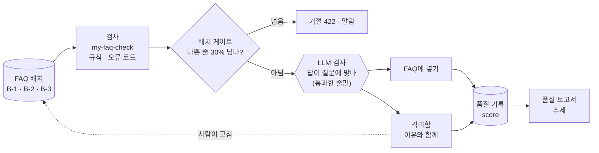

# 78일차 실습 · 데이터 품질 검증 자동화와 품질 관리 Workflow (바이브 코딩)

- 일자: 2026-11-03 (78일차)
- 교과목: 노코드 멀티 에이전트 워크플로우 설계 및 운영
- 단원: AI 워크플로우 운영 및 관리 역량 강화
- 강의 자료: [Lecture/78](../../Lecture/78/README.md)
- 하루 수강 안내: [LECTURE-78.md](LECTURE-78.md) (수업 준비부터 마칠 때까지 순서대로)
- 67~77일차처럼 CLI 코딩 에이전트에게 **내가 쓴 요청문**으로 워크플로우를 만들게 하고, **테스트로 확인**합니다. 오늘은 워크플로우가 믿고 쓰는 **데이터가 깨끗한지** 자동으로 검사하고, 나쁘면 막고, 알리고, 기록합니다.

## 오늘의 상황: 콘텐츠 담당자가 FAQ를 배치로 보낸다

77일차에 와이파이 FAQ 한 줄이 답 못 한 질문 34건을 풀었습니다. 그래서 콘텐츠 담당자가 FAQ를 한꺼번에 보내기 시작했습니다. 그런데 빈 제목, 개인 전화번호, 바깥 링크, 질문과 다른 답이 섞여 들어옵니다. 나쁜 FAQ는 **답을 못 하는 것보다 나쁩니다** (틀린 답을 자신 있게 함).



## 일하는 방식 (67~77일차와 같음)

| 누가 | 무엇을 |
| --- | --- |
| 나 | 품질 규칙 정하기, 나쁜 데이터를 **고치기**, 기준(30% · 0.9) 정하기 |
| CLI 에이전트 | [AGENTS.md](AGENTS.md) 규칙대로 워크플로우 JSON 작성, `check`로 형식 오류 고치기 |
| `tools/flow.py` | check · push · call · test · **quality**(FAQ · 격리함 · 품질 기록 한눈에, `--reset`) |

> **규칙은 Code가, 뜻은 LLM이, 고치는 것은 사람이.** 워크플로우는 나쁜 데이터를 고쳐서 넣지 않고 막고 알립니다.

## 실습 문서 읽는 법

- 실습 문서(`LAB-0x-Q-*.md`, `VIBE-Q-TCHECK.md`)에는 **복사해 붙일 요청문이 없습니다.** 막히면 `▶` 를 하나씩 펼칩니다.
- 쓴 요청문은 `my-work/PROMPTS.md`에 모아 둡니다.

## 구성

```text
Last3Mon/78/
├── README.md
├── LECTURE-78.md                      # 하루 수강 안내 (수업 준비부터 마칠 때까지)
├── AGENTS.md                          # CLI 에이전트용 작업 규칙 (계약 · 품질 규칙 · 고침 목록 · 게이트 · 스키마 · 보고서, 3절)
├── LAB-01-Q-QUALITY-RULES.md          # 1단계 · 눈으로 · 기준 검사 → 검사 워크플로우 → 경계 → 이미 있는 데이터 → 고침 목록
├── LAB-02-Q-QUALITY-GATE.md           # 2단계 · 게이트 · 격리 → LLM 검사 → 기준을 바꾸면 → 기록 · 알림 → LLM 호출 수
├── LAB-03-Q-QUALITY-MANAGEMENT.md     # 3단계 · 스키마 검사 → 고쳐서 다시 → 스키마만 바꾸면 → 보고서 → 데이터셋별
├── VIBE-REQ-TCHECK.md                 # 7교시 바이브 코딩 요청서 (가장 먼저)
├── VIBE-Q-TCHECK.md                   # 7교시 바이브 코딩 · tcheck (CSV · JSON 스키마 검사 · 게이트 · TUI)
├── *-A-*.md · answers/ · tcheck/      # 강사용 정답본 · 정답 워크플로우와 실행 기록 · 강사가 만든 tcheck (학생 저장소에는 수업 뒤)
├── tools/flow.py
├── data-api/                          # 78일차 판 데이터 API (77일차 + 격리함 · 스키마 · 품질 기록)
│   └── data/schemas/                  # faq.json · employee.json · ticket.json
├── cases/                             # lab01 · -edges · -challenge · -challenge2 · lab02 · -gate · -challenge · -challenge2 · lab03 · -fix · -schema · -challenge · -challenge2
├── requests/                          # faq-batch-1 · 2 · 3 · 2-fixed · edges · 1-loose · 2-limit-0.1 · 2-strict · employees-new · tickets-new · not-a-list
├── reference/                         # 팀의 기준(baseline-faq-check · baseline-faq-import) · 막혔을 때 이어 가는 워크플로우
├── templates/                         # 품질 규칙표 · 테스트 보고서
├── my-work/
└── runs/
```

## 준비

[실습 준비](../../Lecture/78/00-DAY78-PREP.md)를 끝내 주세요. 요약:

```bash
cd ~/aio-01d4-stu/Last3Mon/65/n8n && docker compose start   # Ollama는 쓰지 않음 · 처음 한 번 PREP 1절대로 끄기
cd ~/aio-01d4-stu/Last3Mon/78/data-api && docker compose up -d --force-recreate   # 78일차 판 (격리함 · 스키마)
cd ~/aio-01d4-stu/Last3Mon/78 && uv run tools/flow.py push reference/baseline-faq-check.json reference/baseline-faq-import.json
uv run tools/flow.py quality
uv run tools/flow.py doctor                                                          # 마지막 줄 ready
```

## `flow.py` 명령

| 명령 | 하는 일 | 수업 준비 때 |
| --- | --- | --- |
| `uv run tools/flow.py quality` | FAQ 수(더한 id), 격리함, 품질 기록, 알림 수 | 처음: FAQ 6 · 격리 0 · 기록 0 · 알림 0 |
| `uv run tools/flow.py quality --reset` | 더한 FAQ · 격리함 · 품질 기록 · 알림을 처음으로 (`-v`는 지운 수) | |
| `uv run tools/flow.py test cases/lab01.json --webhook base-faq-check` | 같은 테스트를 팀의 기준에 (고치기 전) | 1/5 |
| `uv run tools/flow.py ops [--reset]` | 77일차 실행 기록 · 76일차 접수 건 · DLQ까지 한눈에 · 모두 비우기 | |
| `uv run tools/flow.py call my-faq-check requests/faq-batch-1.json` | 검사 한 번 | 0.1초 안팎 |
| `uv run tools/flow.py call my-faq-import requests/faq-batch-2.json` | 가져오기 한 번 | 규칙만 1~2초, LLM 검사 8~10초 |
