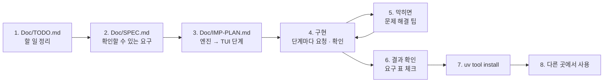

# 7교시 바이브 코딩 · `tcheck` 만들기

> **먼저 [VIBE-REQ-TCHECK.md](VIBE-REQ-TCHECK.md)(요청서)를 읽고 `~/vibe/tcheck/Doc/TODO.md`를 직접 쓴 뒤** 이 문서를 엽니다. 아래 1~8을 차례로 갑니다. 이 문서의 요구 표는 **내 SPEC을 쓴 뒤에** 비교하는 데 쓰고, 에이전트에게 통째로 붙여 넣지 않습니다.



- 시간: 16:00~16:50 (50분) · 발표와 정리는 8교시 · 50분 안에 못 한 단계는 집에서 `Doc/IMP-PLAN.md`의 다음 단계로 이어 갑니다
- 도구: CLI 코딩 에이전트(codex / claude / agy), Python + uv + [Textual](https://textual.textualize.io/), 표준 라이브러리 `csv` · `json` · `re` · `urllib.request`
- 결과물: CSV · JSON(오늘 요청 파일 모양 포함)을 **데이터 API의 스키마**(또는 스키마 파일)로 검사해, 줄마다 오늘의 코드(AGENTS.md 3절)를 붙이고 **n8n `my-check`와 같은 판정**을 내고, 깨끗한 줄 · 나쁜 줄을 따로 파일로 내보내고, **배치 게이트를 판정해 종료 코드로** 알리고, FAQ 내용 규칙 · 고침 목록 · 품질 기록까지 하고, TUI로 탭을 나눠 보는 도구. `uv tool install`로 설치해 **어느 폴더에서나** `tcheck`. 오늘 n8n 워크플로우로 한 일을 **보내기 전에, 내 노트북에서.**

```text
$ tcheck check ~/aio-01d4-stu/Last3Mon/78/requests/employees-new.json --url http://localhost:8800
employee · HR-1 · 9 rows · valid 4 · invalid 5 · score 0.4444
    3  minsu.kang@example         bad_format:email
    4  jia.seo@example.com        not_allowed:dept
    5  doyun.lim@example.com      bad_format:joined
    6  noname@example.com         missing:name
    8  sua.bae@example.com        duplicate_in_batch
codes: bad_format:email 1 · bad_format:joined 1 · duplicate_in_batch 1 · missing:name 1 · not_allowed:dept 1

$ tcheck gate ~/aio-01d4-stu/Last3Mon/78/requests/employees-new.json --url http://localhost:8800; echo $?
✘ rejected · HR-1 · invalid 5/9 = 0.5556 (limit 0.3)
4

$ tcheck ui ~/aio-01d4-stu/Last3Mon/78/requests/tickets-new.json --url http://localhost:8800
┌ tcheck · tickets-new.json · schema ticket ─────────────────────────────┐
│ TK-1 · 9 rows · valid 2 · invalid 7 · score 0.2222                     │
│ [Problem rows]  By code  Clean rows                                    │
│ row key     errors                                                     │
│   2 T-12    bad_format:ticket_id                                       │
│   3 T-2003  not_allowed:priority                                       │
│ [/] filter · [e] export clean rows · [Esc] clear · [q] quit            │
└────────────────────────────────────────────────────────────────────────┘
```

> 요청문은 **직접** 씁니다. 단계마다 `▶` 를 펼치면 생각할 거리가 나옵니다. 정답 요청문은 없습니다.
>
> **테스트에서 진짜 n8n · 데이터 API를 부르지 않습니다.** 스키마 · 배치의 사본, n8n이 낸 결과의 사본, 테스트 안의 작은 가짜 데이터 API로 시험합니다.

## 시간 (50분)

| 시간 | 단계 | 결과 |
| --- | --- | --- |
| 16:00~16:09 | 0 준비 · 1 `Doc/TODO.md` (요청서 읽고 직접) | 할 일 ①~⑫ · 꼭 / 나중 |
| 16:09~16:15 | 2 `Doc/SPEC.md` → 아래 요구 표와 비교 · 고치기 | 요구마다 확인 방법 |
| 16:15~16:20 | 3 `Doc/IMP-PLAN.md` (엔진 단계 · TUI 단계) | 단계마다 체크리스트 |
| 16:20~16:44 | 4 구현: **엔진 1단계 → 엔진 2단계 → TUI 1단계** (막히면 5) | 단계마다 `pytest` · 직접 실행 · commit |
| 16:44~16:50 | 6 확인 · 7 `uv tool install` · 8 다른 폴더에서 | `tcheck check …` = `my-check`의 판정 |

50분 안 목표: **R1 · R2 · R3 · R4 · R12 · R13(엔진 1단계) + R5 · R6 · R7(엔진 2단계) + R11(TUI 1단계) + R14(설치)**. R8 · R9 · R10은 IMP-PLAN의 다음 단계로 8교시 뒤 · 집에서 이어 갑니다.

## 0. 준비 (1분)

```bash
mkdir -p ~/vibe/tcheck/Doc && cd ~/vibe/tcheck
git init
# 에이전트는 Doc/TODO.md를 쓴 뒤에 켭니다: codex (또는 claude, agy)
```

## 1. `Doc/TODO.md` · 만들고 싶은 것과 할 일 정리 (8분, 에이전트 없이)

[VIBE-REQ-TCHECK.md](VIBE-REQ-TCHECK.md)의 "할 일" 틀대로 씁니다. 요청의 말 ①~⑫를 **내 말로** 옮기고, 꼭 · 나중을 표시하고, 걱정되는 것과 50분 안에 못 할 것을 적습니다. "어떻게"는 아직 쓰지 않습니다.

<details><summary>▶ TODO와 SPEC은 무엇이 다른가</summary>

TODO는 **내가 이해한 것**(무엇을 · 왜)입니다. SPEC은 그것을 **확인할 수 있게** 바꾼 것(됐다 · 안 됐다를 말하는 방법)입니다. 오늘 확인 방법은 대부분 **판정**입니다: 직원 9줄 중 4줄, 3째 줄 `bad_format:email`처럼, n8n이 낸 판정과 같은지.
</details>

`git add Doc/TODO.md && git commit -m "TODO"`

## 2. `Doc/SPEC.md` · 확인할 수 있는 요구로 (6분)

TODO의 할 일마다 **확인 방법**(기대 판정 · 종료 코드 · JSON 칸 · 파일)을 붙여 SPEC을 만듭니다. 에이전트에게 "TODO.md를 읽고 SPEC.md 초안을 써 줘. 요구마다 확인 방법을 붙여"라고 시켜도 됩니다. 그러면 **반드시 내가 읽고 고칩니다.**

```markdown
# tcheck SPEC

## 1. 요구 (확인할 수 있게)
| 번호 | 요구 | 요청의 어느 말 | 확인 방법 | 꼭 · 나중 |
| --- | --- | --- | --- | --- |
| R1 | | ① | | 꼭 |

## 2. 숨은 요구
## 3. 범위 밖 (하지 않을 것)
## 4. 정해 둘 것 (판정 규칙 = AGENTS.md 3절 스키마 표, 정규식이 JavaScript와 같게, 종료 코드 번호, 기본 게이트 기준, 읽을 파일 모양)
```

<details><summary>▶ 확인 방법은 n8n이 낸 판정으로</summary>

"스키마로 검사한다"는 확인 방법이 아닙니다. "직원 CSV → 9줄 중 4줄, 3째 `bad_format:email` · 4째 `not_allowed:dept` · 5째 `bad_format:joined` · 6째 `missing:name` · 8째 `duplicate_in_batch`, 접수 건 → 9줄 중 2줄, FAQ B-3(`schema: faq`) → 6줄 중 5줄"이 확인 방법입니다. 오늘 Lab 03의 `cases/lab03.json` · `lab03-schema.json`에 있는 판정을 그대로 가져오면 됩니다 — 규칙이 같으면 판정도 같아야 합니다.
</details>

쓴 뒤 아래 표와 비교합니다. 빠진 요구, 내가 더 뽑은 요구를 `Doc/SPEC.md` 끝 "VIBE-Q와 비교"에 한 줄씩 적고 SPEC을 고칩니다.

### 요구 사항 (요청서에서 뽑은 것, 14개)

| 번호 | 요구 | 요청서의 말 | 확인 방법 | 50분 |
| --- | --- | --- | --- | --- |
| R1 | `.csv`(첫 줄 열 이름) · JSON 목록 · `{"items": [...]}` · 오늘 요청 파일(`{"schema", "batch", "csv" \| "items"}`) 읽기 | ① | `employees-new.json`(CSV가 든 요청) · CSV 파일 · `tickets-new.json` 모두 9줄 | 꼭 |
| R2 | 스키마는 데이터 API `GET /schemas/<name>` 또는 `--schema-file`, **필드 이름을 코드에 쓰지 않고** `fields`를 돌며 타입마다 | ② | `--schema employee` · `ticket` · `faq` 모두 같은 코드로, 없는 스키마 → 종료 코드 1 | 꼭 |
| R3 | 줄마다 AGENTS.md 3절 코드 (`missing:` · `too_long:` · `too_short:` · `not_allowed:` · `bad_format:` · `too_few:` · `too_many:` · `duplicate_in_batch`), 줄 번호 1부터 | ③ | 직원 3 · 4 · 5 · 6 · 8째 줄의 코드 | 꼭 |
| R4 | 같은 배치면 n8n `my-check`와 **같은 판정** (공백 = 빈 값, 선택 칸은 비면 통과, 실제 있는 날짜, 정규식은 JavaScript처럼) | ④ | 직원 · 접수 건 · FAQ B-3의 `rows` · `codes` · `valid`가 `my-check` 응답과 하나도 다르지 않음 | 꼭 |
| R5 | `--json`: `my-check`와 같은 모양 `{schema, batch, total, valid, invalid, rows, codes}` | ⑤ | `tcheck check … --json`과 `call my-check …`를 칸마다 비교 | 꼭 |
| R6 | `--out` 깨끗한 줄 · `--rejects` 나쁜 줄 + `errors` 칸 (원래 줄은 고치지 않음) | ⑥ | 직원 → 깨끗한 4줄 · 나쁜 5줄 파일 | 꼭 |
| R7 | `tcheck gate --max-invalid 0.3`: 나쁜 줄 비율이 **넘으면** 종료 코드 4, 같으면 통과 | ⑦ | 직원(0.5556) → 4, `--max-invalid 0.6` → 0, B-2 `--content answer` 0.1 · 기준 0.1 → 0 | 꼭 |
| R8 | `--content answer`: Lab 01 내용 규칙 `pii`(하이픈 없는 휴대전화 · 메일) · `external_link`(호스트가 정확히 `intra.example.com`) | ⑧ | B-2 → FAQ-209 `pii`, `faq-edges.json` → FAQ-406 `pii` · FAQ-409 `external_link` | 나중 |
| R9 | `--fix`: 나쁜 줄마다 사람이 읽는 말(`fix_list`, 줄 순서) + `message` (`TK-1: 9줄 중 2줄 통과, 7줄 고칠 것`) | ⑨ | 접수 건 → 일곱 줄, 3째 "priority은(는) low · normal · high 중 하나로" | 나중 |
| R10 | `--log`: 데이터 API `POST /quality-log`에 `my-check`(Lab 03 과제 2)와 같은 한 줄 | ⑩ | `flow.py quality` → `HR-1 employee … score 0.4444` | 나중 |
| R11 | `tcheck ui`: 위 요약 한 줄, 탭(문제 줄 · 코드별 · 깨끗한 줄), `[/]` 글자로 거르기, `[e]` 깨끗한 줄 내보내기 | ⑪ | `run_test`: 5 · 5 · 4줄, `email`로 거르면 1줄, `e` → 파일 | 꼭 |
| R12 | 테스트는 n8n · 데이터 API 없이: 스키마 · 배치 사본, n8n 결과 사본, 가짜 데이터 API | 끝 | `uv run pytest -q`가 10초 안, n8n과 같은 판정 | 꼭 |
| R13 | 규칙은 한 곳(엔진 모듈 하나), cli · 화면은 부르기만. 종료 코드 0 됨 · 1 못 읽음 · 2 쓰는 법 · 4 거절 | ④ · ⑫ | 없는 파일 · 없는 스키마 → 1, 스키마를 안 줌 → 2, 거절 → 4 | 꼭 |
| R14 | `uv tool install`로 설치해 **어느 폴더에서나** `tcheck` | 첫 문단 | `cd /tmp && tcheck --help`, `uv tool list`에 `tcheck` | 꼭 |

숨은 요구 (요청서에 직접 없지만 없으면 안 되는 것):

| 숨은 요구 | 어디서 나왔나 |
| --- | --- |
| **규칙은 한 곳**(엔진 모듈 하나). JSON · 파일 · 게이트 · 화면은 그 결과를 쓰기만 | ④ — 규칙이 두 곳이면 기준 검사처럼 어긋남 |
| 정규식을 n8n(JavaScript)과 같게: `\w` · `\d`는 ASCII만 | ④ — Python `re`의 `\w`는 한글도 맞음 |
| 날짜는 꼴(`YYYY-MM-DD`)만이 아니라 **실제 있는 날** | ④ · 오늘 Lab 03 (13월 · 2월 30일) |
| 공백만 있는 칸 = 빈 칸, 선택 칸은 비면 형식을 보지 않음 | ④ · 오늘 Lab 01 예제 3 · Lab 03 예제 3 |
| 반올림은 half up (JavaScript `Math.round`) | ④ · 77일차 `tlog`와 같은 까닭 |
| 나쁜 줄을 **고쳐서** 내보내지 않음 | ⑥ — 오늘의 원칙 "고치는 것은 사람" |
| 읽는 층(`load`) · 규칙 층(`checks`) · 보여 주는 층(cli · TUI)을 나눔 | ② · ⑪ — 파일 모양 · 스키마가 늘어도 규칙은 그대로 |

범위 밖 (오늘 하지 않음): LLM 검사(오늘 n8n Lab 02 예제 2에서 함, 비용 · 키가 필요), 데이터 API에 넣기(`/faq/add` — 넣는 것은 n8n 가져오기의 일), 이미 있는 데이터와 맞춰 보기(Lab 01 과제 1), 알림 보내기.

`git add Doc/SPEC.md && git commit -m "SPEC"`

## 3. `Doc/IMP-PLAN.md` · 구현 계획 (5분)

SPEC의 요구를 **단계**로 나눕니다. 첫 원칙: **엔진(판정하는 곳)을 먼저, 화면(TUI)은 나중에.** 화면은 엔진의 결과를 표에 넣기만 하면 되게 만듭니다. 에이전트에게 "SPEC.md를 읽고 IMP-PLAN.md를 엔진 단계와 TUI 단계로 나눠 써 줘. 단계마다 체크리스트와 확인 명령"이라고 시켜도 됩니다 (내가 읽고 고침).

```markdown
# tcheck IMP-PLAN

## 엔진 1단계 · 읽기 · 스키마 · 코드 · n8n과 같은 판정 (R1 · R2 · R3 · R4 · R12 · R13)
- [ ] load.py: read_rows(path) — csv · JSON 목록 · {"items"} · 요청 파일, read_schema(name, url, file)
- [ ] checks.py: check(rows, schema, batch) — fields를 돌며 타입마다, 키 중복, row 1부터
- [ ] cli: tcheck check FILE [--schema] [--url], 종료 코드 0 · 1 · 2
- [ ] tests: 직원 4/9 · 접수 건 2/9 · FAQ B-3 5/6, n8n 결과 사본과 rows · codes가 같음, 가짜 데이터 API
- 확인: uv run pytest -q, uv run tcheck check …/employees-new.json --url http://localhost:8800

## 엔진 2단계 · JSON · 내보내기 · 게이트 (R5 · R6 · R7)
## TUI 1단계 · 탭 · 거르기 · 내보내기 (R11)
## 설치 (R14)
## 엔진 3단계 · 내용 규칙 · 고침 목록 · 품질 기록 (R8 · R9 · R10)
```

<details><summary>▶ 왜 엔진 먼저인가</summary>

- 엔진은 **화면 없이 테스트**할 수 있습니다 (`pytest`, `tcheck check`). 판정이 n8n과 같은지가 오늘의 핵심인데, 화면부터 만들면 눈으로만 봅니다.
- 보내기 전 게이트는 화면 없이 스크립트에서 돌아갑니다. 종료 코드(R13)가 다음 일(보낼까 말까)을 정합니다 (74일차 게이트와 같음).
- TUI는 엔진의 결과를 표에 넣기만 합니다. 판정이 정해져야 TUI를 만들 수 있습니다.
</details>

<details><summary>▶ 단계 크기</summary>

한 단계 = 에이전트 요청 한두 번 + 확인 한 번 + commit 한 번 (10분 안팎). 오늘 Lab에서 검사를 한 번에 다 만들지 않고 "규칙 → 경계 → 이미 있는 데이터 → 고침 목록"으로 한 칸씩 더한 것과 같습니다.
</details>

`git add Doc/IMP-PLAN.md && git commit -m "IMP-PLAN"`

## 4. 구현 시작 (24분: 엔진 1단계 → 엔진 2단계 → TUI 1단계)

이제 에이전트를 켭니다. 단계마다 긴 요청문은 필요 없습니다. 할 일은 SPEC · IMP-PLAN에 있으니까요.

**처음 한 번:**

```text
Doc/SPEC.md 와 Doc/IMP-PLAN.md 를 읽고 체크 안 된 첫 단계만 만들어 줘. uv 프로젝트, 명령 이름 tcheck, 코드와 화면 글자는 영어.
끝나면 IMP-PLAN 체크를 표시하고 확인 명령을 알려 줘. 다음 단계는 내가 말할 때까지 하지 마.
```

**그다음 단계마다 (같은 한 줄):**

```text
확인했고 commit 했어. 다음 단계.
```

→ 내가 확인 → commit → 한 줄. 그냥 "계속"만 치면 여러 단계를 한꺼번에 하거나 체크 · 확인 명령을 빼먹기 쉽습니다. 틀렸을 때만 **무엇이 틀렸는지 · SPEC의 어느 요구인지 · 어디만 고칠지 · 무엇으로 확인할지**를 적어 고쳐 달라고 합니다. 예:

```text
R4가 틀렸어. 직원 CSV 2째 줄(phone 빈칸)이 bad_format:phone 인데 n8n은 통과야.
선택 칸(required false)은 비었으면 형식을 보지 않게 checks.py 만 고쳐 줘. 확인은 uv run pytest -q 와 tcheck check …/employees-new.json.
```

대화가 길어지면 새 세션에서 처음 요청을 다시 보냅니다.

> **규모가 큰 프로젝트일수록 다단계로** 진행합니다. `tcheck`도 요구가 14개라 한 번에 시키면 에이전트가 수백 줄을 한꺼번에 쓰고, 판정이 n8n과 다를 때 어디가 다른지 찾기 어렵습니다. 단계마다 ① 그 단계만 요청 ② 직접 확인 ③ IMP-PLAN 체크 ④ `git commit`.

<details><summary>▶ 엔진 1단계 · 같은 판정이 나오는지 어떻게 보나</summary>

스키마 셋(`~/aio-01d4-stu/Last3Mon/78/data-api/data/schemas/`)과 배치(`requests/employees-new.json` · `tickets-new.json` · `faq-batch-3.json`)를 `tests/data/`에 복사하고, n8n이 낸 결과도 파일로 둡니다: `uv run ~/aio-01d4-stu/Last3Mon/78/tools/flow.py call my-check requests/employees-new.json`의 응답을 `tests/data/n8n-employee.json`으로. 테스트는 `rows` · `codes`를 통째로 비교합니다.
</details>

<details><summary>▶ 엔진 1단계 · 메일 · 날짜가 n8n과 다를 때</summary>

- 메일 `^[\w.+-]+@[\w-]+(\.[\w-]+)+$`: Python에서는 `re.ASCII`를 붙여야 JavaScript의 `\w`(영문 · 숫자 · `_`)와 같습니다.
- 날짜: `datetime.date.fromisoformat(v).isoformat() == v`로 실제 있는 날인지까지.
</details>

<details><summary>▶ 엔진 2단계 · 게이트의 종료 코드</summary>

"프로그램이 실패했다"(1 · 2)와 "거절될 배치다"(4)를 다른 번호로 둡니다. 스크립트가 1이면 "도구를 고쳐라", 4면 "파일을 고쳐라"로 다르게 할 수 있습니다: `tcheck gate faq.json --schema faq && curl … /webhook/my-faq-import`.
</details>

<details><summary>▶ TUI 1단계 · 화면 나누기</summary>

판정(엔진)과 화면을 나눕니다 (`tlog`와 같음). 탭 셋은 같은 결과를 다르게 거른 것입니다. 거르기 상자(`Input`)는 `[/]`로 보이고 Enter로 적용, 닫을 때 포커스를 표로 돌려야 다음 키(`e`)가 글자로 들어가지 않습니다.
</details>

<details><summary>▶ 다음 단계들 (8교시 뒤 · 집에서)</summary>

- 내용 규칙(R8): 스키마에 없는 규칙을 **어느 칸에** 댈지 옵션으로 받습니다 (`--content answer`). 칸 이름이 코드에 박히지 않게.
- 고침 목록(R9): 코드의 앞부분(`missing` · `bad_format` …)마다 말 하나, 스키마의 `values` · `max`를 말에 넣음.
- 품질 기록(R10): 오늘 Lab 03 과제 2의 `my-check`가 남기는 한 줄과 같은 모양 — 보고서가 데이터셋을 구분합니다.
</details>

## 5. 바이브 코딩으로 문제 해결 팁

| 이럴 때 | 이렇게 |
| --- | --- |
| 에이전트가 "다 됐다"고 함 | **직접 실행**합니다 (`uv run tcheck check … --url …`, `uv run pytest -q`). 확인 방법은 SPEC에 있습니다 |
| 판정이 n8n과 한 줄 다름 | "AGENTS.md 3절 스키마 표 그대로" — 어느 줄 · 어느 코드가 다른지 두 결과를 붙여 줍니다 |
| 필드 이름이 코드에 있음 (`if name == "email"`) | "스키마의 fields를 돌며 type마다. 필드 이름을 코드에 쓰지 말 것" |
| `2026-02-30`이 통과 | "실제 있는 날짜인지까지" |
| 빈 선택 칸이 `bad_format` | "비었으면 required만 보고 다음 칸으로" |
| 테스트가 데이터 API를 부름 | "테스트 안의 가짜 서버(http.server)로, 진짜 API는 확인 단계에서만" |
| 규칙이 cli · 화면에 흩어짐 | "checks.py 하나에, 나머지는 부르기만" |
| `gate`가 늘 0 | "비율이 기준보다 크면 거절(>), 거절이면 종료 코드 4" |
| 나쁜 줄 파일에 고친 값이 들어감 | "원래 줄 그대로 + errors 칸만" |
| 화면이 이상한데 오류가 안 보임 | `uv add --dev textual-dev` 뒤 다른 터미널에서 `uv run textual console` |
| 같은 곳을 3번 고쳐도 안 됨 | 멈추고 `git diff` · `git checkout .`로 되돌린 뒤, 단계를 **더 작게** 나눠 다시 요청 |
| 설치한 `tcheck`가 고친 내용을 모름 | `uv tool install --force .` 로 다시 설치 (또는 처음부터 `--editable`) |

## 6. 결과 확인

`Doc/SPEC.md` 1절 표의 확인 방법대로 **내가** 하나씩 하고 체크합니다. 오늘 50분 안 목표만:

```bash
cd ~/vibe/tcheck
uv run pytest -q                                                                     # R12: 10초 안
R=~/aio-01d4-stu/Last3Mon/78/requests
export TCHECK_URL=http://localhost:8800
uv run tcheck check $R/employees-new.json                                            # R1 · R3: 9줄 중 4줄
uv run tcheck check $R/tickets-new.json                                              # R2: 새 스키마 · 2줄
uv run tcheck check $R/faq-batch-3.json --schema faq                                 # R2: 5줄
uv run tcheck check $R/employees-new.json --json > /tmp/tcheck.json                  # R5
(cd ~/aio-01d4-stu/Last3Mon/78 && uv run tools/flow.py call my-check requests/employees-new.json)   # R4: 판정 비교
uv run tcheck check $R/employees-new.json --out /tmp/clean.csv --rejects /tmp/rejects.csv   # R6
uv run tcheck gate $R/employees-new.json; echo "exit $?"                             # R7: 4
uv run tcheck check nope.csv --schema faq; echo "exit $?"                            # R13: 1
uv run tcheck check $R/employees-new.json --schema nothing; echo "exit $?"           # R13: 1
uv run tcheck ui $R/tickets-new.json                                                 # R11
```

- [ ] R1 CSV · JSON · 요청 파일.
- [ ] R2 스키마 셋, 필드 이름이 코드에 없음.
- [ ] R3 줄마다 코드, 줄 번호 1부터.
- [ ] R4 n8n `my-check`와 같은 판정.
- [ ] R5 `--json` 칸 이름 · 값.
- [ ] R6 깨끗한 줄 · 나쁜 줄 파일.
- [ ] R7 게이트 · 종료 코드 4.
- [ ] R11 TUI.
- [ ] R12 n8n 없이 도는 테스트.
- [ ] R13 규칙 한 곳 · 종료 코드 0 · 1 · 2 · 4.
- [ ] (이어서) R8 · R9 · R10.

## 7. `uv tool install`로 설치

`pyproject.toml`에 명령이 등록되어 있는지 먼저 봅니다.

```toml
[project.scripts]
tcheck = "tcheck.cli:main"
```

```bash
cd ~/vibe/tcheck
uv tool install --editable .        # 고친 내용이 바로 반영됨 (수업 중 권함)
uv tool list                        # tcheck 가 보이는가
which tcheck                        # ~/.local/bin/tcheck
# 명령을 못 찾으면: uv tool update-shell 뒤 터미널을 새로 엶
```

- 지우기: `uv tool uninstall tcheck`.

## 8. 다른 곳에서 사용

설치했으면 오늘 Lab과 내 파일에 씁니다.

```bash
cd ~
export TCHECK_URL=http://localhost:8800                                    # --url 을 매번 쓰지 않게
R=~/aio-01d4-stu/Last3Mon/78/requests
tcheck gate $R/faq-batch-1.json --schema faq --content answer; echo $?     # (R8) 보내기 전에: 거절될 배치 → 4
tcheck gate $R/faq-batch-2.json --schema faq --content answer && echo "보내도 됨"
tcheck check $R/tickets-new.json --fix                                     # (R9) 헬프데스크 팀에 돌려줄 말
tcheck check $R/employees-new.json --log                                   # (R10) 품질 기록 → my-quality-report에 나옴
tcheck check ~/Downloads/명단.csv --schema employee --out 깨끗한.csv --rejects 고칠것.csv
```

- `~/vibe/tcheck`는 지우지 마세요. 79일차 `tops`에서 다시 씁니다.

## 발표 (8교시, 3분)

| 내용 | |
| --- | --- |
| TODO → SPEC | 내 SPEC과 VIBE-Q 요구 표가 달랐던 곳 (빠뜨린 요구, 더 뽑은 요구) |
| IMP-PLAN | 엔진 · TUI를 어떻게 나눴나, 어디까지 체크했나 |
| 요청문 | 처음 요청 · 틀렸을 때 고쳐 달라고 한 요청문 하나 |
| 막힌 곳 | 5절의 어느 팁으로 풀었나 (판정이 다름 · 날짜 · 선택 칸 · 테스트가 API를 부름) |
| 시연 | `tcheck check` 와 `my-check` 의 판정 비교, `tcheck gate` 종료 코드, `tcheck ui` |

## 확인

- [ ] `Doc/TODO.md` → `Doc/SPEC.md` → `Doc/IMP-PLAN.md`를 에이전트 전에 (또는 에이전트와 함께 쓰고 내가 고쳐서) 만들고 commit했다.
- [ ] IMP-PLAN의 엔진 1 · 2단계와 TUI 1단계를 체크했다 (단계마다 commit).
- [ ] R1 · R2 · R3 · R4 · R5 · R6 · R7 · R11 · R12 · R13 확인, `uv run pytest -q`, n8n과 같은 판정.
- [ ] R14 `uv tool install`, 다른 폴더에서 `tcheck`.
- [ ] 남은 요구는 IMP-PLAN에 체크 안 된 채로 남겨 두었다 (다음에 이어 감).
