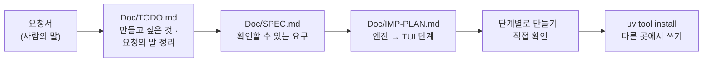

# 7교시 바이브 코딩 · 요청서 `tcheck` (가장 먼저 읽기)

- 순서: **이 요청서** → 내 정리 `~/vibe/tcheck/Doc/TODO.md` (8분) → [VIBE-Q-TCHECK.md](VIBE-Q-TCHECK.md)의 순서대로 `Doc/SPEC.md` → `Doc/IMP-PLAN.md` → 단계별로 만들기 → 설치 · 다른 곳에서 쓰기 → 수업이 끝나면 `VIBE-A-TCHECK.md`(정답본)로 확인
- 이 문서는 **만들어 달라는 사람의 말**입니다. 요구 사항 표도, 단계도 없습니다. 그것을 뽑아 내는 것이 첫 일입니다. 72일차 `tbench`부터 77일차 `tlog`까지와 같은 순서입니다.



> **생활 속 예 · 주머니에 넣는 검수 카드.** 오늘 주방(n8n)에 검수 기준표와 반품 칸을 만들었습니다. 그런데 납품업체가 "보내기 전에 우리 창고에서 미리 검수해 보고 싶다"고 합니다. 주방에 와서 볼 수는 없으니, 같은 검수 카드를 **주머니에 넣어** 창고에서 쓰게 하면 됩니다. 단, 창고의 판정과 주방의 판정이 **같아야** 합니다. `tcheck`는 오늘의 스키마로 터미널에서 검사하는 검수 카드입니다.

## 왜 요청서부터인가

요구 사항 표를 통째로 에이전트에게 주고 "이대로 만들어 줘"라고 하면, 무엇이 만들어지든 **내가 판단할 기준이 없습니다.** 실무에서는 요구 사항 표가 오지 않고, 이 요청서 같은 **사람의 말**이 옵니다. 오늘 Lab 01 예제 1에서 기준 검사의 판정을 먼저 눈으로 비교해 본 것과 같습니다: 무엇이 맞는 판정인지 정해야 맞았는지 말할 수 있습니다.

| 단계 | 누가 | 결과 |
| --- | --- | --- |
| 요청 → 할 일 목록 | **나** | `Doc/TODO.md`: 요청의 말 ①~⑫를 내 말로, 만들고 싶은 것 |
| 할 일 → 요구 | **나** (에이전트와 다듬어도 됨) | `Doc/SPEC.md`: 요구마다 "됐다 / 안 됐다"를 말할 수 있는 확인 방법 |
| 요구 → 단계 | **나** (에이전트와 다듬어도 됨) | `Doc/IMP-PLAN.md`: 엔진 단계와 화면(TUI) 단계로 나눈 순서 |
| 단계 → 코드 | 에이전트 | 처음 요청 한 번 + 단계마다 한 줄, `Doc/*.md`를 읽게 함 |
| 확인 | **나** | 직접 `uv run tcheck …`, `pytest`, n8n `my-check`와 판정 비교, 요구 표에 체크 |

## 요청 (인사팀 · 콘텐츠 담당에게서 온 메시지, 그대로)

> 오늘 n8n으로 검사 · 게이트 · 스키마 검사까지 만들었다고 들었어요. 그런데 저희는 데이터를 **보내기 전에** 미리 검사해 보고 싶어요. 보냈다가 거절당하고, 고쳐서 또 보내는 게 하루에 몇 번씩이에요. 제 노트북 **어느 폴더에서나** `tcheck 파일`이라고 치면 검사해 주는 작은 도구가 있으면 좋겠어요.
>
> ① 저희 파일은 **CSV**도 있고 **JSON**도 있어요. 오늘 n8n에 보내는 요청 파일 모양 그대로도 읽어 주세요.
>
> ② 규칙은 **데이터 API의 스키마**에서 가져와 주세요. 직원 · FAQ · 접수 건, 앞으로 더 늘어나요. 스키마가 늘 때마다 도구를 고치면 안 돼요. 인터넷이 안 되는 날을 위해 스키마 **파일**로도요.
>
> ③ 몇째 줄이 **왜** 틀렸는지 알려 주세요. 이유는 오늘 n8n이 쓰는 그 **코드**로요 (`missing:name`, `bad_format:email` …). 말이 다르면 n8n 화면과 맞춰 보기 어려워요.
>
> ④ 제일 중요한 거요. **n8n이 내리는 판정과 똑같아야** 해요. 제 노트북에서 통과했는데 n8n에서 거절되면 이 도구를 믿을 수 없어요.
>
> ⑤ 다른 프로그램이 읽을 수 있게 **JSON으로도** 주세요. 칸 이름은 n8n 검사 결과와 같게요.
>
> ⑥ **깨끗한 줄만** 새 파일로 뽑아 주세요. 틀린 줄은 이유와 함께 **따로** 파일로요. 틀린 줄 파일을 담당자에게 돌려보낼 거예요.
>
> ⑦ 보내기 전에 "이 배치는 **거절될까?**"를 알고 싶어요. 오늘 정한 그 기준(나쁜 줄 30%)으로, 기준은 바꿀 수 있게요. 스크립트에서 쓸 거라 거절이면 **종료 코드로** 알려 주세요.
>
> ⑧ FAQ는 스키마로 안 잡히는 게 있잖아요. 답 안의 **개인 전화번호 · 메일 · 바깥 링크**도 봐 주세요. 오늘 Lab 01 규칙 그대로요.
>
> ⑨ 틀린 줄마다 **사람이 읽는 말**로 무엇을 고칠지 써 주세요. 맨 위에 "몇 줄 중 몇 줄 통과"도 한 줄로요.
>
> ⑩ 검사한 결과를 오늘 만든 **품질 기록**에도 남길 수 있게요. 그래야 보고서에 저희 데이터셋도 나와요.
>
> ⑪ **화면에서** 보고 싶어요. 틀린 줄 · 코드별 · 깨끗한 줄을 탭으로 나눠서, 글자로 거르고, 깨끗한 줄을 바로 내보낼 수 있게요.
>
> ⑫ 스크립트에서 쓸 거라 **종료 코드**가 중요해요. 됐다 · 파일이나 스키마를 못 읽었다 · 쓰는 법이 틀렸다 · 거절될 배치다를 서로 다른 번호로요.
>
> 아, 시험할 때 **진짜 n8n이나 데이터 API가 없어도** 돌아가야 해요. 그리고 오늘 배치로 **n8n과 같은 판정인지** 꼭 확인해 주세요.

## 함께 받은 것

| 파일 · 자료 | 메모 |
| --- | --- |
| 오늘 데이터 API `http://localhost:8800` | `GET /schemas` · `GET /schemas/<name>` (`faq` · `employee` · `ticket`), `POST /quality-log` |
| `~/aio-01d4-stu/Last3Mon/78/data-api/data/schemas/*.json` | 스키마 셋 (파일로 읽기 · 테스트용 사본) |
| `~/aio-01d4-stu/Last3Mon/78/requests/` | `employees-new.json`(CSV 9줄) · `tickets-new.json` · `faq-batch-1~3.json` |
| [AGENTS.md](AGENTS.md) 3절 | **스키마 타입 표 · 코드** (오늘의 규칙서), FAQ 품질 규칙 · 고침 목록 · 게이트 · 품질 기록 |
| 내 `my-check` | 같은 배치를 물어 판정을 비교할 상대: `uv run tools/flow.py call my-check requests/employees-new.json` |
| Python 표준 라이브러리 | `csv`, `json`, `re`, `urllib.request`. TUI는 Textual |

## 할 일 · 요청을 내 할 일 목록으로 (8분, 에이전트 없이)

`~/vibe/tcheck/Doc/TODO.md`를 만들고 요청의 말 ①~⑫와 맨 끝 부탁을 **내 말로** 한 줄씩 옮깁니다. 아직 "어떻게"는 쓰지 않습니다. **무엇을 · 왜**만 씁니다. 에이전트에게 맡기지 않고 직접 씁니다.

```markdown
# tcheck TODO

## 만들고 싶은 것 (한 문단)
어느 폴더에서나 `tcheck 파일`로 CSV · JSON을 데이터 API의 스키마로 검사해, 오늘 n8n my-check와 같은 판정을 ...

## 요청의 말 → 할 일
| # | 요청의 말 (짧게) | 할 일 (내 말) | 꼭 · 나중 |
| --- | --- | --- | --- |
| ① | CSV · JSON · 요청 파일 | | 꼭 |
| ② | 스키마는 API에서, 파일로도 | | |
| ... | | | |
| 끝 | n8n 없이 시험 · 같은 판정 확인 | | |

## 요청에 없지만 걱정되는 것
## 오늘 50분 안에 못 할 것 같은 것
```

예 하나만 보여 드립니다.

| 요청의 말 | TODO에 쓸 할 일 (내 말) | 다음 단계(SPEC)에서 바뀔 모양 |
| --- | --- | --- |
| ④ "n8n이 내리는 판정과 똑같아야" | "AGENTS.md 3절 스키마 표 그대로: 공백은 빈 값, 선택 칸은 비면 통과, 실제 있는 날짜, 키 중복, 줄 번호 1부터" | R4: 직원 CSV → 9줄 중 4줄, 3째 `bad_format:email` …, 같은 배치 `my-check` 응답의 `rows` · `codes`와 **모두 같음** |

<details><summary>▶ 1단계 · 꼭 할 것과 나중에 할 것</summary>

요청의 말이 열두 개입니다. 50분 안에 다 만들기 어렵습니다. 담당자가 가장 아파하는 것은 "n8n과 똑같은 판정"(믿을 수 있나)과 "거절될까?"(보냈다가 돌아오는 일)입니다. 그리고 내보내기 · 화면 · 고침 말을 만들려면 먼저 무엇이 있어야 하나요? (읽기 → 스키마대로 판정 → JSON → 내보내기 · 게이트 → 화면)
</details>

<details><summary>▶ 2단계 · 걱정되는 것 (숨은 요구의 씨앗)</summary>

- ② "스키마가 늘 때마다 고치면 안 돼요": 필드 이름(`email` · `dept`)이 코드에 나오면 안 됩니다. 스키마의 `fields`를 돌며 **타입마다** 판정합니다 (오늘 Lab 03 예제 3).
- ③ · ④ "같은 코드 · 같은 판정": 정규식의 `\w`는 Python에서 한글까지, JavaScript에서는 영문 · 숫자 · `_`만입니다. n8n Code 노드는 JavaScript입니다. 날짜 `2026-02-30`, 공백만 있는 칸, 선택 칸이 빈 경우도.
- ⑥ "따로 파일로": 원래 줄은 그대로 두고, 나쁜 줄에 이유 칸 하나만 더합니다 (고쳐서 넣지 않음 — 오늘의 원칙).
- ⑦ "30%": 넘으면 거절, **같으면** 통과 (오늘 Lab 02 예제 3의 경계).
- ⑧ "바깥 링크": `intra.example.com.evil.io`는 바깥입니다 (오늘 Lab 01 예제 3).
- ⑫ "거절될 배치": 프로그램이 실패한 것(1 · 2)과 다른 번호여야 스크립트가 둘을 구분합니다.
- 끝 "n8n 없이 시험": 데이터 API를 대신할 작은 가짜 서버, 스키마 · 배치의 사본, 그리고 n8n이 낸 결과의 사본.
</details>

## 그다음

[VIBE-Q-TCHECK.md](VIBE-Q-TCHECK.md)를 엽니다. 거기서 `Doc/TODO.md` → `Doc/SPEC.md` → `Doc/IMP-PLAN.md` → 단계별 구현 → 확인 → `uv tool install` → 다른 곳에서 사용 순서로 갑니다. VIBE-Q의 요구 표는 **내 SPEC을 쓴 뒤에** 비교하는 데 씁니다.
