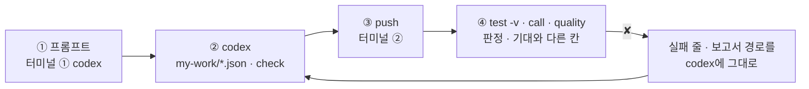
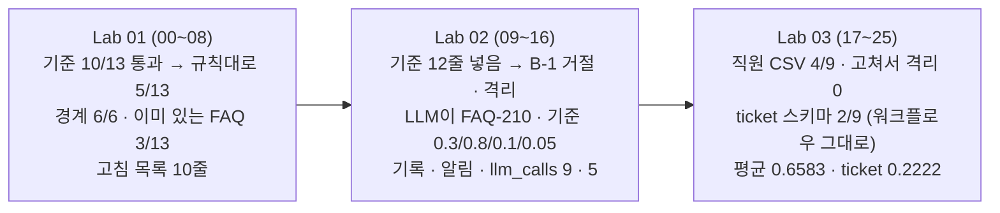

# 78일차 Lab 테스트 결과 · 실제로 만든 시나리오와 `test -v` 결과

> **정답 자료** · 78일차 n8n 워크플로우를 **만드는 프롬프트(codex) → push → `call` · `test -v` · `quality` 결과**를 학생이 가는 순서대로 한 문서에 모았습니다. 수업이 끝난 뒤 공개합니다.

- 실행: 2026-11-01, 실습을 Lab마다 5개(예제 3 + 과제 2)로 늘린 뒤 강사 노트북의 65일차 n8n 2.42.6 + 78일차 판 데이터 API(77일차 + 격리함 · 스키마 셋 · 품질 기록), OpenAI `gpt-4.1-mini`(LLM 검사, temperature 0), 케이스 파일마다 **한 번씩**(Lab 02 과제 2는 세 번), 모두 26단계 (00~25)
- 명령: `~/aio-01d4-stu/Last3Mon/78`에서 `uv run tools/flow.py ...`. 아래 단계마다 **실행한 명령**과 **화면에 나온 출력 전부**를 그대로 붙이고, 그 아래 **쉽게 말하면**으로 결과를 풀어 썼습니다 (특히 ✘가 나온 까닭과 그것이 예상한 것인지). 같은 출력이 `NN-<이름>.txt`에, 그 단계 첫 `test`의 보고서가 `NN-<이름>.json`에 있습니다 (00 · 01단계는 보고서 없음).
- 규칙 판정(Code)은 배치 파일과 규칙이 같으면 **늘 같습니다.** 실행마다 다를 수 있는 것은 시간과 LLM 판정입니다 — 이번 실행에서 LLM이 막은 줄은 B-2의 FAQ-210(매번)과, B-1을 받았을 때의 FAQ-113뿐입니다. 정답의 잘못으로 실패한 케이스는 없습니다. ✘는 모두 "고치기 전" 단계와 Lab 02 과제 2의 `--no-before` 확인에서 본 것입니다.
- "고치기 전" 상태: 00단계에서 `my-*` 워크플로우를 모두 **게시 해제**(`off`)하고 `ops --reset`으로 더한 FAQ · 격리함 · 기록 · 알림을 비워 학생이 처음 여는 상태와 같게 했습니다.

## `-v`가 보여 주는 것

```text
✔ 배치 2 · 통과한 줄만 넣고 나쁜 줄은 격리 · 9.3s         ← 케이스 · 시간
    → request  POST /webhook/my-faq-import                   ← 보낸 요청 JSON (배치)
      { "batch": "B-2", "items": [ … 10줄 … ] }
    ← response HTTP 200                                      ← 받은 응답 JSON (판정)
      { "total": 10, "imported": 8, "quarantined": 2, "score": 0.8, "codes": { "pii": 1, "llm_mismatch": 1 }, … }
```

오늘은 응답의 **판정**(무엇을 넣고 무엇을 막았나 · 왜)을 보고, 기대와 다를 때 `✘` 줄 끝의 `칸 = 실제 (expected 기대)`나 `has none of [코드]`를 봅니다. 판정이 다르면 거의 언제나 **규칙의 말**(넘으면/이상 · 공백 · 꼴 · 정확히)이 다른 것입니다.

## 이 문서 하나로 따라가기

단계마다 **① codex에 넣는 프롬프트 → ② codex가 `my-work/*.json`을 쓰고 `check` → ③ 내가 `push` → ④ 내가 `test -v` · `call` · `quality`** 순서입니다. 에이전트 없이 하는 예제(Lab 01 예제 1 · 3, Lab 02 예제 3, Lab 03 예제 3)와 고치기 전 단계는 프롬프트가 없습니다.



- **프롬프트는 정답본(`LAB-0x-A-*.md`)의 요청문 예**를 그대로 썼습니다 (실습 문서 빈칸 채우기 뼈대의 `____`를 채운 글자).
- **이 기록의 워크플로우는 수업 준비 때 만든 정답 파일**입니다. 프롬프트를 codex에 보내 다시 만들어 재지는 않았습니다 (68일차부터 수업 준비는 정답 워크플로우만 실행).
- 학생은 `my-work/faq-check.json` · `faq-import.json`을 거듭 고쳐 push하고, 이 기록은 같은 웹훅의 단계별 정답 파일을 차례로 push했습니다 (`push`가 앞 판을 내린다는 `! unpublished … same webhook path` 줄이 그것). 그래서 `test` 명령과 결과 모양은 같습니다.

## 시나리오 한눈에



| 단계 | 내용 |
| --- | --- |
| 00 | 수업 준비 · 처음 상태 · 기준 검사 · 기준 가져오기 게시 · doctor |
| 01 | Lab 01 예제 1 · 눈으로 검사 · 팀의 기준 검사 |
| 02 | Lab 01 예제 2 하기 전 → `lab01` 1/5 (기준에) |
| 03 | Lab 01 예제 2 · 검사 워크플로우 → 5/5 |
| 04 | Lab 01 예제 3 · 경계에서 재 보기 → 내 검사 6/6 · 기준 0/6 |
| 05 | Lab 01 과제 1 하기 전 → `lab01-challenge` 0/4 |
| 06 | Lab 01 과제 1 · 이미 있는 데이터와 맞춰 보기 → 4/4 |
| 07 | Lab 01 과제 2 하기 전 → `lab01-challenge2` 1/5 |
| 08 | Lab 01 과제 2 · 보낸 사람에게 돌려줄 고침 목록 → 5/5 |
| 09 | Lab 02 하기 전 → `lab02` 0/6 (기준 가져오기에) |
| 10 | Lab 02 예제 1 · 배치 게이트와 격리 → `lab02` 5/6 |
| 11 | Lab 02 예제 2 · LLM 검사 → 6/6 |
| 12 | Lab 02 예제 3 · 기준을 바꾸면 → 6/6 |
| 13 | Lab 02 과제 1 하기 전 → `lab02-challenge` 2/5 |
| 14 | Lab 02 과제 1 · 품질 기록과 알림 → 5/5 |
| 15 | Lab 02 과제 2 하기 전 → `lab02-challenge2` 0/3 |
| 16 | Lab 02 과제 2 · LLM을 몇 번 부르나 · 늘 같은가 → 3/3 × 세 번 |
| 17 | Lab 03 예제 1 하기 전 → FAQ 검사 400 · `lab03` 0/4 |
| 18 | Lab 03 예제 1 · 스키마 검사 → 4/4 |
| 19 | Lab 03 예제 2 하기 전 → `lab03-fix` 3/4 |
| 20 | Lab 03 예제 2 · 고쳐서 다시 넣기 → 4/4 |
| 21 | Lab 03 예제 3 · 스키마만 바꾸면 → 5/5 (워크플로우 그대로) |
| 22 | Lab 03 과제 1 하기 전 → `lab03-challenge` 0/4 |
| 23 | Lab 03 과제 1 · 품질 보고서 → 4/4 |
| 24 | Lab 03 과제 2 하기 전 → `lab03-challenge2` 0/4 |
| 25 | Lab 03 과제 2 · 데이터셋별 품질 → 4/4 |

## 준비

### 00 · 수업 준비 · 처음 상태 · 기준 검사 · 기준 가져오기 게시 · doctor

실행한 명령:

```bash
uv run tools/flow.py ops --reset
uv run tools/flow.py off my-faq-check my-faq-import my-check my-quality-report
uv run tools/flow.py push reference/baseline-faq-check.json reference/baseline-faq-import.json
uv run tools/flow.py quality
uv run tools/flow.py doctor
```

출력 (그대로):

```text
✔ live run logs, added FAQ, quarantine, quality log, created tickets, DLQ and alerts emptied, fault switch all ok

✔ unpublished my-faq-check (id weecbf2cc21d6fd2)
✔ unpublished my-faq-import (id we9ca88e4f314222)
✔ unpublished my-check (id wf4c2f04db13849f)
✔ unpublished my-quality-report (id we40b9a92abbf7fd)
✔ n8n restarted. Turn it back on with: uv run tools/flow.py push <the workflow file>

✔ pushed '78 FAQ check (team baseline)' (id w2d09b3af4461197)
   POST http://localhost:5678/webhook/base-faq-check
✔ pushed '78 FAQ import (team baseline)' (id w45c6472ffd87501)
   POST http://localhost:5678/webhook/base-faq-import

FAQ: 6  (nothing added)
quarantine: 0
quality log: 0
alerts: 0

! n8n install folder /Users/mcchae/day65-n8n
   → day 65 SETUP-N8N 5단계 (get.n8n.io 설치). 다른 곳에 설치했다면 Last3Mon/65/n8n/.env 에 N8N_HOME=<폴더>
✔ n8n container day65-n8n-n8n-1
✔ n8n http://localhost:5678
✔ data API http://localhost:8800
✔ dead letter queue /dlq · alerts · fault switch dlq (day 76 data API)
✔ run logs /logs (666 seeded runs) · FAQ additions /faq-extra (day 77 data API)
✔ schemas faq · employee · ticket, quarantine, quality log (day 78 data API)
✔ n8n → http://data-api:8800
✔ credential 'OpenAI (.env)' (openAiCourse0001)
✔ node catalog (for check)
✔ CLI coding agent: codex, claude, agy
ready
```

**쉽게 말하면**

- 더한 FAQ · 격리함 · 품질 기록 · 알림(그리고 77일차 실습 기록 · 76일차 접수 건 · DLQ)을 비우고 고장 스위치를 모두 `ok`로 돌렸습니다.
- 앞서 게시한 `my-faq-check` · `my-faq-import` · `my-check` · `my-quality-report`를 내려 학생이 처음 여는 상태를 만들고, 팀의 기준 `base-faq-check` · `base-faq-import`만 게시했습니다.
- `quality`: FAQ 6 · 격리 0 · 기록 0 · 알림 0. `schemas faq · employee · ticket, quarantine, quality log (day 78 data API)` ✔는 데이터 API가 78일차 판이라는 뜻입니다. `ready`.

## Lab 01 · 품질 규칙 · 눈으로 검사하고, 규칙으로 바꾸기

### 01 · Lab 01 예제 1 · 눈으로 검사 · 팀의 기준 검사

실행한 명령:

```bash
uv run tools/flow.py call base-faq-check requests/faq-batch-1.json
```

출력 (그대로):

```text
HTTP 200 · 0.9s
{
  "batch": "B-1",
  "total": 13,
  "valid": 10,
  "invalid": 3,
  "rows": [
    {
      "id": "FAQ-101",
      "ok": true,
      "errors": [],
      "warnings": []
    },
    {
      "id": "FAQ-102",
      "ok": true,
      "errors": [],
      "warnings": []
    },
    {
      "id": "FAQ-103",
      "ok": false,
      "errors": [
        "title_missing"
      ],
      "warnings": []
    },
    {
      "id": "FAQ-10",
      "ok": true,
      "errors": [],
      "warnings": []
    },
    {
      "id": "FAQ-105",
      "ok": false,
      "errors": [
        "answer_missing"
      ],
      "warnings": []
    },
    {
      "id": "FAQ-106",
      "ok": true,
      "errors": [],
      "warnings": []
    },
    {
      "id": "FAQ-102",
      "ok": true,
      "errors": [],
      "warnings": []
    },
    {
      "id": "FAQ-108",
      "ok": false,
      "errors": [
        "keywords_missing"
      ],
      "warnings": []
    },
    {
      "id": "FAQ-109",
      "ok": true,
      "errors": [],
      "warnings": []
    },
    {
      "id": "FAQ-110",
      "ok": true,
      "errors": [],
      "warnings": []
    },
    {
      "id": "FAQ-003",
      "ok": true,
      "errors": [],
      "warnings": []
    },
    {
      "id": "FAQ-112",
      "ok": true,
      "errors": [],
      "warnings": []
    },
    {
      "id": "FAQ-113",
      "ok": true,
      "errors": [],
      "warnings": []
    }
  ],
  "codes": {
    "title_missing": 1,
    "answer_missing": 1,
    "keywords_missing": 1
  }
}
```

**쉽게 말하면**

- 기준 검사는 B-1 13줄 중 **10줄을 통과**시켰습니다. 나쁘다고 한 것은 빈 제목(FAQ-103) · 빈 답(FAQ-105) · 빈 키워드(FAQ-108) 셋뿐입니다.
- 눈으로 규칙표를 대면 분명히 나쁜 줄이 8줄: 위 셋 + id 두 자리(FAQ-10) · 300자 넘는 답(FAQ-106) · 배치 안 중복(둘째 FAQ-102) · 개인 전화번호(FAQ-109) · 바깥 링크(FAQ-110). 기준은 다섯 줄을 놓쳤습니다.
- 기준이 틀린 계산을 한 것이 아니라 **규칙이 셋뿐**입니다. 예상한 결과.

### 02 · Lab 01 예제 2 하기 전 → `lab01` 1/5 (기준에)

실행한 명령:

```bash
uv run tools/flow.py test cases/lab01.json --webhook base-faq-check -v
```

출력 (그대로):

```text
POST http://localhost:5678/webhook/base-faq-check · 5 case(s) × 1
✔ 빈 값 (제목 · 답 · 키워드) · 0.0s
    → request  POST /webhook/base-faq-check
      {
        "batch": "B-1",
        "items": [
          {
            "id": "FAQ-101",
            "title": "사내 와이파이 연결",
            "keywords": [
              "와이파이",
              "wifi",
              "무선"
            ],
            "answer": "사내 와이파이는 'CORP-WIFI'에 사번으로 로그인합니다. 잡히지 않으면 공유기 번호를 IT 포털에 신고합니다."
          },
          {
            "id": "FAQ-102",
            "title": "회의실 예약",
            "keywords": [
              "회의실",
              "예약"
            ],
            "answer": "사내 포털의 '회의실 예약' 메뉴에서 날짜 · 시간 · 인원을 적어 예약합니다."
          },
          {
            "id": "FAQ-103",
            "title": "",
            "keywords": [
              "출입증"
            ],
            "answer": "출입증을 잃어버렸으면 총무팀에 재발급을 신청합니다."
          },
          {
            "id": "FAQ-10",
            "title": "노트북 반납",
            "keywords": [
              "노트북",
              "반납"
            ],
            "answer": "퇴사 5영업일 전까지 IT팀에 노트북을 반납합니다."
          },
          {
            "id": "FAQ-105",
            "title": "모니터 추가 신청",
            "keywords": [
              "모니터"
            ],
            "answer": ""
          },
          {
            "id": "FAQ-106",
            "title": "회의실 예약 규칙",
            "keywords": [
              "회의실 규칙"
            ],
            "answer": "회의실은 사내 포털의 '회의실 예약' 메뉴에서 날짜와 시간을 고른 뒤 인원과 목적을 적어 예약합니다. 회의실은 사내 포털의 '회의실 예약' 메뉴에서 날짜와 시간을 고른 뒤 인원과 목적을 적어 예약합니다. 회의실은 사내 포털의 '회의실 예약' 메뉴에서 날짜와 시간을 고른 뒤 인원과 목적을 적어 예약합니다. 회의실은 사내 포털의 '회의실 예약' 메뉴에서 날짜와 시간을 고른 뒤 인원과 목적을 적어 예약합니다. 회의실은 사내 포털의 '회의실 예약' 메뉴에서 날짜와 시간을 고른 뒤 인원과 목적을 적어 예약합니다. 회의실은 사내 포털의 '회의실 예약' 메뉴에서 날짜와 시간을 고른 뒤 인원과 목적을 적어 예약합니다. "
          },
          {
            "id": "FAQ-102",
            "title": "회의실 예약 (중복)",
            "keywords": [
              "회의실"
            ],
            "answer": "사내 포털에서 회의실을 예약합니다. 취소도 같은 메뉴에서 합니다."
          },
          {
            "id": "FAQ-108",
            "title": "화상회의 장비",
            "keywords": [],
            "answer": "화상회의 장비는 각 층 비품실에서 빌릴 수 있습니다."
          },
          {
            "id": "FAQ-109",
            "title": "보안 사고 신고",
            "keywords": [
              "보안",
              "신고"
            ],
            "answer": "보안 사고는 IT팀 김민지(010-1234-5678)에게 바로 전화해 주세요."
          },
          {
            "id": "FAQ-110",
            "title": "사내 메신저 설치",
            "keywords": [
              "메신저"
            ],
            "answer": "사내 메신저는 http://bit.ly/corp-msg 에서 받아 설치합니다."
          },
          {
            "id": "FAQ-003",
            "title": "VPN 접속 오류 (새 판)",
            "keywords": [
              "재택근무"
            ],
            "answer": "VPN 클라이언트를 최신으로 업데이트하고 인증서를 확인합니다."
          },
          {
            "id": "FAQ-112",
            "title": "VPN 접속 오류",
            "keywords": [
              "vpn",
              "재택근무"
            ],
            "answer": "재택근무 중 VPN이 끊기면 클라이언트를 다시 시작하고 인증서 만료일을 확인합니다."
          },
          {
            "id": "FAQ-113",
            "title": "프린터 토너 교체",
            "keywords": [
              "토너"
            ],
            "answer": "메일함 용량이 꽉 차면 오래된 메일을 보관함으로 옮겨 용량을 확보합니다."
          }
        ]
      }
    ← response HTTP 200
      {
        "batch": "B-1",
        "total": 13,
        "valid": 10,
        "invalid": 3,
        "rows": [
          {
            "id": "FAQ-101",
            "ok": true,
            "errors": [],
            "warnings": []
          },
          {
            "id": "FAQ-102",
            "ok": true,
            "errors": [],
            "warnings": []
          },
          {
            "id": "FAQ-103",
            "ok": false,
            "errors": [
              "title_missing"
            ],
            "warnings": []
          },
          {
            "id": "FAQ-10",
            "ok": true,
            "errors": [],
            "warnings": []
          },
          {
            "id": "FAQ-105",
            "ok": false,
            "errors": [
              "answer_missing"
            ],
            "warnings": []
          },
          {
            "id": "FAQ-106",
            "ok": true,
            "errors": [],
            "warnings": []
          },
          {
            "id": "FAQ-102",
            "ok": true,
            "errors": [],
            "warnings": []
          },
          {
            "id": "FAQ-108",
            "ok": false,
            "errors": [
              "keywords_missing"
            ],
            "warnings": []
          },
          {
            "id": "FAQ-109",
            "ok": true,
            "errors": [],
            "warnings": []
          },
          {
            "id": "FAQ-110",
            "ok": true,
            "errors": [],
            "warnings": []
          },
          {
            "id": "FAQ-003",
            "ok": true,
            "errors": [],
            "warnings": []
          },
          {
            "id": "FAQ-112",
            "ok": true,
            "errors": [],
            "warnings": []
          },
          {
            "id": "FAQ-113",
            "ok": true,
            "errors": [],
            "warnings": []
          }
        ],
        "codes": {
          "title_missing": 1,
          "answer_missing": 1,
          "keywords_missing": 1
        }
      }
✘ 형식 (id · 답 길이) · 0.1s · rows.3.errors has none of ['id_format']; rows.5.errors has none of ['answer_too_long']
    → request  POST /webhook/base-faq-check
      {
        "batch": "B-1",
        "items": [
          {
            "id": "FAQ-101",
            "title": "사내 와이파이 연결",
            "keywords": [
              "와이파이",
              "wifi",
              "무선"
            ],
            "answer": "사내 와이파이는 'CORP-WIFI'에 사번으로 로그인합니다. 잡히지 않으면 공유기 번호를 IT 포털에 신고합니다."
          },
          {
            "id": "FAQ-102",
            "title": "회의실 예약",
            "keywords": [
              "회의실",
              "예약"
            ],
            "answer": "사내 포털의 '회의실 예약' 메뉴에서 날짜 · 시간 · 인원을 적어 예약합니다."
          },
          {
            "id": "FAQ-103",
            "title": "",
            "keywords": [
              "출입증"
            ],
            "answer": "출입증을 잃어버렸으면 총무팀에 재발급을 신청합니다."
          },
          {
            "id": "FAQ-10",
            "title": "노트북 반납",
            "keywords": [
              "노트북",
              "반납"
            ],
            "answer": "퇴사 5영업일 전까지 IT팀에 노트북을 반납합니다."
          },
          {
            "id": "FAQ-105",
            "title": "모니터 추가 신청",
            "keywords": [
              "모니터"
            ],
            "answer": ""
          },
          {
            "id": "FAQ-106",
            "title": "회의실 예약 규칙",
            "keywords": [
              "회의실 규칙"
            ],
            "answer": "회의실은 사내 포털의 '회의실 예약' 메뉴에서 날짜와 시간을 고른 뒤 인원과 목적을 적어 예약합니다. 회의실은 사내 포털의 '회의실 예약' 메뉴에서 날짜와 시간을 고른 뒤 인원과 목적을 적어 예약합니다. 회의실은 사내 포털의 '회의실 예약' 메뉴에서 날짜와 시간을 고른 뒤 인원과 목적을 적어 예약합니다. 회의실은 사내 포털의 '회의실 예약' 메뉴에서 날짜와 시간을 고른 뒤 인원과 목적을 적어 예약합니다. 회의실은 사내 포털의 '회의실 예약' 메뉴에서 날짜와 시간을 고른 뒤 인원과 목적을 적어 예약합니다. 회의실은 사내 포털의 '회의실 예약' 메뉴에서 날짜와 시간을 고른 뒤 인원과 목적을 적어 예약합니다. "
          },
          {
            "id": "FAQ-102",
            "title": "회의실 예약 (중복)",
            "keywords": [
              "회의실"
            ],
            "answer": "사내 포털에서 회의실을 예약합니다. 취소도 같은 메뉴에서 합니다."
          },
          {
            "id": "FAQ-108",
            "title": "화상회의 장비",
            "keywords": [],
            "answer": "화상회의 장비는 각 층 비품실에서 빌릴 수 있습니다."
          },
          {
            "id": "FAQ-109",
            "title": "보안 사고 신고",
            "keywords": [
              "보안",
              "신고"
            ],
            "answer": "보안 사고는 IT팀 김민지(010-1234-5678)에게 바로 전화해 주세요."
          },
          {
            "id": "FAQ-110",
            "title": "사내 메신저 설치",
            "keywords": [
              "메신저"
            ],
            "answer": "사내 메신저는 http://bit.ly/corp-msg 에서 받아 설치합니다."
          },
          {
            "id": "FAQ-003",
            "title": "VPN 접속 오류 (새 판)",
            "keywords": [
              "재택근무"
            ],
            "answer": "VPN 클라이언트를 최신으로 업데이트하고 인증서를 확인합니다."
          },
          {
            "id": "FAQ-112",
            "title": "VPN 접속 오류",
            "keywords": [
              "vpn",
              "재택근무"
            ],
            "answer": "재택근무 중 VPN이 끊기면 클라이언트를 다시 시작하고 인증서 만료일을 확인합니다."
          },
          {
            "id": "FAQ-113",
            "title": "프린터 토너 교체",
            "keywords": [
              "토너"
            ],
            "answer": "메일함 용량이 꽉 차면 오래된 메일을 보관함으로 옮겨 용량을 확보합니다."
          }
        ]
      }
    ← response HTTP 200
      {
        "batch": "B-1",
        "total": 13,
        "valid": 10,
        "invalid": 3,
        "rows": [
          {
            "id": "FAQ-101",
            "ok": true,
            "errors": [],
            "warnings": []
          },
          {
            "id": "FAQ-102",
            "ok": true,
            "errors": [],
            "warnings": []
          },
          {
            "id": "FAQ-103",
            "ok": false,
            "errors": [
              "title_missing"
            ],
            "warnings": []
          },
          {
            "id": "FAQ-10",
            "ok": true,
            "errors": [],
            "warnings": []
          },
          {
            "id": "FAQ-105",
            "ok": false,
            "errors": [
              "answer_missing"
            ],
            "warnings": []
          },
          {
            "id": "FAQ-106",
            "ok": true,
            "errors": [],
            "warnings": []
          },
          {
            "id": "FAQ-102",
            "ok": true,
            "errors": [],
            "warnings": []
          },
          {
            "id": "FAQ-108",
            "ok": false,
            "errors": [
              "keywords_missing"
            ],
            "warnings": []
          },
          {
            "id": "FAQ-109",
            "ok": true,
            "errors": [],
            "warnings": []
          },
          {
            "id": "FAQ-110",
            "ok": true,
            "errors": [],
            "warnings": []
          },
          {
            "id": "FAQ-003",
            "ok": true,
            "errors": [],
            "warnings": []
          },
          {
            "id": "FAQ-112",
            "ok": true,
            "errors": [],
            "warnings": []
          },
          {
            "id": "FAQ-113",
            "ok": true,
            "errors": [],
            "warnings": []
          }
        ],
        "codes": {
          "title_missing": 1,
          "answer_missing": 1,
          "keywords_missing": 1
        }
      }
✘ 배치 안 중복 · 개인정보 · 바깥 링크 · 0.0s · rows.6.errors has none of ['duplicate_in_batch']; rows.8.errors has none of ['pii']; rows.9.errors has none of ['external_link']
    → request  POST /webhook/base-faq-check
      {
        "batch": "B-1",
        "items": [
          {
            "id": "FAQ-101",
            "title": "사내 와이파이 연결",
            "keywords": [
              "와이파이",
              "wifi",
              "무선"
            ],
            "answer": "사내 와이파이는 'CORP-WIFI'에 사번으로 로그인합니다. 잡히지 않으면 공유기 번호를 IT 포털에 신고합니다."
          },
          {
            "id": "FAQ-102",
            "title": "회의실 예약",
            "keywords": [
              "회의실",
              "예약"
            ],
            "answer": "사내 포털의 '회의실 예약' 메뉴에서 날짜 · 시간 · 인원을 적어 예약합니다."
          },
          {
            "id": "FAQ-103",
            "title": "",
            "keywords": [
              "출입증"
            ],
            "answer": "출입증을 잃어버렸으면 총무팀에 재발급을 신청합니다."
          },
          {
            "id": "FAQ-10",
            "title": "노트북 반납",
            "keywords": [
              "노트북",
              "반납"
            ],
            "answer": "퇴사 5영업일 전까지 IT팀에 노트북을 반납합니다."
          },
          {
            "id": "FAQ-105",
            "title": "모니터 추가 신청",
            "keywords": [
              "모니터"
            ],
            "answer": ""
          },
          {
            "id": "FAQ-106",
            "title": "회의실 예약 규칙",
            "keywords": [
              "회의실 규칙"
            ],
            "answer": "회의실은 사내 포털의 '회의실 예약' 메뉴에서 날짜와 시간을 고른 뒤 인원과 목적을 적어 예약합니다. 회의실은 사내 포털의 '회의실 예약' 메뉴에서 날짜와 시간을 고른 뒤 인원과 목적을 적어 예약합니다. 회의실은 사내 포털의 '회의실 예약' 메뉴에서 날짜와 시간을 고른 뒤 인원과 목적을 적어 예약합니다. 회의실은 사내 포털의 '회의실 예약' 메뉴에서 날짜와 시간을 고른 뒤 인원과 목적을 적어 예약합니다. 회의실은 사내 포털의 '회의실 예약' 메뉴에서 날짜와 시간을 고른 뒤 인원과 목적을 적어 예약합니다. 회의실은 사내 포털의 '회의실 예약' 메뉴에서 날짜와 시간을 고른 뒤 인원과 목적을 적어 예약합니다. "
          },
          {
            "id": "FAQ-102",
            "title": "회의실 예약 (중복)",
            "keywords": [
              "회의실"
            ],
            "answer": "사내 포털에서 회의실을 예약합니다. 취소도 같은 메뉴에서 합니다."
          },
          {
            "id": "FAQ-108",
            "title": "화상회의 장비",
            "keywords": [],
            "answer": "화상회의 장비는 각 층 비품실에서 빌릴 수 있습니다."
          },
          {
            "id": "FAQ-109",
            "title": "보안 사고 신고",
            "keywords": [
              "보안",
              "신고"
            ],
            "answer": "보안 사고는 IT팀 김민지(010-1234-5678)에게 바로 전화해 주세요."
          },
          {
            "id": "FAQ-110",
            "title": "사내 메신저 설치",
            "keywords": [
              "메신저"
            ],
            "answer": "사내 메신저는 http://bit.ly/corp-msg 에서 받아 설치합니다."
          },
          {
            "id": "FAQ-003",
            "title": "VPN 접속 오류 (새 판)",
            "keywords": [
              "재택근무"
            ],
            "answer": "VPN 클라이언트를 최신으로 업데이트하고 인증서를 확인합니다."
          },
          {
            "id": "FAQ-112",
            "title": "VPN 접속 오류",
            "keywords": [
              "vpn",
              "재택근무"
            ],
            "answer": "재택근무 중 VPN이 끊기면 클라이언트를 다시 시작하고 인증서 만료일을 확인합니다."
          },
          {
            "id": "FAQ-113",
            "title": "프린터 토너 교체",
            "keywords": [
              "토너"
            ],
            "answer": "메일함 용량이 꽉 차면 오래된 메일을 보관함으로 옮겨 용량을 확보합니다."
          }
        ]
      }
    ← response HTTP 200
      {
        "batch": "B-1",
        "total": 13,
        "valid": 10,
        "invalid": 3,
        "rows": [
          {
            "id": "FAQ-101",
            "ok": true,
            "errors": [],
            "warnings": []
          },
          {
            "id": "FAQ-102",
            "ok": true,
            "errors": [],
            "warnings": []
          },
          {
            "id": "FAQ-103",
            "ok": false,
            "errors": [
              "title_missing"
            ],
            "warnings": []
          },
          {
            "id": "FAQ-10",
            "ok": true,
            "errors": [],
            "warnings": []
          },
          {
            "id": "FAQ-105",
            "ok": false,
            "errors": [
              "answer_missing"
            ],
            "warnings": []
          },
          {
            "id": "FAQ-106",
            "ok": true,
            "errors": [],
            "warnings": []
          },
          {
            "id": "FAQ-102",
            "ok": true,
            "errors": [],
            "warnings": []
          },
          {
            "id": "FAQ-108",
            "ok": false,
            "errors": [
              "keywords_missing"
            ],
            "warnings": []
          },
          {
            "id": "FAQ-109",
            "ok": true,
            "errors": [],
            "warnings": []
          },
          {
            "id": "FAQ-110",
            "ok": true,
            "errors": [],
            "warnings": []
          },
          {
            "id": "FAQ-003",
            "ok": true,
            "errors": [],
            "warnings": []
          },
          {
            "id": "FAQ-112",
            "ok": true,
            "errors": [],
            "warnings": []
          },
          {
            "id": "FAQ-113",
            "ok": true,
            "errors": [],
            "warnings": []
          }
        ],
        "codes": {
          "title_missing": 1,
          "answer_missing": 1,
          "keywords_missing": 1
        }
      }
✘ 배치 2 · 메일 주소만 걸림, 사내 링크는 통과 · 0.1s · valid = 10 (expected 9); codes.pii = null (expected 1); rows.8.ok = true (expected false)
    → request  POST /webhook/base-faq-check
      {
        "batch": "B-2",
        "items": [
          {
            "id": "FAQ-201",
            "title": "회의실 예약",
            "keywords": [
              "회의실",
              "예약"
            ],
            "answer": "사내 포털의 '회의실 예약' 메뉴에서 날짜 · 시간 · 인원을 적어 예약합니다."
          },
          {
            "id": "FAQ-202",
            "title": "출입증 재발급",
            "keywords": [
              "출입증",
              "재발급"
            ],
            "answer": "출입증을 잃어버렸으면 총무팀에 신분증을 가지고 가서 재발급을 신청합니다."
          },
          {
            "id": "FAQ-203",
            "title": "노트북 반납",
            "keywords": [
              "노트북",
              "반납"
            ],
            "answer": "퇴사 5영업일 전까지 IT팀에 노트북과 충전기를 반납합니다."
          },
          {
            "id": "FAQ-204",
            "title": "모니터 추가 신청",
            "keywords": [
              "모니터",
              "추가"
            ],
            "answer": "IT 포털의 '장비 신청'에서 모니터 추가를 신청하면 재고 확인 뒤 지급합니다."
          },
          {
            "id": "FAQ-205",
            "title": "윈도우 업데이트",
            "keywords": [
              "업데이트",
              "윈도우"
            ],
            "answer": "윈도우 업데이트는 매달 둘째 주 수요일 밤에 자동으로 설치됩니다. 끝나면 다시 시작합니다."
          },
          {
            "id": "FAQ-206",
            "title": "화상회의 장비 대여",
            "keywords": [
              "화상회의",
              "카메라"
            ],
            "answer": "화상회의 카메라와 마이크는 각 층 비품실에서 빌리고 같은 날 돌려줍니다."
          },
          {
            "id": "FAQ-207",
            "title": "사내 메신저 설치",
            "keywords": [
              "메신저"
            ],
            "answer": "사내 메신저는 IT 포털(https://intra.example.com/msg)에서 받아 설치합니다."
          },
          {
            "id": "FAQ-208",
            "title": "공유 드라이브 권한",
            "keywords": [
              "공유 드라이브",
              "권한"
            ],
            "answer": "공유 드라이브 권한은 팀장이 IT 포털에서 신청하면 하루 안에 열립니다."
          },
          {
            "id": "FAQ-209",
            "title": "보안 사고 신고",
            "keywords": [
              "보안",
              "신고"
            ],
            "answer": "보안 사고는 security.desk@example.com 으로 바로 메일을 보내 주세요."
          },
          {
            "id": "FAQ-210",
            "title": "모니터 밝기 조절",
            "keywords": [
              "밝기"
            ],
            "answer": "연차 휴가는 입사 1년 뒤부터 15일이며 인사 포털에서 신청합니다."
          }
        ]
      }
    ← response HTTP 200
      {
        "batch": "B-2",
        "total": 10,
        "valid": 10,
        "invalid": 0,
        "rows": [
          {
            "id": "FAQ-201",
            "ok": true,
            "errors": [],
            "warnings": []
          },
          {
            "id": "FAQ-202",
            "ok": true,
            "errors": [],
            "warnings": []
          },
          {
            "id": "FAQ-203",
            "ok": true,
            "errors": [],
            "warnings": []
          },
          {
            "id": "FAQ-204",
            "ok": true,
            "errors": [],
            "warnings": []
          },
          {
            "id": "FAQ-205",
            "ok": true,
            "errors": [],
            "warnings": []
          },
          {
            "id": "FAQ-206",
            "ok": true,
            "errors": [],
            "warnings": []
          },
          {
            "id": "FAQ-207",
            "ok": true,
            "errors": [],
            "warnings": []
          },
          {
            "id": "FAQ-208",
            "ok": true,
            "errors": [],
            "warnings": []
          },
          {
            "id": "FAQ-209",
            "ok": true,
            "errors": [],
            "warnings": []
          },
          {
            "id": "FAQ-210",
            "ok": true,
            "errors": [],
            "warnings": []
          }
        ],
        "codes": {}
      }
✘ 목록이 아닌 본문 → 400 · 0.1s · status 500 (expected 400)
    → request  POST /webhook/base-faq-check
      {
        "batch": "B-x",
        "items": "FAQ-101"
      }
    ← response HTTP 500
      {
        "message": "Error in workflow"
      }
Passed 1/5
report: runs/lab01-20261101-180505.json
```

**쉽게 말하면**

- 빈 값 케이스만 ✔. 형식 · 중복 · 개인정보 · 링크 규칙이 없어 `has none of`, B-2도 10줄 모두 통과(`valid` 10), 목록이 아닌 본문은 Code가 터져 **500**.
- 예상한 결과. 오늘의 규칙은 AGENTS.md 3절.

### 03 · Lab 01 예제 2 · 검사 워크플로우 → 5/5

codex에 입력하는 프롬프트 (터미널 ①, 학생이 만들 파일 `my-work/faq-check.json` · 이 기록에서 push한 같은 역할의 정답 `reference/lab01-example2-check.json`):

```text
my-work/faq-check.json 을 새로 만들어 줘. 웹훅 POST my-faq-check, 이름 "78 FAQ check (my)".
Is a list?(IF): 본문 items 가 목록이 아니면 Reject body 로 HTTP 400 {"error": "items must be a list"}.
Check rows(Code) 하나에서 줄마다 AGENTS.md 3절 FAQ 품질 규칙대로 errors 를 붙인다. 공백만 있는 값은 빈 값, 글자 수는 앞뒤 공백을 뺀 뒤 센다.
pii 는 하이픈 없는 휴대전화도, external_link 는 호스트가 정확히 intra.example.com 이 아니면.
결과 {batch, total, valid, invalid, rows: [{id, ok, errors, warnings}], codes}, rows 는 들어온 순서 그대로. LLM 은 쓰지 않는다. 기대 결과 cases/lab01.json.
```

실행한 명령:

```bash
uv run tools/flow.py push reference/lab01-example2-check.json
uv run tools/flow.py test cases/lab01.json -v
uv run tools/flow.py call my-faq-check requests/faq-batch-1.json
```

출력 (그대로):

```text
✔ pushed '78 FAQ check (reference)' (id w318880a1bd61aa2)
   POST http://localhost:5678/webhook/my-faq-check

POST http://localhost:5678/webhook/my-faq-check · 5 case(s) × 1
✔ 빈 값 (제목 · 답 · 키워드) · 0.9s
    → request  POST /webhook/my-faq-check
      {
        "batch": "B-1",
        "items": [
          {
            "id": "FAQ-101",
            "title": "사내 와이파이 연결",
            "keywords": [
              "와이파이",
              "wifi",
              "무선"
            ],
            "answer": "사내 와이파이는 'CORP-WIFI'에 사번으로 로그인합니다. 잡히지 않으면 공유기 번호를 IT 포털에 신고합니다."
          },
          {
            "id": "FAQ-102",
            "title": "회의실 예약",
            "keywords": [
              "회의실",
              "예약"
            ],
            "answer": "사내 포털의 '회의실 예약' 메뉴에서 날짜 · 시간 · 인원을 적어 예약합니다."
          },
          {
            "id": "FAQ-103",
            "title": "",
            "keywords": [
              "출입증"
            ],
            "answer": "출입증을 잃어버렸으면 총무팀에 재발급을 신청합니다."
          },
          {
            "id": "FAQ-10",
            "title": "노트북 반납",
            "keywords": [
              "노트북",
              "반납"
            ],
            "answer": "퇴사 5영업일 전까지 IT팀에 노트북을 반납합니다."
          },
          {
            "id": "FAQ-105",
            "title": "모니터 추가 신청",
            "keywords": [
              "모니터"
            ],
            "answer": ""
          },
          {
            "id": "FAQ-106",
            "title": "회의실 예약 규칙",
            "keywords": [
              "회의실 규칙"
            ],
            "answer": "회의실은 사내 포털의 '회의실 예약' 메뉴에서 날짜와 시간을 고른 뒤 인원과 목적을 적어 예약합니다. 회의실은 사내 포털의 '회의실 예약' 메뉴에서 날짜와 시간을 고른 뒤 인원과 목적을 적어 예약합니다. 회의실은 사내 포털의 '회의실 예약' 메뉴에서 날짜와 시간을 고른 뒤 인원과 목적을 적어 예약합니다. 회의실은 사내 포털의 '회의실 예약' 메뉴에서 날짜와 시간을 고른 뒤 인원과 목적을 적어 예약합니다. 회의실은 사내 포털의 '회의실 예약' 메뉴에서 날짜와 시간을 고른 뒤 인원과 목적을 적어 예약합니다. 회의실은 사내 포털의 '회의실 예약' 메뉴에서 날짜와 시간을 고른 뒤 인원과 목적을 적어 예약합니다. "
          },
          {
            "id": "FAQ-102",
            "title": "회의실 예약 (중복)",
            "keywords": [
              "회의실"
            ],
            "answer": "사내 포털에서 회의실을 예약합니다. 취소도 같은 메뉴에서 합니다."
          },
          {
            "id": "FAQ-108",
            "title": "화상회의 장비",
            "keywords": [],
            "answer": "화상회의 장비는 각 층 비품실에서 빌릴 수 있습니다."
          },
          {
            "id": "FAQ-109",
            "title": "보안 사고 신고",
            "keywords": [
              "보안",
              "신고"
            ],
            "answer": "보안 사고는 IT팀 김민지(010-1234-5678)에게 바로 전화해 주세요."
          },
          {
            "id": "FAQ-110",
            "title": "사내 메신저 설치",
            "keywords": [
              "메신저"
            ],
            "answer": "사내 메신저는 http://bit.ly/corp-msg 에서 받아 설치합니다."
          },
          {
            "id": "FAQ-003",
            "title": "VPN 접속 오류 (새 판)",
            "keywords": [
              "재택근무"
            ],
            "answer": "VPN 클라이언트를 최신으로 업데이트하고 인증서를 확인합니다."
          },
          {
            "id": "FAQ-112",
            "title": "VPN 접속 오류",
            "keywords": [
              "vpn",
              "재택근무"
            ],
            "answer": "재택근무 중 VPN이 끊기면 클라이언트를 다시 시작하고 인증서 만료일을 확인합니다."
          },
          {
            "id": "FAQ-113",
            "title": "프린터 토너 교체",
            "keywords": [
              "토너"
            ],
            "answer": "메일함 용량이 꽉 차면 오래된 메일을 보관함으로 옮겨 용량을 확보합니다."
          }
        ]
      }
    ← response HTTP 200
      {
        "batch": "B-1",
        "total": 13,
        "valid": 5,
        "invalid": 8,
        "with_warnings": 0,
        "rows": [
          {
            "id": "FAQ-101",
            "ok": true,
            "errors": [],
            "warnings": []
          },
          {
            "id": "FAQ-102",
            "ok": true,
            "errors": [],
            "warnings": []
          },
          {
            "id": "FAQ-103",
            "ok": false,
            "errors": [
              "title_missing"
            ],
            "warnings": []
          },
          {
            "id": "FAQ-10",
            "ok": false,
            "errors": [
              "id_format"
            ],
            "warnings": []
          },
          {
            "id": "FAQ-105",
            "ok": false,
            "errors": [
              "answer_missing"
            ],
            "warnings": []
          },
          {
            "id": "FAQ-106",
            "ok": false,
            "errors": [
              "answer_too_long"
            ],
            "warnings": []
          },
          {
            "id": "FAQ-102",
            "ok": false,
            "errors": [
              "duplicate_in_batch"
            ],
            "warnings": []
          },
          {
            "id": "FAQ-108",
            "ok": false,
            "errors": [
              "keywords_missing"
            ],
            "warnings": []
          },
          {
            "id": "FAQ-109",
            "ok": false,
            "errors": [
              "pii"
            ],
            "warnings": []
          },
          {
            "id": "FAQ-110",
            "ok": false,
            "errors": [
              "external_link"
            ],
            "warnings": []
          },
          {
            "id": "FAQ-003",
            "ok": true,
            "errors": [],
            "warnings": []
          },
          {
            "id": "FAQ-112",
            "ok": true,
            "errors": [],
            "warnings": []
          },
          {
            "id": "FAQ-113",
            "ok": true,
            "errors": [],
            "warnings": []
          }
        ],
        "codes": {
          "title_missing": 1,
          "id_format": 1,
          "answer_missing": 1,
          "answer_too_long": 1,
          "duplicate_in_batch": 1,
          "keywords_missing": 1,
          "pii": 1,
          "external_link": 1
        }
      }
✔ 형식 (id · 답 길이) · 0.0s
    → request  POST /webhook/my-faq-check
      {
        "batch": "B-1",
        "items": [
          {
            "id": "FAQ-101",
            "title": "사내 와이파이 연결",
            "keywords": [
              "와이파이",
              "wifi",
              "무선"
            ],
            "answer": "사내 와이파이는 'CORP-WIFI'에 사번으로 로그인합니다. 잡히지 않으면 공유기 번호를 IT 포털에 신고합니다."
          },
          {
            "id": "FAQ-102",
            "title": "회의실 예약",
            "keywords": [
              "회의실",
              "예약"
            ],
            "answer": "사내 포털의 '회의실 예약' 메뉴에서 날짜 · 시간 · 인원을 적어 예약합니다."
          },
          {
            "id": "FAQ-103",
            "title": "",
            "keywords": [
              "출입증"
            ],
            "answer": "출입증을 잃어버렸으면 총무팀에 재발급을 신청합니다."
          },
          {
            "id": "FAQ-10",
            "title": "노트북 반납",
            "keywords": [
              "노트북",
              "반납"
            ],
            "answer": "퇴사 5영업일 전까지 IT팀에 노트북을 반납합니다."
          },
          {
            "id": "FAQ-105",
            "title": "모니터 추가 신청",
            "keywords": [
              "모니터"
            ],
            "answer": ""
          },
          {
            "id": "FAQ-106",
            "title": "회의실 예약 규칙",
            "keywords": [
              "회의실 규칙"
            ],
            "answer": "회의실은 사내 포털의 '회의실 예약' 메뉴에서 날짜와 시간을 고른 뒤 인원과 목적을 적어 예약합니다. 회의실은 사내 포털의 '회의실 예약' 메뉴에서 날짜와 시간을 고른 뒤 인원과 목적을 적어 예약합니다. 회의실은 사내 포털의 '회의실 예약' 메뉴에서 날짜와 시간을 고른 뒤 인원과 목적을 적어 예약합니다. 회의실은 사내 포털의 '회의실 예약' 메뉴에서 날짜와 시간을 고른 뒤 인원과 목적을 적어 예약합니다. 회의실은 사내 포털의 '회의실 예약' 메뉴에서 날짜와 시간을 고른 뒤 인원과 목적을 적어 예약합니다. 회의실은 사내 포털의 '회의실 예약' 메뉴에서 날짜와 시간을 고른 뒤 인원과 목적을 적어 예약합니다. "
          },
          {
            "id": "FAQ-102",
            "title": "회의실 예약 (중복)",
            "keywords": [
              "회의실"
            ],
            "answer": "사내 포털에서 회의실을 예약합니다. 취소도 같은 메뉴에서 합니다."
          },
          {
            "id": "FAQ-108",
            "title": "화상회의 장비",
            "keywords": [],
            "answer": "화상회의 장비는 각 층 비품실에서 빌릴 수 있습니다."
          },
          {
            "id": "FAQ-109",
            "title": "보안 사고 신고",
            "keywords": [
              "보안",
              "신고"
            ],
            "answer": "보안 사고는 IT팀 김민지(010-1234-5678)에게 바로 전화해 주세요."
          },
          {
            "id": "FAQ-110",
            "title": "사내 메신저 설치",
            "keywords": [
              "메신저"
            ],
            "answer": "사내 메신저는 http://bit.ly/corp-msg 에서 받아 설치합니다."
          },
          {
            "id": "FAQ-003",
            "title": "VPN 접속 오류 (새 판)",
            "keywords": [
              "재택근무"
            ],
            "answer": "VPN 클라이언트를 최신으로 업데이트하고 인증서를 확인합니다."
          },
          {
            "id": "FAQ-112",
            "title": "VPN 접속 오류",
            "keywords": [
              "vpn",
              "재택근무"
            ],
            "answer": "재택근무 중 VPN이 끊기면 클라이언트를 다시 시작하고 인증서 만료일을 확인합니다."
          },
          {
            "id": "FAQ-113",
            "title": "프린터 토너 교체",
            "keywords": [
              "토너"
            ],
            "answer": "메일함 용량이 꽉 차면 오래된 메일을 보관함으로 옮겨 용량을 확보합니다."
          }
        ]
      }
    ← response HTTP 200
      {
        "batch": "B-1",
        "total": 13,
        "valid": 5,
        "invalid": 8,
        "with_warnings": 0,
        "rows": [
          {
            "id": "FAQ-101",
            "ok": true,
            "errors": [],
            "warnings": []
          },
          {
            "id": "FAQ-102",
            "ok": true,
            "errors": [],
            "warnings": []
          },
          {
            "id": "FAQ-103",
            "ok": false,
            "errors": [
              "title_missing"
            ],
            "warnings": []
          },
          {
            "id": "FAQ-10",
            "ok": false,
            "errors": [
              "id_format"
            ],
            "warnings": []
          },
          {
            "id": "FAQ-105",
            "ok": false,
            "errors": [
              "answer_missing"
            ],
            "warnings": []
          },
          {
            "id": "FAQ-106",
            "ok": false,
            "errors": [
              "answer_too_long"
            ],
            "warnings": []
          },
          {
            "id": "FAQ-102",
            "ok": false,
            "errors": [
              "duplicate_in_batch"
            ],
            "warnings": []
          },
          {
            "id": "FAQ-108",
            "ok": false,
            "errors": [
              "keywords_missing"
            ],
            "warnings": []
          },
          {
            "id": "FAQ-109",
            "ok": false,
            "errors": [
              "pii"
            ],
            "warnings": []
          },
          {
            "id": "FAQ-110",
            "ok": false,
            "errors": [
              "external_link"
            ],
            "warnings": []
          },
          {
            "id": "FAQ-003",
            "ok": true,
            "errors": [],
            "warnings": []
          },
          {
            "id": "FAQ-112",
            "ok": true,
            "errors": [],
            "warnings": []
          },
          {
            "id": "FAQ-113",
            "ok": true,
            "errors": [],
            "warnings": []
          }
        ],
        "codes": {
          "title_missing": 1,
          "id_format": 1,
          "answer_missing": 1,
          "answer_too_long": 1,
          "duplicate_in_batch": 1,
          "keywords_missing": 1,
          "pii": 1,
          "external_link": 1
        }
      }
✔ 배치 안 중복 · 개인정보 · 바깥 링크 · 0.1s
    → request  POST /webhook/my-faq-check
      {
        "batch": "B-1",
        "items": [
          {
            "id": "FAQ-101",
            "title": "사내 와이파이 연결",
            "keywords": [
              "와이파이",
              "wifi",
              "무선"
            ],
            "answer": "사내 와이파이는 'CORP-WIFI'에 사번으로 로그인합니다. 잡히지 않으면 공유기 번호를 IT 포털에 신고합니다."
          },
          {
            "id": "FAQ-102",
            "title": "회의실 예약",
            "keywords": [
              "회의실",
              "예약"
            ],
            "answer": "사내 포털의 '회의실 예약' 메뉴에서 날짜 · 시간 · 인원을 적어 예약합니다."
          },
          {
            "id": "FAQ-103",
            "title": "",
            "keywords": [
              "출입증"
            ],
            "answer": "출입증을 잃어버렸으면 총무팀에 재발급을 신청합니다."
          },
          {
            "id": "FAQ-10",
            "title": "노트북 반납",
            "keywords": [
              "노트북",
              "반납"
            ],
            "answer": "퇴사 5영업일 전까지 IT팀에 노트북을 반납합니다."
          },
          {
            "id": "FAQ-105",
            "title": "모니터 추가 신청",
            "keywords": [
              "모니터"
            ],
            "answer": ""
          },
          {
            "id": "FAQ-106",
            "title": "회의실 예약 규칙",
            "keywords": [
              "회의실 규칙"
            ],
            "answer": "회의실은 사내 포털의 '회의실 예약' 메뉴에서 날짜와 시간을 고른 뒤 인원과 목적을 적어 예약합니다. 회의실은 사내 포털의 '회의실 예약' 메뉴에서 날짜와 시간을 고른 뒤 인원과 목적을 적어 예약합니다. 회의실은 사내 포털의 '회의실 예약' 메뉴에서 날짜와 시간을 고른 뒤 인원과 목적을 적어 예약합니다. 회의실은 사내 포털의 '회의실 예약' 메뉴에서 날짜와 시간을 고른 뒤 인원과 목적을 적어 예약합니다. 회의실은 사내 포털의 '회의실 예약' 메뉴에서 날짜와 시간을 고른 뒤 인원과 목적을 적어 예약합니다. 회의실은 사내 포털의 '회의실 예약' 메뉴에서 날짜와 시간을 고른 뒤 인원과 목적을 적어 예약합니다. "
          },
          {
            "id": "FAQ-102",
            "title": "회의실 예약 (중복)",
            "keywords": [
              "회의실"
            ],
            "answer": "사내 포털에서 회의실을 예약합니다. 취소도 같은 메뉴에서 합니다."
          },
          {
            "id": "FAQ-108",
            "title": "화상회의 장비",
            "keywords": [],
            "answer": "화상회의 장비는 각 층 비품실에서 빌릴 수 있습니다."
          },
          {
            "id": "FAQ-109",
            "title": "보안 사고 신고",
            "keywords": [
              "보안",
              "신고"
            ],
            "answer": "보안 사고는 IT팀 김민지(010-1234-5678)에게 바로 전화해 주세요."
          },
          {
            "id": "FAQ-110",
            "title": "사내 메신저 설치",
            "keywords": [
              "메신저"
            ],
            "answer": "사내 메신저는 http://bit.ly/corp-msg 에서 받아 설치합니다."
          },
          {
            "id": "FAQ-003",
            "title": "VPN 접속 오류 (새 판)",
            "keywords": [
              "재택근무"
            ],
            "answer": "VPN 클라이언트를 최신으로 업데이트하고 인증서를 확인합니다."
          },
          {
            "id": "FAQ-112",
            "title": "VPN 접속 오류",
            "keywords": [
              "vpn",
              "재택근무"
            ],
            "answer": "재택근무 중 VPN이 끊기면 클라이언트를 다시 시작하고 인증서 만료일을 확인합니다."
          },
          {
            "id": "FAQ-113",
            "title": "프린터 토너 교체",
            "keywords": [
              "토너"
            ],
            "answer": "메일함 용량이 꽉 차면 오래된 메일을 보관함으로 옮겨 용량을 확보합니다."
          }
        ]
      }
    ← response HTTP 200
      {
        "batch": "B-1",
        "total": 13,
        "valid": 5,
        "invalid": 8,
        "with_warnings": 0,
        "rows": [
          {
            "id": "FAQ-101",
            "ok": true,
            "errors": [],
            "warnings": []
          },
          {
            "id": "FAQ-102",
            "ok": true,
            "errors": [],
            "warnings": []
          },
          {
            "id": "FAQ-103",
            "ok": false,
            "errors": [
              "title_missing"
            ],
            "warnings": []
          },
          {
            "id": "FAQ-10",
            "ok": false,
            "errors": [
              "id_format"
            ],
            "warnings": []
          },
          {
            "id": "FAQ-105",
            "ok": false,
            "errors": [
              "answer_missing"
            ],
            "warnings": []
          },
          {
            "id": "FAQ-106",
            "ok": false,
            "errors": [
              "answer_too_long"
            ],
            "warnings": []
          },
          {
            "id": "FAQ-102",
            "ok": false,
            "errors": [
              "duplicate_in_batch"
            ],
            "warnings": []
          },
          {
            "id": "FAQ-108",
            "ok": false,
            "errors": [
              "keywords_missing"
            ],
            "warnings": []
          },
          {
            "id": "FAQ-109",
            "ok": false,
            "errors": [
              "pii"
            ],
            "warnings": []
          },
          {
            "id": "FAQ-110",
            "ok": false,
            "errors": [
              "external_link"
            ],
            "warnings": []
          },
          {
            "id": "FAQ-003",
            "ok": true,
            "errors": [],
            "warnings": []
          },
          {
            "id": "FAQ-112",
            "ok": true,
            "errors": [],
            "warnings": []
          },
          {
            "id": "FAQ-113",
            "ok": true,
            "errors": [],
            "warnings": []
          }
        ],
        "codes": {
          "title_missing": 1,
          "id_format": 1,
          "answer_missing": 1,
          "answer_too_long": 1,
          "duplicate_in_batch": 1,
          "keywords_missing": 1,
          "pii": 1,
          "external_link": 1
        }
      }
✔ 배치 2 · 메일 주소만 걸림, 사내 링크는 통과 · 0.0s
    → request  POST /webhook/my-faq-check
      {
        "batch": "B-2",
        "items": [
          {
            "id": "FAQ-201",
            "title": "회의실 예약",
            "keywords": [
              "회의실",
              "예약"
            ],
            "answer": "사내 포털의 '회의실 예약' 메뉴에서 날짜 · 시간 · 인원을 적어 예약합니다."
          },
          {
            "id": "FAQ-202",
            "title": "출입증 재발급",
            "keywords": [
              "출입증",
              "재발급"
            ],
            "answer": "출입증을 잃어버렸으면 총무팀에 신분증을 가지고 가서 재발급을 신청합니다."
          },
          {
            "id": "FAQ-203",
            "title": "노트북 반납",
            "keywords": [
              "노트북",
              "반납"
            ],
            "answer": "퇴사 5영업일 전까지 IT팀에 노트북과 충전기를 반납합니다."
          },
          {
            "id": "FAQ-204",
            "title": "모니터 추가 신청",
            "keywords": [
              "모니터",
              "추가"
            ],
            "answer": "IT 포털의 '장비 신청'에서 모니터 추가를 신청하면 재고 확인 뒤 지급합니다."
          },
          {
            "id": "FAQ-205",
            "title": "윈도우 업데이트",
            "keywords": [
              "업데이트",
              "윈도우"
            ],
            "answer": "윈도우 업데이트는 매달 둘째 주 수요일 밤에 자동으로 설치됩니다. 끝나면 다시 시작합니다."
          },
          {
            "id": "FAQ-206",
            "title": "화상회의 장비 대여",
            "keywords": [
              "화상회의",
              "카메라"
            ],
            "answer": "화상회의 카메라와 마이크는 각 층 비품실에서 빌리고 같은 날 돌려줍니다."
          },
          {
            "id": "FAQ-207",
            "title": "사내 메신저 설치",
            "keywords": [
              "메신저"
            ],
            "answer": "사내 메신저는 IT 포털(https://intra.example.com/msg)에서 받아 설치합니다."
          },
          {
            "id": "FAQ-208",
            "title": "공유 드라이브 권한",
            "keywords": [
              "공유 드라이브",
              "권한"
            ],
            "answer": "공유 드라이브 권한은 팀장이 IT 포털에서 신청하면 하루 안에 열립니다."
          },
          {
            "id": "FAQ-209",
            "title": "보안 사고 신고",
            "keywords": [
              "보안",
              "신고"
            ],
            "answer": "보안 사고는 security.desk@example.com 으로 바로 메일을 보내 주세요."
          },
          {
            "id": "FAQ-210",
            "title": "모니터 밝기 조절",
            "keywords": [
              "밝기"
            ],
            "answer": "연차 휴가는 입사 1년 뒤부터 15일이며 인사 포털에서 신청합니다."
          }
        ]
      }
    ← response HTTP 200
      {
        "batch": "B-2",
        "total": 10,
        "valid": 9,
        "invalid": 1,
        "with_warnings": 0,
        "rows": [
          {
            "id": "FAQ-201",
            "ok": true,
            "errors": [],
            "warnings": []
          },
          {
            "id": "FAQ-202",
            "ok": true,
            "errors": [],
            "warnings": []
          },
          {
            "id": "FAQ-203",
            "ok": true,
            "errors": [],
            "warnings": []
          },
          {
            "id": "FAQ-204",
            "ok": true,
            "errors": [],
            "warnings": []
          },
          {
            "id": "FAQ-205",
            "ok": true,
            "errors": [],
            "warnings": []
          },
          {
            "id": "FAQ-206",
            "ok": true,
            "errors": [],
            "warnings": []
          },
          {
            "id": "FAQ-207",
            "ok": true,
            "errors": [],
            "warnings": []
          },
          {
            "id": "FAQ-208",
            "ok": true,
            "errors": [],
            "warnings": []
          },
          {
            "id": "FAQ-209",
            "ok": false,
            "errors": [
              "pii"
            ],
            "warnings": []
          },
          {
            "id": "FAQ-210",
            "ok": true,
            "errors": [],
            "warnings": []
          }
        ],
        "codes": {
          "pii": 1
        }
      }
✔ 목록이 아닌 본문 → 400 · 0.1s
    → request  POST /webhook/my-faq-check
      {
        "batch": "B-x",
        "items": "FAQ-101"
      }
    ← response HTTP 400
      {
        "error": "items must be a list"
      }
Passed 5/5
report: runs/lab01-20261101-180518.json

HTTP 200 · 0.1s
{
  "batch": "B-1",
  "total": 13,
  "valid": 5,
  "invalid": 8,
  "with_warnings": 0,
  "rows": [
    {
      "id": "FAQ-101",
      "ok": true,
      "errors": [],
      "warnings": []
    },
    {
      "id": "FAQ-102",
      "ok": true,
      "errors": [],
      "warnings": []
    },
    {
      "id": "FAQ-103",
      "ok": false,
      "errors": [
        "title_missing"
      ],
      "warnings": []
    },
    {
      "id": "FAQ-10",
      "ok": false,
      "errors": [
        "id_format"
      ],
      "warnings": []
    },
    {
      "id": "FAQ-105",
      "ok": false,
      "errors": [
        "answer_missing"
      ],
      "warnings": []
    },
    {
      "id": "FAQ-106",
      "ok": false,
      "errors": [
        "answer_too_long"
      ],
      "warnings": []
    },
    {
      "id": "FAQ-102",
      "ok": false,
      "errors": [
        "duplicate_in_batch"
      ],
      "warnings": []
    },
    {
      "id": "FAQ-108",
      "ok": false,
      "errors": [
        "keywords_missing"
      ],
      "warnings": []
    },
    {
      "id": "FAQ-109",
      "ok": false,
      "errors": [
        "pii"
      ],
      "warnings": []
    },
    {
      "id": "FAQ-110",
      "ok": false,
      "errors": [
        "external_link"
      ],
      "warnings": []
    },
    {
      "id": "FAQ-003",
      "ok": true,
      "errors": [],
      "warnings": []
    },
    {
      "id": "FAQ-112",
      "ok": true,
      "errors": [],
      "warnings": []
    },
    {
      "id": "FAQ-113",
      "ok": true,
      "errors": [],
      "warnings": []
    }
  ],
  "codes": {
    "title_missing": 1,
    "id_format": 1,
    "answer_missing": 1,
    "answer_too_long": 1,
    "duplicate_in_batch": 1,
    "keywords_missing": 1,
    "pii": 1,
    "external_link": 1
  }
}
```

**쉽게 말하면**

- 규칙 10개로 B-1을 다시 보면 13줄 중 5줄 통과 · 8줄 나쁨 — 눈으로 찾은 8줄과 **같은 줄**입니다. 줄마다 코드가 붙어 `codes`에 8가지가 1건씩.
- 남은 통과 5줄 중 FAQ-003 · FAQ-112는 과제 1(이미 있는 FAQ), FAQ-113은 Lab 02 예제 2(LLM)에서 걸러집니다. 목록이 아닌 본문은 400. 0.1초, LLM 없음. 예상한 결과.

### 04 · Lab 01 예제 3 · 경계에서 재 보기 → 내 검사 6/6 · 기준 0/6

실행한 명령:

```bash
uv run tools/flow.py test cases/lab01-edges.json -v
uv run tools/flow.py test cases/lab01-edges.json --webhook base-faq-check
```

출력 (그대로):

```text
POST http://localhost:5678/webhook/my-faq-check · 6 case(s) × 1
✔ 제목 40자는 통과, 41자는 너무 김 · 0.1s
    → request  POST /webhook/my-faq-check
      {
        "batch": "E-1",
        "items": [
          {
            "id": "FAQ-401",
            "title": "사내 메신저 알림이 오지 않을 때 확인할 것과 다시 설정하는 법가가가가가",
            "keywords": [
              "메신저",
              "알림"
            ],
            "answer": "메신저 설정의 '알림' 탭에서 알림을 다시 켭니다."
          },
          {
            "id": "FAQ-402",
            "title": "사내 메신저 알림이 오지 않을 때 확인할 것과 다시 설정하는 법가가가가가요",
            "keywords": [
              "메신저"
            ],
            "answer": "메신저 설정의 '알림' 탭에서 알림을 다시 켭니다."
          },
          {
            "id": "FAQ-403",
            "title": "   ",
            "keywords": [
              "사원증"
            ],
            "answer": "사원증 사진은 인사 포털에서 바꿉니다."
          },
          {
            "id": "FAQ-404",
            "title": "장비 신청",
            "keywords": [
              "장비"
            ],
            "answer": "IT 포털에서 신청"
          },
          {
            "id": "FAQ-405",
            "title": "장비 반납",
            "keywords": [
              "반납"
            ],
            "answer": "IT포털에서 신청"
          },
          {
            "id": "FAQ-406",
            "title": "야간 장애 연락",
            "keywords": [
              "야간",
              "장애"
            ],
            "answer": "야간 장애는 당직자 01012345678 로 전화합니다."
          },
          {
            "id": "FAQ-407",
            "title": "IT 문의 창구",
            "keywords": [
              "문의",
              "창구"
            ],
            "answer": "IT 문의 창구 번호는 02-123-4567 (평일 9~18시) 입니다."
          },
          {
            "id": "FAQ-408",
            "title": "도움말 모음",
            "keywords": [
              "도움말"
            ],
            "answer": "도움말은 https://intra.example.com/help 에 모여 있습니다."
          },
          {
            "id": "FAQ-409",
            "title": "보안 교육 자료",
            "keywords": [
              "보안 교육"
            ],
            "answer": "보안 교육 자료는 http://intra.example.com.evil.io/edu 에서 받습니다."
          },
          {
            "id": "faq-410",
            "title": "출장 노트북",
            "keywords": [
              "출장"
            ],
            "answer": "출장용 노트북은 IT팀에 사흘 전까지 신청합니다."
          }
        ]
      }
    ← response HTTP 200
      {
        "batch": "E-1",
        "total": 10,
        "valid": 4,
        "invalid": 6,
        "with_warnings": 0,
        "rows": [
          {
            "id": "FAQ-401",
            "ok": true,
            "errors": [],
            "warnings": []
          },
          {
            "id": "FAQ-402",
            "ok": false,
            "errors": [
              "title_too_long"
            ],
            "warnings": []
          },
          {
            "id": "FAQ-403",
            "ok": false,
            "errors": [
              "title_missing"
            ],
            "warnings": []
          },
          {
            "id": "FAQ-404",
            "ok": true,
            "errors": [],
            "warnings": []
          },
          {
            "id": "FAQ-405",
            "ok": false,
            "errors": [
              "answer_too_short"
            ],
            "warnings": []
          },
          {
            "id": "FAQ-406",
            "ok": false,
            "errors": [
              "pii"
            ],
            "warnings": []
          },
          {
            "id": "FAQ-407",
            "ok": true,
            "errors": [],
            "warnings": []
          },
          {
            "id": "FAQ-408",
            "ok": true,
            "errors": [],
            "warnings": []
          },
          {
            "id": "FAQ-409",
            "ok": false,
            "errors": [
              "external_link"
            ],
            "warnings": []
          },
          {
            "id": "faq-410",
            "ok": false,
            "errors": [
              "id_format"
            ],
            "warnings": []
          }
        ],
        "codes": {
          "title_too_long": 1,
          "title_missing": 1,
          "answer_too_short": 1,
          "pii": 1,
          "external_link": 1,
          "id_format": 1
        }
      }
✔ 공백만 있는 제목은 빈 값 · 0.1s
    → request  POST /webhook/my-faq-check
      {
        "batch": "E-1",
        "items": [
          {
            "id": "FAQ-401",
            "title": "사내 메신저 알림이 오지 않을 때 확인할 것과 다시 설정하는 법가가가가가",
            "keywords": [
              "메신저",
              "알림"
            ],
            "answer": "메신저 설정의 '알림' 탭에서 알림을 다시 켭니다."
          },
          {
            "id": "FAQ-402",
            "title": "사내 메신저 알림이 오지 않을 때 확인할 것과 다시 설정하는 법가가가가가요",
            "keywords": [
              "메신저"
            ],
            "answer": "메신저 설정의 '알림' 탭에서 알림을 다시 켭니다."
          },
          {
            "id": "FAQ-403",
            "title": "   ",
            "keywords": [
              "사원증"
            ],
            "answer": "사원증 사진은 인사 포털에서 바꿉니다."
          },
          {
            "id": "FAQ-404",
            "title": "장비 신청",
            "keywords": [
              "장비"
            ],
            "answer": "IT 포털에서 신청"
          },
          {
            "id": "FAQ-405",
            "title": "장비 반납",
            "keywords": [
              "반납"
            ],
            "answer": "IT포털에서 신청"
          },
          {
            "id": "FAQ-406",
            "title": "야간 장애 연락",
            "keywords": [
              "야간",
              "장애"
            ],
            "answer": "야간 장애는 당직자 01012345678 로 전화합니다."
          },
          {
            "id": "FAQ-407",
            "title": "IT 문의 창구",
            "keywords": [
              "문의",
              "창구"
            ],
            "answer": "IT 문의 창구 번호는 02-123-4567 (평일 9~18시) 입니다."
          },
          {
            "id": "FAQ-408",
            "title": "도움말 모음",
            "keywords": [
              "도움말"
            ],
            "answer": "도움말은 https://intra.example.com/help 에 모여 있습니다."
          },
          {
            "id": "FAQ-409",
            "title": "보안 교육 자료",
            "keywords": [
              "보안 교육"
            ],
            "answer": "보안 교육 자료는 http://intra.example.com.evil.io/edu 에서 받습니다."
          },
          {
            "id": "faq-410",
            "title": "출장 노트북",
            "keywords": [
              "출장"
            ],
            "answer": "출장용 노트북은 IT팀에 사흘 전까지 신청합니다."
          }
        ]
      }
    ← response HTTP 200
      {
        "batch": "E-1",
        "total": 10,
        "valid": 4,
        "invalid": 6,
        "with_warnings": 0,
        "rows": [
          {
            "id": "FAQ-401",
            "ok": true,
            "errors": [],
            "warnings": []
          },
          {
            "id": "FAQ-402",
            "ok": false,
            "errors": [
              "title_too_long"
            ],
            "warnings": []
          },
          {
            "id": "FAQ-403",
            "ok": false,
            "errors": [
              "title_missing"
            ],
            "warnings": []
          },
          {
            "id": "FAQ-404",
            "ok": true,
            "errors": [],
            "warnings": []
          },
          {
            "id": "FAQ-405",
            "ok": false,
            "errors": [
              "answer_too_short"
            ],
            "warnings": []
          },
          {
            "id": "FAQ-406",
            "ok": false,
            "errors": [
              "pii"
            ],
            "warnings": []
          },
          {
            "id": "FAQ-407",
            "ok": true,
            "errors": [],
            "warnings": []
          },
          {
            "id": "FAQ-408",
            "ok": true,
            "errors": [],
            "warnings": []
          },
          {
            "id": "FAQ-409",
            "ok": false,
            "errors": [
              "external_link"
            ],
            "warnings": []
          },
          {
            "id": "faq-410",
            "ok": false,
            "errors": [
              "id_format"
            ],
            "warnings": []
          }
        ],
        "codes": {
          "title_too_long": 1,
          "title_missing": 1,
          "answer_too_short": 1,
          "pii": 1,
          "external_link": 1,
          "id_format": 1
        }
      }
✔ 답 10자는 통과, 9자는 너무 짧음 · 0.0s
    → request  POST /webhook/my-faq-check
      {
        "batch": "E-1",
        "items": [
          {
            "id": "FAQ-401",
            "title": "사내 메신저 알림이 오지 않을 때 확인할 것과 다시 설정하는 법가가가가가",
            "keywords": [
              "메신저",
              "알림"
            ],
            "answer": "메신저 설정의 '알림' 탭에서 알림을 다시 켭니다."
          },
          {
            "id": "FAQ-402",
            "title": "사내 메신저 알림이 오지 않을 때 확인할 것과 다시 설정하는 법가가가가가요",
            "keywords": [
              "메신저"
            ],
            "answer": "메신저 설정의 '알림' 탭에서 알림을 다시 켭니다."
          },
          {
            "id": "FAQ-403",
            "title": "   ",
            "keywords": [
              "사원증"
            ],
            "answer": "사원증 사진은 인사 포털에서 바꿉니다."
          },
          {
            "id": "FAQ-404",
            "title": "장비 신청",
            "keywords": [
              "장비"
            ],
            "answer": "IT 포털에서 신청"
          },
          {
            "id": "FAQ-405",
            "title": "장비 반납",
            "keywords": [
              "반납"
            ],
            "answer": "IT포털에서 신청"
          },
          {
            "id": "FAQ-406",
            "title": "야간 장애 연락",
            "keywords": [
              "야간",
              "장애"
            ],
            "answer": "야간 장애는 당직자 01012345678 로 전화합니다."
          },
          {
            "id": "FAQ-407",
            "title": "IT 문의 창구",
            "keywords": [
              "문의",
              "창구"
            ],
            "answer": "IT 문의 창구 번호는 02-123-4567 (평일 9~18시) 입니다."
          },
          {
            "id": "FAQ-408",
            "title": "도움말 모음",
            "keywords": [
              "도움말"
            ],
            "answer": "도움말은 https://intra.example.com/help 에 모여 있습니다."
          },
          {
            "id": "FAQ-409",
            "title": "보안 교육 자료",
            "keywords": [
              "보안 교육"
            ],
            "answer": "보안 교육 자료는 http://intra.example.com.evil.io/edu 에서 받습니다."
          },
          {
            "id": "faq-410",
            "title": "출장 노트북",
            "keywords": [
              "출장"
            ],
            "answer": "출장용 노트북은 IT팀에 사흘 전까지 신청합니다."
          }
        ]
      }
    ← response HTTP 200
      {
        "batch": "E-1",
        "total": 10,
        "valid": 4,
        "invalid": 6,
        "with_warnings": 0,
        "rows": [
          {
            "id": "FAQ-401",
            "ok": true,
            "errors": [],
            "warnings": []
          },
          {
            "id": "FAQ-402",
            "ok": false,
            "errors": [
              "title_too_long"
            ],
            "warnings": []
          },
          {
            "id": "FAQ-403",
            "ok": false,
            "errors": [
              "title_missing"
            ],
            "warnings": []
          },
          {
            "id": "FAQ-404",
            "ok": true,
            "errors": [],
            "warnings": []
          },
          {
            "id": "FAQ-405",
            "ok": false,
            "errors": [
              "answer_too_short"
            ],
            "warnings": []
          },
          {
            "id": "FAQ-406",
            "ok": false,
            "errors": [
              "pii"
            ],
            "warnings": []
          },
          {
            "id": "FAQ-407",
            "ok": true,
            "errors": [],
            "warnings": []
          },
          {
            "id": "FAQ-408",
            "ok": true,
            "errors": [],
            "warnings": []
          },
          {
            "id": "FAQ-409",
            "ok": false,
            "errors": [
              "external_link"
            ],
            "warnings": []
          },
          {
            "id": "faq-410",
            "ok": false,
            "errors": [
              "id_format"
            ],
            "warnings": []
          }
        ],
        "codes": {
          "title_too_long": 1,
          "title_missing": 1,
          "answer_too_short": 1,
          "pii": 1,
          "external_link": 1,
          "id_format": 1
        }
      }
✔ 하이픈 없는 휴대전화도 개인정보, 사무실 번호는 통과 · 0.1s
    → request  POST /webhook/my-faq-check
      {
        "batch": "E-1",
        "items": [
          {
            "id": "FAQ-401",
            "title": "사내 메신저 알림이 오지 않을 때 확인할 것과 다시 설정하는 법가가가가가",
            "keywords": [
              "메신저",
              "알림"
            ],
            "answer": "메신저 설정의 '알림' 탭에서 알림을 다시 켭니다."
          },
          {
            "id": "FAQ-402",
            "title": "사내 메신저 알림이 오지 않을 때 확인할 것과 다시 설정하는 법가가가가가요",
            "keywords": [
              "메신저"
            ],
            "answer": "메신저 설정의 '알림' 탭에서 알림을 다시 켭니다."
          },
          {
            "id": "FAQ-403",
            "title": "   ",
            "keywords": [
              "사원증"
            ],
            "answer": "사원증 사진은 인사 포털에서 바꿉니다."
          },
          {
            "id": "FAQ-404",
            "title": "장비 신청",
            "keywords": [
              "장비"
            ],
            "answer": "IT 포털에서 신청"
          },
          {
            "id": "FAQ-405",
            "title": "장비 반납",
            "keywords": [
              "반납"
            ],
            "answer": "IT포털에서 신청"
          },
          {
            "id": "FAQ-406",
            "title": "야간 장애 연락",
            "keywords": [
              "야간",
              "장애"
            ],
            "answer": "야간 장애는 당직자 01012345678 로 전화합니다."
          },
          {
            "id": "FAQ-407",
            "title": "IT 문의 창구",
            "keywords": [
              "문의",
              "창구"
            ],
            "answer": "IT 문의 창구 번호는 02-123-4567 (평일 9~18시) 입니다."
          },
          {
            "id": "FAQ-408",
            "title": "도움말 모음",
            "keywords": [
              "도움말"
            ],
            "answer": "도움말은 https://intra.example.com/help 에 모여 있습니다."
          },
          {
            "id": "FAQ-409",
            "title": "보안 교육 자료",
            "keywords": [
              "보안 교육"
            ],
            "answer": "보안 교육 자료는 http://intra.example.com.evil.io/edu 에서 받습니다."
          },
          {
            "id": "faq-410",
            "title": "출장 노트북",
            "keywords": [
              "출장"
            ],
            "answer": "출장용 노트북은 IT팀에 사흘 전까지 신청합니다."
          }
        ]
      }
    ← response HTTP 200
      {
        "batch": "E-1",
        "total": 10,
        "valid": 4,
        "invalid": 6,
        "with_warnings": 0,
        "rows": [
          {
            "id": "FAQ-401",
            "ok": true,
            "errors": [],
            "warnings": []
          },
          {
            "id": "FAQ-402",
            "ok": false,
            "errors": [
              "title_too_long"
            ],
            "warnings": []
          },
          {
            "id": "FAQ-403",
            "ok": false,
            "errors": [
              "title_missing"
            ],
            "warnings": []
          },
          {
            "id": "FAQ-404",
            "ok": true,
            "errors": [],
            "warnings": []
          },
          {
            "id": "FAQ-405",
            "ok": false,
            "errors": [
              "answer_too_short"
            ],
            "warnings": []
          },
          {
            "id": "FAQ-406",
            "ok": false,
            "errors": [
              "pii"
            ],
            "warnings": []
          },
          {
            "id": "FAQ-407",
            "ok": true,
            "errors": [],
            "warnings": []
          },
          {
            "id": "FAQ-408",
            "ok": true,
            "errors": [],
            "warnings": []
          },
          {
            "id": "FAQ-409",
            "ok": false,
            "errors": [
              "external_link"
            ],
            "warnings": []
          },
          {
            "id": "faq-410",
            "ok": false,
            "errors": [
              "id_format"
            ],
            "warnings": []
          }
        ],
        "codes": {
          "title_too_long": 1,
          "title_missing": 1,
          "answer_too_short": 1,
          "pii": 1,
          "external_link": 1,
          "id_format": 1
        }
      }
✔ 사내 주소는 통과, 사내 주소처럼 보이는 바깥 링크는 막음 · 0.0s
    → request  POST /webhook/my-faq-check
      {
        "batch": "E-1",
        "items": [
          {
            "id": "FAQ-401",
            "title": "사내 메신저 알림이 오지 않을 때 확인할 것과 다시 설정하는 법가가가가가",
            "keywords": [
              "메신저",
              "알림"
            ],
            "answer": "메신저 설정의 '알림' 탭에서 알림을 다시 켭니다."
          },
          {
            "id": "FAQ-402",
            "title": "사내 메신저 알림이 오지 않을 때 확인할 것과 다시 설정하는 법가가가가가요",
            "keywords": [
              "메신저"
            ],
            "answer": "메신저 설정의 '알림' 탭에서 알림을 다시 켭니다."
          },
          {
            "id": "FAQ-403",
            "title": "   ",
            "keywords": [
              "사원증"
            ],
            "answer": "사원증 사진은 인사 포털에서 바꿉니다."
          },
          {
            "id": "FAQ-404",
            "title": "장비 신청",
            "keywords": [
              "장비"
            ],
            "answer": "IT 포털에서 신청"
          },
          {
            "id": "FAQ-405",
            "title": "장비 반납",
            "keywords": [
              "반납"
            ],
            "answer": "IT포털에서 신청"
          },
          {
            "id": "FAQ-406",
            "title": "야간 장애 연락",
            "keywords": [
              "야간",
              "장애"
            ],
            "answer": "야간 장애는 당직자 01012345678 로 전화합니다."
          },
          {
            "id": "FAQ-407",
            "title": "IT 문의 창구",
            "keywords": [
              "문의",
              "창구"
            ],
            "answer": "IT 문의 창구 번호는 02-123-4567 (평일 9~18시) 입니다."
          },
          {
            "id": "FAQ-408",
            "title": "도움말 모음",
            "keywords": [
              "도움말"
            ],
            "answer": "도움말은 https://intra.example.com/help 에 모여 있습니다."
          },
          {
            "id": "FAQ-409",
            "title": "보안 교육 자료",
            "keywords": [
              "보안 교육"
            ],
            "answer": "보안 교육 자료는 http://intra.example.com.evil.io/edu 에서 받습니다."
          },
          {
            "id": "faq-410",
            "title": "출장 노트북",
            "keywords": [
              "출장"
            ],
            "answer": "출장용 노트북은 IT팀에 사흘 전까지 신청합니다."
          }
        ]
      }
    ← response HTTP 200
      {
        "batch": "E-1",
        "total": 10,
        "valid": 4,
        "invalid": 6,
        "with_warnings": 0,
        "rows": [
          {
            "id": "FAQ-401",
            "ok": true,
            "errors": [],
            "warnings": []
          },
          {
            "id": "FAQ-402",
            "ok": false,
            "errors": [
              "title_too_long"
            ],
            "warnings": []
          },
          {
            "id": "FAQ-403",
            "ok": false,
            "errors": [
              "title_missing"
            ],
            "warnings": []
          },
          {
            "id": "FAQ-404",
            "ok": true,
            "errors": [],
            "warnings": []
          },
          {
            "id": "FAQ-405",
            "ok": false,
            "errors": [
              "answer_too_short"
            ],
            "warnings": []
          },
          {
            "id": "FAQ-406",
            "ok": false,
            "errors": [
              "pii"
            ],
            "warnings": []
          },
          {
            "id": "FAQ-407",
            "ok": true,
            "errors": [],
            "warnings": []
          },
          {
            "id": "FAQ-408",
            "ok": true,
            "errors": [],
            "warnings": []
          },
          {
            "id": "FAQ-409",
            "ok": false,
            "errors": [
              "external_link"
            ],
            "warnings": []
          },
          {
            "id": "faq-410",
            "ok": false,
            "errors": [
              "id_format"
            ],
            "warnings": []
          }
        ],
        "codes": {
          "title_too_long": 1,
          "title_missing": 1,
          "answer_too_short": 1,
          "pii": 1,
          "external_link": 1,
          "id_format": 1
        }
      }
✔ 소문자 id · 합계 10줄 중 4줄 통과 · 0.1s
    → request  POST /webhook/my-faq-check
      {
        "batch": "E-1",
        "items": [
          {
            "id": "FAQ-401",
            "title": "사내 메신저 알림이 오지 않을 때 확인할 것과 다시 설정하는 법가가가가가",
            "keywords": [
              "메신저",
              "알림"
            ],
            "answer": "메신저 설정의 '알림' 탭에서 알림을 다시 켭니다."
          },
          {
            "id": "FAQ-402",
            "title": "사내 메신저 알림이 오지 않을 때 확인할 것과 다시 설정하는 법가가가가가요",
            "keywords": [
              "메신저"
            ],
            "answer": "메신저 설정의 '알림' 탭에서 알림을 다시 켭니다."
          },
          {
            "id": "FAQ-403",
            "title": "   ",
            "keywords": [
              "사원증"
            ],
            "answer": "사원증 사진은 인사 포털에서 바꿉니다."
          },
          {
            "id": "FAQ-404",
            "title": "장비 신청",
            "keywords": [
              "장비"
            ],
            "answer": "IT 포털에서 신청"
          },
          {
            "id": "FAQ-405",
            "title": "장비 반납",
            "keywords": [
              "반납"
            ],
            "answer": "IT포털에서 신청"
          },
          {
            "id": "FAQ-406",
            "title": "야간 장애 연락",
            "keywords": [
              "야간",
              "장애"
            ],
            "answer": "야간 장애는 당직자 01012345678 로 전화합니다."
          },
          {
            "id": "FAQ-407",
            "title": "IT 문의 창구",
            "keywords": [
              "문의",
              "창구"
            ],
            "answer": "IT 문의 창구 번호는 02-123-4567 (평일 9~18시) 입니다."
          },
          {
            "id": "FAQ-408",
            "title": "도움말 모음",
            "keywords": [
              "도움말"
            ],
            "answer": "도움말은 https://intra.example.com/help 에 모여 있습니다."
          },
          {
            "id": "FAQ-409",
            "title": "보안 교육 자료",
            "keywords": [
              "보안 교육"
            ],
            "answer": "보안 교육 자료는 http://intra.example.com.evil.io/edu 에서 받습니다."
          },
          {
            "id": "faq-410",
            "title": "출장 노트북",
            "keywords": [
              "출장"
            ],
            "answer": "출장용 노트북은 IT팀에 사흘 전까지 신청합니다."
          }
        ]
      }
    ← response HTTP 200
      {
        "batch": "E-1",
        "total": 10,
        "valid": 4,
        "invalid": 6,
        "with_warnings": 0,
        "rows": [
          {
            "id": "FAQ-401",
            "ok": true,
            "errors": [],
            "warnings": []
          },
          {
            "id": "FAQ-402",
            "ok": false,
            "errors": [
              "title_too_long"
            ],
            "warnings": []
          },
          {
            "id": "FAQ-403",
            "ok": false,
            "errors": [
              "title_missing"
            ],
            "warnings": []
          },
          {
            "id": "FAQ-404",
            "ok": true,
            "errors": [],
            "warnings": []
          },
          {
            "id": "FAQ-405",
            "ok": false,
            "errors": [
              "answer_too_short"
            ],
            "warnings": []
          },
          {
            "id": "FAQ-406",
            "ok": false,
            "errors": [
              "pii"
            ],
            "warnings": []
          },
          {
            "id": "FAQ-407",
            "ok": true,
            "errors": [],
            "warnings": []
          },
          {
            "id": "FAQ-408",
            "ok": true,
            "errors": [],
            "warnings": []
          },
          {
            "id": "FAQ-409",
            "ok": false,
            "errors": [
              "external_link"
            ],
            "warnings": []
          },
          {
            "id": "faq-410",
            "ok": false,
            "errors": [
              "id_format"
            ],
            "warnings": []
          }
        ],
        "codes": {
          "title_too_long": 1,
          "title_missing": 1,
          "answer_too_short": 1,
          "pii": 1,
          "external_link": 1,
          "id_format": 1
        }
      }
Passed 6/6
report: runs/lab01-edges-20261101-180518.json

POST http://localhost:5678/webhook/base-faq-check · 6 case(s) × 1
✘ 제목 40자는 통과, 41자는 너무 김 · 0.0s · rows.1.ok = true (expected false); rows.1.errors has none of ['title_too_long']
✘ 공백만 있는 제목은 빈 값 · 0.1s · rows.2.errors has none of ['title_missing']
✘ 답 10자는 통과, 9자는 너무 짧음 · 0.0s · rows.4.errors has none of ['answer_too_short']
✘ 하이픈 없는 휴대전화도 개인정보, 사무실 번호는 통과 · 0.1s · rows.5.errors has none of ['pii']
✘ 사내 주소는 통과, 사내 주소처럼 보이는 바깥 링크는 막음 · 0.0s · rows.8.errors has none of ['external_link']
✘ 소문자 id · 합계 10줄 중 4줄 통과 · 0.1s · valid = 10 (expected 4); rows.9.errors has none of ['id_format']
Passed 0/6
report: runs/lab01-edges-20261101-180519.json
```

**쉽게 말하면**

- 내 검사: 40자 통과 · 41자 `title_too_long`, 공백만 있는 제목 `title_missing`, 10자 통과 · 9자 `answer_too_short`, `01012345678` `pii` · `02-123-4567` 통과, `intra.example.com` 통과 · `intra.example.com.evil.io` `external_link`, `faq-410` `id_format` — 10줄 중 4줄 통과.
- 기준: 6케이스 모두 ✘ (10줄 모두 통과). 경계에 대한 규칙이 아예 없기 때문입니다.
- 같은 줄도 규칙의 말 한 마디(넘으면 · 공백 · 꼴 · 정확히)에 따라 판정이 갈립니다. 예상한 결과.

### 05 · Lab 01 과제 1 하기 전 → `lab01-challenge` 0/4

실행한 명령:

```bash
uv run tools/flow.py test cases/lab01-challenge.json -v
```

출력 (그대로):

```text
✔ before: POST http://localhost:8800/faq-reset · HTTP 200 · 0.0s · {"cleared": 0}
    → request  POST http://localhost:8800/faq-reset
      {}
    ← response HTTP 200
      {
        "cleared": 0
      }
POST http://localhost:5678/webhook/my-faq-check · 4 case(s) × 1
✘ 이미 있는 id (FAQ-003) · 0.1s · rows.10.errors has none of ['exists_id']
    → request  POST /webhook/my-faq-check
      {
        "batch": "B-1",
        "items": [
          {
            "id": "FAQ-101",
            "title": "사내 와이파이 연결",
            "keywords": [
              "와이파이",
              "wifi",
              "무선"
            ],
            "answer": "사내 와이파이는 'CORP-WIFI'에 사번으로 로그인합니다. 잡히지 않으면 공유기 번호를 IT 포털에 신고합니다."
          },
          {
            "id": "FAQ-102",
            "title": "회의실 예약",
            "keywords": [
              "회의실",
              "예약"
            ],
            "answer": "사내 포털의 '회의실 예약' 메뉴에서 날짜 · 시간 · 인원을 적어 예약합니다."
          },
          {
            "id": "FAQ-103",
            "title": "",
            "keywords": [
              "출입증"
            ],
            "answer": "출입증을 잃어버렸으면 총무팀에 재발급을 신청합니다."
          },
          {
            "id": "FAQ-10",
            "title": "노트북 반납",
            "keywords": [
              "노트북",
              "반납"
            ],
            "answer": "퇴사 5영업일 전까지 IT팀에 노트북을 반납합니다."
          },
          {
            "id": "FAQ-105",
            "title": "모니터 추가 신청",
            "keywords": [
              "모니터"
            ],
            "answer": ""
          },
          {
            "id": "FAQ-106",
            "title": "회의실 예약 규칙",
            "keywords": [
              "회의실 규칙"
            ],
            "answer": "회의실은 사내 포털의 '회의실 예약' 메뉴에서 날짜와 시간을 고른 뒤 인원과 목적을 적어 예약합니다. 회의실은 사내 포털의 '회의실 예약' 메뉴에서 날짜와 시간을 고른 뒤 인원과 목적을 적어 예약합니다. 회의실은 사내 포털의 '회의실 예약' 메뉴에서 날짜와 시간을 고른 뒤 인원과 목적을 적어 예약합니다. 회의실은 사내 포털의 '회의실 예약' 메뉴에서 날짜와 시간을 고른 뒤 인원과 목적을 적어 예약합니다. 회의실은 사내 포털의 '회의실 예약' 메뉴에서 날짜와 시간을 고른 뒤 인원과 목적을 적어 예약합니다. 회의실은 사내 포털의 '회의실 예약' 메뉴에서 날짜와 시간을 고른 뒤 인원과 목적을 적어 예약합니다. "
          },
          {
            "id": "FAQ-102",
            "title": "회의실 예약 (중복)",
            "keywords": [
              "회의실"
            ],
            "answer": "사내 포털에서 회의실을 예약합니다. 취소도 같은 메뉴에서 합니다."
          },
          {
            "id": "FAQ-108",
            "title": "화상회의 장비",
            "keywords": [],
            "answer": "화상회의 장비는 각 층 비품실에서 빌릴 수 있습니다."
          },
          {
            "id": "FAQ-109",
            "title": "보안 사고 신고",
            "keywords": [
              "보안",
              "신고"
            ],
            "answer": "보안 사고는 IT팀 김민지(010-1234-5678)에게 바로 전화해 주세요."
          },
          {
            "id": "FAQ-110",
            "title": "사내 메신저 설치",
            "keywords": [
              "메신저"
            ],
            "answer": "사내 메신저는 http://bit.ly/corp-msg 에서 받아 설치합니다."
          },
          {
            "id": "FAQ-003",
            "title": "VPN 접속 오류 (새 판)",
            "keywords": [
              "재택근무"
            ],
            "answer": "VPN 클라이언트를 최신으로 업데이트하고 인증서를 확인합니다."
          },
          {
            "id": "FAQ-112",
            "title": "VPN 접속 오류",
            "keywords": [
              "vpn",
              "재택근무"
            ],
            "answer": "재택근무 중 VPN이 끊기면 클라이언트를 다시 시작하고 인증서 만료일을 확인합니다."
          },
          {
            "id": "FAQ-113",
            "title": "프린터 토너 교체",
            "keywords": [
              "토너"
            ],
            "answer": "메일함 용량이 꽉 차면 오래된 메일을 보관함으로 옮겨 용량을 확보합니다."
          }
        ]
      }
    ← response HTTP 200
      {
        "batch": "B-1",
        "total": 13,
        "valid": 5,
        "invalid": 8,
        "with_warnings": 0,
        "rows": [
          {
            "id": "FAQ-101",
            "ok": true,
            "errors": [],
            "warnings": []
          },
          {
            "id": "FAQ-102",
            "ok": true,
            "errors": [],
            "warnings": []
          },
          {
            "id": "FAQ-103",
            "ok": false,
            "errors": [
              "title_missing"
            ],
            "warnings": []
          },
          {
            "id": "FAQ-10",
            "ok": false,
            "errors": [
              "id_format"
            ],
            "warnings": []
          },
          {
            "id": "FAQ-105",
            "ok": false,
            "errors": [
              "answer_missing"
            ],
            "warnings": []
          },
          {
            "id": "FAQ-106",
            "ok": false,
            "errors": [
              "answer_too_long"
            ],
            "warnings": []
          },
          {
            "id": "FAQ-102",
            "ok": false,
            "errors": [
              "duplicate_in_batch"
            ],
            "warnings": []
          },
          {
            "id": "FAQ-108",
            "ok": false,
            "errors": [
              "keywords_missing"
            ],
            "warnings": []
          },
          {
            "id": "FAQ-109",
            "ok": false,
            "errors": [
              "pii"
            ],
            "warnings": []
          },
          {
            "id": "FAQ-110",
            "ok": false,
            "errors": [
              "external_link"
            ],
            "warnings": []
          },
          {
            "id": "FAQ-003",
            "ok": true,
            "errors": [],
            "warnings": []
          },
          {
            "id": "FAQ-112",
            "ok": true,
            "errors": [],
            "warnings": []
          },
          {
            "id": "FAQ-113",
            "ok": true,
            "errors": [],
            "warnings": []
          }
        ],
        "codes": {
          "title_missing": 1,
          "id_format": 1,
          "answer_missing": 1,
          "answer_too_long": 1,
          "duplicate_in_batch": 1,
          "keywords_missing": 1,
          "pii": 1,
          "external_link": 1
        }
      }
✘ 이미 있는 제목 · 쓰인 키워드는 경고 · 0.1s · rows.11.errors has none of ['same_title']; rows.11.warnings has none of ['keyword_used:vpn']
    → request  POST /webhook/my-faq-check
      {
        "batch": "B-1",
        "items": [
          {
            "id": "FAQ-101",
            "title": "사내 와이파이 연결",
            "keywords": [
              "와이파이",
              "wifi",
              "무선"
            ],
            "answer": "사내 와이파이는 'CORP-WIFI'에 사번으로 로그인합니다. 잡히지 않으면 공유기 번호를 IT 포털에 신고합니다."
          },
          {
            "id": "FAQ-102",
            "title": "회의실 예약",
            "keywords": [
              "회의실",
              "예약"
            ],
            "answer": "사내 포털의 '회의실 예약' 메뉴에서 날짜 · 시간 · 인원을 적어 예약합니다."
          },
          {
            "id": "FAQ-103",
            "title": "",
            "keywords": [
              "출입증"
            ],
            "answer": "출입증을 잃어버렸으면 총무팀에 재발급을 신청합니다."
          },
          {
            "id": "FAQ-10",
            "title": "노트북 반납",
            "keywords": [
              "노트북",
              "반납"
            ],
            "answer": "퇴사 5영업일 전까지 IT팀에 노트북을 반납합니다."
          },
          {
            "id": "FAQ-105",
            "title": "모니터 추가 신청",
            "keywords": [
              "모니터"
            ],
            "answer": ""
          },
          {
            "id": "FAQ-106",
            "title": "회의실 예약 규칙",
            "keywords": [
              "회의실 규칙"
            ],
            "answer": "회의실은 사내 포털의 '회의실 예약' 메뉴에서 날짜와 시간을 고른 뒤 인원과 목적을 적어 예약합니다. 회의실은 사내 포털의 '회의실 예약' 메뉴에서 날짜와 시간을 고른 뒤 인원과 목적을 적어 예약합니다. 회의실은 사내 포털의 '회의실 예약' 메뉴에서 날짜와 시간을 고른 뒤 인원과 목적을 적어 예약합니다. 회의실은 사내 포털의 '회의실 예약' 메뉴에서 날짜와 시간을 고른 뒤 인원과 목적을 적어 예약합니다. 회의실은 사내 포털의 '회의실 예약' 메뉴에서 날짜와 시간을 고른 뒤 인원과 목적을 적어 예약합니다. 회의실은 사내 포털의 '회의실 예약' 메뉴에서 날짜와 시간을 고른 뒤 인원과 목적을 적어 예약합니다. "
          },
          {
            "id": "FAQ-102",
            "title": "회의실 예약 (중복)",
            "keywords": [
              "회의실"
            ],
            "answer": "사내 포털에서 회의실을 예약합니다. 취소도 같은 메뉴에서 합니다."
          },
          {
            "id": "FAQ-108",
            "title": "화상회의 장비",
            "keywords": [],
            "answer": "화상회의 장비는 각 층 비품실에서 빌릴 수 있습니다."
          },
          {
            "id": "FAQ-109",
            "title": "보안 사고 신고",
            "keywords": [
              "보안",
              "신고"
            ],
            "answer": "보안 사고는 IT팀 김민지(010-1234-5678)에게 바로 전화해 주세요."
          },
          {
            "id": "FAQ-110",
            "title": "사내 메신저 설치",
            "keywords": [
              "메신저"
            ],
            "answer": "사내 메신저는 http://bit.ly/corp-msg 에서 받아 설치합니다."
          },
          {
            "id": "FAQ-003",
            "title": "VPN 접속 오류 (새 판)",
            "keywords": [
              "재택근무"
            ],
            "answer": "VPN 클라이언트를 최신으로 업데이트하고 인증서를 확인합니다."
          },
          {
            "id": "FAQ-112",
            "title": "VPN 접속 오류",
            "keywords": [
              "vpn",
              "재택근무"
            ],
            "answer": "재택근무 중 VPN이 끊기면 클라이언트를 다시 시작하고 인증서 만료일을 확인합니다."
          },
          {
            "id": "FAQ-113",
            "title": "프린터 토너 교체",
            "keywords": [
              "토너"
            ],
            "answer": "메일함 용량이 꽉 차면 오래된 메일을 보관함으로 옮겨 용량을 확보합니다."
          }
        ]
      }
    ← response HTTP 200
      {
        "batch": "B-1",
        "total": 13,
        "valid": 5,
        "invalid": 8,
        "with_warnings": 0,
        "rows": [
          {
            "id": "FAQ-101",
            "ok": true,
            "errors": [],
            "warnings": []
          },
          {
            "id": "FAQ-102",
            "ok": true,
            "errors": [],
            "warnings": []
          },
          {
            "id": "FAQ-103",
            "ok": false,
            "errors": [
              "title_missing"
            ],
            "warnings": []
          },
          {
            "id": "FAQ-10",
            "ok": false,
            "errors": [
              "id_format"
            ],
            "warnings": []
          },
          {
            "id": "FAQ-105",
            "ok": false,
            "errors": [
              "answer_missing"
            ],
            "warnings": []
          },
          {
            "id": "FAQ-106",
            "ok": false,
            "errors": [
              "answer_too_long"
            ],
            "warnings": []
          },
          {
            "id": "FAQ-102",
            "ok": false,
            "errors": [
              "duplicate_in_batch"
            ],
            "warnings": []
          },
          {
            "id": "FAQ-108",
            "ok": false,
            "errors": [
              "keywords_missing"
            ],
            "warnings": []
          },
          {
            "id": "FAQ-109",
            "ok": false,
            "errors": [
              "pii"
            ],
            "warnings": []
          },
          {
            "id": "FAQ-110",
            "ok": false,
            "errors": [
              "external_link"
            ],
            "warnings": []
          },
          {
            "id": "FAQ-003",
            "ok": true,
            "errors": [],
            "warnings": []
          },
          {
            "id": "FAQ-112",
            "ok": true,
            "errors": [],
            "warnings": []
          },
          {
            "id": "FAQ-113",
            "ok": true,
            "errors": [],
            "warnings": []
          }
        ],
        "codes": {
          "title_missing": 1,
          "id_format": 1,
          "answer_missing": 1,
          "answer_too_long": 1,
          "duplicate_in_batch": 1,
          "keywords_missing": 1,
          "pii": 1,
          "external_link": 1
        }
      }
✘ 배치 1 · 통과 3건 · 0.0s · valid = 5 (expected 3); invalid = 8 (expected 10)
    → request  POST /webhook/my-faq-check
      {
        "batch": "B-1",
        "items": [
          {
            "id": "FAQ-101",
            "title": "사내 와이파이 연결",
            "keywords": [
              "와이파이",
              "wifi",
              "무선"
            ],
            "answer": "사내 와이파이는 'CORP-WIFI'에 사번으로 로그인합니다. 잡히지 않으면 공유기 번호를 IT 포털에 신고합니다."
          },
          {
            "id": "FAQ-102",
            "title": "회의실 예약",
            "keywords": [
              "회의실",
              "예약"
            ],
            "answer": "사내 포털의 '회의실 예약' 메뉴에서 날짜 · 시간 · 인원을 적어 예약합니다."
          },
          {
            "id": "FAQ-103",
            "title": "",
            "keywords": [
              "출입증"
            ],
            "answer": "출입증을 잃어버렸으면 총무팀에 재발급을 신청합니다."
          },
          {
            "id": "FAQ-10",
            "title": "노트북 반납",
            "keywords": [
              "노트북",
              "반납"
            ],
            "answer": "퇴사 5영업일 전까지 IT팀에 노트북을 반납합니다."
          },
          {
            "id": "FAQ-105",
            "title": "모니터 추가 신청",
            "keywords": [
              "모니터"
            ],
            "answer": ""
          },
          {
            "id": "FAQ-106",
            "title": "회의실 예약 규칙",
            "keywords": [
              "회의실 규칙"
            ],
            "answer": "회의실은 사내 포털의 '회의실 예약' 메뉴에서 날짜와 시간을 고른 뒤 인원과 목적을 적어 예약합니다. 회의실은 사내 포털의 '회의실 예약' 메뉴에서 날짜와 시간을 고른 뒤 인원과 목적을 적어 예약합니다. 회의실은 사내 포털의 '회의실 예약' 메뉴에서 날짜와 시간을 고른 뒤 인원과 목적을 적어 예약합니다. 회의실은 사내 포털의 '회의실 예약' 메뉴에서 날짜와 시간을 고른 뒤 인원과 목적을 적어 예약합니다. 회의실은 사내 포털의 '회의실 예약' 메뉴에서 날짜와 시간을 고른 뒤 인원과 목적을 적어 예약합니다. 회의실은 사내 포털의 '회의실 예약' 메뉴에서 날짜와 시간을 고른 뒤 인원과 목적을 적어 예약합니다. "
          },
          {
            "id": "FAQ-102",
            "title": "회의실 예약 (중복)",
            "keywords": [
              "회의실"
            ],
            "answer": "사내 포털에서 회의실을 예약합니다. 취소도 같은 메뉴에서 합니다."
          },
          {
            "id": "FAQ-108",
            "title": "화상회의 장비",
            "keywords": [],
            "answer": "화상회의 장비는 각 층 비품실에서 빌릴 수 있습니다."
          },
          {
            "id": "FAQ-109",
            "title": "보안 사고 신고",
            "keywords": [
              "보안",
              "신고"
            ],
            "answer": "보안 사고는 IT팀 김민지(010-1234-5678)에게 바로 전화해 주세요."
          },
          {
            "id": "FAQ-110",
            "title": "사내 메신저 설치",
            "keywords": [
              "메신저"
            ],
            "answer": "사내 메신저는 http://bit.ly/corp-msg 에서 받아 설치합니다."
          },
          {
            "id": "FAQ-003",
            "title": "VPN 접속 오류 (새 판)",
            "keywords": [
              "재택근무"
            ],
            "answer": "VPN 클라이언트를 최신으로 업데이트하고 인증서를 확인합니다."
          },
          {
            "id": "FAQ-112",
            "title": "VPN 접속 오류",
            "keywords": [
              "vpn",
              "재택근무"
            ],
            "answer": "재택근무 중 VPN이 끊기면 클라이언트를 다시 시작하고 인증서 만료일을 확인합니다."
          },
          {
            "id": "FAQ-113",
            "title": "프린터 토너 교체",
            "keywords": [
              "토너"
            ],
            "answer": "메일함 용량이 꽉 차면 오래된 메일을 보관함으로 옮겨 용량을 확보합니다."
          }
        ]
      }
    ← response HTTP 200
      {
        "batch": "B-1",
        "total": 13,
        "valid": 5,
        "invalid": 8,
        "with_warnings": 0,
        "rows": [
          {
            "id": "FAQ-101",
            "ok": true,
            "errors": [],
            "warnings": []
          },
          {
            "id": "FAQ-102",
            "ok": true,
            "errors": [],
            "warnings": []
          },
          {
            "id": "FAQ-103",
            "ok": false,
            "errors": [
              "title_missing"
            ],
            "warnings": []
          },
          {
            "id": "FAQ-10",
            "ok": false,
            "errors": [
              "id_format"
            ],
            "warnings": []
          },
          {
            "id": "FAQ-105",
            "ok": false,
            "errors": [
              "answer_missing"
            ],
            "warnings": []
          },
          {
            "id": "FAQ-106",
            "ok": false,
            "errors": [
              "answer_too_long"
            ],
            "warnings": []
          },
          {
            "id": "FAQ-102",
            "ok": false,
            "errors": [
              "duplicate_in_batch"
            ],
            "warnings": []
          },
          {
            "id": "FAQ-108",
            "ok": false,
            "errors": [
              "keywords_missing"
            ],
            "warnings": []
          },
          {
            "id": "FAQ-109",
            "ok": false,
            "errors": [
              "pii"
            ],
            "warnings": []
          },
          {
            "id": "FAQ-110",
            "ok": false,
            "errors": [
              "external_link"
            ],
            "warnings": []
          },
          {
            "id": "FAQ-003",
            "ok": true,
            "errors": [],
            "warnings": []
          },
          {
            "id": "FAQ-112",
            "ok": true,
            "errors": [],
            "warnings": []
          },
          {
            "id": "FAQ-113",
            "ok": true,
            "errors": [],
            "warnings": []
          }
        ],
        "codes": {
          "title_missing": 1,
          "id_format": 1,
          "answer_missing": 1,
          "answer_too_long": 1,
          "duplicate_in_batch": 1,
          "keywords_missing": 1,
          "pii": 1,
          "external_link": 1
        }
      }
✔ before: POST http://localhost:8800/faq/add · HTTP 200 · 0.0s · {"added": "FAQ-201", "size": 7}
    → request  POST http://localhost:8800/faq/add
      {
        "id": "FAQ-201",
        "title": "회의실 예약",
        "keywords": [
          "회의실"
        ],
        "answer": "사내 포털의 '회의실 예약' 메뉴에서 예약합니다."
      }
    ← response HTTP 200
      {
        "added": "FAQ-201",
        "size": 7
      }
✘ 막 더한 FAQ도 기존 데이터 · 0.1s · rows.0.errors has none of ['exists_id']
    → request  POST /webhook/my-faq-check
      {
        "batch": "B-2",
        "items": [
          {
            "id": "FAQ-201",
            "title": "회의실 예약",
            "keywords": [
              "회의실",
              "예약"
            ],
            "answer": "사내 포털의 '회의실 예약' 메뉴에서 날짜 · 시간 · 인원을 적어 예약합니다."
          },
          {
            "id": "FAQ-202",
            "title": "출입증 재발급",
            "keywords": [
              "출입증",
              "재발급"
            ],
            "answer": "출입증을 잃어버렸으면 총무팀에 신분증을 가지고 가서 재발급을 신청합니다."
          },
          {
            "id": "FAQ-203",
            "title": "노트북 반납",
            "keywords": [
              "노트북",
              "반납"
            ],
            "answer": "퇴사 5영업일 전까지 IT팀에 노트북과 충전기를 반납합니다."
          },
          {
            "id": "FAQ-204",
            "title": "모니터 추가 신청",
            "keywords": [
              "모니터",
              "추가"
            ],
            "answer": "IT 포털의 '장비 신청'에서 모니터 추가를 신청하면 재고 확인 뒤 지급합니다."
          },
          {
            "id": "FAQ-205",
            "title": "윈도우 업데이트",
            "keywords": [
              "업데이트",
              "윈도우"
            ],
            "answer": "윈도우 업데이트는 매달 둘째 주 수요일 밤에 자동으로 설치됩니다. 끝나면 다시 시작합니다."
          },
          {
            "id": "FAQ-206",
            "title": "화상회의 장비 대여",
            "keywords": [
              "화상회의",
              "카메라"
            ],
            "answer": "화상회의 카메라와 마이크는 각 층 비품실에서 빌리고 같은 날 돌려줍니다."
          },
          {
            "id": "FAQ-207",
            "title": "사내 메신저 설치",
            "keywords": [
              "메신저"
            ],
            "answer": "사내 메신저는 IT 포털(https://intra.example.com/msg)에서 받아 설치합니다."
          },
          {
            "id": "FAQ-208",
            "title": "공유 드라이브 권한",
            "keywords": [
              "공유 드라이브",
              "권한"
            ],
            "answer": "공유 드라이브 권한은 팀장이 IT 포털에서 신청하면 하루 안에 열립니다."
          },
          {
            "id": "FAQ-209",
            "title": "보안 사고 신고",
            "keywords": [
              "보안",
              "신고"
            ],
            "answer": "보안 사고는 security.desk@example.com 으로 바로 메일을 보내 주세요."
          },
          {
            "id": "FAQ-210",
            "title": "모니터 밝기 조절",
            "keywords": [
              "밝기"
            ],
            "answer": "연차 휴가는 입사 1년 뒤부터 15일이며 인사 포털에서 신청합니다."
          }
        ]
      }
    ← response HTTP 200
      {
        "batch": "B-2",
        "total": 10,
        "valid": 9,
        "invalid": 1,
        "with_warnings": 0,
        "rows": [
          {
            "id": "FAQ-201",
            "ok": true,
            "errors": [],
            "warnings": []
          },
          {
            "id": "FAQ-202",
            "ok": true,
            "errors": [],
            "warnings": []
          },
          {
            "id": "FAQ-203",
            "ok": true,
            "errors": [],
            "warnings": []
          },
          {
            "id": "FAQ-204",
            "ok": true,
            "errors": [],
            "warnings": []
          },
          {
            "id": "FAQ-205",
            "ok": true,
            "errors": [],
            "warnings": []
          },
          {
            "id": "FAQ-206",
            "ok": true,
            "errors": [],
            "warnings": []
          },
          {
            "id": "FAQ-207",
            "ok": true,
            "errors": [],
            "warnings": []
          },
          {
            "id": "FAQ-208",
            "ok": true,
            "errors": [],
            "warnings": []
          },
          {
            "id": "FAQ-209",
            "ok": false,
            "errors": [
              "pii"
            ],
            "warnings": []
          },
          {
            "id": "FAQ-210",
            "ok": true,
            "errors": [],
            "warnings": []
          }
        ],
        "codes": {
          "pii": 1
        }
      }
Passed 0/4
report: runs/lab01-challenge-20261101-180519.json
✔ after: POST http://localhost:8800/faq-reset · HTTP 200 · 0.0s · {"cleared": 1}
    → request  POST http://localhost:8800/faq-reset
      {}
    ← response HTTP 200
      {
        "cleared": 1
      }
```

**쉽게 말하면**

- 예제 2의 검사는 이미 있는 FAQ를 읽지 않아 FAQ-003 · FAQ-112를 통과시키고 통과가 5줄. 넷째 케이스 앞의 `before: POST /faq/add`는 케이스 하나만의 준비(FAQ-201을 먼저 더함)입니다. 예상한 결과.

### 06 · Lab 01 과제 1 · 이미 있는 데이터와 맞춰 보기 → 4/4

codex에 입력하는 프롬프트 (터미널 ①, 학생이 만들 파일 `my-work/faq-check.json` · 이 기록에서 push한 같은 역할의 정답 `answers/78-lab01-challenge-existing.json`):

```text
my-work/faq-check.json 에 이미 있는 데이터와 맞춰 보기를 더해 줘.
Is a list? 와 Check rows 사이에 Get FAQ(HTTP GET http://data-api:8800/faq-all) 를 둔다.
이미 있는 id 면 errors 에 exists_id, 이미 있는 제목이면 same_title.
이미 있는 FAQ 가 쓰는 키워드는 errors 가 아니라 warnings 에 keyword_used:<낱말> (대소문자 무시) — 통과는 시킨다.
앞의 규칙은 그대로. 기대 결과 cases/lab01-challenge.json, cases/lab01.json 도.
```

실행한 명령:

```bash
uv run tools/flow.py push answers/78-lab01-challenge-existing.json
uv run tools/flow.py test cases/lab01-challenge.json -v
uv run tools/flow.py test cases/lab01.json
```

출력 (그대로):

```text
! unpublished '78 FAQ check (reference)' (w318880a1bd61aa2): it used the same webhook path
✔ pushed '78 FAQ check + existing data (answer)' (id w99a77a91b9217c9)
   POST http://localhost:5678/webhook/my-faq-check

✔ before: POST http://localhost:8800/faq-reset · HTTP 200 · 0.0s · {"cleared": 0}
    → request  POST http://localhost:8800/faq-reset
      {}
    ← response HTTP 200
      {
        "cleared": 0
      }
POST http://localhost:5678/webhook/my-faq-check · 4 case(s) × 1
✔ 이미 있는 id (FAQ-003) · 0.9s
    → request  POST /webhook/my-faq-check
      {
        "batch": "B-1",
        "items": [
          {
            "id": "FAQ-101",
            "title": "사내 와이파이 연결",
            "keywords": [
              "와이파이",
              "wifi",
              "무선"
            ],
            "answer": "사내 와이파이는 'CORP-WIFI'에 사번으로 로그인합니다. 잡히지 않으면 공유기 번호를 IT 포털에 신고합니다."
          },
          {
            "id": "FAQ-102",
            "title": "회의실 예약",
            "keywords": [
              "회의실",
              "예약"
            ],
            "answer": "사내 포털의 '회의실 예약' 메뉴에서 날짜 · 시간 · 인원을 적어 예약합니다."
          },
          {
            "id": "FAQ-103",
            "title": "",
            "keywords": [
              "출입증"
            ],
            "answer": "출입증을 잃어버렸으면 총무팀에 재발급을 신청합니다."
          },
          {
            "id": "FAQ-10",
            "title": "노트북 반납",
            "keywords": [
              "노트북",
              "반납"
            ],
            "answer": "퇴사 5영업일 전까지 IT팀에 노트북을 반납합니다."
          },
          {
            "id": "FAQ-105",
            "title": "모니터 추가 신청",
            "keywords": [
              "모니터"
            ],
            "answer": ""
          },
          {
            "id": "FAQ-106",
            "title": "회의실 예약 규칙",
            "keywords": [
              "회의실 규칙"
            ],
            "answer": "회의실은 사내 포털의 '회의실 예약' 메뉴에서 날짜와 시간을 고른 뒤 인원과 목적을 적어 예약합니다. 회의실은 사내 포털의 '회의실 예약' 메뉴에서 날짜와 시간을 고른 뒤 인원과 목적을 적어 예약합니다. 회의실은 사내 포털의 '회의실 예약' 메뉴에서 날짜와 시간을 고른 뒤 인원과 목적을 적어 예약합니다. 회의실은 사내 포털의 '회의실 예약' 메뉴에서 날짜와 시간을 고른 뒤 인원과 목적을 적어 예약합니다. 회의실은 사내 포털의 '회의실 예약' 메뉴에서 날짜와 시간을 고른 뒤 인원과 목적을 적어 예약합니다. 회의실은 사내 포털의 '회의실 예약' 메뉴에서 날짜와 시간을 고른 뒤 인원과 목적을 적어 예약합니다. "
          },
          {
            "id": "FAQ-102",
            "title": "회의실 예약 (중복)",
            "keywords": [
              "회의실"
            ],
            "answer": "사내 포털에서 회의실을 예약합니다. 취소도 같은 메뉴에서 합니다."
          },
          {
            "id": "FAQ-108",
            "title": "화상회의 장비",
            "keywords": [],
            "answer": "화상회의 장비는 각 층 비품실에서 빌릴 수 있습니다."
          },
          {
            "id": "FAQ-109",
            "title": "보안 사고 신고",
            "keywords": [
              "보안",
              "신고"
            ],
            "answer": "보안 사고는 IT팀 김민지(010-1234-5678)에게 바로 전화해 주세요."
          },
          {
            "id": "FAQ-110",
            "title": "사내 메신저 설치",
            "keywords": [
              "메신저"
            ],
            "answer": "사내 메신저는 http://bit.ly/corp-msg 에서 받아 설치합니다."
          },
          {
            "id": "FAQ-003",
            "title": "VPN 접속 오류 (새 판)",
            "keywords": [
              "재택근무"
            ],
            "answer": "VPN 클라이언트를 최신으로 업데이트하고 인증서를 확인합니다."
          },
          {
            "id": "FAQ-112",
            "title": "VPN 접속 오류",
            "keywords": [
              "vpn",
              "재택근무"
            ],
            "answer": "재택근무 중 VPN이 끊기면 클라이언트를 다시 시작하고 인증서 만료일을 확인합니다."
          },
          {
            "id": "FAQ-113",
            "title": "프린터 토너 교체",
            "keywords": [
              "토너"
            ],
            "answer": "메일함 용량이 꽉 차면 오래된 메일을 보관함으로 옮겨 용량을 확보합니다."
          }
        ]
      }
    ← response HTTP 200
      {
        "batch": "B-1",
        "total": 13,
        "valid": 3,
        "invalid": 10,
        "with_warnings": 1,
        "rows": [
          {
            "id": "FAQ-101",
            "ok": true,
            "errors": [],
            "warnings": []
          },
          {
            "id": "FAQ-102",
            "ok": true,
            "errors": [],
            "warnings": []
          },
          {
            "id": "FAQ-103",
            "ok": false,
            "errors": [
              "title_missing"
            ],
            "warnings": []
          },
          {
            "id": "FAQ-10",
            "ok": false,
            "errors": [
              "id_format"
            ],
            "warnings": []
          },
          {
            "id": "FAQ-105",
            "ok": false,
            "errors": [
              "answer_missing"
            ],
            "warnings": []
          },
          {
            "id": "FAQ-106",
            "ok": false,
            "errors": [
              "answer_too_long"
            ],
            "warnings": []
          },
          {
            "id": "FAQ-102",
            "ok": false,
            "errors": [
              "duplicate_in_batch"
            ],
            "warnings": []
          },
          {
            "id": "FAQ-108",
            "ok": false,
            "errors": [
              "keywords_missing"
            ],
            "warnings": []
          },
          {
            "id": "FAQ-109",
            "ok": false,
            "errors": [
              "pii"
            ],
            "warnings": []
          },
          {
            "id": "FAQ-110",
            "ok": false,
            "errors": [
              "external_link"
            ],
            "warnings": []
          },
          {
            "id": "FAQ-003",
            "ok": false,
            "errors": [
              "exists_id"
            ],
            "warnings": []
          },
          {
            "id": "FAQ-112",
            "ok": false,
            "errors": [
              "same_title"
            ],
            "warnings": [
              "keyword_used:vpn"
            ]
          },
          {
            "id": "FAQ-113",
            "ok": true,
            "errors": [],
            "warnings": []
          }
        ],
        "codes": {
          "title_missing": 1,
          "id_format": 1,
          "answer_missing": 1,
          "answer_too_long": 1,
          "duplicate_in_batch": 1,
          "keywords_missing": 1,
          "pii": 1,
          "external_link": 1,
          "exists_id": 1,
          "same_title": 1
        }
      }
✔ 이미 있는 제목 · 쓰인 키워드는 경고 · 0.0s
    → request  POST /webhook/my-faq-check
      {
        "batch": "B-1",
        "items": [
          {
            "id": "FAQ-101",
            "title": "사내 와이파이 연결",
            "keywords": [
              "와이파이",
              "wifi",
              "무선"
            ],
            "answer": "사내 와이파이는 'CORP-WIFI'에 사번으로 로그인합니다. 잡히지 않으면 공유기 번호를 IT 포털에 신고합니다."
          },
          {
            "id": "FAQ-102",
            "title": "회의실 예약",
            "keywords": [
              "회의실",
              "예약"
            ],
            "answer": "사내 포털의 '회의실 예약' 메뉴에서 날짜 · 시간 · 인원을 적어 예약합니다."
          },
          {
            "id": "FAQ-103",
            "title": "",
            "keywords": [
              "출입증"
            ],
            "answer": "출입증을 잃어버렸으면 총무팀에 재발급을 신청합니다."
          },
          {
            "id": "FAQ-10",
            "title": "노트북 반납",
            "keywords": [
              "노트북",
              "반납"
            ],
            "answer": "퇴사 5영업일 전까지 IT팀에 노트북을 반납합니다."
          },
          {
            "id": "FAQ-105",
            "title": "모니터 추가 신청",
            "keywords": [
              "모니터"
            ],
            "answer": ""
          },
          {
            "id": "FAQ-106",
            "title": "회의실 예약 규칙",
            "keywords": [
              "회의실 규칙"
            ],
            "answer": "회의실은 사내 포털의 '회의실 예약' 메뉴에서 날짜와 시간을 고른 뒤 인원과 목적을 적어 예약합니다. 회의실은 사내 포털의 '회의실 예약' 메뉴에서 날짜와 시간을 고른 뒤 인원과 목적을 적어 예약합니다. 회의실은 사내 포털의 '회의실 예약' 메뉴에서 날짜와 시간을 고른 뒤 인원과 목적을 적어 예약합니다. 회의실은 사내 포털의 '회의실 예약' 메뉴에서 날짜와 시간을 고른 뒤 인원과 목적을 적어 예약합니다. 회의실은 사내 포털의 '회의실 예약' 메뉴에서 날짜와 시간을 고른 뒤 인원과 목적을 적어 예약합니다. 회의실은 사내 포털의 '회의실 예약' 메뉴에서 날짜와 시간을 고른 뒤 인원과 목적을 적어 예약합니다. "
          },
          {
            "id": "FAQ-102",
            "title": "회의실 예약 (중복)",
            "keywords": [
              "회의실"
            ],
            "answer": "사내 포털에서 회의실을 예약합니다. 취소도 같은 메뉴에서 합니다."
          },
          {
            "id": "FAQ-108",
            "title": "화상회의 장비",
            "keywords": [],
            "answer": "화상회의 장비는 각 층 비품실에서 빌릴 수 있습니다."
          },
          {
            "id": "FAQ-109",
            "title": "보안 사고 신고",
            "keywords": [
              "보안",
              "신고"
            ],
            "answer": "보안 사고는 IT팀 김민지(010-1234-5678)에게 바로 전화해 주세요."
          },
          {
            "id": "FAQ-110",
            "title": "사내 메신저 설치",
            "keywords": [
              "메신저"
            ],
            "answer": "사내 메신저는 http://bit.ly/corp-msg 에서 받아 설치합니다."
          },
          {
            "id": "FAQ-003",
            "title": "VPN 접속 오류 (새 판)",
            "keywords": [
              "재택근무"
            ],
            "answer": "VPN 클라이언트를 최신으로 업데이트하고 인증서를 확인합니다."
          },
          {
            "id": "FAQ-112",
            "title": "VPN 접속 오류",
            "keywords": [
              "vpn",
              "재택근무"
            ],
            "answer": "재택근무 중 VPN이 끊기면 클라이언트를 다시 시작하고 인증서 만료일을 확인합니다."
          },
          {
            "id": "FAQ-113",
            "title": "프린터 토너 교체",
            "keywords": [
              "토너"
            ],
            "answer": "메일함 용량이 꽉 차면 오래된 메일을 보관함으로 옮겨 용량을 확보합니다."
          }
        ]
      }
    ← response HTTP 200
      {
        "batch": "B-1",
        "total": 13,
        "valid": 3,
        "invalid": 10,
        "with_warnings": 1,
        "rows": [
          {
            "id": "FAQ-101",
            "ok": true,
            "errors": [],
            "warnings": []
          },
          {
            "id": "FAQ-102",
            "ok": true,
            "errors": [],
            "warnings": []
          },
          {
            "id": "FAQ-103",
            "ok": false,
            "errors": [
              "title_missing"
            ],
            "warnings": []
          },
          {
            "id": "FAQ-10",
            "ok": false,
            "errors": [
              "id_format"
            ],
            "warnings": []
          },
          {
            "id": "FAQ-105",
            "ok": false,
            "errors": [
              "answer_missing"
            ],
            "warnings": []
          },
          {
            "id": "FAQ-106",
            "ok": false,
            "errors": [
              "answer_too_long"
            ],
            "warnings": []
          },
          {
            "id": "FAQ-102",
            "ok": false,
            "errors": [
              "duplicate_in_batch"
            ],
            "warnings": []
          },
          {
            "id": "FAQ-108",
            "ok": false,
            "errors": [
              "keywords_missing"
            ],
            "warnings": []
          },
          {
            "id": "FAQ-109",
            "ok": false,
            "errors": [
              "pii"
            ],
            "warnings": []
          },
          {
            "id": "FAQ-110",
            "ok": false,
            "errors": [
              "external_link"
            ],
            "warnings": []
          },
          {
            "id": "FAQ-003",
            "ok": false,
            "errors": [
              "exists_id"
            ],
            "warnings": []
          },
          {
            "id": "FAQ-112",
            "ok": false,
            "errors": [
              "same_title"
            ],
            "warnings": [
              "keyword_used:vpn"
            ]
          },
          {
            "id": "FAQ-113",
            "ok": true,
            "errors": [],
            "warnings": []
          }
        ],
        "codes": {
          "title_missing": 1,
          "id_format": 1,
          "answer_missing": 1,
          "answer_too_long": 1,
          "duplicate_in_batch": 1,
          "keywords_missing": 1,
          "pii": 1,
          "external_link": 1,
          "exists_id": 1,
          "same_title": 1
        }
      }
✔ 배치 1 · 통과 3건 · 0.1s
    → request  POST /webhook/my-faq-check
      {
        "batch": "B-1",
        "items": [
          {
            "id": "FAQ-101",
            "title": "사내 와이파이 연결",
            "keywords": [
              "와이파이",
              "wifi",
              "무선"
            ],
            "answer": "사내 와이파이는 'CORP-WIFI'에 사번으로 로그인합니다. 잡히지 않으면 공유기 번호를 IT 포털에 신고합니다."
          },
          {
            "id": "FAQ-102",
            "title": "회의실 예약",
            "keywords": [
              "회의실",
              "예약"
            ],
            "answer": "사내 포털의 '회의실 예약' 메뉴에서 날짜 · 시간 · 인원을 적어 예약합니다."
          },
          {
            "id": "FAQ-103",
            "title": "",
            "keywords": [
              "출입증"
            ],
            "answer": "출입증을 잃어버렸으면 총무팀에 재발급을 신청합니다."
          },
          {
            "id": "FAQ-10",
            "title": "노트북 반납",
            "keywords": [
              "노트북",
              "반납"
            ],
            "answer": "퇴사 5영업일 전까지 IT팀에 노트북을 반납합니다."
          },
          {
            "id": "FAQ-105",
            "title": "모니터 추가 신청",
            "keywords": [
              "모니터"
            ],
            "answer": ""
          },
          {
            "id": "FAQ-106",
            "title": "회의실 예약 규칙",
            "keywords": [
              "회의실 규칙"
            ],
            "answer": "회의실은 사내 포털의 '회의실 예약' 메뉴에서 날짜와 시간을 고른 뒤 인원과 목적을 적어 예약합니다. 회의실은 사내 포털의 '회의실 예약' 메뉴에서 날짜와 시간을 고른 뒤 인원과 목적을 적어 예약합니다. 회의실은 사내 포털의 '회의실 예약' 메뉴에서 날짜와 시간을 고른 뒤 인원과 목적을 적어 예약합니다. 회의실은 사내 포털의 '회의실 예약' 메뉴에서 날짜와 시간을 고른 뒤 인원과 목적을 적어 예약합니다. 회의실은 사내 포털의 '회의실 예약' 메뉴에서 날짜와 시간을 고른 뒤 인원과 목적을 적어 예약합니다. 회의실은 사내 포털의 '회의실 예약' 메뉴에서 날짜와 시간을 고른 뒤 인원과 목적을 적어 예약합니다. "
          },
          {
            "id": "FAQ-102",
            "title": "회의실 예약 (중복)",
            "keywords": [
              "회의실"
            ],
            "answer": "사내 포털에서 회의실을 예약합니다. 취소도 같은 메뉴에서 합니다."
          },
          {
            "id": "FAQ-108",
            "title": "화상회의 장비",
            "keywords": [],
            "answer": "화상회의 장비는 각 층 비품실에서 빌릴 수 있습니다."
          },
          {
            "id": "FAQ-109",
            "title": "보안 사고 신고",
            "keywords": [
              "보안",
              "신고"
            ],
            "answer": "보안 사고는 IT팀 김민지(010-1234-5678)에게 바로 전화해 주세요."
          },
          {
            "id": "FAQ-110",
            "title": "사내 메신저 설치",
            "keywords": [
              "메신저"
            ],
            "answer": "사내 메신저는 http://bit.ly/corp-msg 에서 받아 설치합니다."
          },
          {
            "id": "FAQ-003",
            "title": "VPN 접속 오류 (새 판)",
            "keywords": [
              "재택근무"
            ],
            "answer": "VPN 클라이언트를 최신으로 업데이트하고 인증서를 확인합니다."
          },
          {
            "id": "FAQ-112",
            "title": "VPN 접속 오류",
            "keywords": [
              "vpn",
              "재택근무"
            ],
            "answer": "재택근무 중 VPN이 끊기면 클라이언트를 다시 시작하고 인증서 만료일을 확인합니다."
          },
          {
            "id": "FAQ-113",
            "title": "프린터 토너 교체",
            "keywords": [
              "토너"
            ],
            "answer": "메일함 용량이 꽉 차면 오래된 메일을 보관함으로 옮겨 용량을 확보합니다."
          }
        ]
      }
    ← response HTTP 200
      {
        "batch": "B-1",
        "total": 13,
        "valid": 3,
        "invalid": 10,
        "with_warnings": 1,
        "rows": [
          {
            "id": "FAQ-101",
            "ok": true,
            "errors": [],
            "warnings": []
          },
          {
            "id": "FAQ-102",
            "ok": true,
            "errors": [],
            "warnings": []
          },
          {
            "id": "FAQ-103",
            "ok": false,
            "errors": [
              "title_missing"
            ],
            "warnings": []
          },
          {
            "id": "FAQ-10",
            "ok": false,
            "errors": [
              "id_format"
            ],
            "warnings": []
          },
          {
            "id": "FAQ-105",
            "ok": false,
            "errors": [
              "answer_missing"
            ],
            "warnings": []
          },
          {
            "id": "FAQ-106",
            "ok": false,
            "errors": [
              "answer_too_long"
            ],
            "warnings": []
          },
          {
            "id": "FAQ-102",
            "ok": false,
            "errors": [
              "duplicate_in_batch"
            ],
            "warnings": []
          },
          {
            "id": "FAQ-108",
            "ok": false,
            "errors": [
              "keywords_missing"
            ],
            "warnings": []
          },
          {
            "id": "FAQ-109",
            "ok": false,
            "errors": [
              "pii"
            ],
            "warnings": []
          },
          {
            "id": "FAQ-110",
            "ok": false,
            "errors": [
              "external_link"
            ],
            "warnings": []
          },
          {
            "id": "FAQ-003",
            "ok": false,
            "errors": [
              "exists_id"
            ],
            "warnings": []
          },
          {
            "id": "FAQ-112",
            "ok": false,
            "errors": [
              "same_title"
            ],
            "warnings": [
              "keyword_used:vpn"
            ]
          },
          {
            "id": "FAQ-113",
            "ok": true,
            "errors": [],
            "warnings": []
          }
        ],
        "codes": {
          "title_missing": 1,
          "id_format": 1,
          "answer_missing": 1,
          "answer_too_long": 1,
          "duplicate_in_batch": 1,
          "keywords_missing": 1,
          "pii": 1,
          "external_link": 1,
          "exists_id": 1,
          "same_title": 1
        }
      }
✔ before: POST http://localhost:8800/faq/add · HTTP 200 · 0.0s · {"added": "FAQ-201", "size": 7}
    → request  POST http://localhost:8800/faq/add
      {
        "id": "FAQ-201",
        "title": "회의실 예약",
        "keywords": [
          "회의실"
        ],
        "answer": "사내 포털의 '회의실 예약' 메뉴에서 예약합니다."
      }
    ← response HTTP 200
      {
        "added": "FAQ-201",
        "size": 7
      }
✔ 막 더한 FAQ도 기존 데이터 · 0.0s
    → request  POST /webhook/my-faq-check
      {
        "batch": "B-2",
        "items": [
          {
            "id": "FAQ-201",
            "title": "회의실 예약",
            "keywords": [
              "회의실",
              "예약"
            ],
            "answer": "사내 포털의 '회의실 예약' 메뉴에서 날짜 · 시간 · 인원을 적어 예약합니다."
          },
          {
            "id": "FAQ-202",
            "title": "출입증 재발급",
            "keywords": [
              "출입증",
              "재발급"
            ],
            "answer": "출입증을 잃어버렸으면 총무팀에 신분증을 가지고 가서 재발급을 신청합니다."
          },
          {
            "id": "FAQ-203",
            "title": "노트북 반납",
            "keywords": [
              "노트북",
              "반납"
            ],
            "answer": "퇴사 5영업일 전까지 IT팀에 노트북과 충전기를 반납합니다."
          },
          {
            "id": "FAQ-204",
            "title": "모니터 추가 신청",
            "keywords": [
              "모니터",
              "추가"
            ],
            "answer": "IT 포털의 '장비 신청'에서 모니터 추가를 신청하면 재고 확인 뒤 지급합니다."
          },
          {
            "id": "FAQ-205",
            "title": "윈도우 업데이트",
            "keywords": [
              "업데이트",
              "윈도우"
            ],
            "answer": "윈도우 업데이트는 매달 둘째 주 수요일 밤에 자동으로 설치됩니다. 끝나면 다시 시작합니다."
          },
          {
            "id": "FAQ-206",
            "title": "화상회의 장비 대여",
            "keywords": [
              "화상회의",
              "카메라"
            ],
            "answer": "화상회의 카메라와 마이크는 각 층 비품실에서 빌리고 같은 날 돌려줍니다."
          },
          {
            "id": "FAQ-207",
            "title": "사내 메신저 설치",
            "keywords": [
              "메신저"
            ],
            "answer": "사내 메신저는 IT 포털(https://intra.example.com/msg)에서 받아 설치합니다."
          },
          {
            "id": "FAQ-208",
            "title": "공유 드라이브 권한",
            "keywords": [
              "공유 드라이브",
              "권한"
            ],
            "answer": "공유 드라이브 권한은 팀장이 IT 포털에서 신청하면 하루 안에 열립니다."
          },
          {
            "id": "FAQ-209",
            "title": "보안 사고 신고",
            "keywords": [
              "보안",
              "신고"
            ],
            "answer": "보안 사고는 security.desk@example.com 으로 바로 메일을 보내 주세요."
          },
          {
            "id": "FAQ-210",
            "title": "모니터 밝기 조절",
            "keywords": [
              "밝기"
            ],
            "answer": "연차 휴가는 입사 1년 뒤부터 15일이며 인사 포털에서 신청합니다."
          }
        ]
      }
    ← response HTTP 200
      {
        "batch": "B-2",
        "total": 10,
        "valid": 8,
        "invalid": 2,
        "with_warnings": 1,
        "rows": [
          {
            "id": "FAQ-201",
            "ok": false,
            "errors": [
              "exists_id",
              "same_title"
            ],
            "warnings": [
              "keyword_used:회의실"
            ]
          },
          {
            "id": "FAQ-202",
            "ok": true,
            "errors": [],
            "warnings": []
          },
          {
            "id": "FAQ-203",
            "ok": true,
            "errors": [],
            "warnings": []
          },
          {
            "id": "FAQ-204",
            "ok": true,
            "errors": [],
            "warnings": []
          },
          {
            "id": "FAQ-205",
            "ok": true,
            "errors": [],
            "warnings": []
          },
          {
            "id": "FAQ-206",
            "ok": true,
            "errors": [],
            "warnings": []
          },
          {
            "id": "FAQ-207",
            "ok": true,
            "errors": [],
            "warnings": []
          },
          {
            "id": "FAQ-208",
            "ok": true,
            "errors": [],
            "warnings": []
          },
          {
            "id": "FAQ-209",
            "ok": false,
            "errors": [
              "pii"
            ],
            "warnings": []
          },
          {
            "id": "FAQ-210",
            "ok": true,
            "errors": [],
            "warnings": []
          }
        ],
        "codes": {
          "exists_id": 1,
          "same_title": 1,
          "pii": 1
        }
      }
Passed 4/4
report: runs/lab01-challenge-20261101-180533.json
✔ after: POST http://localhost:8800/faq-reset · HTTP 200 · 0.0s · {"cleared": 1}
    → request  POST http://localhost:8800/faq-reset
      {}
    ← response HTTP 200
      {
        "cleared": 1
      }

POST http://localhost:5678/webhook/my-faq-check · 5 case(s) × 1
✔ 빈 값 (제목 · 답 · 키워드) · 0.1s
✔ 형식 (id · 답 길이) · 0.2s
✔ 배치 안 중복 · 개인정보 · 바깥 링크 · 0.1s
✔ 배치 2 · 메일 주소만 걸림, 사내 링크는 통과 · 0.0s
✔ 목록이 아닌 본문 → 400 · 0.1s
Passed 5/5
report: runs/lab01-20261101-180533.json
```

**쉽게 말하면**

- FAQ-003 `exists_id`, FAQ-112 `same_title` + 경고 `keyword_used:vpn`, B-1 통과 3줄(FAQ-101 · 102 · 113), 막 더한 FAQ-201도 `exists_id` (`/faq-all`은 더한 것까지).
- `lab01` 5/5 그대로. 예상한 결과.

### 07 · Lab 01 과제 2 하기 전 → `lab01-challenge2` 1/5

실행한 명령:

```bash
uv run tools/flow.py test cases/lab01-challenge2.json -v
```

출력 (그대로):

```text
✔ before: POST http://localhost:8800/faq-reset · HTTP 200 · 0.0s · {"cleared": 0}
    → request  POST http://localhost:8800/faq-reset
      {}
    ← response HTTP 200
      {
        "cleared": 0
      }
POST http://localhost:5678/webhook/my-faq-check · 5 case(s) × 1
✘ B-1 · 고칠 줄 10개, 줄 순서대로 · 0.0s · fix_list.0.row = null (expected 3); fix_list.0.id = null (expected FAQ-103); fix_list.9.id = null (expected FAQ-112)
    → request  POST /webhook/my-faq-check
      {
        "batch": "B-1",
        "items": [
          {
            "id": "FAQ-101",
            "title": "사내 와이파이 연결",
            "keywords": [
              "와이파이",
              "wifi",
              "무선"
            ],
            "answer": "사내 와이파이는 'CORP-WIFI'에 사번으로 로그인합니다. 잡히지 않으면 공유기 번호를 IT 포털에 신고합니다."
          },
          {
            "id": "FAQ-102",
            "title": "회의실 예약",
            "keywords": [
              "회의실",
              "예약"
            ],
            "answer": "사내 포털의 '회의실 예약' 메뉴에서 날짜 · 시간 · 인원을 적어 예약합니다."
          },
          {
            "id": "FAQ-103",
            "title": "",
            "keywords": [
              "출입증"
            ],
            "answer": "출입증을 잃어버렸으면 총무팀에 재발급을 신청합니다."
          },
          {
            "id": "FAQ-10",
            "title": "노트북 반납",
            "keywords": [
              "노트북",
              "반납"
            ],
            "answer": "퇴사 5영업일 전까지 IT팀에 노트북을 반납합니다."
          },
          {
            "id": "FAQ-105",
            "title": "모니터 추가 신청",
            "keywords": [
              "모니터"
            ],
            "answer": ""
          },
          {
            "id": "FAQ-106",
            "title": "회의실 예약 규칙",
            "keywords": [
              "회의실 규칙"
            ],
            "answer": "회의실은 사내 포털의 '회의실 예약' 메뉴에서 날짜와 시간을 고른 뒤 인원과 목적을 적어 예약합니다. 회의실은 사내 포털의 '회의실 예약' 메뉴에서 날짜와 시간을 고른 뒤 인원과 목적을 적어 예약합니다. 회의실은 사내 포털의 '회의실 예약' 메뉴에서 날짜와 시간을 고른 뒤 인원과 목적을 적어 예약합니다. 회의실은 사내 포털의 '회의실 예약' 메뉴에서 날짜와 시간을 고른 뒤 인원과 목적을 적어 예약합니다. 회의실은 사내 포털의 '회의실 예약' 메뉴에서 날짜와 시간을 고른 뒤 인원과 목적을 적어 예약합니다. 회의실은 사내 포털의 '회의실 예약' 메뉴에서 날짜와 시간을 고른 뒤 인원과 목적을 적어 예약합니다. "
          },
          {
            "id": "FAQ-102",
            "title": "회의실 예약 (중복)",
            "keywords": [
              "회의실"
            ],
            "answer": "사내 포털에서 회의실을 예약합니다. 취소도 같은 메뉴에서 합니다."
          },
          {
            "id": "FAQ-108",
            "title": "화상회의 장비",
            "keywords": [],
            "answer": "화상회의 장비는 각 층 비품실에서 빌릴 수 있습니다."
          },
          {
            "id": "FAQ-109",
            "title": "보안 사고 신고",
            "keywords": [
              "보안",
              "신고"
            ],
            "answer": "보안 사고는 IT팀 김민지(010-1234-5678)에게 바로 전화해 주세요."
          },
          {
            "id": "FAQ-110",
            "title": "사내 메신저 설치",
            "keywords": [
              "메신저"
            ],
            "answer": "사내 메신저는 http://bit.ly/corp-msg 에서 받아 설치합니다."
          },
          {
            "id": "FAQ-003",
            "title": "VPN 접속 오류 (새 판)",
            "keywords": [
              "재택근무"
            ],
            "answer": "VPN 클라이언트를 최신으로 업데이트하고 인증서를 확인합니다."
          },
          {
            "id": "FAQ-112",
            "title": "VPN 접속 오류",
            "keywords": [
              "vpn",
              "재택근무"
            ],
            "answer": "재택근무 중 VPN이 끊기면 클라이언트를 다시 시작하고 인증서 만료일을 확인합니다."
          },
          {
            "id": "FAQ-113",
            "title": "프린터 토너 교체",
            "keywords": [
              "토너"
            ],
            "answer": "메일함 용량이 꽉 차면 오래된 메일을 보관함으로 옮겨 용량을 확보합니다."
          }
        ]
      }
    ← response HTTP 200
      {
        "batch": "B-1",
        "total": 13,
        "valid": 3,
        "invalid": 10,
        "with_warnings": 1,
        "rows": [
          {
            "id": "FAQ-101",
            "ok": true,
            "errors": [],
            "warnings": []
          },
          {
            "id": "FAQ-102",
            "ok": true,
            "errors": [],
            "warnings": []
          },
          {
            "id": "FAQ-103",
            "ok": false,
            "errors": [
              "title_missing"
            ],
            "warnings": []
          },
          {
            "id": "FAQ-10",
            "ok": false,
            "errors": [
              "id_format"
            ],
            "warnings": []
          },
          {
            "id": "FAQ-105",
            "ok": false,
            "errors": [
              "answer_missing"
            ],
            "warnings": []
          },
          {
            "id": "FAQ-106",
            "ok": false,
            "errors": [
              "answer_too_long"
            ],
            "warnings": []
          },
          {
            "id": "FAQ-102",
            "ok": false,
            "errors": [
              "duplicate_in_batch"
            ],
            "warnings": []
          },
          {
            "id": "FAQ-108",
            "ok": false,
            "errors": [
              "keywords_missing"
            ],
            "warnings": []
          },
          {
            "id": "FAQ-109",
            "ok": false,
            "errors": [
              "pii"
            ],
            "warnings": []
          },
          {
            "id": "FAQ-110",
            "ok": false,
            "errors": [
              "external_link"
            ],
            "warnings": []
          },
          {
            "id": "FAQ-003",
            "ok": false,
            "errors": [
              "exists_id"
            ],
            "warnings": []
          },
          {
            "id": "FAQ-112",
            "ok": false,
            "errors": [
              "same_title"
            ],
            "warnings": [
              "keyword_used:vpn"
            ]
          },
          {
            "id": "FAQ-113",
            "ok": true,
            "errors": [],
            "warnings": []
          }
        ],
        "codes": {
          "title_missing": 1,
          "id_format": 1,
          "answer_missing": 1,
          "answer_too_long": 1,
          "duplicate_in_batch": 1,
          "keywords_missing": 1,
          "pii": 1,
          "external_link": 1,
          "exists_id": 1,
          "same_title": 1
        }
      }
✘ 고칠 것은 사람이 읽는 말로 · 0.1s · fix_list.0.fix has none of ['제목을 써 주세요']; fix_list.6.fix has none of ['개인 전화번호']; fix_list.8.fix has none of ['이미 있는 id']
    → request  POST /webhook/my-faq-check
      {
        "batch": "B-1",
        "items": [
          {
            "id": "FAQ-101",
            "title": "사내 와이파이 연결",
            "keywords": [
              "와이파이",
              "wifi",
              "무선"
            ],
            "answer": "사내 와이파이는 'CORP-WIFI'에 사번으로 로그인합니다. 잡히지 않으면 공유기 번호를 IT 포털에 신고합니다."
          },
          {
            "id": "FAQ-102",
            "title": "회의실 예약",
            "keywords": [
              "회의실",
              "예약"
            ],
            "answer": "사내 포털의 '회의실 예약' 메뉴에서 날짜 · 시간 · 인원을 적어 예약합니다."
          },
          {
            "id": "FAQ-103",
            "title": "",
            "keywords": [
              "출입증"
            ],
            "answer": "출입증을 잃어버렸으면 총무팀에 재발급을 신청합니다."
          },
          {
            "id": "FAQ-10",
            "title": "노트북 반납",
            "keywords": [
              "노트북",
              "반납"
            ],
            "answer": "퇴사 5영업일 전까지 IT팀에 노트북을 반납합니다."
          },
          {
            "id": "FAQ-105",
            "title": "모니터 추가 신청",
            "keywords": [
              "모니터"
            ],
            "answer": ""
          },
          {
            "id": "FAQ-106",
            "title": "회의실 예약 규칙",
            "keywords": [
              "회의실 규칙"
            ],
            "answer": "회의실은 사내 포털의 '회의실 예약' 메뉴에서 날짜와 시간을 고른 뒤 인원과 목적을 적어 예약합니다. 회의실은 사내 포털의 '회의실 예약' 메뉴에서 날짜와 시간을 고른 뒤 인원과 목적을 적어 예약합니다. 회의실은 사내 포털의 '회의실 예약' 메뉴에서 날짜와 시간을 고른 뒤 인원과 목적을 적어 예약합니다. 회의실은 사내 포털의 '회의실 예약' 메뉴에서 날짜와 시간을 고른 뒤 인원과 목적을 적어 예약합니다. 회의실은 사내 포털의 '회의실 예약' 메뉴에서 날짜와 시간을 고른 뒤 인원과 목적을 적어 예약합니다. 회의실은 사내 포털의 '회의실 예약' 메뉴에서 날짜와 시간을 고른 뒤 인원과 목적을 적어 예약합니다. "
          },
          {
            "id": "FAQ-102",
            "title": "회의실 예약 (중복)",
            "keywords": [
              "회의실"
            ],
            "answer": "사내 포털에서 회의실을 예약합니다. 취소도 같은 메뉴에서 합니다."
          },
          {
            "id": "FAQ-108",
            "title": "화상회의 장비",
            "keywords": [],
            "answer": "화상회의 장비는 각 층 비품실에서 빌릴 수 있습니다."
          },
          {
            "id": "FAQ-109",
            "title": "보안 사고 신고",
            "keywords": [
              "보안",
              "신고"
            ],
            "answer": "보안 사고는 IT팀 김민지(010-1234-5678)에게 바로 전화해 주세요."
          },
          {
            "id": "FAQ-110",
            "title": "사내 메신저 설치",
            "keywords": [
              "메신저"
            ],
            "answer": "사내 메신저는 http://bit.ly/corp-msg 에서 받아 설치합니다."
          },
          {
            "id": "FAQ-003",
            "title": "VPN 접속 오류 (새 판)",
            "keywords": [
              "재택근무"
            ],
            "answer": "VPN 클라이언트를 최신으로 업데이트하고 인증서를 확인합니다."
          },
          {
            "id": "FAQ-112",
            "title": "VPN 접속 오류",
            "keywords": [
              "vpn",
              "재택근무"
            ],
            "answer": "재택근무 중 VPN이 끊기면 클라이언트를 다시 시작하고 인증서 만료일을 확인합니다."
          },
          {
            "id": "FAQ-113",
            "title": "프린터 토너 교체",
            "keywords": [
              "토너"
            ],
            "answer": "메일함 용량이 꽉 차면 오래된 메일을 보관함으로 옮겨 용량을 확보합니다."
          }
        ]
      }
    ← response HTTP 200
      {
        "batch": "B-1",
        "total": 13,
        "valid": 3,
        "invalid": 10,
        "with_warnings": 1,
        "rows": [
          {
            "id": "FAQ-101",
            "ok": true,
            "errors": [],
            "warnings": []
          },
          {
            "id": "FAQ-102",
            "ok": true,
            "errors": [],
            "warnings": []
          },
          {
            "id": "FAQ-103",
            "ok": false,
            "errors": [
              "title_missing"
            ],
            "warnings": []
          },
          {
            "id": "FAQ-10",
            "ok": false,
            "errors": [
              "id_format"
            ],
            "warnings": []
          },
          {
            "id": "FAQ-105",
            "ok": false,
            "errors": [
              "answer_missing"
            ],
            "warnings": []
          },
          {
            "id": "FAQ-106",
            "ok": false,
            "errors": [
              "answer_too_long"
            ],
            "warnings": []
          },
          {
            "id": "FAQ-102",
            "ok": false,
            "errors": [
              "duplicate_in_batch"
            ],
            "warnings": []
          },
          {
            "id": "FAQ-108",
            "ok": false,
            "errors": [
              "keywords_missing"
            ],
            "warnings": []
          },
          {
            "id": "FAQ-109",
            "ok": false,
            "errors": [
              "pii"
            ],
            "warnings": []
          },
          {
            "id": "FAQ-110",
            "ok": false,
            "errors": [
              "external_link"
            ],
            "warnings": []
          },
          {
            "id": "FAQ-003",
            "ok": false,
            "errors": [
              "exists_id"
            ],
            "warnings": []
          },
          {
            "id": "FAQ-112",
            "ok": false,
            "errors": [
              "same_title"
            ],
            "warnings": [
              "keyword_used:vpn"
            ]
          },
          {
            "id": "FAQ-113",
            "ok": true,
            "errors": [],
            "warnings": []
          }
        ],
        "codes": {
          "title_missing": 1,
          "id_format": 1,
          "answer_missing": 1,
          "answer_too_long": 1,
          "duplicate_in_batch": 1,
          "keywords_missing": 1,
          "pii": 1,
          "external_link": 1,
          "exists_id": 1,
          "same_title": 1
        }
      }
✘ 한 줄 요약 · 0.0s · message = null (expected B-1: 13줄 중 3줄 통과, 10줄 고칠 것)
    → request  POST /webhook/my-faq-check
      {
        "batch": "B-1",
        "items": [
          {
            "id": "FAQ-101",
            "title": "사내 와이파이 연결",
            "keywords": [
              "와이파이",
              "wifi",
              "무선"
            ],
            "answer": "사내 와이파이는 'CORP-WIFI'에 사번으로 로그인합니다. 잡히지 않으면 공유기 번호를 IT 포털에 신고합니다."
          },
          {
            "id": "FAQ-102",
            "title": "회의실 예약",
            "keywords": [
              "회의실",
              "예약"
            ],
            "answer": "사내 포털의 '회의실 예약' 메뉴에서 날짜 · 시간 · 인원을 적어 예약합니다."
          },
          {
            "id": "FAQ-103",
            "title": "",
            "keywords": [
              "출입증"
            ],
            "answer": "출입증을 잃어버렸으면 총무팀에 재발급을 신청합니다."
          },
          {
            "id": "FAQ-10",
            "title": "노트북 반납",
            "keywords": [
              "노트북",
              "반납"
            ],
            "answer": "퇴사 5영업일 전까지 IT팀에 노트북을 반납합니다."
          },
          {
            "id": "FAQ-105",
            "title": "모니터 추가 신청",
            "keywords": [
              "모니터"
            ],
            "answer": ""
          },
          {
            "id": "FAQ-106",
            "title": "회의실 예약 규칙",
            "keywords": [
              "회의실 규칙"
            ],
            "answer": "회의실은 사내 포털의 '회의실 예약' 메뉴에서 날짜와 시간을 고른 뒤 인원과 목적을 적어 예약합니다. 회의실은 사내 포털의 '회의실 예약' 메뉴에서 날짜와 시간을 고른 뒤 인원과 목적을 적어 예약합니다. 회의실은 사내 포털의 '회의실 예약' 메뉴에서 날짜와 시간을 고른 뒤 인원과 목적을 적어 예약합니다. 회의실은 사내 포털의 '회의실 예약' 메뉴에서 날짜와 시간을 고른 뒤 인원과 목적을 적어 예약합니다. 회의실은 사내 포털의 '회의실 예약' 메뉴에서 날짜와 시간을 고른 뒤 인원과 목적을 적어 예약합니다. 회의실은 사내 포털의 '회의실 예약' 메뉴에서 날짜와 시간을 고른 뒤 인원과 목적을 적어 예약합니다. "
          },
          {
            "id": "FAQ-102",
            "title": "회의실 예약 (중복)",
            "keywords": [
              "회의실"
            ],
            "answer": "사내 포털에서 회의실을 예약합니다. 취소도 같은 메뉴에서 합니다."
          },
          {
            "id": "FAQ-108",
            "title": "화상회의 장비",
            "keywords": [],
            "answer": "화상회의 장비는 각 층 비품실에서 빌릴 수 있습니다."
          },
          {
            "id": "FAQ-109",
            "title": "보안 사고 신고",
            "keywords": [
              "보안",
              "신고"
            ],
            "answer": "보안 사고는 IT팀 김민지(010-1234-5678)에게 바로 전화해 주세요."
          },
          {
            "id": "FAQ-110",
            "title": "사내 메신저 설치",
            "keywords": [
              "메신저"
            ],
            "answer": "사내 메신저는 http://bit.ly/corp-msg 에서 받아 설치합니다."
          },
          {
            "id": "FAQ-003",
            "title": "VPN 접속 오류 (새 판)",
            "keywords": [
              "재택근무"
            ],
            "answer": "VPN 클라이언트를 최신으로 업데이트하고 인증서를 확인합니다."
          },
          {
            "id": "FAQ-112",
            "title": "VPN 접속 오류",
            "keywords": [
              "vpn",
              "재택근무"
            ],
            "answer": "재택근무 중 VPN이 끊기면 클라이언트를 다시 시작하고 인증서 만료일을 확인합니다."
          },
          {
            "id": "FAQ-113",
            "title": "프린터 토너 교체",
            "keywords": [
              "토너"
            ],
            "answer": "메일함 용량이 꽉 차면 오래된 메일을 보관함으로 옮겨 용량을 확보합니다."
          }
        ]
      }
    ← response HTTP 200
      {
        "batch": "B-1",
        "total": 13,
        "valid": 3,
        "invalid": 10,
        "with_warnings": 1,
        "rows": [
          {
            "id": "FAQ-101",
            "ok": true,
            "errors": [],
            "warnings": []
          },
          {
            "id": "FAQ-102",
            "ok": true,
            "errors": [],
            "warnings": []
          },
          {
            "id": "FAQ-103",
            "ok": false,
            "errors": [
              "title_missing"
            ],
            "warnings": []
          },
          {
            "id": "FAQ-10",
            "ok": false,
            "errors": [
              "id_format"
            ],
            "warnings": []
          },
          {
            "id": "FAQ-105",
            "ok": false,
            "errors": [
              "answer_missing"
            ],
            "warnings": []
          },
          {
            "id": "FAQ-106",
            "ok": false,
            "errors": [
              "answer_too_long"
            ],
            "warnings": []
          },
          {
            "id": "FAQ-102",
            "ok": false,
            "errors": [
              "duplicate_in_batch"
            ],
            "warnings": []
          },
          {
            "id": "FAQ-108",
            "ok": false,
            "errors": [
              "keywords_missing"
            ],
            "warnings": []
          },
          {
            "id": "FAQ-109",
            "ok": false,
            "errors": [
              "pii"
            ],
            "warnings": []
          },
          {
            "id": "FAQ-110",
            "ok": false,
            "errors": [
              "external_link"
            ],
            "warnings": []
          },
          {
            "id": "FAQ-003",
            "ok": false,
            "errors": [
              "exists_id"
            ],
            "warnings": []
          },
          {
            "id": "FAQ-112",
            "ok": false,
            "errors": [
              "same_title"
            ],
            "warnings": [
              "keyword_used:vpn"
            ]
          },
          {
            "id": "FAQ-113",
            "ok": true,
            "errors": [],
            "warnings": []
          }
        ],
        "codes": {
          "title_missing": 1,
          "id_format": 1,
          "answer_missing": 1,
          "answer_too_long": 1,
          "duplicate_in_batch": 1,
          "keywords_missing": 1,
          "pii": 1,
          "external_link": 1,
          "exists_id": 1,
          "same_title": 1
        }
      }
✘ B-2 · 메일 주소 한 줄만 · 0.1s · fix_list.0.id = null (expected FAQ-209); fix_list.0.codes.0 = null (expected pii); message = null (expected B-2: 10줄 중 9줄 통과, 1줄 고칠 것)
    → request  POST /webhook/my-faq-check
      {
        "batch": "B-2",
        "items": [
          {
            "id": "FAQ-201",
            "title": "회의실 예약",
            "keywords": [
              "회의실",
              "예약"
            ],
            "answer": "사내 포털의 '회의실 예약' 메뉴에서 날짜 · 시간 · 인원을 적어 예약합니다."
          },
          {
            "id": "FAQ-202",
            "title": "출입증 재발급",
            "keywords": [
              "출입증",
              "재발급"
            ],
            "answer": "출입증을 잃어버렸으면 총무팀에 신분증을 가지고 가서 재발급을 신청합니다."
          },
          {
            "id": "FAQ-203",
            "title": "노트북 반납",
            "keywords": [
              "노트북",
              "반납"
            ],
            "answer": "퇴사 5영업일 전까지 IT팀에 노트북과 충전기를 반납합니다."
          },
          {
            "id": "FAQ-204",
            "title": "모니터 추가 신청",
            "keywords": [
              "모니터",
              "추가"
            ],
            "answer": "IT 포털의 '장비 신청'에서 모니터 추가를 신청하면 재고 확인 뒤 지급합니다."
          },
          {
            "id": "FAQ-205",
            "title": "윈도우 업데이트",
            "keywords": [
              "업데이트",
              "윈도우"
            ],
            "answer": "윈도우 업데이트는 매달 둘째 주 수요일 밤에 자동으로 설치됩니다. 끝나면 다시 시작합니다."
          },
          {
            "id": "FAQ-206",
            "title": "화상회의 장비 대여",
            "keywords": [
              "화상회의",
              "카메라"
            ],
            "answer": "화상회의 카메라와 마이크는 각 층 비품실에서 빌리고 같은 날 돌려줍니다."
          },
          {
            "id": "FAQ-207",
            "title": "사내 메신저 설치",
            "keywords": [
              "메신저"
            ],
            "answer": "사내 메신저는 IT 포털(https://intra.example.com/msg)에서 받아 설치합니다."
          },
          {
            "id": "FAQ-208",
            "title": "공유 드라이브 권한",
            "keywords": [
              "공유 드라이브",
              "권한"
            ],
            "answer": "공유 드라이브 권한은 팀장이 IT 포털에서 신청하면 하루 안에 열립니다."
          },
          {
            "id": "FAQ-209",
            "title": "보안 사고 신고",
            "keywords": [
              "보안",
              "신고"
            ],
            "answer": "보안 사고는 security.desk@example.com 으로 바로 메일을 보내 주세요."
          },
          {
            "id": "FAQ-210",
            "title": "모니터 밝기 조절",
            "keywords": [
              "밝기"
            ],
            "answer": "연차 휴가는 입사 1년 뒤부터 15일이며 인사 포털에서 신청합니다."
          }
        ]
      }
    ← response HTTP 200
      {
        "batch": "B-2",
        "total": 10,
        "valid": 9,
        "invalid": 1,
        "with_warnings": 0,
        "rows": [
          {
            "id": "FAQ-201",
            "ok": true,
            "errors": [],
            "warnings": []
          },
          {
            "id": "FAQ-202",
            "ok": true,
            "errors": [],
            "warnings": []
          },
          {
            "id": "FAQ-203",
            "ok": true,
            "errors": [],
            "warnings": []
          },
          {
            "id": "FAQ-204",
            "ok": true,
            "errors": [],
            "warnings": []
          },
          {
            "id": "FAQ-205",
            "ok": true,
            "errors": [],
            "warnings": []
          },
          {
            "id": "FAQ-206",
            "ok": true,
            "errors": [],
            "warnings": []
          },
          {
            "id": "FAQ-207",
            "ok": true,
            "errors": [],
            "warnings": []
          },
          {
            "id": "FAQ-208",
            "ok": true,
            "errors": [],
            "warnings": []
          },
          {
            "id": "FAQ-209",
            "ok": false,
            "errors": [
              "pii"
            ],
            "warnings": []
          },
          {
            "id": "FAQ-210",
            "ok": true,
            "errors": [],
            "warnings": []
          }
        ],
        "codes": {
          "pii": 1
        }
      }
✔ 앞의 칸은 그대로 · 0.0s
    → request  POST /webhook/my-faq-check
      {
        "batch": "B-1",
        "items": [
          {
            "id": "FAQ-101",
            "title": "사내 와이파이 연결",
            "keywords": [
              "와이파이",
              "wifi",
              "무선"
            ],
            "answer": "사내 와이파이는 'CORP-WIFI'에 사번으로 로그인합니다. 잡히지 않으면 공유기 번호를 IT 포털에 신고합니다."
          },
          {
            "id": "FAQ-102",
            "title": "회의실 예약",
            "keywords": [
              "회의실",
              "예약"
            ],
            "answer": "사내 포털의 '회의실 예약' 메뉴에서 날짜 · 시간 · 인원을 적어 예약합니다."
          },
          {
            "id": "FAQ-103",
            "title": "",
            "keywords": [
              "출입증"
            ],
            "answer": "출입증을 잃어버렸으면 총무팀에 재발급을 신청합니다."
          },
          {
            "id": "FAQ-10",
            "title": "노트북 반납",
            "keywords": [
              "노트북",
              "반납"
            ],
            "answer": "퇴사 5영업일 전까지 IT팀에 노트북을 반납합니다."
          },
          {
            "id": "FAQ-105",
            "title": "모니터 추가 신청",
            "keywords": [
              "모니터"
            ],
            "answer": ""
          },
          {
            "id": "FAQ-106",
            "title": "회의실 예약 규칙",
            "keywords": [
              "회의실 규칙"
            ],
            "answer": "회의실은 사내 포털의 '회의실 예약' 메뉴에서 날짜와 시간을 고른 뒤 인원과 목적을 적어 예약합니다. 회의실은 사내 포털의 '회의실 예약' 메뉴에서 날짜와 시간을 고른 뒤 인원과 목적을 적어 예약합니다. 회의실은 사내 포털의 '회의실 예약' 메뉴에서 날짜와 시간을 고른 뒤 인원과 목적을 적어 예약합니다. 회의실은 사내 포털의 '회의실 예약' 메뉴에서 날짜와 시간을 고른 뒤 인원과 목적을 적어 예약합니다. 회의실은 사내 포털의 '회의실 예약' 메뉴에서 날짜와 시간을 고른 뒤 인원과 목적을 적어 예약합니다. 회의실은 사내 포털의 '회의실 예약' 메뉴에서 날짜와 시간을 고른 뒤 인원과 목적을 적어 예약합니다. "
          },
          {
            "id": "FAQ-102",
            "title": "회의실 예약 (중복)",
            "keywords": [
              "회의실"
            ],
            "answer": "사내 포털에서 회의실을 예약합니다. 취소도 같은 메뉴에서 합니다."
          },
          {
            "id": "FAQ-108",
            "title": "화상회의 장비",
            "keywords": [],
            "answer": "화상회의 장비는 각 층 비품실에서 빌릴 수 있습니다."
          },
          {
            "id": "FAQ-109",
            "title": "보안 사고 신고",
            "keywords": [
              "보안",
              "신고"
            ],
            "answer": "보안 사고는 IT팀 김민지(010-1234-5678)에게 바로 전화해 주세요."
          },
          {
            "id": "FAQ-110",
            "title": "사내 메신저 설치",
            "keywords": [
              "메신저"
            ],
            "answer": "사내 메신저는 http://bit.ly/corp-msg 에서 받아 설치합니다."
          },
          {
            "id": "FAQ-003",
            "title": "VPN 접속 오류 (새 판)",
            "keywords": [
              "재택근무"
            ],
            "answer": "VPN 클라이언트를 최신으로 업데이트하고 인증서를 확인합니다."
          },
          {
            "id": "FAQ-112",
            "title": "VPN 접속 오류",
            "keywords": [
              "vpn",
              "재택근무"
            ],
            "answer": "재택근무 중 VPN이 끊기면 클라이언트를 다시 시작하고 인증서 만료일을 확인합니다."
          },
          {
            "id": "FAQ-113",
            "title": "프린터 토너 교체",
            "keywords": [
              "토너"
            ],
            "answer": "메일함 용량이 꽉 차면 오래된 메일을 보관함으로 옮겨 용량을 확보합니다."
          }
        ]
      }
    ← response HTTP 200
      {
        "batch": "B-1",
        "total": 13,
        "valid": 3,
        "invalid": 10,
        "with_warnings": 1,
        "rows": [
          {
            "id": "FAQ-101",
            "ok": true,
            "errors": [],
            "warnings": []
          },
          {
            "id": "FAQ-102",
            "ok": true,
            "errors": [],
            "warnings": []
          },
          {
            "id": "FAQ-103",
            "ok": false,
            "errors": [
              "title_missing"
            ],
            "warnings": []
          },
          {
            "id": "FAQ-10",
            "ok": false,
            "errors": [
              "id_format"
            ],
            "warnings": []
          },
          {
            "id": "FAQ-105",
            "ok": false,
            "errors": [
              "answer_missing"
            ],
            "warnings": []
          },
          {
            "id": "FAQ-106",
            "ok": false,
            "errors": [
              "answer_too_long"
            ],
            "warnings": []
          },
          {
            "id": "FAQ-102",
            "ok": false,
            "errors": [
              "duplicate_in_batch"
            ],
            "warnings": []
          },
          {
            "id": "FAQ-108",
            "ok": false,
            "errors": [
              "keywords_missing"
            ],
            "warnings": []
          },
          {
            "id": "FAQ-109",
            "ok": false,
            "errors": [
              "pii"
            ],
            "warnings": []
          },
          {
            "id": "FAQ-110",
            "ok": false,
            "errors": [
              "external_link"
            ],
            "warnings": []
          },
          {
            "id": "FAQ-003",
            "ok": false,
            "errors": [
              "exists_id"
            ],
            "warnings": []
          },
          {
            "id": "FAQ-112",
            "ok": false,
            "errors": [
              "same_title"
            ],
            "warnings": [
              "keyword_used:vpn"
            ]
          },
          {
            "id": "FAQ-113",
            "ok": true,
            "errors": [],
            "warnings": []
          }
        ],
        "codes": {
          "title_missing": 1,
          "id_format": 1,
          "answer_missing": 1,
          "answer_too_long": 1,
          "duplicate_in_batch": 1,
          "keywords_missing": 1,
          "pii": 1,
          "external_link": 1,
          "exists_id": 1,
          "same_title": 1
        }
      }
Passed 1/5
report: runs/lab01-challenge2-20261101-180534.json
```

**쉽게 말하면**

- `fix_list` · `message`가 없어 `null`. '앞의 칸은 그대로'만 ✔ (이미 있는 칸을 보는 케이스). 예상한 결과.

### 08 · Lab 01 과제 2 · 보낸 사람에게 돌려줄 고침 목록 → 5/5

codex에 입력하는 프롬프트 (터미널 ①, 학생이 만들 파일 `my-work/faq-check.json` · 이 기록에서 push한 같은 역할의 정답 `answers/78-lab01-challenge2-fix-list.json`):

```text
my-work/faq-check.json 의 결과에 보낸 사람에게 돌려줄 고침 목록을 더해 줘.
fix_list: 통과하지 못한 줄만 줄 순서대로 {row (1부터), id, codes (그 줄의 errors), fix}.
fix 는 코드마다 AGENTS.md 3절 "고침 목록" 표의 말을 그대로 쓴다 (LLM 으로 만들지 않는다).
message: "<batch>: <total>줄 중 <valid>줄 통과, <invalid>줄 고칠 것".
나쁜 줄을 고쳐 주지는 않는다 — 고치는 것은 사람. 앞의 칸은 그대로. 기대 결과 cases/lab01-challenge2.json, lab01 · lab01-challenge 도.
```

실행한 명령:

```bash
uv run tools/flow.py push answers/78-lab01-challenge2-fix-list.json
uv run tools/flow.py test cases/lab01-challenge2.json -v
uv run tools/flow.py test cases/lab01.json
uv run tools/flow.py test cases/lab01-challenge.json
uv run tools/flow.py test cases/lab01-edges.json
```

출력 (그대로):

```text
! unpublished '78 FAQ check + existing data (answer)' (w99a77a91b9217c9): it used the same webhook path
✔ pushed '78 FAQ check + fix list (answer)' (id weecbf2cc21d6fd2)
   POST http://localhost:5678/webhook/my-faq-check

✔ before: POST http://localhost:8800/faq-reset · HTTP 200 · 0.0s · {"cleared": 0}
    → request  POST http://localhost:8800/faq-reset
      {}
    ← response HTTP 200
      {
        "cleared": 0
      }
POST http://localhost:5678/webhook/my-faq-check · 5 case(s) × 1
✔ B-1 · 고칠 줄 10개, 줄 순서대로 · 0.9s
    → request  POST /webhook/my-faq-check
      {
        "batch": "B-1",
        "items": [
          {
            "id": "FAQ-101",
            "title": "사내 와이파이 연결",
            "keywords": [
              "와이파이",
              "wifi",
              "무선"
            ],
            "answer": "사내 와이파이는 'CORP-WIFI'에 사번으로 로그인합니다. 잡히지 않으면 공유기 번호를 IT 포털에 신고합니다."
          },
          {
            "id": "FAQ-102",
            "title": "회의실 예약",
            "keywords": [
              "회의실",
              "예약"
            ],
            "answer": "사내 포털의 '회의실 예약' 메뉴에서 날짜 · 시간 · 인원을 적어 예약합니다."
          },
          {
            "id": "FAQ-103",
            "title": "",
            "keywords": [
              "출입증"
            ],
            "answer": "출입증을 잃어버렸으면 총무팀에 재발급을 신청합니다."
          },
          {
            "id": "FAQ-10",
            "title": "노트북 반납",
            "keywords": [
              "노트북",
              "반납"
            ],
            "answer": "퇴사 5영업일 전까지 IT팀에 노트북을 반납합니다."
          },
          {
            "id": "FAQ-105",
            "title": "모니터 추가 신청",
            "keywords": [
              "모니터"
            ],
            "answer": ""
          },
          {
            "id": "FAQ-106",
            "title": "회의실 예약 규칙",
            "keywords": [
              "회의실 규칙"
            ],
            "answer": "회의실은 사내 포털의 '회의실 예약' 메뉴에서 날짜와 시간을 고른 뒤 인원과 목적을 적어 예약합니다. 회의실은 사내 포털의 '회의실 예약' 메뉴에서 날짜와 시간을 고른 뒤 인원과 목적을 적어 예약합니다. 회의실은 사내 포털의 '회의실 예약' 메뉴에서 날짜와 시간을 고른 뒤 인원과 목적을 적어 예약합니다. 회의실은 사내 포털의 '회의실 예약' 메뉴에서 날짜와 시간을 고른 뒤 인원과 목적을 적어 예약합니다. 회의실은 사내 포털의 '회의실 예약' 메뉴에서 날짜와 시간을 고른 뒤 인원과 목적을 적어 예약합니다. 회의실은 사내 포털의 '회의실 예약' 메뉴에서 날짜와 시간을 고른 뒤 인원과 목적을 적어 예약합니다. "
          },
          {
            "id": "FAQ-102",
            "title": "회의실 예약 (중복)",
            "keywords": [
              "회의실"
            ],
            "answer": "사내 포털에서 회의실을 예약합니다. 취소도 같은 메뉴에서 합니다."
          },
          {
            "id": "FAQ-108",
            "title": "화상회의 장비",
            "keywords": [],
            "answer": "화상회의 장비는 각 층 비품실에서 빌릴 수 있습니다."
          },
          {
            "id": "FAQ-109",
            "title": "보안 사고 신고",
            "keywords": [
              "보안",
              "신고"
            ],
            "answer": "보안 사고는 IT팀 김민지(010-1234-5678)에게 바로 전화해 주세요."
          },
          {
            "id": "FAQ-110",
            "title": "사내 메신저 설치",
            "keywords": [
              "메신저"
            ],
            "answer": "사내 메신저는 http://bit.ly/corp-msg 에서 받아 설치합니다."
          },
          {
            "id": "FAQ-003",
            "title": "VPN 접속 오류 (새 판)",
            "keywords": [
              "재택근무"
            ],
            "answer": "VPN 클라이언트를 최신으로 업데이트하고 인증서를 확인합니다."
          },
          {
            "id": "FAQ-112",
            "title": "VPN 접속 오류",
            "keywords": [
              "vpn",
              "재택근무"
            ],
            "answer": "재택근무 중 VPN이 끊기면 클라이언트를 다시 시작하고 인증서 만료일을 확인합니다."
          },
          {
            "id": "FAQ-113",
            "title": "프린터 토너 교체",
            "keywords": [
              "토너"
            ],
            "answer": "메일함 용량이 꽉 차면 오래된 메일을 보관함으로 옮겨 용량을 확보합니다."
          }
        ]
      }
    ← response HTTP 200
      {
        "batch": "B-1",
        "total": 13,
        "valid": 3,
        "invalid": 10,
        "with_warnings": 1,
        "rows": [
          {
            "id": "FAQ-101",
            "ok": true,
            "errors": [],
            "warnings": []
          },
          {
            "id": "FAQ-102",
            "ok": true,
            "errors": [],
            "warnings": []
          },
          {
            "id": "FAQ-103",
            "ok": false,
            "errors": [
              "title_missing"
            ],
            "warnings": []
          },
          {
            "id": "FAQ-10",
            "ok": false,
            "errors": [
              "id_format"
            ],
            "warnings": []
          },
          {
            "id": "FAQ-105",
            "ok": false,
            "errors": [
              "answer_missing"
            ],
            "warnings": []
          },
          {
            "id": "FAQ-106",
            "ok": false,
            "errors": [
              "answer_too_long"
            ],
            "warnings": []
          },
          {
            "id": "FAQ-102",
            "ok": false,
            "errors": [
              "duplicate_in_batch"
            ],
            "warnings": []
          },
          {
            "id": "FAQ-108",
            "ok": false,
            "errors": [
              "keywords_missing"
            ],
            "warnings": []
          },
          {
            "id": "FAQ-109",
            "ok": false,
            "errors": [
              "pii"
            ],
            "warnings": []
          },
          {
            "id": "FAQ-110",
            "ok": false,
            "errors": [
              "external_link"
            ],
            "warnings": []
          },
          {
            "id": "FAQ-003",
            "ok": false,
            "errors": [
              "exists_id"
            ],
            "warnings": []
          },
          {
            "id": "FAQ-112",
            "ok": false,
            "errors": [
              "same_title"
            ],
            "warnings": [
              "keyword_used:vpn"
            ]
          },
          {
            "id": "FAQ-113",
            "ok": true,
            "errors": [],
            "warnings": []
          }
        ],
        "codes": {
          "title_missing": 1,
          "id_format": 1,
          "answer_missing": 1,
          "answer_too_long": 1,
          "duplicate_in_batch": 1,
          "keywords_missing": 1,
          "pii": 1,
          "external_link": 1,
          "exists_id": 1,
          "same_title": 1
        },
        "fix_list": [
          {
            "row": 3,
            "id": "FAQ-103",
            "codes": [
              "title_missing"
            ],
            "fix": [
              "제목을 써 주세요"
            ]
          },
          {
            "row": 4,
            "id": "FAQ-10",
            "codes": [
              "id_format"
            ],
            "fix": [
              "id를 FAQ-숫자 3자리로 (예: FAQ-104)"
            ]
          },
          {
            "row": 5,
            "id": "FAQ-105",
            "codes": [
              "answer_missing"
            ],
            "fix": [
              "답을 써 주세요"
            ]
          },
          {
            "row": 6,
            "id": "FAQ-106",
            "codes": [
              "answer_too_long"
            ],
            "fix": [
              "답을 300자 이내로 줄여 주세요"
            ]
          },
          {
            "row": 7,
            "id": "FAQ-102",
            "codes": [
              "duplicate_in_batch"
            ],
            "fix": [
              "같은 배치에 같은 id가 또 있습니다. 하나만 남겨 주세요"
            ]
          },
          {
            "row": 8,
            "id": "FAQ-108",
            "codes": [
              "keywords_missing"
            ],
            "fix": [
              "키워드를 하나 이상 넣어 주세요"
            ]
          },
          {
            "row": 9,
            "id": "FAQ-109",
            "codes": [
              "pii"
            ],
            "fix": [
              "개인 전화번호 · 메일 주소를 빼고 IT 포털 안내로 바꿔 주세요"
            ]
          },
          {
            "row": 10,
            "id": "FAQ-110",
            "codes": [
              "external_link"
            ],
            "fix": [
              "바깥 링크 대신 사내 주소(intra.example.com)를 써 주세요"
            ]
          },
          {
            "row": 11,
            "id": "FAQ-003",
            "codes": [
              "exists_id"
            ],
            "fix": [
              "이미 있는 id입니다. 새 id를 쓰거나, 고치려는 것이면 FAQ 담당자에게 알려 주세요"
            ]
          },
          {
            "row": 12,
            "id": "FAQ-112",
            "codes": [
              "same_title"
            ],
            "fix": [
              "같은 제목의 FAQ가 이미 있습니다. 제목을 바꾸거나 기존 FAQ와 합쳐 주세요"
            ]
          }
        ],
        "message": "B-1: 13줄 중 3줄 통과, 10줄 고칠 것"
      }
✔ 고칠 것은 사람이 읽는 말로 · 0.1s
    → request  POST /webhook/my-faq-check
      {
        "batch": "B-1",
        "items": [
          {
            "id": "FAQ-101",
            "title": "사내 와이파이 연결",
            "keywords": [
              "와이파이",
              "wifi",
              "무선"
            ],
            "answer": "사내 와이파이는 'CORP-WIFI'에 사번으로 로그인합니다. 잡히지 않으면 공유기 번호를 IT 포털에 신고합니다."
          },
          {
            "id": "FAQ-102",
            "title": "회의실 예약",
            "keywords": [
              "회의실",
              "예약"
            ],
            "answer": "사내 포털의 '회의실 예약' 메뉴에서 날짜 · 시간 · 인원을 적어 예약합니다."
          },
          {
            "id": "FAQ-103",
            "title": "",
            "keywords": [
              "출입증"
            ],
            "answer": "출입증을 잃어버렸으면 총무팀에 재발급을 신청합니다."
          },
          {
            "id": "FAQ-10",
            "title": "노트북 반납",
            "keywords": [
              "노트북",
              "반납"
            ],
            "answer": "퇴사 5영업일 전까지 IT팀에 노트북을 반납합니다."
          },
          {
            "id": "FAQ-105",
            "title": "모니터 추가 신청",
            "keywords": [
              "모니터"
            ],
            "answer": ""
          },
          {
            "id": "FAQ-106",
            "title": "회의실 예약 규칙",
            "keywords": [
              "회의실 규칙"
            ],
            "answer": "회의실은 사내 포털의 '회의실 예약' 메뉴에서 날짜와 시간을 고른 뒤 인원과 목적을 적어 예약합니다. 회의실은 사내 포털의 '회의실 예약' 메뉴에서 날짜와 시간을 고른 뒤 인원과 목적을 적어 예약합니다. 회의실은 사내 포털의 '회의실 예약' 메뉴에서 날짜와 시간을 고른 뒤 인원과 목적을 적어 예약합니다. 회의실은 사내 포털의 '회의실 예약' 메뉴에서 날짜와 시간을 고른 뒤 인원과 목적을 적어 예약합니다. 회의실은 사내 포털의 '회의실 예약' 메뉴에서 날짜와 시간을 고른 뒤 인원과 목적을 적어 예약합니다. 회의실은 사내 포털의 '회의실 예약' 메뉴에서 날짜와 시간을 고른 뒤 인원과 목적을 적어 예약합니다. "
          },
          {
            "id": "FAQ-102",
            "title": "회의실 예약 (중복)",
            "keywords": [
              "회의실"
            ],
            "answer": "사내 포털에서 회의실을 예약합니다. 취소도 같은 메뉴에서 합니다."
          },
          {
            "id": "FAQ-108",
            "title": "화상회의 장비",
            "keywords": [],
            "answer": "화상회의 장비는 각 층 비품실에서 빌릴 수 있습니다."
          },
          {
            "id": "FAQ-109",
            "title": "보안 사고 신고",
            "keywords": [
              "보안",
              "신고"
            ],
            "answer": "보안 사고는 IT팀 김민지(010-1234-5678)에게 바로 전화해 주세요."
          },
          {
            "id": "FAQ-110",
            "title": "사내 메신저 설치",
            "keywords": [
              "메신저"
            ],
            "answer": "사내 메신저는 http://bit.ly/corp-msg 에서 받아 설치합니다."
          },
          {
            "id": "FAQ-003",
            "title": "VPN 접속 오류 (새 판)",
            "keywords": [
              "재택근무"
            ],
            "answer": "VPN 클라이언트를 최신으로 업데이트하고 인증서를 확인합니다."
          },
          {
            "id": "FAQ-112",
            "title": "VPN 접속 오류",
            "keywords": [
              "vpn",
              "재택근무"
            ],
            "answer": "재택근무 중 VPN이 끊기면 클라이언트를 다시 시작하고 인증서 만료일을 확인합니다."
          },
          {
            "id": "FAQ-113",
            "title": "프린터 토너 교체",
            "keywords": [
              "토너"
            ],
            "answer": "메일함 용량이 꽉 차면 오래된 메일을 보관함으로 옮겨 용량을 확보합니다."
          }
        ]
      }
    ← response HTTP 200
      {
        "batch": "B-1",
        "total": 13,
        "valid": 3,
        "invalid": 10,
        "with_warnings": 1,
        "rows": [
          {
            "id": "FAQ-101",
            "ok": true,
            "errors": [],
            "warnings": []
          },
          {
            "id": "FAQ-102",
            "ok": true,
            "errors": [],
            "warnings": []
          },
          {
            "id": "FAQ-103",
            "ok": false,
            "errors": [
              "title_missing"
            ],
            "warnings": []
          },
          {
            "id": "FAQ-10",
            "ok": false,
            "errors": [
              "id_format"
            ],
            "warnings": []
          },
          {
            "id": "FAQ-105",
            "ok": false,
            "errors": [
              "answer_missing"
            ],
            "warnings": []
          },
          {
            "id": "FAQ-106",
            "ok": false,
            "errors": [
              "answer_too_long"
            ],
            "warnings": []
          },
          {
            "id": "FAQ-102",
            "ok": false,
            "errors": [
              "duplicate_in_batch"
            ],
            "warnings": []
          },
          {
            "id": "FAQ-108",
            "ok": false,
            "errors": [
              "keywords_missing"
            ],
            "warnings": []
          },
          {
            "id": "FAQ-109",
            "ok": false,
            "errors": [
              "pii"
            ],
            "warnings": []
          },
          {
            "id": "FAQ-110",
            "ok": false,
            "errors": [
              "external_link"
            ],
            "warnings": []
          },
          {
            "id": "FAQ-003",
            "ok": false,
            "errors": [
              "exists_id"
            ],
            "warnings": []
          },
          {
            "id": "FAQ-112",
            "ok": false,
            "errors": [
              "same_title"
            ],
            "warnings": [
              "keyword_used:vpn"
            ]
          },
          {
            "id": "FAQ-113",
            "ok": true,
            "errors": [],
            "warnings": []
          }
        ],
        "codes": {
          "title_missing": 1,
          "id_format": 1,
          "answer_missing": 1,
          "answer_too_long": 1,
          "duplicate_in_batch": 1,
          "keywords_missing": 1,
          "pii": 1,
          "external_link": 1,
          "exists_id": 1,
          "same_title": 1
        },
        "fix_list": [
          {
            "row": 3,
            "id": "FAQ-103",
            "codes": [
              "title_missing"
            ],
            "fix": [
              "제목을 써 주세요"
            ]
          },
          {
            "row": 4,
            "id": "FAQ-10",
            "codes": [
              "id_format"
            ],
            "fix": [
              "id를 FAQ-숫자 3자리로 (예: FAQ-104)"
            ]
          },
          {
            "row": 5,
            "id": "FAQ-105",
            "codes": [
              "answer_missing"
            ],
            "fix": [
              "답을 써 주세요"
            ]
          },
          {
            "row": 6,
            "id": "FAQ-106",
            "codes": [
              "answer_too_long"
            ],
            "fix": [
              "답을 300자 이내로 줄여 주세요"
            ]
          },
          {
            "row": 7,
            "id": "FAQ-102",
            "codes": [
              "duplicate_in_batch"
            ],
            "fix": [
              "같은 배치에 같은 id가 또 있습니다. 하나만 남겨 주세요"
            ]
          },
          {
            "row": 8,
            "id": "FAQ-108",
            "codes": [
              "keywords_missing"
            ],
            "fix": [
              "키워드를 하나 이상 넣어 주세요"
            ]
          },
          {
            "row": 9,
            "id": "FAQ-109",
            "codes": [
              "pii"
            ],
            "fix": [
              "개인 전화번호 · 메일 주소를 빼고 IT 포털 안내로 바꿔 주세요"
            ]
          },
          {
            "row": 10,
            "id": "FAQ-110",
            "codes": [
              "external_link"
            ],
            "fix": [
              "바깥 링크 대신 사내 주소(intra.example.com)를 써 주세요"
            ]
          },
          {
            "row": 11,
            "id": "FAQ-003",
            "codes": [
              "exists_id"
            ],
            "fix": [
              "이미 있는 id입니다. 새 id를 쓰거나, 고치려는 것이면 FAQ 담당자에게 알려 주세요"
            ]
          },
          {
            "row": 12,
            "id": "FAQ-112",
            "codes": [
              "same_title"
            ],
            "fix": [
              "같은 제목의 FAQ가 이미 있습니다. 제목을 바꾸거나 기존 FAQ와 합쳐 주세요"
            ]
          }
        ],
        "message": "B-1: 13줄 중 3줄 통과, 10줄 고칠 것"
      }
✔ 한 줄 요약 · 0.1s
    → request  POST /webhook/my-faq-check
      {
        "batch": "B-1",
        "items": [
          {
            "id": "FAQ-101",
            "title": "사내 와이파이 연결",
            "keywords": [
              "와이파이",
              "wifi",
              "무선"
            ],
            "answer": "사내 와이파이는 'CORP-WIFI'에 사번으로 로그인합니다. 잡히지 않으면 공유기 번호를 IT 포털에 신고합니다."
          },
          {
            "id": "FAQ-102",
            "title": "회의실 예약",
            "keywords": [
              "회의실",
              "예약"
            ],
            "answer": "사내 포털의 '회의실 예약' 메뉴에서 날짜 · 시간 · 인원을 적어 예약합니다."
          },
          {
            "id": "FAQ-103",
            "title": "",
            "keywords": [
              "출입증"
            ],
            "answer": "출입증을 잃어버렸으면 총무팀에 재발급을 신청합니다."
          },
          {
            "id": "FAQ-10",
            "title": "노트북 반납",
            "keywords": [
              "노트북",
              "반납"
            ],
            "answer": "퇴사 5영업일 전까지 IT팀에 노트북을 반납합니다."
          },
          {
            "id": "FAQ-105",
            "title": "모니터 추가 신청",
            "keywords": [
              "모니터"
            ],
            "answer": ""
          },
          {
            "id": "FAQ-106",
            "title": "회의실 예약 규칙",
            "keywords": [
              "회의실 규칙"
            ],
            "answer": "회의실은 사내 포털의 '회의실 예약' 메뉴에서 날짜와 시간을 고른 뒤 인원과 목적을 적어 예약합니다. 회의실은 사내 포털의 '회의실 예약' 메뉴에서 날짜와 시간을 고른 뒤 인원과 목적을 적어 예약합니다. 회의실은 사내 포털의 '회의실 예약' 메뉴에서 날짜와 시간을 고른 뒤 인원과 목적을 적어 예약합니다. 회의실은 사내 포털의 '회의실 예약' 메뉴에서 날짜와 시간을 고른 뒤 인원과 목적을 적어 예약합니다. 회의실은 사내 포털의 '회의실 예약' 메뉴에서 날짜와 시간을 고른 뒤 인원과 목적을 적어 예약합니다. 회의실은 사내 포털의 '회의실 예약' 메뉴에서 날짜와 시간을 고른 뒤 인원과 목적을 적어 예약합니다. "
          },
          {
            "id": "FAQ-102",
            "title": "회의실 예약 (중복)",
            "keywords": [
              "회의실"
            ],
            "answer": "사내 포털에서 회의실을 예약합니다. 취소도 같은 메뉴에서 합니다."
          },
          {
            "id": "FAQ-108",
            "title": "화상회의 장비",
            "keywords": [],
            "answer": "화상회의 장비는 각 층 비품실에서 빌릴 수 있습니다."
          },
          {
            "id": "FAQ-109",
            "title": "보안 사고 신고",
            "keywords": [
              "보안",
              "신고"
            ],
            "answer": "보안 사고는 IT팀 김민지(010-1234-5678)에게 바로 전화해 주세요."
          },
          {
            "id": "FAQ-110",
            "title": "사내 메신저 설치",
            "keywords": [
              "메신저"
            ],
            "answer": "사내 메신저는 http://bit.ly/corp-msg 에서 받아 설치합니다."
          },
          {
            "id": "FAQ-003",
            "title": "VPN 접속 오류 (새 판)",
            "keywords": [
              "재택근무"
            ],
            "answer": "VPN 클라이언트를 최신으로 업데이트하고 인증서를 확인합니다."
          },
          {
            "id": "FAQ-112",
            "title": "VPN 접속 오류",
            "keywords": [
              "vpn",
              "재택근무"
            ],
            "answer": "재택근무 중 VPN이 끊기면 클라이언트를 다시 시작하고 인증서 만료일을 확인합니다."
          },
          {
            "id": "FAQ-113",
            "title": "프린터 토너 교체",
            "keywords": [
              "토너"
            ],
            "answer": "메일함 용량이 꽉 차면 오래된 메일을 보관함으로 옮겨 용량을 확보합니다."
          }
        ]
      }
    ← response HTTP 200
      {
        "batch": "B-1",
        "total": 13,
        "valid": 3,
        "invalid": 10,
        "with_warnings": 1,
        "rows": [
          {
            "id": "FAQ-101",
            "ok": true,
            "errors": [],
            "warnings": []
          },
          {
            "id": "FAQ-102",
            "ok": true,
            "errors": [],
            "warnings": []
          },
          {
            "id": "FAQ-103",
            "ok": false,
            "errors": [
              "title_missing"
            ],
            "warnings": []
          },
          {
            "id": "FAQ-10",
            "ok": false,
            "errors": [
              "id_format"
            ],
            "warnings": []
          },
          {
            "id": "FAQ-105",
            "ok": false,
            "errors": [
              "answer_missing"
            ],
            "warnings": []
          },
          {
            "id": "FAQ-106",
            "ok": false,
            "errors": [
              "answer_too_long"
            ],
            "warnings": []
          },
          {
            "id": "FAQ-102",
            "ok": false,
            "errors": [
              "duplicate_in_batch"
            ],
            "warnings": []
          },
          {
            "id": "FAQ-108",
            "ok": false,
            "errors": [
              "keywords_missing"
            ],
            "warnings": []
          },
          {
            "id": "FAQ-109",
            "ok": false,
            "errors": [
              "pii"
            ],
            "warnings": []
          },
          {
            "id": "FAQ-110",
            "ok": false,
            "errors": [
              "external_link"
            ],
            "warnings": []
          },
          {
            "id": "FAQ-003",
            "ok": false,
            "errors": [
              "exists_id"
            ],
            "warnings": []
          },
          {
            "id": "FAQ-112",
            "ok": false,
            "errors": [
              "same_title"
            ],
            "warnings": [
              "keyword_used:vpn"
            ]
          },
          {
            "id": "FAQ-113",
            "ok": true,
            "errors": [],
            "warnings": []
          }
        ],
        "codes": {
          "title_missing": 1,
          "id_format": 1,
          "answer_missing": 1,
          "answer_too_long": 1,
          "duplicate_in_batch": 1,
          "keywords_missing": 1,
          "pii": 1,
          "external_link": 1,
          "exists_id": 1,
          "same_title": 1
        },
        "fix_list": [
          {
            "row": 3,
            "id": "FAQ-103",
            "codes": [
              "title_missing"
            ],
            "fix": [
              "제목을 써 주세요"
            ]
          },
          {
            "row": 4,
            "id": "FAQ-10",
            "codes": [
              "id_format"
            ],
            "fix": [
              "id를 FAQ-숫자 3자리로 (예: FAQ-104)"
            ]
          },
          {
            "row": 5,
            "id": "FAQ-105",
            "codes": [
              "answer_missing"
            ],
            "fix": [
              "답을 써 주세요"
            ]
          },
          {
            "row": 6,
            "id": "FAQ-106",
            "codes": [
              "answer_too_long"
            ],
            "fix": [
              "답을 300자 이내로 줄여 주세요"
            ]
          },
          {
            "row": 7,
            "id": "FAQ-102",
            "codes": [
              "duplicate_in_batch"
            ],
            "fix": [
              "같은 배치에 같은 id가 또 있습니다. 하나만 남겨 주세요"
            ]
          },
          {
            "row": 8,
            "id": "FAQ-108",
            "codes": [
              "keywords_missing"
            ],
            "fix": [
              "키워드를 하나 이상 넣어 주세요"
            ]
          },
          {
            "row": 9,
            "id": "FAQ-109",
            "codes": [
              "pii"
            ],
            "fix": [
              "개인 전화번호 · 메일 주소를 빼고 IT 포털 안내로 바꿔 주세요"
            ]
          },
          {
            "row": 10,
            "id": "FAQ-110",
            "codes": [
              "external_link"
            ],
            "fix": [
              "바깥 링크 대신 사내 주소(intra.example.com)를 써 주세요"
            ]
          },
          {
            "row": 11,
            "id": "FAQ-003",
            "codes": [
              "exists_id"
            ],
            "fix": [
              "이미 있는 id입니다. 새 id를 쓰거나, 고치려는 것이면 FAQ 담당자에게 알려 주세요"
            ]
          },
          {
            "row": 12,
            "id": "FAQ-112",
            "codes": [
              "same_title"
            ],
            "fix": [
              "같은 제목의 FAQ가 이미 있습니다. 제목을 바꾸거나 기존 FAQ와 합쳐 주세요"
            ]
          }
        ],
        "message": "B-1: 13줄 중 3줄 통과, 10줄 고칠 것"
      }
✔ B-2 · 메일 주소 한 줄만 · 0.1s
    → request  POST /webhook/my-faq-check
      {
        "batch": "B-2",
        "items": [
          {
            "id": "FAQ-201",
            "title": "회의실 예약",
            "keywords": [
              "회의실",
              "예약"
            ],
            "answer": "사내 포털의 '회의실 예약' 메뉴에서 날짜 · 시간 · 인원을 적어 예약합니다."
          },
          {
            "id": "FAQ-202",
            "title": "출입증 재발급",
            "keywords": [
              "출입증",
              "재발급"
            ],
            "answer": "출입증을 잃어버렸으면 총무팀에 신분증을 가지고 가서 재발급을 신청합니다."
          },
          {
            "id": "FAQ-203",
            "title": "노트북 반납",
            "keywords": [
              "노트북",
              "반납"
            ],
            "answer": "퇴사 5영업일 전까지 IT팀에 노트북과 충전기를 반납합니다."
          },
          {
            "id": "FAQ-204",
            "title": "모니터 추가 신청",
            "keywords": [
              "모니터",
              "추가"
            ],
            "answer": "IT 포털의 '장비 신청'에서 모니터 추가를 신청하면 재고 확인 뒤 지급합니다."
          },
          {
            "id": "FAQ-205",
            "title": "윈도우 업데이트",
            "keywords": [
              "업데이트",
              "윈도우"
            ],
            "answer": "윈도우 업데이트는 매달 둘째 주 수요일 밤에 자동으로 설치됩니다. 끝나면 다시 시작합니다."
          },
          {
            "id": "FAQ-206",
            "title": "화상회의 장비 대여",
            "keywords": [
              "화상회의",
              "카메라"
            ],
            "answer": "화상회의 카메라와 마이크는 각 층 비품실에서 빌리고 같은 날 돌려줍니다."
          },
          {
            "id": "FAQ-207",
            "title": "사내 메신저 설치",
            "keywords": [
              "메신저"
            ],
            "answer": "사내 메신저는 IT 포털(https://intra.example.com/msg)에서 받아 설치합니다."
          },
          {
            "id": "FAQ-208",
            "title": "공유 드라이브 권한",
            "keywords": [
              "공유 드라이브",
              "권한"
            ],
            "answer": "공유 드라이브 권한은 팀장이 IT 포털에서 신청하면 하루 안에 열립니다."
          },
          {
            "id": "FAQ-209",
            "title": "보안 사고 신고",
            "keywords": [
              "보안",
              "신고"
            ],
            "answer": "보안 사고는 security.desk@example.com 으로 바로 메일을 보내 주세요."
          },
          {
            "id": "FAQ-210",
            "title": "모니터 밝기 조절",
            "keywords": [
              "밝기"
            ],
            "answer": "연차 휴가는 입사 1년 뒤부터 15일이며 인사 포털에서 신청합니다."
          }
        ]
      }
    ← response HTTP 200
      {
        "batch": "B-2",
        "total": 10,
        "valid": 9,
        "invalid": 1,
        "with_warnings": 0,
        "rows": [
          {
            "id": "FAQ-201",
            "ok": true,
            "errors": [],
            "warnings": []
          },
          {
            "id": "FAQ-202",
            "ok": true,
            "errors": [],
            "warnings": []
          },
          {
            "id": "FAQ-203",
            "ok": true,
            "errors": [],
            "warnings": []
          },
          {
            "id": "FAQ-204",
            "ok": true,
            "errors": [],
            "warnings": []
          },
          {
            "id": "FAQ-205",
            "ok": true,
            "errors": [],
            "warnings": []
          },
          {
            "id": "FAQ-206",
            "ok": true,
            "errors": [],
            "warnings": []
          },
          {
            "id": "FAQ-207",
            "ok": true,
            "errors": [],
            "warnings": []
          },
          {
            "id": "FAQ-208",
            "ok": true,
            "errors": [],
            "warnings": []
          },
          {
            "id": "FAQ-209",
            "ok": false,
            "errors": [
              "pii"
            ],
            "warnings": []
          },
          {
            "id": "FAQ-210",
            "ok": true,
            "errors": [],
            "warnings": []
          }
        ],
        "codes": {
          "pii": 1
        },
        "fix_list": [
          {
            "row": 9,
            "id": "FAQ-209",
            "codes": [
              "pii"
            ],
            "fix": [
              "개인 전화번호 · 메일 주소를 빼고 IT 포털 안내로 바꿔 주세요"
            ]
          }
        ],
        "message": "B-2: 10줄 중 9줄 통과, 1줄 고칠 것"
      }
✔ 앞의 칸은 그대로 · 0.2s
    → request  POST /webhook/my-faq-check
      {
        "batch": "B-1",
        "items": [
          {
            "id": "FAQ-101",
            "title": "사내 와이파이 연결",
            "keywords": [
              "와이파이",
              "wifi",
              "무선"
            ],
            "answer": "사내 와이파이는 'CORP-WIFI'에 사번으로 로그인합니다. 잡히지 않으면 공유기 번호를 IT 포털에 신고합니다."
          },
          {
            "id": "FAQ-102",
            "title": "회의실 예약",
            "keywords": [
              "회의실",
              "예약"
            ],
            "answer": "사내 포털의 '회의실 예약' 메뉴에서 날짜 · 시간 · 인원을 적어 예약합니다."
          },
          {
            "id": "FAQ-103",
            "title": "",
            "keywords": [
              "출입증"
            ],
            "answer": "출입증을 잃어버렸으면 총무팀에 재발급을 신청합니다."
          },
          {
            "id": "FAQ-10",
            "title": "노트북 반납",
            "keywords": [
              "노트북",
              "반납"
            ],
            "answer": "퇴사 5영업일 전까지 IT팀에 노트북을 반납합니다."
          },
          {
            "id": "FAQ-105",
            "title": "모니터 추가 신청",
            "keywords": [
              "모니터"
            ],
            "answer": ""
          },
          {
            "id": "FAQ-106",
            "title": "회의실 예약 규칙",
            "keywords": [
              "회의실 규칙"
            ],
            "answer": "회의실은 사내 포털의 '회의실 예약' 메뉴에서 날짜와 시간을 고른 뒤 인원과 목적을 적어 예약합니다. 회의실은 사내 포털의 '회의실 예약' 메뉴에서 날짜와 시간을 고른 뒤 인원과 목적을 적어 예약합니다. 회의실은 사내 포털의 '회의실 예약' 메뉴에서 날짜와 시간을 고른 뒤 인원과 목적을 적어 예약합니다. 회의실은 사내 포털의 '회의실 예약' 메뉴에서 날짜와 시간을 고른 뒤 인원과 목적을 적어 예약합니다. 회의실은 사내 포털의 '회의실 예약' 메뉴에서 날짜와 시간을 고른 뒤 인원과 목적을 적어 예약합니다. 회의실은 사내 포털의 '회의실 예약' 메뉴에서 날짜와 시간을 고른 뒤 인원과 목적을 적어 예약합니다. "
          },
          {
            "id": "FAQ-102",
            "title": "회의실 예약 (중복)",
            "keywords": [
              "회의실"
            ],
            "answer": "사내 포털에서 회의실을 예약합니다. 취소도 같은 메뉴에서 합니다."
          },
          {
            "id": "FAQ-108",
            "title": "화상회의 장비",
            "keywords": [],
            "answer": "화상회의 장비는 각 층 비품실에서 빌릴 수 있습니다."
          },
          {
            "id": "FAQ-109",
            "title": "보안 사고 신고",
            "keywords": [
              "보안",
              "신고"
            ],
            "answer": "보안 사고는 IT팀 김민지(010-1234-5678)에게 바로 전화해 주세요."
          },
          {
            "id": "FAQ-110",
            "title": "사내 메신저 설치",
            "keywords": [
              "메신저"
            ],
            "answer": "사내 메신저는 http://bit.ly/corp-msg 에서 받아 설치합니다."
          },
          {
            "id": "FAQ-003",
            "title": "VPN 접속 오류 (새 판)",
            "keywords": [
              "재택근무"
            ],
            "answer": "VPN 클라이언트를 최신으로 업데이트하고 인증서를 확인합니다."
          },
          {
            "id": "FAQ-112",
            "title": "VPN 접속 오류",
            "keywords": [
              "vpn",
              "재택근무"
            ],
            "answer": "재택근무 중 VPN이 끊기면 클라이언트를 다시 시작하고 인증서 만료일을 확인합니다."
          },
          {
            "id": "FAQ-113",
            "title": "프린터 토너 교체",
            "keywords": [
              "토너"
            ],
            "answer": "메일함 용량이 꽉 차면 오래된 메일을 보관함으로 옮겨 용량을 확보합니다."
          }
        ]
      }
    ← response HTTP 200
      {
        "batch": "B-1",
        "total": 13,
        "valid": 3,
        "invalid": 10,
        "with_warnings": 1,
        "rows": [
          {
            "id": "FAQ-101",
            "ok": true,
            "errors": [],
            "warnings": []
          },
          {
            "id": "FAQ-102",
            "ok": true,
            "errors": [],
            "warnings": []
          },
          {
            "id": "FAQ-103",
            "ok": false,
            "errors": [
              "title_missing"
            ],
            "warnings": []
          },
          {
            "id": "FAQ-10",
            "ok": false,
            "errors": [
              "id_format"
            ],
            "warnings": []
          },
          {
            "id": "FAQ-105",
            "ok": false,
            "errors": [
              "answer_missing"
            ],
            "warnings": []
          },
          {
            "id": "FAQ-106",
            "ok": false,
            "errors": [
              "answer_too_long"
            ],
            "warnings": []
          },
          {
            "id": "FAQ-102",
            "ok": false,
            "errors": [
              "duplicate_in_batch"
            ],
            "warnings": []
          },
          {
            "id": "FAQ-108",
            "ok": false,
            "errors": [
              "keywords_missing"
            ],
            "warnings": []
          },
          {
            "id": "FAQ-109",
            "ok": false,
            "errors": [
              "pii"
            ],
            "warnings": []
          },
          {
            "id": "FAQ-110",
            "ok": false,
            "errors": [
              "external_link"
            ],
            "warnings": []
          },
          {
            "id": "FAQ-003",
            "ok": false,
            "errors": [
              "exists_id"
            ],
            "warnings": []
          },
          {
            "id": "FAQ-112",
            "ok": false,
            "errors": [
              "same_title"
            ],
            "warnings": [
              "keyword_used:vpn"
            ]
          },
          {
            "id": "FAQ-113",
            "ok": true,
            "errors": [],
            "warnings": []
          }
        ],
        "codes": {
          "title_missing": 1,
          "id_format": 1,
          "answer_missing": 1,
          "answer_too_long": 1,
          "duplicate_in_batch": 1,
          "keywords_missing": 1,
          "pii": 1,
          "external_link": 1,
          "exists_id": 1,
          "same_title": 1
        },
        "fix_list": [
          {
            "row": 3,
            "id": "FAQ-103",
            "codes": [
              "title_missing"
            ],
            "fix": [
              "제목을 써 주세요"
            ]
          },
          {
            "row": 4,
            "id": "FAQ-10",
            "codes": [
              "id_format"
            ],
            "fix": [
              "id를 FAQ-숫자 3자리로 (예: FAQ-104)"
            ]
          },
          {
            "row": 5,
            "id": "FAQ-105",
            "codes": [
              "answer_missing"
            ],
            "fix": [
              "답을 써 주세요"
            ]
          },
          {
            "row": 6,
            "id": "FAQ-106",
            "codes": [
              "answer_too_long"
            ],
            "fix": [
              "답을 300자 이내로 줄여 주세요"
            ]
          },
          {
            "row": 7,
            "id": "FAQ-102",
            "codes": [
              "duplicate_in_batch"
            ],
            "fix": [
              "같은 배치에 같은 id가 또 있습니다. 하나만 남겨 주세요"
            ]
          },
          {
            "row": 8,
            "id": "FAQ-108",
            "codes": [
              "keywords_missing"
            ],
            "fix": [
              "키워드를 하나 이상 넣어 주세요"
            ]
          },
          {
            "row": 9,
            "id": "FAQ-109",
            "codes": [
              "pii"
            ],
            "fix": [
              "개인 전화번호 · 메일 주소를 빼고 IT 포털 안내로 바꿔 주세요"
            ]
          },
          {
            "row": 10,
            "id": "FAQ-110",
            "codes": [
              "external_link"
            ],
            "fix": [
              "바깥 링크 대신 사내 주소(intra.example.com)를 써 주세요"
            ]
          },
          {
            "row": 11,
            "id": "FAQ-003",
            "codes": [
              "exists_id"
            ],
            "fix": [
              "이미 있는 id입니다. 새 id를 쓰거나, 고치려는 것이면 FAQ 담당자에게 알려 주세요"
            ]
          },
          {
            "row": 12,
            "id": "FAQ-112",
            "codes": [
              "same_title"
            ],
            "fix": [
              "같은 제목의 FAQ가 이미 있습니다. 제목을 바꾸거나 기존 FAQ와 합쳐 주세요"
            ]
          }
        ],
        "message": "B-1: 13줄 중 3줄 통과, 10줄 고칠 것"
      }
Passed 5/5
report: runs/lab01-challenge2-20261101-180548.json

POST http://localhost:5678/webhook/my-faq-check · 5 case(s) × 1
✔ 빈 값 (제목 · 답 · 키워드) · 0.0s
✔ 형식 (id · 답 길이) · 0.1s
✔ 배치 안 중복 · 개인정보 · 바깥 링크 · 0.0s
✔ 배치 2 · 메일 주소만 걸림, 사내 링크는 통과 · 0.1s
✔ 목록이 아닌 본문 → 400 · 0.0s
Passed 5/5
report: runs/lab01-20261101-180549.json

✔ before: POST http://localhost:8800/faq-reset · HTTP 200 · 0.0s · {"cleared": 0}
POST http://localhost:5678/webhook/my-faq-check · 4 case(s) × 1
✔ 이미 있는 id (FAQ-003) · 0.0s
✔ 이미 있는 제목 · 쓰인 키워드는 경고 · 0.1s
✔ 배치 1 · 통과 3건 · 0.0s
✔ before: POST http://localhost:8800/faq/add · HTTP 200 · 0.0s · {"added": "FAQ-201", "size": 7}
✔ 막 더한 FAQ도 기존 데이터 · 0.1s
Passed 4/4
report: runs/lab01-challenge-20261101-180549.json
✔ after: POST http://localhost:8800/faq-reset · HTTP 200 · 0.0s · {"cleared": 1}

POST http://localhost:5678/webhook/my-faq-check · 6 case(s) × 1
✔ 제목 40자는 통과, 41자는 너무 김 · 0.0s
✔ 공백만 있는 제목은 빈 값 · 0.1s
✔ 답 10자는 통과, 9자는 너무 짧음 · 0.0s
✔ 하이픈 없는 휴대전화도 개인정보, 사무실 번호는 통과 · 0.1s
✔ 사내 주소는 통과, 사내 주소처럼 보이는 바깥 링크는 막음 · 0.0s
✔ 소문자 id · 합계 10줄 중 4줄 통과 · 0.1s
Passed 6/6
report: runs/lab01-edges-20261101-180549.json
```

**쉽게 말하면**

- B-1: 고칠 줄 10개(3째 FAQ-103 ~ 12째 FAQ-112, 줄 순서), 코드마다 3절 표의 말("제목을 써 주세요" · "개인 전화번호 · 메일 주소를 빼고…"), `message` "B-1: 13줄 중 3줄 통과, 10줄 고칠 것". B-2: FAQ-209 하나.
- `lab01` 5/5 · `lab01-challenge` 4/4 · `lab01-edges` 6/6 그대로. 예상한 결과.

## Lab 02 · 품질 게이트 · 막고, 격리하고, 알리기

### 09 · Lab 02 하기 전 → `lab02` 0/6 (기준 가져오기에)

실행한 명령:

```bash
uv run tools/flow.py test cases/lab02.json --webhook base-faq-import -v
uv run tools/flow.py quality
```

출력 (그대로):

```text
✔ before: POST http://localhost:8800/faq-reset · HTTP 200 · 0.0s · {"cleared": 0}
    → request  POST http://localhost:8800/faq-reset
      {}
    ← response HTTP 200
      {
        "cleared": 0
      }
✔ before: POST http://localhost:8800/quarantine-clear · HTTP 200 · 0.0s · {"cleared": 0}
    → request  POST http://localhost:8800/quarantine-clear
      {}
    ← response HTTP 200
      {
        "cleared": 0
      }
✔ before: POST http://localhost:8800/quality-log-clear · HTTP 200 · 0.0s · {"cleared": 0}
    → request  POST http://localhost:8800/quality-log-clear
      {}
    ← response HTTP 200
      {
        "cleared": 0
      }
✔ before: POST http://localhost:8800/alerts-clear · HTTP 200 · 0.0s · {"cleared": 0}
    → request  POST http://localhost:8800/alerts-clear
      {}
    ← response HTTP 200
      {
        "cleared": 0
      }
POST http://localhost:5678/webhook/base-faq-import · 6 case(s) × 1
✘ 나쁜 배치는 통째로 거절 (422) · 0.1s · status 200 (expected 422); invalid_ratio = null (expected 0.3..1)
    → request  POST /webhook/base-faq-import
      {
        "batch": "B-1",
        "items": [
          {
            "id": "FAQ-101",
            "title": "사내 와이파이 연결",
            "keywords": [
              "와이파이",
              "wifi",
              "무선"
            ],
            "answer": "사내 와이파이는 'CORP-WIFI'에 사번으로 로그인합니다. 잡히지 않으면 공유기 번호를 IT 포털에 신고합니다."
          },
          {
            "id": "FAQ-102",
            "title": "회의실 예약",
            "keywords": [
              "회의실",
              "예약"
            ],
            "answer": "사내 포털의 '회의실 예약' 메뉴에서 날짜 · 시간 · 인원을 적어 예약합니다."
          },
          {
            "id": "FAQ-103",
            "title": "",
            "keywords": [
              "출입증"
            ],
            "answer": "출입증을 잃어버렸으면 총무팀에 재발급을 신청합니다."
          },
          {
            "id": "FAQ-10",
            "title": "노트북 반납",
            "keywords": [
              "노트북",
              "반납"
            ],
            "answer": "퇴사 5영업일 전까지 IT팀에 노트북을 반납합니다."
          },
          {
            "id": "FAQ-105",
            "title": "모니터 추가 신청",
            "keywords": [
              "모니터"
            ],
            "answer": ""
          },
          {
            "id": "FAQ-106",
            "title": "회의실 예약 규칙",
            "keywords": [
              "회의실 규칙"
            ],
            "answer": "회의실은 사내 포털의 '회의실 예약' 메뉴에서 날짜와 시간을 고른 뒤 인원과 목적을 적어 예약합니다. 회의실은 사내 포털의 '회의실 예약' 메뉴에서 날짜와 시간을 고른 뒤 인원과 목적을 적어 예약합니다. 회의실은 사내 포털의 '회의실 예약' 메뉴에서 날짜와 시간을 고른 뒤 인원과 목적을 적어 예약합니다. 회의실은 사내 포털의 '회의실 예약' 메뉴에서 날짜와 시간을 고른 뒤 인원과 목적을 적어 예약합니다. 회의실은 사내 포털의 '회의실 예약' 메뉴에서 날짜와 시간을 고른 뒤 인원과 목적을 적어 예약합니다. 회의실은 사내 포털의 '회의실 예약' 메뉴에서 날짜와 시간을 고른 뒤 인원과 목적을 적어 예약합니다. "
          },
          {
            "id": "FAQ-102",
            "title": "회의실 예약 (중복)",
            "keywords": [
              "회의실"
            ],
            "answer": "사내 포털에서 회의실을 예약합니다. 취소도 같은 메뉴에서 합니다."
          },
          {
            "id": "FAQ-108",
            "title": "화상회의 장비",
            "keywords": [],
            "answer": "화상회의 장비는 각 층 비품실에서 빌릴 수 있습니다."
          },
          {
            "id": "FAQ-109",
            "title": "보안 사고 신고",
            "keywords": [
              "보안",
              "신고"
            ],
            "answer": "보안 사고는 IT팀 김민지(010-1234-5678)에게 바로 전화해 주세요."
          },
          {
            "id": "FAQ-110",
            "title": "사내 메신저 설치",
            "keywords": [
              "메신저"
            ],
            "answer": "사내 메신저는 http://bit.ly/corp-msg 에서 받아 설치합니다."
          },
          {
            "id": "FAQ-003",
            "title": "VPN 접속 오류 (새 판)",
            "keywords": [
              "재택근무"
            ],
            "answer": "VPN 클라이언트를 최신으로 업데이트하고 인증서를 확인합니다."
          },
          {
            "id": "FAQ-112",
            "title": "VPN 접속 오류",
            "keywords": [
              "vpn",
              "재택근무"
            ],
            "answer": "재택근무 중 VPN이 끊기면 클라이언트를 다시 시작하고 인증서 만료일을 확인합니다."
          },
          {
            "id": "FAQ-113",
            "title": "프린터 토너 교체",
            "keywords": [
              "토너"
            ],
            "answer": "메일함 용량이 꽉 차면 오래된 메일을 보관함으로 옮겨 용량을 확보합니다."
          }
        ]
      }
    ← response HTTP 200
      {
        "batch": "B-1",
        "total": 13,
        "imported": 12,
        "quarantined": 0,
        "rejected": false,
        "score": 0.9231,
        "imported_ids": [
          "FAQ-101",
          "FAQ-102",
          "FAQ-103",
          "FAQ-10",
          "FAQ-106",
          "FAQ-102",
          "FAQ-108",
          "FAQ-109",
          "FAQ-110",
          "FAQ-003",
          "FAQ-112",
          "FAQ-113"
        ],
        "quarantined_ids": []
      }
✘ 배치 2 · 통과한 줄만 넣고 나쁜 줄은 격리 · 1.1s · quarantined_ids has none of ['FAQ-209']
    → request  POST /webhook/base-faq-import
      {
        "batch": "B-2",
        "items": [
          {
            "id": "FAQ-201",
            "title": "회의실 예약",
            "keywords": [
              "회의실",
              "예약"
            ],
            "answer": "사내 포털의 '회의실 예약' 메뉴에서 날짜 · 시간 · 인원을 적어 예약합니다."
          },
          {
            "id": "FAQ-202",
            "title": "출입증 재발급",
            "keywords": [
              "출입증",
              "재발급"
            ],
            "answer": "출입증을 잃어버렸으면 총무팀에 신분증을 가지고 가서 재발급을 신청합니다."
          },
          {
            "id": "FAQ-203",
            "title": "노트북 반납",
            "keywords": [
              "노트북",
              "반납"
            ],
            "answer": "퇴사 5영업일 전까지 IT팀에 노트북과 충전기를 반납합니다."
          },
          {
            "id": "FAQ-204",
            "title": "모니터 추가 신청",
            "keywords": [
              "모니터",
              "추가"
            ],
            "answer": "IT 포털의 '장비 신청'에서 모니터 추가를 신청하면 재고 확인 뒤 지급합니다."
          },
          {
            "id": "FAQ-205",
            "title": "윈도우 업데이트",
            "keywords": [
              "업데이트",
              "윈도우"
            ],
            "answer": "윈도우 업데이트는 매달 둘째 주 수요일 밤에 자동으로 설치됩니다. 끝나면 다시 시작합니다."
          },
          {
            "id": "FAQ-206",
            "title": "화상회의 장비 대여",
            "keywords": [
              "화상회의",
              "카메라"
            ],
            "answer": "화상회의 카메라와 마이크는 각 층 비품실에서 빌리고 같은 날 돌려줍니다."
          },
          {
            "id": "FAQ-207",
            "title": "사내 메신저 설치",
            "keywords": [
              "메신저"
            ],
            "answer": "사내 메신저는 IT 포털(https://intra.example.com/msg)에서 받아 설치합니다."
          },
          {
            "id": "FAQ-208",
            "title": "공유 드라이브 권한",
            "keywords": [
              "공유 드라이브",
              "권한"
            ],
            "answer": "공유 드라이브 권한은 팀장이 IT 포털에서 신청하면 하루 안에 열립니다."
          },
          {
            "id": "FAQ-209",
            "title": "보안 사고 신고",
            "keywords": [
              "보안",
              "신고"
            ],
            "answer": "보안 사고는 security.desk@example.com 으로 바로 메일을 보내 주세요."
          },
          {
            "id": "FAQ-210",
            "title": "모니터 밝기 조절",
            "keywords": [
              "밝기"
            ],
            "answer": "연차 휴가는 입사 1년 뒤부터 15일이며 인사 포털에서 신청합니다."
          }
        ]
      }
    ← response HTTP 200
      {
        "batch": "B-2",
        "total": 10,
        "imported": 10,
        "quarantined": 0,
        "rejected": false,
        "score": 1,
        "imported_ids": [
          "FAQ-201",
          "FAQ-202",
          "FAQ-203",
          "FAQ-204",
          "FAQ-205",
          "FAQ-206",
          "FAQ-207",
          "FAQ-208",
          "FAQ-209",
          "FAQ-210"
        ],
        "quarantined_ids": []
      }
✘ FAQ에 들어갔고 메일 주소는 안 들어감 · 0.0s · faqs must not have ['security.desk']
    → request  POST http://localhost:8800/faq/list
      {}
    ← response HTTP 200
      {
        "count": 27,
        "faqs": [
          {
            "id": "FAQ-001",
            "title": "비밀번호 재설정",
            "keywords": [
              "비밀번호",
              "패스워드",
              "password",
              "재설정",
              "초기화"
            ],
            "answer": "사내 포털 로그인 화면의 '비밀번호 찾기'에서 휴대폰 인증 후 새 비밀번호를 설정합니다."
          },
          {
            "id": "FAQ-002",
            "title": "계정 잠김 해제",
            "keywords": [
              "계정",
              "잠김",
              "잠금",
              "로그인",
              "실패"
            ],
            "answer": "로그인 5회 실패 시 30분 동안 잠깁니다. 30분 후 다시 시도하거나 헬프데스크에 잠금 해제를 요청합니다."
          },
          {
            "id": "FAQ-003",
            "title": "VPN 접속 오류",
            "keywords": [
              "vpn",
              "원격",
              "재택",
              "접속",
              "연결"
            ],
            "answer": "VPN 클라이언트를 최신 버전으로 업데이트하고, 인증서 만료 여부를 확인한 뒤 다시 접속합니다."
          },
          {
            "id": "FAQ-004",
            "title": "프린터 출력 안 됨",
            "keywords": [
              "프린터",
              "출력",
              "인쇄",
              "용지"
            ],
            "answer": "프린터 전원과 네트워크 연결을 확인하고, 인쇄 대기열을 비운 뒤 다시 출력합니다."
          },
          {
            "id": "FAQ-005",
            "title": "메일함 용량 초과",
            "keywords": [
              "메일",
              "용량",
              "메일함",
              "첨부"
            ],
            "answer": "오래된 메일과 큰 첨부 파일을 보관함으로 옮기거나 삭제해 용량을 확보합니다."
          },
          {
            "id": "FAQ-006",
            "title": "소프트웨어 설치 요청",
            "keywords": [
              "설치",
              "소프트웨어",
              "프로그램",
              "라이선스"
            ],
            "answer": "IT 포털의 '소프트웨어 신청' 메뉴에서 승인 요청을 올리면 승인 후 원격으로 설치됩니다."
          },
          {
            "id": "FAQ-103",
            "title": "",
            "keywords": [
              "출입증"
            ],
            "answer": "출입증을 잃어버렸으면 총무팀에 재발급을 신청합니다."
          },
          {
            "id": "FAQ-109",
            "title": "보안 사고 신고",
            "keywords": [
              "보안",
              "신고"
            ],
            "answer": "보안 사고는 IT팀 김민지(010-1234-5678)에게 바로 전화해 주세요."
          },
          {
            "id": "FAQ-110",
            "title": "사내 메신저 설치",
            "keywords": [
              "메신저"
            ],
            "answer": "사내 메신저는 http://bit.ly/corp-msg 에서 받아 설치합니다."
          },
          {
            "id": "FAQ-106",
            "title": "회의실 예약 규칙",
            "keywords": [
              "회의실 규칙"
            ],
            "answer": "회의실은 사내 포털의 '회의실 예약' 메뉴에서 날짜와 시간을 고른 뒤 인원과 목적을 적어 예약합니다. 회의실은 사내 포털의 '회의실 예약' 메뉴에서 날짜와 시간을 고른 뒤 인원과 목적을 적어 예약합니다. 회의실은 사내 포털의 '회의실 예약' 메뉴에서 날짜와 시간을 고른 뒤 인원과 목적을 적어 예약합니다. 회의실은 사내 포털의 '회의실 예약' 메뉴에서 날짜와 시간을 고른 뒤 인원과 목적을 적어 예약합니다. 회의실은 사내 포털의 '회의실 예약' 메뉴에서 날짜와 시간을 고른 뒤 인원과 목적을 적어 예약합니다. 회의실은 사내 포털의 '회의실 예약' 메뉴에서 날짜와 시간을 고른 뒤 인원과 목적을 적어 예약합니다. "
          },
          {
            "id": "FAQ-003",
            "title": "VPN 접속 오류 (새 판)",
            "keywords": [
              "재택근무"
            ],
            "answer": "VPN 클라이언트를 최신으로 업데이트하고 인증서를 확인합니다."
          },
          {
            "id": "FAQ-112",
            "title": "VPN 접속 오류",
            "keywords": [
              "vpn",
              "재택근무"
            ],
            "answer": "재택근무 중 VPN이 끊기면 클라이언트를 다시 시작하고 인증서 만료일을 확인합니다."
          },
          {
            "id": "FAQ-10",
            "title": "노트북 반납",
            "keywords": [
              "노트북",
              "반납"
            ],
            "answer": "퇴사 5영업일 전까지 IT팀에 노트북을 반납합니다."
          },
          {
            "id": "FAQ-108",
            "title": "화상회의 장비",
            "keywords": [],
            "answer": "화상회의 장비는 각 층 비품실에서 빌릴 수 있습니다."
          },
          {
            "id": "FAQ-102",
            "title": "회의실 예약 (중복)",
            "keywords": [
              "회의실"
            ],
            "answer": "사내 포털에서 회의실을 예약합니다. 취소도 같은 메뉴에서 합니다."
          },
          {
            "id": "FAQ-113",
            "title": "프린터 토너 교체",
            "keywords": [
              "토너"
            ],
            "answer": "메일함 용량이 꽉 차면 오래된 메일을 보관함으로 옮겨 용량을 확보합니다."
          },
          {
            "id": "FAQ-101",
            "title": "사내 와이파이 연결",
            "keywords": [
              "와이파이",
              "wifi",
              "무선"
            ],
            "answer": "사내 와이파이는 'CORP-WIFI'에 사번으로 로그인합니다. 잡히지 않으면 공유기 번호를 IT 포털에 신고합니다."
          },
          {
            "id": "FAQ-201",
            "title": "회의실 예약",
            "keywords": [
              "회의실",
              "예약"
            ],
            "answer": "사내 포털의 '회의실 예약' 메뉴에서 날짜 · 시간 · 인원을 적어 예약합니다."
          },
          {
            "id": "FAQ-203",
            "title": "노트북 반납",
            "keywords": [
              "노트북",
              "반납"
            ],
            "answer": "퇴사 5영업일 전까지 IT팀에 노트북과 충전기를 반납합니다."
          },
          {
            "id": "FAQ-204",
            "title": "모니터 추가 신청",
            "keywords": [
              "모니터",
              "추가"
            ],
            "answer": "IT 포털의 '장비 신청'에서 모니터 추가를 신청하면 재고 확인 뒤 지급합니다."
          },
          {
            "id": "FAQ-205",
            "title": "윈도우 업데이트",
            "keywords": [
              "업데이트",
              "윈도우"
            ],
            "answer": "윈도우 업데이트는 매달 둘째 주 수요일 밤에 자동으로 설치됩니다. 끝나면 다시 시작합니다."
          },
          {
            "id": "FAQ-206",
            "title": "화상회의 장비 대여",
            "keywords": [
              "화상회의",
              "카메라"
            ],
            "answer": "화상회의 카메라와 마이크는 각 층 비품실에서 빌리고 같은 날 돌려줍니다."
          },
          {
            "id": "FAQ-207",
            "title": "사내 메신저 설치",
            "keywords": [
              "메신저"
            ],
            "answer": "사내 메신저는 IT 포털(https://intra.example.com/msg)에서 받아 설치합니다."
          },
          {
            "id": "FAQ-202",
            "title": "출입증 재발급",
            "keywords": [
              "출입증",
              "재발급"
            ],
            "answer": "출입증을 잃어버렸으면 총무팀에 신분증을 가지고 가서 재발급을 신청합니다."
          },
          {
            "id": "FAQ-210",
            "title": "모니터 밝기 조절",
            "keywords": [
              "밝기"
            ],
            "answer": "연차 휴가는 입사 1년 뒤부터 15일이며 인사 포털에서 신청합니다."
          },
          {
            "id": "FAQ-209",
            "title": "보안 사고 신고",
            "keywords": [
              "보안",
              "신고"
            ],
            "answer": "보안 사고는 security.desk@example.com 으로 바로 메일을 보내 주세요."
          },
          {
            "id": "FAQ-208",
            "title": "공유 드라이브 권한",
            "keywords": [
              "공유 드라이브",
              "권한"
            ],
            "answer": "공유 드라이브 권한은 팀장이 IT 포털에서 신청하면 하루 안에 열립니다."
          }
        ]
      }
✘ 격리함에 이유와 함께 · 0.0s · items has none of ['"pii"']
    → request  POST http://localhost:8800/quarantine/list
      {}
    ← response HTTP 200
      {
        "size": 0,
        "items": []
      }
✔ before: POST http://localhost:8800/faq-reset · HTTP 200 · 0.0s · {"cleared": 21}
    → request  POST http://localhost:8800/faq-reset
      {}
    ← response HTTP 200
      {
        "cleared": 21
      }
✔ before: POST http://localhost:8800/quarantine-clear · HTTP 200 · 0.0s · {"cleared": 0}
    → request  POST http://localhost:8800/quarantine-clear
      {}
    ← response HTTP 200
      {
        "cleared": 0
      }
✘ LLM · 제목과 답이 다른 줄 (FAQ-210) · 1.1s · imported = 10 (expected 8); quarantined = 0 (expected 2); codes.llm_mismatch = null (expected 1); quarantined_ids has none of ['FAQ-210']
    → request  POST /webhook/base-faq-import
      {
        "batch": "B-2",
        "items": [
          {
            "id": "FAQ-201",
            "title": "회의실 예약",
            "keywords": [
              "회의실",
              "예약"
            ],
            "answer": "사내 포털의 '회의실 예약' 메뉴에서 날짜 · 시간 · 인원을 적어 예약합니다."
          },
          {
            "id": "FAQ-202",
            "title": "출입증 재발급",
            "keywords": [
              "출입증",
              "재발급"
            ],
            "answer": "출입증을 잃어버렸으면 총무팀에 신분증을 가지고 가서 재발급을 신청합니다."
          },
          {
            "id": "FAQ-203",
            "title": "노트북 반납",
            "keywords": [
              "노트북",
              "반납"
            ],
            "answer": "퇴사 5영업일 전까지 IT팀에 노트북과 충전기를 반납합니다."
          },
          {
            "id": "FAQ-204",
            "title": "모니터 추가 신청",
            "keywords": [
              "모니터",
              "추가"
            ],
            "answer": "IT 포털의 '장비 신청'에서 모니터 추가를 신청하면 재고 확인 뒤 지급합니다."
          },
          {
            "id": "FAQ-205",
            "title": "윈도우 업데이트",
            "keywords": [
              "업데이트",
              "윈도우"
            ],
            "answer": "윈도우 업데이트는 매달 둘째 주 수요일 밤에 자동으로 설치됩니다. 끝나면 다시 시작합니다."
          },
          {
            "id": "FAQ-206",
            "title": "화상회의 장비 대여",
            "keywords": [
              "화상회의",
              "카메라"
            ],
            "answer": "화상회의 카메라와 마이크는 각 층 비품실에서 빌리고 같은 날 돌려줍니다."
          },
          {
            "id": "FAQ-207",
            "title": "사내 메신저 설치",
            "keywords": [
              "메신저"
            ],
            "answer": "사내 메신저는 IT 포털(https://intra.example.com/msg)에서 받아 설치합니다."
          },
          {
            "id": "FAQ-208",
            "title": "공유 드라이브 권한",
            "keywords": [
              "공유 드라이브",
              "권한"
            ],
            "answer": "공유 드라이브 권한은 팀장이 IT 포털에서 신청하면 하루 안에 열립니다."
          },
          {
            "id": "FAQ-209",
            "title": "보안 사고 신고",
            "keywords": [
              "보안",
              "신고"
            ],
            "answer": "보안 사고는 security.desk@example.com 으로 바로 메일을 보내 주세요."
          },
          {
            "id": "FAQ-210",
            "title": "모니터 밝기 조절",
            "keywords": [
              "밝기"
            ],
            "answer": "연차 휴가는 입사 1년 뒤부터 15일이며 인사 포털에서 신청합니다."
          }
        ]
      }
    ← response HTTP 200
      {
        "batch": "B-2",
        "total": 10,
        "imported": 10,
        "quarantined": 0,
        "rejected": false,
        "score": 1,
        "imported_ids": [
          "FAQ-201",
          "FAQ-202",
          "FAQ-203",
          "FAQ-204",
          "FAQ-205",
          "FAQ-206",
          "FAQ-207",
          "FAQ-208",
          "FAQ-209",
          "FAQ-210"
        ],
        "quarantined_ids": []
      }
✘ LLM · 규칙에 걸린 줄은 그대로 (FAQ-305) · 0.1s · imported = 6 (expected 5); quarantined_ids has none of ['FAQ-305']
    → request  POST /webhook/base-faq-import
      {
        "batch": "B-3",
        "items": [
          {
            "id": "FAQ-301",
            "title": "택배 수령",
            "keywords": [
              "택배"
            ],
            "answer": "회사로 온 택배는 1층 안내 데스크에서 사원증을 보여 주고 받습니다."
          },
          {
            "id": "FAQ-302",
            "title": "주차 등록",
            "keywords": [
              "주차"
            ],
            "answer": "주차 등록은 총무팀 포털에서 차량 번호를 적어 신청합니다."
          },
          {
            "id": "FAQ-303",
            "title": "명함 신청",
            "keywords": [
              "명함"
            ],
            "answer": "명함은 인사 포털에서 신청하면 일주일 안에 자리로 배달됩니다."
          },
          {
            "id": "FAQ-304",
            "title": "사내 식당 메뉴",
            "keywords": [
              "식당",
              "메뉴"
            ],
            "answer": "사내 식당 메뉴는 매주 월요일 아침 사내 게시판에 올라옵니다."
          },
          {
            "id": "FAQ-305",
            "title": "교육 신청",
            "keywords": [
              "교육"
            ],
            "answer": "짧"
          },
          {
            "id": "FAQ-306",
            "title": "건강검진",
            "keywords": [
              "건강검진"
            ],
            "answer": "건강검진은 매년 9월에 인사팀이 안내하며 지정 병원에서 받습니다."
          }
        ]
      }
    ← response HTTP 200
      {
        "batch": "B-3",
        "total": 6,
        "imported": 6,
        "quarantined": 0,
        "rejected": false,
        "score": 1,
        "imported_ids": [
          "FAQ-301",
          "FAQ-302",
          "FAQ-303",
          "FAQ-304",
          "FAQ-305",
          "FAQ-306"
        ],
        "quarantined_ids": []
      }
Passed 0/6
report: runs/lab02-20261101-180552.json
✔ after: POST http://localhost:8800/faq-reset · HTTP 200 · 0.0s · {"cleared": 16}
    → request  POST http://localhost:8800/faq-reset
      {}
    ← response HTTP 200
      {
        "cleared": 16
      }

FAQ: 6  (nothing added)
quarantine: 0
quality log: 0
alerts: 0
```

**쉽게 말하면**

- 기준 가져오기는 B-1을 **13줄 중 12줄 넣었습니다** (FAQ-105만 데이터 API가 '답이 필요하다'며 거절). 개인 전화번호 FAQ-109, 바깥 링크 FAQ-110, 이미 있는 FAQ-003과 같은 id까지. `score` 0.9231은 '잘 들어갔다'처럼 보입니다.
- B-2도 10줄 모두(메일 주소 FAQ-209 · 다른 답 FAQ-210), B-3도 6줄 모두(답 '짧'). 격리함 0. 끝의 `after: faq-reset`이 넣은 16줄을 비워 `quality`는 다시 FAQ 6. 예상한 결과.

### 10 · Lab 02 예제 1 · 배치 게이트와 격리 → `lab02` 5/6

codex에 입력하는 프롬프트 (터미널 ①, 학생이 만들 파일 `my-work/faq-import.json` · 이 기록에서 push한 같은 역할의 정답 `reference/lab02-example1-import.json`):

```text
my-work/faq-import.json 을 새로 만들어 줘. 웹훅 POST my-faq-import, 이름 "78 FAQ import (my)".
Run check: 규칙을 다시 쓰지 말고 HTTP POST http://localhost:5678/webhook/my-faq-check 로 부른다 (본문 그대로, neverError, timeout 30000).
Batch ok?(IF): invalid / total 이 기준 이하일 때만 받는다. 기준은 본문 max_invalid_ratio, 없으면 0.3. 넘으면 HTTP 422 {error: "batch rejected", batch, invalid_ratio (4자리), max_invalid_ratio, codes}.
Split rows → Store row: 줄마다 ok 면 POST /faq/add, 아니면 POST /quarantine {items: [{batch, row, errors}]} — IF 로 가르지 말고 HTTP 노드 하나에서 주소를 표현식으로.
Summarize: {batch, total, imported, quarantined, rejected: false, score (imported / total, 4자리), max_invalid_ratio, codes, imported_ids, quarantined_ids}. 기대 결과 cases/lab02.json 앞 네 케이스.
```

실행한 명령:

```bash
uv run tools/flow.py push reference/lab02-example1-import.json
uv run tools/flow.py test cases/lab02.json -v
uv run tools/flow.py quality
```

출력 (그대로):

```text
✔ pushed '78 FAQ import + gate (reference)' (id we19b3911975e55e)
   POST http://localhost:5678/webhook/my-faq-import

✔ before: POST http://localhost:8800/faq-reset · HTTP 200 · 0.0s · {"cleared": 0}
    → request  POST http://localhost:8800/faq-reset
      {}
    ← response HTTP 200
      {
        "cleared": 0
      }
✔ before: POST http://localhost:8800/quarantine-clear · HTTP 200 · 0.0s · {"cleared": 0}
    → request  POST http://localhost:8800/quarantine-clear
      {}
    ← response HTTP 200
      {
        "cleared": 0
      }
✔ before: POST http://localhost:8800/quality-log-clear · HTTP 200 · 0.0s · {"cleared": 0}
    → request  POST http://localhost:8800/quality-log-clear
      {}
    ← response HTTP 200
      {
        "cleared": 0
      }
✔ before: POST http://localhost:8800/alerts-clear · HTTP 200 · 0.0s · {"cleared": 0}
    → request  POST http://localhost:8800/alerts-clear
      {}
    ← response HTTP 200
      {
        "cleared": 0
      }
POST http://localhost:5678/webhook/my-faq-import · 6 case(s) × 1
✔ 나쁜 배치는 통째로 거절 (422) · 0.9s
    → request  POST /webhook/my-faq-import
      {
        "batch": "B-1",
        "items": [
          {
            "id": "FAQ-101",
            "title": "사내 와이파이 연결",
            "keywords": [
              "와이파이",
              "wifi",
              "무선"
            ],
            "answer": "사내 와이파이는 'CORP-WIFI'에 사번으로 로그인합니다. 잡히지 않으면 공유기 번호를 IT 포털에 신고합니다."
          },
          {
            "id": "FAQ-102",
            "title": "회의실 예약",
            "keywords": [
              "회의실",
              "예약"
            ],
            "answer": "사내 포털의 '회의실 예약' 메뉴에서 날짜 · 시간 · 인원을 적어 예약합니다."
          },
          {
            "id": "FAQ-103",
            "title": "",
            "keywords": [
              "출입증"
            ],
            "answer": "출입증을 잃어버렸으면 총무팀에 재발급을 신청합니다."
          },
          {
            "id": "FAQ-10",
            "title": "노트북 반납",
            "keywords": [
              "노트북",
              "반납"
            ],
            "answer": "퇴사 5영업일 전까지 IT팀에 노트북을 반납합니다."
          },
          {
            "id": "FAQ-105",
            "title": "모니터 추가 신청",
            "keywords": [
              "모니터"
            ],
            "answer": ""
          },
          {
            "id": "FAQ-106",
            "title": "회의실 예약 규칙",
            "keywords": [
              "회의실 규칙"
            ],
            "answer": "회의실은 사내 포털의 '회의실 예약' 메뉴에서 날짜와 시간을 고른 뒤 인원과 목적을 적어 예약합니다. 회의실은 사내 포털의 '회의실 예약' 메뉴에서 날짜와 시간을 고른 뒤 인원과 목적을 적어 예약합니다. 회의실은 사내 포털의 '회의실 예약' 메뉴에서 날짜와 시간을 고른 뒤 인원과 목적을 적어 예약합니다. 회의실은 사내 포털의 '회의실 예약' 메뉴에서 날짜와 시간을 고른 뒤 인원과 목적을 적어 예약합니다. 회의실은 사내 포털의 '회의실 예약' 메뉴에서 날짜와 시간을 고른 뒤 인원과 목적을 적어 예약합니다. 회의실은 사내 포털의 '회의실 예약' 메뉴에서 날짜와 시간을 고른 뒤 인원과 목적을 적어 예약합니다. "
          },
          {
            "id": "FAQ-102",
            "title": "회의실 예약 (중복)",
            "keywords": [
              "회의실"
            ],
            "answer": "사내 포털에서 회의실을 예약합니다. 취소도 같은 메뉴에서 합니다."
          },
          {
            "id": "FAQ-108",
            "title": "화상회의 장비",
            "keywords": [],
            "answer": "화상회의 장비는 각 층 비품실에서 빌릴 수 있습니다."
          },
          {
            "id": "FAQ-109",
            "title": "보안 사고 신고",
            "keywords": [
              "보안",
              "신고"
            ],
            "answer": "보안 사고는 IT팀 김민지(010-1234-5678)에게 바로 전화해 주세요."
          },
          {
            "id": "FAQ-110",
            "title": "사내 메신저 설치",
            "keywords": [
              "메신저"
            ],
            "answer": "사내 메신저는 http://bit.ly/corp-msg 에서 받아 설치합니다."
          },
          {
            "id": "FAQ-003",
            "title": "VPN 접속 오류 (새 판)",
            "keywords": [
              "재택근무"
            ],
            "answer": "VPN 클라이언트를 최신으로 업데이트하고 인증서를 확인합니다."
          },
          {
            "id": "FAQ-112",
            "title": "VPN 접속 오류",
            "keywords": [
              "vpn",
              "재택근무"
            ],
            "answer": "재택근무 중 VPN이 끊기면 클라이언트를 다시 시작하고 인증서 만료일을 확인합니다."
          },
          {
            "id": "FAQ-113",
            "title": "프린터 토너 교체",
            "keywords": [
              "토너"
            ],
            "answer": "메일함 용량이 꽉 차면 오래된 메일을 보관함으로 옮겨 용량을 확보합니다."
          }
        ]
      }
    ← response HTTP 422
      {
        "error": "batch rejected",
        "batch": "B-1",
        "invalid_ratio": 0.7692,
        "max_invalid_ratio": 0.3,
        "codes": {
          "title_missing": 1,
          "id_format": 1,
          "answer_missing": 1,
          "answer_too_long": 1,
          "duplicate_in_batch": 1,
          "keywords_missing": 1,
          "pii": 1,
          "external_link": 1,
          "exists_id": 1,
          "same_title": 1
        }
      }
✔ 배치 2 · 통과한 줄만 넣고 나쁜 줄은 격리 · 1.4s
    → request  POST /webhook/my-faq-import
      {
        "batch": "B-2",
        "items": [
          {
            "id": "FAQ-201",
            "title": "회의실 예약",
            "keywords": [
              "회의실",
              "예약"
            ],
            "answer": "사내 포털의 '회의실 예약' 메뉴에서 날짜 · 시간 · 인원을 적어 예약합니다."
          },
          {
            "id": "FAQ-202",
            "title": "출입증 재발급",
            "keywords": [
              "출입증",
              "재발급"
            ],
            "answer": "출입증을 잃어버렸으면 총무팀에 신분증을 가지고 가서 재발급을 신청합니다."
          },
          {
            "id": "FAQ-203",
            "title": "노트북 반납",
            "keywords": [
              "노트북",
              "반납"
            ],
            "answer": "퇴사 5영업일 전까지 IT팀에 노트북과 충전기를 반납합니다."
          },
          {
            "id": "FAQ-204",
            "title": "모니터 추가 신청",
            "keywords": [
              "모니터",
              "추가"
            ],
            "answer": "IT 포털의 '장비 신청'에서 모니터 추가를 신청하면 재고 확인 뒤 지급합니다."
          },
          {
            "id": "FAQ-205",
            "title": "윈도우 업데이트",
            "keywords": [
              "업데이트",
              "윈도우"
            ],
            "answer": "윈도우 업데이트는 매달 둘째 주 수요일 밤에 자동으로 설치됩니다. 끝나면 다시 시작합니다."
          },
          {
            "id": "FAQ-206",
            "title": "화상회의 장비 대여",
            "keywords": [
              "화상회의",
              "카메라"
            ],
            "answer": "화상회의 카메라와 마이크는 각 층 비품실에서 빌리고 같은 날 돌려줍니다."
          },
          {
            "id": "FAQ-207",
            "title": "사내 메신저 설치",
            "keywords": [
              "메신저"
            ],
            "answer": "사내 메신저는 IT 포털(https://intra.example.com/msg)에서 받아 설치합니다."
          },
          {
            "id": "FAQ-208",
            "title": "공유 드라이브 권한",
            "keywords": [
              "공유 드라이브",
              "권한"
            ],
            "answer": "공유 드라이브 권한은 팀장이 IT 포털에서 신청하면 하루 안에 열립니다."
          },
          {
            "id": "FAQ-209",
            "title": "보안 사고 신고",
            "keywords": [
              "보안",
              "신고"
            ],
            "answer": "보안 사고는 security.desk@example.com 으로 바로 메일을 보내 주세요."
          },
          {
            "id": "FAQ-210",
            "title": "모니터 밝기 조절",
            "keywords": [
              "밝기"
            ],
            "answer": "연차 휴가는 입사 1년 뒤부터 15일이며 인사 포털에서 신청합니다."
          }
        ]
      }
    ← response HTTP 200
      {
        "batch": "B-2",
        "total": 10,
        "imported": 9,
        "quarantined": 1,
        "rejected": false,
        "score": 0.9,
        "max_invalid_ratio": 0.3,
        "codes": {
          "pii": 1
        },
        "imported_ids": [
          "FAQ-201",
          "FAQ-202",
          "FAQ-203",
          "FAQ-204",
          "FAQ-205",
          "FAQ-206",
          "FAQ-207",
          "FAQ-208",
          "FAQ-210"
        ],
        "quarantined_ids": [
          "FAQ-209"
        ]
      }
✔ FAQ에 들어갔고 메일 주소는 안 들어감 · 0.0s
    → request  POST http://localhost:8800/faq/list
      {}
    ← response HTTP 200
      {
        "count": 15,
        "faqs": [
          {
            "id": "FAQ-001",
            "title": "비밀번호 재설정",
            "keywords": [
              "비밀번호",
              "패스워드",
              "password",
              "재설정",
              "초기화"
            ],
            "answer": "사내 포털 로그인 화면의 '비밀번호 찾기'에서 휴대폰 인증 후 새 비밀번호를 설정합니다."
          },
          {
            "id": "FAQ-002",
            "title": "계정 잠김 해제",
            "keywords": [
              "계정",
              "잠김",
              "잠금",
              "로그인",
              "실패"
            ],
            "answer": "로그인 5회 실패 시 30분 동안 잠깁니다. 30분 후 다시 시도하거나 헬프데스크에 잠금 해제를 요청합니다."
          },
          {
            "id": "FAQ-003",
            "title": "VPN 접속 오류",
            "keywords": [
              "vpn",
              "원격",
              "재택",
              "접속",
              "연결"
            ],
            "answer": "VPN 클라이언트를 최신 버전으로 업데이트하고, 인증서 만료 여부를 확인한 뒤 다시 접속합니다."
          },
          {
            "id": "FAQ-004",
            "title": "프린터 출력 안 됨",
            "keywords": [
              "프린터",
              "출력",
              "인쇄",
              "용지"
            ],
            "answer": "프린터 전원과 네트워크 연결을 확인하고, 인쇄 대기열을 비운 뒤 다시 출력합니다."
          },
          {
            "id": "FAQ-005",
            "title": "메일함 용량 초과",
            "keywords": [
              "메일",
              "용량",
              "메일함",
              "첨부"
            ],
            "answer": "오래된 메일과 큰 첨부 파일을 보관함으로 옮기거나 삭제해 용량을 확보합니다."
          },
          {
            "id": "FAQ-006",
            "title": "소프트웨어 설치 요청",
            "keywords": [
              "설치",
              "소프트웨어",
              "프로그램",
              "라이선스"
            ],
            "answer": "IT 포털의 '소프트웨어 신청' 메뉴에서 승인 요청을 올리면 승인 후 원격으로 설치됩니다."
          },
          {
            "id": "FAQ-201",
            "title": "회의실 예약",
            "keywords": [
              "회의실",
              "예약"
            ],
            "answer": "사내 포털의 '회의실 예약' 메뉴에서 날짜 · 시간 · 인원을 적어 예약합니다."
          },
          {
            "id": "FAQ-202",
            "title": "출입증 재발급",
            "keywords": [
              "출입증",
              "재발급"
            ],
            "answer": "출입증을 잃어버렸으면 총무팀에 신분증을 가지고 가서 재발급을 신청합니다."
          },
          {
            "id": "FAQ-203",
            "title": "노트북 반납",
            "keywords": [
              "노트북",
              "반납"
            ],
            "answer": "퇴사 5영업일 전까지 IT팀에 노트북과 충전기를 반납합니다."
          },
          {
            "id": "FAQ-204",
            "title": "모니터 추가 신청",
            "keywords": [
              "모니터",
              "추가"
            ],
            "answer": "IT 포털의 '장비 신청'에서 모니터 추가를 신청하면 재고 확인 뒤 지급합니다."
          },
          {
            "id": "FAQ-205",
            "title": "윈도우 업데이트",
            "keywords": [
              "업데이트",
              "윈도우"
            ],
            "answer": "윈도우 업데이트는 매달 둘째 주 수요일 밤에 자동으로 설치됩니다. 끝나면 다시 시작합니다."
          },
          {
            "id": "FAQ-206",
            "title": "화상회의 장비 대여",
            "keywords": [
              "화상회의",
              "카메라"
            ],
            "answer": "화상회의 카메라와 마이크는 각 층 비품실에서 빌리고 같은 날 돌려줍니다."
          },
          {
            "id": "FAQ-207",
            "title": "사내 메신저 설치",
            "keywords": [
              "메신저"
            ],
            "answer": "사내 메신저는 IT 포털(https://intra.example.com/msg)에서 받아 설치합니다."
          },
          {
            "id": "FAQ-208",
            "title": "공유 드라이브 권한",
            "keywords": [
              "공유 드라이브",
              "권한"
            ],
            "answer": "공유 드라이브 권한은 팀장이 IT 포털에서 신청하면 하루 안에 열립니다."
          },
          {
            "id": "FAQ-210",
            "title": "모니터 밝기 조절",
            "keywords": [
              "밝기"
            ],
            "answer": "연차 휴가는 입사 1년 뒤부터 15일이며 인사 포털에서 신청합니다."
          }
        ]
      }
✔ 격리함에 이유와 함께 · 0.0s
    → request  POST http://localhost:8800/quarantine/list
      {}
    ← response HTTP 200
      {
        "size": 1,
        "items": [
          {
            "row_id": "FAQ-209",
            "batch": "B-2",
            "row": {
              "id": "FAQ-209",
              "title": "보안 사고 신고",
              "keywords": [
                "보안",
                "신고"
              ],
              "answer": "보안 사고는 security.desk@example.com 으로 바로 메일을 보내 주세요."
            },
            "errors": [
              "pii"
            ],
            "at": "2026-11-01T18:06:06"
          }
        ]
      }
✔ before: POST http://localhost:8800/faq-reset · HTTP 200 · 0.0s · {"cleared": 9}
    → request  POST http://localhost:8800/faq-reset
      {}
    ← response HTTP 200
      {
        "cleared": 9
      }
✔ before: POST http://localhost:8800/quarantine-clear · HTTP 200 · 0.0s · {"cleared": 1}
    → request  POST http://localhost:8800/quarantine-clear
      {}
    ← response HTTP 200
      {
        "cleared": 1
      }
✘ LLM · 제목과 답이 다른 줄 (FAQ-210) · 1.2s · imported = 9 (expected 8); quarantined = 1 (expected 2); codes.llm_mismatch = null (expected 1); quarantined_ids has none of ['FAQ-210']
    → request  POST /webhook/my-faq-import
      {
        "batch": "B-2",
        "items": [
          {
            "id": "FAQ-201",
            "title": "회의실 예약",
            "keywords": [
              "회의실",
              "예약"
            ],
            "answer": "사내 포털의 '회의실 예약' 메뉴에서 날짜 · 시간 · 인원을 적어 예약합니다."
          },
          {
            "id": "FAQ-202",
            "title": "출입증 재발급",
            "keywords": [
              "출입증",
              "재발급"
            ],
            "answer": "출입증을 잃어버렸으면 총무팀에 신분증을 가지고 가서 재발급을 신청합니다."
          },
          {
            "id": "FAQ-203",
            "title": "노트북 반납",
            "keywords": [
              "노트북",
              "반납"
            ],
            "answer": "퇴사 5영업일 전까지 IT팀에 노트북과 충전기를 반납합니다."
          },
          {
            "id": "FAQ-204",
            "title": "모니터 추가 신청",
            "keywords": [
              "모니터",
              "추가"
            ],
            "answer": "IT 포털의 '장비 신청'에서 모니터 추가를 신청하면 재고 확인 뒤 지급합니다."
          },
          {
            "id": "FAQ-205",
            "title": "윈도우 업데이트",
            "keywords": [
              "업데이트",
              "윈도우"
            ],
            "answer": "윈도우 업데이트는 매달 둘째 주 수요일 밤에 자동으로 설치됩니다. 끝나면 다시 시작합니다."
          },
          {
            "id": "FAQ-206",
            "title": "화상회의 장비 대여",
            "keywords": [
              "화상회의",
              "카메라"
            ],
            "answer": "화상회의 카메라와 마이크는 각 층 비품실에서 빌리고 같은 날 돌려줍니다."
          },
          {
            "id": "FAQ-207",
            "title": "사내 메신저 설치",
            "keywords": [
              "메신저"
            ],
            "answer": "사내 메신저는 IT 포털(https://intra.example.com/msg)에서 받아 설치합니다."
          },
          {
            "id": "FAQ-208",
            "title": "공유 드라이브 권한",
            "keywords": [
              "공유 드라이브",
              "권한"
            ],
            "answer": "공유 드라이브 권한은 팀장이 IT 포털에서 신청하면 하루 안에 열립니다."
          },
          {
            "id": "FAQ-209",
            "title": "보안 사고 신고",
            "keywords": [
              "보안",
              "신고"
            ],
            "answer": "보안 사고는 security.desk@example.com 으로 바로 메일을 보내 주세요."
          },
          {
            "id": "FAQ-210",
            "title": "모니터 밝기 조절",
            "keywords": [
              "밝기"
            ],
            "answer": "연차 휴가는 입사 1년 뒤부터 15일이며 인사 포털에서 신청합니다."
          }
        ]
      }
    ← response HTTP 200
      {
        "batch": "B-2",
        "total": 10,
        "imported": 9,
        "quarantined": 1,
        "rejected": false,
        "score": 0.9,
        "max_invalid_ratio": 0.3,
        "codes": {
          "pii": 1
        },
        "imported_ids": [
          "FAQ-201",
          "FAQ-202",
          "FAQ-203",
          "FAQ-204",
          "FAQ-205",
          "FAQ-206",
          "FAQ-207",
          "FAQ-208",
          "FAQ-210"
        ],
        "quarantined_ids": [
          "FAQ-209"
        ]
      }
✔ LLM · 규칙에 걸린 줄은 그대로 (FAQ-305) · 0.1s
    → request  POST /webhook/my-faq-import
      {
        "batch": "B-3",
        "items": [
          {
            "id": "FAQ-301",
            "title": "택배 수령",
            "keywords": [
              "택배"
            ],
            "answer": "회사로 온 택배는 1층 안내 데스크에서 사원증을 보여 주고 받습니다."
          },
          {
            "id": "FAQ-302",
            "title": "주차 등록",
            "keywords": [
              "주차"
            ],
            "answer": "주차 등록은 총무팀 포털에서 차량 번호를 적어 신청합니다."
          },
          {
            "id": "FAQ-303",
            "title": "명함 신청",
            "keywords": [
              "명함"
            ],
            "answer": "명함은 인사 포털에서 신청하면 일주일 안에 자리로 배달됩니다."
          },
          {
            "id": "FAQ-304",
            "title": "사내 식당 메뉴",
            "keywords": [
              "식당",
              "메뉴"
            ],
            "answer": "사내 식당 메뉴는 매주 월요일 아침 사내 게시판에 올라옵니다."
          },
          {
            "id": "FAQ-305",
            "title": "교육 신청",
            "keywords": [
              "교육"
            ],
            "answer": "짧"
          },
          {
            "id": "FAQ-306",
            "title": "건강검진",
            "keywords": [
              "건강검진"
            ],
            "answer": "건강검진은 매년 9월에 인사팀이 안내하며 지정 병원에서 받습니다."
          }
        ]
      }
    ← response HTTP 200
      {
        "batch": "B-3",
        "total": 6,
        "imported": 5,
        "quarantined": 1,
        "rejected": false,
        "score": 0.8333,
        "max_invalid_ratio": 0.3,
        "codes": {
          "answer_too_short": 1
        },
        "imported_ids": [
          "FAQ-301",
          "FAQ-302",
          "FAQ-303",
          "FAQ-304",
          "FAQ-306"
        ],
        "quarantined_ids": [
          "FAQ-305"
        ]
      }
Passed 5/6
report: runs/lab02-20261101-180607.json
✔ after: POST http://localhost:8800/faq-reset · HTTP 200 · 0.0s · {"cleared": 14}
    → request  POST http://localhost:8800/faq-reset
      {}
    ← response HTTP 200
      {
        "cleared": 14
      }

FAQ: 6  (nothing added)
quarantine: 2
  B-2  FAQ-209  pii
  B-3  FAQ-305  answer_too_short
quality log: 0
alerts: 0
```

**쉽게 말하면**

- B-1 **422** (`invalid_ratio` 0.7692 > 0.3, 아무것도 넣지 않음), B-2 9줄 넣고 FAQ-209 격리(`score` 0.9), B-3 5줄 넣고 FAQ-305 격리.
- FAQ-210 케이스만 ✘ — 규칙을 모두 통과했으니 아직 들어갑니다 (`imported` 9). 예제 2에서 LLM이 막습니다. `quality`: 격리 2. 예상한 결과.

### 11 · Lab 02 예제 2 · LLM 검사 → 6/6

codex에 입력하는 프롬프트 (터미널 ①, 학생이 만들 파일 `my-work/faq-import.json` · 이 기록에서 push한 같은 역할의 정답 `reference/lab02-example2-import.json`):

```text
my-work/faq-import.json 에 LLM 검사를 더해 줘.
Split rows 뒤에 Only passed(Code) 로 규칙을 통과한 줄만 Judge(AI Agent + OpenAI gpt-4.1-mini, temperature 0) 에게 보낸다.
지시문: 제목과 답만 주고 "답이 제목의 질문에 답하나?" 를 {"match": true|false, "reason"} JSON 으로만.
Decide(Code): Judge 의 i번째 결과를 Only passed 의 i번째 줄과 맞추고, 읽을 수 없으면 match false. match 가 false 면 errors 에 llm_mismatch.
Judge 의 onError 는 continueRegularOutput. 규칙에 걸린 줄은 LLM 에 보내지 않고 그대로 격리. 앞의 칸은 그대로. 기대 결과 cases/lab02.json 전체.
```

실행한 명령:

```bash
uv run tools/flow.py push reference/lab02-example2-import.json
uv run tools/flow.py test cases/lab02.json -v
```

출력 (그대로):

```text
! unpublished '78 FAQ import + release fixed rows (reference)' (we9ca88e4f314222): it used the same webhook path
✔ pushed '78 FAQ import + LLM check (reference)' (id wee5dfb169c284f5)
   POST http://localhost:5678/webhook/my-faq-import

✔ before: POST http://localhost:8800/faq-reset · HTTP 200 · 0.0s · {"cleared": 0}
    → request  POST http://localhost:8800/faq-reset
      {}
    ← response HTTP 200
      {
        "cleared": 0
      }
✔ before: POST http://localhost:8800/quarantine-clear · HTTP 200 · 0.0s · {"cleared": 0}
    → request  POST http://localhost:8800/quarantine-clear
      {}
    ← response HTTP 200
      {
        "cleared": 0
      }
✔ before: POST http://localhost:8800/quality-log-clear · HTTP 200 · 0.0s · {"cleared": 0}
    → request  POST http://localhost:8800/quality-log-clear
      {}
    ← response HTTP 200
      {
        "cleared": 0
      }
✔ before: POST http://localhost:8800/alerts-clear · HTTP 200 · 0.0s · {"cleared": 0}
    → request  POST http://localhost:8800/alerts-clear
      {}
    ← response HTTP 200
      {
        "cleared": 0
      }
POST http://localhost:5678/webhook/my-faq-import · 6 case(s) × 1
✔ 나쁜 배치는 통째로 거절 (422) · 1.0s
    → request  POST /webhook/my-faq-import
      {
        "batch": "B-1",
        "items": [
          {
            "id": "FAQ-101",
            "title": "사내 와이파이 연결",
            "keywords": [
              "와이파이",
              "wifi",
              "무선"
            ],
            "answer": "사내 와이파이는 'CORP-WIFI'에 사번으로 로그인합니다. 잡히지 않으면 공유기 번호를 IT 포털에 신고합니다."
          },
          {
            "id": "FAQ-102",
            "title": "회의실 예약",
            "keywords": [
              "회의실",
              "예약"
            ],
            "answer": "사내 포털의 '회의실 예약' 메뉴에서 날짜 · 시간 · 인원을 적어 예약합니다."
          },
          {
            "id": "FAQ-103",
            "title": "",
            "keywords": [
              "출입증"
            ],
            "answer": "출입증을 잃어버렸으면 총무팀에 재발급을 신청합니다."
          },
          {
            "id": "FAQ-10",
            "title": "노트북 반납",
            "keywords": [
              "노트북",
              "반납"
            ],
            "answer": "퇴사 5영업일 전까지 IT팀에 노트북을 반납합니다."
          },
          {
            "id": "FAQ-105",
            "title": "모니터 추가 신청",
            "keywords": [
              "모니터"
            ],
            "answer": ""
          },
          {
            "id": "FAQ-106",
            "title": "회의실 예약 규칙",
            "keywords": [
              "회의실 규칙"
            ],
            "answer": "회의실은 사내 포털의 '회의실 예약' 메뉴에서 날짜와 시간을 고른 뒤 인원과 목적을 적어 예약합니다. 회의실은 사내 포털의 '회의실 예약' 메뉴에서 날짜와 시간을 고른 뒤 인원과 목적을 적어 예약합니다. 회의실은 사내 포털의 '회의실 예약' 메뉴에서 날짜와 시간을 고른 뒤 인원과 목적을 적어 예약합니다. 회의실은 사내 포털의 '회의실 예약' 메뉴에서 날짜와 시간을 고른 뒤 인원과 목적을 적어 예약합니다. 회의실은 사내 포털의 '회의실 예약' 메뉴에서 날짜와 시간을 고른 뒤 인원과 목적을 적어 예약합니다. 회의실은 사내 포털의 '회의실 예약' 메뉴에서 날짜와 시간을 고른 뒤 인원과 목적을 적어 예약합니다. "
          },
          {
            "id": "FAQ-102",
            "title": "회의실 예약 (중복)",
            "keywords": [
              "회의실"
            ],
            "answer": "사내 포털에서 회의실을 예약합니다. 취소도 같은 메뉴에서 합니다."
          },
          {
            "id": "FAQ-108",
            "title": "화상회의 장비",
            "keywords": [],
            "answer": "화상회의 장비는 각 층 비품실에서 빌릴 수 있습니다."
          },
          {
            "id": "FAQ-109",
            "title": "보안 사고 신고",
            "keywords": [
              "보안",
              "신고"
            ],
            "answer": "보안 사고는 IT팀 김민지(010-1234-5678)에게 바로 전화해 주세요."
          },
          {
            "id": "FAQ-110",
            "title": "사내 메신저 설치",
            "keywords": [
              "메신저"
            ],
            "answer": "사내 메신저는 http://bit.ly/corp-msg 에서 받아 설치합니다."
          },
          {
            "id": "FAQ-003",
            "title": "VPN 접속 오류 (새 판)",
            "keywords": [
              "재택근무"
            ],
            "answer": "VPN 클라이언트를 최신으로 업데이트하고 인증서를 확인합니다."
          },
          {
            "id": "FAQ-112",
            "title": "VPN 접속 오류",
            "keywords": [
              "vpn",
              "재택근무"
            ],
            "answer": "재택근무 중 VPN이 끊기면 클라이언트를 다시 시작하고 인증서 만료일을 확인합니다."
          },
          {
            "id": "FAQ-113",
            "title": "프린터 토너 교체",
            "keywords": [
              "토너"
            ],
            "answer": "메일함 용량이 꽉 차면 오래된 메일을 보관함으로 옮겨 용량을 확보합니다."
          }
        ]
      }
    ← response HTTP 422
      {
        "error": "batch rejected",
        "batch": "B-1",
        "invalid_ratio": 0.7692,
        "max_invalid_ratio": 0.3,
        "codes": {
          "title_missing": 1,
          "id_format": 1,
          "answer_missing": 1,
          "answer_too_long": 1,
          "duplicate_in_batch": 1,
          "keywords_missing": 1,
          "pii": 1,
          "external_link": 1,
          "exists_id": 1,
          "same_title": 1
        }
      }
✔ 배치 2 · 통과한 줄만 넣고 나쁜 줄은 격리 · 9.3s
    → request  POST /webhook/my-faq-import
      {
        "batch": "B-2",
        "items": [
          {
            "id": "FAQ-201",
            "title": "회의실 예약",
            "keywords": [
              "회의실",
              "예약"
            ],
            "answer": "사내 포털의 '회의실 예약' 메뉴에서 날짜 · 시간 · 인원을 적어 예약합니다."
          },
          {
            "id": "FAQ-202",
            "title": "출입증 재발급",
            "keywords": [
              "출입증",
              "재발급"
            ],
            "answer": "출입증을 잃어버렸으면 총무팀에 신분증을 가지고 가서 재발급을 신청합니다."
          },
          {
            "id": "FAQ-203",
            "title": "노트북 반납",
            "keywords": [
              "노트북",
              "반납"
            ],
            "answer": "퇴사 5영업일 전까지 IT팀에 노트북과 충전기를 반납합니다."
          },
          {
            "id": "FAQ-204",
            "title": "모니터 추가 신청",
            "keywords": [
              "모니터",
              "추가"
            ],
            "answer": "IT 포털의 '장비 신청'에서 모니터 추가를 신청하면 재고 확인 뒤 지급합니다."
          },
          {
            "id": "FAQ-205",
            "title": "윈도우 업데이트",
            "keywords": [
              "업데이트",
              "윈도우"
            ],
            "answer": "윈도우 업데이트는 매달 둘째 주 수요일 밤에 자동으로 설치됩니다. 끝나면 다시 시작합니다."
          },
          {
            "id": "FAQ-206",
            "title": "화상회의 장비 대여",
            "keywords": [
              "화상회의",
              "카메라"
            ],
            "answer": "화상회의 카메라와 마이크는 각 층 비품실에서 빌리고 같은 날 돌려줍니다."
          },
          {
            "id": "FAQ-207",
            "title": "사내 메신저 설치",
            "keywords": [
              "메신저"
            ],
            "answer": "사내 메신저는 IT 포털(https://intra.example.com/msg)에서 받아 설치합니다."
          },
          {
            "id": "FAQ-208",
            "title": "공유 드라이브 권한",
            "keywords": [
              "공유 드라이브",
              "권한"
            ],
            "answer": "공유 드라이브 권한은 팀장이 IT 포털에서 신청하면 하루 안에 열립니다."
          },
          {
            "id": "FAQ-209",
            "title": "보안 사고 신고",
            "keywords": [
              "보안",
              "신고"
            ],
            "answer": "보안 사고는 security.desk@example.com 으로 바로 메일을 보내 주세요."
          },
          {
            "id": "FAQ-210",
            "title": "모니터 밝기 조절",
            "keywords": [
              "밝기"
            ],
            "answer": "연차 휴가는 입사 1년 뒤부터 15일이며 인사 포털에서 신청합니다."
          }
        ]
      }
    ← response HTTP 200
      {
        "batch": "B-2",
        "total": 10,
        "imported": 8,
        "quarantined": 2,
        "rejected": false,
        "score": 0.8,
        "max_invalid_ratio": 0.3,
        "codes": {
          "pii": 1,
          "llm_mismatch": 1
        },
        "imported_ids": [
          "FAQ-201",
          "FAQ-202",
          "FAQ-203",
          "FAQ-204",
          "FAQ-205",
          "FAQ-206",
          "FAQ-207",
          "FAQ-208"
        ],
        "quarantined_ids": [
          "FAQ-209",
          "FAQ-210"
        ]
      }
✔ FAQ에 들어갔고 메일 주소는 안 들어감 · 0.0s
    → request  POST http://localhost:8800/faq/list
      {}
    ← response HTTP 200
      {
        "count": 14,
        "faqs": [
          {
            "id": "FAQ-001",
            "title": "비밀번호 재설정",
            "keywords": [
              "비밀번호",
              "패스워드",
              "password",
              "재설정",
              "초기화"
            ],
            "answer": "사내 포털 로그인 화면의 '비밀번호 찾기'에서 휴대폰 인증 후 새 비밀번호를 설정합니다."
          },
          {
            "id": "FAQ-002",
            "title": "계정 잠김 해제",
            "keywords": [
              "계정",
              "잠김",
              "잠금",
              "로그인",
              "실패"
            ],
            "answer": "로그인 5회 실패 시 30분 동안 잠깁니다. 30분 후 다시 시도하거나 헬프데스크에 잠금 해제를 요청합니다."
          },
          {
            "id": "FAQ-003",
            "title": "VPN 접속 오류",
            "keywords": [
              "vpn",
              "원격",
              "재택",
              "접속",
              "연결"
            ],
            "answer": "VPN 클라이언트를 최신 버전으로 업데이트하고, 인증서 만료 여부를 확인한 뒤 다시 접속합니다."
          },
          {
            "id": "FAQ-004",
            "title": "프린터 출력 안 됨",
            "keywords": [
              "프린터",
              "출력",
              "인쇄",
              "용지"
            ],
            "answer": "프린터 전원과 네트워크 연결을 확인하고, 인쇄 대기열을 비운 뒤 다시 출력합니다."
          },
          {
            "id": "FAQ-005",
            "title": "메일함 용량 초과",
            "keywords": [
              "메일",
              "용량",
              "메일함",
              "첨부"
            ],
            "answer": "오래된 메일과 큰 첨부 파일을 보관함으로 옮기거나 삭제해 용량을 확보합니다."
          },
          {
            "id": "FAQ-006",
            "title": "소프트웨어 설치 요청",
            "keywords": [
              "설치",
              "소프트웨어",
              "프로그램",
              "라이선스"
            ],
            "answer": "IT 포털의 '소프트웨어 신청' 메뉴에서 승인 요청을 올리면 승인 후 원격으로 설치됩니다."
          },
          {
            "id": "FAQ-201",
            "title": "회의실 예약",
            "keywords": [
              "회의실",
              "예약"
            ],
            "answer": "사내 포털의 '회의실 예약' 메뉴에서 날짜 · 시간 · 인원을 적어 예약합니다."
          },
          {
            "id": "FAQ-202",
            "title": "출입증 재발급",
            "keywords": [
              "출입증",
              "재발급"
            ],
            "answer": "출입증을 잃어버렸으면 총무팀에 신분증을 가지고 가서 재발급을 신청합니다."
          },
          {
            "id": "FAQ-203",
            "title": "노트북 반납",
            "keywords": [
              "노트북",
              "반납"
            ],
            "answer": "퇴사 5영업일 전까지 IT팀에 노트북과 충전기를 반납합니다."
          },
          {
            "id": "FAQ-205",
            "title": "윈도우 업데이트",
            "keywords": [
              "업데이트",
              "윈도우"
            ],
            "answer": "윈도우 업데이트는 매달 둘째 주 수요일 밤에 자동으로 설치됩니다. 끝나면 다시 시작합니다."
          },
          {
            "id": "FAQ-204",
            "title": "모니터 추가 신청",
            "keywords": [
              "모니터",
              "추가"
            ],
            "answer": "IT 포털의 '장비 신청'에서 모니터 추가를 신청하면 재고 확인 뒤 지급합니다."
          },
          {
            "id": "FAQ-206",
            "title": "화상회의 장비 대여",
            "keywords": [
              "화상회의",
              "카메라"
            ],
            "answer": "화상회의 카메라와 마이크는 각 층 비품실에서 빌리고 같은 날 돌려줍니다."
          },
          {
            "id": "FAQ-207",
            "title": "사내 메신저 설치",
            "keywords": [
              "메신저"
            ],
            "answer": "사내 메신저는 IT 포털(https://intra.example.com/msg)에서 받아 설치합니다."
          },
          {
            "id": "FAQ-208",
            "title": "공유 드라이브 권한",
            "keywords": [
              "공유 드라이브",
              "권한"
            ],
            "answer": "공유 드라이브 권한은 팀장이 IT 포털에서 신청하면 하루 안에 열립니다."
          }
        ]
      }
✔ 격리함에 이유와 함께 · 0.0s
    → request  POST http://localhost:8800/quarantine/list
      {}
    ← response HTTP 200
      {
        "size": 2,
        "items": [
          {
            "row_id": "FAQ-210",
            "batch": "B-2",
            "row": {
              "id": "FAQ-210",
              "title": "모니터 밝기 조절",
              "keywords": [
                "밝기"
              ],
              "answer": "연차 휴가는 입사 1년 뒤부터 15일이며 인사 포털에서 신청합니다."
            },
            "errors": [
              "llm_mismatch"
            ],
            "at": "2026-11-01T18:12:18"
          },
          {
            "row_id": "FAQ-209",
            "batch": "B-2",
            "row": {
              "id": "FAQ-209",
              "title": "보안 사고 신고",
              "keywords": [
                "보안",
                "신고"
              ],
              "answer": "보안 사고는 security.desk@example.com 으로 바로 메일을 보내 주세요."
            },
            "errors": [
              "pii"
            ],
            "at": "2026-11-01T18:12:18"
          }
        ]
      }
✔ before: POST http://localhost:8800/faq-reset · HTTP 200 · 0.0s · {"cleared": 8}
    → request  POST http://localhost:8800/faq-reset
      {}
    ← response HTTP 200
      {
        "cleared": 8
      }
✔ before: POST http://localhost:8800/quarantine-clear · HTTP 200 · 0.0s · {"cleared": 2}
    → request  POST http://localhost:8800/quarantine-clear
      {}
    ← response HTTP 200
      {
        "cleared": 2
      }
✔ LLM · 제목과 답이 다른 줄 (FAQ-210) · 8.4s
    → request  POST /webhook/my-faq-import
      {
        "batch": "B-2",
        "items": [
          {
            "id": "FAQ-201",
            "title": "회의실 예약",
            "keywords": [
              "회의실",
              "예약"
            ],
            "answer": "사내 포털의 '회의실 예약' 메뉴에서 날짜 · 시간 · 인원을 적어 예약합니다."
          },
          {
            "id": "FAQ-202",
            "title": "출입증 재발급",
            "keywords": [
              "출입증",
              "재발급"
            ],
            "answer": "출입증을 잃어버렸으면 총무팀에 신분증을 가지고 가서 재발급을 신청합니다."
          },
          {
            "id": "FAQ-203",
            "title": "노트북 반납",
            "keywords": [
              "노트북",
              "반납"
            ],
            "answer": "퇴사 5영업일 전까지 IT팀에 노트북과 충전기를 반납합니다."
          },
          {
            "id": "FAQ-204",
            "title": "모니터 추가 신청",
            "keywords": [
              "모니터",
              "추가"
            ],
            "answer": "IT 포털의 '장비 신청'에서 모니터 추가를 신청하면 재고 확인 뒤 지급합니다."
          },
          {
            "id": "FAQ-205",
            "title": "윈도우 업데이트",
            "keywords": [
              "업데이트",
              "윈도우"
            ],
            "answer": "윈도우 업데이트는 매달 둘째 주 수요일 밤에 자동으로 설치됩니다. 끝나면 다시 시작합니다."
          },
          {
            "id": "FAQ-206",
            "title": "화상회의 장비 대여",
            "keywords": [
              "화상회의",
              "카메라"
            ],
            "answer": "화상회의 카메라와 마이크는 각 층 비품실에서 빌리고 같은 날 돌려줍니다."
          },
          {
            "id": "FAQ-207",
            "title": "사내 메신저 설치",
            "keywords": [
              "메신저"
            ],
            "answer": "사내 메신저는 IT 포털(https://intra.example.com/msg)에서 받아 설치합니다."
          },
          {
            "id": "FAQ-208",
            "title": "공유 드라이브 권한",
            "keywords": [
              "공유 드라이브",
              "권한"
            ],
            "answer": "공유 드라이브 권한은 팀장이 IT 포털에서 신청하면 하루 안에 열립니다."
          },
          {
            "id": "FAQ-209",
            "title": "보안 사고 신고",
            "keywords": [
              "보안",
              "신고"
            ],
            "answer": "보안 사고는 security.desk@example.com 으로 바로 메일을 보내 주세요."
          },
          {
            "id": "FAQ-210",
            "title": "모니터 밝기 조절",
            "keywords": [
              "밝기"
            ],
            "answer": "연차 휴가는 입사 1년 뒤부터 15일이며 인사 포털에서 신청합니다."
          }
        ]
      }
    ← response HTTP 200
      {
        "batch": "B-2",
        "total": 10,
        "imported": 8,
        "quarantined": 2,
        "rejected": false,
        "score": 0.8,
        "max_invalid_ratio": 0.3,
        "codes": {
          "pii": 1,
          "llm_mismatch": 1
        },
        "imported_ids": [
          "FAQ-201",
          "FAQ-202",
          "FAQ-203",
          "FAQ-204",
          "FAQ-205",
          "FAQ-206",
          "FAQ-207",
          "FAQ-208"
        ],
        "quarantined_ids": [
          "FAQ-209",
          "FAQ-210"
        ]
      }
✔ LLM · 규칙에 걸린 줄은 그대로 (FAQ-305) · 4.4s
    → request  POST /webhook/my-faq-import
      {
        "batch": "B-3",
        "items": [
          {
            "id": "FAQ-301",
            "title": "택배 수령",
            "keywords": [
              "택배"
            ],
            "answer": "회사로 온 택배는 1층 안내 데스크에서 사원증을 보여 주고 받습니다."
          },
          {
            "id": "FAQ-302",
            "title": "주차 등록",
            "keywords": [
              "주차"
            ],
            "answer": "주차 등록은 총무팀 포털에서 차량 번호를 적어 신청합니다."
          },
          {
            "id": "FAQ-303",
            "title": "명함 신청",
            "keywords": [
              "명함"
            ],
            "answer": "명함은 인사 포털에서 신청하면 일주일 안에 자리로 배달됩니다."
          },
          {
            "id": "FAQ-304",
            "title": "사내 식당 메뉴",
            "keywords": [
              "식당",
              "메뉴"
            ],
            "answer": "사내 식당 메뉴는 매주 월요일 아침 사내 게시판에 올라옵니다."
          },
          {
            "id": "FAQ-305",
            "title": "교육 신청",
            "keywords": [
              "교육"
            ],
            "answer": "짧"
          },
          {
            "id": "FAQ-306",
            "title": "건강검진",
            "keywords": [
              "건강검진"
            ],
            "answer": "건강검진은 매년 9월에 인사팀이 안내하며 지정 병원에서 받습니다."
          }
        ]
      }
    ← response HTTP 200
      {
        "batch": "B-3",
        "total": 6,
        "imported": 5,
        "quarantined": 1,
        "rejected": false,
        "score": 0.8333,
        "max_invalid_ratio": 0.3,
        "codes": {
          "answer_too_short": 1
        },
        "imported_ids": [
          "FAQ-301",
          "FAQ-302",
          "FAQ-303",
          "FAQ-304",
          "FAQ-306"
        ],
        "quarantined_ids": [
          "FAQ-305"
        ]
      }
Passed 6/6
report: runs/lab02-20261101-181231.json
✔ after: POST http://localhost:8800/faq-reset · HTTP 200 · 0.0s · {"cleared": 13}
    → request  POST http://localhost:8800/faq-reset
      {}
    ← response HTTP 200
      {
        "cleared": 13
      }
```

**쉽게 말하면**

- B-2: FAQ-210(밝기 · 연차 휴가) `llm_mismatch`로 격리 → 넣음 8 · 격리 2 · `score` 0.8. B-3: FAQ-305는 규칙에서 이미 걸려 LLM에 가지 않음.
- B-2 가져오기가 1.4초 → **9.3초** (규칙을 통과한 9줄 × LLM 한 번). LLM이 막은 줄은 FAQ-210 하나뿐입니다. 예상한 결과.

### 12 · Lab 02 예제 3 · 기준을 바꾸면 → 6/6

실행한 명령:

```bash
uv run tools/flow.py test cases/lab02-gate.json -v
uv run tools/flow.py quality
```

출력 (그대로):

```text
✔ before: POST http://localhost:8800/faq-reset · HTTP 200 · 0.0s · {"cleared": 0}
    → request  POST http://localhost:8800/faq-reset
      {}
    ← response HTTP 200
      {
        "cleared": 0
      }
✔ before: POST http://localhost:8800/quarantine-clear · HTTP 200 · 0.0s · {"cleared": 3}
    → request  POST http://localhost:8800/quarantine-clear
      {}
    ← response HTTP 200
      {
        "cleared": 3
      }
✔ before: POST http://localhost:8800/quality-log-clear · HTTP 200 · 0.0s · {"cleared": 0}
    → request  POST http://localhost:8800/quality-log-clear
      {}
    ← response HTTP 200
      {
        "cleared": 0
      }
✔ before: POST http://localhost:8800/alerts-clear · HTTP 200 · 0.0s · {"cleared": 0}
    → request  POST http://localhost:8800/alerts-clear
      {}
    ← response HTTP 200
      {
        "cleared": 0
      }
POST http://localhost:5678/webhook/my-faq-import · 6 case(s) × 1
✔ B-1 · 기본 기준 0.3 → 거절 · 0.1s
    → request  POST /webhook/my-faq-import
      {
        "batch": "B-1",
        "items": [
          {
            "id": "FAQ-101",
            "title": "사내 와이파이 연결",
            "keywords": [
              "와이파이",
              "wifi",
              "무선"
            ],
            "answer": "사내 와이파이는 'CORP-WIFI'에 사번으로 로그인합니다. 잡히지 않으면 공유기 번호를 IT 포털에 신고합니다."
          },
          {
            "id": "FAQ-102",
            "title": "회의실 예약",
            "keywords": [
              "회의실",
              "예약"
            ],
            "answer": "사내 포털의 '회의실 예약' 메뉴에서 날짜 · 시간 · 인원을 적어 예약합니다."
          },
          {
            "id": "FAQ-103",
            "title": "",
            "keywords": [
              "출입증"
            ],
            "answer": "출입증을 잃어버렸으면 총무팀에 재발급을 신청합니다."
          },
          {
            "id": "FAQ-10",
            "title": "노트북 반납",
            "keywords": [
              "노트북",
              "반납"
            ],
            "answer": "퇴사 5영업일 전까지 IT팀에 노트북을 반납합니다."
          },
          {
            "id": "FAQ-105",
            "title": "모니터 추가 신청",
            "keywords": [
              "모니터"
            ],
            "answer": ""
          },
          {
            "id": "FAQ-106",
            "title": "회의실 예약 규칙",
            "keywords": [
              "회의실 규칙"
            ],
            "answer": "회의실은 사내 포털의 '회의실 예약' 메뉴에서 날짜와 시간을 고른 뒤 인원과 목적을 적어 예약합니다. 회의실은 사내 포털의 '회의실 예약' 메뉴에서 날짜와 시간을 고른 뒤 인원과 목적을 적어 예약합니다. 회의실은 사내 포털의 '회의실 예약' 메뉴에서 날짜와 시간을 고른 뒤 인원과 목적을 적어 예약합니다. 회의실은 사내 포털의 '회의실 예약' 메뉴에서 날짜와 시간을 고른 뒤 인원과 목적을 적어 예약합니다. 회의실은 사내 포털의 '회의실 예약' 메뉴에서 날짜와 시간을 고른 뒤 인원과 목적을 적어 예약합니다. 회의실은 사내 포털의 '회의실 예약' 메뉴에서 날짜와 시간을 고른 뒤 인원과 목적을 적어 예약합니다. "
          },
          {
            "id": "FAQ-102",
            "title": "회의실 예약 (중복)",
            "keywords": [
              "회의실"
            ],
            "answer": "사내 포털에서 회의실을 예약합니다. 취소도 같은 메뉴에서 합니다."
          },
          {
            "id": "FAQ-108",
            "title": "화상회의 장비",
            "keywords": [],
            "answer": "화상회의 장비는 각 층 비품실에서 빌릴 수 있습니다."
          },
          {
            "id": "FAQ-109",
            "title": "보안 사고 신고",
            "keywords": [
              "보안",
              "신고"
            ],
            "answer": "보안 사고는 IT팀 김민지(010-1234-5678)에게 바로 전화해 주세요."
          },
          {
            "id": "FAQ-110",
            "title": "사내 메신저 설치",
            "keywords": [
              "메신저"
            ],
            "answer": "사내 메신저는 http://bit.ly/corp-msg 에서 받아 설치합니다."
          },
          {
            "id": "FAQ-003",
            "title": "VPN 접속 오류 (새 판)",
            "keywords": [
              "재택근무"
            ],
            "answer": "VPN 클라이언트를 최신으로 업데이트하고 인증서를 확인합니다."
          },
          {
            "id": "FAQ-112",
            "title": "VPN 접속 오류",
            "keywords": [
              "vpn",
              "재택근무"
            ],
            "answer": "재택근무 중 VPN이 끊기면 클라이언트를 다시 시작하고 인증서 만료일을 확인합니다."
          },
          {
            "id": "FAQ-113",
            "title": "프린터 토너 교체",
            "keywords": [
              "토너"
            ],
            "answer": "메일함 용량이 꽉 차면 오래된 메일을 보관함으로 옮겨 용량을 확보합니다."
          }
        ]
      }
    ← response HTTP 422
      {
        "error": "batch rejected",
        "batch": "B-1",
        "invalid_ratio": 0.7692,
        "max_invalid_ratio": 0.3,
        "codes": {
          "title_missing": 1,
          "id_format": 1,
          "answer_missing": 1,
          "answer_too_long": 1,
          "duplicate_in_batch": 1,
          "keywords_missing": 1,
          "pii": 1,
          "external_link": 1,
          "exists_id": 1,
          "same_title": 1
        }
      }
✔ B-1 · 기준을 0.8로 풀면 → 받음, 넣는 것은 2줄 · 9.0s
    → request  POST /webhook/my-faq-import
      {
        "max_invalid_ratio": 0.8,
        "batch": "B-1",
        "items": [
          {
            "id": "FAQ-101",
            "title": "사내 와이파이 연결",
            "keywords": [
              "와이파이",
              "wifi",
              "무선"
            ],
            "answer": "사내 와이파이는 'CORP-WIFI'에 사번으로 로그인합니다. 잡히지 않으면 공유기 번호를 IT 포털에 신고합니다."
          },
          {
            "id": "FAQ-102",
            "title": "회의실 예약",
            "keywords": [
              "회의실",
              "예약"
            ],
            "answer": "사내 포털의 '회의실 예약' 메뉴에서 날짜 · 시간 · 인원을 적어 예약합니다."
          },
          {
            "id": "FAQ-103",
            "title": "",
            "keywords": [
              "출입증"
            ],
            "answer": "출입증을 잃어버렸으면 총무팀에 재발급을 신청합니다."
          },
          {
            "id": "FAQ-10",
            "title": "노트북 반납",
            "keywords": [
              "노트북",
              "반납"
            ],
            "answer": "퇴사 5영업일 전까지 IT팀에 노트북을 반납합니다."
          },
          {
            "id": "FAQ-105",
            "title": "모니터 추가 신청",
            "keywords": [
              "모니터"
            ],
            "answer": ""
          },
          {
            "id": "FAQ-106",
            "title": "회의실 예약 규칙",
            "keywords": [
              "회의실 규칙"
            ],
            "answer": "회의실은 사내 포털의 '회의실 예약' 메뉴에서 날짜와 시간을 고른 뒤 인원과 목적을 적어 예약합니다. 회의실은 사내 포털의 '회의실 예약' 메뉴에서 날짜와 시간을 고른 뒤 인원과 목적을 적어 예약합니다. 회의실은 사내 포털의 '회의실 예약' 메뉴에서 날짜와 시간을 고른 뒤 인원과 목적을 적어 예약합니다. 회의실은 사내 포털의 '회의실 예약' 메뉴에서 날짜와 시간을 고른 뒤 인원과 목적을 적어 예약합니다. 회의실은 사내 포털의 '회의실 예약' 메뉴에서 날짜와 시간을 고른 뒤 인원과 목적을 적어 예약합니다. 회의실은 사내 포털의 '회의실 예약' 메뉴에서 날짜와 시간을 고른 뒤 인원과 목적을 적어 예약합니다. "
          },
          {
            "id": "FAQ-102",
            "title": "회의실 예약 (중복)",
            "keywords": [
              "회의실"
            ],
            "answer": "사내 포털에서 회의실을 예약합니다. 취소도 같은 메뉴에서 합니다."
          },
          {
            "id": "FAQ-108",
            "title": "화상회의 장비",
            "keywords": [],
            "answer": "화상회의 장비는 각 층 비품실에서 빌릴 수 있습니다."
          },
          {
            "id": "FAQ-109",
            "title": "보안 사고 신고",
            "keywords": [
              "보안",
              "신고"
            ],
            "answer": "보안 사고는 IT팀 김민지(010-1234-5678)에게 바로 전화해 주세요."
          },
          {
            "id": "FAQ-110",
            "title": "사내 메신저 설치",
            "keywords": [
              "메신저"
            ],
            "answer": "사내 메신저는 http://bit.ly/corp-msg 에서 받아 설치합니다."
          },
          {
            "id": "FAQ-003",
            "title": "VPN 접속 오류 (새 판)",
            "keywords": [
              "재택근무"
            ],
            "answer": "VPN 클라이언트를 최신으로 업데이트하고 인증서를 확인합니다."
          },
          {
            "id": "FAQ-112",
            "title": "VPN 접속 오류",
            "keywords": [
              "vpn",
              "재택근무"
            ],
            "answer": "재택근무 중 VPN이 끊기면 클라이언트를 다시 시작하고 인증서 만료일을 확인합니다."
          },
          {
            "id": "FAQ-113",
            "title": "프린터 토너 교체",
            "keywords": [
              "토너"
            ],
            "answer": "메일함 용량이 꽉 차면 오래된 메일을 보관함으로 옮겨 용량을 확보합니다."
          }
        ]
      }
    ← response HTTP 200
      {
        "batch": "B-1",
        "total": 13,
        "imported": 2,
        "quarantined": 11,
        "rejected": false,
        "score": 0.1538,
        "max_invalid_ratio": 0.8,
        "codes": {
          "title_missing": 1,
          "id_format": 1,
          "answer_missing": 1,
          "answer_too_long": 1,
          "duplicate_in_batch": 1,
          "keywords_missing": 1,
          "pii": 1,
          "external_link": 1,
          "exists_id": 1,
          "same_title": 1,
          "llm_mismatch": 1
        },
        "imported_ids": [
          "FAQ-101",
          "FAQ-102"
        ],
        "quarantined_ids": [
          "FAQ-103",
          "FAQ-10",
          "FAQ-105",
          "FAQ-106",
          "FAQ-102",
          "FAQ-108",
          "FAQ-109",
          "FAQ-110",
          "FAQ-003",
          "FAQ-112",
          "FAQ-113"
        ]
      }
✔ FAQ만 처음으로 (B-1이 넣은 2줄을 비움, 격리함은 그대로) · 0.0s
    → request  POST http://localhost:8800/faq-reset
      {}
    ← response HTTP 200
      {
        "cleared": 2
      }
✔ B-2 · 기준 0.05 → 거절 · 0.1s
    → request  POST /webhook/my-faq-import
      {
        "max_invalid_ratio": 0.05,
        "batch": "B-2",
        "items": [
          {
            "id": "FAQ-201",
            "title": "회의실 예약",
            "keywords": [
              "회의실",
              "예약"
            ],
            "answer": "사내 포털의 '회의실 예약' 메뉴에서 날짜 · 시간 · 인원을 적어 예약합니다."
          },
          {
            "id": "FAQ-202",
            "title": "출입증 재발급",
            "keywords": [
              "출입증",
              "재발급"
            ],
            "answer": "출입증을 잃어버렸으면 총무팀에 신분증을 가지고 가서 재발급을 신청합니다."
          },
          {
            "id": "FAQ-203",
            "title": "노트북 반납",
            "keywords": [
              "노트북",
              "반납"
            ],
            "answer": "퇴사 5영업일 전까지 IT팀에 노트북과 충전기를 반납합니다."
          },
          {
            "id": "FAQ-204",
            "title": "모니터 추가 신청",
            "keywords": [
              "모니터",
              "추가"
            ],
            "answer": "IT 포털의 '장비 신청'에서 모니터 추가를 신청하면 재고 확인 뒤 지급합니다."
          },
          {
            "id": "FAQ-205",
            "title": "윈도우 업데이트",
            "keywords": [
              "업데이트",
              "윈도우"
            ],
            "answer": "윈도우 업데이트는 매달 둘째 주 수요일 밤에 자동으로 설치됩니다. 끝나면 다시 시작합니다."
          },
          {
            "id": "FAQ-206",
            "title": "화상회의 장비 대여",
            "keywords": [
              "화상회의",
              "카메라"
            ],
            "answer": "화상회의 카메라와 마이크는 각 층 비품실에서 빌리고 같은 날 돌려줍니다."
          },
          {
            "id": "FAQ-207",
            "title": "사내 메신저 설치",
            "keywords": [
              "메신저"
            ],
            "answer": "사내 메신저는 IT 포털(https://intra.example.com/msg)에서 받아 설치합니다."
          },
          {
            "id": "FAQ-208",
            "title": "공유 드라이브 권한",
            "keywords": [
              "공유 드라이브",
              "권한"
            ],
            "answer": "공유 드라이브 권한은 팀장이 IT 포털에서 신청하면 하루 안에 열립니다."
          },
          {
            "id": "FAQ-209",
            "title": "보안 사고 신고",
            "keywords": [
              "보안",
              "신고"
            ],
            "answer": "보안 사고는 security.desk@example.com 으로 바로 메일을 보내 주세요."
          },
          {
            "id": "FAQ-210",
            "title": "모니터 밝기 조절",
            "keywords": [
              "밝기"
            ],
            "answer": "연차 휴가는 입사 1년 뒤부터 15일이며 인사 포털에서 신청합니다."
          }
        ]
      }
    ← response HTTP 422
      {
        "error": "batch rejected",
        "batch": "B-2",
        "invalid_ratio": 0.1,
        "max_invalid_ratio": 0.05,
        "codes": {
          "pii": 1
        }
      }
✔ B-2 · 기준 0.1 · 나쁜 줄이 딱 10% → 받음 · 8.7s
    → request  POST /webhook/my-faq-import
      {
        "max_invalid_ratio": 0.1,
        "batch": "B-2",
        "items": [
          {
            "id": "FAQ-201",
            "title": "회의실 예약",
            "keywords": [
              "회의실",
              "예약"
            ],
            "answer": "사내 포털의 '회의실 예약' 메뉴에서 날짜 · 시간 · 인원을 적어 예약합니다."
          },
          {
            "id": "FAQ-202",
            "title": "출입증 재발급",
            "keywords": [
              "출입증",
              "재발급"
            ],
            "answer": "출입증을 잃어버렸으면 총무팀에 신분증을 가지고 가서 재발급을 신청합니다."
          },
          {
            "id": "FAQ-203",
            "title": "노트북 반납",
            "keywords": [
              "노트북",
              "반납"
            ],
            "answer": "퇴사 5영업일 전까지 IT팀에 노트북과 충전기를 반납합니다."
          },
          {
            "id": "FAQ-204",
            "title": "모니터 추가 신청",
            "keywords": [
              "모니터",
              "추가"
            ],
            "answer": "IT 포털의 '장비 신청'에서 모니터 추가를 신청하면 재고 확인 뒤 지급합니다."
          },
          {
            "id": "FAQ-205",
            "title": "윈도우 업데이트",
            "keywords": [
              "업데이트",
              "윈도우"
            ],
            "answer": "윈도우 업데이트는 매달 둘째 주 수요일 밤에 자동으로 설치됩니다. 끝나면 다시 시작합니다."
          },
          {
            "id": "FAQ-206",
            "title": "화상회의 장비 대여",
            "keywords": [
              "화상회의",
              "카메라"
            ],
            "answer": "화상회의 카메라와 마이크는 각 층 비품실에서 빌리고 같은 날 돌려줍니다."
          },
          {
            "id": "FAQ-207",
            "title": "사내 메신저 설치",
            "keywords": [
              "메신저"
            ],
            "answer": "사내 메신저는 IT 포털(https://intra.example.com/msg)에서 받아 설치합니다."
          },
          {
            "id": "FAQ-208",
            "title": "공유 드라이브 권한",
            "keywords": [
              "공유 드라이브",
              "권한"
            ],
            "answer": "공유 드라이브 권한은 팀장이 IT 포털에서 신청하면 하루 안에 열립니다."
          },
          {
            "id": "FAQ-209",
            "title": "보안 사고 신고",
            "keywords": [
              "보안",
              "신고"
            ],
            "answer": "보안 사고는 security.desk@example.com 으로 바로 메일을 보내 주세요."
          },
          {
            "id": "FAQ-210",
            "title": "모니터 밝기 조절",
            "keywords": [
              "밝기"
            ],
            "answer": "연차 휴가는 입사 1년 뒤부터 15일이며 인사 포털에서 신청합니다."
          }
        ]
      }
    ← response HTTP 200
      {
        "batch": "B-2",
        "total": 10,
        "imported": 8,
        "quarantined": 2,
        "rejected": false,
        "score": 0.8,
        "max_invalid_ratio": 0.1,
        "codes": {
          "pii": 1,
          "llm_mismatch": 1
        },
        "imported_ids": [
          "FAQ-201",
          "FAQ-202",
          "FAQ-203",
          "FAQ-204",
          "FAQ-205",
          "FAQ-206",
          "FAQ-207",
          "FAQ-208"
        ],
        "quarantined_ids": [
          "FAQ-209",
          "FAQ-210"
        ]
      }
✔ 격리함이 13줄 (B-1 11 + B-2 2) · 0.0s
    → request  POST http://localhost:8800/quarantine/list
      {}
    ← response HTTP 200
      {
        "size": 13,
        "items": [
          {
            "row_id": "FAQ-103",
            "batch": "B-1",
            "row": {
              "id": "FAQ-103",
              "title": "",
              "keywords": [
                "출입증"
              ],
              "answer": "출입증을 잃어버렸으면 총무팀에 재발급을 신청합니다."
            },
            "errors": [
              "title_missing"
            ],
            "at": "2026-11-01T18:12:39"
          },
          {
            "row_id": "FAQ-10",
            "batch": "B-1",
            "row": {
              "id": "FAQ-10",
              "title": "노트북 반납",
              "keywords": [
                "노트북",
                "반납"
              ],
              "answer": "퇴사 5영업일 전까지 IT팀에 노트북을 반납합니다."
            },
            "errors": [
              "id_format"
            ],
            "at": "2026-11-01T18:12:39"
          },
          {
            "row_id": "FAQ-105",
            "batch": "B-1",
            "row": {
              "id": "FAQ-105",
              "title": "모니터 추가 신청",
              "keywords": [
                "모니터"
              ],
              "answer": ""
            },
            "errors": [
              "answer_missing"
            ],
            "at": "2026-11-01T18:12:39"
          },
          {
            "row_id": "FAQ-106",
            "batch": "B-1",
            "row": {
              "id": "FAQ-106",
              "title": "회의실 예약 규칙",
              "keywords": [
                "회의실 규칙"
              ],
              "answer": "회의실은 사내 포털의 '회의실 예약' 메뉴에서 날짜와 시간을 고른 뒤 인원과 목적을 적어 예약합니다. 회의실은 사내 포털의 '회의실 예약' 메뉴에서 날짜와 시간을 고른 뒤 인원과 목적을 적어 예약합니다. 회의실은 사내 포털의 '회의실 예약' 메뉴에서 날짜와 시간을 고른 뒤 인원과 목적을 적어 예약합니다. 회의실은 사내 포털의 '회의실 예약' 메뉴에서 날짜와 시간을 고른 뒤 인원과 목적을 적어 예약합니다. 회의실은 사내 포털의 '회의실 예약' 메뉴에서 날짜와 시간을 고른 뒤 인원과 목적을 적어 예약합니다. 회의실은 사내 포털의 '회의실 예약' 메뉴에서 날짜와 시간을 고른 뒤 인원과 목적을 적어 예약합니다. "
            },
            "errors": [
              "answer_too_long"
            ],
            "at": "2026-11-01T18:12:39"
          },
          {
            "row_id": "FAQ-113",
            "batch": "B-1",
            "row": {
              "id": "FAQ-113",
              "title": "프린터 토너 교체",
              "keywords": [
                "토너"
              ],
              "answer": "메일함 용량이 꽉 차면 오래된 메일을 보관함으로 옮겨 용량을 확보합니다."
            },
            "errors": [
              "llm_mismatch"
            ],
            "at": "2026-11-01T18:12:40"
          },
          {
            "row_id": "FAQ-108",
            "batch": "B-1",
            "row": {
              "id": "FAQ-108",
              "title": "화상회의 장비",
              "keywords": [],
              "answer": "화상회의 장비는 각 층 비품실에서 빌릴 수 있습니다."
            },
            "errors": [
              "keywords_missing"
            ],
            "at": "2026-11-01T18:12:40"
          },
          {
            "row_id": "FAQ-003",
            "batch": "B-1",
            "row": {
              "id": "FAQ-003",
              "title": "VPN 접속 오류 (새 판)",
              "keywords": [
                "재택근무"
              ],
              "answer": "VPN 클라이언트를 최신으로 업데이트하고 인증서를 확인합니다."
            },
            "errors": [
              "exists_id"
            ],
            "at": "2026-11-01T18:12:40"
          },
          {
            "row_id": "FAQ-109",
            "batch": "B-1",
            "row": {
              "id": "FAQ-109",
              "title": "보안 사고 신고",
              "keywords": [
                "보안",
                "신고"
              ],
              "answer": "보안 사고는 IT팀 김민지(010-1234-5678)에게 바로 전화해 주세요."
            },
            "errors": [
              "pii"
            ],
            "at": "2026-11-01T18:12:40"
          },
          {
            "row_id": "FAQ-110",
            "batch": "B-1",
            "row": {
              "id": "FAQ-110",
              "title": "사내 메신저 설치",
              "keywords": [
                "메신저"
              ],
              "answer": "사내 메신저는 http://bit.ly/corp-msg 에서 받아 설치합니다."
            },
            "errors": [
              "external_link"
            ],
            "at": "2026-11-01T18:12:40"
          },
          {
            "row_id": "FAQ-112",
            "batch": "B-1",
            "row": {
              "id": "FAQ-112",
              "title": "VPN 접속 오류",
              "keywords": [
                "vpn",
                "재택근무"
              ],
              "answer": "재택근무 중 VPN이 끊기면 클라이언트를 다시 시작하고 인증서 만료일을 확인합니다."
            },
            "errors": [
              "same_title"
            ],
            "at": "2026-11-01T18:12:40"
          },
          {
            "row_id": "FAQ-102",
            "batch": "B-1",
            "row": {
              "id": "FAQ-102",
              "title": "회의실 예약 (중복)",
              "keywords": [
                "회의실"
              ],
              "answer": "사내 포털에서 회의실을 예약합니다. 취소도 같은 메뉴에서 합니다."
            },
            "errors": [
              "duplicate_in_batch"
            ],
            "at": "2026-11-01T18:12:40"
          },
          {
            "row_id": "FAQ-210",
            "batch": "B-2",
            "row": {
              "id": "FAQ-210",
              "title": "모니터 밝기 조절",
              "keywords": [
                "밝기"
              ],
              "answer": "연차 휴가는 입사 1년 뒤부터 15일이며 인사 포털에서 신청합니다."
            },
            "errors": [
              "llm_mismatch"
            ],
            "at": "2026-11-01T18:12:48"
          },
          {
            "row_id": "FAQ-209",
            "batch": "B-2",
            "row": {
              "id": "FAQ-209",
              "title": "보안 사고 신고",
              "keywords": [
                "보안",
                "신고"
              ],
              "answer": "보안 사고는 security.desk@example.com 으로 바로 메일을 보내 주세요."
            },
            "errors": [
              "pii"
            ],
            "at": "2026-11-01T18:12:49"
          }
        ]
      }
Passed 6/6
report: runs/lab02-gate-20261101-181249.json

FAQ: 14  (FAQ-202, FAQ-201, FAQ-203, FAQ-204, FAQ-205, FAQ-207, FAQ-208, FAQ-206)
quarantine: 13
  B-1  FAQ-108  keywords_missing
  B-1  FAQ-003  exists_id
  B-1  FAQ-109  pii
  B-1  FAQ-110  external_link
  B-1  FAQ-112  same_title
  B-1  FAQ-102  duplicate_in_batch
  B-2  FAQ-210  llm_mismatch
  B-2  FAQ-209  pii
quality log: 0
alerts: 0
```

**쉽게 말하면**

- B-1: 0.3 거절 / 0.8 받음 — 넣음 2 · 격리 11 · `score` 0.1538 (FAQ-113은 LLM이 막음). B-2: 0.05 거절(0.1 > 0.05) / 0.1 받음(같으면 통과). 격리함 13 = 11 + 2.
- 느슨하면 격리함이 넘치고(사람이 11줄을 봄), 엄하면 멀쩡한 9줄도 돌아갑니다. 기준은 맞고 틀리는 값이 아니라 고르는 값입니다.
- 실험 순서: B-1을 받은 뒤 FAQ를 비우고(③), 엄한 기준을 먼저 보냅니다. 그러지 않으면 앞 배치가 넣은 FAQ 때문에 B-2가 `same_title` · `exists_id`로 나빠집니다 (수업 준비 때 실제로 겪음). 예상한 결과.

### 13 · Lab 02 과제 1 하기 전 → `lab02-challenge` 2/5

실행한 명령:

```bash
uv run tools/flow.py test cases/lab02-challenge.json -v
```

출력 (그대로):

```text
✔ before: POST http://localhost:8800/faq-reset · HTTP 200 · 0.0s · {"cleared": 8}
    → request  POST http://localhost:8800/faq-reset
      {}
    ← response HTTP 200
      {
        "cleared": 8
      }
✔ before: POST http://localhost:8800/quarantine-clear · HTTP 200 · 0.0s · {"cleared": 13}
    → request  POST http://localhost:8800/quarantine-clear
      {}
    ← response HTTP 200
      {
        "cleared": 13
      }
✔ before: POST http://localhost:8800/quality-log-clear · HTTP 200 · 0.0s · {"cleared": 0}
    → request  POST http://localhost:8800/quality-log-clear
      {}
    ← response HTTP 200
      {
        "cleared": 0
      }
✔ before: POST http://localhost:8800/alerts-clear · HTTP 200 · 0.0s · {"cleared": 0}
    → request  POST http://localhost:8800/alerts-clear
      {}
    ← response HTTP 200
      {
        "cleared": 0
      }
POST http://localhost:5678/webhook/my-faq-import · 5 case(s) × 1
✔ 거절도 품질 기록 · 0.1s
    → request  POST /webhook/my-faq-import
      {
        "batch": "B-1",
        "items": [
          {
            "id": "FAQ-101",
            "title": "사내 와이파이 연결",
            "keywords": [
              "와이파이",
              "wifi",
              "무선"
            ],
            "answer": "사내 와이파이는 'CORP-WIFI'에 사번으로 로그인합니다. 잡히지 않으면 공유기 번호를 IT 포털에 신고합니다."
          },
          {
            "id": "FAQ-102",
            "title": "회의실 예약",
            "keywords": [
              "회의실",
              "예약"
            ],
            "answer": "사내 포털의 '회의실 예약' 메뉴에서 날짜 · 시간 · 인원을 적어 예약합니다."
          },
          {
            "id": "FAQ-103",
            "title": "",
            "keywords": [
              "출입증"
            ],
            "answer": "출입증을 잃어버렸으면 총무팀에 재발급을 신청합니다."
          },
          {
            "id": "FAQ-10",
            "title": "노트북 반납",
            "keywords": [
              "노트북",
              "반납"
            ],
            "answer": "퇴사 5영업일 전까지 IT팀에 노트북을 반납합니다."
          },
          {
            "id": "FAQ-105",
            "title": "모니터 추가 신청",
            "keywords": [
              "모니터"
            ],
            "answer": ""
          },
          {
            "id": "FAQ-106",
            "title": "회의실 예약 규칙",
            "keywords": [
              "회의실 규칙"
            ],
            "answer": "회의실은 사내 포털의 '회의실 예약' 메뉴에서 날짜와 시간을 고른 뒤 인원과 목적을 적어 예약합니다. 회의실은 사내 포털의 '회의실 예약' 메뉴에서 날짜와 시간을 고른 뒤 인원과 목적을 적어 예약합니다. 회의실은 사내 포털의 '회의실 예약' 메뉴에서 날짜와 시간을 고른 뒤 인원과 목적을 적어 예약합니다. 회의실은 사내 포털의 '회의실 예약' 메뉴에서 날짜와 시간을 고른 뒤 인원과 목적을 적어 예약합니다. 회의실은 사내 포털의 '회의실 예약' 메뉴에서 날짜와 시간을 고른 뒤 인원과 목적을 적어 예약합니다. 회의실은 사내 포털의 '회의실 예약' 메뉴에서 날짜와 시간을 고른 뒤 인원과 목적을 적어 예약합니다. "
          },
          {
            "id": "FAQ-102",
            "title": "회의실 예약 (중복)",
            "keywords": [
              "회의실"
            ],
            "answer": "사내 포털에서 회의실을 예약합니다. 취소도 같은 메뉴에서 합니다."
          },
          {
            "id": "FAQ-108",
            "title": "화상회의 장비",
            "keywords": [],
            "answer": "화상회의 장비는 각 층 비품실에서 빌릴 수 있습니다."
          },
          {
            "id": "FAQ-109",
            "title": "보안 사고 신고",
            "keywords": [
              "보안",
              "신고"
            ],
            "answer": "보안 사고는 IT팀 김민지(010-1234-5678)에게 바로 전화해 주세요."
          },
          {
            "id": "FAQ-110",
            "title": "사내 메신저 설치",
            "keywords": [
              "메신저"
            ],
            "answer": "사내 메신저는 http://bit.ly/corp-msg 에서 받아 설치합니다."
          },
          {
            "id": "FAQ-003",
            "title": "VPN 접속 오류 (새 판)",
            "keywords": [
              "재택근무"
            ],
            "answer": "VPN 클라이언트를 최신으로 업데이트하고 인증서를 확인합니다."
          },
          {
            "id": "FAQ-112",
            "title": "VPN 접속 오류",
            "keywords": [
              "vpn",
              "재택근무"
            ],
            "answer": "재택근무 중 VPN이 끊기면 클라이언트를 다시 시작하고 인증서 만료일을 확인합니다."
          },
          {
            "id": "FAQ-113",
            "title": "프린터 토너 교체",
            "keywords": [
              "토너"
            ],
            "answer": "메일함 용량이 꽉 차면 오래된 메일을 보관함으로 옮겨 용량을 확보합니다."
          }
        ]
      }
    ← response HTTP 422
      {
        "error": "batch rejected",
        "batch": "B-1",
        "invalid_ratio": 0.7692,
        "max_invalid_ratio": 0.3,
        "codes": {
          "title_missing": 1,
          "id_format": 1,
          "answer_missing": 1,
          "answer_too_long": 1,
          "duplicate_in_batch": 1,
          "keywords_missing": 1,
          "pii": 1,
          "external_link": 1,
          "exists_id": 1,
          "same_title": 1
        }
      }
✔ 배치 2 가져오기 · 8.7s
    → request  POST /webhook/my-faq-import
      {
        "batch": "B-2",
        "items": [
          {
            "id": "FAQ-201",
            "title": "회의실 예약",
            "keywords": [
              "회의실",
              "예약"
            ],
            "answer": "사내 포털의 '회의실 예약' 메뉴에서 날짜 · 시간 · 인원을 적어 예약합니다."
          },
          {
            "id": "FAQ-202",
            "title": "출입증 재발급",
            "keywords": [
              "출입증",
              "재발급"
            ],
            "answer": "출입증을 잃어버렸으면 총무팀에 신분증을 가지고 가서 재발급을 신청합니다."
          },
          {
            "id": "FAQ-203",
            "title": "노트북 반납",
            "keywords": [
              "노트북",
              "반납"
            ],
            "answer": "퇴사 5영업일 전까지 IT팀에 노트북과 충전기를 반납합니다."
          },
          {
            "id": "FAQ-204",
            "title": "모니터 추가 신청",
            "keywords": [
              "모니터",
              "추가"
            ],
            "answer": "IT 포털의 '장비 신청'에서 모니터 추가를 신청하면 재고 확인 뒤 지급합니다."
          },
          {
            "id": "FAQ-205",
            "title": "윈도우 업데이트",
            "keywords": [
              "업데이트",
              "윈도우"
            ],
            "answer": "윈도우 업데이트는 매달 둘째 주 수요일 밤에 자동으로 설치됩니다. 끝나면 다시 시작합니다."
          },
          {
            "id": "FAQ-206",
            "title": "화상회의 장비 대여",
            "keywords": [
              "화상회의",
              "카메라"
            ],
            "answer": "화상회의 카메라와 마이크는 각 층 비품실에서 빌리고 같은 날 돌려줍니다."
          },
          {
            "id": "FAQ-207",
            "title": "사내 메신저 설치",
            "keywords": [
              "메신저"
            ],
            "answer": "사내 메신저는 IT 포털(https://intra.example.com/msg)에서 받아 설치합니다."
          },
          {
            "id": "FAQ-208",
            "title": "공유 드라이브 권한",
            "keywords": [
              "공유 드라이브",
              "권한"
            ],
            "answer": "공유 드라이브 권한은 팀장이 IT 포털에서 신청하면 하루 안에 열립니다."
          },
          {
            "id": "FAQ-209",
            "title": "보안 사고 신고",
            "keywords": [
              "보안",
              "신고"
            ],
            "answer": "보안 사고는 security.desk@example.com 으로 바로 메일을 보내 주세요."
          },
          {
            "id": "FAQ-210",
            "title": "모니터 밝기 조절",
            "keywords": [
              "밝기"
            ],
            "answer": "연차 휴가는 입사 1년 뒤부터 15일이며 인사 포털에서 신청합니다."
          }
        ]
      }
    ← response HTTP 200
      {
        "batch": "B-2",
        "total": 10,
        "imported": 8,
        "quarantined": 2,
        "rejected": false,
        "score": 0.8,
        "max_invalid_ratio": 0.3,
        "codes": {
          "pii": 1,
          "llm_mismatch": 1
        },
        "imported_ids": [
          "FAQ-201",
          "FAQ-202",
          "FAQ-203",
          "FAQ-204",
          "FAQ-205",
          "FAQ-206",
          "FAQ-207",
          "FAQ-208"
        ],
        "quarantined_ids": [
          "FAQ-209",
          "FAQ-210"
        ]
      }
✘ 품질 기록 두 줄 (거절 · 0.8) · 0.0s · count = 0 (expected 2); items.0.rejected = null (expected true); items.1.score = null (expected 0.8); items.1.valid = null (expected 8); items.1.quarantined = null (expected 2)
    → request  POST http://localhost:8800/quality-log/list
      {}
    ← response HTTP 200
      {
        "count": 0,
        "items": []
      }
✘ 알림 두 건 (거절 · 낮은 점수) · 0.0s · count = 0 (expected 2); alerts has none of ['batch_rejected']
    → request  POST http://localhost:8800/alerts/list
      {}
    ← response HTTP 200
      {
        "count": 0,
        "alerts": []
      }
✘ 알림에 낮은 점수 · 0.0s · alerts has none of ['low_quality']
    → request  POST http://localhost:8800/alerts/list
      {}
    ← response HTTP 200
      {
        "count": 0,
        "alerts": []
      }
Passed 2/5
report: runs/lab02-challenge-20261101-180707.json
✔ after: POST http://localhost:8800/faq-reset · HTTP 200 · 0.0s · {"cleared": 8}
    → request  POST http://localhost:8800/faq-reset
      {}
    ← response HTTP 200
      {
        "cleared": 8
      }
```

**쉽게 말하면**

- 가져오기 두 케이스(422 · `score` 0.8)는 예제 2로도 됩니다. 기록 · 알림을 보는 셋은 `count` 0. 예상한 결과.

### 14 · Lab 02 과제 1 · 품질 기록과 알림 → 5/5

codex에 입력하는 프롬프트 (터미널 ①, 학생이 만들 파일 `my-work/faq-import.json` · 이 기록에서 push한 같은 역할의 정답 `answers/78-lab02-challenge-log-alert.json`):

```text
my-work/faq-import.json 에 품질 기록과 알림을 더해 줘.
배치마다 POST http://data-api:8800/quality-log 한 줄 {batch, dataset: "faq", total, valid: imported, quarantined, rejected, score, codes} — 거절된 배치도 rejected: true · score 0 으로.
거절이면 POST /alerts {workflow: "faq-import", severity: "high", reason: "batch_rejected", batch, message}.
받은 배치의 score 가 0.9 미만이면 reason "low_quality" 알림.
알림을 보내도 응답은 같은 결과 (Summarize 의 결과를 다시). 기대 결과 cases/lab02-challenge.json, cases/lab02.json 도.
```

실행한 명령:

```bash
uv run tools/flow.py push answers/78-lab02-challenge-log-alert.json
uv run tools/flow.py test cases/lab02-challenge.json -v
uv run tools/flow.py test cases/lab02.json
uv run tools/flow.py quality
```

출력 (그대로):

```text
! unpublished '78 FAQ import + LLM check (reference)' (wee5dfb169c284f5): it used the same webhook path
✔ pushed '78 FAQ import + quality log and alerts (answer)' (id w53039b5a517bf0d)
   POST http://localhost:5678/webhook/my-faq-import

✔ before: POST http://localhost:8800/faq-reset · HTTP 200 · 0.1s · {"cleared": 0}
    → request  POST http://localhost:8800/faq-reset
      {}
    ← response HTTP 200
      {
        "cleared": 0
      }
✔ before: POST http://localhost:8800/quarantine-clear · HTTP 200 · 0.0s · {"cleared": 2}
    → request  POST http://localhost:8800/quarantine-clear
      {}
    ← response HTTP 200
      {
        "cleared": 2
      }
✔ before: POST http://localhost:8800/quality-log-clear · HTTP 200 · 0.0s · {"cleared": 0}
    → request  POST http://localhost:8800/quality-log-clear
      {}
    ← response HTTP 200
      {
        "cleared": 0
      }
✔ before: POST http://localhost:8800/alerts-clear · HTTP 200 · 0.0s · {"cleared": 0}
    → request  POST http://localhost:8800/alerts-clear
      {}
    ← response HTTP 200
      {
        "cleared": 0
      }
POST http://localhost:5678/webhook/my-faq-import · 5 case(s) × 1
✔ 거절도 품질 기록 · 1.3s
    → request  POST /webhook/my-faq-import
      {
        "batch": "B-1",
        "items": [
          {
            "id": "FAQ-101",
            "title": "사내 와이파이 연결",
            "keywords": [
              "와이파이",
              "wifi",
              "무선"
            ],
            "answer": "사내 와이파이는 'CORP-WIFI'에 사번으로 로그인합니다. 잡히지 않으면 공유기 번호를 IT 포털에 신고합니다."
          },
          {
            "id": "FAQ-102",
            "title": "회의실 예약",
            "keywords": [
              "회의실",
              "예약"
            ],
            "answer": "사내 포털의 '회의실 예약' 메뉴에서 날짜 · 시간 · 인원을 적어 예약합니다."
          },
          {
            "id": "FAQ-103",
            "title": "",
            "keywords": [
              "출입증"
            ],
            "answer": "출입증을 잃어버렸으면 총무팀에 재발급을 신청합니다."
          },
          {
            "id": "FAQ-10",
            "title": "노트북 반납",
            "keywords": [
              "노트북",
              "반납"
            ],
            "answer": "퇴사 5영업일 전까지 IT팀에 노트북을 반납합니다."
          },
          {
            "id": "FAQ-105",
            "title": "모니터 추가 신청",
            "keywords": [
              "모니터"
            ],
            "answer": ""
          },
          {
            "id": "FAQ-106",
            "title": "회의실 예약 규칙",
            "keywords": [
              "회의실 규칙"
            ],
            "answer": "회의실은 사내 포털의 '회의실 예약' 메뉴에서 날짜와 시간을 고른 뒤 인원과 목적을 적어 예약합니다. 회의실은 사내 포털의 '회의실 예약' 메뉴에서 날짜와 시간을 고른 뒤 인원과 목적을 적어 예약합니다. 회의실은 사내 포털의 '회의실 예약' 메뉴에서 날짜와 시간을 고른 뒤 인원과 목적을 적어 예약합니다. 회의실은 사내 포털의 '회의실 예약' 메뉴에서 날짜와 시간을 고른 뒤 인원과 목적을 적어 예약합니다. 회의실은 사내 포털의 '회의실 예약' 메뉴에서 날짜와 시간을 고른 뒤 인원과 목적을 적어 예약합니다. 회의실은 사내 포털의 '회의실 예약' 메뉴에서 날짜와 시간을 고른 뒤 인원과 목적을 적어 예약합니다. "
          },
          {
            "id": "FAQ-102",
            "title": "회의실 예약 (중복)",
            "keywords": [
              "회의실"
            ],
            "answer": "사내 포털에서 회의실을 예약합니다. 취소도 같은 메뉴에서 합니다."
          },
          {
            "id": "FAQ-108",
            "title": "화상회의 장비",
            "keywords": [],
            "answer": "화상회의 장비는 각 층 비품실에서 빌릴 수 있습니다."
          },
          {
            "id": "FAQ-109",
            "title": "보안 사고 신고",
            "keywords": [
              "보안",
              "신고"
            ],
            "answer": "보안 사고는 IT팀 김민지(010-1234-5678)에게 바로 전화해 주세요."
          },
          {
            "id": "FAQ-110",
            "title": "사내 메신저 설치",
            "keywords": [
              "메신저"
            ],
            "answer": "사내 메신저는 http://bit.ly/corp-msg 에서 받아 설치합니다."
          },
          {
            "id": "FAQ-003",
            "title": "VPN 접속 오류 (새 판)",
            "keywords": [
              "재택근무"
            ],
            "answer": "VPN 클라이언트를 최신으로 업데이트하고 인증서를 확인합니다."
          },
          {
            "id": "FAQ-112",
            "title": "VPN 접속 오류",
            "keywords": [
              "vpn",
              "재택근무"
            ],
            "answer": "재택근무 중 VPN이 끊기면 클라이언트를 다시 시작하고 인증서 만료일을 확인합니다."
          },
          {
            "id": "FAQ-113",
            "title": "프린터 토너 교체",
            "keywords": [
              "토너"
            ],
            "answer": "메일함 용량이 꽉 차면 오래된 메일을 보관함으로 옮겨 용량을 확보합니다."
          }
        ]
      }
    ← response HTTP 422
      {
        "error": "batch rejected",
        "batch": "B-1",
        "invalid_ratio": 0.7692,
        "max_invalid_ratio": 0.3,
        "codes": {
          "title_missing": 1,
          "id_format": 1,
          "answer_missing": 1,
          "answer_too_long": 1,
          "duplicate_in_batch": 1,
          "keywords_missing": 1,
          "pii": 1,
          "external_link": 1,
          "exists_id": 1,
          "same_title": 1
        }
      }
✔ 배치 2 가져오기 · 9.4s
    → request  POST /webhook/my-faq-import
      {
        "batch": "B-2",
        "items": [
          {
            "id": "FAQ-201",
            "title": "회의실 예약",
            "keywords": [
              "회의실",
              "예약"
            ],
            "answer": "사내 포털의 '회의실 예약' 메뉴에서 날짜 · 시간 · 인원을 적어 예약합니다."
          },
          {
            "id": "FAQ-202",
            "title": "출입증 재발급",
            "keywords": [
              "출입증",
              "재발급"
            ],
            "answer": "출입증을 잃어버렸으면 총무팀에 신분증을 가지고 가서 재발급을 신청합니다."
          },
          {
            "id": "FAQ-203",
            "title": "노트북 반납",
            "keywords": [
              "노트북",
              "반납"
            ],
            "answer": "퇴사 5영업일 전까지 IT팀에 노트북과 충전기를 반납합니다."
          },
          {
            "id": "FAQ-204",
            "title": "모니터 추가 신청",
            "keywords": [
              "모니터",
              "추가"
            ],
            "answer": "IT 포털의 '장비 신청'에서 모니터 추가를 신청하면 재고 확인 뒤 지급합니다."
          },
          {
            "id": "FAQ-205",
            "title": "윈도우 업데이트",
            "keywords": [
              "업데이트",
              "윈도우"
            ],
            "answer": "윈도우 업데이트는 매달 둘째 주 수요일 밤에 자동으로 설치됩니다. 끝나면 다시 시작합니다."
          },
          {
            "id": "FAQ-206",
            "title": "화상회의 장비 대여",
            "keywords": [
              "화상회의",
              "카메라"
            ],
            "answer": "화상회의 카메라와 마이크는 각 층 비품실에서 빌리고 같은 날 돌려줍니다."
          },
          {
            "id": "FAQ-207",
            "title": "사내 메신저 설치",
            "keywords": [
              "메신저"
            ],
            "answer": "사내 메신저는 IT 포털(https://intra.example.com/msg)에서 받아 설치합니다."
          },
          {
            "id": "FAQ-208",
            "title": "공유 드라이브 권한",
            "keywords": [
              "공유 드라이브",
              "권한"
            ],
            "answer": "공유 드라이브 권한은 팀장이 IT 포털에서 신청하면 하루 안에 열립니다."
          },
          {
            "id": "FAQ-209",
            "title": "보안 사고 신고",
            "keywords": [
              "보안",
              "신고"
            ],
            "answer": "보안 사고는 security.desk@example.com 으로 바로 메일을 보내 주세요."
          },
          {
            "id": "FAQ-210",
            "title": "모니터 밝기 조절",
            "keywords": [
              "밝기"
            ],
            "answer": "연차 휴가는 입사 1년 뒤부터 15일이며 인사 포털에서 신청합니다."
          }
        ]
      }
    ← response HTTP 200
      {
        "batch": "B-2",
        "total": 10,
        "imported": 8,
        "quarantined": 2,
        "rejected": false,
        "score": 0.8,
        "max_invalid_ratio": 0.3,
        "codes": {
          "pii": 1,
          "llm_mismatch": 1
        },
        "imported_ids": [
          "FAQ-201",
          "FAQ-202",
          "FAQ-203",
          "FAQ-204",
          "FAQ-205",
          "FAQ-206",
          "FAQ-207",
          "FAQ-208"
        ],
        "quarantined_ids": [
          "FAQ-209",
          "FAQ-210"
        ]
      }
✔ 품질 기록 두 줄 (거절 · 0.8) · 0.0s
    → request  POST http://localhost:8800/quality-log/list
      {}
    ← response HTTP 200
      {
        "count": 2,
        "items": [
          {
            "batch": "B-1",
            "dataset": "faq",
            "total": 13,
            "valid": 3,
            "quarantined": 0,
            "rejected": true,
            "score": 0,
            "codes": {
              "title_missing": 1,
              "id_format": 1,
              "answer_missing": 1,
              "answer_too_long": 1,
              "duplicate_in_batch": 1,
              "keywords_missing": 1,
              "pii": 1,
              "external_link": 1,
              "exists_id": 1,
              "same_title": 1
            },
            "at": "2026-11-01T18:07:21"
          },
          {
            "batch": "B-2",
            "dataset": "faq",
            "total": 10,
            "valid": 8,
            "quarantined": 2,
            "rejected": false,
            "score": 0.8,
            "codes": {
              "pii": 1,
              "llm_mismatch": 1
            },
            "at": "2026-11-01T18:07:31"
          }
        ]
      }
✔ 알림 두 건 (거절 · 낮은 점수) · 0.0s
    → request  POST http://localhost:8800/alerts/list
      {}
    ← response HTTP 200
      {
        "count": 2,
        "alerts": [
          {
            "workflow": "faq-import",
            "node": "Batch ok?",
            "severity": "high",
            "reason": "batch_rejected",
            "batch": "B-1",
            "message": "B-1 rejected",
            "at": 1793524041.7771661
          },
          {
            "workflow": "faq-import",
            "node": "Low score?",
            "severity": "high",
            "reason": "low_quality",
            "batch": "B-2",
            "score": 0.8,
            "message": "B-2 quality 0.8",
            "at": 1793524051.234785
          }
        ]
      }
✔ 알림에 낮은 점수 · 0.0s
    → request  POST http://localhost:8800/alerts/list
      {}
    ← response HTTP 200
      {
        "count": 2,
        "alerts": [
          {
            "workflow": "faq-import",
            "node": "Batch ok?",
            "severity": "high",
            "reason": "batch_rejected",
            "batch": "B-1",
            "message": "B-1 rejected",
            "at": 1793524041.7771661
          },
          {
            "workflow": "faq-import",
            "node": "Low score?",
            "severity": "high",
            "reason": "low_quality",
            "batch": "B-2",
            "score": 0.8,
            "message": "B-2 quality 0.8",
            "at": 1793524051.234785
          }
        ]
      }
Passed 5/5
report: runs/lab02-challenge-20261101-180731.json
✔ after: POST http://localhost:8800/faq-reset · HTTP 200 · 0.0s · {"cleared": 8}
    → request  POST http://localhost:8800/faq-reset
      {}
    ← response HTTP 200
      {
        "cleared": 8
      }

✔ before: POST http://localhost:8800/faq-reset · HTTP 200 · 0.0s · {"cleared": 0}
✔ before: POST http://localhost:8800/quarantine-clear · HTTP 200 · 0.0s · {"cleared": 2}
✔ before: POST http://localhost:8800/quality-log-clear · HTTP 200 · 0.0s · {"cleared": 2}
✔ before: POST http://localhost:8800/alerts-clear · HTTP 200 · 0.0s · {"cleared": 2}
POST http://localhost:5678/webhook/my-faq-import · 6 case(s) × 1
✔ 나쁜 배치는 통째로 거절 (422) · 0.1s
✔ 배치 2 · 통과한 줄만 넣고 나쁜 줄은 격리 · 8.8s
✔ FAQ에 들어갔고 메일 주소는 안 들어감 · 0.0s
✔ 격리함에 이유와 함께 · 0.0s
✔ before: POST http://localhost:8800/faq-reset · HTTP 200 · 0.0s · {"cleared": 8}
✔ before: POST http://localhost:8800/quarantine-clear · HTTP 200 · 0.0s · {"cleared": 2}
✔ LLM · 제목과 답이 다른 줄 (FAQ-210) · 8.6s
✔ LLM · 규칙에 걸린 줄은 그대로 (FAQ-305) · 4.5s
Passed 6/6
report: runs/lab02-20261101-180753.json
✔ after: POST http://localhost:8800/faq-reset · HTTP 200 · 0.0s · {"cleared": 13}

FAQ: 6  (nothing added)
quarantine: 3
  B-2  FAQ-210  llm_mismatch
  B-2  FAQ-209  pii
  B-3  FAQ-305  answer_too_short
quality log: 4
  B-1  faq  total 13  valid 3  score 0  rejected True
  B-2  faq  total 10  valid 8  score 0.8  rejected False
  B-2  faq  total 10  valid 8  score 0.8  rejected False
  B-3  faq  total 6  valid 5  score 0.8333  rejected False
alerts: 4
  [high] faq-import · low_quality · B-2 quality 0.8
  [high] faq-import · low_quality · B-2 quality 0.8
  [high] faq-import · low_quality · B-3 quality 0.8333
```

**쉽게 말하면**

- 기록: B-1 `rejected: true` · `score` 0, B-2 `valid` 8 · `quarantined` 2 · 0.8. 알림: `batch_rejected` · `low_quality`.
- 응답은 그대로(`Result again`), `lab02` 6/6. `quality`의 기록 4 · 알림 4는 뒤이어 돌린 `lab02`가 남긴 네 배치입니다. 예상한 결과.

### 15 · Lab 02 과제 2 하기 전 → `lab02-challenge2` 0/3

실행한 명령:

```bash
uv run tools/flow.py test cases/lab02-challenge2.json -v
```

출력 (그대로):

```text
✔ before: POST http://localhost:8800/faq-reset · HTTP 200 · 0.0s · {"cleared": 0}
    → request  POST http://localhost:8800/faq-reset
      {}
    ← response HTTP 200
      {
        "cleared": 0
      }
✔ before: POST http://localhost:8800/quarantine-clear · HTTP 200 · 0.0s · {"cleared": 3}
    → request  POST http://localhost:8800/quarantine-clear
      {}
    ← response HTTP 200
      {
        "cleared": 3
      }
✔ before: POST http://localhost:8800/quality-log-clear · HTTP 200 · 0.0s · {"cleared": 4}
    → request  POST http://localhost:8800/quality-log-clear
      {}
    ← response HTTP 200
      {
        "cleared": 4
      }
✔ before: POST http://localhost:8800/alerts-clear · HTTP 200 · 0.0s · {"cleared": 4}
    → request  POST http://localhost:8800/alerts-clear
      {}
    ← response HTTP 200
      {
        "cleared": 4
      }
POST http://localhost:5678/webhook/my-faq-import · 3 case(s) × 1
✘ 거절된 배치는 LLM을 부르지 않음 · 0.1s · llm_calls = null (expected 0)
    → request  POST /webhook/my-faq-import
      {
        "batch": "B-1",
        "items": [
          {
            "id": "FAQ-101",
            "title": "사내 와이파이 연결",
            "keywords": [
              "와이파이",
              "wifi",
              "무선"
            ],
            "answer": "사내 와이파이는 'CORP-WIFI'에 사번으로 로그인합니다. 잡히지 않으면 공유기 번호를 IT 포털에 신고합니다."
          },
          {
            "id": "FAQ-102",
            "title": "회의실 예약",
            "keywords": [
              "회의실",
              "예약"
            ],
            "answer": "사내 포털의 '회의실 예약' 메뉴에서 날짜 · 시간 · 인원을 적어 예약합니다."
          },
          {
            "id": "FAQ-103",
            "title": "",
            "keywords": [
              "출입증"
            ],
            "answer": "출입증을 잃어버렸으면 총무팀에 재발급을 신청합니다."
          },
          {
            "id": "FAQ-10",
            "title": "노트북 반납",
            "keywords": [
              "노트북",
              "반납"
            ],
            "answer": "퇴사 5영업일 전까지 IT팀에 노트북을 반납합니다."
          },
          {
            "id": "FAQ-105",
            "title": "모니터 추가 신청",
            "keywords": [
              "모니터"
            ],
            "answer": ""
          },
          {
            "id": "FAQ-106",
            "title": "회의실 예약 규칙",
            "keywords": [
              "회의실 규칙"
            ],
            "answer": "회의실은 사내 포털의 '회의실 예약' 메뉴에서 날짜와 시간을 고른 뒤 인원과 목적을 적어 예약합니다. 회의실은 사내 포털의 '회의실 예약' 메뉴에서 날짜와 시간을 고른 뒤 인원과 목적을 적어 예약합니다. 회의실은 사내 포털의 '회의실 예약' 메뉴에서 날짜와 시간을 고른 뒤 인원과 목적을 적어 예약합니다. 회의실은 사내 포털의 '회의실 예약' 메뉴에서 날짜와 시간을 고른 뒤 인원과 목적을 적어 예약합니다. 회의실은 사내 포털의 '회의실 예약' 메뉴에서 날짜와 시간을 고른 뒤 인원과 목적을 적어 예약합니다. 회의실은 사내 포털의 '회의실 예약' 메뉴에서 날짜와 시간을 고른 뒤 인원과 목적을 적어 예약합니다. "
          },
          {
            "id": "FAQ-102",
            "title": "회의실 예약 (중복)",
            "keywords": [
              "회의실"
            ],
            "answer": "사내 포털에서 회의실을 예약합니다. 취소도 같은 메뉴에서 합니다."
          },
          {
            "id": "FAQ-108",
            "title": "화상회의 장비",
            "keywords": [],
            "answer": "화상회의 장비는 각 층 비품실에서 빌릴 수 있습니다."
          },
          {
            "id": "FAQ-109",
            "title": "보안 사고 신고",
            "keywords": [
              "보안",
              "신고"
            ],
            "answer": "보안 사고는 IT팀 김민지(010-1234-5678)에게 바로 전화해 주세요."
          },
          {
            "id": "FAQ-110",
            "title": "사내 메신저 설치",
            "keywords": [
              "메신저"
            ],
            "answer": "사내 메신저는 http://bit.ly/corp-msg 에서 받아 설치합니다."
          },
          {
            "id": "FAQ-003",
            "title": "VPN 접속 오류 (새 판)",
            "keywords": [
              "재택근무"
            ],
            "answer": "VPN 클라이언트를 최신으로 업데이트하고 인증서를 확인합니다."
          },
          {
            "id": "FAQ-112",
            "title": "VPN 접속 오류",
            "keywords": [
              "vpn",
              "재택근무"
            ],
            "answer": "재택근무 중 VPN이 끊기면 클라이언트를 다시 시작하고 인증서 만료일을 확인합니다."
          },
          {
            "id": "FAQ-113",
            "title": "프린터 토너 교체",
            "keywords": [
              "토너"
            ],
            "answer": "메일함 용량이 꽉 차면 오래된 메일을 보관함으로 옮겨 용량을 확보합니다."
          }
        ]
      }
    ← response HTTP 422
      {
        "error": "batch rejected",
        "batch": "B-1",
        "invalid_ratio": 0.7692,
        "max_invalid_ratio": 0.3,
        "codes": {
          "title_missing": 1,
          "id_format": 1,
          "answer_missing": 1,
          "answer_too_long": 1,
          "duplicate_in_batch": 1,
          "keywords_missing": 1,
          "pii": 1,
          "external_link": 1,
          "exists_id": 1,
          "same_title": 1
        }
      }
✘ B-2 · 규칙을 통과한 9줄만 LLM에 · 8.6s · llm_calls = null (expected 9)
    → request  POST /webhook/my-faq-import
      {
        "batch": "B-2",
        "items": [
          {
            "id": "FAQ-201",
            "title": "회의실 예약",
            "keywords": [
              "회의실",
              "예약"
            ],
            "answer": "사내 포털의 '회의실 예약' 메뉴에서 날짜 · 시간 · 인원을 적어 예약합니다."
          },
          {
            "id": "FAQ-202",
            "title": "출입증 재발급",
            "keywords": [
              "출입증",
              "재발급"
            ],
            "answer": "출입증을 잃어버렸으면 총무팀에 신분증을 가지고 가서 재발급을 신청합니다."
          },
          {
            "id": "FAQ-203",
            "title": "노트북 반납",
            "keywords": [
              "노트북",
              "반납"
            ],
            "answer": "퇴사 5영업일 전까지 IT팀에 노트북과 충전기를 반납합니다."
          },
          {
            "id": "FAQ-204",
            "title": "모니터 추가 신청",
            "keywords": [
              "모니터",
              "추가"
            ],
            "answer": "IT 포털의 '장비 신청'에서 모니터 추가를 신청하면 재고 확인 뒤 지급합니다."
          },
          {
            "id": "FAQ-205",
            "title": "윈도우 업데이트",
            "keywords": [
              "업데이트",
              "윈도우"
            ],
            "answer": "윈도우 업데이트는 매달 둘째 주 수요일 밤에 자동으로 설치됩니다. 끝나면 다시 시작합니다."
          },
          {
            "id": "FAQ-206",
            "title": "화상회의 장비 대여",
            "keywords": [
              "화상회의",
              "카메라"
            ],
            "answer": "화상회의 카메라와 마이크는 각 층 비품실에서 빌리고 같은 날 돌려줍니다."
          },
          {
            "id": "FAQ-207",
            "title": "사내 메신저 설치",
            "keywords": [
              "메신저"
            ],
            "answer": "사내 메신저는 IT 포털(https://intra.example.com/msg)에서 받아 설치합니다."
          },
          {
            "id": "FAQ-208",
            "title": "공유 드라이브 권한",
            "keywords": [
              "공유 드라이브",
              "권한"
            ],
            "answer": "공유 드라이브 권한은 팀장이 IT 포털에서 신청하면 하루 안에 열립니다."
          },
          {
            "id": "FAQ-209",
            "title": "보안 사고 신고",
            "keywords": [
              "보안",
              "신고"
            ],
            "answer": "보안 사고는 security.desk@example.com 으로 바로 메일을 보내 주세요."
          },
          {
            "id": "FAQ-210",
            "title": "모니터 밝기 조절",
            "keywords": [
              "밝기"
            ],
            "answer": "연차 휴가는 입사 1년 뒤부터 15일이며 인사 포털에서 신청합니다."
          }
        ]
      }
    ← response HTTP 200
      {
        "batch": "B-2",
        "total": 10,
        "imported": 8,
        "quarantined": 2,
        "rejected": false,
        "score": 0.8,
        "max_invalid_ratio": 0.3,
        "codes": {
          "pii": 1,
          "llm_mismatch": 1
        },
        "imported_ids": [
          "FAQ-201",
          "FAQ-202",
          "FAQ-203",
          "FAQ-204",
          "FAQ-205",
          "FAQ-206",
          "FAQ-207",
          "FAQ-208"
        ],
        "quarantined_ids": [
          "FAQ-209",
          "FAQ-210"
        ]
      }
✘ B-3 · 5줄만 LLM에 · 4.3s · llm_calls = null (expected 5)
    → request  POST /webhook/my-faq-import
      {
        "batch": "B-3",
        "items": [
          {
            "id": "FAQ-301",
            "title": "택배 수령",
            "keywords": [
              "택배"
            ],
            "answer": "회사로 온 택배는 1층 안내 데스크에서 사원증을 보여 주고 받습니다."
          },
          {
            "id": "FAQ-302",
            "title": "주차 등록",
            "keywords": [
              "주차"
            ],
            "answer": "주차 등록은 총무팀 포털에서 차량 번호를 적어 신청합니다."
          },
          {
            "id": "FAQ-303",
            "title": "명함 신청",
            "keywords": [
              "명함"
            ],
            "answer": "명함은 인사 포털에서 신청하면 일주일 안에 자리로 배달됩니다."
          },
          {
            "id": "FAQ-304",
            "title": "사내 식당 메뉴",
            "keywords": [
              "식당",
              "메뉴"
            ],
            "answer": "사내 식당 메뉴는 매주 월요일 아침 사내 게시판에 올라옵니다."
          },
          {
            "id": "FAQ-305",
            "title": "교육 신청",
            "keywords": [
              "교육"
            ],
            "answer": "짧"
          },
          {
            "id": "FAQ-306",
            "title": "건강검진",
            "keywords": [
              "건강검진"
            ],
            "answer": "건강검진은 매년 9월에 인사팀이 안내하며 지정 병원에서 받습니다."
          }
        ]
      }
    ← response HTTP 200
      {
        "batch": "B-3",
        "total": 6,
        "imported": 5,
        "quarantined": 1,
        "rejected": false,
        "score": 0.8333,
        "max_invalid_ratio": 0.3,
        "codes": {
          "answer_too_short": 1
        },
        "imported_ids": [
          "FAQ-301",
          "FAQ-302",
          "FAQ-303",
          "FAQ-304",
          "FAQ-306"
        ],
        "quarantined_ids": [
          "FAQ-305"
        ]
      }
Passed 0/3
report: runs/lab02-challenge2-20261101-180806.json
```

**쉽게 말하면**

- 가져오기는 되지만 `llm_calls` 칸이 없어 `null`. 예상한 결과.

### 16 · Lab 02 과제 2 · LLM을 몇 번 부르나 · 늘 같은가 → 3/3 × 세 번

codex에 입력하는 프롬프트 (터미널 ①, 학생이 만들 파일 `my-work/faq-import.json` · 이 기록에서 push한 같은 역할의 정답 `answers/78-lab02-challenge2-llm-calls.json`):

```text
my-work/faq-import.json 의 결과에 llm_calls 를 더해 줘.
llm_calls = LLM 검사에 보낸 줄 수 (Only passed 의 줄 수). 거절된 배치(422)의 본문에도 llm_calls 0.
LLM 은 규칙을 통과한 줄에만 부른다는 것을 숫자로 보이게 하는 칸이다. 다른 칸은 그대로.
기대 결과 cases/lab02-challenge2.json 을 세 번 돌려 늘 같은지, lab02 · lab02-challenge 도.
```

실행한 명령:

```bash
uv run tools/flow.py push answers/78-lab02-challenge2-llm-calls.json
uv run tools/flow.py test cases/lab02-challenge2.json -v
uv run tools/flow.py test cases/lab02-challenge2.json
uv run tools/flow.py test cases/lab02-challenge2.json
uv run tools/flow.py test cases/lab02-challenge2.json --no-before --repeat 2
uv run tools/flow.py test cases/lab02.json
uv run tools/flow.py test cases/lab02-challenge.json
```

출력 (그대로):

```text
! unpublished '78 FAQ import + quality log and alerts (answer)' (w53039b5a517bf0d): it used the same webhook path
✔ pushed '78 FAQ import + LLM calls (answer)' (id w4b0730166dd93f5)
   POST http://localhost:5678/webhook/my-faq-import

✔ before: POST http://localhost:8800/faq-reset · HTTP 200 · 0.0s · {"cleared": 13}
    → request  POST http://localhost:8800/faq-reset
      {}
    ← response HTTP 200
      {
        "cleared": 13
      }
✔ before: POST http://localhost:8800/quarantine-clear · HTTP 200 · 0.0s · {"cleared": 3}
    → request  POST http://localhost:8800/quarantine-clear
      {}
    ← response HTTP 200
      {
        "cleared": 3
      }
✔ before: POST http://localhost:8800/quality-log-clear · HTTP 200 · 0.0s · {"cleared": 3}
    → request  POST http://localhost:8800/quality-log-clear
      {}
    ← response HTTP 200
      {
        "cleared": 3
      }
✔ before: POST http://localhost:8800/alerts-clear · HTTP 200 · 0.0s · {"cleared": 3}
    → request  POST http://localhost:8800/alerts-clear
      {}
    ← response HTTP 200
      {
        "cleared": 3
      }
POST http://localhost:5678/webhook/my-faq-import · 3 case(s) × 1
✔ 거절된 배치는 LLM을 부르지 않음 · 1.1s
    → request  POST /webhook/my-faq-import
      {
        "batch": "B-1",
        "items": [
          {
            "id": "FAQ-101",
            "title": "사내 와이파이 연결",
            "keywords": [
              "와이파이",
              "wifi",
              "무선"
            ],
            "answer": "사내 와이파이는 'CORP-WIFI'에 사번으로 로그인합니다. 잡히지 않으면 공유기 번호를 IT 포털에 신고합니다."
          },
          {
            "id": "FAQ-102",
            "title": "회의실 예약",
            "keywords": [
              "회의실",
              "예약"
            ],
            "answer": "사내 포털의 '회의실 예약' 메뉴에서 날짜 · 시간 · 인원을 적어 예약합니다."
          },
          {
            "id": "FAQ-103",
            "title": "",
            "keywords": [
              "출입증"
            ],
            "answer": "출입증을 잃어버렸으면 총무팀에 재발급을 신청합니다."
          },
          {
            "id": "FAQ-10",
            "title": "노트북 반납",
            "keywords": [
              "노트북",
              "반납"
            ],
            "answer": "퇴사 5영업일 전까지 IT팀에 노트북을 반납합니다."
          },
          {
            "id": "FAQ-105",
            "title": "모니터 추가 신청",
            "keywords": [
              "모니터"
            ],
            "answer": ""
          },
          {
            "id": "FAQ-106",
            "title": "회의실 예약 규칙",
            "keywords": [
              "회의실 규칙"
            ],
            "answer": "회의실은 사내 포털의 '회의실 예약' 메뉴에서 날짜와 시간을 고른 뒤 인원과 목적을 적어 예약합니다. 회의실은 사내 포털의 '회의실 예약' 메뉴에서 날짜와 시간을 고른 뒤 인원과 목적을 적어 예약합니다. 회의실은 사내 포털의 '회의실 예약' 메뉴에서 날짜와 시간을 고른 뒤 인원과 목적을 적어 예약합니다. 회의실은 사내 포털의 '회의실 예약' 메뉴에서 날짜와 시간을 고른 뒤 인원과 목적을 적어 예약합니다. 회의실은 사내 포털의 '회의실 예약' 메뉴에서 날짜와 시간을 고른 뒤 인원과 목적을 적어 예약합니다. 회의실은 사내 포털의 '회의실 예약' 메뉴에서 날짜와 시간을 고른 뒤 인원과 목적을 적어 예약합니다. "
          },
          {
            "id": "FAQ-102",
            "title": "회의실 예약 (중복)",
            "keywords": [
              "회의실"
            ],
            "answer": "사내 포털에서 회의실을 예약합니다. 취소도 같은 메뉴에서 합니다."
          },
          {
            "id": "FAQ-108",
            "title": "화상회의 장비",
            "keywords": [],
            "answer": "화상회의 장비는 각 층 비품실에서 빌릴 수 있습니다."
          },
          {
            "id": "FAQ-109",
            "title": "보안 사고 신고",
            "keywords": [
              "보안",
              "신고"
            ],
            "answer": "보안 사고는 IT팀 김민지(010-1234-5678)에게 바로 전화해 주세요."
          },
          {
            "id": "FAQ-110",
            "title": "사내 메신저 설치",
            "keywords": [
              "메신저"
            ],
            "answer": "사내 메신저는 http://bit.ly/corp-msg 에서 받아 설치합니다."
          },
          {
            "id": "FAQ-003",
            "title": "VPN 접속 오류 (새 판)",
            "keywords": [
              "재택근무"
            ],
            "answer": "VPN 클라이언트를 최신으로 업데이트하고 인증서를 확인합니다."
          },
          {
            "id": "FAQ-112",
            "title": "VPN 접속 오류",
            "keywords": [
              "vpn",
              "재택근무"
            ],
            "answer": "재택근무 중 VPN이 끊기면 클라이언트를 다시 시작하고 인증서 만료일을 확인합니다."
          },
          {
            "id": "FAQ-113",
            "title": "프린터 토너 교체",
            "keywords": [
              "토너"
            ],
            "answer": "메일함 용량이 꽉 차면 오래된 메일을 보관함으로 옮겨 용량을 확보합니다."
          }
        ]
      }
    ← response HTTP 422
      {
        "error": "batch rejected",
        "batch": "B-1",
        "invalid_ratio": 0.7692,
        "max_invalid_ratio": 0.3,
        "codes": {
          "title_missing": 1,
          "id_format": 1,
          "answer_missing": 1,
          "answer_too_long": 1,
          "duplicate_in_batch": 1,
          "keywords_missing": 1,
          "pii": 1,
          "external_link": 1,
          "exists_id": 1,
          "same_title": 1
        },
        "llm_calls": 0
      }
✔ B-2 · 규칙을 통과한 9줄만 LLM에 · 9.4s
    → request  POST /webhook/my-faq-import
      {
        "batch": "B-2",
        "items": [
          {
            "id": "FAQ-201",
            "title": "회의실 예약",
            "keywords": [
              "회의실",
              "예약"
            ],
            "answer": "사내 포털의 '회의실 예약' 메뉴에서 날짜 · 시간 · 인원을 적어 예약합니다."
          },
          {
            "id": "FAQ-202",
            "title": "출입증 재발급",
            "keywords": [
              "출입증",
              "재발급"
            ],
            "answer": "출입증을 잃어버렸으면 총무팀에 신분증을 가지고 가서 재발급을 신청합니다."
          },
          {
            "id": "FAQ-203",
            "title": "노트북 반납",
            "keywords": [
              "노트북",
              "반납"
            ],
            "answer": "퇴사 5영업일 전까지 IT팀에 노트북과 충전기를 반납합니다."
          },
          {
            "id": "FAQ-204",
            "title": "모니터 추가 신청",
            "keywords": [
              "모니터",
              "추가"
            ],
            "answer": "IT 포털의 '장비 신청'에서 모니터 추가를 신청하면 재고 확인 뒤 지급합니다."
          },
          {
            "id": "FAQ-205",
            "title": "윈도우 업데이트",
            "keywords": [
              "업데이트",
              "윈도우"
            ],
            "answer": "윈도우 업데이트는 매달 둘째 주 수요일 밤에 자동으로 설치됩니다. 끝나면 다시 시작합니다."
          },
          {
            "id": "FAQ-206",
            "title": "화상회의 장비 대여",
            "keywords": [
              "화상회의",
              "카메라"
            ],
            "answer": "화상회의 카메라와 마이크는 각 층 비품실에서 빌리고 같은 날 돌려줍니다."
          },
          {
            "id": "FAQ-207",
            "title": "사내 메신저 설치",
            "keywords": [
              "메신저"
            ],
            "answer": "사내 메신저는 IT 포털(https://intra.example.com/msg)에서 받아 설치합니다."
          },
          {
            "id": "FAQ-208",
            "title": "공유 드라이브 권한",
            "keywords": [
              "공유 드라이브",
              "권한"
            ],
            "answer": "공유 드라이브 권한은 팀장이 IT 포털에서 신청하면 하루 안에 열립니다."
          },
          {
            "id": "FAQ-209",
            "title": "보안 사고 신고",
            "keywords": [
              "보안",
              "신고"
            ],
            "answer": "보안 사고는 security.desk@example.com 으로 바로 메일을 보내 주세요."
          },
          {
            "id": "FAQ-210",
            "title": "모니터 밝기 조절",
            "keywords": [
              "밝기"
            ],
            "answer": "연차 휴가는 입사 1년 뒤부터 15일이며 인사 포털에서 신청합니다."
          }
        ]
      }
    ← response HTTP 200
      {
        "batch": "B-2",
        "total": 10,
        "imported": 8,
        "quarantined": 2,
        "rejected": false,
        "score": 0.8,
        "max_invalid_ratio": 0.3,
        "codes": {
          "pii": 1,
          "llm_mismatch": 1
        },
        "imported_ids": [
          "FAQ-201",
          "FAQ-202",
          "FAQ-203",
          "FAQ-204",
          "FAQ-205",
          "FAQ-206",
          "FAQ-207",
          "FAQ-208"
        ],
        "quarantined_ids": [
          "FAQ-209",
          "FAQ-210"
        ],
        "llm_calls": 9
      }
✔ B-3 · 5줄만 LLM에 · 4.1s
    → request  POST /webhook/my-faq-import
      {
        "batch": "B-3",
        "items": [
          {
            "id": "FAQ-301",
            "title": "택배 수령",
            "keywords": [
              "택배"
            ],
            "answer": "회사로 온 택배는 1층 안내 데스크에서 사원증을 보여 주고 받습니다."
          },
          {
            "id": "FAQ-302",
            "title": "주차 등록",
            "keywords": [
              "주차"
            ],
            "answer": "주차 등록은 총무팀 포털에서 차량 번호를 적어 신청합니다."
          },
          {
            "id": "FAQ-303",
            "title": "명함 신청",
            "keywords": [
              "명함"
            ],
            "answer": "명함은 인사 포털에서 신청하면 일주일 안에 자리로 배달됩니다."
          },
          {
            "id": "FAQ-304",
            "title": "사내 식당 메뉴",
            "keywords": [
              "식당",
              "메뉴"
            ],
            "answer": "사내 식당 메뉴는 매주 월요일 아침 사내 게시판에 올라옵니다."
          },
          {
            "id": "FAQ-305",
            "title": "교육 신청",
            "keywords": [
              "교육"
            ],
            "answer": "짧"
          },
          {
            "id": "FAQ-306",
            "title": "건강검진",
            "keywords": [
              "건강검진"
            ],
            "answer": "건강검진은 매년 9월에 인사팀이 안내하며 지정 병원에서 받습니다."
          }
        ]
      }
    ← response HTTP 200
      {
        "batch": "B-3",
        "total": 6,
        "imported": 5,
        "quarantined": 1,
        "rejected": false,
        "score": 0.8333,
        "max_invalid_ratio": 0.3,
        "codes": {
          "answer_too_short": 1
        },
        "imported_ids": [
          "FAQ-301",
          "FAQ-302",
          "FAQ-303",
          "FAQ-304",
          "FAQ-306"
        ],
        "quarantined_ids": [
          "FAQ-305"
        ],
        "llm_calls": 5
      }
Passed 3/3
report: runs/lab02-challenge2-20261101-180834.json

✔ before: POST http://localhost:8800/faq-reset · HTTP 200 · 0.0s · {"cleared": 13}
✔ before: POST http://localhost:8800/quarantine-clear · HTTP 200 · 0.0s · {"cleared": 3}
✔ before: POST http://localhost:8800/quality-log-clear · HTTP 200 · 0.0s · {"cleared": 3}
✔ before: POST http://localhost:8800/alerts-clear · HTTP 200 · 0.0s · {"cleared": 3}
POST http://localhost:5678/webhook/my-faq-import · 3 case(s) × 1
✔ 거절된 배치는 LLM을 부르지 않음 · 0.1s
✔ B-2 · 규칙을 통과한 9줄만 LLM에 · 8.1s
✔ B-3 · 5줄만 LLM에 · 4.4s
Passed 3/3
report: runs/lab02-challenge2-20261101-180846.json

✔ before: POST http://localhost:8800/faq-reset · HTTP 200 · 0.0s · {"cleared": 13}
✔ before: POST http://localhost:8800/quarantine-clear · HTTP 200 · 0.0s · {"cleared": 3}
✔ before: POST http://localhost:8800/quality-log-clear · HTTP 200 · 0.0s · {"cleared": 3}
✔ before: POST http://localhost:8800/alerts-clear · HTTP 200 · 0.0s · {"cleared": 3}
POST http://localhost:5678/webhook/my-faq-import · 3 case(s) × 1
✔ 거절된 배치는 LLM을 부르지 않음 · 0.1s
✔ B-2 · 규칙을 통과한 9줄만 LLM에 · 7.6s
✔ B-3 · 5줄만 LLM에 · 4.0s
Passed 3/3
report: runs/lab02-challenge2-20261101-180858.json

POST http://localhost:5678/webhook/my-faq-import · 3 case(s) × 2
✔ 거절된 배치는 LLM을 부르지 않음 #1 · 0.1s
✔ 거절된 배치는 LLM을 부르지 않음 #2 · 0.1s
✘ B-2 · 규칙을 통과한 9줄만 LLM에 #1 · 0.1s · status 422 (expected 200); llm_calls = 0 (expected 9); imported = null (expected 8); quarantined_ids has none of ['FAQ-210']
✘ B-2 · 규칙을 통과한 9줄만 LLM에 #2 · 0.1s · status 422 (expected 200); llm_calls = 0 (expected 9); imported = null (expected 8); quarantined_ids has none of ['FAQ-210']
✘ B-3 · 5줄만 LLM에 #1 · 0.1s · status 422 (expected 200); llm_calls = 0 (expected 5); imported = null (expected 5)
✘ B-3 · 5줄만 LLM에 #2 · 0.1s · status 422 (expected 200); llm_calls = 0 (expected 5); imported = null (expected 5)
Passed 2/6
report: runs/lab02-challenge2-20261101-180859.json

✔ before: POST http://localhost:8800/faq-reset · HTTP 200 · 0.0s · {"cleared": 13}
✔ before: POST http://localhost:8800/quarantine-clear · HTTP 200 · 0.0s · {"cleared": 3}
✔ before: POST http://localhost:8800/quality-log-clear · HTTP 200 · 0.0s · {"cleared": 9}
✔ before: POST http://localhost:8800/alerts-clear · HTTP 200 · 0.0s · {"cleared": 9}
POST http://localhost:5678/webhook/my-faq-import · 6 case(s) × 1
✔ 나쁜 배치는 통째로 거절 (422) · 0.1s
✔ 배치 2 · 통과한 줄만 넣고 나쁜 줄은 격리 · 8.2s
✔ FAQ에 들어갔고 메일 주소는 안 들어감 · 0.0s
✔ 격리함에 이유와 함께 · 0.0s
✔ before: POST http://localhost:8800/faq-reset · HTTP 200 · 0.0s · {"cleared": 8}
✔ before: POST http://localhost:8800/quarantine-clear · HTTP 200 · 0.0s · {"cleared": 2}
✔ LLM · 제목과 답이 다른 줄 (FAQ-210) · 8.1s
✔ LLM · 규칙에 걸린 줄은 그대로 (FAQ-305) · 5.0s
Passed 6/6
report: runs/lab02-20261101-180921.json
✔ after: POST http://localhost:8800/faq-reset · HTTP 200 · 0.0s · {"cleared": 13}

✔ before: POST http://localhost:8800/faq-reset · HTTP 200 · 0.0s · {"cleared": 0}
✔ before: POST http://localhost:8800/quarantine-clear · HTTP 200 · 0.0s · {"cleared": 3}
✔ before: POST http://localhost:8800/quality-log-clear · HTTP 200 · 0.0s · {"cleared": 4}
✔ before: POST http://localhost:8800/alerts-clear · HTTP 200 · 0.0s · {"cleared": 4}
POST http://localhost:5678/webhook/my-faq-import · 5 case(s) × 1
✔ 거절도 품질 기록 · 0.1s
✔ 배치 2 가져오기 · 8.5s
✔ 품질 기록 두 줄 (거절 · 0.8) · 0.0s
✔ 알림 두 건 (거절 · 낮은 점수) · 0.0s
✔ 알림에 낮은 점수 · 0.0s
Passed 5/5
report: runs/lab02-challenge-20261101-180930.json
✔ after: POST http://localhost:8800/faq-reset · HTTP 200 · 0.0s · {"cleared": 8}
```

**쉽게 말하면**

- `llm_calls`: B-1(거절) 0 · B-2 9 · B-3 5 = 규칙을 통과한 줄 수. 세 번 모두 FAQ-210만 막고 같은 수를 넣었습니다 (B-2 9.4 · 8.1 · 7.6초 — 시간은 매번 다름).
- `--no-before --repeat 2`는 **2/6**: 앞 실행이 넣은 FAQ가 남아 B-2 · B-3이 `exists_id`로 거절되고 LLM은 0번. 판정이 흔들린 것이 아니라 데이터가 바뀐 것 — 그래서 '늘 같은가'는 처음 상태에서 세 번 돌립니다.
- `lab02` 6/6 · `lab02-challenge` 5/5 그대로. 예상한 결과.

## Lab 03 · 품질 관리 · 스키마로 넓히고, 고쳐서 다시, 추세로 보기

### 17 · Lab 03 예제 1 하기 전 → FAQ 검사 400 · `lab03` 0/4

실행한 명령:

```bash
uv run tools/flow.py call my-faq-check requests/employees-new.json
uv run tools/flow.py test cases/lab03.json -v
```

출력 (그대로):

```text
HTTP 400 · 0.0s
{
  "error": "items must be a list"
}

POST http://localhost:5678/webhook/my-check · 4 case(s) × 1
✘ 직원 CSV · 9줄 중 4줄 통과 · 0.0s · status 404 (expected 200); schema = null (expected employee); total = null (expected 9); valid = null (expected 4); rows.6.ok = null (expected true)
    → request  POST /webhook/my-check
      {
        "schema": "employee",
        "batch": "HR-1",
        "csv": "name,dept,email,phone,joined\n오세훈,영업팀,sehoon.oh@example.com,010-2222-3333,2026-10-01\n윤하늘,재무팀,haneul.yoon@example.com,,2026-10-05\n강민수,개발팀,minsu.kang@example,010-4444-5555,2026-10-06\n서지아,마케팅팀,jia.seo@example.com,010-6666-7777,2026-10-07\n임도윤,인사팀,doyun.lim@example.com,010-8888-9999,2026-13-01\n,IT팀,noname@example.com,,2026-10-09\n배수아,총무팀,sua.bae@example.com,02-123-4567,2026-10-12\n배수아,총무팀,sua.bae@example.com,02-123-4567,2026-10-12\n정다은,IT팀,daeun.jung@example.com,010-1111-2222,2026-10-14"
      }
    ← response HTTP 404
      {
        "code": 404,
        "message": "The requested webhook \"POST my-check\" is not registered.",
        "hint": "The workflow must be active for a production URL to run successfully. You can activate the workflow using the toggle in the top-right of the editor. Note that unlike test URL calls, production URL calls aren't shown on the canvas (only in the executions list)"
      }
✘ 직원 CSV · 줄마다 이유 · 0.0s · status 404 (expected 200); rows.2.errors has none of ['bad_format:email']; rows.3.errors has none of ['not_allowed:dept']; rows.4.errors has none of ['bad_format:joined']; rows.5.errors has none of ['missing:name']; rows.7.errors has none of ['duplicate_in_batch']
    → request  POST /webhook/my-check
      {
        "schema": "employee",
        "batch": "HR-1",
        "csv": "name,dept,email,phone,joined\n오세훈,영업팀,sehoon.oh@example.com,010-2222-3333,2026-10-01\n윤하늘,재무팀,haneul.yoon@example.com,,2026-10-05\n강민수,개발팀,minsu.kang@example,010-4444-5555,2026-10-06\n서지아,마케팅팀,jia.seo@example.com,010-6666-7777,2026-10-07\n임도윤,인사팀,doyun.lim@example.com,010-8888-9999,2026-13-01\n,IT팀,noname@example.com,,2026-10-09\n배수아,총무팀,sua.bae@example.com,02-123-4567,2026-10-12\n배수아,총무팀,sua.bae@example.com,02-123-4567,2026-10-12\n정다은,IT팀,daeun.jung@example.com,010-1111-2222,2026-10-14"
      }
    ← response HTTP 404
      {
        "code": 404,
        "message": "The requested webhook \"POST my-check\" is not registered.",
        "hint": "The workflow must be active for a production URL to run successfully. You can activate the workflow using the toggle in the top-right of the editor. Note that unlike test URL calls, production URL calls aren't shown on the canvas (only in the executions list)"
      }
✘ 같은 워크플로우로 FAQ 스키마 · 0.0s · status 404 (expected 200); schema = null (expected faq); total = null (expected 6); valid = null (expected 5); rows.4.errors has none of ['too_short:answer']
    → request  POST /webhook/my-check
      {
        "schema": "faq",
        "batch": "B-3",
        "items": [
          {
            "id": "FAQ-301",
            "title": "택배 수령",
            "keywords": [
              "택배"
            ],
            "answer": "회사로 온 택배는 1층 안내 데스크에서 사원증을 보여 주고 받습니다."
          },
          {
            "id": "FAQ-302",
            "title": "주차 등록",
            "keywords": [
              "주차"
            ],
            "answer": "주차 등록은 총무팀 포털에서 차량 번호를 적어 신청합니다."
          },
          {
            "id": "FAQ-303",
            "title": "명함 신청",
            "keywords": [
              "명함"
            ],
            "answer": "명함은 인사 포털에서 신청하면 일주일 안에 자리로 배달됩니다."
          },
          {
            "id": "FAQ-304",
            "title": "사내 식당 메뉴",
            "keywords": [
              "식당",
              "메뉴"
            ],
            "answer": "사내 식당 메뉴는 매주 월요일 아침 사내 게시판에 올라옵니다."
          },
          {
            "id": "FAQ-305",
            "title": "교육 신청",
            "keywords": [
              "교육"
            ],
            "answer": "짧"
          },
          {
            "id": "FAQ-306",
            "title": "건강검진",
            "keywords": [
              "건강검진"
            ],
            "answer": "건강검진은 매년 9월에 인사팀이 안내하며 지정 병원에서 받습니다."
          }
        ]
      }
    ← response HTTP 404
      {
        "code": 404,
        "message": "The requested webhook \"POST my-check\" is not registered.",
        "hint": "The workflow must be active for a production URL to run successfully. You can activate the workflow using the toggle in the top-right of the editor. Note that unlike test URL calls, production URL calls aren't shown on the canvas (only in the executions list)"
      }
✘ 모르는 스키마 → 400 · 0.0s · status 404 (expected 400)
    → request  POST /webhook/my-check
      {
        "schema": "invoice",
        "items": []
      }
    ← response HTTP 404
      {
        "code": 404,
        "message": "The requested webhook \"POST my-check\" is not registered.",
        "hint": "The workflow must be active for a production URL to run successfully. You can activate the workflow using the toggle in the top-right of the editor. Note that unlike test URL calls, production URL calls aren't shown on the canvas (only in the executions list)"
      }
Passed 0/4
report: runs/lab03-20261101-180930.json
```

**쉽게 말하면**

- 직원 배치는 `items`가 아니라 `csv` 글자라 FAQ 검사가 400 (`items must be a list`). `my-check`는 아직 없어 404. 예상한 결과.

### 18 · Lab 03 예제 1 · 스키마 검사 → 4/4

codex에 입력하는 프롬프트 (터미널 ①, 학생이 만들 파일 `my-work/check.json` · 이 기록에서 push한 같은 역할의 정답 `reference/lab03-example1-schema-check.json`):

```text
my-work/check.json 을 새로 만들어 줘. 웹훅 POST my-check, 이름 "78 Schema check (my)".
Get schema: HTTP GET http://data-api:8800/schemas/<본문 schema> (neverError). 스키마가 없으면(fields 가 없음) HTTP 400 {error: "unknown schema", schema}.
Check rows(Code): 본문 csv 가 있으면 첫 줄을 열 이름으로 쉼표로 나눠 줄로 바꾸고, items 가 있으면 그대로.
필드 규칙은 코드에 쓰지 말고 스키마의 fields 를 읽어 AGENTS.md 3절 타입 표대로 (required · string · enum · email · phone · date · pattern · list), 키는 배치 안 중복.
결과 {schema, batch, total, valid, invalid, rows: [{row (1부터), key, ok, errors}], codes}. 기대 결과 cases/lab03.json.
```

실행한 명령:

```bash
uv run tools/flow.py push reference/lab03-example1-schema-check.json
uv run tools/flow.py test cases/lab03.json -v
```

출력 (그대로):

```text
✔ pushed '78 Schema check (reference)' (id w6b17d7c76908a6a)
   POST http://localhost:5678/webhook/my-check

POST http://localhost:5678/webhook/my-check · 4 case(s) × 1
✔ 직원 CSV · 9줄 중 4줄 통과 · 0.9s
    → request  POST /webhook/my-check
      {
        "schema": "employee",
        "batch": "HR-1",
        "csv": "name,dept,email,phone,joined\n오세훈,영업팀,sehoon.oh@example.com,010-2222-3333,2026-10-01\n윤하늘,재무팀,haneul.yoon@example.com,,2026-10-05\n강민수,개발팀,minsu.kang@example,010-4444-5555,2026-10-06\n서지아,마케팅팀,jia.seo@example.com,010-6666-7777,2026-10-07\n임도윤,인사팀,doyun.lim@example.com,010-8888-9999,2026-13-01\n,IT팀,noname@example.com,,2026-10-09\n배수아,총무팀,sua.bae@example.com,02-123-4567,2026-10-12\n배수아,총무팀,sua.bae@example.com,02-123-4567,2026-10-12\n정다은,IT팀,daeun.jung@example.com,010-1111-2222,2026-10-14"
      }
    ← response HTTP 200
      {
        "schema": "employee",
        "batch": "HR-1",
        "total": 9,
        "valid": 4,
        "invalid": 5,
        "rows": [
          {
            "row": 1,
            "key": "sehoon.oh@example.com",
            "ok": true,
            "errors": []
          },
          {
            "row": 2,
            "key": "haneul.yoon@example.com",
            "ok": true,
            "errors": []
          },
          {
            "row": 3,
            "key": "minsu.kang@example",
            "ok": false,
            "errors": [
              "bad_format:email"
            ]
          },
          {
            "row": 4,
            "key": "jia.seo@example.com",
            "ok": false,
            "errors": [
              "not_allowed:dept"
            ]
          },
          {
            "row": 5,
            "key": "doyun.lim@example.com",
            "ok": false,
            "errors": [
              "bad_format:joined"
            ]
          },
          {
            "row": 6,
            "key": "noname@example.com",
            "ok": false,
            "errors": [
              "missing:name"
            ]
          },
          {
            "row": 7,
            "key": "sua.bae@example.com",
            "ok": true,
            "errors": []
          },
          {
            "row": 8,
            "key": "sua.bae@example.com",
            "ok": false,
            "errors": [
              "duplicate_in_batch"
            ]
          },
          {
            "row": 9,
            "key": "daeun.jung@example.com",
            "ok": true,
            "errors": []
          }
        ],
        "codes": {
          "bad_format:email": 1,
          "not_allowed:dept": 1,
          "bad_format:joined": 1,
          "missing:name": 1,
          "duplicate_in_batch": 1
        }
      }
✔ 직원 CSV · 줄마다 이유 · 0.0s
    → request  POST /webhook/my-check
      {
        "schema": "employee",
        "batch": "HR-1",
        "csv": "name,dept,email,phone,joined\n오세훈,영업팀,sehoon.oh@example.com,010-2222-3333,2026-10-01\n윤하늘,재무팀,haneul.yoon@example.com,,2026-10-05\n강민수,개발팀,minsu.kang@example,010-4444-5555,2026-10-06\n서지아,마케팅팀,jia.seo@example.com,010-6666-7777,2026-10-07\n임도윤,인사팀,doyun.lim@example.com,010-8888-9999,2026-13-01\n,IT팀,noname@example.com,,2026-10-09\n배수아,총무팀,sua.bae@example.com,02-123-4567,2026-10-12\n배수아,총무팀,sua.bae@example.com,02-123-4567,2026-10-12\n정다은,IT팀,daeun.jung@example.com,010-1111-2222,2026-10-14"
      }
    ← response HTTP 200
      {
        "schema": "employee",
        "batch": "HR-1",
        "total": 9,
        "valid": 4,
        "invalid": 5,
        "rows": [
          {
            "row": 1,
            "key": "sehoon.oh@example.com",
            "ok": true,
            "errors": []
          },
          {
            "row": 2,
            "key": "haneul.yoon@example.com",
            "ok": true,
            "errors": []
          },
          {
            "row": 3,
            "key": "minsu.kang@example",
            "ok": false,
            "errors": [
              "bad_format:email"
            ]
          },
          {
            "row": 4,
            "key": "jia.seo@example.com",
            "ok": false,
            "errors": [
              "not_allowed:dept"
            ]
          },
          {
            "row": 5,
            "key": "doyun.lim@example.com",
            "ok": false,
            "errors": [
              "bad_format:joined"
            ]
          },
          {
            "row": 6,
            "key": "noname@example.com",
            "ok": false,
            "errors": [
              "missing:name"
            ]
          },
          {
            "row": 7,
            "key": "sua.bae@example.com",
            "ok": true,
            "errors": []
          },
          {
            "row": 8,
            "key": "sua.bae@example.com",
            "ok": false,
            "errors": [
              "duplicate_in_batch"
            ]
          },
          {
            "row": 9,
            "key": "daeun.jung@example.com",
            "ok": true,
            "errors": []
          }
        ],
        "codes": {
          "bad_format:email": 1,
          "not_allowed:dept": 1,
          "bad_format:joined": 1,
          "missing:name": 1,
          "duplicate_in_batch": 1
        }
      }
✔ 같은 워크플로우로 FAQ 스키마 · 0.1s
    → request  POST /webhook/my-check
      {
        "schema": "faq",
        "batch": "B-3",
        "items": [
          {
            "id": "FAQ-301",
            "title": "택배 수령",
            "keywords": [
              "택배"
            ],
            "answer": "회사로 온 택배는 1층 안내 데스크에서 사원증을 보여 주고 받습니다."
          },
          {
            "id": "FAQ-302",
            "title": "주차 등록",
            "keywords": [
              "주차"
            ],
            "answer": "주차 등록은 총무팀 포털에서 차량 번호를 적어 신청합니다."
          },
          {
            "id": "FAQ-303",
            "title": "명함 신청",
            "keywords": [
              "명함"
            ],
            "answer": "명함은 인사 포털에서 신청하면 일주일 안에 자리로 배달됩니다."
          },
          {
            "id": "FAQ-304",
            "title": "사내 식당 메뉴",
            "keywords": [
              "식당",
              "메뉴"
            ],
            "answer": "사내 식당 메뉴는 매주 월요일 아침 사내 게시판에 올라옵니다."
          },
          {
            "id": "FAQ-305",
            "title": "교육 신청",
            "keywords": [
              "교육"
            ],
            "answer": "짧"
          },
          {
            "id": "FAQ-306",
            "title": "건강검진",
            "keywords": [
              "건강검진"
            ],
            "answer": "건강검진은 매년 9월에 인사팀이 안내하며 지정 병원에서 받습니다."
          }
        ]
      }
    ← response HTTP 200
      {
        "schema": "faq",
        "batch": "B-3",
        "total": 6,
        "valid": 5,
        "invalid": 1,
        "rows": [
          {
            "row": 1,
            "key": "FAQ-301",
            "ok": true,
            "errors": []
          },
          {
            "row": 2,
            "key": "FAQ-302",
            "ok": true,
            "errors": []
          },
          {
            "row": 3,
            "key": "FAQ-303",
            "ok": true,
            "errors": []
          },
          {
            "row": 4,
            "key": "FAQ-304",
            "ok": true,
            "errors": []
          },
          {
            "row": 5,
            "key": "FAQ-305",
            "ok": false,
            "errors": [
              "too_short:answer"
            ]
          },
          {
            "row": 6,
            "key": "FAQ-306",
            "ok": true,
            "errors": []
          }
        ],
        "codes": {
          "too_short:answer": 1
        }
      }
✔ 모르는 스키마 → 400 · 0.0s
    → request  POST /webhook/my-check
      {
        "schema": "invoice",
        "items": []
      }
    ← response HTTP 400
      {
        "error": "unknown schema",
        "schema": "invoice"
      }
Passed 4/4
report: runs/lab03-20261101-180943.json
```

**쉽게 말하면**

- 직원 CSV 9줄 중 4줄: `minsu.kang@example` 메일 형식, `마케팅팀` 없는 팀, `2026-13-01` 없는 날짜, 이름 빈칸, 같은 메일 두 번. 전화가 비었거나(2째) 사무실 번호(7째)는 통과.
- 같은 워크플로우로 `schema: faq` B-3 → 6줄 중 5줄, FAQ-305 `too_short:answer` (스키마의 `min: 10`). 모르는 스키마 400. 예상한 결과.

### 19 · Lab 03 예제 2 하기 전 → `lab03-fix` 3/4

실행한 명령:

```bash
uv run tools/flow.py test cases/lab03-fix.json -v
uv run tools/flow.py quality
```

출력 (그대로):

```text
✔ before: POST http://localhost:8800/faq-reset · HTTP 200 · 0.0s · {"cleared": 0}
    → request  POST http://localhost:8800/faq-reset
      {}
    ← response HTTP 200
      {
        "cleared": 0
      }
✔ before: POST http://localhost:8800/quarantine-clear · HTTP 200 · 0.0s · {"cleared": 2}
    → request  POST http://localhost:8800/quarantine-clear
      {}
    ← response HTTP 200
      {
        "cleared": 2
      }
✔ before: POST http://localhost:8800/quality-log-clear · HTTP 200 · 0.0s · {"cleared": 2}
    → request  POST http://localhost:8800/quality-log-clear
      {}
    ← response HTTP 200
      {
        "cleared": 2
      }
✔ before: POST http://localhost:8800/alerts-clear · HTTP 200 · 0.0s · {"cleared": 2}
    → request  POST http://localhost:8800/alerts-clear
      {}
    ← response HTTP 200
      {
        "cleared": 2
      }
✔ before: POST /webhook/my-faq-import · HTTP 200 · 8.4s · {"batch": "B-2", "total": 10, "imported": 8, "quarantined": 2, "rejected": false, "score": 0.8, "max_invalid_ratio": 0.3
    → request  POST /webhook/my-faq-import
      {
        "batch": "B-2",
        "items": [
          {
            "id": "FAQ-201",
            "title": "회의실 예약",
            "keywords": [
              "회의실",
              "예약"
            ],
            "answer": "사내 포털의 '회의실 예약' 메뉴에서 날짜 · 시간 · 인원을 적어 예약합니다."
          },
          {
            "id": "FAQ-202",
            "title": "출입증 재발급",
            "keywords": [
              "출입증",
              "재발급"
            ],
            "answer": "출입증을 잃어버렸으면 총무팀에 신분증을 가지고 가서 재발급을 신청합니다."
          },
          {
            "id": "FAQ-203",
            "title": "노트북 반납",
            "keywords": [
              "노트북",
              "반납"
            ],
            "answer": "퇴사 5영업일 전까지 IT팀에 노트북과 충전기를 반납합니다."
          },
          {
            "id": "FAQ-204",
            "title": "모니터 추가 신청",
            "keywords": [
              "모니터",
              "추가"
            ],
            "answer": "IT 포털의 '장비 신청'에서 모니터 추가를 신청하면 재고 확인 뒤 지급합니다."
          },
          {
            "id": "FAQ-205",
            "title": "윈도우 업데이트",
            "keywords": [
              "업데이트",
              "윈도우"
            ],
            "answer": "윈도우 업데이트는 매달 둘째 주 수요일 밤에 자동으로 설치됩니다. 끝나면 다시 시작합니다."
          },
          {
            "id": "FAQ-206",
            "title": "화상회의 장비 대여",
            "keywords": [
              "화상회의",
              "카메라"
            ],
            "answer": "화상회의 카메라와 마이크는 각 층 비품실에서 빌리고 같은 날 돌려줍니다."
          },
          {
            "id": "FAQ-207",
            "title": "사내 메신저 설치",
            "keywords": [
              "메신저"
            ],
            "answer": "사내 메신저는 IT 포털(https://intra.example.com/msg)에서 받아 설치합니다."
          },
          {
            "id": "FAQ-208",
            "title": "공유 드라이브 권한",
            "keywords": [
              "공유 드라이브",
              "권한"
            ],
            "answer": "공유 드라이브 권한은 팀장이 IT 포털에서 신청하면 하루 안에 열립니다."
          },
          {
            "id": "FAQ-209",
            "title": "보안 사고 신고",
            "keywords": [
              "보안",
              "신고"
            ],
            "answer": "보안 사고는 security.desk@example.com 으로 바로 메일을 보내 주세요."
          },
          {
            "id": "FAQ-210",
            "title": "모니터 밝기 조절",
            "keywords": [
              "밝기"
            ],
            "answer": "연차 휴가는 입사 1년 뒤부터 15일이며 인사 포털에서 신청합니다."
          }
        ]
      }
    ← response HTTP 200
      {
        "batch": "B-2",
        "total": 10,
        "imported": 8,
        "quarantined": 2,
        "rejected": false,
        "score": 0.8,
        "max_invalid_ratio": 0.3,
        "codes": {
          "pii": 1,
          "llm_mismatch": 1
        },
        "imported_ids": [
          "FAQ-201",
          "FAQ-202",
          "FAQ-203",
          "FAQ-204",
          "FAQ-205",
          "FAQ-206",
          "FAQ-207",
          "FAQ-208"
        ],
        "quarantined_ids": [
          "FAQ-209",
          "FAQ-210"
        ],
        "llm_calls": 9
      }
POST http://localhost:5678/webhook/my-faq-import · 4 case(s) × 1
✔ 고친 두 줄 다시 가져오기 · 2.5s
    → request  POST /webhook/my-faq-import
      {
        "batch": "B-2-fix",
        "items": [
          {
            "id": "FAQ-209",
            "title": "보안 사고 신고",
            "keywords": [
              "보안",
              "신고"
            ],
            "answer": "보안 사고는 IT 포털의 '보안 신고' 메뉴로 바로 알려 주세요. 급하면 IT 문의 창구로 연락합니다."
          },
          {
            "id": "FAQ-210",
            "title": "모니터 밝기 조절",
            "keywords": [
              "밝기"
            ],
            "answer": "모니터 밝기는 모니터 아래 버튼이나 윈도우 '디스플레이 설정'에서 조절합니다."
          }
        ]
      }
    ← response HTTP 200
      {
        "batch": "B-2-fix",
        "total": 2,
        "imported": 2,
        "quarantined": 0,
        "rejected": false,
        "score": 1,
        "max_invalid_ratio": 0.3,
        "codes": {},
        "imported_ids": [
          "FAQ-209",
          "FAQ-210"
        ],
        "quarantined_ids": [],
        "llm_calls": 2
      }
✘ 격리함이 비었나 · 0.0s · size = 2 (expected 0)
    → request  POST http://localhost:8800/quarantine/list
      {}
    ← response HTTP 200
      {
        "size": 2,
        "items": [
          {
            "row_id": "FAQ-209",
            "batch": "B-2",
            "row": {
              "id": "FAQ-209",
              "title": "보안 사고 신고",
              "keywords": [
                "보안",
                "신고"
              ],
              "answer": "보안 사고는 security.desk@example.com 으로 바로 메일을 보내 주세요."
            },
            "errors": [
              "pii"
            ],
            "at": "2026-11-01T18:09:51"
          },
          {
            "row_id": "FAQ-210",
            "batch": "B-2",
            "row": {
              "id": "FAQ-210",
              "title": "모니터 밝기 조절",
              "keywords": [
                "밝기"
              ],
              "answer": "연차 휴가는 입사 1년 뒤부터 15일이며 인사 포털에서 신청합니다."
            },
            "errors": [
              "llm_mismatch"
            ],
            "at": "2026-11-01T18:09:51"
          }
        ]
      }
✔ FAQ에 FAQ-209 · FAQ-210 · 0.0s
    → request  POST http://localhost:8800/faq/list
      {}
    ← response HTTP 200
      {
        "count": 16,
        "faqs": [
          {
            "id": "FAQ-001",
            "title": "비밀번호 재설정",
            "keywords": [
              "비밀번호",
              "패스워드",
              "password",
              "재설정",
              "초기화"
            ],
            "answer": "사내 포털 로그인 화면의 '비밀번호 찾기'에서 휴대폰 인증 후 새 비밀번호를 설정합니다."
          },
          {
            "id": "FAQ-002",
            "title": "계정 잠김 해제",
            "keywords": [
              "계정",
              "잠김",
              "잠금",
              "로그인",
              "실패"
            ],
            "answer": "로그인 5회 실패 시 30분 동안 잠깁니다. 30분 후 다시 시도하거나 헬프데스크에 잠금 해제를 요청합니다."
          },
          {
            "id": "FAQ-003",
            "title": "VPN 접속 오류",
            "keywords": [
              "vpn",
              "원격",
              "재택",
              "접속",
              "연결"
            ],
            "answer": "VPN 클라이언트를 최신 버전으로 업데이트하고, 인증서 만료 여부를 확인한 뒤 다시 접속합니다."
          },
          {
            "id": "FAQ-004",
            "title": "프린터 출력 안 됨",
            "keywords": [
              "프린터",
              "출력",
              "인쇄",
              "용지"
            ],
            "answer": "프린터 전원과 네트워크 연결을 확인하고, 인쇄 대기열을 비운 뒤 다시 출력합니다."
          },
          {
            "id": "FAQ-005",
            "title": "메일함 용량 초과",
            "keywords": [
              "메일",
              "용량",
              "메일함",
              "첨부"
            ],
            "answer": "오래된 메일과 큰 첨부 파일을 보관함으로 옮기거나 삭제해 용량을 확보합니다."
          },
          {
            "id": "FAQ-006",
            "title": "소프트웨어 설치 요청",
            "keywords": [
              "설치",
              "소프트웨어",
              "프로그램",
              "라이선스"
            ],
            "answer": "IT 포털의 '소프트웨어 신청' 메뉴에서 승인 요청을 올리면 승인 후 원격으로 설치됩니다."
          },
          {
            "id": "FAQ-201",
            "title": "회의실 예약",
            "keywords": [
              "회의실",
              "예약"
            ],
            "answer": "사내 포털의 '회의실 예약' 메뉴에서 날짜 · 시간 · 인원을 적어 예약합니다."
          },
          {
            "id": "FAQ-202",
            "title": "출입증 재발급",
            "keywords": [
              "출입증",
              "재발급"
            ],
            "answer": "출입증을 잃어버렸으면 총무팀에 신분증을 가지고 가서 재발급을 신청합니다."
          },
          {
            "id": "FAQ-203",
            "title": "노트북 반납",
            "keywords": [
              "노트북",
              "반납"
            ],
            "answer": "퇴사 5영업일 전까지 IT팀에 노트북과 충전기를 반납합니다."
          },
          {
            "id": "FAQ-204",
            "title": "모니터 추가 신청",
            "keywords": [
              "모니터",
              "추가"
            ],
            "answer": "IT 포털의 '장비 신청'에서 모니터 추가를 신청하면 재고 확인 뒤 지급합니다."
          },
          {
            "id": "FAQ-205",
            "title": "윈도우 업데이트",
            "keywords": [
              "업데이트",
              "윈도우"
            ],
            "answer": "윈도우 업데이트는 매달 둘째 주 수요일 밤에 자동으로 설치됩니다. 끝나면 다시 시작합니다."
          },
          {
            "id": "FAQ-206",
            "title": "화상회의 장비 대여",
            "keywords": [
              "화상회의",
              "카메라"
            ],
            "answer": "화상회의 카메라와 마이크는 각 층 비품실에서 빌리고 같은 날 돌려줍니다."
          },
          {
            "id": "FAQ-207",
            "title": "사내 메신저 설치",
            "keywords": [
              "메신저"
            ],
            "answer": "사내 메신저는 IT 포털(https://intra.example.com/msg)에서 받아 설치합니다."
          },
          {
            "id": "FAQ-208",
            "title": "공유 드라이브 권한",
            "keywords": [
              "공유 드라이브",
              "권한"
            ],
            "answer": "공유 드라이브 권한은 팀장이 IT 포털에서 신청하면 하루 안에 열립니다."
          },
          {
            "id": "FAQ-209",
            "title": "보안 사고 신고",
            "keywords": [
              "보안",
              "신고"
            ],
            "answer": "보안 사고는 IT 포털의 '보안 신고' 메뉴로 바로 알려 주세요. 급하면 IT 문의 창구로 연락합니다."
          },
          {
            "id": "FAQ-210",
            "title": "모니터 밝기 조절",
            "keywords": [
              "밝기"
            ],
            "answer": "모니터 밝기는 모니터 아래 버튼이나 윈도우 '디스플레이 설정'에서 조절합니다."
          }
        ]
      }
✔ 품질 기록 · 점수 1 · 0.0s
    → request  POST http://localhost:8800/quality-log/list
      {}
    ← response HTTP 200
      {
        "count": 2,
        "items": [
          {
            "batch": "B-2",
            "dataset": "faq",
            "total": 10,
            "valid": 8,
            "quarantined": 2,
            "rejected": false,
            "score": 0.8,
            "codes": {
              "pii": 1,
              "llm_mismatch": 1
            },
            "at": "2026-11-01T18:09:51"
          },
          {
            "batch": "B-2-fix",
            "dataset": "faq",
            "total": 2,
            "valid": 2,
            "quarantined": 0,
            "rejected": false,
            "score": 1,
            "codes": {},
            "at": "2026-11-01T18:09:54"
          }
        ]
      }
Passed 3/4
report: runs/lab03-fix-20261101-180954.json
✔ after: POST http://localhost:8800/faq-reset · HTTP 200 · 0.0s · {"cleared": 10}
    → request  POST http://localhost:8800/faq-reset
      {}
    ← response HTTP 200
      {
        "cleared": 10
      }

FAQ: 6  (nothing added)
quarantine: 2
  B-2  FAQ-209  pii
  B-2  FAQ-210  llm_mismatch
quality log: 2
  B-2  faq  total 10  valid 8  score 0.8  rejected False
  B-2-fix  faq  total 2  valid 2  score 1  rejected False
alerts: 1
  [high] faq-import · low_quality · B-2 quality 0.8
```

**쉽게 말하면**

- `before`가 B-2를 가져와 FAQ-209 · 210을 격리, 고친 배치 B-2-fix는 두 줄 모두 넣음(`score` 1 · FAQ 16). 그런데 격리함에 **옛 두 줄이 그대로** (`size` 2). 예상한 결과.

### 20 · Lab 03 예제 2 · 고쳐서 다시 넣기 → 4/4

codex에 입력하는 프롬프트 (터미널 ①, 학생이 만들 파일 `my-work/faq-import.json` · 이 기록에서 push한 같은 역할의 정답 `reference/lab03-example2-import.json`):

```text
my-work/faq-import.json 에서 고쳐서 다시 넣은 줄을 격리함에서 빼 줘.
Summarize 뒤에 Release fixed: POST http://data-api:8800/quarantine/remove {ids: imported_ids}.
넣은 줄만 뺀다 — 이번에도 걸린 줄은 격리함에 남는다. 품질 기록 · 알림은 그대로.
응답은 Summarize 의 결과를 다시 (Release fixed 의 응답이 아님). 기대 결과 cases/lab03-fix.json.
```

실행한 명령:

```bash
uv run tools/flow.py push reference/lab03-example2-import.json
uv run tools/flow.py test cases/lab03-fix.json -v
uv run tools/flow.py quality
```

출력 (그대로):

```text
! unpublished '78 FAQ import + LLM calls (answer)' (w4b0730166dd93f5): it used the same webhook path
✔ pushed '78 FAQ import + release fixed rows (reference)' (id we9ca88e4f314222)
   POST http://localhost:5678/webhook/my-faq-import

✔ before: POST http://localhost:8800/faq-reset · HTTP 200 · 0.0s · {"cleared": 0}
    → request  POST http://localhost:8800/faq-reset
      {}
    ← response HTTP 200
      {
        "cleared": 0
      }
✔ before: POST http://localhost:8800/quarantine-clear · HTTP 200 · 0.0s · {"cleared": 2}
    → request  POST http://localhost:8800/quarantine-clear
      {}
    ← response HTTP 200
      {
        "cleared": 2
      }
✔ before: POST http://localhost:8800/quality-log-clear · HTTP 200 · 0.0s · {"cleared": 2}
    → request  POST http://localhost:8800/quality-log-clear
      {}
    ← response HTTP 200
      {
        "cleared": 2
      }
✔ before: POST http://localhost:8800/alerts-clear · HTTP 200 · 0.0s · {"cleared": 1}
    → request  POST http://localhost:8800/alerts-clear
      {}
    ← response HTTP 200
      {
        "cleared": 1
      }
✔ before: POST /webhook/my-faq-import · HTTP 200 · 10.7s · {"batch": "B-2", "total": 10, "imported": 8, "quarantined": 2, "rejected": false, "score": 0.8, "max_invalid_ratio": 0.3
    → request  POST /webhook/my-faq-import
      {
        "batch": "B-2",
        "items": [
          {
            "id": "FAQ-201",
            "title": "회의실 예약",
            "keywords": [
              "회의실",
              "예약"
            ],
            "answer": "사내 포털의 '회의실 예약' 메뉴에서 날짜 · 시간 · 인원을 적어 예약합니다."
          },
          {
            "id": "FAQ-202",
            "title": "출입증 재발급",
            "keywords": [
              "출입증",
              "재발급"
            ],
            "answer": "출입증을 잃어버렸으면 총무팀에 신분증을 가지고 가서 재발급을 신청합니다."
          },
          {
            "id": "FAQ-203",
            "title": "노트북 반납",
            "keywords": [
              "노트북",
              "반납"
            ],
            "answer": "퇴사 5영업일 전까지 IT팀에 노트북과 충전기를 반납합니다."
          },
          {
            "id": "FAQ-204",
            "title": "모니터 추가 신청",
            "keywords": [
              "모니터",
              "추가"
            ],
            "answer": "IT 포털의 '장비 신청'에서 모니터 추가를 신청하면 재고 확인 뒤 지급합니다."
          },
          {
            "id": "FAQ-205",
            "title": "윈도우 업데이트",
            "keywords": [
              "업데이트",
              "윈도우"
            ],
            "answer": "윈도우 업데이트는 매달 둘째 주 수요일 밤에 자동으로 설치됩니다. 끝나면 다시 시작합니다."
          },
          {
            "id": "FAQ-206",
            "title": "화상회의 장비 대여",
            "keywords": [
              "화상회의",
              "카메라"
            ],
            "answer": "화상회의 카메라와 마이크는 각 층 비품실에서 빌리고 같은 날 돌려줍니다."
          },
          {
            "id": "FAQ-207",
            "title": "사내 메신저 설치",
            "keywords": [
              "메신저"
            ],
            "answer": "사내 메신저는 IT 포털(https://intra.example.com/msg)에서 받아 설치합니다."
          },
          {
            "id": "FAQ-208",
            "title": "공유 드라이브 권한",
            "keywords": [
              "공유 드라이브",
              "권한"
            ],
            "answer": "공유 드라이브 권한은 팀장이 IT 포털에서 신청하면 하루 안에 열립니다."
          },
          {
            "id": "FAQ-209",
            "title": "보안 사고 신고",
            "keywords": [
              "보안",
              "신고"
            ],
            "answer": "보안 사고는 security.desk@example.com 으로 바로 메일을 보내 주세요."
          },
          {
            "id": "FAQ-210",
            "title": "모니터 밝기 조절",
            "keywords": [
              "밝기"
            ],
            "answer": "연차 휴가는 입사 1년 뒤부터 15일이며 인사 포털에서 신청합니다."
          }
        ]
      }
    ← response HTTP 200
      {
        "batch": "B-2",
        "total": 10,
        "imported": 8,
        "quarantined": 2,
        "rejected": false,
        "score": 0.8,
        "max_invalid_ratio": 0.3,
        "codes": {
          "pii": 1,
          "llm_mismatch": 1
        },
        "imported_ids": [
          "FAQ-201",
          "FAQ-202",
          "FAQ-203",
          "FAQ-204",
          "FAQ-205",
          "FAQ-206",
          "FAQ-207",
          "FAQ-208"
        ],
        "quarantined_ids": [
          "FAQ-209",
          "FAQ-210"
        ],
        "llm_calls": 9
      }
POST http://localhost:5678/webhook/my-faq-import · 4 case(s) × 1
✔ 고친 두 줄 다시 가져오기 · 2.0s
    → request  POST /webhook/my-faq-import
      {
        "batch": "B-2-fix",
        "items": [
          {
            "id": "FAQ-209",
            "title": "보안 사고 신고",
            "keywords": [
              "보안",
              "신고"
            ],
            "answer": "보안 사고는 IT 포털의 '보안 신고' 메뉴로 바로 알려 주세요. 급하면 IT 문의 창구로 연락합니다."
          },
          {
            "id": "FAQ-210",
            "title": "모니터 밝기 조절",
            "keywords": [
              "밝기"
            ],
            "answer": "모니터 밝기는 모니터 아래 버튼이나 윈도우 '디스플레이 설정'에서 조절합니다."
          }
        ]
      }
    ← response HTTP 200
      {
        "batch": "B-2-fix",
        "total": 2,
        "imported": 2,
        "quarantined": 0,
        "rejected": false,
        "score": 1,
        "max_invalid_ratio": 0.3,
        "codes": {},
        "imported_ids": [
          "FAQ-209",
          "FAQ-210"
        ],
        "quarantined_ids": [],
        "llm_calls": 2
      }
✔ 격리함이 비었나 · 0.0s
    → request  POST http://localhost:8800/quarantine/list
      {}
    ← response HTTP 200
      {
        "size": 0,
        "items": []
      }
✔ FAQ에 FAQ-209 · FAQ-210 · 0.0s
    → request  POST http://localhost:8800/faq/list
      {}
    ← response HTTP 200
      {
        "count": 16,
        "faqs": [
          {
            "id": "FAQ-001",
            "title": "비밀번호 재설정",
            "keywords": [
              "비밀번호",
              "패스워드",
              "password",
              "재설정",
              "초기화"
            ],
            "answer": "사내 포털 로그인 화면의 '비밀번호 찾기'에서 휴대폰 인증 후 새 비밀번호를 설정합니다."
          },
          {
            "id": "FAQ-002",
            "title": "계정 잠김 해제",
            "keywords": [
              "계정",
              "잠김",
              "잠금",
              "로그인",
              "실패"
            ],
            "answer": "로그인 5회 실패 시 30분 동안 잠깁니다. 30분 후 다시 시도하거나 헬프데스크에 잠금 해제를 요청합니다."
          },
          {
            "id": "FAQ-003",
            "title": "VPN 접속 오류",
            "keywords": [
              "vpn",
              "원격",
              "재택",
              "접속",
              "연결"
            ],
            "answer": "VPN 클라이언트를 최신 버전으로 업데이트하고, 인증서 만료 여부를 확인한 뒤 다시 접속합니다."
          },
          {
            "id": "FAQ-004",
            "title": "프린터 출력 안 됨",
            "keywords": [
              "프린터",
              "출력",
              "인쇄",
              "용지"
            ],
            "answer": "프린터 전원과 네트워크 연결을 확인하고, 인쇄 대기열을 비운 뒤 다시 출력합니다."
          },
          {
            "id": "FAQ-005",
            "title": "메일함 용량 초과",
            "keywords": [
              "메일",
              "용량",
              "메일함",
              "첨부"
            ],
            "answer": "오래된 메일과 큰 첨부 파일을 보관함으로 옮기거나 삭제해 용량을 확보합니다."
          },
          {
            "id": "FAQ-006",
            "title": "소프트웨어 설치 요청",
            "keywords": [
              "설치",
              "소프트웨어",
              "프로그램",
              "라이선스"
            ],
            "answer": "IT 포털의 '소프트웨어 신청' 메뉴에서 승인 요청을 올리면 승인 후 원격으로 설치됩니다."
          },
          {
            "id": "FAQ-201",
            "title": "회의실 예약",
            "keywords": [
              "회의실",
              "예약"
            ],
            "answer": "사내 포털의 '회의실 예약' 메뉴에서 날짜 · 시간 · 인원을 적어 예약합니다."
          },
          {
            "id": "FAQ-202",
            "title": "출입증 재발급",
            "keywords": [
              "출입증",
              "재발급"
            ],
            "answer": "출입증을 잃어버렸으면 총무팀에 신분증을 가지고 가서 재발급을 신청합니다."
          },
          {
            "id": "FAQ-203",
            "title": "노트북 반납",
            "keywords": [
              "노트북",
              "반납"
            ],
            "answer": "퇴사 5영업일 전까지 IT팀에 노트북과 충전기를 반납합니다."
          },
          {
            "id": "FAQ-204",
            "title": "모니터 추가 신청",
            "keywords": [
              "모니터",
              "추가"
            ],
            "answer": "IT 포털의 '장비 신청'에서 모니터 추가를 신청하면 재고 확인 뒤 지급합니다."
          },
          {
            "id": "FAQ-205",
            "title": "윈도우 업데이트",
            "keywords": [
              "업데이트",
              "윈도우"
            ],
            "answer": "윈도우 업데이트는 매달 둘째 주 수요일 밤에 자동으로 설치됩니다. 끝나면 다시 시작합니다."
          },
          {
            "id": "FAQ-206",
            "title": "화상회의 장비 대여",
            "keywords": [
              "화상회의",
              "카메라"
            ],
            "answer": "화상회의 카메라와 마이크는 각 층 비품실에서 빌리고 같은 날 돌려줍니다."
          },
          {
            "id": "FAQ-207",
            "title": "사내 메신저 설치",
            "keywords": [
              "메신저"
            ],
            "answer": "사내 메신저는 IT 포털(https://intra.example.com/msg)에서 받아 설치합니다."
          },
          {
            "id": "FAQ-208",
            "title": "공유 드라이브 권한",
            "keywords": [
              "공유 드라이브",
              "권한"
            ],
            "answer": "공유 드라이브 권한은 팀장이 IT 포털에서 신청하면 하루 안에 열립니다."
          },
          {
            "id": "FAQ-209",
            "title": "보안 사고 신고",
            "keywords": [
              "보안",
              "신고"
            ],
            "answer": "보안 사고는 IT 포털의 '보안 신고' 메뉴로 바로 알려 주세요. 급하면 IT 문의 창구로 연락합니다."
          },
          {
            "id": "FAQ-210",
            "title": "모니터 밝기 조절",
            "keywords": [
              "밝기"
            ],
            "answer": "모니터 밝기는 모니터 아래 버튼이나 윈도우 '디스플레이 설정'에서 조절합니다."
          }
        ]
      }
✔ 품질 기록 · 점수 1 · 0.0s
    → request  POST http://localhost:8800/quality-log/list
      {}
    ← response HTTP 200
      {
        "count": 2,
        "items": [
          {
            "batch": "B-2",
            "dataset": "faq",
            "total": 10,
            "valid": 8,
            "quarantined": 2,
            "rejected": false,
            "score": 0.8,
            "codes": {
              "pii": 1,
              "llm_mismatch": 1
            },
            "at": "2026-11-01T18:10:18"
          },
          {
            "batch": "B-2-fix",
            "dataset": "faq",
            "total": 2,
            "valid": 2,
            "quarantined": 0,
            "rejected": false,
            "score": 1,
            "codes": {},
            "at": "2026-11-01T18:10:20"
          }
        ]
      }
Passed 4/4
report: runs/lab03-fix-20261101-181020.json
✔ after: POST http://localhost:8800/faq-reset · HTTP 200 · 0.0s · {"cleared": 10}
    → request  POST http://localhost:8800/faq-reset
      {}
    ← response HTTP 200
      {
        "cleared": 10
      }

FAQ: 6  (nothing added)
quarantine: 0
quality log: 2
  B-2  faq  total 10  valid 8  score 0.8  rejected False
  B-2-fix  faq  total 2  valid 2  score 1  rejected False
alerts: 1
  [high] faq-import · low_quality · B-2 quality 0.8
```

**쉽게 말하면**

- `Release fixed`가 넣은 id(FAQ-209 · 210)를 격리함에서 뺐습니다 → 격리 0. 기록은 B-2 0.8 → B-2-fix 1.
- 격리 → 사람이 고침 → 다시 넣음 → 격리함에서 뺌, 되돌림 고리가 한 바퀴. 예상한 결과.

### 21 · Lab 03 예제 3 · 스키마만 바꾸면 → 5/5 (워크플로우 그대로)

실행한 명령:

```bash
uv run tools/flow.py call my-faq-check requests/tickets-new.json
uv run tools/flow.py test cases/lab03-schema.json -v
```

출력 (그대로):

```text
HTTP 200 · 0.1s
{
  "batch": "TK-1",
  "total": 9,
  "valid": 0,
  "invalid": 9,
  "with_warnings": 0,
  "rows": [
    {
      "id": "",
      "ok": false,
      "errors": [
        "id_format",
        "keywords_missing",
        "answer_missing"
      ],
      "warnings": []
    },
    {
      "id": "",
      "ok": false,
      "errors": [
        "id_format",
        "keywords_missing",
        "answer_missing",
        "duplicate_in_batch"
      ],
      "warnings": []
    },
    {
      "id": "",
      "ok": false,
      "errors": [
        "id_format",
        "keywords_missing",
        "answer_missing",
        "duplicate_in_batch"
      ],
      "warnings": []
    },
    {
      "id": "",
      "ok": false,
      "errors": [
        "id_format",
        "keywords_missing",
        "answer_missing",
        "duplicate_in_batch"
      ],
      "warnings": []
    },
    {
      "id": "",
      "ok": false,
      "errors": [
        "id_format",
        "keywords_missing",
        "answer_missing",
        "duplicate_in_batch"
      ],
      "warnings": []
    },
    {
      "id": "",
      "ok": false,
      "errors": [
        "id_format",
        "keywords_missing",
        "answer_missing",
        "duplicate_in_batch"
      ],
      "warnings": []
    },
    {
      "id": "",
      "ok": false,
      "errors": [
        "id_format",
        "keywords_missing",
        "answer_missing",
        "duplicate_in_batch"
      ],
      "warnings": []
    },
    {
      "id": "",
      "ok": false,
      "errors": [
        "id_format",
        "keywords_missing",
        "answer_missing",
        "duplicate_in_batch"
      ],
      "warnings": []
    },
    {
      "id": "",
      "ok": false,
      "errors": [
        "id_format",
        "keywords_missing",
        "answer_missing",
        "duplicate_in_batch"
      ],
      "warnings": []
    }
  ],
  "codes": {
    "id_format": 9,
    "keywords_missing": 9,
    "answer_missing": 9,
    "duplicate_in_batch": 8
  },
  "fix_list": [
    {
      "row": 1,
      "id": "",
      "codes": [
        "id_format",
        "keywords_missing",
        "answer_missing"
      ],
      "fix": [
        "id를 FAQ-숫자 3자리로 (예: FAQ-104)",
        "키워드를 하나 이상 넣어 주세요",
        "답을 써 주세요"
      ]
    },
    {
      "row": 2,
      "id": "",
      "codes": [
        "id_format",
        "keywords_missing",
        "answer_missing",
        "duplicate_in_batch"
      ],
      "fix": [
        "id를 FAQ-숫자 3자리로 (예: FAQ-104)",
        "키워드를 하나 이상 넣어 주세요",
        "답을 써 주세요",
        "같은 배치에 같은 id가 또 있습니다. 하나만 남겨 주세요"
      ]
    },
    {
      "row": 3,
      "id": "",
      "codes": [
        "id_format",
        "keywords_missing",
        "answer_missing",
        "duplicate_in_batch"
      ],
      "fix": [
        "id를 FAQ-숫자 3자리로 (예: FAQ-104)",
        "키워드를 하나 이상 넣어 주세요",
        "답을 써 주세요",
        "같은 배치에 같은 id가 또 있습니다. 하나만 남겨 주세요"
      ]
    },
    {
      "row": 4,
      "id": "",
      "codes": [
        "id_format",
        "keywords_missing",
        "answer_missing",
        "duplicate_in_batch"
      ],
      "fix": [
        "id를 FAQ-숫자 3자리로 (예: FAQ-104)",
        "키워드를 하나 이상 넣어 주세요",
        "답을 써 주세요",
        "같은 배치에 같은 id가 또 있습니다. 하나만 남겨 주세요"
      ]
    },
    {
      "row": 5,
      "id": "",
      "codes": [
        "id_format",
        "keywords_missing",
        "answer_missing",
        "duplicate_in_batch"
      ],
      "fix": [
        "id를 FAQ-숫자 3자리로 (예: FAQ-104)",
        "키워드를 하나 이상 넣어 주세요",
        "답을 써 주세요",
        "같은 배치에 같은 id가 또 있습니다. 하나만 남겨 주세요"
      ]
    },
    {
      "row": 6,
      "id": "",
      "codes": [
        "id_format",
        "keywords_missing",
        "answer_missing",
        "duplicate_in_batch"
      ],
      "fix": [
        "id를 FAQ-숫자 3자리로 (예: FAQ-104)",
        "키워드를 하나 이상 넣어 주세요",
        "답을 써 주세요",
        "같은 배치에 같은 id가 또 있습니다. 하나만 남겨 주세요"
      ]
    },
    {
      "row": 7,
      "id": "",
      "codes": [
        "id_format",
        "keywords_missing",
        "answer_missing",
        "duplicate_in_batch"
      ],
      "fix": [
        "id를 FAQ-숫자 3자리로 (예: FAQ-104)",
        "키워드를 하나 이상 넣어 주세요",
        "답을 써 주세요",
        "같은 배치에 같은 id가 또 있습니다. 하나만 남겨 주세요"
      ]
    },
    {
      "row": 8,
      "id": "",
      "codes": [
        "id_format",
        "keywords_missing",
        "answer_missing",
        "duplicate_in_batch"
      ],
      "fix": [
        "id를 FAQ-숫자 3자리로 (예: FAQ-104)",
        "키워드를 하나 이상 넣어 주세요",
        "답을 써 주세요",
        "같은 배치에 같은 id가 또 있습니다. 하나만 남겨 주세요"
      ]
    },
    {
      "row": 9,
      "id": "",
      "codes": [
        "id_format",
        "keywords_missing",
        "answer_missing",
        "duplicate_in_batch"
      ],
      "fix": [
        "id를 FAQ-숫자 3자리로 (예: FAQ-104)",
        "키워드를 하나 이상 넣어 주세요",
        "답을 써 주세요",
        "같은 배치에 같은 id가 또 있습니다. 하나만 남겨 주세요"
      ]
    }
  ],
  "message": "TK-1: 9줄 중 0줄 통과, 9줄 고칠 것"
}

POST http://localhost:5678/webhook/my-check · 5 case(s) × 1
✔ 스키마 목록에 ticket이 있다 · 0.0s
    → request  POST http://localhost:8800/schemas/list
      {}
    ← response HTTP 200
      {
        "schemas": [
          "employee",
          "faq",
          "ticket"
        ]
      }
✔ 새 스키마 ticket · 워크플로우는 그대로 · 9줄 중 2줄 통과 · 0.1s
    → request  POST /webhook/my-check
      {
        "schema": "ticket",
        "batch": "TK-1",
        "items": [
          {
            "ticket_id": "T-2001",
            "title": "모니터가 켜지지 않음",
            "requester": "박서연",
            "priority": "normal",
            "opened": "2026-10-28",
            "contact": "010-2345-6789"
          },
          {
            "ticket_id": "T-12",
            "title": "메일 첨부가 안 열림",
            "requester": "이준호",
            "priority": "low",
            "opened": "2026-10-28"
          },
          {
            "ticket_id": "T-2003",
            "title": "VPN이 계속 끊김",
            "requester": "최유진",
            "priority": "urgent",
            "opened": "2026-10-29"
          },
          {
            "ticket_id": "T-2004",
            "title": "키보드 교체 요청",
            "requester": "한지훈",
            "priority": "low",
            "opened": "2026-02-30"
          },
          {
            "ticket_id": "T-2005",
            "title": "프린터",
            "requester": "김민지",
            "priority": "normal",
            "opened": "2026-10-29"
          },
          {
            "ticket_id": "T-2006",
            "title": "공유 드라이브 권한",
            "requester": "박서연",
            "priority": "normal",
            "opened": "2026-10-30",
            "contact": "010-12-3456"
          },
          {
            "ticket_id": "T-2001",
            "title": "모니터가 또 꺼짐",
            "requester": "박서연",
            "priority": "high",
            "opened": "2026-10-30"
          },
          {
            "ticket_id": "T-2008",
            "title": "화상회의 카메라 대여",
            "requester": "",
            "priority": "low",
            "opened": "2026-10-30"
          },
          {
            "ticket_id": "T-2009",
            "title": "새 직원 계정 만들기",
            "requester": "이준호",
            "priority": "high",
            "opened": "2026-10-30"
          }
        ]
      }
    ← response HTTP 200
      {
        "schema": "ticket",
        "batch": "TK-1",
        "total": 9,
        "valid": 2,
        "invalid": 7,
        "rows": [
          {
            "row": 1,
            "key": "T-2001",
            "ok": true,
            "errors": []
          },
          {
            "row": 2,
            "key": "T-12",
            "ok": false,
            "errors": [
              "bad_format:ticket_id"
            ]
          },
          {
            "row": 3,
            "key": "T-2003",
            "ok": false,
            "errors": [
              "not_allowed:priority"
            ]
          },
          {
            "row": 4,
            "key": "T-2004",
            "ok": false,
            "errors": [
              "bad_format:opened"
            ]
          },
          {
            "row": 5,
            "key": "T-2005",
            "ok": false,
            "errors": [
              "too_short:title"
            ]
          },
          {
            "row": 6,
            "key": "T-2006",
            "ok": false,
            "errors": [
              "bad_format:contact"
            ]
          },
          {
            "row": 7,
            "key": "T-2001",
            "ok": false,
            "errors": [
              "duplicate_in_batch"
            ]
          },
          {
            "row": 8,
            "key": "T-2008",
            "ok": false,
            "errors": [
              "missing:requester"
            ]
          },
          {
            "row": 9,
            "key": "T-2009",
            "ok": true,
            "errors": []
          }
        ],
        "codes": {
          "bad_format:ticket_id": 1,
          "not_allowed:priority": 1,
          "bad_format:opened": 1,
          "too_short:title": 1,
          "bad_format:contact": 1,
          "duplicate_in_batch": 1,
          "missing:requester": 1
        }
      }
✔ 형식 · 목록 · 날짜 · 길이 · 0.1s
    → request  POST /webhook/my-check
      {
        "schema": "ticket",
        "batch": "TK-1",
        "items": [
          {
            "ticket_id": "T-2001",
            "title": "모니터가 켜지지 않음",
            "requester": "박서연",
            "priority": "normal",
            "opened": "2026-10-28",
            "contact": "010-2345-6789"
          },
          {
            "ticket_id": "T-12",
            "title": "메일 첨부가 안 열림",
            "requester": "이준호",
            "priority": "low",
            "opened": "2026-10-28"
          },
          {
            "ticket_id": "T-2003",
            "title": "VPN이 계속 끊김",
            "requester": "최유진",
            "priority": "urgent",
            "opened": "2026-10-29"
          },
          {
            "ticket_id": "T-2004",
            "title": "키보드 교체 요청",
            "requester": "한지훈",
            "priority": "low",
            "opened": "2026-02-30"
          },
          {
            "ticket_id": "T-2005",
            "title": "프린터",
            "requester": "김민지",
            "priority": "normal",
            "opened": "2026-10-29"
          },
          {
            "ticket_id": "T-2006",
            "title": "공유 드라이브 권한",
            "requester": "박서연",
            "priority": "normal",
            "opened": "2026-10-30",
            "contact": "010-12-3456"
          },
          {
            "ticket_id": "T-2001",
            "title": "모니터가 또 꺼짐",
            "requester": "박서연",
            "priority": "high",
            "opened": "2026-10-30"
          },
          {
            "ticket_id": "T-2008",
            "title": "화상회의 카메라 대여",
            "requester": "",
            "priority": "low",
            "opened": "2026-10-30"
          },
          {
            "ticket_id": "T-2009",
            "title": "새 직원 계정 만들기",
            "requester": "이준호",
            "priority": "high",
            "opened": "2026-10-30"
          }
        ]
      }
    ← response HTTP 200
      {
        "schema": "ticket",
        "batch": "TK-1",
        "total": 9,
        "valid": 2,
        "invalid": 7,
        "rows": [
          {
            "row": 1,
            "key": "T-2001",
            "ok": true,
            "errors": []
          },
          {
            "row": 2,
            "key": "T-12",
            "ok": false,
            "errors": [
              "bad_format:ticket_id"
            ]
          },
          {
            "row": 3,
            "key": "T-2003",
            "ok": false,
            "errors": [
              "not_allowed:priority"
            ]
          },
          {
            "row": 4,
            "key": "T-2004",
            "ok": false,
            "errors": [
              "bad_format:opened"
            ]
          },
          {
            "row": 5,
            "key": "T-2005",
            "ok": false,
            "errors": [
              "too_short:title"
            ]
          },
          {
            "row": 6,
            "key": "T-2006",
            "ok": false,
            "errors": [
              "bad_format:contact"
            ]
          },
          {
            "row": 7,
            "key": "T-2001",
            "ok": false,
            "errors": [
              "duplicate_in_batch"
            ]
          },
          {
            "row": 8,
            "key": "T-2008",
            "ok": false,
            "errors": [
              "missing:requester"
            ]
          },
          {
            "row": 9,
            "key": "T-2009",
            "ok": true,
            "errors": []
          }
        ],
        "codes": {
          "bad_format:ticket_id": 1,
          "not_allowed:priority": 1,
          "bad_format:opened": 1,
          "too_short:title": 1,
          "bad_format:contact": 1,
          "duplicate_in_batch": 1,
          "missing:requester": 1
        }
      }
✔ 선택 칸 형식 · 중복 · 빈 칸, 선택 칸이 없어도 통과 · 0.0s
    → request  POST /webhook/my-check
      {
        "schema": "ticket",
        "batch": "TK-1",
        "items": [
          {
            "ticket_id": "T-2001",
            "title": "모니터가 켜지지 않음",
            "requester": "박서연",
            "priority": "normal",
            "opened": "2026-10-28",
            "contact": "010-2345-6789"
          },
          {
            "ticket_id": "T-12",
            "title": "메일 첨부가 안 열림",
            "requester": "이준호",
            "priority": "low",
            "opened": "2026-10-28"
          },
          {
            "ticket_id": "T-2003",
            "title": "VPN이 계속 끊김",
            "requester": "최유진",
            "priority": "urgent",
            "opened": "2026-10-29"
          },
          {
            "ticket_id": "T-2004",
            "title": "키보드 교체 요청",
            "requester": "한지훈",
            "priority": "low",
            "opened": "2026-02-30"
          },
          {
            "ticket_id": "T-2005",
            "title": "프린터",
            "requester": "김민지",
            "priority": "normal",
            "opened": "2026-10-29"
          },
          {
            "ticket_id": "T-2006",
            "title": "공유 드라이브 권한",
            "requester": "박서연",
            "priority": "normal",
            "opened": "2026-10-30",
            "contact": "010-12-3456"
          },
          {
            "ticket_id": "T-2001",
            "title": "모니터가 또 꺼짐",
            "requester": "박서연",
            "priority": "high",
            "opened": "2026-10-30"
          },
          {
            "ticket_id": "T-2008",
            "title": "화상회의 카메라 대여",
            "requester": "",
            "priority": "low",
            "opened": "2026-10-30"
          },
          {
            "ticket_id": "T-2009",
            "title": "새 직원 계정 만들기",
            "requester": "이준호",
            "priority": "high",
            "opened": "2026-10-30"
          }
        ]
      }
    ← response HTTP 200
      {
        "schema": "ticket",
        "batch": "TK-1",
        "total": 9,
        "valid": 2,
        "invalid": 7,
        "rows": [
          {
            "row": 1,
            "key": "T-2001",
            "ok": true,
            "errors": []
          },
          {
            "row": 2,
            "key": "T-12",
            "ok": false,
            "errors": [
              "bad_format:ticket_id"
            ]
          },
          {
            "row": 3,
            "key": "T-2003",
            "ok": false,
            "errors": [
              "not_allowed:priority"
            ]
          },
          {
            "row": 4,
            "key": "T-2004",
            "ok": false,
            "errors": [
              "bad_format:opened"
            ]
          },
          {
            "row": 5,
            "key": "T-2005",
            "ok": false,
            "errors": [
              "too_short:title"
            ]
          },
          {
            "row": 6,
            "key": "T-2006",
            "ok": false,
            "errors": [
              "bad_format:contact"
            ]
          },
          {
            "row": 7,
            "key": "T-2001",
            "ok": false,
            "errors": [
              "duplicate_in_batch"
            ]
          },
          {
            "row": 8,
            "key": "T-2008",
            "ok": false,
            "errors": [
              "missing:requester"
            ]
          },
          {
            "row": 9,
            "key": "T-2009",
            "ok": true,
            "errors": []
          }
        ],
        "codes": {
          "bad_format:ticket_id": 1,
          "not_allowed:priority": 1,
          "bad_format:opened": 1,
          "too_short:title": 1,
          "bad_format:contact": 1,
          "duplicate_in_batch": 1,
          "missing:requester": 1
        }
      }
✔ 직원 CSV는 그대로 9줄 중 4줄 · 0.1s
    → request  POST /webhook/my-check
      {
        "schema": "employee",
        "batch": "HR-1",
        "csv": "name,dept,email,phone,joined\n오세훈,영업팀,sehoon.oh@example.com,010-2222-3333,2026-10-01\n윤하늘,재무팀,haneul.yoon@example.com,,2026-10-05\n강민수,개발팀,minsu.kang@example,010-4444-5555,2026-10-06\n서지아,마케팅팀,jia.seo@example.com,010-6666-7777,2026-10-07\n임도윤,인사팀,doyun.lim@example.com,010-8888-9999,2026-13-01\n,IT팀,noname@example.com,,2026-10-09\n배수아,총무팀,sua.bae@example.com,02-123-4567,2026-10-12\n배수아,총무팀,sua.bae@example.com,02-123-4567,2026-10-12\n정다은,IT팀,daeun.jung@example.com,010-1111-2222,2026-10-14"
      }
    ← response HTTP 200
      {
        "schema": "employee",
        "batch": "HR-1",
        "total": 9,
        "valid": 4,
        "invalid": 5,
        "rows": [
          {
            "row": 1,
            "key": "sehoon.oh@example.com",
            "ok": true,
            "errors": []
          },
          {
            "row": 2,
            "key": "haneul.yoon@example.com",
            "ok": true,
            "errors": []
          },
          {
            "row": 3,
            "key": "minsu.kang@example",
            "ok": false,
            "errors": [
              "bad_format:email"
            ]
          },
          {
            "row": 4,
            "key": "jia.seo@example.com",
            "ok": false,
            "errors": [
              "not_allowed:dept"
            ]
          },
          {
            "row": 5,
            "key": "doyun.lim@example.com",
            "ok": false,
            "errors": [
              "bad_format:joined"
            ]
          },
          {
            "row": 6,
            "key": "noname@example.com",
            "ok": false,
            "errors": [
              "missing:name"
            ]
          },
          {
            "row": 7,
            "key": "sua.bae@example.com",
            "ok": true,
            "errors": []
          },
          {
            "row": 8,
            "key": "sua.bae@example.com",
            "ok": false,
            "errors": [
              "duplicate_in_batch"
            ]
          },
          {
            "row": 9,
            "key": "daeun.jung@example.com",
            "ok": true,
            "errors": []
          }
        ],
        "codes": {
          "bad_format:email": 1,
          "not_allowed:dept": 1,
          "bad_format:joined": 1,
          "missing:name": 1,
          "duplicate_in_batch": 1
        }
      }
Passed 5/5
report: runs/lab03-schema-20261101-181021.json
```

**쉽게 말하면**

- 같은 접수 건 9줄을 FAQ 검사에 보내면 0줄 통과 (칸이 달라 `id_format` · `keywords_missing` · `answer_missing` 9, 빈 id 중복 8).
- `my-check`(고치지 않음)는 `ticket` 스키마로 2줄 통과, 줄마다 다른 이유 일곱: `T-12` 형식 · `urgent` · 2월 30일 · 3자 제목 · `010-12-3456` · 중복 · 요청자 빈칸. 선택 칸 `contact`가 없는 9째 줄은 통과.
- 데이터 API의 스키마 한 장으로 새 데이터셋을 검사했습니다. 직원 CSV 4/9 그대로. 예상한 결과.

### 22 · Lab 03 과제 1 하기 전 → `lab03-challenge` 0/4

실행한 명령:

```bash
uv run tools/flow.py test cases/lab03-challenge.json -v
```

출력 (그대로):

```text
✔ before: POST http://localhost:8800/faq-reset · HTTP 200 · 0.0s · {"cleared": 0}
    → request  POST http://localhost:8800/faq-reset
      {}
    ← response HTTP 200
      {
        "cleared": 0
      }
✔ before: POST http://localhost:8800/quarantine-clear · HTTP 200 · 0.0s · {"cleared": 0}
    → request  POST http://localhost:8800/quarantine-clear
      {}
    ← response HTTP 200
      {
        "cleared": 0
      }
✔ before: POST http://localhost:8800/quality-log-clear · HTTP 200 · 0.0s · {"cleared": 2}
    → request  POST http://localhost:8800/quality-log-clear
      {}
    ← response HTTP 200
      {
        "cleared": 2
      }
✔ before: POST http://localhost:8800/alerts-clear · HTTP 200 · 0.0s · {"cleared": 1}
    → request  POST http://localhost:8800/alerts-clear
      {}
    ← response HTTP 200
      {
        "cleared": 1
      }
! before: POST /webhook/my-faq-import · HTTP 422 · 0.1s (allow_fail: rejected on purpose) · {"error": "batch rejected", "batch": "B-1", "invalid_ratio": 0.7692, "max_invalid_ratio": 0.3, "codes": {"title_missing"
    → request  POST /webhook/my-faq-import
      {
        "batch": "B-1",
        "items": [
          {
            "id": "FAQ-101",
            "title": "사내 와이파이 연결",
            "keywords": [
              "와이파이",
              "wifi",
              "무선"
            ],
            "answer": "사내 와이파이는 'CORP-WIFI'에 사번으로 로그인합니다. 잡히지 않으면 공유기 번호를 IT 포털에 신고합니다."
          },
          {
            "id": "FAQ-102",
            "title": "회의실 예약",
            "keywords": [
              "회의실",
              "예약"
            ],
            "answer": "사내 포털의 '회의실 예약' 메뉴에서 날짜 · 시간 · 인원을 적어 예약합니다."
          },
          {
            "id": "FAQ-103",
            "title": "",
            "keywords": [
              "출입증"
            ],
            "answer": "출입증을 잃어버렸으면 총무팀에 재발급을 신청합니다."
          },
          {
            "id": "FAQ-10",
            "title": "노트북 반납",
            "keywords": [
              "노트북",
              "반납"
            ],
            "answer": "퇴사 5영업일 전까지 IT팀에 노트북을 반납합니다."
          },
          {
            "id": "FAQ-105",
            "title": "모니터 추가 신청",
            "keywords": [
              "모니터"
            ],
            "answer": ""
          },
          {
            "id": "FAQ-106",
            "title": "회의실 예약 규칙",
            "keywords": [
              "회의실 규칙"
            ],
            "answer": "회의실은 사내 포털의 '회의실 예약' 메뉴에서 날짜와 시간을 고른 뒤 인원과 목적을 적어 예약합니다. 회의실은 사내 포털의 '회의실 예약' 메뉴에서 날짜와 시간을 고른 뒤 인원과 목적을 적어 예약합니다. 회의실은 사내 포털의 '회의실 예약' 메뉴에서 날짜와 시간을 고른 뒤 인원과 목적을 적어 예약합니다. 회의실은 사내 포털의 '회의실 예약' 메뉴에서 날짜와 시간을 고른 뒤 인원과 목적을 적어 예약합니다. 회의실은 사내 포털의 '회의실 예약' 메뉴에서 날짜와 시간을 고른 뒤 인원과 목적을 적어 예약합니다. 회의실은 사내 포털의 '회의실 예약' 메뉴에서 날짜와 시간을 고른 뒤 인원과 목적을 적어 예약합니다. "
          },
          {
            "id": "FAQ-102",
            "title": "회의실 예약 (중복)",
            "keywords": [
              "회의실"
            ],
            "answer": "사내 포털에서 회의실을 예약합니다. 취소도 같은 메뉴에서 합니다."
          },
          {
            "id": "FAQ-108",
            "title": "화상회의 장비",
            "keywords": [],
            "answer": "화상회의 장비는 각 층 비품실에서 빌릴 수 있습니다."
          },
          {
            "id": "FAQ-109",
            "title": "보안 사고 신고",
            "keywords": [
              "보안",
              "신고"
            ],
            "answer": "보안 사고는 IT팀 김민지(010-1234-5678)에게 바로 전화해 주세요."
          },
          {
            "id": "FAQ-110",
            "title": "사내 메신저 설치",
            "keywords": [
              "메신저"
            ],
            "answer": "사내 메신저는 http://bit.ly/corp-msg 에서 받아 설치합니다."
          },
          {
            "id": "FAQ-003",
            "title": "VPN 접속 오류 (새 판)",
            "keywords": [
              "재택근무"
            ],
            "answer": "VPN 클라이언트를 최신으로 업데이트하고 인증서를 확인합니다."
          },
          {
            "id": "FAQ-112",
            "title": "VPN 접속 오류",
            "keywords": [
              "vpn",
              "재택근무"
            ],
            "answer": "재택근무 중 VPN이 끊기면 클라이언트를 다시 시작하고 인증서 만료일을 확인합니다."
          },
          {
            "id": "FAQ-113",
            "title": "프린터 토너 교체",
            "keywords": [
              "토너"
            ],
            "answer": "메일함 용량이 꽉 차면 오래된 메일을 보관함으로 옮겨 용량을 확보합니다."
          }
        ]
      }
    ← response HTTP 422
      {
        "error": "batch rejected",
        "batch": "B-1",
        "invalid_ratio": 0.7692,
        "max_invalid_ratio": 0.3,
        "codes": {
          "title_missing": 1,
          "id_format": 1,
          "answer_missing": 1,
          "answer_too_long": 1,
          "duplicate_in_batch": 1,
          "keywords_missing": 1,
          "pii": 1,
          "external_link": 1,
          "exists_id": 1,
          "same_title": 1
        },
        "llm_calls": 0
      }
✔ before: POST /webhook/my-faq-import · HTTP 200 · 8.4s · {"batch": "B-2", "total": 10, "imported": 8, "quarantined": 2, "rejected": false, "score": 0.8, "max_invalid_ratio": 0.3
    → request  POST /webhook/my-faq-import
      {
        "batch": "B-2",
        "items": [
          {
            "id": "FAQ-201",
            "title": "회의실 예약",
            "keywords": [
              "회의실",
              "예약"
            ],
            "answer": "사내 포털의 '회의실 예약' 메뉴에서 날짜 · 시간 · 인원을 적어 예약합니다."
          },
          {
            "id": "FAQ-202",
            "title": "출입증 재발급",
            "keywords": [
              "출입증",
              "재발급"
            ],
            "answer": "출입증을 잃어버렸으면 총무팀에 신분증을 가지고 가서 재발급을 신청합니다."
          },
          {
            "id": "FAQ-203",
            "title": "노트북 반납",
            "keywords": [
              "노트북",
              "반납"
            ],
            "answer": "퇴사 5영업일 전까지 IT팀에 노트북과 충전기를 반납합니다."
          },
          {
            "id": "FAQ-204",
            "title": "모니터 추가 신청",
            "keywords": [
              "모니터",
              "추가"
            ],
            "answer": "IT 포털의 '장비 신청'에서 모니터 추가를 신청하면 재고 확인 뒤 지급합니다."
          },
          {
            "id": "FAQ-205",
            "title": "윈도우 업데이트",
            "keywords": [
              "업데이트",
              "윈도우"
            ],
            "answer": "윈도우 업데이트는 매달 둘째 주 수요일 밤에 자동으로 설치됩니다. 끝나면 다시 시작합니다."
          },
          {
            "id": "FAQ-206",
            "title": "화상회의 장비 대여",
            "keywords": [
              "화상회의",
              "카메라"
            ],
            "answer": "화상회의 카메라와 마이크는 각 층 비품실에서 빌리고 같은 날 돌려줍니다."
          },
          {
            "id": "FAQ-207",
            "title": "사내 메신저 설치",
            "keywords": [
              "메신저"
            ],
            "answer": "사내 메신저는 IT 포털(https://intra.example.com/msg)에서 받아 설치합니다."
          },
          {
            "id": "FAQ-208",
            "title": "공유 드라이브 권한",
            "keywords": [
              "공유 드라이브",
              "권한"
            ],
            "answer": "공유 드라이브 권한은 팀장이 IT 포털에서 신청하면 하루 안에 열립니다."
          },
          {
            "id": "FAQ-209",
            "title": "보안 사고 신고",
            "keywords": [
              "보안",
              "신고"
            ],
            "answer": "보안 사고는 security.desk@example.com 으로 바로 메일을 보내 주세요."
          },
          {
            "id": "FAQ-210",
            "title": "모니터 밝기 조절",
            "keywords": [
              "밝기"
            ],
            "answer": "연차 휴가는 입사 1년 뒤부터 15일이며 인사 포털에서 신청합니다."
          }
        ]
      }
    ← response HTTP 200
      {
        "batch": "B-2",
        "total": 10,
        "imported": 8,
        "quarantined": 2,
        "rejected": false,
        "score": 0.8,
        "max_invalid_ratio": 0.3,
        "codes": {
          "pii": 1,
          "llm_mismatch": 1
        },
        "imported_ids": [
          "FAQ-201",
          "FAQ-202",
          "FAQ-203",
          "FAQ-204",
          "FAQ-205",
          "FAQ-206",
          "FAQ-207",
          "FAQ-208"
        ],
        "quarantined_ids": [
          "FAQ-209",
          "FAQ-210"
        ],
        "llm_calls": 9
      }
✔ before: POST /webhook/my-faq-import · HTTP 200 · 4.6s · {"batch": "B-3", "total": 6, "imported": 5, "quarantined": 1, "rejected": false, "score": 0.8333, "max_invalid_ratio": 0
    → request  POST /webhook/my-faq-import
      {
        "batch": "B-3",
        "items": [
          {
            "id": "FAQ-301",
            "title": "택배 수령",
            "keywords": [
              "택배"
            ],
            "answer": "회사로 온 택배는 1층 안내 데스크에서 사원증을 보여 주고 받습니다."
          },
          {
            "id": "FAQ-302",
            "title": "주차 등록",
            "keywords": [
              "주차"
            ],
            "answer": "주차 등록은 총무팀 포털에서 차량 번호를 적어 신청합니다."
          },
          {
            "id": "FAQ-303",
            "title": "명함 신청",
            "keywords": [
              "명함"
            ],
            "answer": "명함은 인사 포털에서 신청하면 일주일 안에 자리로 배달됩니다."
          },
          {
            "id": "FAQ-304",
            "title": "사내 식당 메뉴",
            "keywords": [
              "식당",
              "메뉴"
            ],
            "answer": "사내 식당 메뉴는 매주 월요일 아침 사내 게시판에 올라옵니다."
          },
          {
            "id": "FAQ-305",
            "title": "교육 신청",
            "keywords": [
              "교육"
            ],
            "answer": "짧"
          },
          {
            "id": "FAQ-306",
            "title": "건강검진",
            "keywords": [
              "건강검진"
            ],
            "answer": "건강검진은 매년 9월에 인사팀이 안내하며 지정 병원에서 받습니다."
          }
        ]
      }
    ← response HTTP 200
      {
        "batch": "B-3",
        "total": 6,
        "imported": 5,
        "quarantined": 1,
        "rejected": false,
        "score": 0.8333,
        "max_invalid_ratio": 0.3,
        "codes": {
          "answer_too_short": 1
        },
        "imported_ids": [
          "FAQ-301",
          "FAQ-302",
          "FAQ-303",
          "FAQ-304",
          "FAQ-306"
        ],
        "quarantined_ids": [
          "FAQ-305"
        ],
        "llm_calls": 5
      }
✔ before: POST /webhook/my-faq-import · HTTP 200 · 1.9s · {"batch": "B-2-fix", "total": 2, "imported": 2, "quarantined": 0, "rejected": false, "score": 1, "max_invalid_ratio": 0.
    → request  POST /webhook/my-faq-import
      {
        "batch": "B-2-fix",
        "items": [
          {
            "id": "FAQ-209",
            "title": "보안 사고 신고",
            "keywords": [
              "보안",
              "신고"
            ],
            "answer": "보안 사고는 IT 포털의 '보안 신고' 메뉴로 바로 알려 주세요. 급하면 IT 문의 창구로 연락합니다."
          },
          {
            "id": "FAQ-210",
            "title": "모니터 밝기 조절",
            "keywords": [
              "밝기"
            ],
            "answer": "모니터 밝기는 모니터 아래 버튼이나 윈도우 '디스플레이 설정'에서 조절합니다."
          }
        ]
      }
    ← response HTTP 200
      {
        "batch": "B-2-fix",
        "total": 2,
        "imported": 2,
        "quarantined": 0,
        "rejected": false,
        "score": 1,
        "max_invalid_ratio": 0.3,
        "codes": {},
        "imported_ids": [
          "FAQ-209",
          "FAQ-210"
        ],
        "quarantined_ids": [],
        "llm_calls": 2
      }
POST http://localhost:5678/webhook/my-quality-report · 4 case(s) × 1
✘ 배치 네 개 · 평균 · 가장 나쁜 배치 · 0.0s · status 404 (expected 200); count = null (expected 4); avg_score = null (expected 0.6583); worst_batch = null (expected B-1); rejected_batches = null (expected 1)
    → request  POST /webhook/my-quality-report
      {}
    ← response HTTP 404
      {
        "code": 404,
        "message": "The requested webhook \"POST my-quality-report\" is not registered.",
        "hint": "The workflow must be active for a production URL to run successfully. You can activate the workflow using the toggle in the top-right of the editor. Note that unlike test URL calls, production URL calls aren't shown on the canvas (only in the executions list)"
      }
✘ 가장 많은 이유 · 흐름 · 0.0s · status 404 (expected 200); top_codes.0.code = null (expected pii); top_codes.0.count = null (expected 2); trend = null (expected 좋아짐)
    → request  POST /webhook/my-quality-report
      {}
    ← response HTTP 404
      {
        "code": 404,
        "message": "The requested webhook \"POST my-quality-report\" is not registered.",
        "hint": "The workflow must be active for a production URL to run successfully. You can activate the workflow using the toggle in the top-right of the editor. Note that unlike test URL calls, production URL calls aren't shown on the canvas (only in the executions list)"
      }
✘ 배치마다 점수 순서 · 0.0s · status 404 (expected 200); batches.1.score = null (expected 0.8); batches.2.score = null (expected 0.8333); batches.3.batch = null (expected B-2-fix)
    → request  POST /webhook/my-quality-report
      {}
    ← response HTTP 404
      {
        "code": 404,
        "message": "The requested webhook \"POST my-quality-report\" is not registered.",
        "hint": "The workflow must be active for a production URL to run successfully. You can activate the workflow using the toggle in the top-right of the editor. Note that unlike test URL calls, production URL calls aren't shown on the canvas (only in the executions list)"
      }
✘ 다른 데이터셋으로 거르기 · 0.0s · status 404 (expected 200); count = null (expected 0); avg_score = null (expected 0)
    → request  POST /webhook/my-quality-report
      {
        "dataset": "employee"
      }
    ← response HTTP 404
      {
        "code": 404,
        "message": "The requested webhook \"POST my-quality-report\" is not registered.",
        "hint": "The workflow must be active for a production URL to run successfully. You can activate the workflow using the toggle in the top-right of the editor. Note that unlike test URL calls, production URL calls aren't shown on the canvas (only in the executions list)"
      }
Passed 0/4
report: runs/lab03-challenge-20261101-181036.json
✔ after: POST http://localhost:8800/faq-reset · HTTP 200 · 0.0s · {"cleared": 15}
    → request  POST http://localhost:8800/faq-reset
      {}
    ← response HTTP 200
      {
        "cleared": 15
      }
```

**쉽게 말하면**

- `before`가 B-1(일부러 거절, `!` allow_fail) · B-2 · B-3 · B-2-fix를 가져와 기록 네 줄은 생겼지만, `my-quality-report`가 없어 404. 예상한 결과.

### 23 · Lab 03 과제 1 · 품질 보고서 → 4/4

codex에 입력하는 프롬프트 (터미널 ①, 학생이 만들 파일 `my-work/quality-report.json` · 이 기록에서 push한 같은 역할의 정답 `answers/78-lab03-challenge-report.json`):

```text
my-work/quality-report.json 을 새로 만들어 줘. 웹훅 POST my-quality-report, 이름 "78 Quality report (my)".
Get log: HTTP GET http://data-api:8800/quality-log. 본문에 dataset 이 있으면 그 데이터셋만.
Make report(Code) 하나에서 AGENTS.md 3절 "품질 보고서" 정의대로 count · batches · avg_score (소수 4자리, 0건이면 0) · worst_batch (같으면 먼저 나온 것) · rejected_batches.
top_codes: 모든 기록의 codes 를 더해 많은 순, 같으면 코드 글자순. trend: 마지막 score − 첫 score 가 0.05 넘으면 좋아짐, −0.05 미만이면 나빠짐, 아니면 그대로.
LLM 은 쓰지 않는다. 기대 결과 cases/lab03-challenge.json.
```

실행한 명령:

```bash
uv run tools/flow.py push answers/78-lab03-challenge-report.json
uv run tools/flow.py test cases/lab03-challenge.json -v
uv run tools/flow.py call my-quality-report '{}'
```

출력 (그대로):

```text
✔ pushed '78 Quality report (answer)' (id wa6b87a0a6957e93)
   POST http://localhost:5678/webhook/my-quality-report

✔ before: POST http://localhost:8800/faq-reset · HTTP 200 · 0.0s · {"cleared": 0}
    → request  POST http://localhost:8800/faq-reset
      {}
    ← response HTTP 200
      {
        "cleared": 0
      }
✔ before: POST http://localhost:8800/quarantine-clear · HTTP 200 · 0.0s · {"cleared": 1}
    → request  POST http://localhost:8800/quarantine-clear
      {}
    ← response HTTP 200
      {
        "cleared": 1
      }
✔ before: POST http://localhost:8800/quality-log-clear · HTTP 200 · 0.0s · {"cleared": 4}
    → request  POST http://localhost:8800/quality-log-clear
      {}
    ← response HTTP 200
      {
        "cleared": 4
      }
✔ before: POST http://localhost:8800/alerts-clear · HTTP 200 · 0.0s · {"cleared": 3}
    → request  POST http://localhost:8800/alerts-clear
      {}
    ← response HTTP 200
      {
        "cleared": 3
      }
! before: POST /webhook/my-faq-import · HTTP 422 · 1.2s (allow_fail: rejected on purpose) · {"error": "batch rejected", "batch": "B-1", "invalid_ratio": 0.7692, "max_invalid_ratio": 0.3, "codes": {"title_missing"
    → request  POST /webhook/my-faq-import
      {
        "batch": "B-1",
        "items": [
          {
            "id": "FAQ-101",
            "title": "사내 와이파이 연결",
            "keywords": [
              "와이파이",
              "wifi",
              "무선"
            ],
            "answer": "사내 와이파이는 'CORP-WIFI'에 사번으로 로그인합니다. 잡히지 않으면 공유기 번호를 IT 포털에 신고합니다."
          },
          {
            "id": "FAQ-102",
            "title": "회의실 예약",
            "keywords": [
              "회의실",
              "예약"
            ],
            "answer": "사내 포털의 '회의실 예약' 메뉴에서 날짜 · 시간 · 인원을 적어 예약합니다."
          },
          {
            "id": "FAQ-103",
            "title": "",
            "keywords": [
              "출입증"
            ],
            "answer": "출입증을 잃어버렸으면 총무팀에 재발급을 신청합니다."
          },
          {
            "id": "FAQ-10",
            "title": "노트북 반납",
            "keywords": [
              "노트북",
              "반납"
            ],
            "answer": "퇴사 5영업일 전까지 IT팀에 노트북을 반납합니다."
          },
          {
            "id": "FAQ-105",
            "title": "모니터 추가 신청",
            "keywords": [
              "모니터"
            ],
            "answer": ""
          },
          {
            "id": "FAQ-106",
            "title": "회의실 예약 규칙",
            "keywords": [
              "회의실 규칙"
            ],
            "answer": "회의실은 사내 포털의 '회의실 예약' 메뉴에서 날짜와 시간을 고른 뒤 인원과 목적을 적어 예약합니다. 회의실은 사내 포털의 '회의실 예약' 메뉴에서 날짜와 시간을 고른 뒤 인원과 목적을 적어 예약합니다. 회의실은 사내 포털의 '회의실 예약' 메뉴에서 날짜와 시간을 고른 뒤 인원과 목적을 적어 예약합니다. 회의실은 사내 포털의 '회의실 예약' 메뉴에서 날짜와 시간을 고른 뒤 인원과 목적을 적어 예약합니다. 회의실은 사내 포털의 '회의실 예약' 메뉴에서 날짜와 시간을 고른 뒤 인원과 목적을 적어 예약합니다. 회의실은 사내 포털의 '회의실 예약' 메뉴에서 날짜와 시간을 고른 뒤 인원과 목적을 적어 예약합니다. "
          },
          {
            "id": "FAQ-102",
            "title": "회의실 예약 (중복)",
            "keywords": [
              "회의실"
            ],
            "answer": "사내 포털에서 회의실을 예약합니다. 취소도 같은 메뉴에서 합니다."
          },
          {
            "id": "FAQ-108",
            "title": "화상회의 장비",
            "keywords": [],
            "answer": "화상회의 장비는 각 층 비품실에서 빌릴 수 있습니다."
          },
          {
            "id": "FAQ-109",
            "title": "보안 사고 신고",
            "keywords": [
              "보안",
              "신고"
            ],
            "answer": "보안 사고는 IT팀 김민지(010-1234-5678)에게 바로 전화해 주세요."
          },
          {
            "id": "FAQ-110",
            "title": "사내 메신저 설치",
            "keywords": [
              "메신저"
            ],
            "answer": "사내 메신저는 http://bit.ly/corp-msg 에서 받아 설치합니다."
          },
          {
            "id": "FAQ-003",
            "title": "VPN 접속 오류 (새 판)",
            "keywords": [
              "재택근무"
            ],
            "answer": "VPN 클라이언트를 최신으로 업데이트하고 인증서를 확인합니다."
          },
          {
            "id": "FAQ-112",
            "title": "VPN 접속 오류",
            "keywords": [
              "vpn",
              "재택근무"
            ],
            "answer": "재택근무 중 VPN이 끊기면 클라이언트를 다시 시작하고 인증서 만료일을 확인합니다."
          },
          {
            "id": "FAQ-113",
            "title": "프린터 토너 교체",
            "keywords": [
              "토너"
            ],
            "answer": "메일함 용량이 꽉 차면 오래된 메일을 보관함으로 옮겨 용량을 확보합니다."
          }
        ]
      }
    ← response HTTP 422
      {
        "error": "batch rejected",
        "batch": "B-1",
        "invalid_ratio": 0.7692,
        "max_invalid_ratio": 0.3,
        "codes": {
          "title_missing": 1,
          "id_format": 1,
          "answer_missing": 1,
          "answer_too_long": 1,
          "duplicate_in_batch": 1,
          "keywords_missing": 1,
          "pii": 1,
          "external_link": 1,
          "exists_id": 1,
          "same_title": 1
        },
        "llm_calls": 0
      }
✔ before: POST /webhook/my-faq-import · HTTP 200 · 9.5s · {"batch": "B-2", "total": 10, "imported": 8, "quarantined": 2, "rejected": false, "score": 0.8, "max_invalid_ratio": 0.3
    → request  POST /webhook/my-faq-import
      {
        "batch": "B-2",
        "items": [
          {
            "id": "FAQ-201",
            "title": "회의실 예약",
            "keywords": [
              "회의실",
              "예약"
            ],
            "answer": "사내 포털의 '회의실 예약' 메뉴에서 날짜 · 시간 · 인원을 적어 예약합니다."
          },
          {
            "id": "FAQ-202",
            "title": "출입증 재발급",
            "keywords": [
              "출입증",
              "재발급"
            ],
            "answer": "출입증을 잃어버렸으면 총무팀에 신분증을 가지고 가서 재발급을 신청합니다."
          },
          {
            "id": "FAQ-203",
            "title": "노트북 반납",
            "keywords": [
              "노트북",
              "반납"
            ],
            "answer": "퇴사 5영업일 전까지 IT팀에 노트북과 충전기를 반납합니다."
          },
          {
            "id": "FAQ-204",
            "title": "모니터 추가 신청",
            "keywords": [
              "모니터",
              "추가"
            ],
            "answer": "IT 포털의 '장비 신청'에서 모니터 추가를 신청하면 재고 확인 뒤 지급합니다."
          },
          {
            "id": "FAQ-205",
            "title": "윈도우 업데이트",
            "keywords": [
              "업데이트",
              "윈도우"
            ],
            "answer": "윈도우 업데이트는 매달 둘째 주 수요일 밤에 자동으로 설치됩니다. 끝나면 다시 시작합니다."
          },
          {
            "id": "FAQ-206",
            "title": "화상회의 장비 대여",
            "keywords": [
              "화상회의",
              "카메라"
            ],
            "answer": "화상회의 카메라와 마이크는 각 층 비품실에서 빌리고 같은 날 돌려줍니다."
          },
          {
            "id": "FAQ-207",
            "title": "사내 메신저 설치",
            "keywords": [
              "메신저"
            ],
            "answer": "사내 메신저는 IT 포털(https://intra.example.com/msg)에서 받아 설치합니다."
          },
          {
            "id": "FAQ-208",
            "title": "공유 드라이브 권한",
            "keywords": [
              "공유 드라이브",
              "권한"
            ],
            "answer": "공유 드라이브 권한은 팀장이 IT 포털에서 신청하면 하루 안에 열립니다."
          },
          {
            "id": "FAQ-209",
            "title": "보안 사고 신고",
            "keywords": [
              "보안",
              "신고"
            ],
            "answer": "보안 사고는 security.desk@example.com 으로 바로 메일을 보내 주세요."
          },
          {
            "id": "FAQ-210",
            "title": "모니터 밝기 조절",
            "keywords": [
              "밝기"
            ],
            "answer": "연차 휴가는 입사 1년 뒤부터 15일이며 인사 포털에서 신청합니다."
          }
        ]
      }
    ← response HTTP 200
      {
        "batch": "B-2",
        "total": 10,
        "imported": 8,
        "quarantined": 2,
        "rejected": false,
        "score": 0.8,
        "max_invalid_ratio": 0.3,
        "codes": {
          "pii": 1,
          "llm_mismatch": 1
        },
        "imported_ids": [
          "FAQ-201",
          "FAQ-202",
          "FAQ-203",
          "FAQ-204",
          "FAQ-205",
          "FAQ-206",
          "FAQ-207",
          "FAQ-208"
        ],
        "quarantined_ids": [
          "FAQ-209",
          "FAQ-210"
        ],
        "llm_calls": 9
      }
✔ before: POST /webhook/my-faq-import · HTTP 200 · 4.3s · {"batch": "B-3", "total": 6, "imported": 5, "quarantined": 1, "rejected": false, "score": 0.8333, "max_invalid_ratio": 0
    → request  POST /webhook/my-faq-import
      {
        "batch": "B-3",
        "items": [
          {
            "id": "FAQ-301",
            "title": "택배 수령",
            "keywords": [
              "택배"
            ],
            "answer": "회사로 온 택배는 1층 안내 데스크에서 사원증을 보여 주고 받습니다."
          },
          {
            "id": "FAQ-302",
            "title": "주차 등록",
            "keywords": [
              "주차"
            ],
            "answer": "주차 등록은 총무팀 포털에서 차량 번호를 적어 신청합니다."
          },
          {
            "id": "FAQ-303",
            "title": "명함 신청",
            "keywords": [
              "명함"
            ],
            "answer": "명함은 인사 포털에서 신청하면 일주일 안에 자리로 배달됩니다."
          },
          {
            "id": "FAQ-304",
            "title": "사내 식당 메뉴",
            "keywords": [
              "식당",
              "메뉴"
            ],
            "answer": "사내 식당 메뉴는 매주 월요일 아침 사내 게시판에 올라옵니다."
          },
          {
            "id": "FAQ-305",
            "title": "교육 신청",
            "keywords": [
              "교육"
            ],
            "answer": "짧"
          },
          {
            "id": "FAQ-306",
            "title": "건강검진",
            "keywords": [
              "건강검진"
            ],
            "answer": "건강검진은 매년 9월에 인사팀이 안내하며 지정 병원에서 받습니다."
          }
        ]
      }
    ← response HTTP 200
      {
        "batch": "B-3",
        "total": 6,
        "imported": 5,
        "quarantined": 1,
        "rejected": false,
        "score": 0.8333,
        "max_invalid_ratio": 0.3,
        "codes": {
          "answer_too_short": 1
        },
        "imported_ids": [
          "FAQ-301",
          "FAQ-302",
          "FAQ-303",
          "FAQ-304",
          "FAQ-306"
        ],
        "quarantined_ids": [
          "FAQ-305"
        ],
        "llm_calls": 5
      }
✔ before: POST /webhook/my-faq-import · HTTP 200 · 2.2s · {"batch": "B-2-fix", "total": 2, "imported": 2, "quarantined": 0, "rejected": false, "score": 1, "max_invalid_ratio": 0.
    → request  POST /webhook/my-faq-import
      {
        "batch": "B-2-fix",
        "items": [
          {
            "id": "FAQ-209",
            "title": "보안 사고 신고",
            "keywords": [
              "보안",
              "신고"
            ],
            "answer": "보안 사고는 IT 포털의 '보안 신고' 메뉴로 바로 알려 주세요. 급하면 IT 문의 창구로 연락합니다."
          },
          {
            "id": "FAQ-210",
            "title": "모니터 밝기 조절",
            "keywords": [
              "밝기"
            ],
            "answer": "모니터 밝기는 모니터 아래 버튼이나 윈도우 '디스플레이 설정'에서 조절합니다."
          }
        ]
      }
    ← response HTTP 200
      {
        "batch": "B-2-fix",
        "total": 2,
        "imported": 2,
        "quarantined": 0,
        "rejected": false,
        "score": 1,
        "max_invalid_ratio": 0.3,
        "codes": {},
        "imported_ids": [
          "FAQ-209",
          "FAQ-210"
        ],
        "quarantined_ids": [],
        "llm_calls": 2
      }
POST http://localhost:5678/webhook/my-quality-report · 4 case(s) × 1
✔ 배치 네 개 · 평균 · 가장 나쁜 배치 · 0.0s
    → request  POST /webhook/my-quality-report
      {}
    ← response HTTP 200
      {
        "count": 4,
        "batches": [
          {
            "batch": "B-1",
            "score": 0,
            "rejected": true,
            "total": 13
          },
          {
            "batch": "B-2",
            "score": 0.8,
            "rejected": false,
            "total": 10
          },
          {
            "batch": "B-3",
            "score": 0.8333,
            "rejected": false,
            "total": 6
          },
          {
            "batch": "B-2-fix",
            "score": 1,
            "rejected": false,
            "total": 2
          }
        ],
        "avg_score": 0.6583,
        "worst_batch": "B-1",
        "rejected_batches": 1,
        "top_codes": [
          {
            "code": "pii",
            "count": 2
          },
          {
            "code": "answer_missing",
            "count": 1
          },
          {
            "code": "answer_too_long",
            "count": 1
          },
          {
            "code": "answer_too_short",
            "count": 1
          },
          {
            "code": "duplicate_in_batch",
            "count": 1
          },
          {
            "code": "exists_id",
            "count": 1
          },
          {
            "code": "external_link",
            "count": 1
          },
          {
            "code": "id_format",
            "count": 1
          },
          {
            "code": "keywords_missing",
            "count": 1
          },
          {
            "code": "llm_mismatch",
            "count": 1
          },
          {
            "code": "same_title",
            "count": 1
          },
          {
            "code": "title_missing",
            "count": 1
          }
        ],
        "trend": "좋아짐"
      }
✔ 가장 많은 이유 · 흐름 · 0.1s
    → request  POST /webhook/my-quality-report
      {}
    ← response HTTP 200
      {
        "count": 4,
        "batches": [
          {
            "batch": "B-1",
            "score": 0,
            "rejected": true,
            "total": 13
          },
          {
            "batch": "B-2",
            "score": 0.8,
            "rejected": false,
            "total": 10
          },
          {
            "batch": "B-3",
            "score": 0.8333,
            "rejected": false,
            "total": 6
          },
          {
            "batch": "B-2-fix",
            "score": 1,
            "rejected": false,
            "total": 2
          }
        ],
        "avg_score": 0.6583,
        "worst_batch": "B-1",
        "rejected_batches": 1,
        "top_codes": [
          {
            "code": "pii",
            "count": 2
          },
          {
            "code": "answer_missing",
            "count": 1
          },
          {
            "code": "answer_too_long",
            "count": 1
          },
          {
            "code": "answer_too_short",
            "count": 1
          },
          {
            "code": "duplicate_in_batch",
            "count": 1
          },
          {
            "code": "exists_id",
            "count": 1
          },
          {
            "code": "external_link",
            "count": 1
          },
          {
            "code": "id_format",
            "count": 1
          },
          {
            "code": "keywords_missing",
            "count": 1
          },
          {
            "code": "llm_mismatch",
            "count": 1
          },
          {
            "code": "same_title",
            "count": 1
          },
          {
            "code": "title_missing",
            "count": 1
          }
        ],
        "trend": "좋아짐"
      }
✔ 배치마다 점수 순서 · 0.0s
    → request  POST /webhook/my-quality-report
      {}
    ← response HTTP 200
      {
        "count": 4,
        "batches": [
          {
            "batch": "B-1",
            "score": 0,
            "rejected": true,
            "total": 13
          },
          {
            "batch": "B-2",
            "score": 0.8,
            "rejected": false,
            "total": 10
          },
          {
            "batch": "B-3",
            "score": 0.8333,
            "rejected": false,
            "total": 6
          },
          {
            "batch": "B-2-fix",
            "score": 1,
            "rejected": false,
            "total": 2
          }
        ],
        "avg_score": 0.6583,
        "worst_batch": "B-1",
        "rejected_batches": 1,
        "top_codes": [
          {
            "code": "pii",
            "count": 2
          },
          {
            "code": "answer_missing",
            "count": 1
          },
          {
            "code": "answer_too_long",
            "count": 1
          },
          {
            "code": "answer_too_short",
            "count": 1
          },
          {
            "code": "duplicate_in_batch",
            "count": 1
          },
          {
            "code": "exists_id",
            "count": 1
          },
          {
            "code": "external_link",
            "count": 1
          },
          {
            "code": "id_format",
            "count": 1
          },
          {
            "code": "keywords_missing",
            "count": 1
          },
          {
            "code": "llm_mismatch",
            "count": 1
          },
          {
            "code": "same_title",
            "count": 1
          },
          {
            "code": "title_missing",
            "count": 1
          }
        ],
        "trend": "좋아짐"
      }
✔ 다른 데이터셋으로 거르기 · 0.1s
    → request  POST /webhook/my-quality-report
      {
        "dataset": "employee"
      }
    ← response HTTP 200
      {
        "count": 0,
        "batches": [],
        "avg_score": 0,
        "worst_batch": null,
        "rejected_batches": 0,
        "top_codes": [],
        "trend": "그대로"
      }
Passed 4/4
report: runs/lab03-challenge-20261101-181105.json
✔ after: POST http://localhost:8800/faq-reset · HTTP 200 · 0.0s · {"cleared": 15}
    → request  POST http://localhost:8800/faq-reset
      {}
    ← response HTTP 200
      {
        "cleared": 15
      }

HTTP 200 · 0.0s
{
  "count": 4,
  "batches": [
    {
      "batch": "B-1",
      "score": 0,
      "rejected": true,
      "total": 13
    },
    {
      "batch": "B-2",
      "score": 0.8,
      "rejected": false,
      "total": 10
    },
    {
      "batch": "B-3",
      "score": 0.8333,
      "rejected": false,
      "total": 6
    },
    {
      "batch": "B-2-fix",
      "score": 1,
      "rejected": false,
      "total": 2
    }
  ],
  "avg_score": 0.6583,
  "worst_batch": "B-1",
  "rejected_batches": 1,
  "top_codes": [
    {
      "code": "pii",
      "count": 2
    },
    {
      "code": "answer_missing",
      "count": 1
    },
    {
      "code": "answer_too_long",
      "count": 1
    },
    {
      "code": "answer_too_short",
      "count": 1
    },
    {
      "code": "duplicate_in_batch",
      "count": 1
    },
    {
      "code": "exists_id",
      "count": 1
    },
    {
      "code": "external_link",
      "count": 1
    },
    {
      "code": "id_format",
      "count": 1
    },
    {
      "code": "keywords_missing",
      "count": 1
    },
    {
      "code": "llm_mismatch",
      "count": 1
    },
    {
      "code": "same_title",
      "count": 1
    },
    {
      "code": "title_missing",
      "count": 1
    }
  ],
  "trend": "좋아짐"
}
```

**쉽게 말하면**

- 배치 4 · 평균 **0.6583** (거절 0 포함, 빼면 0.8778) · 가장 나쁜 B-1 · 거절 1 · 가장 흔한 문제 `pii` 2 (FAQ-109 전화 + FAQ-209 메일) · `좋아짐`.
- `trend`는 13줄 거절(0)과 고친 2줄(1)을 비교한 것 — 숫자는 정의대로지만 무엇을 비교했는지 함께 말해야 합니다. `employee`로 거르면 0건 · 평균 0. 예상한 결과.

### 24 · Lab 03 과제 2 하기 전 → `lab03-challenge2` 0/4

실행한 명령:

```bash
uv run tools/flow.py test cases/lab03-challenge2.json -v
```

출력 (그대로):

```text
✔ before: POST http://localhost:8800/faq-reset · HTTP 200 · 0.0s · {"cleared": 0}
    → request  POST http://localhost:8800/faq-reset
      {}
    ← response HTTP 200
      {
        "cleared": 0
      }
✔ before: POST http://localhost:8800/quarantine-clear · HTTP 200 · 0.0s · {"cleared": 1}
    → request  POST http://localhost:8800/quarantine-clear
      {}
    ← response HTTP 200
      {
        "cleared": 1
      }
✔ before: POST http://localhost:8800/quality-log-clear · HTTP 200 · 0.0s · {"cleared": 4}
    → request  POST http://localhost:8800/quality-log-clear
      {}
    ← response HTTP 200
      {
        "cleared": 4
      }
✔ before: POST http://localhost:8800/alerts-clear · HTTP 200 · 0.0s · {"cleared": 3}
    → request  POST http://localhost:8800/alerts-clear
      {}
    ← response HTTP 200
      {
        "cleared": 3
      }
✔ before: POST /webhook/my-check · HTTP 200 · 0.1s · {"schema": "employee", "batch": "HR-1", "total": 9, "valid": 4, "invalid": 5, "rows": [{"row": 1, "key": "sehoon.oh@exam
    → request  POST /webhook/my-check
      {
        "schema": "employee",
        "batch": "HR-1",
        "csv": "name,dept,email,phone,joined\n오세훈,영업팀,sehoon.oh@example.com,010-2222-3333,2026-10-01\n윤하늘,재무팀,haneul.yoon@example.com,,2026-10-05\n강민수,개발팀,minsu.kang@example,010-4444-5555,2026-10-06\n서지아,마케팅팀,jia.seo@example.com,010-6666-7777,2026-10-07\n임도윤,인사팀,doyun.lim@example.com,010-8888-9999,2026-13-01\n,IT팀,noname@example.com,,2026-10-09\n배수아,총무팀,sua.bae@example.com,02-123-4567,2026-10-12\n배수아,총무팀,sua.bae@example.com,02-123-4567,2026-10-12\n정다은,IT팀,daeun.jung@example.com,010-1111-2222,2026-10-14"
      }
    ← response HTTP 200
      {
        "schema": "employee",
        "batch": "HR-1",
        "total": 9,
        "valid": 4,
        "invalid": 5,
        "rows": [
          {
            "row": 1,
            "key": "sehoon.oh@example.com",
            "ok": true,
            "errors": []
          },
          {
            "row": 2,
            "key": "haneul.yoon@example.com",
            "ok": true,
            "errors": []
          },
          {
            "row": 3,
            "key": "minsu.kang@example",
            "ok": false,
            "errors": [
              "bad_format:email"
            ]
          },
          {
            "row": 4,
            "key": "jia.seo@example.com",
            "ok": false,
            "errors": [
              "not_allowed:dept"
            ]
          },
          {
            "row": 5,
            "key": "doyun.lim@example.com",
            "ok": false,
            "errors": [
              "bad_format:joined"
            ]
          },
          {
            "row": 6,
            "key": "noname@example.com",
            "ok": false,
            "errors": [
              "missing:name"
            ]
          },
          {
            "row": 7,
            "key": "sua.bae@example.com",
            "ok": true,
            "errors": []
          },
          {
            "row": 8,
            "key": "sua.bae@example.com",
            "ok": false,
            "errors": [
              "duplicate_in_batch"
            ]
          },
          {
            "row": 9,
            "key": "daeun.jung@example.com",
            "ok": true,
            "errors": []
          }
        ],
        "codes": {
          "bad_format:email": 1,
          "not_allowed:dept": 1,
          "bad_format:joined": 1,
          "missing:name": 1,
          "duplicate_in_batch": 1
        }
      }
✔ before: POST /webhook/my-check · HTTP 200 · 0.1s · {"schema": "ticket", "batch": "TK-1", "total": 9, "valid": 2, "invalid": 7, "rows": [{"row": 1, "key": "T-2001", "ok": t
    → request  POST /webhook/my-check
      {
        "schema": "ticket",
        "batch": "TK-1",
        "items": [
          {
            "ticket_id": "T-2001",
            "title": "모니터가 켜지지 않음",
            "requester": "박서연",
            "priority": "normal",
            "opened": "2026-10-28",
            "contact": "010-2345-6789"
          },
          {
            "ticket_id": "T-12",
            "title": "메일 첨부가 안 열림",
            "requester": "이준호",
            "priority": "low",
            "opened": "2026-10-28"
          },
          {
            "ticket_id": "T-2003",
            "title": "VPN이 계속 끊김",
            "requester": "최유진",
            "priority": "urgent",
            "opened": "2026-10-29"
          },
          {
            "ticket_id": "T-2004",
            "title": "키보드 교체 요청",
            "requester": "한지훈",
            "priority": "low",
            "opened": "2026-02-30"
          },
          {
            "ticket_id": "T-2005",
            "title": "프린터",
            "requester": "김민지",
            "priority": "normal",
            "opened": "2026-10-29"
          },
          {
            "ticket_id": "T-2006",
            "title": "공유 드라이브 권한",
            "requester": "박서연",
            "priority": "normal",
            "opened": "2026-10-30",
            "contact": "010-12-3456"
          },
          {
            "ticket_id": "T-2001",
            "title": "모니터가 또 꺼짐",
            "requester": "박서연",
            "priority": "high",
            "opened": "2026-10-30"
          },
          {
            "ticket_id": "T-2008",
            "title": "화상회의 카메라 대여",
            "requester": "",
            "priority": "low",
            "opened": "2026-10-30"
          },
          {
            "ticket_id": "T-2009",
            "title": "새 직원 계정 만들기",
            "requester": "이준호",
            "priority": "high",
            "opened": "2026-10-30"
          }
        ]
      }
    ← response HTTP 200
      {
        "schema": "ticket",
        "batch": "TK-1",
        "total": 9,
        "valid": 2,
        "invalid": 7,
        "rows": [
          {
            "row": 1,
            "key": "T-2001",
            "ok": true,
            "errors": []
          },
          {
            "row": 2,
            "key": "T-12",
            "ok": false,
            "errors": [
              "bad_format:ticket_id"
            ]
          },
          {
            "row": 3,
            "key": "T-2003",
            "ok": false,
            "errors": [
              "not_allowed:priority"
            ]
          },
          {
            "row": 4,
            "key": "T-2004",
            "ok": false,
            "errors": [
              "bad_format:opened"
            ]
          },
          {
            "row": 5,
            "key": "T-2005",
            "ok": false,
            "errors": [
              "too_short:title"
            ]
          },
          {
            "row": 6,
            "key": "T-2006",
            "ok": false,
            "errors": [
              "bad_format:contact"
            ]
          },
          {
            "row": 7,
            "key": "T-2001",
            "ok": false,
            "errors": [
              "duplicate_in_batch"
            ]
          },
          {
            "row": 8,
            "key": "T-2008",
            "ok": false,
            "errors": [
              "missing:requester"
            ]
          },
          {
            "row": 9,
            "key": "T-2009",
            "ok": true,
            "errors": []
          }
        ],
        "codes": {
          "bad_format:ticket_id": 1,
          "not_allowed:priority": 1,
          "bad_format:opened": 1,
          "too_short:title": 1,
          "bad_format:contact": 1,
          "duplicate_in_batch": 1,
          "missing:requester": 1
        }
      }
✔ before: POST /webhook/my-faq-import · HTTP 200 · 4.0s · {"batch": "B-3", "total": 6, "imported": 5, "quarantined": 1, "rejected": false, "score": 0.8333, "max_invalid_ratio": 0
    → request  POST /webhook/my-faq-import
      {
        "batch": "B-3",
        "items": [
          {
            "id": "FAQ-301",
            "title": "택배 수령",
            "keywords": [
              "택배"
            ],
            "answer": "회사로 온 택배는 1층 안내 데스크에서 사원증을 보여 주고 받습니다."
          },
          {
            "id": "FAQ-302",
            "title": "주차 등록",
            "keywords": [
              "주차"
            ],
            "answer": "주차 등록은 총무팀 포털에서 차량 번호를 적어 신청합니다."
          },
          {
            "id": "FAQ-303",
            "title": "명함 신청",
            "keywords": [
              "명함"
            ],
            "answer": "명함은 인사 포털에서 신청하면 일주일 안에 자리로 배달됩니다."
          },
          {
            "id": "FAQ-304",
            "title": "사내 식당 메뉴",
            "keywords": [
              "식당",
              "메뉴"
            ],
            "answer": "사내 식당 메뉴는 매주 월요일 아침 사내 게시판에 올라옵니다."
          },
          {
            "id": "FAQ-305",
            "title": "교육 신청",
            "keywords": [
              "교육"
            ],
            "answer": "짧"
          },
          {
            "id": "FAQ-306",
            "title": "건강검진",
            "keywords": [
              "건강검진"
            ],
            "answer": "건강검진은 매년 9월에 인사팀이 안내하며 지정 병원에서 받습니다."
          }
        ]
      }
    ← response HTTP 200
      {
        "batch": "B-3",
        "total": 6,
        "imported": 5,
        "quarantined": 1,
        "rejected": false,
        "score": 0.8333,
        "max_invalid_ratio": 0.3,
        "codes": {
          "answer_too_short": 1
        },
        "imported_ids": [
          "FAQ-301",
          "FAQ-302",
          "FAQ-303",
          "FAQ-304",
          "FAQ-306"
        ],
        "quarantined_ids": [
          "FAQ-305"
        ],
        "llm_calls": 5
      }
POST http://localhost:5678/webhook/my-quality-report · 4 case(s) × 1
✘ 검사도 품질 기록 (직원 · 티켓 · FAQ) · 0.0s · count = 1 (expected 3); items.0.dataset = faq (expected employee); items.0.score = 0.8333 (expected 0.4444); items.1.dataset = null (expected ticket); items.2.dataset = null (expected faq)
    → request  POST http://localhost:8800/quality-log/list
      {}
    ← response HTTP 200
      {
        "count": 1,
        "items": [
          {
            "batch": "B-3",
            "dataset": "faq",
            "total": 6,
            "valid": 5,
            "quarantined": 1,
            "rejected": false,
            "score": 0.8333,
            "codes": {
              "answer_too_short": 1
            },
            "at": "2026-11-01T18:11:10"
          }
        ]
      }
✘ 데이터셋마다 나눠 보기 · 0.2s · count = 1 (expected 3); by_dataset.employee.avg_score = null (expected 0.4444); by_dataset.ticket.avg_score = null (expected 0.2222); by_dataset.faq.avg_score = null (expected 0.8333)
    → request  POST /webhook/my-quality-report
      {}
    ← response HTTP 200
      {
        "count": 1,
        "batches": [
          {
            "batch": "B-3",
            "score": 0.8333,
            "rejected": false,
            "total": 6
          }
        ],
        "avg_score": 0.8333,
        "worst_batch": "B-3",
        "rejected_batches": 0,
        "top_codes": [
          {
            "code": "answer_too_short",
            "count": 1
          }
        ],
        "trend": "그대로"
      }
✘ 가장 나쁜 데이터셋 · 그 이유 · 0.1s · worst_dataset = null (expected ticket); by_dataset.employee.top_code = null (expected bad_format:email)
    → request  POST /webhook/my-quality-report
      {}
    ← response HTTP 200
      {
        "count": 1,
        "batches": [
          {
            "batch": "B-3",
            "score": 0.8333,
            "rejected": false,
            "total": 6
          }
        ],
        "avg_score": 0.8333,
        "worst_batch": "B-3",
        "rejected_batches": 0,
        "top_codes": [
          {
            "code": "answer_too_short",
            "count": 1
          }
        ],
        "trend": "그대로"
      }
✘ 한 데이터셋만 (앞의 칸은 그대로) · 0.0s · count = 0 (expected 1); worst_batch = null (expected TK-1)
    → request  POST /webhook/my-quality-report
      {
        "dataset": "ticket"
      }
    ← response HTTP 200
      {
        "count": 0,
        "batches": [],
        "avg_score": 0,
        "worst_batch": null,
        "rejected_batches": 0,
        "top_codes": [],
        "trend": "그대로"
      }
Passed 0/4
report: runs/lab03-challenge2-20261101-181110.json
```

**쉽게 말하면**

- 검사 두 번(직원 · 접수 건)은 기록을 남기지 않아 기록이 B-3 한 줄뿐(`count` 1). `by_dataset` · `worst_dataset` 없음. 예상한 결과.

### 25 · Lab 03 과제 2 · 데이터셋별 품질 → 4/4

codex에 입력하는 프롬프트 (터미널 ①, 학생이 만들 파일 `my-work/check.json · my-work/quality-report.json` · 이 기록에서 push한 같은 역할의 정답 `answers/78-lab03-challenge2-check-log.json · answers/78-lab03-challenge2-report.json`):

```text
두 워크플로우를 고쳐 줘.
① my-work/check.json: 검사가 끝나면 POST http://data-api:8800/quality-log 한 줄 {batch, dataset: schema, total, valid, quarantined: invalid, rejected: false, score: valid / total (4자리), codes}. 응답은 검사 결과 그대로.
② my-work/quality-report.json: by_dataset — 모든 기록을 dataset 마다 {count, avg_score, worst_batch, top_code} (처음 나온 순서), worst_dataset — avg_score 가 가장 낮은 데이터셋.
본문의 dataset 거르기와 앞의 칸은 그대로. 기대 결과 cases/lab03-challenge2.json, lab03 · lab03-challenge 도.
```

실행한 명령:

```bash
uv run tools/flow.py push answers/78-lab03-challenge2-check-log.json answers/78-lab03-challenge2-report.json
uv run tools/flow.py test cases/lab03-challenge2.json -v
uv run tools/flow.py test cases/lab03.json
uv run tools/flow.py test cases/lab03-challenge.json
uv run tools/flow.py quality
uv run tools/flow.py ops --reset
uv run tools/flow.py doctor
```

출력 (그대로):

```text
! unpublished '78 Schema check (reference)' (w6b17d7c76908a6a): it used the same webhook path
! unpublished '78 Quality report (answer)' (wa6b87a0a6957e93): it used the same webhook path
✔ pushed '78 Schema check + quality log (answer)' (id wf4c2f04db13849f)
   POST http://localhost:5678/webhook/my-check
✔ pushed '78 Quality report + by dataset (answer)' (id we40b9a92abbf7fd)
   POST http://localhost:5678/webhook/my-quality-report

✔ before: POST http://localhost:8800/faq-reset · HTTP 200 · 0.0s · {"cleared": 5}
    → request  POST http://localhost:8800/faq-reset
      {}
    ← response HTTP 200
      {
        "cleared": 5
      }
✔ before: POST http://localhost:8800/quarantine-clear · HTTP 200 · 0.0s · {"cleared": 1}
    → request  POST http://localhost:8800/quarantine-clear
      {}
    ← response HTTP 200
      {
        "cleared": 1
      }
✔ before: POST http://localhost:8800/quality-log-clear · HTTP 200 · 0.0s · {"cleared": 1}
    → request  POST http://localhost:8800/quality-log-clear
      {}
    ← response HTTP 200
      {
        "cleared": 1
      }
✔ before: POST http://localhost:8800/alerts-clear · HTTP 200 · 0.0s · {"cleared": 1}
    → request  POST http://localhost:8800/alerts-clear
      {}
    ← response HTTP 200
      {
        "cleared": 1
      }
✔ before: POST /webhook/my-check · HTTP 200 · 0.9s · {"schema": "employee", "batch": "HR-1", "total": 9, "valid": 4, "invalid": 5, "rows": [{"row": 1, "key": "sehoon.oh@exam
    → request  POST /webhook/my-check
      {
        "schema": "employee",
        "batch": "HR-1",
        "csv": "name,dept,email,phone,joined\n오세훈,영업팀,sehoon.oh@example.com,010-2222-3333,2026-10-01\n윤하늘,재무팀,haneul.yoon@example.com,,2026-10-05\n강민수,개발팀,minsu.kang@example,010-4444-5555,2026-10-06\n서지아,마케팅팀,jia.seo@example.com,010-6666-7777,2026-10-07\n임도윤,인사팀,doyun.lim@example.com,010-8888-9999,2026-13-01\n,IT팀,noname@example.com,,2026-10-09\n배수아,총무팀,sua.bae@example.com,02-123-4567,2026-10-12\n배수아,총무팀,sua.bae@example.com,02-123-4567,2026-10-12\n정다은,IT팀,daeun.jung@example.com,010-1111-2222,2026-10-14"
      }
    ← response HTTP 200
      {
        "schema": "employee",
        "batch": "HR-1",
        "total": 9,
        "valid": 4,
        "invalid": 5,
        "rows": [
          {
            "row": 1,
            "key": "sehoon.oh@example.com",
            "ok": true,
            "errors": []
          },
          {
            "row": 2,
            "key": "haneul.yoon@example.com",
            "ok": true,
            "errors": []
          },
          {
            "row": 3,
            "key": "minsu.kang@example",
            "ok": false,
            "errors": [
              "bad_format:email"
            ]
          },
          {
            "row": 4,
            "key": "jia.seo@example.com",
            "ok": false,
            "errors": [
              "not_allowed:dept"
            ]
          },
          {
            "row": 5,
            "key": "doyun.lim@example.com",
            "ok": false,
            "errors": [
              "bad_format:joined"
            ]
          },
          {
            "row": 6,
            "key": "noname@example.com",
            "ok": false,
            "errors": [
              "missing:name"
            ]
          },
          {
            "row": 7,
            "key": "sua.bae@example.com",
            "ok": true,
            "errors": []
          },
          {
            "row": 8,
            "key": "sua.bae@example.com",
            "ok": false,
            "errors": [
              "duplicate_in_batch"
            ]
          },
          {
            "row": 9,
            "key": "daeun.jung@example.com",
            "ok": true,
            "errors": []
          }
        ],
        "codes": {
          "bad_format:email": 1,
          "not_allowed:dept": 1,
          "bad_format:joined": 1,
          "missing:name": 1,
          "duplicate_in_batch": 1
        }
      }
✔ before: POST /webhook/my-check · HTTP 200 · 0.3s · {"schema": "ticket", "batch": "TK-1", "total": 9, "valid": 2, "invalid": 7, "rows": [{"row": 1, "key": "T-2001", "ok": t
    → request  POST /webhook/my-check
      {
        "schema": "ticket",
        "batch": "TK-1",
        "items": [
          {
            "ticket_id": "T-2001",
            "title": "모니터가 켜지지 않음",
            "requester": "박서연",
            "priority": "normal",
            "opened": "2026-10-28",
            "contact": "010-2345-6789"
          },
          {
            "ticket_id": "T-12",
            "title": "메일 첨부가 안 열림",
            "requester": "이준호",
            "priority": "low",
            "opened": "2026-10-28"
          },
          {
            "ticket_id": "T-2003",
            "title": "VPN이 계속 끊김",
            "requester": "최유진",
            "priority": "urgent",
            "opened": "2026-10-29"
          },
          {
            "ticket_id": "T-2004",
            "title": "키보드 교체 요청",
            "requester": "한지훈",
            "priority": "low",
            "opened": "2026-02-30"
          },
          {
            "ticket_id": "T-2005",
            "title": "프린터",
            "requester": "김민지",
            "priority": "normal",
            "opened": "2026-10-29"
          },
          {
            "ticket_id": "T-2006",
            "title": "공유 드라이브 권한",
            "requester": "박서연",
            "priority": "normal",
            "opened": "2026-10-30",
            "contact": "010-12-3456"
          },
          {
            "ticket_id": "T-2001",
            "title": "모니터가 또 꺼짐",
            "requester": "박서연",
            "priority": "high",
            "opened": "2026-10-30"
          },
          {
            "ticket_id": "T-2008",
            "title": "화상회의 카메라 대여",
            "requester": "",
            "priority": "low",
            "opened": "2026-10-30"
          },
          {
            "ticket_id": "T-2009",
            "title": "새 직원 계정 만들기",
            "requester": "이준호",
            "priority": "high",
            "opened": "2026-10-30"
          }
        ]
      }
    ← response HTTP 200
      {
        "schema": "ticket",
        "batch": "TK-1",
        "total": 9,
        "valid": 2,
        "invalid": 7,
        "rows": [
          {
            "row": 1,
            "key": "T-2001",
            "ok": true,
            "errors": []
          },
          {
            "row": 2,
            "key": "T-12",
            "ok": false,
            "errors": [
              "bad_format:ticket_id"
            ]
          },
          {
            "row": 3,
            "key": "T-2003",
            "ok": false,
            "errors": [
              "not_allowed:priority"
            ]
          },
          {
            "row": 4,
            "key": "T-2004",
            "ok": false,
            "errors": [
              "bad_format:opened"
            ]
          },
          {
            "row": 5,
            "key": "T-2005",
            "ok": false,
            "errors": [
              "too_short:title"
            ]
          },
          {
            "row": 6,
            "key": "T-2006",
            "ok": false,
            "errors": [
              "bad_format:contact"
            ]
          },
          {
            "row": 7,
            "key": "T-2001",
            "ok": false,
            "errors": [
              "duplicate_in_batch"
            ]
          },
          {
            "row": 8,
            "key": "T-2008",
            "ok": false,
            "errors": [
              "missing:requester"
            ]
          },
          {
            "row": 9,
            "key": "T-2009",
            "ok": true,
            "errors": []
          }
        ],
        "codes": {
          "bad_format:ticket_id": 1,
          "not_allowed:priority": 1,
          "bad_format:opened": 1,
          "too_short:title": 1,
          "bad_format:contact": 1,
          "duplicate_in_batch": 1,
          "missing:requester": 1
        }
      }
✔ before: POST /webhook/my-faq-import · HTTP 200 · 5.0s · {"batch": "B-3", "total": 6, "imported": 5, "quarantined": 1, "rejected": false, "score": 0.8333, "max_invalid_ratio": 0
    → request  POST /webhook/my-faq-import
      {
        "batch": "B-3",
        "items": [
          {
            "id": "FAQ-301",
            "title": "택배 수령",
            "keywords": [
              "택배"
            ],
            "answer": "회사로 온 택배는 1층 안내 데스크에서 사원증을 보여 주고 받습니다."
          },
          {
            "id": "FAQ-302",
            "title": "주차 등록",
            "keywords": [
              "주차"
            ],
            "answer": "주차 등록은 총무팀 포털에서 차량 번호를 적어 신청합니다."
          },
          {
            "id": "FAQ-303",
            "title": "명함 신청",
            "keywords": [
              "명함"
            ],
            "answer": "명함은 인사 포털에서 신청하면 일주일 안에 자리로 배달됩니다."
          },
          {
            "id": "FAQ-304",
            "title": "사내 식당 메뉴",
            "keywords": [
              "식당",
              "메뉴"
            ],
            "answer": "사내 식당 메뉴는 매주 월요일 아침 사내 게시판에 올라옵니다."
          },
          {
            "id": "FAQ-305",
            "title": "교육 신청",
            "keywords": [
              "교육"
            ],
            "answer": "짧"
          },
          {
            "id": "FAQ-306",
            "title": "건강검진",
            "keywords": [
              "건강검진"
            ],
            "answer": "건강검진은 매년 9월에 인사팀이 안내하며 지정 병원에서 받습니다."
          }
        ]
      }
    ← response HTTP 200
      {
        "batch": "B-3",
        "total": 6,
        "imported": 5,
        "quarantined": 1,
        "rejected": false,
        "score": 0.8333,
        "max_invalid_ratio": 0.3,
        "codes": {
          "answer_too_short": 1
        },
        "imported_ids": [
          "FAQ-301",
          "FAQ-302",
          "FAQ-303",
          "FAQ-304",
          "FAQ-306"
        ],
        "quarantined_ids": [
          "FAQ-305"
        ],
        "llm_calls": 5
      }
POST http://localhost:5678/webhook/my-quality-report · 4 case(s) × 1
✔ 검사도 품질 기록 (직원 · 티켓 · FAQ) · 0.0s
    → request  POST http://localhost:8800/quality-log/list
      {}
    ← response HTTP 200
      {
        "count": 3,
        "items": [
          {
            "batch": "HR-1",
            "dataset": "employee",
            "total": 9,
            "valid": 4,
            "quarantined": 5,
            "rejected": false,
            "score": 0.4444,
            "codes": {
              "bad_format:email": 1,
              "not_allowed:dept": 1,
              "bad_format:joined": 1,
              "missing:name": 1,
              "duplicate_in_batch": 1
            },
            "at": "2026-11-01T18:11:30"
          },
          {
            "batch": "TK-1",
            "dataset": "ticket",
            "total": 9,
            "valid": 2,
            "quarantined": 7,
            "rejected": false,
            "score": 0.2222,
            "codes": {
              "bad_format:ticket_id": 1,
              "not_allowed:priority": 1,
              "bad_format:opened": 1,
              "too_short:title": 1,
              "bad_format:contact": 1,
              "duplicate_in_batch": 1,
              "missing:requester": 1
            },
            "at": "2026-11-01T18:11:30"
          },
          {
            "batch": "B-3",
            "dataset": "faq",
            "total": 6,
            "valid": 5,
            "quarantined": 1,
            "rejected": false,
            "score": 0.8333,
            "codes": {
              "answer_too_short": 1
            },
            "at": "2026-11-01T18:11:35"
          }
        ]
      }
✔ 데이터셋마다 나눠 보기 · 0.1s
    → request  POST /webhook/my-quality-report
      {}
    ← response HTTP 200
      {
        "count": 3,
        "batches": [
          {
            "batch": "HR-1",
            "score": 0.4444,
            "rejected": false,
            "total": 9
          },
          {
            "batch": "TK-1",
            "score": 0.2222,
            "rejected": false,
            "total": 9
          },
          {
            "batch": "B-3",
            "score": 0.8333,
            "rejected": false,
            "total": 6
          }
        ],
        "avg_score": 0.5,
        "worst_batch": "TK-1",
        "rejected_batches": 0,
        "top_codes": [
          {
            "code": "duplicate_in_batch",
            "count": 2
          },
          {
            "code": "answer_too_short",
            "count": 1
          },
          {
            "code": "bad_format:contact",
            "count": 1
          },
          {
            "code": "bad_format:email",
            "count": 1
          },
          {
            "code": "bad_format:joined",
            "count": 1
          },
          {
            "code": "bad_format:opened",
            "count": 1
          },
          {
            "code": "bad_format:ticket_id",
            "count": 1
          },
          {
            "code": "missing:name",
            "count": 1
          },
          {
            "code": "missing:requester",
            "count": 1
          },
          {
            "code": "not_allowed:dept",
            "count": 1
          },
          {
            "code": "not_allowed:priority",
            "count": 1
          },
          {
            "code": "too_short:title",
            "count": 1
          }
        ],
        "trend": "좋아짐",
        "by_dataset": {
          "employee": {
            "count": 1,
            "avg_score": 0.4444,
            "worst_batch": "HR-1",
            "top_code": "bad_format:email"
          },
          "ticket": {
            "count": 1,
            "avg_score": 0.2222,
            "worst_batch": "TK-1",
            "top_code": "bad_format:contact"
          },
          "faq": {
            "count": 1,
            "avg_score": 0.8333,
            "worst_batch": "B-3",
            "top_code": "answer_too_short"
          }
        },
        "worst_dataset": "ticket"
      }
✔ 가장 나쁜 데이터셋 · 그 이유 · 0.0s
    → request  POST /webhook/my-quality-report
      {}
    ← response HTTP 200
      {
        "count": 3,
        "batches": [
          {
            "batch": "HR-1",
            "score": 0.4444,
            "rejected": false,
            "total": 9
          },
          {
            "batch": "TK-1",
            "score": 0.2222,
            "rejected": false,
            "total": 9
          },
          {
            "batch": "B-3",
            "score": 0.8333,
            "rejected": false,
            "total": 6
          }
        ],
        "avg_score": 0.5,
        "worst_batch": "TK-1",
        "rejected_batches": 0,
        "top_codes": [
          {
            "code": "duplicate_in_batch",
            "count": 2
          },
          {
            "code": "answer_too_short",
            "count": 1
          },
          {
            "code": "bad_format:contact",
            "count": 1
          },
          {
            "code": "bad_format:email",
            "count": 1
          },
          {
            "code": "bad_format:joined",
            "count": 1
          },
          {
            "code": "bad_format:opened",
            "count": 1
          },
          {
            "code": "bad_format:ticket_id",
            "count": 1
          },
          {
            "code": "missing:name",
            "count": 1
          },
          {
            "code": "missing:requester",
            "count": 1
          },
          {
            "code": "not_allowed:dept",
            "count": 1
          },
          {
            "code": "not_allowed:priority",
            "count": 1
          },
          {
            "code": "too_short:title",
            "count": 1
          }
        ],
        "trend": "좋아짐",
        "by_dataset": {
          "employee": {
            "count": 1,
            "avg_score": 0.4444,
            "worst_batch": "HR-1",
            "top_code": "bad_format:email"
          },
          "ticket": {
            "count": 1,
            "avg_score": 0.2222,
            "worst_batch": "TK-1",
            "top_code": "bad_format:contact"
          },
          "faq": {
            "count": 1,
            "avg_score": 0.8333,
            "worst_batch": "B-3",
            "top_code": "answer_too_short"
          }
        },
        "worst_dataset": "ticket"
      }
✔ 한 데이터셋만 (앞의 칸은 그대로) · 0.1s
    → request  POST /webhook/my-quality-report
      {
        "dataset": "ticket"
      }
    ← response HTTP 200
      {
        "count": 1,
        "batches": [
          {
            "batch": "TK-1",
            "score": 0.2222,
            "rejected": false,
            "total": 9
          }
        ],
        "avg_score": 0.2222,
        "worst_batch": "TK-1",
        "rejected_batches": 0,
        "top_codes": [
          {
            "code": "bad_format:contact",
            "count": 1
          },
          {
            "code": "bad_format:opened",
            "count": 1
          },
          {
            "code": "bad_format:ticket_id",
            "count": 1
          },
          {
            "code": "duplicate_in_batch",
            "count": 1
          },
          {
            "code": "missing:requester",
            "count": 1
          },
          {
            "code": "not_allowed:priority",
            "count": 1
          },
          {
            "code": "too_short:title",
            "count": 1
          }
        ],
        "trend": "그대로",
        "by_dataset": {
          "employee": {
            "count": 1,
            "avg_score": 0.4444,
            "worst_batch": "HR-1",
            "top_code": "bad_format:email"
          },
          "ticket": {
            "count": 1,
            "avg_score": 0.2222,
            "worst_batch": "TK-1",
            "top_code": "bad_format:contact"
          },
          "faq": {
            "count": 1,
            "avg_score": 0.8333,
            "worst_batch": "B-3",
            "top_code": "answer_too_short"
          }
        },
        "worst_dataset": "ticket"
      }
Passed 4/4
report: runs/lab03-challenge2-20261101-181135.json

POST http://localhost:5678/webhook/my-check · 4 case(s) × 1
✔ 직원 CSV · 9줄 중 4줄 통과 · 0.1s
✔ 직원 CSV · 줄마다 이유 · 0.1s
✔ 같은 워크플로우로 FAQ 스키마 · 0.1s
✔ 모르는 스키마 → 400 · 0.0s
Passed 4/4
report: runs/lab03-20261101-181136.json

✔ before: POST http://localhost:8800/faq-reset · HTTP 200 · 0.0s · {"cleared": 5}
✔ before: POST http://localhost:8800/quarantine-clear · HTTP 200 · 0.0s · {"cleared": 1}
✔ before: POST http://localhost:8800/quality-log-clear · HTTP 200 · 0.0s · {"cleared": 6}
✔ before: POST http://localhost:8800/alerts-clear · HTTP 200 · 0.0s · {"cleared": 1}
! before: POST /webhook/my-faq-import · HTTP 422 · 0.1s (allow_fail: rejected on purpose) · {"error": "batch rejected", "batch": "B-1", "invalid_ratio": 0.7692, "max_invalid_ratio": 0.3, "codes": {"title_missing"
✔ before: POST /webhook/my-faq-import · HTTP 200 · 8.8s · {"batch": "B-2", "total": 10, "imported": 8, "quarantined": 2, "rejected": false, "score": 0.8, "max_invalid_ratio": 0.3
✔ before: POST /webhook/my-faq-import · HTTP 200 · 4.6s · {"batch": "B-3", "total": 6, "imported": 5, "quarantined": 1, "rejected": false, "score": 0.8333, "max_invalid_ratio": 0
✔ before: POST /webhook/my-faq-import · HTTP 200 · 1.8s · {"batch": "B-2-fix", "total": 2, "imported": 2, "quarantined": 0, "rejected": false, "score": 1, "max_invalid_ratio": 0.
POST http://localhost:5678/webhook/my-quality-report · 4 case(s) × 1
✔ 배치 네 개 · 평균 · 가장 나쁜 배치 · 0.0s
✔ 가장 많은 이유 · 흐름 · 0.1s
✔ 배치마다 점수 순서 · 0.0s
✔ 다른 데이터셋으로 거르기 · 0.1s
Passed 4/4
report: runs/lab03-challenge-20261101-181151.json
✔ after: POST http://localhost:8800/faq-reset · HTTP 200 · 0.0s · {"cleared": 15}

FAQ: 6  (nothing added)
quarantine: 1
  B-3  FAQ-305  answer_too_short
quality log: 4
  B-1  faq  total 13  valid 3  score 0  rejected True
  B-2  faq  total 10  valid 8  score 0.8  rejected False
  B-3  faq  total 6  valid 5  score 0.8333  rejected False
  B-2-fix  faq  total 2  valid 2  score 1  rejected False
alerts: 3
  [high] faq-import · batch_rejected · B-1 rejected
  [high] faq-import · low_quality · B-2 quality 0.8
  [high] faq-import · low_quality · B-3 quality 0.8333

✔ live run logs, added FAQ, quarantine, quality log, created tickets, DLQ and alerts emptied, fault switch all ok

! n8n install folder /Users/mcchae/day65-n8n
   → day 65 SETUP-N8N 5단계 (get.n8n.io 설치). 다른 곳에 설치했다면 Last3Mon/65/n8n/.env 에 N8N_HOME=<폴더>
✔ n8n container day65-n8n-n8n-1
✔ n8n http://localhost:5678
✔ data API http://localhost:8800
✔ dead letter queue /dlq · alerts · fault switch dlq (day 76 data API)
✔ run logs /logs (666 seeded runs) · FAQ additions /faq-extra (day 77 data API)
✔ schemas faq · employee · ticket, quarantine, quality log (day 78 data API)
✔ n8n → http://data-api:8800
✔ credential 'OpenAI (.env)' (openAiCourse0001)
✔ node catalog (for check)
✔ CLI coding agent: codex, claude, agy
ready
```

**쉽게 말하면**

- 기록 3줄: employee 0.4444 · ticket **0.2222** · faq 0.8333 → `worst_dataset` ticket. 전체 평균 0.5는 '절반쯤 괜찮다'지만 나누면 접수 건이 손볼 곳.
- 전체 `trend`(좋아짐)는 직원 → FAQ를 비교한 것이라 뜻이 없습니다 — 추세는 데이터셋 안에서. `lab03` · `lab03-challenge` 4/4 그대로.
- 마지막 `ops --reset`으로 더한 FAQ · 격리함 · 기록 · 알림을 비우고 `doctor`. 예상한 결과.

## 다시 돌려 보기

강사 노트북에서 같은 순서를 다시 돌리려면 (강사 저장소 `~/work/AIO-01D4/Last3Mon/78`, 정답 파일이 있는 곳):

```bash
cd ~/work/AIO-01D4/Last3Mon/78
uv run tools/flow.py ops --reset
uv run tools/flow.py push reference/baseline-faq-check.json reference/baseline-faq-import.json reference/lab01-example2-check.json
uv run tools/flow.py test cases/lab01-edges.json -v && uv run tools/flow.py test cases/lab01-edges.json --webhook base-faq-check
uv run tools/flow.py push answers/78-lab01-challenge2-fix-list.json reference/lab02-example2-import.json
uv run tools/flow.py test cases/lab02.json --webhook base-faq-import && uv run tools/flow.py test cases/lab02-gate.json -v
uv run tools/flow.py push reference/lab03-example2-import.json && uv run tools/flow.py test cases/lab02-challenge2.json -v
uv run tools/flow.py push answers/78-lab03-challenge2-check-log.json answers/78-lab03-challenge2-report.json
uv run tools/flow.py test cases/lab03-schema.json -v && uv run tools/flow.py test cases/lab03-challenge.json && uv run tools/flow.py test cases/lab03-challenge2.json -v
uv run tools/flow.py ops --reset && uv run tools/flow.py doctor
```

- 결과의 ✔ · ✘(판정)는 같게 나와야 합니다. 규칙 판정은 늘 같고, 시간과 LLM 판정은 다를 수 있습니다 (FAQ-210 · FAQ-113이 아닌 줄을 LLM이 막으면 그 줄의 `reason`을 봅니다).
