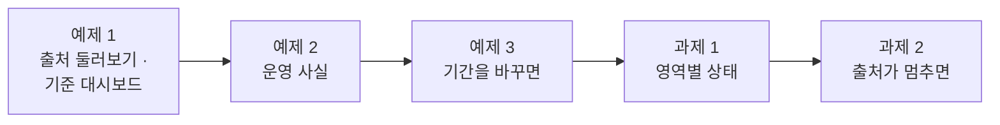
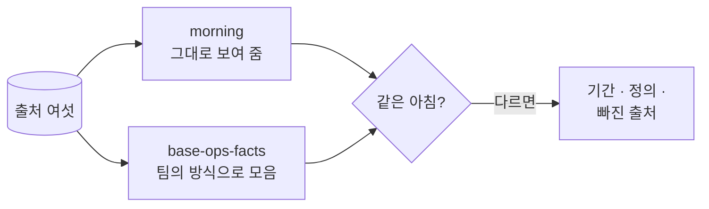
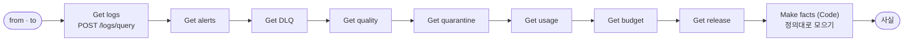
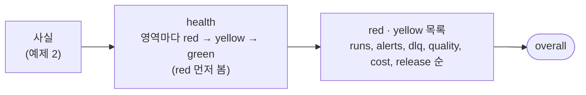
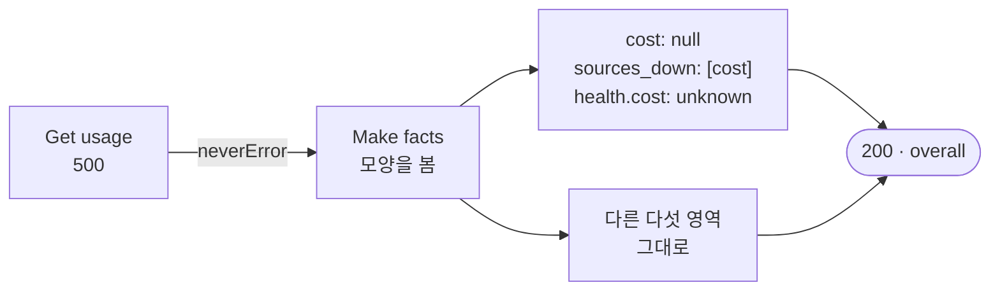

# Lab 01 · 운영 사실 · 흩어진 출처를 한 장으로

- 관련 강의: [1단계 · 운영 사실](../../Lecture/79/01-STAGE1-OPS-FACTS.md)
- 소요 시간: 50분 (2교시 한 시간) · 예제 1 10분 · 예제 2 15분 · 예제 3 7분 · 과제 1 8분 · 과제 2 10분
- 준비: [실습 준비](../../Lecture/79/00-DAY79-PREP.md)의 `doctor` → `ready`, `morning`이 운영 아침 상태, 기준 사실 `base-ops-facts` 게시
- 목표: 72~78일차의 출처 여섯(실행 기록 · 알림 · DLQ · 품질 · 비용 · 릴리스)을 먼저 **하나씩 둘러보고**, 팀이 쓰던 아침 대시보드가 무엇을 틀리게 · 빠뜨리게 보여 주는지 찾는다. 출처를 정의대로 모은 **운영 사실**(`my-ops-facts`)을 만들고, 기간을 바꿔 무엇이 따라 바뀌는지 재 보고, 영역마다 **상태**(🔴 · 🟡 · 🟢)를 정하고, 출처 하나가 멈춰도 "모른다"고 답하게 한다.



> 복사해 붙일 요청문은 없습니다. 막히면 `▶` 를 하나씩 펼칩니다. 연습이 끝나면 `uv run tools/flow.py morning --reset`.

## 시작하기 · 터미널 두 개

| 터미널 | 하는 일 |
| --- | --- |
| ① 에이전트 | `cd ~/aio-01d4-stu/Last3Mon/79` 후 `codex` (또는 `claude`, `agy`). 내가 쓴 요청문을 보낸다 |
| ② 확인 | `cd ~/aio-01d4-stu/Last3Mon/79` 에서 `morning` · `call` · `push` · `test`를 **내가** 실행한다 |

`cp templates/OPS-ASSISTANT-TEMPLATE.md my-work/OPS.md` 후 표를 채워 갑니다. 쓴 요청문은 `my-work/PROMPTS.md`에 모읍니다.

## 예제 1 · 출처 둘러보기 · 팀의 기준 대시보드 (10분, 에이전트 없이)

### 이 실습의 의도

**한 줄로:** 수요일 아침 08:30의 운영 상태를 `morning`으로 출처마다 직접 둘러보고, 팀이 지난달 만든 아침 대시보드(`base-ops-facts`)가 같은 아침을 어떻게 보여 주는지 **비교**합니다. 고치는 것은 예제 2부터이고, 여기서는 **보고 비교해 적기만** 합니다.

> **생활 속 예 · 병원의 아침 인수인계.** 아침 8시 반, 간호사가 출근하면 밤 근무자에게 인수인계를 받습니다. 혈압 기록지, 투약 기록, 검사 결과, 호출 기록이 따로따로입니다. 하나씩 넘겨 보면 시간이 걸리고, 누가 "밤새 괜찮았어요"라고 요약하면 빠르지만 무엇을 빼먹었는지 모릅니다. 예제 1은 기록지를 직접 넘겨 보고, 지난달 만든 요약표(기준 대시보드)가 무엇을 빼먹는지 보는 실습입니다.

**상황.** 운영 담당자가 출근했습니다. 72~78일차에 만든 것이 출처 여섯에 흔적을 남겼습니다. 팀에는 지난달 만든 아침 대시보드 `base-ops-facts`가 있고, 지금까지 아침 회의에서 이 숫자를 봐 왔습니다.

**실험 둘.**

| 실험 | 명령 | 볼 것 |
| --- | --- | --- |
| ① 출처 둘러보기 | `morning` | 알림 몇 건 · 높음 몇 건, DLQ 몇 건 · parked 몇 건, 품질 점수, 비용 · 예산, 카나리 |
| ② 기준 대시보드에 지난주를 | `call base-ops-facts requests/week2.json` | 실행 수가 지난주(357)인가? 어떤 칸이 있고 없나? |

**끝나면 알게 되는 것.** 운영 상태는 **여러 출처의 사실**을 모은 것이고, 모을 때 기간 · 정의 · 빠뜨린 출처에 따라 그림이 크게 달라진다는 것. 그리고 "좋아 보이는" 대시보드가 가장 급한 것(카나리 · parked)을 아예 안 보여 줄 수 있다는 것.

**적을 곳.** `my-work/OPS.md` 1절 표 (출처 · `morning`에서 본 것 · 기준 대시보드는 · 빠진 것).

```bash
uv run tools/flow.py morning                                    # ① 출처 여섯을 한눈에
uv run tools/flow.py call base-ops-facts requests/week2.json    # ② {"from": "2026-10-26", "to": "2026-10-30"}
```

### 이해하기

**출처 여섯.** [AGENTS.md](AGENTS.md) 2절 "운영 아침 상태"입니다. 72~78일차에 하나씩 만든 것들입니다.

| 출처 | 만든 날 | 묻는 것 |
| --- | --- | --- |
| 실행 기록 `/logs/query` | 77 | 지난주 오류율 · p95 · 답 못 함, 가장 많은 실패 |
| 알림 `/alerts` | 76 · 78 | 몇 건, 높음 몇 건, 이유별 |
| DLQ `/dlq` | 76 | 몇 건, 사람이 봐야 할(parked) 것 |
| 품질 기록 · 격리함 | 78 | 배치 점수 평균 · 마지막, 격리 몇 건 |
| 사용량 · 예산 | 75 | 오늘 비용 · 예산의 몇 % · 1위 사용자 |
| 릴리스 `/releases/helpdesk` | 74 | 지금 판 · 카나리와 그 비율 |

**운영 사실 = 출처 + 정의.** "오류율"은 77일차 정의(끝날 포함 · 4자리 · 0건이면 0), "다시 묻는 비율"은 74일차 카나리 비교, "예산의 몇 %"는 75일차 예산입니다. 오늘의 사실은 **새 정의를 만드는 것이 아니라 지난 날들의 정의를 한 곳에 모으는 것**입니다.



**기대 결과.** `morning`과 기준 대시보드의 숫자가 **다르고**, 기준에는 **없는 칸**이 있습니다. 무엇이 다른지는 아래 실행 결과를 보기 전에 먼저 찾아 봅니다.

<details><summary>▶ 1단계 · 기준의 실행 수가 357이 아니라면</summary>

기준 대시보드는 지난주를 물었는데 몇 건을 셌나요? 77일차의 두 주 666과 같다면, 기간을 데이터 API에 넘기지 않은 것입니다. `uv run tools/flow.py diff reference/baseline-ops-facts.json reference/lab01-example2-facts.json`로 `Get logs`의 본문을 비교해 봅니다.
</details>

<details><summary>▶ 2단계 · 기준에 없는 것 중 가장 위험한 것</summary>

`morning`의 마지막 줄(릴리스)과 DLQ의 `parked`를 봅니다. 기준 대시보드만 보는 운영 담당자는 이 둘을 알 수 있나요?
</details>

### 실행 결과 · 출처 둘러보기 · 기준 대시보드

수업 준비 때(11/01) 강사 노트북에서 실제로 나온 출력입니다. 운영 아침 상태는 데이터 API를 켤 때마다 같은 상태로 채워지므로 누가 돌려도 같습니다 (`call`의 시간만 다름).

이 예제는 **고치지 않습니다.** 같은 아침을 `morning`(출처를 그대로)과 기준 대시보드(팀의 방식)로 보고 비교합니다.

#### ① `morning`으로 출처 둘러보기

실행한 명령:

```bash
uv run tools/flow.py morning
```

출력:

```text
seeded morning 2026-11-04T08:30:00 · {"alerts": 6, "dlq": 3, "quality_log": 4, "quarantine": 1, "usage": 192}
alerts: 6 (high 3)
  [high] helpdesk/Search FAQ · timeout · timeout of 1000ms exceeded
  [high] helpdesk/Answer · rate_limit · 429 Rate limit reached for requests
  [high] faq-import/Batch ok? · batch_rejected · B-1 rejected
  [medium] faq-import/Low score? · low_quality · B-2 quality 0.8
  [medium] faq-import/Low score? · low_quality · B-3 quality 0.8333
  [medium] intake/Create ticket · api_error · tickets API 503
DLQ: 3 (parked 2)
  #1  attempts 3  parked True  tickets API 503
  #2  attempts 3  parked True  tickets API 503
  #3  attempts 1  parked False  timeout
quality log: 4 (scores [0, 0.8, 0.8333, 1]) · quarantine 1
usage: 156 requests · 192 calls · $0.073604
budget: used $0.073604 of $0.08
release: active 1.1.0 · canary {"release": "1.2.0", "percent": 20}
```

**왜 이렇게 나왔나**

- 알림 6건은 72~78일차가 남긴 것입니다: 77일차의 FAQ timeout · 429, 78일차의 B-1 거절 · 낮은 점수 둘, 76일차 접수 API 503. 높음은 3건.
- DLQ 3건 중 **2건이 parked** — 세 번 시도해도 실패해 사람이 봐야 하는 접수 건입니다 (76일차).
- 품질 기록 4줄은 78일차 Lab 03 과제 1의 B-1(0) · B-2 · B-3 · B-2-fix(1), 격리함에는 FAQ-305 하나.
- 오늘 비용 $0.073604 = 예산 $0.08의 약 92%. 카나리 1.2.0이 20% 켜져 있습니다 (74일차).

#### ② 기준 대시보드에 지난주를

실행한 명령:

```bash
uv run tools/flow.py call base-ops-facts requests/week2.json
```

출력:

```text
HTTP 200 · 1.4s
{ "runs": { "total": 666, "errors": 21, "error_rate": 3.153153153153153 },
  "alerts": { "count": 6 },
  "dlq": { "size": 3 },
  "cost": { "used_usd": 0.073604, "daily_usd": 0.08 } }
```

**왜 이렇게 나왔나**

| 출처 | `morning` | 기준 대시보드 | 다른 까닭 |
| --- | --- | --- | --- |
| 실행 기록 | (지난주 357건) | **666건** · 3.153… | 기간을 데이터 API에 넘기지 않아 두 주 전체를 셈, 오류율은 백분율에 반올림 없음 |
| 알림 | 6 · 높음 3 | 6 | 높음 · 이유가 없음 |
| DLQ | 3 · **parked 2** | 3 | parked가 없음 — 사람이 볼 일이 보이지 않음 |
| 품질 | 4줄 · 격리 1 | **없음** | 출처를 읽지 않음 |
| 비용 | $0.073604 / $0.08 | 같음 | 비율 · 1위 사용자가 없음 |
| 릴리스 | 1.1.0 + **카나리 1.2.0 20%** | **없음** | 출처를 읽지 않음 |

- 기준만 보는 운영 담당자는 **카나리가 켜져 있다는 것**과 **parked 2건**을 모릅니다. 둘 다 오늘 아침 가장 급한 일입니다 (과제 1의 빨강).
- 숫자가 "틀린" 것보다 위험한 것은 **칸이 없는** 것입니다. 없는 칸은 대시보드에서 "괜찮다"처럼 보입니다.

## 예제 2 · 운영 사실 (15분)

### 이 실습의 의도

**한 줄로:** 예제 1에서 본 차이를 없애기 위해, 출처 여덟 개(실행 기록 · 알림 · DLQ · 품질 기록 · 격리함 · 사용량 · 예산 · 릴리스)를 AGENTS.md 3절 정의대로 모은 **운영 사실**(`my-ops-facts`)을 만듭니다. Lab 01의 중심 실습이고, 오늘 만드는 질문 답변 · 브리핑이 모두 이 사실을 부릅니다.

> **생활 속 예 · 환자 한 장 차트.** 기록지가 여러 장이면 인수인계 때마다 누군가 빠뜨립니다. 그래서 병원은 혈압 · 투약 · 검사 · 호출을 한 장 차트에 **정해진 칸으로** 모읍니다. 차트 칸이 정해져 있으면 누가 써도 같은 차트가 됩니다. 예제 2는 그 한 장 차트를 만드는 실습입니다.

| 예제 1에서 본 것 | 정의 (AGENTS.md 3절 "사실") | 확인하는 케이스 |
| --- | --- | --- |
| 기간 없이 666을 셈 | 본문 `from` · `to`, 비면 지난주(10/26~10/30) | 지난주 · 첫 주 |
| 오류율이 백분율 · 끊지 않음 | 77일차 정의 그대로 (4자리 · `ceil(p × n)`) | 지난주 |
| 알림 · DLQ가 건수뿐 | `high` · `by_reason`, `parked` · `waiting` | 지금 상태 |
| 품질 · 릴리스가 없음 | `quality` · `release` (카나리 · 다시 묻는 비율) | 비용 · 릴리스 |
| "지금"이 바뀌면 | 사실은 부를 때마다 다시 셈 | DLQ #3 처리 |

**순서.** 같은 테스트를 **기준에 먼저** 돌려 0/5를 봄 → 요청문 → push → 5/5.

**끝나면 알게 되는 것.** 여러 출처를 모을 때 정할 것(기간은 어디에 · 어느 칸을 · 0건이면), 숫자는 Code가 모으고 LLM은 쓰지 않는 까닭, 운영 도우미가 **읽기만** 하는 까닭.

**만들 것**: 기간을 받아 출처 여덟을 차례로 읽고 한 JSON으로 모아 돌려주는 워크플로우.

```bash
uv run tools/flow.py test cases/lab01.json --webhook base-ops-facts -v     # 고치기 전 (기준에 같은 테스트)
```

| 조건 | 값 |
| --- | --- |
| 파일 · 웹훅 | `my-work/ops-facts.json` (새로) · `my-ops-facts` |
| 사실 | `period` · `runs` · `alerts` · `dlq` · `quality` · `cost` · `release` — **정의는 [AGENTS.md](AGENTS.md) 3절** |
| 계산 | HTTP 여덟 개를 한 줄로, Code 하나 (LLM 없음) |
| 기대 결과 | `cases/lab01.json` (지난주 · 지금 상태 · 비용 · 릴리스 · 첫 주 · DLQ #3 처리) |

### 이해하기

**지금 무엇이 문제인가.** 기준 대시보드는 틀린 계산을 한 것이 아니라, **기간을 넘기지 않았고 · 정의가 77일차와 다르고 · 출처 둘을 빠뜨렸습니다.** 고치는 일은 "출처마다 정의를 정해 한 곳에 모으기"입니다.



**HTTP를 한 줄로 잇는 까닭.** 아이템이 하나씩이라 각 HTTP 노드는 한 번만 부르고, `Make facts`가 `$('Get alerts').first().json`처럼 **이름으로** 모든 출처를 읽습니다 (AGENTS.md 5절). 여덟 출처를 다 모아도 0.1초 안팎입니다.

**기간은 실행 기록에만.** 알림 · DLQ · 품질 · 비용 · 릴리스는 "지금" 상태입니다. "지난주의 DLQ"라는 것은 오늘 데이터에 없습니다. 기간을 모든 출처에 대면 오히려 틀립니다 (예제 3에서 재 봄).

**읽기만.** 운영 도우미는 데이터 API의 상태를 바꾸지 않습니다 (`/dlq/update` · `/releases` · `/budget` POST를 부르지 않음). 사실을 모으는 곳이 상태를 바꾸면, 보고 있는 동안 그림이 바뀌고 무엇이 왜 바뀌었는지 모릅니다. 상태를 바꾸는 것은 런북에 따라 사람이 합니다 — 테스트의 `before`가 그 "사람"입니다.

**테스트 케이스.**

| 케이스 | 기대 |
| --- | --- |
| 지난주 실행 (기본 기간) | 357 · 21 · 0.0588 · p95 2598, 실패 1위 `Search FAQ` 16 |
| 지금 상태 · 알림 · DLQ · 품질 | 알림 6 · 높음 3 · `low_quality` 2, DLQ 3 · parked 2, 품질 평균 0.6583 · 마지막 1 · 격리 1 |
| 비용 · 릴리스 | 156 요청 · 예산의 0.9201 · 1위 `test-bot` 0.3699, 1.1.0 + 카나리 1.2.0 · 0.625 |
| 첫 주 | 실행 309 · 오류 0 · 실패 1위 `null`, DLQ는 그대로 3 |
| DLQ #3 처리 | 테스트가 먼저 #3을 처리 → DLQ 2 · waiting 0 |

**기대 결과.** 고치기 전(기준에 같은 테스트) 0/5, 고친 뒤 5/5.

<details><summary>▶ 1단계 · 정의를 요청문에</summary>

"운영 상태를 모아 줘"만 쓰면 에이전트마다 칸이 다릅니다. 3절 "사실" 표를 그대로 요청문에 넣거나 "AGENTS.md 3절 사실 표대로"라고 씁니다. 실행 기록은 "77일차 정의 그대로", 기간의 기본값, 0건일 때도.
</details>

<details><summary>▶ 2단계 · 비율 · 1위는 어떻게</summary>

`used_ratio`는 `used_usd / daily_usd`(4자리), `top_user`는 `by_user`를 `cost_usd`로 정렬한 1위와 그 몫(`share`). 다시 묻는 비율은 그 기간 `자동 답변` 실행 중 그 릴리스의 `repeat` 비율입니다 (74 · 77일차).
</details>

<details><summary>▶ 빈칸 채우기 · 요청문(프롬프트) 뼈대</summary>

요청문에 꼭 들어갈 것: **① 파일 · 웹훅 ② 기간과 기본값 ③ 출처 · 노드 순서 · 정의 ④ 기간을 쓰는 곳 ⑤ 하지 않을 것 · 기대 결과**. 아래 빈칸 4개(`____①`~`____④`)를 채워 `my-work/PROMPTS.md`에 쓴 뒤 에이전트에게 보냅니다.

```text
my-work/ops-facts.json 을 새로 만들어 줘. 웹훅 POST ____①, 이름 "79 Ops facts (my)".
Get logs(POST http://data-api:8800/logs/query) 에 본문의 from · to 를 넘기고, 비면 ____② (지난주).
그 뒤 Get alerts · Get DLQ · Get quality · Get quarantine · Get usage · Get budget · Get release 를 한 줄로 잇고, Make facts(Code) 하나에서 AGENTS.md 3절 "사실" 표대로 모은다.
runs 는 77일차 정의 그대로 (error_rate 4자리 · p95 는 ceil(p × n)번째 · 0건이면 0), top_failure 는 (노드, 메시지) 묶음 1위 또는 null.
기간은 ____③ 쓰고, 알림 · DLQ · 품질 · 비용 · 릴리스는 지금 상태. 숫자는 Code 가 세고 LLM 은 쓰지 않는다.
데이터 API 에 ____④은 보내지 않는다 (읽기만). 기대 결과 cases/lab01.json.
```

빈칸 힌트 (답이 아니라 **어디서 찾고 무엇을 생각하나**):

- ① AGENTS.md 3절 계약 표의 "운영 사실" 줄입니다. 테스트 파일 `cases/lab01.json` 맨 위의 `webhook`과 같아야 합니다.
- ② 같은 줄의 "입력" 칸. 운영 회의는 어느 기간을 보나요?
- ③ 3절 "사실" 표 아래 줄. 알림 · DLQ에 기간을 대면 무엇이 남나요?
- ④ AGENTS.md 4절의 마지막 줄. 운영 도우미가 데이터 API에 하지 않는 일.

채운 요청문은 수업 뒤 공개되는 정답본의 요청문 예와 비교합니다.
</details>

```bash
uv run tools/flow.py push my-work/ops-facts.json
uv run tools/flow.py test cases/lab01.json -v
uv run tools/flow.py call my-ops-facts requests/week2.json
```

### 실행 결과 · 운영 사실

수업 준비 때(11/01) 강사 노트북에서 정답 워크플로우로 실제로 나온 출력입니다. 실행 기록과 운영 아침 상태가 같으므로 숫자는 누구에게나 같습니다.

#### 고치기 전 · 기준(`base-ops-facts`)에 같은 테스트

실행한 명령:

```bash
uv run tools/flow.py test cases/lab01.json --webhook base-ops-facts -v
```

출력 (결과 줄만):

```text
✔ before: POST http://localhost:8800/ops-reset · HTTP 200 · 0.0s · {"seeded_at": "2026-11-04T08:30:00", …
✘ 지난주 실행 (기본 기간) · 0.4s · period.from = null (expected 2026-10-26); runs.total = 666 (expected 357); runs.error_rate = 3.153153153153153 (expected 0.0588); runs.p95_ms = null (expected 2598); runs.top_failure.node = null (expected Search FAQ); runs.top_failure.count = null (expected 16)
✘ 지금 상태 · 알림 · DLQ · 품질 · 0.1s · alerts.high = null (expected 3); alerts.by_reason.low_quality = null (expected 2); dlq.parked = null (expected 2); quality.avg_score = null (expected 0.6583); quality.last_score = null (expected 1); quality.quarantine = null (expected 1)
✘ 비용 · 릴리스 · 0.1s · cost.requests = null (expected 156); cost.used_ratio = null (expected 0.9201); cost.top_user.user = null (expected test-bot); cost.top_user.share = null (expected 0.3699); release.active = null (expected 1.1.0); release.canary_release = null (expected 1.2.0); …
✘ 첫 주 (기간을 바꾸면 실행만 바뀜) · 0.1s · runs.total = 666 (expected 309); runs.errors = 21 (expected 0)
✔ before: POST http://localhost:8800/dlq/update · HTTP 200 · 0.0s · {"removed": true, "size": 2}
✘ 상태가 바뀌면 숫자도 (DLQ #3 처리) · 0.1s · dlq.waiting = null (expected 0)
Passed 0/5
```

**왜 이렇게 나왔나 (고치기 전)**

- **첫 줄 `before: /ops-reset`:** 테스트가 먼저 운영 아침을 처음 상태로 되돌립니다. 테스트끼리 서로의 흔적(처리한 DLQ · 올린 예산)을 넘겨받지 않게.
- **지난주 · 첫 주 모두 666:** 기간을 넘기지 않으니 무엇을 물어도 두 주 전체입니다.
- **나머지는 `null`:** 그런 칸이 없습니다 (높음 · parked · 품질 · 비율 · 1위 · 릴리스).
- **마지막 케이스 앞의 `before`:** 테스트가 사람 대신 DLQ #3을 처리합니다(`size` 2). 기준도 `dlq.size`는 2로 바꿔 보이지만 `waiting` 칸이 없어 ✘.
- 0/5는 **예상한 결과**입니다.

#### 고친 뒤 · 내 `my-ops-facts`

실행한 명령:

```bash
uv run tools/flow.py push my-work/ops-facts.json
uv run tools/flow.py test cases/lab01.json -v
uv run tools/flow.py call my-ops-facts requests/week2.json
```

출력 (결과 줄과 `call`):

```text
✔ 지난주 실행 (기본 기간) · 1.1s
✔ 지금 상태 · 알림 · DLQ · 품질 · 0.4s
✔ 비용 · 릴리스 · 0.1s
✔ 첫 주 (기간을 바꾸면 실행만 바뀜) · 0.1s
✔ before: POST http://localhost:8800/dlq/update · HTTP 200 · 0.0s · {"removed": true, "size": 2}
✔ 상태가 바뀌면 숫자도 (DLQ #3 처리) · 0.1s
Passed 5/5

HTTP 200 · 0.1s
{ "period": {"from": "2026-10-26", "to": "2026-10-30"},
  "runs": {"total": 357, "errors": 21, "error_rate": 0.0588, "p95_ms": 2598, "unanswered_rate": 0.0476,
           "top_failure": {"node": "Search FAQ", "message": "timeout of 1000ms exceeded", "count": 16}},
  "alerts": {"count": 6, "high": 3, "by_reason": {"timeout": 1, "rate_limit": 1, "batch_rejected": 1, "low_quality": 2, "api_error": 1}},
  "dlq": {"size": 3, "parked": 2, "waiting": 1},
  "quality": {"batches": 4, "avg_score": 0.6583, "last_score": 1, "rejected_batches": 1, "quarantine": 1},
  "cost": {"requests": 156, "calls": 192, "cost_usd": 0.073604, "daily_usd": 0.08, "used_ratio": 0.9201,
           "top_user": {"user": "test-bot", "cost_usd": 0.027228, "share": 0.3699}},
  "release": {"active": "1.1.0", "canary_release": "1.2.0", "canary_percent": 20, "active_repeat_rate": 0.0773, "canary_repeat_rate": 0.625} }
```

**고친 뒤 이렇게 나온 까닭**

| 칸 | 고치기 전 (기준) | 고친 뒤 | 무엇이 바꿨나 |
| --- | --- | --- | --- |
| 지난주 실행 | 666 · 3.153… | 357 · 0.0588 · p95 2598 | 기간을 `/logs/query`에, 77일차 정의 |
| 실패 1위 | 없음 | `Search FAQ` timeout 16 | (노드, 메시지)로 묶기 |
| 알림 · DLQ | 건수뿐 | 높음 3 · 이유별, parked 2 · waiting 1 | 출처의 칸을 정의대로 |
| 품질 | 없음 | 평균 0.6583 · 마지막 1 · 격리 1 | 출처 둘을 더 읽음 |
| 비용 | 금액뿐 | 예산의 0.9201 · 1위 `test-bot` 37% | 비율 · 정렬 |
| 릴리스 | 없음 | 1.1.0 · 카나리 1.2.0 20% · 다시 묻기 7.73% 대 **62.5%** | 출처 + 실행 기록의 `repeat` |

- **같은 숫자 · 다른 날:** 실행 357 · 0.0588 · 2598 · 실패 1위 16은 77일차 `my-log-report`의 둘째 주와 같습니다. 정의를 다시 만들지 않고 모았기 때문입니다.
- **릴리스의 62.5%:** 카나리로 답한 실행의 다시 묻는 비율이 지금 판(7.73%)의 여덟 배입니다. 기준 대시보드에서는 아예 보이지 않던 숫자입니다.
- **0.1초:** 출처 여덟을 한 줄로 읽어 Code 하나에서 모았습니다. LLM 없음, 데이터 API의 상태는 하나도 바꾸지 않았습니다.

## 예제 3 · 기간을 바꾸면 (7분, 에이전트 없이)

### 이 실습의 의도

**한 줄로:** 예제 2의 사실에 기간만 바꿔(두 주 · 하루 · 빈 주 · 기간 없음) 물어, **어느 숫자가 기간을 따라 바뀌고 어느 숫자는 그대로인지** 봅니다. 고치는 실습이 아니라 **재 보는** 실습입니다.

> **생활 속 예 · "지난주 혈압"과 "지금 열".** 인수인계 때 "지난주 혈압 추이"는 기간을 정해 보지만, "지금 열이 있나 · 지금 수액이 몇 개 남았나"는 기간이 없습니다. 둘을 같은 기간으로 물으면 엉뚱한 답이 나옵니다. 예제 3은 차트의 어느 칸이 기간을 따르는지 재 보는 실습입니다.

**상황.** 운영 회의는 지난주를 보지만, 사고가 난 날(10/26 월)만 보거나, 두 주를 보거나, 이번 주(아직 기록 없음)를 물을 때도 있습니다. `cases/lab01-period.json`을 예제 2의 사실에 돌립니다.

| 기간 | 보내는 것 | 기대 (정의대로) |
| --- | --- | --- |
| 두 주 | `two-weeks` (10/19~10/30) | 실행 666 · 오류 21 · 0.0315 |
| 하루 | `monday` (10/26) | 70 · 16, 실패 1위 `Search FAQ` |
| 빈 주 | `empty-week` (11/02~11/06) | 0 · 0 · p95 0, 실패 1위 `null`, 다시 묻는 비율 `null` — 200 |
| 기간 없음 | `{}` | 지난주 (10/26~10/30) · 357 |
| "지금" 숫자 | `empty-week` | 알림 6 · DLQ 3 · 품질 0.6583 · 비용 0.9201 · 1.1.0 — 그대로 |

**끝나면 알게 되는 것.** 운영 사실에는 **기간이 있는 숫자**(실행 기록)와 **지금 숫자**(상태)가 섞여 있고, 둘을 구분해 말해야 한다는 것. 0건 · 없음(`null`)의 차이.

**적을 곳.** `my-work/OPS.md` 2절 표 (기간 · 실행 · 그대로인 것 · `null`이 된 것).

```bash
uv run tools/flow.py test cases/lab01-period.json -v
```

### 이해하기

**두 종류의 숫자.**

| | 기간이 있는 숫자 | 지금 숫자 |
| --- | --- | --- |
| 예 | 오류율 · p95 · 답 못 함 · 실패 1위 · 다시 묻는 비율 | 알림 · DLQ · 품질 · 비용 · 지금 판 |
| 출처 | 실행 기록 (일어난 일의 목록) | 상태 (지금 남아 있는 것) |
| 기간을 바꾸면 | 바뀜 | 그대로 |
| 보고할 때 | "10/26~10/30에" | "08:30 지금" |

**0과 `null`.** 빈 주의 오류율은 **0**(0건이면 0, 77일차 정의)이지만, 다시 묻는 비율은 **`null`**입니다 — 그 기간에 그 판으로 답한 실행이 없으니 비율을 말할 수 없습니다. 0은 "없었다", `null`은 "모른다"입니다. 과제 1의 상태 판정에서 이 차이가 중요해집니다 ("카나리 비교 불가").

**기대 결과.** 5/5. 실패하면 예제 2의 요청문에 "기간은 실행 기록에만" · "0건이면 0"이 빠진 것입니다.

<details><summary>▶ 1단계 · 하루(10/26)인데 다시 묻는 비율이 `null`이라면</summary>

그날 1.1.0 · 1.2.0으로 답한 실행이 있었나요? `uv run tools/flow.py logs --from 2026-10-26 --to 2026-10-26 --last 0`과 77일차 `by_release`를 떠올려 봅니다. 실행이 없으면 비율은 `null`이 맞습니다.
</details>

### 실행 결과 · 기간을 바꾸면

수업 준비 때(11/01) 강사 노트북에서 실제로 나온 출력입니다 (예제 2의 사실, 고치지 않음).

실행한 명령:

```bash
uv run tools/flow.py test cases/lab01-period.json -v
```

출력 (결과 줄과 `-v`로 본 응답의 실행 · 릴리스 부분):

```text
✔ 두 주 (10/19~10/30) · 0.1s
✔ 하루 (10/26) · 0.1s
✔ 빈 기간 (11/02~11/06) · 0건이어도 200 · 0.1s
✔ 기간을 비우면 지난주 (기본) · 0.1s
✔ 기간과 상관없는 '지금' 숫자는 그대로 · 0.1s
Passed 5/5

두 주     runs {"total": 666, "errors": 21, "error_rate": 0.0315, "p95_ms": 2537, "unanswered_rate": 0.0511, top_failure 16}
          release {"active_repeat_rate": 0.0773, "canary_repeat_rate": 0.625}
하루      runs {"total": 70, "errors": 16, "error_rate": 0.2286, "p95_ms": 2468, "unanswered_rate": 0.0571, top_failure 16}
          release {"active_repeat_rate": null, "canary_repeat_rate": null}
빈 기간   runs {"total": 0, "errors": 0, "error_rate": 0, "p95_ms": 0, "unanswered_rate": 0, "top_failure": null}
          release {"active_repeat_rate": null, "canary_repeat_rate": null}
기간 없음 period {"from": "2026-10-26", "to": "2026-10-30"} · runs.total 357
```

**왜 이렇게 나왔나 (기간마다)**

| 기간 | 실행 | 다시 묻는 비율 | 지금 숫자 (알림 · DLQ · 품질 · 비용 · 판) |
| --- | --- | --- | --- |
| 두 주 | 666 · 21 · 0.0315 | 7.73% · 62.5% | 6 · 3 · 0.6583 · 0.9201 · 1.1.0 |
| 하루 (10/26) | 70 · 16 · 0.2286 | **`null` · `null`** | 같음 |
| 빈 주 | 0 · 0 · 0 · p95 0 | `null` · `null` | 같음 |
| 기간 없음 | 357 (지난주) | 7.73% · 62.5% | 같음 |

- **실행 기록만 바뀝니다.** 알림 · DLQ · 품질 · 비용 · 판은 다섯 기간 모두 같습니다 — "지금" 숫자이기 때문입니다.
- **하루(10/26)에 다시 묻는 비율이 `null`:** 그날은 1.1.0 · 1.2.0으로 답한 실행이 없었습니다 (두 판은 둘째 주 뒤쪽에 나옴). 비율을 말할 수 없으니 `null`이 맞습니다. 두 주의 비율이 지난주와 같은 것도 같은 까닭 — 첫 주에는 두 판이 없었습니다.
- **빈 주:** 오류율 · p95는 **0**(0건이면 0), 실패 1위 · 다시 묻는 비율은 **`null`**(모름). 두 값의 뜻이 다릅니다. 과제 1에서 비율이 `null`이면 카나리를 빨강이 아니라 노랑으로 둡니다.
- 운영 회의에서 이 사실을 말할 때는 "실행은 10/26~10/30, 나머지는 08:30 지금"처럼 **두 시간을 나눠** 말합니다.

## 과제 1 · 영역별 상태 (8분)

### 이 실습의 의도

**한 줄로:** 사실에 영역마다 **상태**(`red` · `yellow` · `green`)와 빨강 · 노랑 목록, 전체 상태를 더해, 숫자를 다 읽지 않아도 "어디부터 볼까"가 보이게 합니다.

> **생활 속 예 · 활력 징후의 색.** 병동 화면은 환자마다 숫자(혈압 · 맥박 · 산소)를 띄우지만, 기준을 넘으면 칸이 **빨갛게** 변합니다. 간호사는 숫자를 다 읽기 전에 빨간 칸부터 봅니다. 그 기준은 간호사 개인이 아니라 병원이 정해 둡니다. 과제 1은 영역마다 그 기준과 색을 정하는 실습입니다.

**상황.** 사실은 숫자가 서른 개가 넘습니다. 팀장이 요청했습니다: "영역마다 신호등 하나, 빨강 · 노랑 목록, 전체 한 단어를 주세요. 기준은 AGENTS.md에 적어 둔 대로."

| 영역 | 🔴 red | 🟡 yellow |
| --- | --- | --- |
| runs | 오류율 > 0.01 | 답 못 함 > 0.02 |
| alerts | 높음 ≥ 5 | 1건 이상 |
| dlq | parked > 0 | 1건 이상 |
| quality | 마지막 점수 < 0.8 | < 0.9 또는 격리 > 0 |
| cost | 예산의 100% 이상 | 80% 이상 |
| release | 카나리의 다시 묻는 비율 > 지금 판의 2배 | 카나리가 있음 |

**끝나면 알게 되는 것.** 상태는 **정해진 기준**(SLO · 77일차)의 다른 모양이라는 것, 판정은 Code가 늘 같게 해야 한다는 것, 목록의 **순서**도 정의라는 것.

**적을 곳.** `my-work/OPS.md` 3절 표 (영역 · 상태 · 그 숫자 · 기준).

```bash
uv run tools/flow.py test cases/lab01-challenge.json -v    # 고치기 전 (예제 2의 사실)
```

### 이해하기



**빨강을 먼저 봅니다.** 한 영역이 빨강 조건과 노랑 조건에 둘 다 맞으면 빨강입니다. 그리고 목록은 늘 **같은 순서**(runs, alerts, dlq, quality, cost, release)로 — 브리핑(Lab 03)의 "먼저 볼 것"이 이 순서를 씁니다.

**카나리 비교 불가.** 첫 주에는 카나리 1.2.0으로 답한 실행이 없어 다시 묻는 비율이 `null`입니다. 비교할 수 없으니 빨강이 아니라 **노랑**(카나리가 있음)입니다. 모르는 것을 나쁘다고도 좋다고도 하지 않습니다.

**테스트 케이스.** 테스트의 일부는 먼저 "사람의 작업"을 합니다 (예산 올리기 · parked 처리).

| 케이스 | 기대 |
| --- | --- |
| 지난주 영역별 상태 | runs · dlq · release 🔴, alerts · quality · cost 🟡, 전체 🔴 |
| 빨강 · 노랑 목록 | `["runs", "dlq", "release"]` · `["alerts", "quality", "cost"]` |
| 첫 주 | runs 🟡 (오류 0 · 답 못 함 5.5%), release 🟡 (비교 불가), 빨강은 dlq 하나 |
| 예산을 늘리면 | 비용 🟢 (0.0736) |
| parked를 처리하면 | DLQ 🟡, 빨강은 runs · release |

**기대 결과.** 고치기 전 0/5, 고친 뒤 5/5, `lab01` 5/5 그대로.

<details><summary>▶ 빈칸 채우기 · 요청문(프롬프트) 뼈대</summary>

요청문에 꼭 들어갈 것: **① 판정 순서 ② 릴리스 기준 ③ 목록 순서 ④ 누가 판정하나**. 아래 빈칸 4개를 채웁니다.

```text
my-work/ops-facts.json 의 Make facts 에 영역별 상태를 더해 줘.
AGENTS.md 3절 "상태" 표대로 health {runs, alerts, dlq, quality, cost, release} 를 red · yellow · green 으로. red 를 yellow 보다 ____① 본다.
release 는 카나리가 있고 두 비율이 모두 있고 canary_repeat_rate 가 active 의 ____②를 넘으면 red, 카나리만 있으면 yellow.
red · yellow 는 그 색인 영역을 ____③ 순서로, overall 은 red 가 있으면 red, 아니면 yellow 가 있으면 yellow, 아니면 green.
상태 판정은 LLM 이 아니라 ____④. 앞의 사실은 그대로. 기대 결과 cases/lab01-challenge.json, cases/lab01.json 도.
```

빈칸 힌트:

- ① 두 조건이 다 맞으면 어느 색인가요?
- ② 3절 "상태" 표의 release 줄.
- ③ 3절 표 아래 줄의 "이 순서".
- ④ AGENTS.md 4절 "숫자 · 상태는 …".
</details>

```bash
uv run tools/flow.py push my-work/ops-facts.json
uv run tools/flow.py test cases/lab01-challenge.json -v
uv run tools/flow.py test cases/lab01.json
```

### 실행 결과 · 영역별 상태

수업 준비 때(11/01) 강사 노트북에서 실제로 나온 출력입니다.

#### 고치기 전 · 예제 2의 사실

실행한 명령:

```bash
uv run tools/flow.py test cases/lab01-challenge.json -v
```

출력 (결과 줄만):

```text
✘ 지난주 영역별 상태 · 0.1s · health.runs = null (expected red); health.alerts = null (expected yellow); health.dlq = null (expected red); health.quality = null (expected yellow); health.cost = null (expected yellow); health.release = null (expected red); overall = null (expected red)
✘ 빨강 · 노랑 목록 (정해진 순서) · 0.1s · red = null (expected ["runs", "dlq", "release"]); yellow = null (expected ["alerts", "quality", "cost"])
✘ 첫 주: 오류는 없지만 답 못 함 · 카나리 비교 불가 · 0.1s · health.runs = null (expected yellow); health.release = null (expected yellow); red = null (expected ["dlq"])
✔ before: POST http://localhost:8800/budget · HTTP 200 · 0.0s · {"daily_usd": 1.0, …, "used_usd": 0.073604, "remaining_usd": 0.926396, …
✘ 예산을 늘리면 비용은 초록 · 0.1s · health.cost = null (expected green)
✔ before: POST http://localhost:8800/dlq/update · HTTP 200 · 0.0s · {"removed": true, "size": 2}
✔ before: POST http://localhost:8800/dlq/update · HTTP 200 · 0.0s · {"removed": true, "size": 1}
✘ parked를 처리하면 DLQ는 노랑 · 0.1s · health.dlq = null (expected yellow); red = null (expected ["runs", "release"])
Passed 0/5
```

**왜 이렇게 나왔나 (고치기 전):** 예제 2의 사실에는 `health` · `red` · `yellow` · `overall` 칸이 없어 모두 `null`입니다. 넷째 · 다섯째 케이스 앞의 `before`는 사람의 작업(예산을 $1로 · parked 둘 처리)입니다. 0/5는 예상한 결과.

#### 고친 뒤

실행한 명령:

```bash
uv run tools/flow.py push my-work/ops-facts.json
uv run tools/flow.py test cases/lab01-challenge.json -v
uv run tools/flow.py test cases/lab01.json
```

출력 (결과 줄과 지난주의 상태):

```text
✔ 지난주 영역별 상태 · 1.1s
✔ 빨강 · 노랑 목록 (정해진 순서) · 0.3s
✔ 첫 주: 오류는 없지만 답 못 함 · 카나리 비교 불가 · 0.1s
✔ 예산을 늘리면 비용은 초록 · 0.1s
✔ parked를 처리하면 DLQ는 노랑 · 0.1s
Passed 5/5

"health": {"runs": "red", "alerts": "yellow", "dlq": "red", "quality": "yellow", "cost": "yellow", "release": "red"},
"red": ["runs", "dlq", "release"], "yellow": ["alerts", "quality", "cost"], "overall": "red"

(lab01) Passed 5/5
```

**고친 뒤 이렇게 나온 까닭**

| 영역 | 숫자 | 상태 | 어느 기준에 걸렸나 |
| --- | --- | --- | --- |
| runs | 오류율 0.0588 | 🔴 | > 0.01 |
| alerts | 6건 · 높음 3 | 🟡 | 높음 5 미만, 1건 이상 |
| dlq | parked 2 | 🔴 | parked > 0 |
| quality | 마지막 1 · 격리 1 | 🟡 | 격리 > 0 |
| cost | 0.9201 | 🟡 | ≥ 0.8 |
| release | 62.5% > 2 × 7.73% | 🔴 | 카나리가 두 배 넘게 나쁨 |

- **첫 주:** 오류 0이지만 답 못 함 5.5%(> 0.02) → runs 🟡. 카나리로 답한 실행이 없어 비율 `null` → 비교 불가 → release 🟡. 빨강은 parked가 있는 dlq 하나.
- **예산을 $1로:** 0.073604 / 1 = 0.0736 → 비용 🟢. **parked 둘 처리:** parked 0 · 대기 1 → DLQ 🟡, 빨강은 runs · release.
- 상태는 숫자를 바꾸지 않습니다. 같은 사실에 **정해진 기준**을 댄 것입니다 (77일차 SLO와 같음). `lab01` 5/5 그대로.

## 과제 2 · 출처가 멈추면 (10분)

### 이 실습의 의도

**한 줄로:** 비용 출처(`/usage/summary`)가 멈춘 아침에도 사실이 **500 대신 200**으로 답하고, 그 영역은 "모름"(`null` · `unknown`)으로, 나머지 다섯 영역은 그대로 보여 주게 합니다.

> **생활 속 예 · 혈압계가 고장 난 아침.** 혈압계가 고장 났다고 인수인계를 통째로 안 할 수는 없습니다. "혈압: 오늘 아침 못 잼"이라고 적고 나머지는 그대로 넘깁니다. 그리고 "혈압 정상"이라고 **지어 적지 않습니다.** 과제 2는 고장 난 기록지를 "못 잼"으로 적는 실습입니다.

**상황.** 75일차 사용량 서비스가 가끔 멈춥니다. 지금 사실 워크플로우는 출처 하나가 500을 내면 **전체가 500**이 됩니다 — 아침 회의에 아무 숫자도 없습니다. 테스트가 고장 스위치로 사용량 출처를 멈춥니다 (`fault usage error`, 끝나면 되돌림).

| 정의 (AGENTS.md 3절 "출처가 멈추면") | |
| --- | --- |
| 그 영역의 사실 | `null` (0이 아님) |
| `sources_down` | 멈춘 영역 이름 |
| `health` · `unknown` | 그 영역은 `unknown` (⚪), 빨강 · 노랑 목록에는 넣지 않음 |
| `overall` | red가 있으면 red, 아니면 yellow나 unknown이 있으면 **yellow** |
| 응답 | 언제나 200 |

**끝나면 알게 되는 것.** 여러 출처를 모으는 곳은 **부분 실패**(partial failure)를 견뎌야 한다는 것 (72일차 안정성), 그리고 "모른다"를 "좋다"로 바꾸지 않는 것 (73일차 fail-closed와 같은 생각).

**적을 곳.** `my-work/OPS.md` 3절 아래 "출처가 멈춘 아침".

```bash
uv run tools/flow.py test cases/lab01-challenge2.json -v    # 고치기 전 (과제 1의 사실)
```

### 이해하기



**`neverError`가 없으면.** HTTP 노드는 4xx · 5xx를 받으면 오류로 멈추고, 워크플로우 전체가 500이 됩니다. `neverError`를 켜면 오류 응답도 **본문으로** 받아 다음 노드로 갑니다 (76 · 78일차). 그다음 "답했나"를 Code가 응답의 **모양**으로 판단합니다 (`cost_usd`가 숫자인가).

**0이 아니라 `null`.** 비용을 0으로 적으면 "오늘 돈을 하나도 안 썼다(초록)"로 읽힙니다. `null`과 `unknown`은 "모른다"입니다. 전체 상태도 모르는 영역이 있으면 적어도 노랑 — 모르는 것을 초록으로 말하지 않습니다.

**테스트 케이스.**

| 케이스 | 기대 |
| --- | --- |
| 비용 출처가 멈춰도 200 | `cost: null` · `sources_down: ["cost"]` · `health.cost: "unknown"` · `unknown: ["cost"]` |
| 다른 영역은 그대로 | DLQ 3 · 🔴, 빨강 runs · dlq · release, 전체 🔴 |
| 출처가 돌아오면 | 케이스 앞에서 고장을 끔 → `sources_down: []` · 비용 🟡 · 0.9201 |

**기대 결과.** 고치기 전 0/3 (첫 둘은 500, 셋째는 칸이 없음), 고친 뒤 3/3, `lab01` · `lab01-challenge` · `lab01-period` 그대로.

<details><summary>▶ 빈칸 채우기 · 요청문(프롬프트) 뼈대</summary>

요청문에 꼭 들어갈 것: **① 오류를 받는 법 ② 모름의 값 ③ 전체 상태 ④ 응답 코드**. 아래 빈칸 4개를 채웁니다.

```text
my-work/ops-facts.json 이 출처 하나가 멈춰도 답하게 해 줘.
Get logs 를 뺀 HTTP 노드에 ____① 를 켜고, Make facts 에서 출처의 응답 모양을 본다 (alerts 목록 · DLQ items · quality items 와 quarantine size · usage cost_usd 와 budget daily_usd 가 숫자 · release active).
답하지 않은 영역은 사실을 ____②, sources_down 에 영역 이름, health 는 unknown, unknown 목록에.
overall 은 red 가 있으면 red, 아니면 yellow 나 ____③ 이 있으면 yellow, 아니면 green — 모르는 것을 초록으로 말하지 않는다.
응답은 언제나 HTTP ____④. 앞의 칸은 그대로. 기대 결과 cases/lab01-challenge2.json, lab01 · lab01-challenge · lab01-period 도.
```

빈칸 힌트:

- ① AGENTS.md 3절 "출처가 멈추면" 아래 줄. HTTP 노드의 어느 옵션?
- ② 0과 무엇이 다른가요? (예제 3의 "0과 `null`")
- ③ 모르는 영역이 있을 때 전체가 green이면 무엇이 위험한가요?
- ④ 다른 다섯 영역은 쓸 수 있으니까.
</details>

```bash
uv run tools/flow.py push my-work/ops-facts.json
uv run tools/flow.py test cases/lab01-challenge2.json -v
uv run tools/flow.py test cases/lab01.json
uv run tools/flow.py test cases/lab01-challenge.json
uv run tools/flow.py test cases/lab01-period.json
```

### 실행 결과 · 출처가 멈추면

수업 준비 때(11/01) 강사 노트북에서 실제로 나온 출력입니다. 테스트가 시작할 때 사용량 출처를 멈추고(`fault usage error`), 끝날 때 되돌립니다.

#### 고치기 전 · 과제 1의 사실

실행한 명령:

```bash
uv run tools/flow.py test cases/lab01-challenge2.json -v
```

출력 (결과 줄만):

```text
✔ before: POST http://localhost:8800/admin/fault · HTTP 200 · 0.0s · {"faq": "ok", "tickets": "ok", "prompts": "ok", "usage": "error", "dlq": "ok", "slow_seconds": 8}
✘ 비용 출처가 멈춰도 200 · 모르는 것은 모른다고 · 0.1s · status 500 (expected 200); sources_down = null (expected ["cost"]); health.cost = null (expected unknown); unknown = null (expected ["cost"])
✘ 다른 영역은 그대로 · 0.1s · status 500 (expected 200); dlq.size = null (expected 3); health.dlq = null (expected red); red = null (expected ["runs", "dlq", "release"]); overall = null (expected red)
✔ before: POST http://localhost:8800/admin/fault · HTTP 200 · 0.0s · {… "usage": "ok", …}
✘ 출처가 돌아오면 다시 노랑 · 0.1s · sources_down = null (expected []); unknown = null (expected [])
Passed 0/3
✔ after: POST http://localhost:8800/admin/fault · HTTP 200 · 0.0s · {… "usage": "ok", …}
```

**왜 이렇게 나왔나 (고치기 전)**

- **첫 두 케이스가 500:** `Get usage`가 500을 받자 HTTP 노드가 오류로 멈추고, 워크플로우 전체가 실패했습니다. 비용 하나 때문에 **나머지 다섯 영역의 사실도 없습니다** — 아침 회의에 숫자가 하나도 없는 셈입니다.
- **셋째 케이스:** 출처가 돌아와 200이지만 `sources_down` · `unknown` 칸이 없어 ✘.
- 0/3은 예상한 결과.

#### 고친 뒤

실행한 명령:

```bash
uv run tools/flow.py push my-work/ops-facts.json
uv run tools/flow.py test cases/lab01-challenge2.json -v
uv run tools/flow.py test cases/lab01.json
uv run tools/flow.py test cases/lab01-challenge.json
uv run tools/flow.py test cases/lab01-period.json
```

출력 (결과 줄과 비용 출처가 멈춘 때의 응답 일부):

```text
✔ 비용 출처가 멈춰도 200 · 모르는 것은 모른다고 · 1.2s
✔ 다른 영역은 그대로 · 0.3s
✔ 출처가 돌아오면 다시 노랑 · 0.1s
Passed 3/3

"dlq": {"size": 3, "parked": 2, "waiting": 1}, … "cost": null, "release": {"active": "1.1.0", …},
"sources_down": ["cost"],
"health": {"runs": "red", "alerts": "yellow", "dlq": "red", "quality": "yellow", "cost": "unknown", "release": "red"},
"red": ["runs", "dlq", "release"], "unknown": ["cost"], "overall": "red"

(lab01) Passed 5/5 · (lab01-challenge) Passed 5/5 · (lab01-period) Passed 5/5
```

**고친 뒤 이렇게 나온 까닭**

| | 고치기 전 | 고친 뒤 | 무엇이 바꿨나 |
| --- | --- | --- | --- |
| 비용 출처가 멈춘 아침 | **500**, 사실 없음 | 200, 다섯 영역 그대로 | HTTP 노드에 `neverError` |
| 비용 | — | `null` · `unknown` · `sources_down: ["cost"]` | 응답 모양으로 "답했나"를 봄 |
| 빨강 · 노랑 | — | 빨강 셋 그대로, cost는 `unknown` 목록에만 | 모르는 영역은 색을 매기지 않음 |
| 출처가 돌아오면 | 칸 없음 | `[]` · 비용 🟡 0.9201 | 같은 코드 |

- **0이 아니라 `null`:** 비용을 0으로 적었다면 비용은 🟢(예산의 0%)로 보였을 것입니다. 오늘 실제로는 92%를 썼습니다. 모르는 것을 좋게 말하는 대시보드가 가장 위험합니다.
- **전체는 그대로 red:** 빨강이 있으니 red. 빨강이 없는 아침이었다면 `unknown` 때문에 적어도 yellow가 됐을 것입니다.
- 앞의 테스트 셋이 모두 그대로 — 출처가 모두 답하는 아침에는 같은 사실입니다.

## 막혔을 때

| 증상 | 할 일 |
| --- | --- |
| `runs.total`이 666 | `Get logs`에 본문의 `from` · `to`를 넘기는지, 비면 2026-10-26 · 2026-10-30 |
| 오류율이 5.88 · 0.05882… | 비율, 소수 4자리 (77일차 정의) |
| `alerts.high` · `dlq.parked`가 없음 | 3절 표의 칸을 모두 |
| 빈 주에 `null` 오류율 | 0건이면 0 (다시 묻는 비율만 `null`) |
| 첫 주에 DLQ가 0 | 기간을 실행 기록에만 |
| `red` 순서가 다름 | runs, alerts, dlq, quality, cost, release |
| 첫 주 release가 red | 비율이 `null`이면 비교 불가 → yellow |
| 출처가 멈추면 500 | 그 HTTP 노드에 `neverError` |
| 비용이 0 · 초록 | 모르면 `null` · `unknown`, 전체는 적어도 yellow |
| 계속 안 됨 | `cp reference/lab01-example2-facts.json my-work/ops-facts.json` 후 push (예제 2까지), Lab 02 · 03은 `reference/ops-facts-health.json`으로 |

## 확인

- [ ] 예제 1: `OPS.md` 1절 (출처 · `morning` · 기준 대시보드 · 빠진 것).
- [ ] 예제 2: `cases/lab01.json` 5/5 (고치기 전 기준에 0/5).
- [ ] 예제 3: `cases/lab01-period.json` 5/5, `OPS.md` 2절.
- [ ] 과제 1: `cases/lab01-challenge.json` 5/5, `lab01`도 통과, `OPS.md` 3절.
- [ ] 과제 2: `cases/lab01-challenge2.json` 3/3, 앞의 테스트도 통과.
- [ ] `my-work/PROMPTS.md`.
