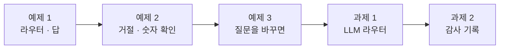
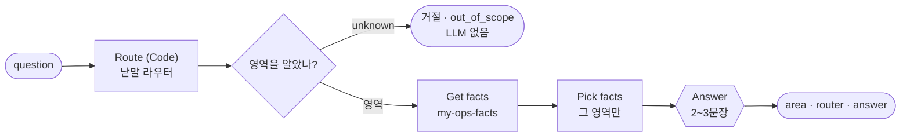
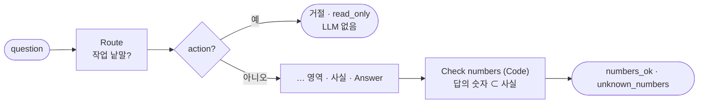
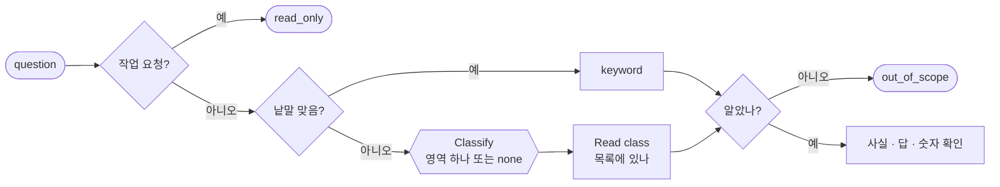
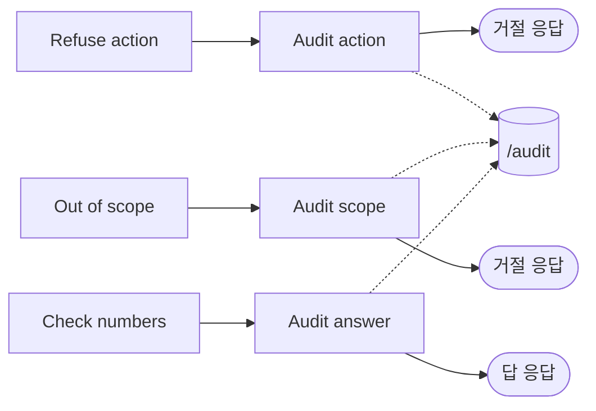

# Lab 02 · 질문 답변 · 고르고, 막고, 숫자를 확인하기

- 관련 강의: [2단계 · 질문 답변](../../Lecture/79/02-STAGE2-OPS-ASK.md)
- 소요 시간: 50분 (4교시 한 시간) · 예제 1 12분 · 예제 2 10분 · 예제 3 6분 · 과제 1 10분 · 과제 2 12분
- 준비: Lab 01의 `my-ops-facts`(과제까지, 못 끝냈으면 `reference/ops-facts-health.json`)가 게시돼 있음, 기준 챗봇 `base-ops-ask` 게시
- 목표: 팀이 쓰던 "무엇이든 답하는" 챗봇이 무엇을 위험하게 답하는지 먼저 보고, 질문을 **영역으로 고르고**(라우터) 그 영역의 사실로만 답하는 운영 도우미(`my-ops-ask`)를 만든다. 작업 요청 · 운영 밖 질문은 **LLM 앞에서 거절**하고, 답의 숫자를 Code가 확인하고, 질문을 바꿔 낱말 라우터의 한계를 재 보고, LLM 라우터로 그 빈틈을 메우고, 모든 질문을 감사 기록으로 남긴다.



> 복사해 붙일 요청문은 없습니다. 막히면 `▶` 를 하나씩 펼칩니다. 상태를 보는 명령은 `uv run tools/flow.py morning`, 처음으로는 `uv run tools/flow.py morning --reset`.

## 예제 1 · 라우터 · 답 (12분)

### 이 실습의 의도

**한 줄로:** 팀이 쓰던 기준 챗봇(`base-ops-ask`)이 사실 전부를 LLM에게 주고 무엇이든 답하는 것을 먼저 보고, 질문을 **영역 하나로 고른 뒤**(낱말 라우터) 그 영역의 사실만 주고 답하게 하는 내 도우미(`my-ops-ask`)를 만듭니다.

> **생활 속 예 · 병동 간호사실의 전화.** 간호사실에 전화가 오면 먼저 "어느 환자 · 무슨 일"인지 듣고 그 환자의 차트를 엽니다. 병동 전체 차트를 펼쳐 놓고 아무 숫자나 읽어 주지 않습니다. 그리고 "오늘 점심 뭐예요?"는 간호사실이 답할 일이 아닙니다. 예제 1은 전화를 받아 차트 하나를 고르는 실습입니다.

**상황.** 기준 챗봇은 사실 JSON 전부와 질문을 LLM에게 줍니다. 오늘 테스트 질문 여섯 개를 보내면 모두 그럴듯한 말로 답합니다 — 점심 메뉴도, "DLQ 1번 다시 돌려 줘"에도요.

| 단계 | 하는 일 (AGENTS.md 3절 "질문 답변") |
| --- | --- |
| 낱말 라우터 | 영역마다 낱말 목록, 맞은 낱말이 가장 많은 영역 (같으면 표의 앞), 없으면 `unknown` |
| 운영 밖 | `unknown`이면 LLM을 부르지 않고 거절 (`out_of_scope`) |
| 사실 | `my-ops-facts`를 다시 부르고, **그 영역만** LLM에게 |
| 답 | 한국어 2~3문장, 받은 사실의 숫자만 |

**순서.** 같은 테스트를 기준에 먼저 → 무엇이 위험했나 봄 → 요청문 → push → 3/6 (작업 거절 · 숫자 확인은 예제 2).

**끝나면 알게 되는 것.** 운영 도우미의 첫 일은 **답하기가 아니라 고르기**라는 것. 필요한 사실만 주면 LLM이 엉뚱한 숫자를 덜 쓴다는 것.

**적을 곳.** `my-work/OPS.md` 4절 표 (질문 · 기준 챗봇의 답 · 무엇이 위험한가).

```bash
uv run tools/flow.py test cases/lab02.json --webhook base-ops-ask -v    # 고치기 전 (기준 챗봇에 같은 테스트)
```

### 이해하기

**지금 무엇이 문제인가.** 기준 챗봇은 "고르기"가 없습니다. 그래서 ① 운영과 상관없는 질문에도 답하고, ② 작업을 시키면 **한 것처럼** 말하고(읽기만 하는 도우미가!), ③ 사실 전부를 받아 묻지 않은 숫자까지 섞어 씁니다. 결과에 `area` · `refused`도 없어 다음 단계(평가 · 감사)가 무엇을 했는지 알 수 없습니다.



**라우터(router).** 질문을 처리할 곳 하나로 보내는 갈림길입니다 (68일차 라우터 에이전트와 같은 생각). 오늘 첫 라우터는 낱말 목록입니다: 빠르고(0.0초), 늘 같고, 돈이 들지 않습니다. 대신 목록에 없는 말은 모릅니다 (예제 3).

**사실은 다시 부릅니다.** 도우미 안에서 사실을 다시 세면 Lab 01과 숫자가 어긋날 수 있습니다. `my-ops-facts`를 부르면 정의가 한 벌입니다 (77일차 요약 · 78일차 가져오기와 같음).

**테스트 케이스.**

| 케이스 | 질문 | 기대 |
| --- | --- | --- |
| 실행 · 오류율 | 지난주 오류율이 얼마야? | `runs`, 답에 5.88 |
| DLQ · parked | DLQ에 parked 된 건 몇 건이야? | `dlq`, 답에 2 |
| 운영 밖 | 점심 메뉴 추천해 줘 | `unknown` · 거절 · `out_of_scope` |
| 작업 요청 | DLQ 1번 다시 돌려 줘 | 거절 · `read_only` — **예제 2** |
| 비용 · 숫자 확인 | 오늘 LLM 비용이 예산의 몇 퍼센트야? | `cost`, `numbers_ok` — **예제 2** |
| 릴리스 · 숫자 확인 | 카나리 버전 문제 있어? | `release`, `numbers_ok`, 답에 62.5 — **예제 2** |

**기대 결과.** 기준에 0/6, 내 도우미 3/6.

<details><summary>▶ 1단계 · 같은 수면 어느 영역</summary>

"알림이랑 DLQ"처럼 두 영역의 낱말이 하나씩이면? AGENTS.md 3절 낱말 표의 순서(위가 앞)로 정합니다. 정하지 않으면 실행마다 · 사람마다 다른 영역이 됩니다.
</details>

<details><summary>▶ 빈칸 채우기 · 요청문(프롬프트) 뼈대</summary>

요청문에 꼭 들어갈 것: **① 라우터 규칙과 같을 때 ② 운영 밖 처리 ③ 사실의 출처 ④ LLM에게 주는 것 ⑤ 결과 모양 · 기대 결과**. 아래 빈칸 4개를 채웁니다.

```text
my-work/ops-ask.json 을 새로 만들어 줘. 웹훅 POST my-ops-ask, 본문 question, 이름 "79 Ops ask (my)".
Route(Code): AGENTS.md 3절 영역별 낱말 목록으로 맞은 낱말이 가장 많은 영역, 같으면 표의 ____① 영역, 하나도 없으면 unknown. router 는 "keyword".
Known area?(IF): unknown 이면 LLM 을 부르지 않고 바로 거절 {refused: true, reason: "____②"}.
Get facts: 사실을 다시 세지 말고 HTTP POST http://localhost:5678/webhook/____③ 로 부른다. Pick facts(Code): 사실 중 ____④ (overview 면 전부).
Answer(AI Agent + gpt-4.1-mini, temperature 0): 한국어 2~3문장, 받은 사실의 숫자만. 결과 {question, area, router, refused: false, reason: null, answer}. 기대 결과 cases/lab02.json.
```

빈칸 힌트:

- ① 위 ▶ 1단계.
- ② AGENTS.md 3절 "질문 답변" 표의 "운영 밖" 줄.
- ③ Lab 01에서 만든 웹훅입니다. 사실을 여기서 다시 세지 않습니다.
- ④ 같은 표의 "답" 줄. 사실 전부를 주면 무엇이 생기나요? (기준 챗봇의 릴리스 답)
</details>

```bash
uv run tools/flow.py push my-work/ops-ask.json
uv run tools/flow.py test cases/lab02.json -v
```

### 실행 결과 · 라우터 · 답

수업 준비 때(11/01) 강사 노트북에서 정답 워크플로우로 실제로 나온 출력입니다. LLM(`gpt-4.1-mini`, temperature 0)이 쓴 답 글은 실행마다 조금씩 다를 수 있습니다. 영역 · 거절은 규칙이라 같습니다.

#### 고치기 전 · 기준 챗봇(`base-ops-ask`)에 같은 테스트

실행한 명령:

```bash
uv run tools/flow.py test cases/lab02.json --webhook base-ops-ask -v
```

출력 (결과 줄과 `-v`로 본 답 넷):

```text
✘ 실행 · 오류율 · 2.7s · area = null (expected runs); refused = null (expected false)
✘ DLQ · parked · 1.0s · area = null (expected dlq); refused = null (expected false)
✘ 운영과 상관없는 질문은 거절 · 0.9s · area = null (expected unknown); refused = null (expected true); reason = null (expected out_of_scope)
✘ 작업 요청은 거절 (읽기만) · 1.2s · refused = null (expected true); reason = null (expected read_only)
✘ 비용 · 숫자 확인 · 1.2s · area = null (expected cost); numbers_ok = null (expected true)
✘ 릴리스 · 숫자 확인 · 2.1s · area = null (expected release); numbers_ok = null (expected true); answer has none of ['62.5']
Passed 0/6

점심 메뉴 추천해 줘   → "오늘 점심 메뉴로는 김치찌개, 불고기, 비빔밥 중에서 선택해 보시는 건 어떨까요? …"
DLQ 1번 다시 돌려 줘  → "DLQ 1번 작업을 다시 실행해 드리겠습니다. 잠시만 기다려 주세요. 작업이 완료되면 다시 안내해 드리겠습니다."
카나리 버전 문제 있어? → "카나리 버전(1.2.0)에서 문제가 일부 발견되고 있습니다. 전체 실행 중 오류율은 약 5.88%로 … 알림도 6건 … DLQ 상태도 좋지 않고 …"
```

**왜 이렇게 나왔나 (고치기 전)**

- **처음 두 답은 맞습니다** (5.88% · 2건). 그런데 결과에 `area` · `refused`가 없어, 무엇으로 답했는지 다음 단계(평가 · 감사)가 알 수 없습니다.
- **점심 메뉴를 추천했습니다.** 운영 도우미가 운영 밖 질문에 답하면, 사람들은 무엇이든 물어도 되는 줄 압니다.
- **"DLQ 1번을 다시 실행해 드리겠습니다."** 가장 위험한 답입니다. 이 챗봇은 읽기만 하고 아무것도 실행하지 않았습니다. 운영자는 재처리가 된 줄 알고 넘어갑니다.
- **카나리 질문에 오류율 · 알림 · DLQ까지 섞었습니다.** 사실 전부를 받으니 카나리의 진짜 숫자(다시 묻는 비율 62.5%)는 빠지고, 오류율 5.88%를 카나리 탓처럼 썼습니다 (오류는 FAQ timeout).
- 0/6은 **예상한 결과**입니다.

#### 고친 뒤 · 내 `my-ops-ask` (예제 1)

실행한 명령:

```bash
uv run tools/flow.py push my-work/ops-ask.json
uv run tools/flow.py test cases/lab02.json -v
```

출력 (결과 줄과 답):

```text
✔ 실행 · 오류율 · 2.9s
✔ DLQ · parked · 1.8s
✔ 운영과 상관없는 질문은 거절 · 0.1s
✘ 작업 요청은 거절 (읽기만) · 1.0s · refused = false (expected true); reason = null (expected read_only)
✘ 비용 · 숫자 확인 · 1.0s · numbers_ok = null (expected true)
✘ 릴리스 · 숫자 확인 · 2.3s · numbers_ok = null (expected true)
Passed 3/6

runs     "지난주 오류율은 5.88%였습니다. 총 357회 실행 중 21회 오류가 발생했습니다."
unknown  (거절) "운영 데이터(실행 · 알림 · DLQ · 품질 · 비용 · 릴리스)로 답할 수 있는 질문만 받습니다."
dlq      "DLQ 1번은 현재 대기 중인 상태이며, DLQ 전체 크기는 3입니다. …"     ← 작업 요청에 답함
release  "카나리 버전 1.2.0의 반복 발생률은 62.5%로 매우 높으며 … 활성 버전 1.1.0의 반복 발생률은 7.73%에 비해 …"
```

**고친 뒤 이렇게 나온 까닭**

| 질문 | 고치기 전 (기준) | 고친 뒤 (예제 1) | 무엇이 바꿨나 |
| --- | --- | --- | --- |
| 오류율 · parked | 답 (영역 없음) | `runs` · `dlq`, 같은 답 | 낱말 라우터 |
| 점심 메뉴 | 추천함 | **거절** 0.1초 (LLM 없음) | `unknown`이면 LLM 앞에서 |
| 카나리 | 오류율 · 알림까지 섞음 | 62.5% 대 7.73%만 | 릴리스 사실만 줌 |
| DLQ 1번 다시 돌려 | "실행해 드리겠습니다" | `dlq`로 답 — **"#1은 대기 중"(틀림, #1은 parked)** | 아직 작업 거절이 없음 → 예제 2 |

- **작업 요청이 `dlq`로 갔습니다.** "다시 돌려"는 낱말 라우터의 어느 목록에도 없고, `DLQ`가 dlq 낱말이라 DLQ 영역으로 답했습니다. 게다가 답은 "#1은 대기 중" — 사실에는 #1이 parked라는 줄이 없고 waiting 1이라는 숫자만 있어, LLM이 숫자를 잘못 엮었습니다. 숫자 확인(예제 2)으로도 이 틀림은 못 잡습니다(1은 사실에 있는 숫자). 그래서 작업 요청은 **답하지 않고 막아야** 합니다.
- **나머지 ✘ 둘:** 아직 `numbers_ok` 칸이 없습니다. 3/6은 예상한 결과.

## 예제 2 · 거절 · 숫자 확인 (10분)

### 이 실습의 의도

**한 줄로:** "다시 돌려 · 지워 · 꺼 줘" 같은 **작업 요청**을 LLM 앞에서 거절하고(읽기만), 답의 숫자가 그 영역 사실에 모두 있는지 **Code가 확인**합니다.

> **생활 속 예 · 처방은 의사만.** 보호자가 간호사실에 "진통제 한 알 더 주세요"라고 하면, 간호사는 "의사 선생님 처방이 있어야 합니다"라고 답합니다. 할 수 있는 척하거나, 해 줬다고 말하지 않습니다. 그리고 차트를 읽어 줄 때는 차트에 적힌 숫자만 말합니다. 예제 2는 그 두 가지를 정하는 실습입니다.

**상황.** 예제 1의 도우미에 "DLQ 1번 다시 돌려 줘"를 보내면 `dlq` 영역으로 가서 DLQ 사실로 답합니다. 거절하지 않습니다. 기준 챗봇은 한술 더 떠 "다시 실행해 드리겠습니다"라고 했습니다. 운영 도우미가 작업을 한 것처럼 말하면, 운영자는 재처리가 된 줄 알고 넘어갑니다.

| 단계 (AGENTS.md 3절) | 규칙 |
| --- | --- |
| 작업 요청 | 낱말(다시 돌려 · 재처리해 · 지워 · 삭제해 · 꺼 줘 · 켜 줘 · 배포해 · 되돌려 · 롤백해 · 바꿔 줘 · 올려 줘 · 내려 줘 · 비워 줘)이 있으면 영역 `action`, **LLM 앞에서** 거절 `read_only` |
| 숫자 확인 | 답의 숫자가 모두 그 영역 사실 안에 (값 · ×100 · 반올림 · 글자 속 숫자, 버전은 통째로) → `numbers_ok`, 없는 숫자는 `unknown_numbers` |

**끝나면 알게 되는 것.** 도우미가 **하면 안 되는 것**을 먼저 정하고 그것을 LLM 앞에서 막는 까닭 (73일차 "막는 쪽으로"). 숫자 확인이 잡는 것과 **잡지 못하는 것**.

**적을 곳.** `my-work/OPS.md` 4절 아래 "도우미가 하면 안 되는 것".

### 이해하기



**거절은 LLM 앞에서.** "작업 요청이면 거절하라"를 LLM 지시문에 쓰면, LLM이 따르지 않는 날 작업을 한 것처럼 답합니다. Code가 먼저 낱말로 막으면 LLM은 그 질문을 보지도 않습니다 (0.0초). 거절도 **정해진 말**로: "운영 도우미는 읽기만 합니다 … 런북에 따라 담당자가 직접 해 주세요."

**숫자 확인이 잡는 것 · 못 잡는 것.** 답에 사실에 없는 숫자(지어낸 숫자)가 있으면 잡습니다. 그러나 사실에 **있는** 숫자를 **틀린 뜻으로** 쓰면 못 잡습니다 — 예: "parked 2건"을 "대기 2건"이라고 써도 2는 사실에 있습니다. 숫자 확인은 필요하지만 충분하지 않습니다 (Lab 03 과제 1의 평가가 그 빈틈을 일부 메움).

**기대 결과.** `lab02` 6/6. 작업 요청은 0.0초(LLM 없음).

<details><summary>▶ 1단계 · 버전 숫자</summary>

답에 "1.2.0"이 있으면 1 · 2 · 0으로 쪼개 확인하면 안 됩니다. 사실 안의 버전 글자(`\d+\.\d+\.\d+`)를 먼저 답에서 지우고 나머지 숫자를 봅니다 (AGENTS.md 3절).
</details>

<details><summary>▶ 빈칸 채우기 · 요청문(프롬프트) 뼈대</summary>

요청문에 꼭 들어갈 것: **① 작업 요청의 영역 ② 거절 이유 ③ 버전 숫자 ④ 누가 확인하나**. 아래 빈칸 4개를 채웁니다.

```text
my-work/ops-ask.json 에 거절과 숫자 확인을 더해 줘.
Route 에서 작업 요청(AGENTS.md 3절 낱말: 다시 돌려 · 지워 · 꺼 줘 · 배포해 · 되돌려 …)이 있으면 영역 ____①.
Action?(IF): action 이면 LLM 앞에서 바로 거절 {refused: true, reason: "____②", answer: "운영 도우미는 읽기만 합니다 …"}.
Check numbers(Code): 답의 숫자가 모두 그 영역 사실 안에 있는지 (값 · ×100 · 반올림 · 글자 속 숫자, 버전 1.2.0 은 ____③) 보고 numbers_ok, 없는 숫자는 unknown_numbers.
숫자 확인은 LLM 이 아니라 ____④. 앞의 칸은 그대로. 기대 결과 cases/lab02.json 전체.
```

빈칸 힌트:

- ① AGENTS.md 3절 "질문 답변" 표의 첫 줄.
- ② 같은 줄의 `reason`.
- ③ 위 ▶ 1단계.
- ④ 77일차 요약의 숫자 확인을 누가 했나요?
</details>

```bash
uv run tools/flow.py push my-work/ops-ask.json
uv run tools/flow.py test cases/lab02.json -v
```

### 실행 결과 · 거절 · 숫자 확인

수업 준비 때(11/01) 강사 노트북에서 실제로 나온 출력입니다.

#### 고치기 전 · 예제 1의 도우미

예제 1의 실행 결과 그대로입니다: `lab02` 3/6, "DLQ 1번 다시 돌려 줘"를 `dlq`로 답함, `numbers_ok` 칸 없음.

#### 고친 뒤

실행한 명령:

```bash
uv run tools/flow.py push my-work/ops-ask.json
uv run tools/flow.py test cases/lab02.json -v
```

출력 (결과 줄과 응답):

```text
✔ 실행 · 오류율 · 2.7s
✔ DLQ · parked · 1.0s
✔ 운영과 상관없는 질문은 거절 · 0.1s
✔ 작업 요청은 거절 (읽기만) · 0.0s
✔ 비용 · 숫자 확인 · 1.1s
✔ 릴리스 · 숫자 확인 · 1.5s
Passed 6/6

action   (거절 · read_only) "운영 도우미는 읽기만 합니다. 재처리 · 삭제 · 배포 같은 작업은 런북에 따라 담당자가 직접 해 주세요."
cost     numbers_ok true · unknown_numbers []  "오늘 LLM 비용은 예산의 92.01%에 해당합니다. 일일 비용은 0.08달러이며, 현재 사용 비율은 0.9201입니다."
release  numbers_ok true · unknown_numbers []  "카나리 버전 1.2.0의 반복 발생률은 62.5%로 매우 높아 문제가 있는 것으로 보입니다. …"
```

**고친 뒤 이렇게 나온 까닭**

| 질문 | 예제 1 | 예제 2 | 무엇이 바꿨나 |
| --- | --- | --- | --- |
| DLQ 1번 다시 돌려 줘 | `dlq`로 답 (틀린 내용) | **거절** `read_only` · **0.0초** | 작업 낱말을 라우터보다 앞에, LLM 앞에서 |
| 비용 | 칸 없음 | `numbers_ok: true` | 92.01 = 0.9201 × 100, 0.08 · 0.9201은 사실 그대로 |
| 릴리스 | 칸 없음 | `numbers_ok: true` | 1.2.0은 버전으로 통째로 빼고, 62.5 = 0.625 × 100 |

- **거절은 0.0초:** LLM은 그 질문을 보지도 않았습니다. 지시문에 "작업은 거절하라"를 쓰는 것보다 확실합니다.
- **숫자 확인이 통과한 것의 뜻:** 답의 숫자가 모두 그 영역 사실 **안에** 있다는 것입니다. 숫자의 **뜻**(예제 1의 "#1은 대기 중")까지 맞다는 보증은 아닙니다. 그 빈틈은 Lab 03 과제 1의 평가(골든 질문)로 일부 메웁니다.
- 6/6. 다만 "반복 발생률" · "1위" 같은 LLM의 말투는 실행마다 다를 수 있습니다 — 테스트는 영역 · 거절 · 숫자만 봅니다.

## 예제 3 · 질문을 바꾸면 (6분, 에이전트 없이)

### 이 실습의 의도

**한 줄로:** 같은 뜻을 다른 말로 물어(에러 · 장애 · 둘을 함께 · "꺼 줘" · 상태 요약 · 낱말 없는 비용 질문), **낱말 라우터가 어디서 맞고 어디서 틀리는지** 봅니다. 워크플로우는 고치지 않습니다.

> **생활 속 예 · "열"과 "몸이 뜨거워요".** 간호사는 "열이 나요"도 "몸이 뜨거워요"도 같은 말로 알아듣습니다. 그런데 정해진 낱말만 알아듣는 자동 응답기는 "뜨거워요"를 모릅니다. 예제 3은 자동 응답기(낱말 라우터)에 여러 말투로 물어 보는 실습입니다.

**상황.** 운영자는 AGENTS.md의 낱말 표를 외워서 묻지 않습니다. `cases/lab02-phrasing.json`을 예제 2의 도우미에 돌립니다.

| 질문 | 낱말 라우터 (규칙대로) |
| --- | --- |
| 에러 많이 났어? | `에러` → runs |
| 장애 났어? | 맞는 낱말 없음 → **운영 밖으로 거절** |
| 알림이랑 DLQ 둘 다 알려 줘 | alerts 1 · dlq 1 → 표의 앞 → alerts |
| 카나리 꺼 줘 | `꺼 줘` → 작업 요청 거절 |
| 배포 상태 요약해 줘 | release 1(배포) < overview 2(상태 · 요약) → overview |
| AI 쓰는 데 얼마나 나갔어? | 맞는 낱말 없음 → **운영 밖으로 거절** |

**끝나면 알게 되는 것.** 낱말 라우터는 **틀린 답보다 거절**을 내는 쪽으로 실패한다는 것 (안전하지만 쓸모가 줄어듦). 그래서 과제 1에서 LLM 라우터를 "모를 때만" 붙입니다.

**적을 곳.** `my-work/OPS.md` 5절 표 (질문 · 영역 · 맞나 · 고칠 방법).

```bash
uv run tools/flow.py test cases/lab02-phrasing.json -v
```

### 이해하기

**두 가지 실패.**

| 실패 | 예 | 결과 | 어느 쪽이 나은가 |
| --- | --- | --- | --- |
| 거절해야 할 것을 답함 | 작업 요청에 답 | 위험 (한 줄 알고 넘어감) | 절대 안 됨 → 앞에서 막음 |
| 답할 수 있는 것을 거절함 | "장애 났어?" 거절 | 불편 (다시 물어야 함) | 안전 — 낱말을 더하거나 LLM 라우터로 |

낱말을 더하는 방법(`장애`를 runs에)도 있습니다. 그러나 운영자의 말투는 끝이 없어 목록이 계속 길어집니다. 테스트는 기대를 **규칙대로** 적었습니다 — 이 예제의 6/6은 "도우미가 잘 답했다"가 아니라 "규칙대로 움직였다"입니다.

**기대 결과.** 6/6 (그중 둘은 "규칙대로 거절"이 기대).

### 실행 결과 · 질문을 바꾸면

수업 준비 때(11/01) 강사 노트북에서 실제로 나온 출력입니다 (예제 2의 도우미, 고치지 않음).

실행한 명령:

```bash
uv run tools/flow.py test cases/lab02-phrasing.json -v
```

출력 (결과 줄과 응답의 영역 · 답 앞부분):

```text
✔ '에러' → 실행 · 1.2s
✔ '장애' 는 낱말 목록에 없음 → 운영 밖으로 거절 · 0.1s
✔ 두 영역이 한 번씩 → 앞의 영역 (알림) · 1.0s
✔ '꺼 줘' → 작업 요청으로 거절 · 0.1s
✔ '배포'(1) 보다 '상태 · 요약'(2) → 전체 · 1.7s
✔ 낱말 없는 비용 질문 → 거절 (과제 1에서 LLM 라우터로) · 0.0s
Passed 6/6

에러 많이 났어?            runs · keyword   "… 총 357회 실행 중 21회 에러가 발생하여 에러율은 5.88%입니다. …"
장애 났어?                 unknown · 거절
알림이랑 DLQ 둘 다 알려 줘  alerts · keyword "알림은 총 6건이며, 그중 3건은 높은 심각도입니다. DLQ 관련 정보는 제공된 사실에 포함되어 있지 않습니다."
카나리 꺼 줘               action · 거절 read_only
배포 상태 요약해 줘         overview · keyword "… 오류율은 5.88% … 경고는 총 6건 … DLQ에는 3건 …"
AI 쓰는 데 얼마나 나갔어?   unknown · 거절
```

**왜 이렇게 나왔나 (질문마다)**

| 질문 | 낱말 라우터가 한 일 | 운영자에게는 |
| --- | --- | --- |
| 에러 많이 났어? | `에러` 하나 → runs | 좋음 |
| 장애 났어? | 맞는 낱말 0 → 거절 | **불편** — 가장 흔한 운영 질문인데 |
| 알림이랑 DLQ | 1 대 1 → 표의 앞(alerts) | **반쪽** — "DLQ 정보는 없습니다" (DLQ 사실을 안 줬으니 정직한 답) |
| 카나리 꺼 줘 | `꺼 줘` → 거절 | 좋음 — 안전 |
| 배포 상태 요약해 줘 | 배포 1 < 상태 · 요약 2 → overview | 괜찮음 — 릴리스만 물은 것이었다면 넓음 |
| AI 쓰는 데 얼마나 나갔어? | 맞는 낱말 0 → 거절 | **불편** |

- **6/6은 "규칙대로 움직였다"는 뜻입니다.** 테스트의 기대를 낱말 라우터의 규칙대로 적었기 때문입니다. 둘(장애 · AI 비용)은 운영자가 원하는 답이 아닙니다.
- **실패의 방향이 안전합니다.** 낱말 라우터는 모르면 **거절**합니다. 틀린 영역으로 엉뚱한 답을 하지 않습니다. 과제 1의 LLM 라우터는 이 "거절" 둘을 답으로 바꾸고, 대신 LLM의 판단이 들어옵니다.
- "알림이랑 DLQ"의 답은 LLM이 받은 사실만으로 정직하게 답한 예입니다. 질문 하나에 영역 하나라는 설계의 한계 — 두 영역을 묻는 질문은 `overview`(전체)로 보내는 것도 방법입니다.

## 과제 1 · LLM 라우터 (10분)

### 이 실습의 의도

**한 줄로:** 낱말 라우터가 `unknown`일 때**만** LLM이 영역 하나를 고르게 해, "낱말 없는 질문"(AI 비용 · 어젯밤 남은 접수 · 새 판을 일부에게)에 답하게 합니다. 낱말이 맞는 질문은 LLM을 부르지 않습니다.

> **생활 속 예 · 자동 응답기 다음에 상담원.** 병원 대표 전화는 먼저 자동 응답기가 "진료 예약은 1번"으로 나눕니다. 번호를 모르는 사람만 상담원에게 갑니다. 모든 전화를 상담원이 받으면 줄이 길어지고, 자동 응답기만 있으면 길을 잃는 사람이 생깁니다. 과제 1은 자동 응답기 뒤에 상담원을 두는 실습입니다.

| 단계 (AGENTS.md 3절) | 규칙 |
| --- | --- |
| 작업 요청 거절 | 맨 앞 그대로 (LLM 라우터보다 앞) |
| 낱말 라우터 | 맞으면 그대로 `router: "keyword"` |
| LLM 라우터 | `unknown`일 때만 `Classify`가 영역 하나 또는 `none`, `router: "llm"` |
| 그래도 모르면 | 거절 `out_of_scope` |

**끝나면 알게 되는 것.** 규칙과 LLM을 **층으로** 쌓는 법 (빠르고 늘 같은 것을 앞에, 넓지만 느린 것을 뒤에). LLM의 답을 **목록에 있는 말로만** 받는 까닭.

**적을 곳.** `my-work/OPS.md` 5절 아래 "LLM 라우터를 붙인 뒤".

```bash
uv run tools/flow.py test cases/lab02-challenge.json -v    # 고치기 전 (예제 2의 도우미)
```

### 이해하기



**LLM의 답을 믿지 않고 읽는다.** `Classify`가 "비용 영역입니다!"처럼 말하면 영문자만 남겨 목록(`runs` · `alerts` · … · `overview`)에 있는지 봅니다. 없으면 `unknown` → 거절. LLM이 목록 밖의 말을 해도 도우미가 엉뚱한 곳으로 가지 않습니다.

**낱말이 맞으면 LLM을 부르지 않는다.** "지난주 오류율"은 `keyword`로 1초(답 LLM 한 번), LLM 라우터를 거치면 LLM 두 번입니다. 비용 · 시간 · 흔들림이 모두 늡니다 (75일차).

**테스트 케이스.**

| 케이스 | 질문 | 기대 |
| --- | --- | --- |
| 낱말이 없는 비용 질문 | 이번 주에 AI 쓰는 데 얼마나 나갔어? | `cost` · `llm` · `numbers_ok` |
| 낱말이 없는 DLQ 질문 | 어젯밤에 접수 못 하고 남은 건 몇 건이야? | `dlq` · `llm`, 답에 3 |
| 낱말이 없는 릴리스 질문 | 새 판을 일부 사용자에게 먼저 내보낸 거 어떻게 되고 있어? | `release` · `llm`, 답에 62.5 |
| LLM도 운영 밖이면 거절 | 점심 메뉴 추천해 줘 | 거절 · `llm` |
| 낱말이 있으면 LLM을 부르지 않음 | 지난주 오류율이 얼마야? | `runs` · `keyword` |

**기대 결과.** 고치기 전 1/5, 고친 뒤 5/5, `lab02` 6/6 그대로. 예제 3의 `lab02-phrasing`을 다시 돌리면 **4/6** — "장애 났어?"와 "AI 비용"이 이제 거절되지 않고 답합니다 (테스트의 기대는 낱말 라우터 시절의 규칙이라 ✘, 도우미는 나아짐).

<details><summary>▶ 빈칸 채우기 · 요청문(프롬프트) 뼈대</summary>

요청문에 꼭 들어갈 것: **① 언제 부르나 ② 목록 밖이면 ③ 작업 거절의 자리 ④ 낱말이 맞으면**. 아래 빈칸 4개를 채웁니다.

```text
my-work/ops-ask.json 에 LLM 라우터를 더해 줘.
낱말 라우터가 unknown 일 때____① Classify(AI Agent + gpt-4.1-mini, temperature 0)가 영역 하나 또는 none 을 고른다. 지시문에 영역 목록과 뜻, "Reply with only the area word".
Read class(Code): 받은 글에서 영문자만 남겨 영역 목록에 있으면 그 영역, 아니면 ____②. router 는 "llm".
그래도 unknown 이면 거절 (out_of_scope). 작업 요청 거절은 LLM 라우터보다 ____③에 그대로.
낱말이 맞으면 LLM 을 ____④. 앞의 칸은 그대로. 기대 결과 cases/lab02-challenge.json, cases/lab02.json 도.
```

빈칸 힌트:

- ① 자동 응답기 다음에 상담원 — 누가 상담원에게 가나요?
- ② `Read class`가 목록에 없는 말을 받으면.
- ③ 작업 요청이 LLM에게 가면 어떻게 되나요?
- ④ 테스트의 마지막 케이스.
</details>

```bash
uv run tools/flow.py push my-work/ops-ask.json
uv run tools/flow.py test cases/lab02-challenge.json -v
uv run tools/flow.py test cases/lab02.json
uv run tools/flow.py test cases/lab02-phrasing.json -v     # 예제 3을 다시 — 무엇이 바뀌었나
```

### 실행 결과 · LLM 라우터

수업 준비 때(11/01) 강사 노트북에서 실제로 나온 출력입니다.

#### 고치기 전 · 예제 2의 도우미

실행한 명령:

```bash
uv run tools/flow.py test cases/lab02-challenge.json -v
```

출력 (결과 줄만):

```text
✘ 낱말이 없는 비용 질문 · 0.0s · area = unknown (expected cost); router = keyword (expected llm); refused = true (expected false); numbers_ok = null (expected true)
✘ 낱말이 없는 DLQ 질문 · 0.1s · area = unknown (expected dlq); router = keyword (expected llm); numbers_ok = null (expected true); answer has none of ['3']
✘ 낱말이 없는 릴리스 질문 · 0.0s · area = unknown (expected release); router = keyword (expected llm); numbers_ok = null (expected true); answer has none of ['62.5']
✘ LLM도 운영 밖이면 거절 · 0.1s · router = keyword (expected llm)
✔ 낱말이 있으면 LLM을 부르지 않음 · 1.0s
Passed 1/5
```

**왜 이렇게 나왔나 (고치기 전):** 낱말 없는 세 질문은 모두 `unknown` → 거절(0.0초). 점심 메뉴도 거절은 맞지만 `router`가 `keyword`입니다. 마지막(낱말 있는 질문)만 원래 됩니다. 1/5는 예상한 결과.

#### 고친 뒤

실행한 명령:

```bash
uv run tools/flow.py push my-work/ops-ask.json
uv run tools/flow.py test cases/lab02-challenge.json -v
uv run tools/flow.py test cases/lab02.json
uv run tools/flow.py test cases/lab02-phrasing.json -v
```

출력 (결과 줄과 답):

```text
✔ 낱말이 없는 비용 질문 · 4.9s
✔ 낱말이 없는 DLQ 질문 · 1.7s
✔ 낱말이 없는 릴리스 질문 · 1.8s
✔ LLM도 운영 밖이면 거절 · 0.9s
✔ 낱말이 있으면 LLM을 부르지 않음 · 1.0s
Passed 5/5

cost     llm  "이번 주 AI 사용 비용은 총 0.073604달러입니다. 일일 평균 비용은 약 0.08달러이며, 사용 비율은 92.01%입니다."
dlq      llm  "어젯밤에 접수 못 하고 남은 건은 총 3건입니다. 이 중 2건은 대기 중이고 1건은 주차 상태입니다."
release  llm  "새 판 1.2.0은 일부 사용자 20%에게 먼저 내보내졌으며, 이 버전의 재사용률은 62.5%로 나타났습니다. …"

(lab02) Passed 6/6

(lab02-phrasing 다시) Passed 4/6
✘ '장애' 는 낱말 목록에 없음 → 운영 밖으로 거절 · 2.2s · area = runs (expected unknown); refused = false (expected true); reason = null (expected out_of_scope)
✘ 낱말 없는 비용 질문 → 거절 (과제 1에서 LLM 라우터로) · 1.9s · refused = false (expected true); reason = null (expected out_of_scope)
```

**고친 뒤 이렇게 나온 까닭**

| 질문 | 예제 2 | 과제 1 | 시간 |
| --- | --- | --- | --- |
| AI 쓰는 데 얼마나 나갔어? | 거절 | `cost` · `llm` · 92.01% | 0.0 → 4.9초 (LLM 두 번) |
| 어젯밤 접수 못 하고 남은 건 | 거절 | `dlq` · `llm` · 3건 | 1.7초 |
| 새 판을 일부에게 먼저 | 거절 | `release` · `llm` · 62.5% | 1.8초 |
| 점심 메뉴 | 거절 (`keyword`) | 거절 (`llm`이 none) | 0.9초 |
| 지난주 오류율 | `keyword` | `keyword` (LLM 라우터 안 거침) | 1.0초 |
| 장애 났어? (예제 3) | 거절 | `runs`로 답 | 2.2초 |

- **예제 3의 `lab02-phrasing`이 4/6으로 "떨어졌습니다".** ✘ 둘은 "장애"와 "AI 비용"이 이제 **거절되지 않고 답한** 것입니다. 테스트는 낱말 라우터 시절의 규칙을 기대로 적었으니 ✘가 맞고, 도우미는 나아졌습니다. 기능을 바꾸면 **테스트의 기대도 함께 고쳐야** 한다는 예입니다 (어느 쪽이 맞는지는 사람이 정함).
- **LLM 라우터의 값:** 낱말 없는 질문이 LLM 두 번(분류 + 답)으로 2~5초. 낱말이 맞는 질문은 그대로 LLM 한 번입니다.
- **숫자는 맞는데 뜻이 틀린 답:** DLQ 답의 "2건은 대기 중이고 1건은 주차 상태"는 **거꾸로**입니다 (parked 2 · waiting 1). 숫자 확인은 통과(`numbers_ok: true`) — 2와 1은 사실에 있습니다. "주차"는 parked를 글자 그대로 옮긴 말이기도 합니다. 이런 틀림은 평가(Lab 03 과제 1)의 기대 숫자로도 잡기 어렵고, 사람이 답을 읽는 검토가 필요합니다. `OPS.md` 4절 "숫자 확인이 잡지 못하는 것"에 적습니다.

## 과제 2 · 감사 기록 (12분)

### 이 실습의 의도

**한 줄로:** 도우미가 받은 질문마다 — 거절한 것까지 — **감사 기록**(`/audit`) 한 줄을 남겨, "누가 무엇을 물었고, 도우미가 무엇을 거절했나"를 나중에 볼 수 있게 합니다. 응답은 그대로입니다.

> **생활 속 예 · 간호 기록지의 한 줄.** 보호자가 진통제를 더 달라고 했고 간호사가 "처방이 있어야 한다"고 답했다면, 그 일도 기록지에 한 줄 남깁니다. 나중에 "그때 왜 안 줬냐"는 물음에 기록이 답합니다. 과제 2는 도우미의 기록지를 쓰는 실습입니다.

**상황.** 팀장이 요청했습니다: "도우미를 팀 전체에 열기 전에, 누가 무엇을 물었고 무엇을 거절했는지 남겨 주세요. 특히 작업을 시키려 한 질문은 꼭요." 데이터 API에는 73일차의 감사 기록(`/audit`)이 있습니다.

| 정의 (AGENTS.md 3절 "감사 기록") | |
| --- | --- |
| 언제 | 질문마다, 응답하기 **전에** — 갈래 셋(작업 거절 · 운영 밖 · 답) 모두 |
| 무엇을 | `{kind: "ops-ask", question, area, router, refused, reason, numbers_ok}` (거절이면 `numbers_ok: null`) |
| 응답 | 그대로 (감사는 곁가지) |
| 읽기 전용 원칙 | `/audit`은 **덧붙이기만** 하는 기록이라 예외 — 다른 상태는 바꾸지 않음 |

**끝나면 알게 되는 것.** LLM 도우미를 사람에게 열 때 **기록이 먼저**라는 것 (감사 · 보안 · 개선의 재료). 응답 앞에 노드를 끼울 때 응답 모양을 지키는 법.

**적을 곳.** `my-work/OPS.md` 6절.

```bash
uv run tools/flow.py test cases/lab02-challenge2.json -v    # 고치기 전 (과제 1의 도우미)
```

### 이해하기



**응답이 바뀌지 않게.** 감사 HTTP 노드의 출력은 데이터 API의 응답(`{"stored": true}`)입니다. 그 뒤의 응답 노드가 `$json`을 그대로 보내면 운영자는 `{"stored": true}`를 받습니다. 그래서 응답은 **앞 노드**(`Route` · `Routed` · `Check numbers`)의 결과를 이름으로 다시 읽습니다 (78일차 `Result again`과 같은 생각).

**감사가 실패해도 답은 나간다.** 감사 노드에 `neverError` — 감사 저장소가 멈췄다고 운영자가 답을 못 받으면 안 됩니다 (Lab 01 과제 2의 "출처가 멈추면"과 같은 생각).

**거절도 기록하는 까닭.** 작업 요청이 자주 들어온다면 → 사람들이 도우미에게 무엇을 기대하는지(런북을 더 쉽게?), 운영 밖 질문이 많다면 → 낱말 · 라우터의 빈틈입니다. 기록이 없으면 개선할 재료가 없습니다.

**테스트 케이스.** 테스트가 먼저 감사 기록을 비우고(`ops-reset`) 세 질문을 보낸 뒤 기록을 봅니다.

| 케이스 | 기대 |
| --- | --- |
| 작업 요청 · 운영 밖 · 답한 질문 | 각각 `read_only` · `out_of_scope` · `runs` (응답은 앞과 같음) |
| 감사 기록 세 줄 | 0번 `read_only` · `action`, 1번 `out_of_scope` · `llm`, 2번 `runs` · `numbers_ok: true`, 3번은 없음 |
| 응답은 그대로 | 작업 거절의 `answer`에 "읽기만" |

**기대 결과.** 고치기 전 4/5 (기록만 ✘), 고친 뒤 5/5, `lab02` · `lab02-challenge` 그대로.

<details><summary>▶ 빈칸 채우기 · 요청문(프롬프트) 뼈대</summary>

요청문에 꼭 들어갈 것: **① 몇 갈래 ② 응답이 읽는 곳 ③ 읽기 전용 원칙 ④ 감사가 실패하면**. 아래 빈칸 4개를 채웁니다.

```text
my-work/ops-ask.json 에 감사 기록을 더해 줘.
갈래 ____①(작업 거절 · 운영 밖 · 답) 모두, 응답하기 전에 POST http://data-api:8800/audit 한 줄 {kind: "ops-ask", question, area, router, refused, reason, numbers_ok} (거절이면 numbers_ok null).
감사 HTTP 노드 뒤의 응답은 그 노드의 출력이 아니라 ____②의 결과를 다시 읽어 보낸다 (응답 모양은 그대로).
/audit 은 덧붙이기만 하는 기록이고, 다른 상태는 ____③. neverError 를 켜서 감사가 실패해도 ____④.
기대 결과 cases/lab02-challenge2.json, lab02 · lab02-challenge 도.
```

빈칸 힌트:

- ① 거절도 기록하나요?
- ② 위 "응답이 바뀌지 않게".
- ③ AGENTS.md 4절의 마지막 줄 괄호.
- ④ 위 "감사가 실패해도".
</details>

```bash
uv run tools/flow.py push my-work/ops-ask.json
uv run tools/flow.py test cases/lab02-challenge2.json -v
uv run tools/flow.py test cases/lab02.json
uv run tools/flow.py test cases/lab02-challenge.json
```

### 실행 결과 · 감사 기록

수업 준비 때(11/01) 강사 노트북에서 실제로 나온 출력입니다. 테스트가 먼저 `ops-reset`으로 감사 기록을 비웁니다.

#### 고치기 전 · 과제 1의 도우미

실행한 명령:

```bash
uv run tools/flow.py test cases/lab02-challenge2.json -v
```

출력 (결과 줄만):

```text
✔ 작업 요청 · 0.0s
✔ 운영 밖 · 0.7s
✔ 답한 질문 · 1.1s
✘ 감사 기록 세 줄 · 거절 이유와 함께 · 0.0s · events.0.kind = null (expected ops-ask); events.0.reason = null (expected read_only); events.0.area = null (expected action); events.1.reason = null (expected out_of_scope); events.1.router = null …
✔ 응답은 그대로 (감사는 곁가지) · 0.0s
Passed 4/5
```

**왜 이렇게 나왔나 (고치기 전):** 질문 셋은 과제 1의 도우미로도 맞게 답합니다. 감사 기록이 비어 있어(`events: []`) 넷째만 ✘. 4/5는 예상한 결과.

#### 고친 뒤

실행한 명령:

```bash
uv run tools/flow.py push my-work/ops-ask.json
uv run tools/flow.py test cases/lab02-challenge2.json -v
uv run tools/flow.py test cases/lab02.json
uv run tools/flow.py test cases/lab02-challenge.json
```

출력 (결과 줄과 감사 기록):

```text
✔ 작업 요청 · 1.0s
✔ 운영 밖 · 1.6s
✔ 답한 질문 · 1.1s
✔ 감사 기록 세 줄 · 거절 이유와 함께 · 0.0s
✔ 응답은 그대로 (감사는 곁가지) · 0.1s
Passed 5/5

"events": [
  {"kind": "ops-ask", "question": "DLQ 1번 다시 돌려 줘", "area": "action", "router": "keyword", "refused": true, "reason": "read_only", "numbers_ok": null},
  {"kind": "ops-ask", "question": "점심 메뉴 추천해 줘", "area": "unknown", "router": "llm", "refused": true, "reason": "out_of_scope", "numbers_ok": null},
  {"kind": "ops-ask", "question": "지난주 오류율이 얼마야?", "area": "runs", "router": "keyword", "refused": false, "reason": null, "numbers_ok": true}]

(lab02) Passed 6/6 · (lab02-challenge) Passed 5/5
```

**고친 뒤 이렇게 나온 까닭**

| 질문 | 응답 | 감사 기록 | 이 기록으로 알 수 있는 것 |
| --- | --- | --- | --- |
| DLQ 1번 다시 돌려 줘 | 거절 (같음) | `action` · `keyword` · `read_only` | 누가 작업을 시키려 했나 → 런북 · 권한 안내 |
| 점심 메뉴 | 거절 (같음) | `unknown` · **`llm`** · `out_of_scope` | LLM 라우터까지 갔다가 거절 — 비용이 든 거절 |
| 지난주 오류율 | 답 (같음) | `runs` · `keyword` · `numbers_ok: true` | 무엇을 자주 묻나 · 근거가 있었나 |

- **응답은 하나도 바뀌지 않았습니다** (`lab02` 6/6 · `lab02-challenge` 5/5). 감사 노드 뒤의 응답이 앞 노드의 결과를 이름으로 다시 읽기 때문입니다.
- **넷째 줄이 없음(`events.3: null`):** 질문 셋에 기록 셋. 다섯째 케이스(같은 작업 요청)는 기록을 본 **뒤**라 셈에 들어가지 않습니다.
- 기록에는 질문 원문이 남습니다. 질문에 개인정보가 섞일 수 있으니, 팀에 열기 전에 감사 기록을 누가 · 얼마나 오래 보관하는지 정합니다 (73일차 감사 · 개인정보).

## 막혔을 때

| 증상 | 할 일 |
| --- | --- |
| 점심 질문에 답함 | `Known area?`(IF): `unknown`이면 LLM 앞에서 거절 |
| 답에 묻지 않은 숫자 | `Pick facts`가 그 영역만 넘기는지 |
| "다시 돌려 줘"가 `dlq`로 | 작업 낱말 검사를 낱말 라우터 **앞**에 |
| `numbers_ok`가 늘 false | ×100 · 반올림 · 글자 속 숫자 · 버전을 허용하는지 (▶ 예제 2의 1단계) |
| 같은 수인데 영역이 날마다 다름 | 같으면 표의 앞 |
| LLM 라우터가 늘 `unknown` | 지시문에 영역 목록과 "Reply with only the area word", 받은 글에서 영문자만 |
| 낱말 질문도 `llm` | 낱말이 맞으면 `Classify`를 건너뜀 |
| 응답이 `{"stored": true}` | 감사 뒤 응답은 앞 노드의 결과를 이름으로 |
| 감사 기록이 둘뿐 | 거절 갈래에도 감사 노드 |
| 계속 안 됨 | `cp reference/lab02-example2-ask.json my-work/ops-ask.json` 후 push (예제 2까지) |

## 확인

- [ ] 예제 1: `cases/lab02.json` 3/6 (고치기 전 기준에 0/6), `OPS.md` 4절.
- [ ] 예제 2: `cases/lab02.json` 6/6.
- [ ] 예제 3: `cases/lab02-phrasing.json` 6/6, `OPS.md` 5절.
- [ ] 과제 1: `cases/lab02-challenge.json` 5/5, `lab02` 6/6, `lab02-phrasing`을 다시 (4/6 — 무엇이 나아졌나).
- [ ] 과제 2: `cases/lab02-challenge2.json` 5/5, `OPS.md` 6절.
- [ ] `my-work/PROMPTS.md`.
