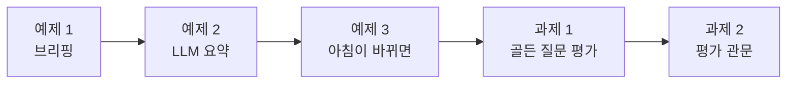
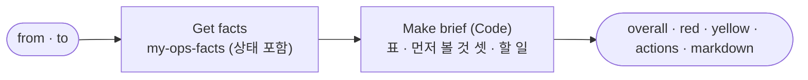
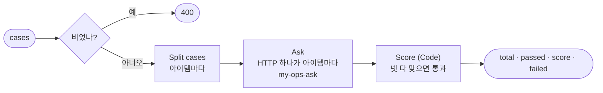
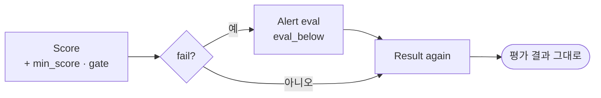

# Lab 03 · 브리핑과 평가 · 먼저 볼 것을 정하고, 도우미를 시험하기

- 관련 강의: [3단계 · 브리핑과 평가](../../Lecture/79/03-STAGE3-OPS-BRIEF.md)
- 소요 시간: 50분 (6교시 한 시간) · 예제 1 14분 · 예제 2 8분 · 예제 3 6분 · 과제 1 12분 · 과제 2 10분
- 준비: Lab 01의 `my-ops-facts`(과제까지) · Lab 02의 `my-ops-ask`(과제까지)가 게시돼 있음
- 목표: 사실 · 상태로 아침 **브리핑**(영역 표 · 먼저 볼 것 셋)을 규칙으로 만들고, LLM 세 문장 요약을 붙여 숫자를 확인하고, 사람이 일을 하나씩 처리할 때 브리핑이 어떻게 바뀌는지 재 보고, **골든 질문**으로 도우미를 평가하고, 평가 점수가 기준 아래면 알리는 **평가 관문**을 만든다.



> 복사해 붙일 요청문은 없습니다. 막히면 `▶` 를 하나씩 펼칩니다. 연습이 끝나면 `uv run tools/flow.py morning --reset`.

## 예제 1 · 브리핑 (14분)

### 이 실습의 의도

**한 줄로:** 운영 사실(상태 포함)을 다시 불러 **아침 브리핑**(`my-ops-brief`)을 만듭니다: 전체 · 영역 표(🔴 · 🟡 · 🟢와 숫자) · "먼저 볼 것" 셋과 정해진 할 일. LLM은 쓰지 않습니다.

> **생활 속 예 · 인수인계지 한 장.** 아침 인수인계는 환자마다 차트를 다 읽지 않고 한 장으로 끝냅니다: 병동 전체 상태, 환자별 신호등, 그리고 "오늘 먼저 볼 환자 셋 · 할 일". 할 일은 그때그때 지어내지 않고 병원의 지침(런북)에 적힌 대로 씁니다. 예제 1은 그 한 장을 만드는 실습입니다.

**상황.** 운영 담당자는 08:30에 숫자 서른 개가 아니라 **무엇부터 볼지**를 알고 싶습니다. 사실과 상태는 Lab 01에서 정했습니다. 브리핑은 그것을 정해진 모양으로 줄 세우기만 합니다.

| 칸 (AGENTS.md 3절 "브리핑") | 정의 |
| --- | --- |
| `actions` | `red` 다음 `yellow`의 앞 **3개**, 영역마다 정해진 할 일 (예: DLQ → "parked 건 원인 확인 뒤 런북대로 재처리 (76일차)") |
| `markdown` | 제목 · 전체 · `\| 영역 \| 상태 \| 숫자 \|` 표 · "## 먼저 볼 것" |
| 상태 | 사실의 `health` 그대로 (다시 판정하지 않음) |

**순서.** 테스트 먼저(404) → 요청문 → push → 4/4 → `call`로 브리핑 읽기.

**끝나면 알게 되는 것.** 브리핑은 **판정이 아니라 배열**이라는 것 (판정은 사실 한 곳에서). 할 일을 규칙으로 쓰는 까닭 (77일차 주간 보고의 "다음 할 일"과 같음).

**적을 곳.** `my-work/OPS.md` 7절.

```bash
uv run tools/flow.py test cases/lab03.json -v    # 고치기 전 (my-ops-brief가 아직 없음)
```

### 이해하기



**판정은 한 곳에.** 브리핑이 상태를 다시 판정하면(예: 비용 80%를 브리핑에서 따로 셈), Lab 01의 상태와 어긋나는 날이 옵니다. 브리핑은 `health` · `red` · `yellow`를 **그대로** 읽어 줄 세웁니다.

**할 일은 런북에서.** 영역마다 할 일 한 줄은 이미 정해져 있습니다 (72~78일차에 만든 것들). LLM에게 "무엇을 하면 좋을까"를 물으면 그럴듯하지만 날마다 다르고, 런북에 없는 일을 권할 수 있습니다.

**테스트 케이스.**

| 케이스 | 기대 |
| --- | --- |
| 전체 · 먼저 볼 것 셋 | 🔴, 빨강 runs · dlq · release → 먼저 볼 것도 그 순서 |
| 표에 숫자 | `\| DLQ \| 🔴 \| 3건 (parked 2) \|` |
| 할 일은 규칙에서 | "카나리 끄기 · 되돌리기 검토 (74일차)", DLQ 할 일에 parked |
| DLQ를 비운 뒤 | 테스트가 DLQ를 모두 비움(`dlq-clear`) → 빨강 runs · release, 셋째로 alerts |

**기대 결과.** 고치기 전 0/4 (404), 고친 뒤 4/4.

<details><summary>▶ 빈칸 채우기 · 요청문(프롬프트) 뼈대</summary>

요청문에 꼭 들어갈 것: **① 상태의 출처 ② 먼저 볼 것의 수 ③ 마크다운 제목 ④ LLM**. 아래 빈칸 4개를 채웁니다.

```text
my-work/ops-brief.json 을 새로 만들어 줘. 웹훅 POST my-ops-brief, 이름 "79 Ops brief (my)".
Get facts: HTTP POST http://localhost:5678/webhook/my-ops-facts (본문 from · to 그대로). 상태도 사실에서 ____① 쓴다 (다시 판정하지 않음).
Make brief(Code): actions = red 다음 yellow 의 앞 ____②개, 영역마다 AGENTS.md 3절 표의 할 일 글자 그대로.
markdown: 제목 · 전체 · | 영역 | 상태 | 숫자 | 표 (🔴 · 🟡 · 🟢, 숫자 칸은 3절 표의 꼴) · "## ____③".
LLM 은 ____④. 결과 {overall, red, yellow, actions, markdown}. 기대 결과 cases/lab03.json.
```

빈칸 힌트:

- ① 판정은 어디서 한 번만 하나요?
- ② AGENTS.md 3절 "브리핑" 첫 줄.
- ③ 테스트 · 예제 2가 찾는 절 제목.
- ④ 예제 1에서 LLM을 쓰나요?
</details>

```bash
uv run tools/flow.py push my-work/ops-brief.json
uv run tools/flow.py test cases/lab03.json -v
uv run tools/flow.py call my-ops-brief '{}'
```

### 실행 결과 · 브리핑

수업 준비 때(11/01) 강사 노트북에서 정답 워크플로우로 실제로 나온 출력입니다. 브리핑은 규칙으로 만들어 누구에게나 같습니다.

#### 고치기 전 · `my-ops-brief`가 없을 때

실행한 명령:

```bash
uv run tools/flow.py test cases/lab03.json -v
```

출력 (결과 줄만):

```text
✘ 전체 · 먼저 볼 것 셋 · 0.0s · status 404 (expected 200); overall = null (expected red); red = null (expected ["runs", "dlq", "release"]); …
✘ 표에 숫자 · 0.0s · status 404 (expected 200); markdown has none of ['| DLQ | 🔴 | 3건 (parked 2) |']
✘ 할 일은 규칙에서 · 0.0s · status 404 (expected 200); markdown has none of ['카나리 끄기 · 되돌리기 검토 (74일차)']; actions.1.action has none of ['parked']
✘ DLQ를 비운 뒤 · 0.0s · status 404 (expected 200); red = null (expected ["runs", "release"]); actions.2.area = null (expected alerts)
Passed 0/4
```

**왜 이렇게 나왔나 (고치기 전):** 웹훅이 아직 없어 404입니다. 0/4는 예상한 결과.

#### 고친 뒤

실행한 명령:

```bash
uv run tools/flow.py push my-work/ops-brief.json
uv run tools/flow.py test cases/lab03.json -v
uv run tools/flow.py call my-ops-brief '{}'
```

출력 (결과 줄과 `call`의 `markdown`):

```text
✔ 전체 · 먼저 볼 것 셋 · 1.1s
✔ 표에 숫자 · 0.2s
✔ 할 일은 규칙에서 · 0.1s
✔ DLQ를 비운 뒤 · 0.1s
Passed 4/4

# 운영 브리핑 (2026-10-26 ~ 2026-10-30 실행 기록 + 지금 상태)

전체: 🔴 red

| 영역 | 상태 | 숫자 |
| --- | --- | --- |
| 실행 | 🔴 | 오류율 5.88% · p95 2598ms · 답 못 함 4.76% |
| 알림 | 🟡 | 6건 (높음 3) |
| DLQ | 🔴 | 3건 (parked 2) |
| 데이터 품질 | 🟡 | 평균 0.6583 · 마지막 1 · 격리 1 |
| 비용 | 🟡 | $0.073604 / $0.08 (92.01%) |
| 릴리스 | 🔴 | 1.1.0 · 카나리 1.2.0 20% (다시 묻기 62.5%) |

## 먼저 볼 것

1. 🔴 실행: 오류 묶음 1위 확인 · 고치기 (77일차)
2. 🔴 DLQ: parked 건 원인 확인 뒤 런북대로 재처리 (76일차)
3. 🔴 릴리스: 카나리 끄기 · 되돌리기 검토 (74일차)
```

**고친 뒤 이렇게 나온 까닭**

| 칸 | 어디서 | 어떻게 |
| --- | --- | --- |
| 전체 · 상태 | 사실의 `overall` · `health` | 그대로 (다시 판정하지 않음) |
| 표의 숫자 | 사실 | AGENTS.md 3절의 꼴 (비율은 ×100 · 두 자리) |
| 먼저 볼 것 | `red` 다음 `yellow`의 앞 3개 | 빨강이 셋이라 셋 다 빨강 |
| 할 일 | 영역마다 정해진 한 줄 | 72~78일차 런북 |

- **DLQ를 비운 뒤:** 테스트가 DLQ를 모두 비우면(`dlq-clear`) 빨강은 runs · release, 셋째 자리에 노랑의 첫째인 alerts가 들어옵니다. 브리핑을 고치지 않아도 사실이 바뀌면 순서가 바뀝니다 (예제 3).
- **0.1~1초:** 첫 호출의 1.1초는 n8n이 막 다시 켜진 뒤라서입니다. LLM은 없습니다.

## 예제 2 · LLM 요약 (8분)

### 이 실습의 의도

**한 줄로:** 브리핑 끝에 LLM이 쓴 **세 문장 요약**(전체 · 가장 급한 곳 · 먼저 할 일)을 붙이고, 요약의 숫자를 Code가 확인합니다. 표 · 먼저 볼 것은 Code가 만든 그대로입니다.

> **생활 속 예 · 수간호사의 세 마디.** 인수인계지 한 장을 다 읽을 시간이 없는 과장님께 수간호사가 세 마디로 말합니다: "병동은 위험 단계, 가장 급한 건 3호실 감염, 먼저 격리부터." 그 세 마디에 인수인계지에 없는 숫자가 들어가면 안 됩니다. 예제 2는 세 마디(요약)를 붙이고 숫자를 대조하는 실습입니다.

| 노드 | 하는 일 |
| --- | --- |
| `Summarize` (AI Agent + `gpt-4.1-mini`, temperature 0) | 사실 · `actions`만 받아 한국어 세 문장 |
| `Check summary` (Code) | 요약의 숫자가 사실 안에 있나 → `numbers_ok` (Lab 02 예제 2와 같은 방법) |
| markdown | 끝에 "## 요약" + 요약 글 (표 · 먼저 볼 것은 그대로) |

**끝나면 알게 되는 것.** LLM이 하는 일(말로 줄이기)과 하지 않는 일(판정 · 배열 · 숫자)의 경계. 요약은 실행마다 글이 달라도 숫자 확인으로 묶어 둘 수 있다는 것.

**적을 곳.** `my-work/OPS.md` 7절 아래 "LLM 요약이 한 것 · 하지 않은 것".

```bash
uv run tools/flow.py test cases/lab03-llm.json -v    # 고치기 전 (예제 1의 브리핑)
```

### 이해하기

**글은 LLM, 숫자는 Code.** 77일차 Lab 02 과제 2 · 오늘 Lab 02 예제 2와 같은 원칙입니다. 요약 글은 실행마다 조금씩 다릅니다 (그래서 테스트는 글 전체가 아니라 `numbers_ok`와 "급한 곳의 낱말 하나"를 봅니다).

**기대 결과.** 고치기 전 0/2 (`summary` · `## 요약` 없음), 고친 뒤 2/2, `lab03` 4/4 그대로. 브리핑이 0.1초 → 1~3.5초 (LLM 한 번).

<details><summary>▶ 빈칸 채우기 · 요청문(프롬프트) 뼈대</summary>

요청문에 꼭 들어갈 것: **① 몇 문장 ② 확인 칸 ③ 마크다운 절 ④ 표는 누가**. 아래 빈칸 4개를 채웁니다.

```text
my-work/ops-brief.json 에 LLM 요약을 더해 줘.
Summarize(AI Agent + gpt-4.1-mini, temperature 0): 사실 JSON 과 actions 만 주고 한국어 ____①문장 — 전체 상태 · 가장 급한 곳 · 먼저 할 일. 사실에 없는 숫자 · 원인은 쓰지 않는다.
Check summary(Code): 요약의 숫자가 사실 안에 있는지 Lab 02 예제 2 와 같은 방법으로 보고 ____②.
markdown 끝에 "## ____③" 과 요약 글. 표 · 먼저 볼 것은 Code 가 만든 그대로 (LLM 이 ____④).
기대 결과 cases/lab03-llm.json, cases/lab03.json 도.
```

빈칸 힌트:

- ① 수간호사의 몇 마디?
- ② Lab 02 예제 2와 같은 칸 이름.
- ③ 테스트가 찾는 절 제목.
- ④ 표와 먼저 볼 것은 LLM이 손대나요?
</details>

```bash
uv run tools/flow.py push my-work/ops-brief.json
uv run tools/flow.py test cases/lab03-llm.json -v
uv run tools/flow.py test cases/lab03.json
```

### 실행 결과 · LLM 요약

수업 준비 때(11/01) 강사 노트북에서 실제로 나온 출력입니다. 요약 글은 실행마다 조금씩 다릅니다.

#### 고치기 전 · 예제 1의 브리핑

실행한 명령:

```bash
uv run tools/flow.py test cases/lab03-llm.json -v
```

출력 (결과 줄만):

```text
✘ 요약 세 문장 · 숫자 확인 · 0.1s · numbers_ok = null (expected true); markdown has none of ['## 요약']
✘ 요약에 급한 곳 · 0.1s · summary has none of ['DLQ', '릴리스', '카나리', '실행', '오류']
Passed 0/2
```

**왜 이렇게 나왔나 (고치기 전):** 예제 1의 브리핑에는 `summary` · `numbers_ok` · "## 요약"이 없습니다. 0/2는 예상한 결과.

#### 고친 뒤

실행한 명령:

```bash
uv run tools/flow.py push my-work/ops-brief.json
uv run tools/flow.py test cases/lab03-llm.json -v
uv run tools/flow.py test cases/lab03.json
```

출력 (결과 줄과 두 번의 요약):

```text
✔ 요약 세 문장 · 숫자 확인 · 3.5s
✔ 요약에 급한 곳 · 1.1s
Passed 2/2

요약 1: "전체 시스템 상태는 빨간색으로, 오류율은 5.88%이며 DLQ 크기는 3입니다. 가장 긴급한 문제는 'Search FAQ' 노드에서 발생하는 1000ms 타임아웃 오류로 16건이 보고되었습니다. 우선 이 타임아웃 문제를 해결하는 데 집중해야 합니다."
요약 2: "전체 시스템 상태는 빨간색으로, 오류율은 5.88%이며, 응답하지 않은 비율은 4.76%입니다. 가장 긴급한 문제는 'Search FAQ' 노드에서 발생한 16건의 타임아웃 오류입니다. 우선 이 타임아웃 문제를 해결하는 데 집중해야 합니다."

(lab03) Passed 4/4
```

**고친 뒤 이렇게 나온 까닭**

| | 예제 1 | 예제 2 |
| --- | --- | --- |
| 표 · 먼저 볼 것 | Code | Code (그대로) |
| 요약 | 없음 | LLM 세 문장, `numbers_ok: true` |
| 시간 | 0.1초 | 1~3.5초 |

- **같은 브리핑, 다른 요약 글:** 두 번 부른 요약이 다릅니다 (둘째 문장 · 숫자 고름). 둘 다 숫자 확인을 통과했고, 둘 다 "가장 급한 것 = 실행(FAQ timeout)"이라고 했습니다.
- **요약은 먼저 볼 것 셋 중 하나만 말했습니다.** DLQ parked · 카나리는 세 문장에 들어가지 못했습니다. 그래서 표 · 먼저 볼 것은 LLM에게 맡기지 않고 Code가 만든 그대로 둡니다 — 요약은 **덧붙이는 말**이지 브리핑 자체가 아닙니다.
- `lab03` 4/4 그대로 (표 · 순서는 바뀌지 않음).

## 예제 3 · 아침이 바뀌면 (6분, 에이전트 없이)

### 이 실습의 의도

**한 줄로:** 사람이 일을 하나씩 처리할 때(parked 둘 처리 → 카나리 끄기 → 예산 올리기) 같은 브리핑을 다시 불러, **빨강 · 먼저 볼 것이 어떻게 바뀌는지** 봅니다. 워크플로우는 고치지 않습니다.

> **생활 속 예 · 오전 회진 뒤의 인수인계지.** 아침에 "먼저 볼 환자 셋"을 받은 간호사가 한 명씩 처치하면, 점심 인수인계지의 순서가 바뀝니다. 처치가 끝난 환자는 빨강에서 노랑으로, 넷째였던 환자가 셋째로 올라옵니다. 예제 3은 처치할 때마다 인수인계지를 다시 뽑아 보는 실습입니다.

**상황.** 운영 담당자가 브리핑대로 일합니다. 도우미는 읽기만 하므로, "처리"는 테스트가 사람 대신 합니다(케이스의 `before`: `/dlq/update` · `/releases/helpdesk` · `/budget`). 케이스는 **이어서** 갑니다 (앞 케이스의 처리가 남음). `cases/lab03-after.json`을 예제 2의 브리핑에 돌립니다.

| 사람이 한 일 (차례로) | 기대 |
| --- | --- |
| (처음) | 빨강 runs · dlq · release |
| parked 둘(#1 · #2) 처리 | DLQ 🟡 `1건 (parked 0)`, 빨강 runs · release, 먼저 볼 것 셋째에 alerts |
| 카나리 끄기 | 릴리스 🟢 `1.1.0`, 빨강 runs 하나, 먼저 볼 것 runs · alerts · dlq |
| 예산 올리기 (0.08 → 0.2달러) | 비용 🟢, 노랑 alerts · dlq · quality |
| 남은 빨강 | 실행 하나 — 고칠 사람이 있는 일 (77일차) |

**끝나면 알게 되는 것.** 브리핑은 한 번 보고 끝나는 보고서가 아니라 **할 일 목록**이라는 것. 그리고 "카나리 끄기 · 예산 올리기"는 빨강을 지우지만 **원인을 고친 것은 아닐 수 있다**는 것.

**적을 곳.** `my-work/OPS.md` 8절 표.

```bash
uv run tools/flow.py test cases/lab03-after.json -v
uv run tools/flow.py morning      # 처리 뒤의 아침 (끝나면 morning --reset)
```

### 이해하기

**빨강을 지우는 일 · 고치는 일.**

| 사람이 한 일 | 빨강이 사라진 까닭 | 고친 것인가 |
| --- | --- | --- |
| parked 둘 처리 (재처리 · 닫기) | parked 0 | 그렇다 — 일을 끝냄 (DLQ의 대기 1건은 남음) |
| 카나리 끄기 | 카나리가 없으니 비교할 것이 없음 | 위험을 멈춤 — 1.2.0의 다시 묻는 문제는 그대로 (고쳐서 다시 내보내야) |
| 예산 올리기 | 비율 0.9201 → 0.368 | 한도를 바꿈 — 쓰는 양은 그대로 (75일차: 1위 사용자 확인이 먼저) |
| (남은 실행) | — | FAQ timeout을 고쳐야 (77일차 Lab 03) |

브리핑의 숫자는 정의대로 맞지만, 숫자가 초록이 된 **까닭**을 함께 말해야 합니다. 77일차 SLO에서 "기준을 낮춰 지킴으로 만들지 않는다"와 같은 이야기입니다.

**기대 결과.** 5/5. 끝나면 `morning --reset`으로 아침을 되돌립니다.

### 실행 결과 · 아침이 바뀌면

수업 준비 때(11/01) 강사 노트북에서 실제로 나온 출력입니다 (예제 2의 브리핑, 고치지 않음). 케이스가 이어서 가므로 앞 케이스의 처리가 남습니다.

실행한 명령:

```bash
uv run tools/flow.py test cases/lab03-after.json -v
```

출력 (결과 줄과 케이스마다 `red` · `yellow` · 먼저 볼 것):

```text
✔ 아침 그대로 · 1.4s
✔ parked 둘을 처리하면 → DLQ는 노랑, 먼저 볼 것에 알림 · 1.0s
✔ 카나리를 끄면 → 릴리스는 초록 · 1.1s
✔ 예산을 올리면 → 비용도 초록 · 1.1s
✔ 남은 빨강은 실행 하나 (사람이 고칠 일) · 1.2s
Passed 5/5

아침 그대로       red [runs, dlq, release] · yellow [alerts, quality, cost]       → 실행 · DLQ · 릴리스
parked 둘 처리    red [runs, release]      · yellow [alerts, dlq, quality, cost]  → 실행 · 릴리스 · 알림    (표: | DLQ | 🟡 | 1건 (parked 0) |)
카나리 끔         red [runs]               · yellow [alerts, dlq, quality, cost]  → 실행 · 알림 · DLQ      (표: | 릴리스 | 🟢 | 1.1.0 |)
예산 올림         red [runs]               · yellow [alerts, dlq, quality]        → 실행 · 알림 · DLQ
남은 빨강         overall red · 먼저 볼 것 1번 실행
```

**왜 이렇게 나왔나 (사람이 한 일마다)**

| 사람이 한 일 | 바뀐 것 | 고친 것인가 |
| --- | --- | --- |
| parked #1 · #2 처리 | DLQ 🔴 → 🟡 (대기 1건 남음), 알림이 먼저 볼 것에 | 그렇다 — 일을 끝냄 |
| 카나리 끔 | 릴리스 🔴 → 🟢 | 위험을 멈춤 — 1.2.0의 다시 묻는 문제(8건 중 5건)는 그대로 |
| 예산 0.08 → 0.2 | 비용 🟡 → 🟢 (0.9201 → 0.368) | 한도를 바꿈 — 쓴 돈은 그대로 |
| (아무도 안 함) | 실행 🔴 그대로 | FAQ timeout을 고쳐야 (77일차 Lab 03) |

- 브리핑은 고치지 않았습니다. 사실이 바뀌니 표 · 순서 · 할 일이 따라 바뀌었습니다 — 브리핑은 **할 일 목록**입니다.
- 빨강이 지워진 까닭이 셋 다 다릅니다. 회의에서 "릴리스는 초록입니다"라고만 말하면 1.2.0이 고쳐진 줄 압니다. 숫자와 함께 **무엇을 했는지**를 말합니다.
- 요약 글(LLM)은 다섯 번 모두 "가장 급한 것은 FAQ timeout"이라고 했습니다 — 남은 빨강과 같습니다.
- 끝나면 `morning --reset`으로 아침을 되돌립니다 (다음 과제의 평가가 처음 상태를 씀).

## 과제 1 · 골든 질문 평가 (12분)

### 이 실습의 의도

**한 줄로:** 정답을 아는 질문 여덟 개(`requests/ops-golden.json`)로 도우미를 **시험**하는 평가 워크플로우(`my-ops-eval`)를 만듭니다: 영역 · 거절 · 숫자 · 근거가 모두 맞아야 통과, 점수와 틀린 케이스.

> **생활 속 예 · 신규 간호사 시험 문제.** 새 간호사가 병동에 서기 전에 정답이 정해진 상황 문제를 풉니다: "이 환자에게 진통제 더 줘도 되나요?" — 정답은 "처방 확인". 문제를 바꾸지 않고 해마다 같은 문제로 보면, 교육이 나아졌는지 숫자로 압니다. 과제 1은 도우미의 시험지를 만드는 실습입니다.

**상황.** 도우미를 팀에 열기 전에, 그리고 고칠 때마다 "전보다 나빠지지 않았나"를 확인해야 합니다 (72 · 74일차 회귀 · 배포 관문). 질문 여덟 개와 기대(영역 · 거절 · 답에 있어야 할 숫자)가 정답지입니다.

| 정의 (AGENTS.md 3절 "평가") | |
| --- | --- |
| 케이스마다 | `my-ops-ask`를 부름 |
| 통과 | `area` 같음 · `refused` 같음 · `numbers` 중 하나가 답에 · 거절이 아니면 `numbers_ok` — **넷 다** |
| 결과 | `total` · `passed` · `score`(4자리) · 항목별 맞은 수 · `failed`(무엇이 틀렸나 · 답) |
| 빈 목록 | 400 |

**끝나면 알게 되는 것.** LLM 도우미를 **숫자로 시험**하는 법 (LLM 평가 · 골든 셋). 시험지도 틀릴 수 있다는 것 — 그래서 "틀린 기대를 잡아내는지"도 시험합니다.

**적을 곳.** `my-work/OPS.md` 9절.

```bash
uv run tools/flow.py test cases/lab03-challenge.json -v    # 고치기 전 (my-ops-eval이 아직 없음)
```

### 이해하기



**넷 다 맞아야.** 영역만 맞고 숫자가 틀리면, 숫자는 맞는데 근거(`numbers_ok`)가 없으면, 통과가 아닙니다. 그리고 거절해야 할 질문(작업 요청)은 **거절하면 통과**입니다 — 평가는 "답을 잘하나"만이 아니라 "하면 안 되는 것을 안 하나"도 봅니다.

**시험지를 시험한다.** 둘째 케이스는 기대를 일부러 틀리게(`알림` 질문의 영역을 `cost`로) 적었습니다. 평가가 그것을 "실패"로 잡아내야 평가를 믿을 수 있습니다.

**기대 결과.** 고치기 전 0/3 (404), 고친 뒤 3/3 (골든 8개 중 7~8개 — 점수 0.875~1을 허용).

<details><summary>▶ 빈칸 채우기 · 요청문(프롬프트) 뼈대</summary>

요청문에 꼭 들어갈 것: **① 빈 목록 ② 통과 조건 ③ 반올림 ④ 틀린 케이스에 남길 것**. 아래 빈칸 4개를 채웁니다.

```text
my-work/ops-eval.json 을 새로 만들어 줘. 웹훅 POST my-ops-eval, 본문 {cases: [{question, area, refused, numbers}]}, 이름 "79 Ops eval (my)".
cases 가 비었으면 HTTP ____①. Split cases(Code)로 케이스를 아이템으로 나누고, HTTP 노드 하나가 아이템마다 my-ops-ask 를 부른다.
Score(Code): 케이스마다 area 같음 · refused 같음 · numbers 중 하나가 답에 있음 · 거절이 아니면 numbers_ok — ____② 맞으면 통과.
score = 통과 / 전체 (소수 ____③자리), failed 에는 통과 못 한 케이스와 어느 것이 틀렸나 (area_ok · refused_ok · number_ok · grounded · ____④).
기대 결과 cases/lab03-challenge.json.
```

빈칸 힌트:

- ① 테스트의 셋째 케이스.
- ② 위 "넷 다 맞아야".
- ③ 0.875처럼.
- ④ 사람이 "왜 틀렸나"를 보려면 무엇이 있어야 하나요?
</details>

```bash
uv run tools/flow.py push my-work/ops-eval.json
uv run tools/flow.py test cases/lab03-challenge.json -v
```

### 실행 결과 · 골든 질문 평가

수업 준비 때(11/01) 강사 노트북에서 실제로 나온 출력입니다. 평가는 `my-ops-ask`를 질문마다 불러 LLM을 씁니다.

#### 고치기 전 · `my-ops-eval`이 없을 때

실행한 명령:

```bash
uv run tools/flow.py test cases/lab03-challenge.json -v
```

출력 (결과 줄만):

```text
✘ 골든 질문 8개 · 0.0s · status 404 (expected 200); total = null (expected 8); area_ok = null (expected 8); refused_ok = null (expected 8); score = null (expected 0.875..1)
✘ 틀린 기대는 잡아냄 · 0.0s · status 404 (expected 200); total = null (expected 1); passed = null (expected 0); failed.0.area = null (expected alerts); failed.0.area_ok = null (expected false)
✘ 빈 목록 → 400 · 0.0s · status 404 (expected 400)
Passed 0/3
```

**왜 이렇게 나왔나 (고치기 전):** 웹훅이 없어 404. 0/3은 예상한 결과.

#### 고친 뒤

실행한 명령:

```bash
uv run tools/flow.py push my-work/ops-eval.json
uv run tools/flow.py test cases/lab03-challenge.json -v
```

출력 (결과 줄과 응답):

```text
✔ 골든 질문 8개 · 3.9s
✔ 틀린 기대는 잡아냄 · 1.0s
✔ 빈 목록 → 400 · 0.0s
Passed 3/3

골든 8    {"total": 8, "passed": 8, "score": 1, "area_ok": 8, "refused_ok": 8, "number_ok": 8, "grounded": 8, "failed": []}
틀린 기대 {"total": 1, "passed": 0, "score": 0, "area_ok": 0, "refused_ok": 1, "number_ok": 1, "grounded": 1,
           "failed": [{"question": "알림이 몇 건 와 있어?", "area": "alerts", "area_ok": false, …,
                       "answer": "알림은 총 6건이 있습니다. 이 중 3건은 높은 심각도 알림입니다."}]}
빈 목록   HTTP 400 {"error": "cases must be a non-empty list"}
```

**고친 뒤 이렇게 나온 까닭**

| | 결과 | 뜻 |
| --- | --- | --- |
| 골든 8 | **8/8 · score 1** | 영역 · 거절(작업 요청 하나 포함) · 숫자 · 근거가 모두 맞음 |
| 틀린 기대 | 0/1, `area_ok: false`만 틀림 | 도우미는 `alerts`로 맞게 답했고, 시험지의 기대(`cost`)가 틀렸다는 것을 평가가 잡아냄 |
| 빈 목록 | 400 | "0개 중 0개 통과 = 100%"로 속지 않음 |

- **3.9초:** 질문 여덟 개를 차례로 `my-ops-ask`에 보냈습니다 (질문마다 LLM 한두 번). 평가는 도우미보다 느리고 비쌉니다 — 고칠 때마다 돌리되, 운영 중 매 질문마다 돌리지는 않습니다.
- **8/8이 "완벽하다"는 뜻은 아닙니다.** Lab 02 과제 1의 "parked 2 · 대기 1을 거꾸로 말한 답"은 숫자가 맞아 이 평가를 통과합니다. 골든 질문을 늘릴 때는 **틀리기 쉬운 질문**(뜻을 뒤집기 쉬운 것)을 더합니다 — `my-work/golden.json`.
- 테스트는 점수 0.875~1을 허용합니다 (LLM 답이 한 번 흔들려도 통과하게). 이번에는 1이었습니다.

## 과제 2 · 평가 관문 (10분)

### 이 실습의 의도

**한 줄로:** 평가 점수를 기준(`min_score`, 기본 0.9)과 비교해 `gate`(`pass` · `fail`)를 내고, 기준 아래면 알림을 남깁니다. 도우미를 고칠 때마다 이 관문을 지나게 합니다.

> **생활 속 예 · 시험 점수의 합격선.** 신규 간호사 시험에 합격선이 없으면 "몇 점이면 병동에 서도 되나"를 그때그때 정합니다. 합격선을 정해 두고, 떨어지면 교육 담당에게 바로 알립니다. 과제 2는 도우미 시험의 합격선과 알림을 만드는 실습입니다.

| 정의 (AGENTS.md 3절 "평가") | |
| --- | --- |
| `min_score` | 본문, 없으면 0.9 |
| `gate` | `score ≥ min_score`면 `pass`, 아니면 `fail` (같으면 통과) |
| `fail`이면 | `POST /alerts {workflow: "ops-eval", reason: "eval_below", score, min_score, message}` |
| 응답 | 평가 결과 그대로 + `min_score` · `gate` |

**끝나면 알게 되는 것.** LLM 도우미에도 74일차와 같은 **배포 관문**을 두는 법. 그리고 평가가 남긴 기록(알림)이 **다음 평가의 답을 바꿀 수 있다**는 것.

**적을 곳.** `my-work/OPS.md` 9절 아래 "평가가 남긴 알림이 다음 평가에 준 영향".

```bash
uv run tools/flow.py test cases/lab03-challenge2.json -v    # 고치기 전 (과제 1의 평가)
```

### 이해하기



**평가는 도우미가 아니다.** 운영 도우미는 읽기만 하지만, 평가는 도우미를 **시험하는** 워크플로우라 알림을 남겨도 됩니다 (AGENTS.md 4절). 알림은 곁가지 — 응답은 `Result again`이 평가 결과를 다시 꺼냅니다 (78일차와 같음).

**평가가 남긴 기록이 다음 평가를 바꾼다.** 수업 준비 때 "실패 → 알림" 케이스 **뒤에** "알림이 몇 건?" 케이스를 두었더니, 도우미가 "7건"이라고 답해 "6"을 기대한 평가가 틀렸습니다. 도우미는 맞았습니다 — 평가의 알림이 하나 늘었으니까요. 그래서 케이스 순서를 바꿨습니다. 평가도 **처음 상태**에서, 평가가 바꾸는 것까지 생각해 돌려야 합니다 (78일차 `--repeat`와 같은 이야기).

**테스트 케이스.**

| 케이스 | 기대 |
| --- | --- |
| 기준을 안 주면 0.9 | 알림 질문 하나 → `score` 1 · `pass` · `min_score` 0.9 |
| 골든 8 · 기준 0.8 | `pass` · `min_score` 0.8 (점수 0.875~1) |
| 틀린 기대 · 기준 0.9 | `score` 0 · `fail` |
| 실패하면 알림 한 건 | `/alerts/list {reason: eval_below}` → 1건 · `ops-eval` · `score` 0 |

**기대 결과.** 고치기 전 0/4, 고친 뒤 4/4, `lab03-challenge` 3/3 그대로.

<details><summary>▶ 빈칸 채우기 · 요청문(프롬프트) 뼈대</summary>

요청문에 꼭 들어갈 것: **① 기본 기준 ② 경계 ③ 알림 이유 ④ 응답**. 아래 빈칸 4개를 채웁니다.

```text
my-work/ops-eval.json 에 평가 관문을 더해 줘.
본문 min_score (없으면 ____①) 와 비교해 gate = score 가 min_score ____②이면 "pass", 아니면 "fail". 결과에 min_score · gate.
fail 이면 POST http://data-api:8800/alerts {workflow: "ops-eval", severity: "medium", reason: "____③", score, min_score, message}.
알림을 보내도 응답은 평가 결과 ____④. 앞의 칸은 그대로. 기대 결과 cases/lab03-challenge2.json, cases/lab03-challenge.json 도.
```

빈칸 힌트:

- ① AGENTS.md 3절 "평가" 마지막 줄.
- ② 0.9와 0.9는 통과인가요? (78일차 게이트)
- ③ 테스트가 찾는 알림 이유.
- ④ 알림 노드 뒤에서 무엇을 응답하나요?
</details>

```bash
uv run tools/flow.py push my-work/ops-eval.json
uv run tools/flow.py test cases/lab03-challenge2.json -v
uv run tools/flow.py test cases/lab03-challenge.json
uv run tools/flow.py morning --reset
```

### 실행 결과 · 평가 관문

수업 준비 때(11/01) 강사 노트북에서 실제로 나온 출력입니다.

#### 고치기 전 · 과제 1의 평가

실행한 명령:

```bash
uv run tools/flow.py test cases/lab03-challenge2.json -v
```

출력 (결과 줄만):

```text
✘ 기준을 안 주면 0.9 · 1.2s · min_score = null (expected 0.9); gate = null (expected pass)
✘ 골든 8 · 기준 0.8 → 통과 · 2.7s · gate = null (expected pass); min_score = null (expected 0.8)
✘ 틀린 기대 · 기준 0.9 → 실패 · 1.2s · gate = null (expected fail)
✘ 실패하면 알림 한 건 · 0.0s · count = 0 (expected 1); alerts.0.workflow = null (expected ops-eval); alerts.0.score = null (expected 0)
Passed 0/4
```

**왜 이렇게 나왔나 (고치기 전):** 평가 자체는 되지만 `min_score` · `gate` 칸이 없고 알림도 남기지 않습니다. 0/4는 예상한 결과.

#### 고친 뒤

실행한 명령:

```bash
uv run tools/flow.py push my-work/ops-eval.json
uv run tools/flow.py test cases/lab03-challenge2.json -v
uv run tools/flow.py test cases/lab03-challenge.json
uv run tools/flow.py morning --reset
```

출력 (결과 줄과 응답 · 알림):

```text
✔ 기준을 안 주면 0.9 · 3.3s
✔ 골든 8 · 기준 0.8 → 통과 · 3.4s
✔ 틀린 기대 · 기준 0.9 → 실패 · 1.2s
✔ 실패하면 알림 한 건 · 0.0s
Passed 4/4

골든 8    {"total": 8, "passed": 8, "score": 1, …, "min_score": 0.8, "gate": "pass"}
틀린 기대 {"total": 1, "passed": 0, "score": 0, …, "min_score": 0.9, "gate": "fail"}
알림      {"count": 1, "alerts": [{"workflow": "ops-eval", "node": "Below?", "severity": "medium", "reason": "eval_below",
                                  "score": 0, "min_score": 0.9, "message": "ops assistant eval 0 < 0.9", …}]}

(lab03-challenge) Passed 3/3
```

**고친 뒤 이렇게 나온 까닭**

| 평가 | score | 기준 | gate | 알림 |
| --- | --- | --- | --- | --- |
| 알림 질문 하나 (기준 없음) | 1 | 0.9 (기본) | pass | 없음 |
| 골든 8 | 1 | 0.8 | pass | 없음 |
| 틀린 기대 하나 | 0 | 0.9 | **fail** | **`eval_below` 1건** |

- **응답은 평가 결과 그대로**에 `min_score` · `gate` 두 칸만 더해졌습니다 (`lab03-challenge` 3/3 그대로).
- **수업 준비 때 겪은 일 — 평가가 남긴 알림이 다음 평가를 바꿨다.** 처음에는 "기준을 안 주면 0.9" 케이스를 **맨 뒤**에 두었습니다. 그러자 도우미가 "알림은 총 **7건**"이라고 답해 "6"을 기대한 평가가 0점이 됐습니다. 도우미가 틀린 것이 아닙니다 — 바로 앞 케이스의 실패가 `eval_below` 알림을 하나 남겨 알림이 7건이 됐습니다 (숫자 확인도 통과: 7은 사실에 있음). 그래서 그 케이스를 맨 앞으로 옮겼습니다.
- 평가 · 관문을 CI처럼 돌릴 때는 **처음 상태에서**, 그리고 평가 자신이 바꾸는 것(알림 · 감사 기록)까지 생각해 순서를 정합니다. 78일차 `--repeat`의 `exists_id`와 같은 종류의 함정입니다.

## 막혔을 때

| 증상 | 할 일 |
| --- | --- |
| 브리핑의 상태가 사실과 다름 | 브리핑이 다시 판정하지 말고 `health`를 그대로 |
| 먼저 볼 것이 넷 이상 · 순서가 다름 | `red` 다음 `yellow`, 앞 3개 |
| 표의 숫자 꼴이 다름 | AGENTS.md 3절 표의 꼴 그대로 (`3건 (parked 2)`) |
| 요약에 없는 숫자 | 요약에 줄 사실을 줄이고, `Check summary`로 |
| `## 요약`이 표보다 앞 | markdown 끝에 덧붙임 |
| 예제 3에서 숫자가 안 바뀜 | 케이스가 이어서 가는지 (앞 케이스의 처리가 남음) |
| 평가가 늘 0점 | `Ask`가 아이템마다 부르는지, i번째 답 = i번째 케이스 |
| 거절 질문이 실패로 | 거절이면 `grounded`는 true (`numbers_ok`를 보지 않음) |
| 알림 질문의 숫자가 6이 아님 | 앞 평가가 알림을 남김 → `morning --reset` |
| 계속 안 됨 | `cp reference/lab03-example2-brief.json my-work/ops-brief.json` 후 push (예제 2까지) |

## 확인

- [ ] 예제 1: `cases/lab03.json` 4/4 (고치기 전 0/4), `OPS.md` 7절.
- [ ] 예제 2: `cases/lab03-llm.json` 2/2, `lab03` 4/4.
- [ ] 예제 3: `cases/lab03-after.json` 5/5, `OPS.md` 8절.
- [ ] 과제 1: `cases/lab03-challenge.json` 3/3, `OPS.md` 9절.
- [ ] 과제 2: `cases/lab03-challenge2.json` 4/4, `lab03-challenge`도 통과.
- [ ] `my-work/PROMPTS.md`, 끝나면 `uv run tools/flow.py morning --reset`.
