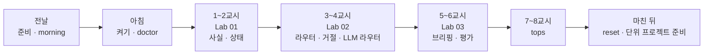
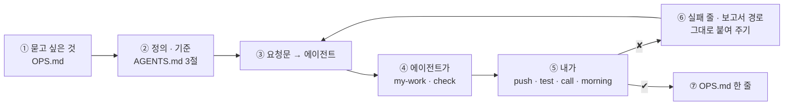

# 79일차 수강 안내 · 수업 준비부터 마칠 때까지

- 일자: 2026-11-04 (수) · 79일차
- 주제: 운영 데이터 기반 Workflow Ops Assistant (출처 → 사실 · 상태 → 질문 답변 → 브리핑 · 평가)
- 실습 폴더: [Last3Mon/79](README.md) · 강의 자료: [Lecture/79](../../Lecture/79/README.md)
- 환경: 65일차 n8n 2.42.6 + **OpenAI API 키만**(`gpt-4.1-mini`) + **79일차 판 데이터 API**(운영 아침 상태) + CLI 코딩 에이전트 하나. **Ollama는 쓰지 않습니다.**
- 이 문서: 오늘 하루 내가 할 일을 수업 준비부터 마칠 때까지 순서대로 모은 수강 안내입니다. 수업 중에도 띄워 두고 어디까지 왔는지 확인하세요.



## 0. 하루 한눈에

| 교시 | 시간 | 할 일 | 문서 | 끝났다는 표시 |
| --- | --- | --- | --- | --- |
| 전날 | 약 10분 | 자료 받기 · n8n · 79일차 데이터 API · 기준 대시보드 · 기준 챗봇 게시 · morning · doctor | [PREP](../../Lecture/79/00-DAY79-PREP.md) | `ready` |
| 1 | 09:00~09:50 | 개요 · 1단계 강의 (운영 사실) | [개요](../../Lecture/79/00-DAY79-OVERVIEW.md) 1~14장, [1단계](../../Lecture/79/01-STAGE1-OPS-FACTS.md) | |
| 2 | 10:00~10:50 | Lab 01 실습 5개 (예제 1~3 · 과제 1~2) | [Lab 01](LAB-01-Q-OPS-FACTS.md) | `lab01-challenge` 5/5 · `lab01-challenge2` 3/3 |
| 3 | 11:00~11:50 | 2단계 강의 (질문 답변) | 개요 15~21장, [2단계](../../Lecture/79/02-STAGE2-OPS-ASK.md) | |
| 4 | 12:00~12:50 | Lab 02 실습 5개 | [Lab 02](LAB-02-Q-OPS-ASK.md) | `lab02-challenge` 5/5 · `lab02-challenge2` 5/5 |
| - | 13:00~14:00 | 점심 | | |
| 5 | 14:00~14:50 | 3단계 강의 (브리핑과 평가) | 개요 22~28장, [3단계](../../Lecture/79/03-STAGE3-OPS-BRIEF.md) | |
| 6 | 15:00~15:50 | Lab 03 실습 5개 | [Lab 03](LAB-03-Q-OPS-BRIEF.md) | `lab03-challenge` 3/3 · `lab03-challenge2` 4/4, `OPS.md` |
| 7 | 16:00~16:50 | 바이브 코딩 `tops`: 요청서 → TODO → SPEC → IMP-PLAN → 만들기 → 설치 | [VIBE-REQ-TOPS](VIBE-REQ-TOPS.md) → [VIBE-Q-TOPS](VIBE-Q-TOPS.md) | `Doc/*.md` · R1~R7 · R11~R14 · `pytest` |
| 8 | 17:00~17:50 | 바이브 코딩 발표 · **4단계 정리** (오늘의 의미 · 효과 · 회사에서 쓰는 법) · 80일차(단위 프로젝트) 예고 | [4단계 정리](../../Lecture/79/04-STAGE4-WRAPUP.md), [진행](../../Lecture/79/05-VIBE-CODING.md) | 최종 프로젝트 체크리스트 |

## 1. 전날 준비 (약 10분)

### 1.1 자료 받기

```bash
cd ~/aio-01d4-stu && git pull
```

### 1.2 n8n과 **79일차** 데이터 API 켜기 (Ollama는 끔)

```bash
sudo systemctl disable --now ollama 2>/dev/null   # WSL에 설치한 Ollama가 있으면 끄고 자동 시작도 끔
cd ~/aio-01d4-stu/Last3Mon/65/n8n
docker compose rm -sf ollama                      # Ollama 컨테이너가 있으면 지움 (없으면 그냥 지나감)
docker compose start
cd ~/aio-01d4-stu/Last3Mon/79/data-api
docker compose up -d --force-recreate             # 78일차 판을 79일차 판(+ 운영 아침 상태)으로 바꿈
curl -s localhost:8800/ops/seed-info
```

### 1.3 상태 보기 · 준비 확인

```bash
cd ~/aio-01d4-stu/Last3Mon/79
uv run tools/flow.py push reference/baseline-ops-facts.json reference/baseline-ops-ask.json   # 팀의 기준 (고치기 전에 비교할 상대)
uv run tools/flow.py morning       # 알림 6 · DLQ 3 · 예산 · 카나리
uv run tools/flow.py doctor        # 마지막 줄 ready
```

### 1.4 미리 읽기 (선택, 5분)

[PREP 3절](../../Lecture/79/00-DAY79-PREP.md): `morning`을 보고 가장 먼저 볼 것 하나를 골라 오기.

### 준비물

노트북과 충전기, WSL의 Docker, WSL 창 두 개, 브라우저, 72~78일차 `~/vibe/*` (없어도 됨).

## 2. 수업 당일 아침 (09:00 전)

1. 노트북을 껐다 켰다면 1.2를 다시 합니다 (운영 아침 상태로 다시 채워짐).
2. 터미널 두 개, 둘 다 `cd ~/aio-01d4-stu/Last3Mon/79`. ① 에이전트, ② 확인.
3. 터미널 ②에서 `uv run tools/flow.py doctor` → `ready`.
4. `cp templates/OPS-ASSISTANT-TEMPLATE.md my-work/OPS.md`, `my-work/PROMPTS.md`.

## 3. 실습할 때마다 같은 순서 (오늘은 "정의 → 요청문 → 사실 · 답 → 확인")



- 숫자 · 상태는 Code가, 글은 LLM이, 작업은 사람이. 운영 도우미는 **읽기만** 합니다.
- 테스트는 대부분 시작할 때 `ops-reset`으로 운영 아침을 되돌립니다. 이상하면 먼저 `uv run tools/flow.py morning`(지난 실습이 DLQ · 예산 · 카나리를 바꿨나), 그다음 `morning --reset`.
- 숫자가 기대와 다르면 거의 언제나 **정의**(기간 · 백분율과 비율 · 반올림 · 무엇을 세나)가 다른 것입니다. `✘` 줄 끝의 `칸 = 실제 (expected 기대)`를 그대로 에이전트에게 붙여 줍니다.
- 오늘은 **네 파일**에 칸을 더해 갑니다: `my-work/ops-facts.json` (Lab 01) → `ops-ask.json` (Lab 02) → `ops-brief.json` · `ops-eval.json` (Lab 03). 고칠 때마다 앞의 테스트도 다시 돌립니다 (회귀).
- 사실 · 상태 · 거절 · 브리핑의 표는 누구에게나 같고, LLM이 쓴 답 · 요약 글과 시간만 실행마다 다를 수 있습니다.

## 4. 1~2교시 · 1단계 · 운영 사실

1교시는 강의, 2교시는 [Lab 01](LAB-01-Q-OPS-FACTS.md) (50분, 실습 5개).

| 순서 | 할 일 | 파일 · 웹훅 | 확인 (터미널 ②) |
| --- | --- | --- | --- |
| 예제 1 (10분, 에이전트 없이) | 출처 여섯을 `morning`으로 둘러보고 팀의 기준 대시보드와 비교 | `base-ops-facts` | `morning`, `call base-ops-facts requests/week2.json` → `OPS.md` 1절 |
| 예제 2 (15분) | 운영 사실 (지난주 실행 · 알림 · DLQ · 품질 · 비용 · 릴리스) | `my-work/ops-facts.json` (새로) · `my-ops-facts` | `test cases/lab01.json --webhook base-ops-facts -v` (전), `push` → `test cases/lab01.json -v` |
| 예제 3 (7분, 에이전트 없이) | 기간을 바꾸면: 두 주 · 하루 · 빈 주 · 기간 없음 | (그대로) | `test cases/lab01-period.json -v` → `OPS.md` 2절 |
| 과제 1 (10분) | 영역별 상태 (`health` · `red` · `yellow` · `overall`) | `my-work/ops-facts.json` 고치기 | `test cases/lab01-challenge.json -v`, `lab01` |
| 과제 2 (8분) | 출처가 멈추면: 200 · `sources_down` · `unknown` | 같은 파일 | `test cases/lab01-challenge2.json -v`, `lab01` · `lab01-challenge` · `lab01-period` |

(명령 앞에는 모두 `uv run tools/flow.py`가 붙습니다.)

## 5. 3~4교시 · 2단계 · 질문 답변

3교시는 강의, 4교시는 [Lab 02](LAB-02-Q-OPS-ASK.md) (50분, 실습 5개).

| 순서 | 할 일 | 확인 |
| --- | --- | --- |
| 예제 1 (12분) | 낱말 라우터 · 그 영역 사실만 · LLM 답, 운영 밖 거절 | `test cases/lab02.json --webhook base-ops-ask -v` (전), `push my-work/ops-ask.json` → `test cases/lab02.json -v` 3/6 |
| 예제 2 (10분) | 작업 요청 거절 · 숫자 확인 | `test cases/lab02.json -v` 6/6 |
| 예제 3 (6분, 에이전트 없이) | 질문을 바꾸면: 에러 · 장애 · 두 영역 · 꺼 줘 · 배포 상태 · AI 비용 | `test cases/lab02-phrasing.json -v` → `OPS.md` 5절 |
| 과제 1 (12분) | LLM 라우터 (낱말이 모를 때만) | `test cases/lab02-challenge.json -v`, `lab02`, `lab02-phrasing` 다시 (4/6이 맞음) |
| 과제 2 (10분) | 감사 기록 (질문 · 영역 · 라우터 · 거절 이유) | `test cases/lab02-challenge2.json -v`, `lab02` · `lab02-challenge` → `OPS.md` 6절 |

## 6. 5~6교시 · 3단계 · 브리핑과 평가

5교시는 강의, 6교시는 [Lab 03](LAB-03-Q-OPS-BRIEF.md) (50분, 실습 5개).

| 순서 | 할 일 | 확인 |
| --- | --- | --- |
| 예제 1 (12분) | 아침 브리핑 (표 · 먼저 볼 것 셋 · 정해진 할 일) | `test cases/lab03.json -v` (전 404), `push my-work/ops-brief.json` → 4/4, `call my-ops-brief '{}'` |
| 예제 2 (8분) | LLM 요약 세 문장 · 숫자 확인 | `test cases/lab03-llm.json -v`, `lab03` |
| 예제 3 (6분, 에이전트 없이) | 아침이 바뀌면: parked 처리 · 카나리 끔 · 예산 올림 | `test cases/lab03-after.json -v` → `OPS.md` 8절, 끝나면 `morning --reset` |
| 과제 1 (14분) | 골든 질문 평가 `my-ops-eval` | `my-work/ops-eval.json` (새로), `test cases/lab03-challenge.json -v`, `call my-ops-eval requests/ops-golden.json` |
| 과제 2 (10분) | 평가 관문 (`min_score` · `gate` · 실패하면 알림) | `test cases/lab03-challenge2.json -v`, `lab03-challenge`, `morning --reset` → `OPS.md` 9절 |

- 기록: `OPS.md` 전체, `cp templates/TEST-REPORT-TEMPLATE.md my-work/TEST-REPORT.md`.

## 7. 7~8교시 · 바이브 코딩 `tops`

[VIBE-REQ-TOPS](VIBE-REQ-TOPS.md)(요청서)를 **먼저** 읽고 [VIBE-Q-TOPS](VIBE-Q-TOPS.md)의 순서대로 갑니다: `Doc/TODO.md` → `Doc/SPEC.md` → `Doc/IMP-PLAN.md`(엔진 · TUI 단계) → 단계별 구현 → 확인 → `uv tool install` → 다른 폴더에서 사용. 요구는 14개(R1~R14)이고 50분 안에는 엔진 1 · 2단계 · TUI 1단계 · 설치까지, 나머지(R8 지난 도구, R9 평가 관문, R10 감사)는 `Doc/IMP-PLAN.md`의 다음 단계로 집에서 이어 갑니다. 만드는 것은 오늘 n8n 운영 도우미를 **터미널에서 보는** 도구: 영역 여섯의 색 · 숫자를 n8n이 정한 그대로, 질문 · 거절, 브리핑, TUI. **읽기만** 합니다. 정답본 `VIBE-A-TOPS.md`는 수업이 끝나면 `git pull`로 받습니다.

```bash
mkdir -p ~/vibe/tops/Doc && cd ~/vibe/tops
git init
# 에이전트는 Doc/TODO.md를 쓴 뒤에 켭니다: codex (또는 claude, agy)
```

| 시간 | 단계 | 확인 |
| --- | --- | --- |
| 16:00~16:09 | 0 준비 · 1 요청서 → `Doc/TODO.md` (에이전트 없이) | 할 일 ①~⑫ · 꼭 / 나중 |
| 16:09~16:15 | 2 `Doc/SPEC.md` → VIBE-Q 요구 표(R1~R14)와 비교 · commit | 요구마다 확인 방법 (영역 일곱 줄 · 종료 코드 4 · 거절) |
| 16:15~16:20 | 3 `Doc/IMP-PLAN.md` (엔진 1~3단계 · TUI 1단계 · 설치) · commit | 단계마다 체크리스트 |
| 16:20~16:44 | 4 구현: 엔진 1단계(R1 · R2 · R3 · R5 · R7 · R13 · R14) → 엔진 2단계(R4 · R6) → TUI 1단계(R11 · R12), 막히면 5 문제 해결 팁 | 단계마다 `pytest` · 직접 실행 · commit |
| 16:44~16:50 | 6 확인 · 7 `uv tool install --editable .` · 8 다른 폴더에서 `tops` | `tops status` = n8n 브리핑의 색 |

- 8교시: 1~2명 발표 (10분) → [4단계 정리](../../Lecture/79/04-STAGE4-WRAPUP.md) (35분: 오늘 한 일의 의미 · 효과 · 산업에서의 응용 · 면접 질문 · 최종 프로젝트 체크리스트) → 80일차(단위 프로젝트) 예고.

## 8. 마친 뒤

| 할 일 | 이유 |
| --- | --- |
| `uv run tools/flow.py morning --reset` | 운영 아침 상태로 |
| `PROMPTS.md`, `OPS.md`, `TEST-REPORT.md` 정리 | 단위 프로젝트 재료 (운영 · 평가) |
| 64~79일차 `my-work/*`, `~/vibe/*` 지우지 않기 | 80~82일차 단위 프로젝트 |
| 내가 가장 잘 만든 워크플로우 하나 고르기 | 80일차 팀 구성 |

## 9. 막혔을 때 (오늘 공통)

| 증상 | 할 일 |
| --- | --- |
| doctor의 operations morning ✘ | 데이터 API가 예전 판. 1.2의 79일차 `--force-recreate` |
| 숫자가 테스트와 다름 | `morning --reset` 뒤 다시, 정의는 AGENTS.md 3절 (77일차 정의 그대로) |
| 출처 하나가 500이라 사실 전체가 500 | HTTP 노드에 `neverError`, 응답 모양으로 "답했나"를 봄 (Lab 01 과제 2) |
| `my-ops-ask`가 `Get facts`에서 404 | `my-ops-facts`를 push했는지 |
| 브리핑에 `health`가 없음 | 상태가 있는 사실 (`reference/ops-facts-health.json`) |
| 평가 점수가 갑자기 0 | 앞 케이스가 남긴 알림 · 감사 기록 때문인지, `morning --reset` 뒤 다시 (Lab 03 과제 2) |
| 평가가 오래 걸림 | 질문마다 LLM 1~2번, timeout 60초 |
| 같은 곳을 3번 고쳐도 실패 | 요청을 더 작게, 또는 `reference/`로 이어 가기 |

## 확인

- [ ] 전날 79일차 데이터 API, 기준 둘 게시, `morning`, `doctor` → `ready`
- [ ] Lab 01: `OPS.md` 1~3절, `lab01` 5/5, `lab01-period` 5/5, `lab01-challenge` 5/5, `lab01-challenge2` 3/3
- [ ] Lab 02: `lab02` 6/6, `lab02-phrasing` 6/6 → 과제 1 뒤 4/6, `lab02-challenge` 5/5, `lab02-challenge2` 5/5, `OPS.md` 4~6절
- [ ] Lab 03: `lab03` 4/4, `lab03-llm` 2/2, `lab03-after` 5/5, `lab03-challenge` 3/3, `lab03-challenge2` 4/4, `OPS.md` 7~9절 · `TEST-REPORT.md`
- [ ] `tops`: `Doc/TODO.md` · `SPEC.md` · `IMP-PLAN.md`, R1~R7 · R11~R14, `pytest`, 단계마다 commit, `uv tool install`
- [ ] `morning --reset`, 단위 프로젝트 준비
