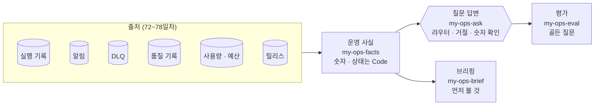

# 79일차 실습 · 운영 데이터 기반 Workflow Ops Assistant (바이브 코딩)

- 일자: 2026-11-04 (79일차)
- 교과목: 노코드 멀티 에이전트 워크플로우 설계 및 운영
- 단원: AI 워크플로우 운영 및 관리 역량 강화
- 강의 자료: [Lecture/79](../../Lecture/79/README.md)
- 하루 수강 안내: [LECTURE-79.md](LECTURE-79.md) (수업 준비부터 마칠 때까지 순서대로)
- 67~78일차처럼 CLI 코딩 에이전트에게 **내가 쓴 요청문**으로 워크플로우를 만들게 하고, **테스트로 확인**합니다. 오늘은 72~78일차에 쌓은 운영 데이터를 모아 **"지금 괜찮나? 무엇부터 볼까?"에 답하는 운영 도우미**를 만듭니다. 80~82일차 단위 프로젝트의 운영 부분이 됩니다.

## 오늘의 상황: 수요일 아침 08:30

운영 담당자가 출근했습니다. 알림은 쌓여 있고, DLQ에 남은 것이 있고, 어제 FAQ 배치가 거절됐고, 예산은 거의 다 썼고, 카나리는 아직 켜져 있습니다. 출처가 여섯 곳입니다. 하나씩 열어 보지 않고 **한 번에 묻고 답을 받고** 싶습니다.



## 일하는 방식 (67~78일차와 같음)

| 누가 | 무엇을 |
| --- | --- |
| 나 | 사실 · 상태의 정의, 도우미가 **하면 안 되는 것** 정하기, 골든 질문 쓰기 |
| CLI 에이전트 | [AGENTS.md](AGENTS.md) 규칙대로 워크플로우 JSON 작성, `check`로 형식 오류 고치기 |
| `tools/flow.py` | check · push · call · test · **morning**(운영 아침 상태 한눈에, `--reset`) |

> **숫자 · 상태는 Code가, 글은 LLM이, 작업은 사람이.** 운영 도우미는 읽기만 합니다.

## 실습 문서 읽는 법

- 실습 문서(`LAB-0x-Q-*.md`, `VIBE-Q-TOPS.md`)에는 **복사해 붙일 요청문이 없습니다.** 막히면 `▶` 를 하나씩 펼칩니다.
- 쓴 요청문은 `my-work/PROMPTS.md`에 모아 둡니다.

## 구성

```text
Last3Mon/79/
├── README.md
├── LECTURE-79.md                      # 하루 수강 안내 (수업 준비부터 마칠 때까지)
├── AGENTS.md                          # CLI 에이전트용 작업 규칙 (계약 · 사실 · 상태 기준 · 거절 · 브리핑 · 평가, 3절)
├── LAB-01-Q-OPS-FACTS.md              # 1단계 · 출처 둘러보기 · 기준 대시보드 → 운영 사실 → 기간 → 영역별 상태 → 출처가 멈추면
├── LAB-02-Q-OPS-ASK.md                # 2단계 · 라우터 · 답 → 거절 · 숫자 확인 → 질문을 바꾸면 → LLM 라우터 → 감사 기록
├── LAB-03-Q-OPS-BRIEF.md              # 3단계 · 브리핑 → LLM 요약 → 아침이 바뀌면 → 골든 질문 평가 → 평가 관문
├── VIBE-REQ-TOPS.md                   # 7교시 바이브 코딩 요청서 (가장 먼저)
├── VIBE-Q-TOPS.md                     # 7교시 바이브 코딩 · tops (운영 도우미를 터미널에서, 읽기만 · TUI)
├── *-A-*.md · answers/ · tops/        # 강사용 정답본 · 정답 워크플로우와 실행 기록 · 강사가 만든 tops (학생 저장소에는 수업 뒤)
├── tools/flow.py
├── data-api/                          # 79일차 판 데이터 API (78일차 + 운영 아침 상태 · 감사 기록)
│   └── data/ops-seed.json             # 알림 6 · DLQ 3 · 품질 기록 4 · 격리 1 · 사용량 192 · 예산 · 카나리
├── cases/                             # lab01 · -period · -challenge · -challenge2 · lab02 · -phrasing · -challenge · -challenge2 · lab03 · -llm · -after · -challenge · -challenge2
├── requests/                          # week1 · week2 · two-weeks · monday · empty-week · ops-golden(골든 질문 8) · ops-golden-gate
├── reference/                         # 팀의 기준(baseline-ops-facts · baseline-ops-ask) · 막혔을 때 이어 가는 워크플로우
├── templates/                         # 운영 도우미 설계표 · 테스트 보고서
├── my-work/
└── runs/
```

## 준비

[실습 준비](../../Lecture/79/00-DAY79-PREP.md)를 끝내 주세요. 요약:

```bash
cd ~/aio-01d4-stu/Last3Mon/65/n8n && docker compose start   # Ollama는 쓰지 않음 · 처음 한 번 PREP 1절대로 끄기
cd ~/aio-01d4-stu/Last3Mon/79/data-api && docker compose up -d --force-recreate   # 79일차 판 (운영 아침 상태)
cd ~/aio-01d4-stu/Last3Mon/79 && uv run tools/flow.py push reference/baseline-ops-facts.json reference/baseline-ops-ask.json
uv run tools/flow.py morning
uv run tools/flow.py doctor                                                          # 마지막 줄 ready
```

## `flow.py` 명령

| 명령 | 하는 일 | 수업 준비 때 |
| --- | --- | --- |
| `uv run tools/flow.py morning` | 알림 · DLQ · 예산 · 릴리스를 한눈에 | 알림 6 · DLQ 3 (parked 2) · $0.073604 / $0.08 · 카나리 1.2.0 20% |
| `uv run tools/flow.py morning --reset` | 운영 아침 상태로 되돌리기 (알림 · DLQ · 예산 · 카나리 · 감사 기록 · 고장 스위치, `-v`는 되돌린 수) | |
| `uv run tools/flow.py test cases/lab01.json --webhook base-ops-facts` | 같은 테스트를 팀의 기준에 (고치기 전) | 0/5 |
| `uv run tools/flow.py test cases/lab02.json --webhook base-ops-ask` | 같은 테스트를 기준 챗봇에 (고치기 전) | 0/6 |
| `uv run tools/flow.py call my-ops-facts '{}'` | 사실 한 번 | 0.1초 안팎 |
| `uv run tools/flow.py call my-ops-ask '{"question": "카나리 버전 문제 있어?"}'` | 질문 한 번 | 1~3초 |

- 오늘은 `flow.py ops --reset`도 `morning --reset`과 같습니다 (DLQ · 알림을 비우지 않고 **운영 아침 상태로** 되돌림). 테스트 파일은 대부분 시작할 때 스스로 되돌립니다.
