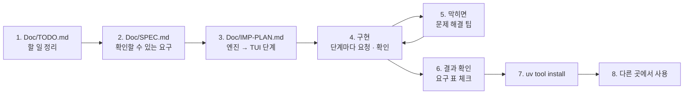

# 7교시 바이브 코딩 · `tops` 만들기

> **먼저 [VIBE-REQ-TOPS.md](VIBE-REQ-TOPS.md)(요청서)를 읽고 `~/vibe/tops/Doc/TODO.md`를 직접 쓴 뒤** 이 문서를 엽니다. 아래 1~8을 차례로 갑니다. 이 문서의 요구 표는 **내 SPEC을 쓴 뒤에** 비교하는 데 쓰고, 에이전트에게 통째로 붙여 넣지 않습니다.



- 시간: 16:00~16:50 (50분) · 발표와 정리는 8교시 · 50분 안에 못 한 단계는 집에서 `Doc/IMP-PLAN.md`의 다음 단계로 이어 갑니다
- 도구: CLI 코딩 에이전트(codex / claude / agy), Python + uv + [Textual](https://textual.textualize.io/), 표준 라이브러리 `json` · `urllib.request` · `subprocess`
- 결과물: 오늘 n8n 운영 도우미(`my-ops-facts` · `my-ops-ask` · `my-ops-brief` · `my-ops-eval`)를 **터미널에서 보는** 도구. 영역 여섯의 색 · 숫자를 **n8n이 정한 그대로** 보이고, 질문을 보내 영역 · 거절 · 숫자 확인을 보이고, 브리핑 · 골든 질문 평가 · 감사 기록을 보이고, 지난 도구(`tlog` · `tcheck`)를 부품으로 부르고, TUI로 탭을 나눠 보는 도구. **읽기만** 합니다. `uv tool install`로 설치해 **어느 폴더에서나** `tops`. 오늘 n8n으로 만든 운영 도우미를 **당번의 터미널에서.**

```text
$ tops status --n8n http://localhost:5678; echo $?
overall 🔴 red · runs 2026-10-26 ~ 2026-10-30 + state now
  🔴 runs     error rate 5.88% · p95 2598ms · unanswered 4.76%
  🟡 alerts   6 (high 3)
  🔴 DLQ      3 (parked 2)
  🟡 quality  avg 0.6583 · last 1 · quarantine 1
  🟡 cost     $0.073604 / $0.08 (92.01%)
  🔴 release  1.1.0 · canary 1.2.0 20% (repeat 62.5%)
4

$ tops ask "DLQ 1번 다시 돌려 줘"
[action · keyword] refused (read_only)
  운영 도우미는 읽기만 합니다. 재처리 · 삭제 · 배포 같은 작업은 런북에 따라 담당자가 직접 해 주세요.

$ tops ui
┌ tops ──────────────────────────────────────────────────────────────────┐
│ overall 🔴 red · runs 2026-10-26 ~ 2026-10-30 + state now               │
│ [Areas]  Brief  Ask  Audit  Tools                                       │
│     area     color   numbers                                            │
│ 🔴  runs     red     error rate 5.88% · p95 2598ms · unanswered 4.76%   │
│ 🔴  DLQ      red     3 (parked 2)                                       │
│ [r] refresh · [?] ask · [q] quit                                        │
└─────────────────────────────────────────────────────────────────────────┘
```

> 요청문은 **직접** 씁니다. 단계마다 `▶` 를 펼치면 생각할 거리가 나옵니다. 정답 요청문은 없습니다.
>
> **테스트에서 진짜 n8n · 데이터 API를 부르지 않습니다.** 정답 실행 기록에 있는 n8n 응답의 사본과, 테스트 안의 작은 가짜 서버로 시험합니다.

## 시간 (50분)

| 시간 | 단계 | 결과 |
| --- | --- | --- |
| 16:00~16:09 | 0 준비 · 1 `Doc/TODO.md` (요청서 읽고 직접) | 할 일 ①~⑫ · 꼭 / 나중 |
| 16:09~16:15 | 2 `Doc/SPEC.md` → 아래 요구 표와 비교 · 고치기 | 요구마다 확인 방법 |
| 16:15~16:20 | 3 `Doc/IMP-PLAN.md` (엔진 단계 · TUI 단계) | 단계마다 체크리스트 |
| 16:20~16:44 | 4 구현: **엔진 1단계 → 엔진 2단계 → TUI 1단계** (막히면 5) | 단계마다 `pytest` · 직접 실행 · commit |
| 16:44~16:50 | 6 확인 · 7 `uv tool install` · 8 다른 폴더에서 | `tops status` = n8n 브리핑의 색 |

50분 안 목표: **R1 · R2 · R3 · R5 · R7 · R13 · R14(엔진 1단계) + R4 · R6(엔진 2단계) + R11 · R12(TUI 1단계) + 설치**. R8 · R9 · R10은 IMP-PLAN의 다음 단계로 8교시 뒤 · 집에서 이어 갑니다.

## 0. 준비 (1분)

```bash
mkdir -p ~/vibe/tops/Doc && cd ~/vibe/tops
git init
ls ~/vibe                      # tlog tcheck ... 무엇이 있나 (없어도 됨)
# 에이전트는 Doc/TODO.md를 쓴 뒤에 켭니다: codex (또는 claude, agy)
```

## 1. `Doc/TODO.md` · 만들고 싶은 것과 할 일 정리 (8분, 에이전트 없이)

[VIBE-REQ-TOPS.md](VIBE-REQ-TOPS.md)의 "할 일" 칸대로 씁니다. 요청의 말 ①~⑫와 끝 부탁을 내 말로, 꼭 / 나중을 표시합니다.

<details><summary>▶ 만들고 싶은 것 한 문단 · 무엇이 들어가야 하나</summary>

누가(운영 당번) · 어디서(어느 폴더에서나, 터미널) · 무엇을(오늘 n8n 운영 도우미의 사실 · 답 · 브리핑 · 평가) · 어떤 약속으로(**n8n과 같은 색 · 숫자**, **읽기만**). 이 문단이 SPEC의 첫 줄이 됩니다.
</details>

`git add Doc/TODO.md && git commit -m "TODO"`

## 2. `Doc/SPEC.md` · 확인할 수 있는 요구로 (6분)

TODO의 할 일마다 **확인 방법**을 붙입니다. 에이전트에게 "Doc/TODO.md를 읽고 SPEC.md를 써 줘. 요구마다 확인 방법"이라고 시켜도 됩니다 (내가 읽고 고침).

```markdown
# tops SPEC

## 1. 요구 (확인할 수 있게)
| 번호 | 요구 | 요청서의 말 | 확인 방법 | 50분 |
| --- | --- | --- | --- | --- |
| R1 | ... | ① · ② | ... | 꼭 |

## 2. 숨은 요구
## 3. 범위 밖 (하지 않을 것)
## 4. 정해 둘 것 (부를 수 있는 주소, 숫자 꼴 = AGENTS.md 3절 브리핑 표, 종료 코드 번호, n8n 주소 넣는 법)
```

<details><summary>▶ 확인 방법이 확인 방법이려면</summary>

"영역을 보여 준다"는 확인 방법이 아닙니다. "`tops status` → 🔴 runs `error rate 5.88% · p95 2598ms` · 🔴 DLQ `3 (parked 2)` · 🟡 cost `$0.073604 / $0.08 (92.01%)` · 🔴 release `canary 1.2.0 20% (repeat 62.5%)`, 종료 코드 4"가 확인 방법입니다. 오늘 Lab 03의 브리핑 표(`cases/lab03.json`)와 **같은 숫자**여야 합니다 — 같은 사실을 보이니까요.
</details>

쓴 뒤 아래 표와 비교합니다. 빠진 요구, 내가 더 뽑은 요구를 `Doc/SPEC.md` 끝 "VIBE-Q와 비교"에 한 줄씩 적고 SPEC을 고칩니다.

### 요구 사항 (요청서에서 뽑은 것, 14개)

| 번호 | 요구 | 요청서의 말 | 확인 방법 | 50분 |
| --- | --- | --- | --- | --- |
| R1 | `tops status`: `my-ops-facts`를 불러 영역 여섯의 **색은 `health` 그대로**, 숫자는 브리핑 표의 꼴(×100 · 두 자리)로, 다시 세지 않음 | ① · ② | 위 일곱 줄. 사실 파일의 `health.cost`를 `green`으로 바꿔 주면 🟢 (tops가 판정하지 않음) | 꼭 |
| R2 | `--from` · `--to`를 `my-ops-facts`에 그대로 넘김 | ③ | `--from 2026-10-19 --to 2026-10-23` → 🟡 runs `error rate 0% … unanswered 5.5%` (Lab 01 과제 1의 첫 주) | 꼭 |
| R3 | 명령 `status` · `ask` · `brief` · `eval` · `audit` · `tools` · `ui`, 종료 코드 0 됨 · 1 못 읽음 · 2 쓰는 법 · **4 빨강 · 평가 실패** | ⑫ | `status`(🔴) → 4, 모르는 옵션 → 2, n8n 주소 없음 → 2 | 꼭 |
| R4 | `tops ask "질문"`: `my-ops-ask`로 보내 `[영역 · 라우터]`, 거절이면 `refused (이유)`, 아니면 `numbers ✔/✘`와 답 | ④ | "DLQ 1번 다시 돌려 줘" → `[action · keyword] refused (read_only)` | 꼭 |
| R5 | **읽기만**: 부를 수 있는 주소를 목록으로 정하고 그 밖은 막음 (재처리 · 리셋 · 예산 · 고장 스위치 주소를 부르지 않음) | ⑤ | 테스트: `/dlq/update` · `/ops-reset`을 부르려 하면 오류, 가짜 서버에 그런 요청이 0건 | 꼭 |
| R6 | `tops brief`: `my-ops-brief`의 `markdown`을 그대로 | ⑥ | `\| DLQ \| 🔴 \| 3건 (parked 2) \|` 줄이 보임 | 꼭 |
| R7 | 출처가 멈춘 영역은 `null` → 숫자 칸 "응답 없음" · 색 `unknown`(⚪) · `sources_down` 줄. **0으로 보이지 않음** | ⑦ | Lab 01 과제 2의 응답(`cost: null`) → `⚪ cost  source not answering` | 꼭 |
| R8 | `tops tools`: 지난 도구를 **명령으로** 불러(`tlog slo --json` · `tcheck`) 결과 한 줄, 없으면 "설치되지 않음" (복사해 오지 않음) | ⑧ | `tlog slo: breaches error_rate, unanswered_rate (357 runs)`, 없는 도구 → 오류 없이 한 줄 | 나중 |
| R9 | `tops eval 파일 [--min-score]`: `my-ops-eval`로 보내 `8/8 · score 1 · gate pass`, 틀린 질문 목록, **gate fail이면 종료 코드 4**, 빈 목록 → 2 | ⑨ · ⑫ | 골든 8 → 0, 틀린 기대 하나 → 4 (`✘ … area_ok`) | 나중 |
| R10 | `tops audit`: 데이터 API `POST /audit/list`의 질문 · 영역 · 라우터 · 거절 이유 | ⑩ | Lab 02 과제 2 뒤 → `3 question(s)`, `refused read_only` | 나중 |
| R11 | `tops ui`: 위 한 줄(전체 · 기간), 탭(영역 · 브리핑 · 질문하기 · 감사 · 도구), `[r]` 새로고침 · `[?]` 질문하기 · `[q]` 끝 | ⑪ | `run_test`: 영역 6줄, `?` → 질문 입력 → 거절이 보임 | 꼭 |
| R12 | 탭 하나가 못 읽어도 다른 탭은 동작 (그 탭에 "not available") | ⑪ · 끝 | 사실을 파일로 주고 n8n 없이 `ui` → 영역 6줄, 질문하기 · 감사는 "not available" | 꼭 |
| R13 | `--json`은 n8n 응답을 **바꾸지 않고**, n8n 주소는 `--n8n` 또는 `$TOPS_N8N`, 사실은 `--file`로도 | ⑫ | `status --json`이 사실 사본과 똑같음 | 꼭 |
| R14 | 테스트는 n8n · 데이터 API 없이: n8n 응답 사본 + 가짜 서버, n8n이 꺼지면 종료 코드 1 (죽지 않음) | 끝 | `uv run pytest -q`가 10초 안, 꺼진 주소 → `cannot read` · 1 | 꼭 |

숨은 요구 (요청서에 직접 없지만 없으면 안 되는 것):

| 숨은 요구 | 어디서 나왔나 |
| --- | --- |
| **판정은 n8n 한 곳.** tops 코드에 기준값(0.01 · 0.8 · parked > 0 …)이 없음 | ② — 정의가 두 벌이면 77일차처럼 어긋남 |
| 읽기만은 "조심"이 아니라 **주소 목록**으로 | ⑤ — 테스트로 확인할 수 있어야 약속 |
| `null`(모름)과 0(없었음)을 다르게 보임 | ⑦ · 오늘 Lab 01 예제 3 · 과제 2 |
| 읽는 층(`client`) · 보여 주는 층(`view`) · 명령(cli · TUI)을 나눔 | ① · ⑪ — 같은 사실을 글자 · JSON · 화면으로 |
| 지난 도구는 **명령으로** 부르고 그 도구의 정의를 씀 | ⑧ — 복사해 오면 정의가 또 한 벌 |
| HTTP 400 · 500의 몸(`{"error"}`)도 읽어 사람에게 보임 | ⑨ — 빈 목록 400을 "n8n이 꺼짐"과 구분 |

범위 밖 (오늘 하지 않음): 작업하기(재처리 · 카나리 끄기 · 예산 바꾸기 — 런북대로 사람이), 숫자를 tops에서 계산하기, LLM을 tops에서 직접 부르기(질문은 `my-ops-ask`가), 알림 보내기.

`git add Doc/SPEC.md && git commit -m "SPEC"`

## 3. `Doc/IMP-PLAN.md` · 구현 계획 (5분)

SPEC의 요구를 **단계**로 나눕니다. 첫 원칙: **엔진(읽고 꼴을 정하는 곳)을 먼저, 화면(TUI)은 나중에.** 화면은 엔진이 만든 줄을 표에 넣기만 하면 되게 만듭니다. 에이전트에게 "SPEC.md를 읽고 IMP-PLAN.md를 엔진 단계와 TUI 단계로 나눠 써 줘. 단계마다 체크리스트와 확인 명령"이라고 시켜도 됩니다 (내가 읽고 고침).

```markdown
# tops IMP-PLAN

## 엔진 1단계 · 읽기 · 상태 · 읽기만 · 종료 코드 (R1 · R2 · R3 · R5 · R7 · R13 · R14)
- [ ] client.py: post(base, path, body) — 부를 수 있는 주소 목록 밖이면 오류, facts(n8n, file, from, to)
- [ ] view.py: status_lines(facts) — health 그대로, 숫자 꼴은 AGENTS.md 3절 브리핑 표, null은 "응답 없음"
- [ ] cli: tops status [--n8n | $TOPS_N8N] [--file] [--from --to] [--json], 종료 코드 0 · 1 · 2 · 4
- [ ] tests: 사실 사본 → 일곱 줄, cost null → ⚪, 쓰는 주소는 막힘, 꺼진 n8n → 1, 가짜 서버
- 확인: uv run pytest -q, uv run tops status --n8n http://localhost:5678; echo $?

## 엔진 2단계 · 질문 · 브리핑 (R4 · R6)
## TUI 1단계 · 탭 · 새로고침 · 질문하기 · 못 읽는 탭 (R11 · R12)
## 설치
## 엔진 3단계 · 평가 관문 · 감사 · 지난 도구 (R8 · R9 · R10)
```

<details><summary>▶ 왜 엔진 먼저인가</summary>

- 엔진은 **화면 없이 테스트**할 수 있습니다 (`pytest`, `tops status`). 색이 n8n과 같은지 · 읽기만인지가 오늘의 핵심인데, 화면부터 만들면 눈으로만 봅니다.
- 아침 점검은 화면 없이 스크립트에서 돌아갑니다. 종료 코드(R3)가 다음 일(당번을 부를까)을 정합니다: `tops status || 알림`.
- TUI는 엔진이 만든 줄을 표에 넣기만 합니다.
</details>

<details><summary>▶ 단계 크기</summary>

한 단계 = 에이전트 요청 한두 번 + 확인 한 번 + commit 한 번 (10분 안팎). 오늘 Lab에서 운영 도우미를 한 번에 다 만들지 않고 "사실 → 상태 → 질문 → 거절 → 브리핑 → 평가"로 한 칸씩 더한 것과 같습니다.
</details>

`git add Doc/IMP-PLAN.md && git commit -m "IMP-PLAN"`

## 4. 구현 시작 (24분: 엔진 1단계 → 엔진 2단계 → TUI 1단계)

이제 에이전트를 켭니다. 단계마다 긴 요청문은 필요 없습니다. 할 일은 SPEC · IMP-PLAN에 있으니까요.

**처음 한 번:**

```text
Doc/SPEC.md 와 Doc/IMP-PLAN.md 를 읽고 체크 안 된 첫 단계만 만들어 줘. uv 프로젝트, 명령 이름 tops, 코드와 화면 글자는 영어.
끝나면 IMP-PLAN 체크를 표시하고 확인 명령을 알려 줘. 다음 단계는 내가 말할 때까지 하지 마.
```

**그다음 단계마다 (같은 한 줄):**

```text
확인했고 commit 했어. 다음 단계.
```

→ 내가 확인 → commit → 한 줄. 그냥 "계속"만 치면 여러 단계를 한꺼번에 하거나 체크 · 확인 명령을 빼먹기 쉽습니다. 틀렸을 때만 **무엇이 틀렸는지 · SPEC의 어느 요구인지 · 어디만 고칠지 · 무엇으로 확인할지**를 적어 고쳐 달라고 합니다. 예:

```text
R1이 틀렸어. tops status 가 cost 를 🔴 로 보여 주는데 n8n 브리핑은 🟡 야. view.py 에 used_ratio >= 0.9 이면 red 라는 기준이 들어가 있어.
색은 사실의 health 를 그대로 쓰게 view.py 만 고쳐 줘. 기준값은 코드에서 지우고, health.cost 를 green 으로 바꾼 사실을 주면 🟢 인 테스트를 넣어 줘.
```

대화가 길어지면 새 세션에서 처음 요청을 다시 보냅니다.

> **규모가 큰 프로젝트일수록 다단계로** 진행합니다. `tops`도 요구가 14개라 한 번에 시키면 에이전트가 수백 줄을 한꺼번에 쓰고, 색이 n8n과 다를 때 어디서 다시 판정했는지 찾기 어렵습니다. 단계마다 ① 그 단계만 요청 ② 직접 확인 ③ IMP-PLAN 체크 ④ `git commit`.

<details><summary>▶ 엔진 1단계 · n8n 응답의 사본은 어디서</summary>

정답 실행 기록 `~/aio-01d4-stu/Last3Mon/79/answers/`가 수업 뒤에 올라옵니다. 수업 중에는 내 n8n에서 직접 받습니다: `uv run ~/aio-01d4-stu/Last3Mon/79/tools/flow.py call my-ops-facts requests/week2.json > tests/data/facts.json`. Lab 01 과제 2를 했다면 `fault usage error` 때의 응답도 `facts-cost-down.json`으로. 테스트는 이 파일을 읽은 줄을 비교합니다.
</details>

<details><summary>▶ 엔진 1단계 · 읽기만을 어떻게 보장하나</summary>

HTTP를 부르는 함수를 **하나**만 두고, 그 함수가 주소 목록(`/webhook/my-ops-facts` · `…-ask` · `…-brief` · `…-eval` · `/audit/list`)을 봅니다. 목록 밖이면 보내기 전에 오류. 테스트에서 `/dlq/update`를 부르게 해 보고 가짜 서버에 요청이 0건인지 봅니다.
</details>

<details><summary>▶ 엔진 2단계 · 질문의 거절과 답</summary>

`my-ops-ask`가 이미 영역 · 거절 · 숫자 확인을 정합니다. tops는 `refused`가 참이면 `reason`을, 아니면 `numbers_ok`를 보입니다. 질문을 tops가 미리 거르지 않습니다 — 거절 규칙도 한 곳(n8n).
</details>

<details><summary>▶ TUI 1단계 · 못 읽는 탭</summary>

탭마다 따로 읽고, 못 읽으면 그 탭에만 "not available: 까닭". 한 탭의 오류가 앱 전체를 멈추게 두지 않습니다 (오늘 Lab 01 과제 2의 `neverError`와 같은 생각). 질문 입력(`Input`)은 Enter 뒤 포커스를 표로 돌려야 `r` · `q`가 글자로 들어가지 않습니다 (78일차 `tcheck`에서 겪은 일).
</details>

<details><summary>▶ 다음 단계들 (8교시 뒤 · 집에서)</summary>

- 평가 관문(R9): `gate`가 `fail`이면 4. 평가는 LLM을 질문마다 부르니 느립니다(수 초) — 타임아웃을 길게.
- 감사(R10): 데이터 API의 읽기 주소 하나. 질문 원문에 개인정보가 섞일 수 있으니 화면에만, 파일로 내보내지 않음.
- 지난 도구(R8): `subprocess`로 `tlog slo --url … --from 2026-10-26 --to 2026-10-30 --json`. `tlog`의 SLO는 `tlog`의 정의 — tops가 다시 계산하지 않습니다.
</details>

## 5. 바이브 코딩으로 문제 해결 팁

| 이럴 때 | 이렇게 |
| --- | --- |
| 에이전트가 "다 됐다"고 함 | **직접 실행**합니다 (`uv run tops status --n8n …; echo $?`, `uv run pytest -q`). 확인 방법은 SPEC에 있습니다 |
| 색이 n8n 브리핑과 다름 | "색은 사실의 health 그대로, 기준값을 코드에 쓰지 말 것" — 두 결과를 붙여 줍니다 |
| 오류율이 `0.0588%` · `588%` | "AGENTS.md 3절 브리핑 표의 꼴: ×100 · 소수 두 자리" |
| 출처가 멈춘 날 비용이 `$0` · 🟢 | "null이면 '응답 없음' · unknown(⚪)" |
| tops에 재처리 · 리셋 버튼이 생김 | "읽기만. 부를 수 있는 주소 목록 밖은 막고, 그 테스트를" |
| 테스트가 진짜 n8n을 부름 | "테스트 안의 가짜 서버(http.server)로, 진짜 n8n은 확인 단계에서만" |
| n8n이 꺼지면 traceback | "URLError를 잡아 'cannot read' · 종료 코드 1" |
| `eval` 빈 목록이 "n8n 꺼짐"으로 나옴 | "HTTP 400의 몸 `{"error"}`를 읽어 보이고 종료 코드 2" |
| 질문을 치면 `r` · `q`가 글자로 | "Enter 뒤 포커스를 표로" |
| 화면이 이상한데 오류가 안 보임 | `uv add --dev textual-dev` 뒤 다른 터미널에서 `uv run textual console` |
| 같은 곳을 3번 고쳐도 안 됨 | 멈추고 `git diff` · `git checkout .`로 되돌린 뒤, 단계를 **더 작게** 나눠 다시 요청 |
| 설치한 `tops`가 고친 내용을 모름 | `uv tool install --force .` 로 다시 설치 (또는 처음부터 `--editable`) |

## 6. 결과 확인

`Doc/SPEC.md` 1절 표의 확인 방법대로 **내가** 하나씩 하고 체크합니다. 오늘 50분 안 목표만:

```bash
cd ~/vibe/tops
uv run pytest -q                                                   # R14: 10초 안
export TOPS_N8N=http://localhost:5678
uv run tops status; echo "exit $?"                                 # R1 · R3: 일곱 줄 · 4
uv run tops status --from 2026-10-19 --to 2026-10-23               # R2: runs 🟡
uv run tops status --json > /tmp/facts.json                        # R13
uv run tops status --file tests/data/facts-cost-down.json          # R7: ⚪ cost
uv run tops ask "DLQ 1번 다시 돌려 줘"                             # R4 · R5: refused (read_only)
uv run tops ask "카나리 버전 문제 있어?"                           # R4: release · numbers ✔
uv run tops brief                                                  # R6
uv run tops status --n8n http://localhost:9; echo "exit $?"        # R14: cannot read · 1
uv run tops ui                                                     # R11 · R12
```

- [ ] R1 영역 여섯 · n8n과 같은 색 · 숫자.
- [ ] R2 기간.
- [ ] R3 명령 · 종료 코드 0 · 1 · 2 · 4.
- [ ] R4 질문 · 영역 · 거절 · 숫자 확인.
- [ ] R5 읽기만 (테스트).
- [ ] R6 브리핑.
- [ ] R7 모르는 영역은 ⚪.
- [ ] R11 · R12 TUI · 못 읽는 탭.
- [ ] R13 `--json` · `$TOPS_N8N` · `--file`.
- [ ] R14 n8n 없이 도는 테스트 · 꺼져도 1.
- [ ] (이어서) R8 · R9 · R10.

## 7. `uv tool install`로 설치

`pyproject.toml`에 명령이 등록되어 있는지 먼저 봅니다.

```toml
[project.scripts]
tops = "tops.cli:main"
```

```bash
cd ~/vibe/tops
uv tool install --editable .        # 고친 내용이 바로 반영됨 (수업 중 권함)
uv tool list                        # tops 가 보이는가
which tops                          # ~/.local/bin/tops
# 명령을 못 찾으면: uv tool update-shell 뒤 터미널을 새로 엶
```

- 지우기: `uv tool uninstall tops`.

## 8. 다른 곳에서 사용

설치했으면 아침 점검과 내 스크립트에 씁니다.

```bash
cd ~
export TOPS_N8N=http://localhost:5678
tops status || echo "빨강이 있습니다 — tops brief 를 보세요"            # 종료 코드로 아침 점검
tops brief > ~/ops-brief-$(date +%m%d).md                                # 회의에 붙일 브리핑
tops eval ~/aio-01d4-stu/Last3Mon/79/requests/ops-golden.json --min-score 0.9 && echo "도우미 그대로 써도 됨"   # (R9) 고친 뒤 관문
tops audit                                                               # (R10) 오늘 무엇을 물었나
tops tools                                                               # (R8) tlog SLO · tcheck
```

- 80~82일차 단위 프로젝트에서 팀의 운영 화면으로 이어 써도 됩니다. `~/vibe/tops`는 지우지 마세요.

## 발표 (8교시, 3분)

| 내용 | |
| --- | --- |
| TODO → SPEC | 내 SPEC과 VIBE-Q 요구 표가 달랐던 곳 (빠뜨린 요구, 더 뽑은 요구) |
| IMP-PLAN | 엔진 · TUI를 어떻게 나눴나, 어디까지 체크했나 |
| 요청문 | 처음 요청 · 틀렸을 때 고쳐 달라고 한 요청문 하나 |
| 막힌 곳 | 5절의 어느 팁으로 풀었나 (색이 다름 · 숫자 꼴 · 0과 null · 읽기만) |
| 시연 | `tops status`와 n8n 브리핑의 색 비교, 작업 요청 거절, `tops ui`의 못 읽는 탭 |

## 확인

- [ ] `Doc/TODO.md` → `Doc/SPEC.md` → `Doc/IMP-PLAN.md`를 에이전트 전에 (또는 에이전트와 함께 쓰고 내가 고쳐서) 만들고 commit했다.
- [ ] IMP-PLAN의 엔진 1 · 2단계와 TUI 1단계를 체크했다 (단계마다 commit).
- [ ] R1 · R2 · R3 · R4 · R5 · R6 · R7 · R11 · R12 · R13 · R14 확인, `uv run pytest -q`, n8n과 같은 색.
- [ ] `uv tool install`, 다른 폴더에서 `tops`.
- [ ] 남은 요구는 IMP-PLAN에 체크 안 된 채로 남겨 두었다 (다음에 이어 감).
