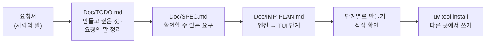

# 7교시 바이브 코딩 · 요청서 `tops` (가장 먼저 읽기)

- 순서: **이 요청서** → 내 정리 `~/vibe/tops/Doc/TODO.md` (8분) → [VIBE-Q-TOPS.md](VIBE-Q-TOPS.md)의 순서대로 `Doc/SPEC.md` → `Doc/IMP-PLAN.md` → 단계별로 만들기 → 설치 · 다른 곳에서 쓰기 → 수업이 끝나면 `VIBE-A-TOPS.md`(정답본)로 확인
- 이 문서는 **만들어 달라는 사람의 말**입니다. 요구 사항 표도, 단계도 없습니다. 그것을 뽑아 내는 것이 첫 일입니다. 72일차 `tbench`부터 78일차 `tcheck`까지와 같은 순서입니다.



> **생활 속 예 · 회진 도는 의사의 손바닥 현황판.** 오늘 병원(n8n)에 아침 인수인계 시스템을 만들었습니다: 환자 상태표(사실), 물어보면 답하는 간호사실(질문 답변), 아침 브리핑(먼저 볼 것). 그런데 회진을 도는 의사는 간호사실까지 오지 않고 **손바닥 화면**으로 보고 싶어 합니다. 화면이 따로 판정을 내리면 안 됩니다 — 간호사실이 "빨강"이라고 한 환자는 손바닥에서도 빨강이어야 합니다. 그리고 손바닥 화면으로는 **보기만** 하고, 처방은 하지 않습니다. `tops`는 오늘의 운영 도우미를 터미널에서 보는 손바닥 현황판입니다.

## 왜 요청서부터인가

요구 사항 표를 통째로 에이전트에게 주고 "이대로 만들어 줘"라고 하면, 무엇이 만들어지든 **내가 판단할 기준이 없습니다.** 실무에서는 요구 사항 표가 오지 않고, 이 요청서 같은 **사람의 말**이 옵니다. 오늘 Lab 01 예제 1에서 `morning`과 기준 대시보드를 먼저 눈으로 비교해 본 것과 같습니다: 무엇이 보여야 하는지 정해야 맞게 보였는지 말할 수 있습니다.

| 단계 | 누가 | 결과 |
| --- | --- | --- |
| 요청 → 할 일 목록 | **나** | `Doc/TODO.md`: 요청의 말 ①~⑫를 내 말로, 만들고 싶은 것 |
| 할 일 → 요구 | **나** (에이전트와 다듬어도 됨) | `Doc/SPEC.md`: 요구마다 "됐다 / 안 됐다"를 말할 수 있는 확인 방법 |
| 요구 → 단계 | **나** (에이전트와 다듬어도 됨) | `Doc/IMP-PLAN.md`: 엔진 단계와 화면(TUI) 단계로 나눈 순서 |
| 단계 → 코드 | 에이전트 | 처음 요청 한 번 + 단계마다 한 줄, `Doc/*.md`를 읽게 함 |
| 확인 | **나** | 직접 `uv run tops …`, `pytest`, n8n 브리핑 · `my-ops-facts`와 색 · 숫자 비교, 요구 표에 체크 |

## 요청 (운영 당번 · 팀장에게서 온 메시지, 그대로)

> 오늘 n8n으로 운영 사실 · 질문 답변 · 브리핑 · 평가까지 만들었다고 들었어요. 그런데 당번은 아침마다 **터미널부터** 열어요. 브라우저에서 n8n을 열고 웹훅을 부르는 건 번거로워요. 어느 폴더에서나 `tops`라고 치면 오늘 아침 상태가 보이는 도구가 있으면 좋겠어요.
>
> ① 영역 여섯(실행 · 알림 · DLQ · 품질 · 비용 · 릴리스)의 **색과 숫자**를 한눈에요. 오늘 만든 사실(`my-ops-facts`) 그대로요.
>
> ② 제일 중요한 거요. **색을 도구가 따로 정하면 안 돼요.** n8n 브리핑이 빨강이라는데 터미널이 노랑이면 아무것도 못 믿어요. 숫자도 다시 세지 말고요 (77 · 78일차에 두 벌 정의로 고생했잖아요).
>
> ③ 지난주 말고 **다른 기간**도 볼 수 있게요. 첫 주를 다시 보고 싶을 때가 있어요.
>
> ④ 터미널에서 **질문**도 하고 싶어요. 오늘 만든 도우미(`my-ops-ask`)에 그대로 보내서, 무엇으로 답했는지(영역) · 숫자 확인이 됐는지 · 거절했는지 같이 보여 주세요.
>
> ⑤ 절대로요. 이 도구로 **재처리 · 삭제 · 카나리 끄기 같은 걸 하면 안 돼요.** 읽기만요. 실수로라도 바뀌면 큰일이에요.
>
> ⑥ 아침 회의에 붙일 **브리핑**(`my-ops-brief`)도 그대로 터미널에서요.
>
> ⑦ 출처가 하나 멈춘 날 있잖아요. 그날은 **모른다고** 보여 주세요. 0이나 초록으로 보이면 안 돼요.
>
> ⑧ 지난번에 만든 도구들 있죠 — `tlog` · `tcheck`. **다시 만들지 말고** 있는 걸 불러서 같이 보여 주면 좋겠어요. 없는 사람은 없다고만요.
>
> ⑨ 도우미를 고칠 때마다 **골든 질문 평가**(`my-ops-eval`)를 터미널에서 돌리고 싶어요. 기준보다 낮으면 스크립트가 알 수 있게 **종료 코드로**요.
>
> ⑩ 사람들이 도우미에게 **무엇을 물었는지**(감사 기록)도 볼 수 있게요.
>
> ⑪ **화면에서** 보고 싶어요. 영역 · 브리핑 · 질문하기 · 감사 기록을 탭으로 나누고, 새로고침 키도요.
>
> ⑫ 스크립트에서 쓸 거라 **종료 코드**가 중요해요. 됐다 · n8n을 못 읽었다 · 쓰는 법이 틀렸다 · 빨강이거나 평가가 떨어졌다를 서로 다른 번호로요. 다른 프로그램이 읽을 수 있게 **JSON**으로도요.
>
> 아, 시험할 때 **진짜 n8n이 없어도** 돌아가야 해요. n8n이 꺼진 날에도 도구가 죽지 말고 "못 읽었다"고 해 주세요.

## 함께 받은 것

| 파일 · 자료 | 메모 |
| --- | --- |
| 오늘 n8n 웹훅 `http://localhost:5678/webhook/…` | `my-ops-facts` (`{"from", "to"}`) · `my-ops-ask` (`{"question"}`) · `my-ops-brief` · `my-ops-eval` (`{"cases", "min_score"}`) |
| 오늘 데이터 API `http://localhost:8800` | `POST /audit/list` (감사 기록). **상태를 바꾸는 주소는 쓰지 않음** (`/dlq/update` · `/ops-reset` · `/budget` · `/admin/fault`) |
| `~/aio-01d4-stu/Last3Mon/79/requests/` | `week1.json` · `week2.json` · `ops-golden.json`(골든 질문 8) |
| 내 n8n의 응답 | `uv run tools/flow.py call my-ops-facts requests/week2.json` 등으로 받은 사실 · 답 · 브리핑 · 평가 응답 → 파일로 저장해 **테스트용 사본** (수업 뒤에는 정답 실행 기록 `answers/`에도) |
| [AGENTS.md](AGENTS.md) 3절 | 사실의 칸 · **영역별 상태 기준** · 브리핑 표의 숫자 꼴 · 거절 이유 (오늘의 규칙서) |
| 72~78일차 `~/vibe/*` | `tlog` (`slo --json`) · `tcheck` (있으면) |
| Python 표준 라이브러리 | `json`, `urllib.request`, `subprocess`. TUI는 Textual |

## 할 일 · 요청을 내 할 일 목록으로 (8분, 에이전트 없이)

`~/vibe/tops/Doc/TODO.md`를 만들고 요청의 말 ①~⑫와 맨 끝 부탁을 **내 말로** 한 줄씩 옮깁니다. 아직 "어떻게"는 쓰지 않습니다. **무엇을 · 왜**만 씁니다. 에이전트에게 맡기지 않고 직접 씁니다.

```markdown
# tops TODO

## 만들고 싶은 것 (한 문단)
어느 폴더에서나 `tops`로 오늘 n8n 운영 도우미(my-ops-*)의 사실 · 답 · 브리핑 · 평가를 터미널에서 보는, 읽기만 하는 ...

## 요청의 말 → 할 일
| # | 요청의 말 (짧게) | 할 일 (내 말) | 꼭 · 나중 |
| --- | --- | --- | --- |
| ① | 영역 여섯 · 색 · 숫자 | | 꼭 |
| ② | 색을 따로 정하지 않음 | | |
| ... | | | |
| 끝 | n8n 없이 시험 · 꺼져도 안 죽음 | | |

## 요청에 없지만 걱정되는 것
## 오늘 50분 안에 못 할 것 같은 것
```

예 하나만 보여 드립니다.

| 요청의 말 | TODO에 쓸 할 일 (내 말) | 다음 단계(SPEC)에서 바뀔 모양 |
| --- | --- | --- |
| ② "색을 도구가 따로 정하면 안 돼요" | "`my-ops-facts`의 `health` · `overall`을 그대로 쓰고, 숫자는 브리핑 표의 꼴(×100 · 두 자리)로 보이기만. 기준(0.01 · 0.8 …)을 코드에 쓰지 않음" | R1: 사실 파일의 `health.cost`를 `green`으로 바꿔 주면 비용이 92%여도 🟢로 보임 (tops가 다시 판정하지 않는다는 증거) |

<details><summary>▶ 1단계 · 꼭 할 것과 나중에 할 것</summary>

요청의 말이 열두 개입니다. 50분 안에 다 만들기 어렵습니다. 당번이 가장 아파하는 것은 "n8n과 같은 색"(믿을 수 있나)과 "읽기만"(실수로 바꾸지 않나)입니다. 그리고 질문 · 브리핑 · 평가 · 화면을 만들려면 먼저 무엇이 있어야 하나요? (n8n을 읽는 층 → 사실을 보여 주기 → 질문 · 브리핑 → 평가 · 감사 → 화면)
</details>

<details><summary>▶ 2단계 · 걱정되는 것 (숨은 요구의 씨앗)</summary>

- ② "다시 세지 말고": 오류율 · 비율을 tops가 계산하면 77일차처럼 정의가 두 벌이 됩니다. 사실의 값을 **꼴만 바꿔** 보입니다 (0.0588 → 5.88%).
- ⑤ "읽기만": "조심해서 안 부른다"가 아니라 **부를 수 있는 주소를 정해 두고** 그 밖은 막습니다. 테스트로 확인할 수 있게.
- ⑦ "모른다고": `cost`가 `null`이면 숫자 칸에 0이 아니라 "응답 없음", 색은 `unknown` (오늘 Lab 01 과제 2).
- ⑧ "다시 만들지 말고": 지난 도구는 **명령으로** 부르고(`tlog slo --json`), 없으면 "설치되지 않음". 지난 도구의 코드를 복사해 오지 않습니다.
- ⑨ · ⑫ "종료 코드": 평가가 떨어진 것(4)과 n8n을 못 읽은 것(1)이 다른 번호여야 스크립트가 "도우미를 고쳐라"와 "n8n을 켜라"를 구분합니다.
- ⑪ "탭": 탭 하나가 못 읽어도(브리핑 웹훅이 없음) 다른 탭은 보여야 합니다.
- 끝 "n8n 없이 시험": n8n · 데이터 API를 대신할 작은 가짜 서버, 그리고 내 n8n이 낸 응답을 저장한 사본.
</details>

## 그다음

[VIBE-Q-TOPS.md](VIBE-Q-TOPS.md)를 엽니다. 거기서 `Doc/TODO.md` → `Doc/SPEC.md` → `Doc/IMP-PLAN.md` → 단계별 구현 → 확인 → `uv tool install` → 다른 곳에서 사용 순서로 갑니다. VIBE-Q의 요구 표는 **내 SPEC을 쓴 뒤에** 비교하는 데 씁니다.
