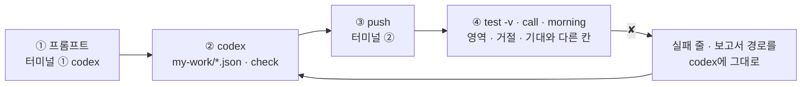
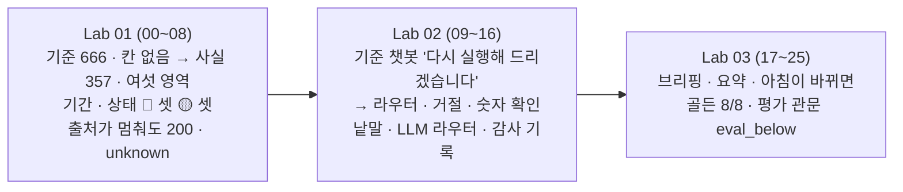

# 79일차 Lab 테스트 결과 · 실제로 만든 시나리오와 `test -v` 결과

> **정답 자료** · 79일차 n8n 워크플로우를 **만드는 프롬프트(codex) → push → `call` · `test -v` · `quality` 결과**를 학생이 가는 순서대로 한 문서에 모았습니다. 수업이 끝난 뒤 공개합니다.

- 실행: 2026-11-01, 실습을 Lab마다 5개(예제 3 + 과제 2)로 늘린 뒤 강사 노트북의 65일차 n8n 2.42.6 + 79일차 판 데이터 API(78일차 + 2026-11-04 08:30 운영 아침 상태), OpenAI `gpt-4.1-mini`(답 · 라우터 · 요약, temperature 0), 케이스 파일마다 **한 번씩**, 모두 26단계 (00~25)
- 명령: `~/aio-01d4-stu/Last3Mon/79`에서 `uv run tools/flow.py ...`. 아래 단계마다 **실행한 명령**과 **화면에 나온 출력 전부**를 그대로 붙이고, 그 아래 **쉽게 말하면**으로 결과를 풀어 썼습니다 (특히 ✘가 나온 까닭과 그것이 예상한 것인지). 같은 출력이 `NN-<이름>.txt`에, 그 단계 첫 `test`의 보고서가 `NN-<이름>.json`에 있습니다 (00 · 01단계는 보고서 없음).
- 사실 · 상태 · 거절 · 브리핑의 표는 Code라 **늘 같습니다.** 실행마다 다를 수 있는 것은 시간과 LLM이 쓴 답 · 요약 글입니다 (영역 · 거절 · `numbers_ok`는 이번 실행에서 모두 기대대로). 정답의 잘못으로 실패한 케이스는 없습니다. ✘는 모두 "고치기 전" 단계와, LLM 라우터를 붙인 뒤 다시 돌린 `lab02-phrasing`(기대가 옛 규칙)에서 본 것입니다.
- "고치기 전" 상태: 00단계에서 `my-*` 워크플로우를 모두 **게시 해제**(`off`)하고 `ops --reset`으로 운영 아침을 되돌려 학생이 처음 여는 상태와 같게 했습니다.

## `-v`가 보여 주는 것

```text
✔ 비용 · 숫자 확인 · 1.1s                                   ← 케이스 · 시간
    → request  POST /webhook/my-ops-ask                      ← 보낸 요청 JSON (질문)
      { "question": "오늘 LLM 비용이 예산의 몇 퍼센트야?" }
    ← response HTTP 200                                      ← 받은 응답 JSON (영역 · 답 · 숫자 확인)
      { "area": "cost", "router": "keyword", "refused": false, "answer": "… 92.01% …", "numbers_ok": true, … }
```

오늘은 응답의 **영역 · 거절 · 숫자 확인**(무엇으로 답했나 · 하면 안 되는 것을 안 했나 · 숫자가 사실에 있나)을 보고, 기대와 다를 때 `✘` 줄 끝의 `칸 = 실제 (expected 기대)`를 봅니다. LLM의 답 글은 실행마다 다를 수 있어 테스트는 글 전체를 보지 않습니다.

## 이 문서 하나로 따라가기

단계마다 **① codex에 넣는 프롬프트 → ② codex가 `my-work/*.json`을 쓰고 `check` → ③ 내가 `push` → ④ 내가 `test -v` · `call` · `morning`** 순서입니다. 에이전트 없이 하는 예제(Lab 01 예제 1 · 3, Lab 02 예제 3, Lab 03 예제 3)와 고치기 전 단계는 프롬프트가 없습니다.



- **프롬프트는 정답본(`LAB-0x-A-*.md`)의 요청문 예**를 그대로 썼습니다 (실습 문서 빈칸 채우기 뼈대의 `____`를 채운 글자).
- **이 기록의 워크플로우는 수업 준비 때 만든 정답 파일**입니다. 프롬프트를 codex에 보내 다시 만들어 재지는 않았습니다 (68일차부터 수업 준비는 정답 워크플로우만 실행).
- 학생은 `my-work/ops-facts.json` · `ops-ask.json` · `ops-brief.json` · `ops-eval.json`을 거듭 고쳐 push하고, 이 기록은 같은 웹훅의 단계별 정답 파일을 차례로 push했습니다 (`push`가 앞 판을 내린다는 `! unpublished … same webhook path` 줄이 그것). 그래서 `test` 명령과 결과 모양은 같습니다.

## 시나리오 한눈에



| 단계 | 내용 |
| --- | --- |
| 00 | 수업 준비 · 운영 아침으로 · 기준 둘 게시 · doctor |
| 01 | Lab 01 예제 1 · 출처 둘러보기 · 기준 대시보드 |
| 02 | Lab 01 예제 2 하기 전 → `lab01` 0/5 (기준에) |
| 03 | Lab 01 예제 2 · 운영 사실 → 5/5 |
| 04 | Lab 01 예제 3 · 기간을 바꾸면 → 5/5 |
| 05 | Lab 01 과제 1 하기 전 → `lab01-challenge` 0/5 |
| 06 | Lab 01 과제 1 · 영역별 상태 → 5/5 |
| 07 | Lab 01 과제 2 하기 전 → `lab01-challenge2` 0/3 |
| 08 | Lab 01 과제 2 · 출처가 멈추면 → 3/3 |
| 09 | Lab 02 하기 전 → `lab02` 0/6 (기준 챗봇에) |
| 10 | Lab 02 예제 1 · 라우터 · 답 → `lab02` 3/6 |
| 11 | Lab 02 예제 2 · 거절 · 숫자 확인 → 6/6 |
| 12 | Lab 02 예제 3 · 질문을 바꾸면 → 6/6 (규칙대로) |
| 13 | Lab 02 과제 1 하기 전 → `lab02-challenge` 1/5 |
| 14 | Lab 02 과제 1 · LLM 라우터 → 5/5 |
| 15 | Lab 02 과제 2 하기 전 → `lab02-challenge2` 4/5 |
| 16 | Lab 02 과제 2 · 감사 기록 → 5/5 |
| 17 | Lab 03 예제 1 하기 전 → `lab03` 0/4 |
| 18 | Lab 03 예제 1 · 브리핑 → 4/4 |
| 19 | Lab 03 예제 2 하기 전 → `lab03-llm` 0/2 |
| 20 | Lab 03 예제 2 · LLM 요약 → 2/2 |
| 21 | Lab 03 예제 3 · 아침이 바뀌면 → 5/5 |
| 22 | Lab 03 과제 1 하기 전 → `lab03-challenge` 0/3 |
| 23 | Lab 03 과제 1 · 골든 질문 평가 → 3/3 |
| 24 | Lab 03 과제 2 하기 전 → `lab03-challenge2` 0/4 |
| 25 | Lab 03 과제 2 · 평가 관문 → 4/4 |

## 준비

### 00 · 수업 준비 · 운영 아침으로 · 기준 둘 게시 · doctor

실행한 명령:

```bash
uv run tools/flow.py ops --reset
uv run tools/flow.py off my-ops-facts my-ops-ask my-ops-brief my-ops-eval
uv run tools/flow.py push reference/baseline-ops-facts.json reference/baseline-ops-ask.json
uv run tools/flow.py doctor
```

출력 (그대로):

```text
✔ back to the seeded operations morning (alerts · DLQ · quality · usage · budget · release), live logs · added FAQ · tickets emptied, fault switch all ok

✔ unpublished my-ops-facts (id w41f9b14835e9a3c)
✔ unpublished my-ops-ask (id w48289056bc6d55d)
✔ unpublished my-ops-brief (id w871e57398bd7b32)
✔ unpublished my-ops-eval (id w7803df55a337611)
✔ n8n restarted. Turn it back on with: uv run tools/flow.py push <the workflow file>

✔ pushed '79 Ops facts (team baseline)' (id wbc17136383891fb)
   POST http://localhost:5678/webhook/base-ops-facts
✔ pushed '79 Ops ask (team baseline)' (id w65a1ecde0ce401b)
   POST http://localhost:5678/webhook/base-ops-ask

! n8n install folder /Users/mcchae/day65-n8n
   → day 65 SETUP-N8N 5단계 (get.n8n.io 설치). 다른 곳에 설치했다면 Last3Mon/65/n8n/.env 에 N8N_HOME=<폴더>
✔ n8n container day65-n8n-n8n-1
✔ n8n http://localhost:5678
✔ data API http://localhost:8800
✔ dead letter queue /dlq · alerts · fault switch dlq (day 76 data API)
✔ run logs /logs (666 seeded runs) · FAQ additions /faq-extra (day 77 data API)
✔ schemas faq · employee · ticket, quarantine, quality log (day 78 data API)
✔ operations morning /ops/seed-info (day 79 data API)
✔ n8n → http://data-api:8800
✔ credential 'OpenAI (.env)' (openAiCourse0001)
✔ node catalog (for check)
✔ CLI coding agent: codex, claude, agy
ready
```

**쉽게 말하면**

- `ops --reset`이 79일차에는 운영 아침 상태(알림 6 · DLQ 3 · 품질 4 · 격리 1 · 사용량 192 · 예산 · 카나리)로 되돌립니다.
- 앞서 게시한 `my-ops-facts` · `my-ops-ask` · `my-ops-brief` · `my-ops-eval`을 내려 학생이 처음 여는 상태를 만들고, 팀의 기준 `base-ops-facts` · `base-ops-ask`만 게시했습니다.
- `operations morning /ops/seed-info (day 79 data API)` ✔는 데이터 API가 79일차 판이라는 뜻입니다. `ready`.

## Lab 01 · 운영 사실 · 흩어진 출처를 한 장으로

### 01 · Lab 01 예제 1 · 출처 둘러보기 · 기준 대시보드

실행한 명령:

```bash
uv run tools/flow.py morning
uv run tools/flow.py call base-ops-facts requests/week2.json
```

출력 (그대로):

```text
seeded morning 2026-11-04T08:30:00 · {"alerts": 6, "dlq": 3, "quality_log": 4, "quarantine": 1, "usage": 192}
alerts: 6 (high 3)
  [high] helpdesk/Search FAQ · timeout · timeout of 1000ms exceeded
  [high] helpdesk/Answer · rate_limit · 429 Rate limit reached for requests
  [high] faq-import/Batch ok? · batch_rejected · B-1 rejected
  [medium] faq-import/Low score? · low_quality · B-2 quality 0.8
  [medium] faq-import/Low score? · low_quality · B-3 quality 0.8333
  [medium] intake/Create ticket · api_error · tickets API 503
DLQ: 3 (parked 2)
  #1  attempts 3  parked True  tickets API 503
  #2  attempts 3  parked True  tickets API 503
  #3  attempts 1  parked False  timeout
quality log: 4 (scores [0, 0.8, 0.8333, 1]) · quarantine 1
usage: 156 requests · 192 calls · $0.073604
budget: used $0.073604 of $0.08
release: active 1.1.0 · canary {"release": "1.2.0", "percent": 20}

HTTP 200 · 1.4s
{
  "runs": {
    "total": 666,
    "errors": 21,
    "error_rate": 3.153153153153153
  },
  "alerts": {
    "count": 6
  },
  "dlq": {
    "size": 3
  },
  "cost": {
    "used_usd": 0.073604,
    "daily_usd": 0.08
  }
}
```

**쉽게 말하면**

- `morning`: 알림 6(높음 3) · DLQ 3(parked 2) · 품질 점수 0 · 0.8 · 0.8333 · 1 · 격리 1 · 비용 $0.073604 / $0.08 · 카나리 1.2.0 20%.
- 기준 대시보드는 지난주를 물어도 **666건**(두 주 전체) · 오류율 3.153…(백분율), 그리고 parked · 품질 · 카나리가 **아예 없습니다**. 오늘 가장 급한 둘이 보이지 않습니다. 예상한 결과.

### 02 · Lab 01 예제 2 하기 전 → `lab01` 0/5 (기준에)

실행한 명령:

```bash
uv run tools/flow.py test cases/lab01.json --webhook base-ops-facts -v
```

출력 (그대로):

```text
✔ before: POST http://localhost:8800/ops-reset · HTTP 200 · 0.0s · {"seeded_at": "2026-11-04T08:30:00", "note": "79일차 운영 아침 상태 (연습 데이터, seed 79)", "counts": {"alerts": 6, "dlq": 3, "quali
    → request  POST http://localhost:8800/ops-reset
      {}
    ← response HTTP 200
      {
        "seeded_at": "2026-11-04T08:30:00",
        "note": "79일차 운영 아침 상태 (연습 데이터, seed 79)",
        "counts": {
          "alerts": 6,
          "dlq": 3,
          "quality_log": 4,
          "quarantine": 1,
          "usage": 192
        }
      }
POST http://localhost:5678/webhook/base-ops-facts · 5 case(s) × 1
✘ 지난주 실행 (기본 기간) · 0.4s · period.from = null (expected 2026-10-26); runs.total = 666 (expected 357); runs.error_rate = 3.153153153153153 (expected 0.0588); runs.p95_ms = null (expected 2598); runs.top_failure.node = null (expected Search FAQ); runs.top_failure.count = null (expected 16)
    → request  POST /webhook/base-ops-facts
      {}
    ← response HTTP 200
      {
        "runs": {
          "total": 666,
          "errors": 21,
          "error_rate": 3.153153153153153
        },
        "alerts": {
          "count": 6
        },
        "dlq": {
          "size": 3
        },
        "cost": {
          "used_usd": 0.073604,
          "daily_usd": 0.08
        }
      }
✘ 지금 상태 · 알림 · DLQ · 품질 · 0.1s · alerts.high = null (expected 3); alerts.by_reason.low_quality = null (expected 2); dlq.parked = null (expected 2); quality.avg_score = null (expected 0.6583); quality.last_score = null (expected 1); quality.quarantine = null (expected 1)
    → request  POST /webhook/base-ops-facts
      {}
    ← response HTTP 200
      {
        "runs": {
          "total": 666,
          "errors": 21,
          "error_rate": 3.153153153153153
        },
        "alerts": {
          "count": 6
        },
        "dlq": {
          "size": 3
        },
        "cost": {
          "used_usd": 0.073604,
          "daily_usd": 0.08
        }
      }
✘ 비용 · 릴리스 · 0.1s · cost.requests = null (expected 156); cost.used_ratio = null (expected 0.9201); cost.top_user.user = null (expected test-bot); cost.top_user.share = null (expected 0.3699); release.active = null (expected 1.1.0); release.canary_release = null (expected 1.2.0); release.canary_repeat_rate = null (expected 0.625); release.active_repeat_rate = null (expected 0.0773)
    → request  POST /webhook/base-ops-facts
      {}
    ← response HTTP 200
      {
        "runs": {
          "total": 666,
          "errors": 21,
          "error_rate": 3.153153153153153
        },
        "alerts": {
          "count": 6
        },
        "dlq": {
          "size": 3
        },
        "cost": {
          "used_usd": 0.073604,
          "daily_usd": 0.08
        }
      }
✘ 첫 주 (기간을 바꾸면 실행만 바뀜) · 0.1s · runs.total = 666 (expected 309); runs.errors = 21 (expected 0)
    → request  POST /webhook/base-ops-facts
      {
        "from": "2026-10-19",
        "to": "2026-10-23"
      }
    ← response HTTP 200
      {
        "runs": {
          "total": 666,
          "errors": 21,
          "error_rate": 3.153153153153153
        },
        "alerts": {
          "count": 6
        },
        "dlq": {
          "size": 3
        },
        "cost": {
          "used_usd": 0.073604,
          "daily_usd": 0.08
        }
      }
✔ before: POST http://localhost:8800/dlq/update · HTTP 200 · 0.0s · {"removed": true, "size": 2}
    → request  POST http://localhost:8800/dlq/update
      {
        "dlq_id": 3,
        "remove": true
      }
    ← response HTTP 200
      {
        "removed": true,
        "size": 2
      }
✘ 상태가 바뀌면 숫자도 (DLQ #3 처리) · 0.1s · dlq.waiting = null (expected 0)
    → request  POST /webhook/base-ops-facts
      {}
    ← response HTTP 200
      {
        "runs": {
          "total": 666,
          "errors": 21,
          "error_rate": 3.153153153153153
        },
        "alerts": {
          "count": 6
        },
        "dlq": {
          "size": 2
        },
        "cost": {
          "used_usd": 0.073604,
          "daily_usd": 0.08
        }
      }
Passed 0/5
report: runs/lab01-20261101-185111.json
✔ after: POST http://localhost:8800/ops-reset · HTTP 200 · 0.0s · {"seeded_at": "2026-11-04T08:30:00", "note": "79일차 운영 아침 상태 (연습 데이터, seed 79)", "counts": {"alerts": 6, "dlq": 3, "quali
    → request  POST http://localhost:8800/ops-reset
      {}
    ← response HTTP 200
      {
        "seeded_at": "2026-11-04T08:30:00",
        "note": "79일차 운영 아침 상태 (연습 데이터, seed 79)",
        "counts": {
          "alerts": 6,
          "dlq": 3,
          "quality_log": 4,
          "quarantine": 1,
          "usage": 192
        }
      }
```

**쉽게 말하면**

- 기간을 넘기지 않아 지난주 · 첫 주 모두 666, 나머지 칸은 없어 `null`. 테스트는 시작할 때 `ops-reset`으로 아침을 되돌립니다. 예상한 결과.

### 03 · Lab 01 예제 2 · 운영 사실 → 5/5

codex에 입력하는 프롬프트 (터미널 ①, 학생이 만들 파일 `my-work/ops-facts.json` · 이 기록에서 push한 같은 역할의 정답 `reference/lab01-example2-facts.json`):

```text
my-work/ops-facts.json 을 새로 만들어 줘. 웹훅 POST my-ops-facts, 이름 "79 Ops facts (my)".
Get logs(POST http://data-api:8800/logs/query) 에 본문의 from · to 를 넘기고, 비면 2026-10-26 · 2026-10-30 (지난주).
그 뒤 Get alerts · Get DLQ · Get quality · Get quarantine · Get usage · Get budget · Get release 를 한 줄로 잇고, Make facts(Code) 하나에서 AGENTS.md 3절 "사실" 표대로 모은다.
runs 는 77일차 정의 그대로 (error_rate 4자리 · p95 는 ceil(p × n)번째 · 0건이면 0), top_failure 는 (노드, 메시지) 묶음 1위 또는 null.
기간은 실행 기록에만 쓰고, 알림 · DLQ · 품질 · 비용 · 릴리스는 지금 상태. 숫자는 Code 가 세고 LLM 은 쓰지 않는다.
데이터 API 에 바꾸는 요청은 보내지 않는다 (읽기만). 기대 결과 cases/lab01.json.
```

실행한 명령:

```bash
uv run tools/flow.py push reference/lab01-example2-facts.json
uv run tools/flow.py test cases/lab01.json -v
uv run tools/flow.py call my-ops-facts requests/week2.json
```

출력 (그대로):

```text
✔ pushed '79 Ops facts (reference)' (id w91aa244110abf96)
   POST http://localhost:5678/webhook/my-ops-facts

✔ before: POST http://localhost:8800/ops-reset · HTTP 200 · 0.0s · {"seeded_at": "2026-11-04T08:30:00", "note": "79일차 운영 아침 상태 (연습 데이터, seed 79)", "counts": {"alerts": 6, "dlq": 3, "quali
    → request  POST http://localhost:8800/ops-reset
      {}
    ← response HTTP 200
      {
        "seeded_at": "2026-11-04T08:30:00",
        "note": "79일차 운영 아침 상태 (연습 데이터, seed 79)",
        "counts": {
          "alerts": 6,
          "dlq": 3,
          "quality_log": 4,
          "quarantine": 1,
          "usage": 192
        }
      }
POST http://localhost:5678/webhook/my-ops-facts · 5 case(s) × 1
✔ 지난주 실행 (기본 기간) · 1.1s
    → request  POST /webhook/my-ops-facts
      {}
    ← response HTTP 200
      {
        "period": {
          "from": "2026-10-26",
          "to": "2026-10-30"
        },
        "runs": {
          "total": 357,
          "errors": 21,
          "error_rate": 0.0588,
          "p95_ms": 2598,
          "unanswered_rate": 0.0476,
          "top_failure": {
            "node": "Search FAQ",
            "message": "timeout of 1000ms exceeded",
            "count": 16
          }
        },
        "alerts": {
          "count": 6,
          "high": 3,
          "by_reason": {
            "timeout": 1,
            "rate_limit": 1,
            "batch_rejected": 1,
            "low_quality": 2,
            "api_error": 1
          }
        },
        "dlq": {
          "size": 3,
          "parked": 2,
          "waiting": 1
        },
        "quality": {
          "batches": 4,
          "avg_score": 0.6583,
          "last_score": 1,
          "rejected_batches": 1,
          "quarantine": 1
        },
        "cost": {
          "requests": 156,
          "calls": 192,
          "cost_usd": 0.073604,
          "daily_usd": 0.08,
          "used_ratio": 0.9201,
          "top_user": {
            "user": "test-bot",
            "cost_usd": 0.027228,
            "share": 0.3699
          }
        },
        "release": {
          "active": "1.1.0",
          "canary_release": "1.2.0",
          "canary_percent": 20,
          "active_repeat_rate": 0.0773,
          "canary_repeat_rate": 0.625
        }
      }
✔ 지금 상태 · 알림 · DLQ · 품질 · 0.4s
    → request  POST /webhook/my-ops-facts
      {}
    ← response HTTP 200
      {
        "period": {
          "from": "2026-10-26",
          "to": "2026-10-30"
        },
        "runs": {
          "total": 357,
          "errors": 21,
          "error_rate": 0.0588,
          "p95_ms": 2598,
          "unanswered_rate": 0.0476,
          "top_failure": {
            "node": "Search FAQ",
            "message": "timeout of 1000ms exceeded",
            "count": 16
          }
        },
        "alerts": {
          "count": 6,
          "high": 3,
          "by_reason": {
            "timeout": 1,
            "rate_limit": 1,
            "batch_rejected": 1,
            "low_quality": 2,
            "api_error": 1
          }
        },
        "dlq": {
          "size": 3,
          "parked": 2,
          "waiting": 1
        },
        "quality": {
          "batches": 4,
          "avg_score": 0.6583,
          "last_score": 1,
          "rejected_batches": 1,
          "quarantine": 1
        },
        "cost": {
          "requests": 156,
          "calls": 192,
          "cost_usd": 0.073604,
          "daily_usd": 0.08,
          "used_ratio": 0.9201,
          "top_user": {
            "user": "test-bot",
            "cost_usd": 0.027228,
            "share": 0.3699
          }
        },
        "release": {
          "active": "1.1.0",
          "canary_release": "1.2.0",
          "canary_percent": 20,
          "active_repeat_rate": 0.0773,
          "canary_repeat_rate": 0.625
        }
      }
✔ 비용 · 릴리스 · 0.1s
    → request  POST /webhook/my-ops-facts
      {}
    ← response HTTP 200
      {
        "period": {
          "from": "2026-10-26",
          "to": "2026-10-30"
        },
        "runs": {
          "total": 357,
          "errors": 21,
          "error_rate": 0.0588,
          "p95_ms": 2598,
          "unanswered_rate": 0.0476,
          "top_failure": {
            "node": "Search FAQ",
            "message": "timeout of 1000ms exceeded",
            "count": 16
          }
        },
        "alerts": {
          "count": 6,
          "high": 3,
          "by_reason": {
            "timeout": 1,
            "rate_limit": 1,
            "batch_rejected": 1,
            "low_quality": 2,
            "api_error": 1
          }
        },
        "dlq": {
          "size": 3,
          "parked": 2,
          "waiting": 1
        },
        "quality": {
          "batches": 4,
          "avg_score": 0.6583,
          "last_score": 1,
          "rejected_batches": 1,
          "quarantine": 1
        },
        "cost": {
          "requests": 156,
          "calls": 192,
          "cost_usd": 0.073604,
          "daily_usd": 0.08,
          "used_ratio": 0.9201,
          "top_user": {
            "user": "test-bot",
            "cost_usd": 0.027228,
            "share": 0.3699
          }
        },
        "release": {
          "active": "1.1.0",
          "canary_release": "1.2.0",
          "canary_percent": 20,
          "active_repeat_rate": 0.0773,
          "canary_repeat_rate": 0.625
        }
      }
✔ 첫 주 (기간을 바꾸면 실행만 바뀜) · 0.1s
    → request  POST /webhook/my-ops-facts
      {
        "from": "2026-10-19",
        "to": "2026-10-23"
      }
    ← response HTTP 200
      {
        "period": {
          "from": "2026-10-19",
          "to": "2026-10-23"
        },
        "runs": {
          "total": 309,
          "errors": 0,
          "error_rate": 0,
          "p95_ms": 2525,
          "unanswered_rate": 0.055,
          "top_failure": null
        },
        "alerts": {
          "count": 6,
          "high": 3,
          "by_reason": {
            "timeout": 1,
            "rate_limit": 1,
            "batch_rejected": 1,
            "low_quality": 2,
            "api_error": 1
          }
        },
        "dlq": {
          "size": 3,
          "parked": 2,
          "waiting": 1
        },
        "quality": {
          "batches": 4,
          "avg_score": 0.6583,
          "last_score": 1,
          "rejected_batches": 1,
          "quarantine": 1
        },
        "cost": {
          "requests": 156,
          "calls": 192,
          "cost_usd": 0.073604,
          "daily_usd": 0.08,
          "used_ratio": 0.9201,
          "top_user": {
            "user": "test-bot",
            "cost_usd": 0.027228,
            "share": 0.3699
          }
        },
        "release": {
          "active": "1.1.0",
          "canary_release": "1.2.0",
          "canary_percent": 20,
          "active_repeat_rate": null,
          "canary_repeat_rate": null
        }
      }
✔ before: POST http://localhost:8800/dlq/update · HTTP 200 · 0.0s · {"removed": true, "size": 2}
    → request  POST http://localhost:8800/dlq/update
      {
        "dlq_id": 3,
        "remove": true
      }
    ← response HTTP 200
      {
        "removed": true,
        "size": 2
      }
✔ 상태가 바뀌면 숫자도 (DLQ #3 처리) · 0.1s
    → request  POST /webhook/my-ops-facts
      {}
    ← response HTTP 200
      {
        "period": {
          "from": "2026-10-26",
          "to": "2026-10-30"
        },
        "runs": {
          "total": 357,
          "errors": 21,
          "error_rate": 0.0588,
          "p95_ms": 2598,
          "unanswered_rate": 0.0476,
          "top_failure": {
            "node": "Search FAQ",
            "message": "timeout of 1000ms exceeded",
            "count": 16
          }
        },
        "alerts": {
          "count": 6,
          "high": 3,
          "by_reason": {
            "timeout": 1,
            "rate_limit": 1,
            "batch_rejected": 1,
            "low_quality": 2,
            "api_error": 1
          }
        },
        "dlq": {
          "size": 2,
          "parked": 2,
          "waiting": 0
        },
        "quality": {
          "batches": 4,
          "avg_score": 0.6583,
          "last_score": 1,
          "rejected_batches": 1,
          "quarantine": 1
        },
        "cost": {
          "requests": 156,
          "calls": 192,
          "cost_usd": 0.073604,
          "daily_usd": 0.08,
          "used_ratio": 0.9201,
          "top_user": {
            "user": "test-bot",
            "cost_usd": 0.027228,
            "share": 0.3699
          }
        },
        "release": {
          "active": "1.1.0",
          "canary_release": "1.2.0",
          "canary_percent": 20,
          "active_repeat_rate": 0.0773,
          "canary_repeat_rate": 0.625
        }
      }
Passed 5/5
report: runs/lab01-20261101-185125.json
✔ after: POST http://localhost:8800/ops-reset · HTTP 200 · 0.0s · {"seeded_at": "2026-11-04T08:30:00", "note": "79일차 운영 아침 상태 (연습 데이터, seed 79)", "counts": {"alerts": 6, "dlq": 3, "quali
    → request  POST http://localhost:8800/ops-reset
      {}
    ← response HTTP 200
      {
        "seeded_at": "2026-11-04T08:30:00",
        "note": "79일차 운영 아침 상태 (연습 데이터, seed 79)",
        "counts": {
          "alerts": 6,
          "dlq": 3,
          "quality_log": 4,
          "quarantine": 1,
          "usage": 192
        }
      }

HTTP 200 · 0.1s
{
  "period": {
    "from": "2026-10-26",
    "to": "2026-10-30"
  },
  "runs": {
    "total": 357,
    "errors": 21,
    "error_rate": 0.0588,
    "p95_ms": 2598,
    "unanswered_rate": 0.0476,
    "top_failure": {
      "node": "Search FAQ",
      "message": "timeout of 1000ms exceeded",
      "count": 16
    }
  },
  "alerts": {
    "count": 6,
    "high": 3,
    "by_reason": {
      "timeout": 1,
      "rate_limit": 1,
      "batch_rejected": 1,
      "low_quality": 2,
      "api_error": 1
    }
  },
  "dlq": {
    "size": 3,
    "parked": 2,
    "waiting": 1
  },
  "quality": {
    "batches": 4,
    "avg_score": 0.6583,
    "last_score": 1,
    "rejected_batches": 1,
    "quarantine": 1
  },
  "cost": {
    "requests": 156,
    "calls": 192,
    "cost_usd": 0.073604,
    "daily_usd": 0.08,
    "used_ratio": 0.9201,
    "top_user": {
      "user": "test-bot",
      "cost_usd": 0.027228,
      "share": 0.3699
    }
  },
  "release": {
    "active": "1.1.0",
    "canary_release": "1.2.0",
    "canary_percent": 20,
    "active_repeat_rate": 0.0773,
    "canary_repeat_rate": 0.625
  }
}
```

**쉽게 말하면**

- 지난주 357 · 21 · 0.0588 · p95 2598 · 실패 1위 `Search FAQ` timeout 16 (77일차 숫자와 같음), 알림 6 · 높음 3, DLQ 3 · parked 2 · 대기 1, 품질 0.6583, 비용 0.9201 · 1위 `test-bot` 37%, 카나리 다시 묻기 62.5% 대 1.1.0 7.73%.
- 출처 여덟을 한 줄로 읽어 Code 하나에서 0.1초. LLM 없음, 상태를 바꾸는 요청 없음. 예상한 결과.

### 04 · Lab 01 예제 3 · 기간을 바꾸면 → 5/5

실행한 명령:

```bash
uv run tools/flow.py test cases/lab01-period.json -v
```

출력 (그대로):

```text
✔ before: POST http://localhost:8800/ops-reset · HTTP 200 · 0.0s · {"seeded_at": "2026-11-04T08:30:00", "note": "79일차 운영 아침 상태 (연습 데이터, seed 79)", "counts": {"alerts": 6, "dlq": 3, "quali
    → request  POST http://localhost:8800/ops-reset
      {}
    ← response HTTP 200
      {
        "seeded_at": "2026-11-04T08:30:00",
        "note": "79일차 운영 아침 상태 (연습 데이터, seed 79)",
        "counts": {
          "alerts": 6,
          "dlq": 3,
          "quality_log": 4,
          "quarantine": 1,
          "usage": 192
        }
      }
POST http://localhost:5678/webhook/my-ops-facts · 5 case(s) × 1
✔ 두 주 (10/19~10/30) · 0.1s
    → request  POST /webhook/my-ops-facts
      {
        "from": "2026-10-19",
        "to": "2026-10-30"
      }
    ← response HTTP 200
      {
        "period": {
          "from": "2026-10-19",
          "to": "2026-10-30"
        },
        "runs": {
          "total": 666,
          "errors": 21,
          "error_rate": 0.0315,
          "p95_ms": 2537,
          "unanswered_rate": 0.0511,
          "top_failure": {
            "node": "Search FAQ",
            "message": "timeout of 1000ms exceeded",
            "count": 16
          }
        },
        "alerts": {
          "count": 6,
          "high": 3,
          "by_reason": {
            "timeout": 1,
            "rate_limit": 1,
            "batch_rejected": 1,
            "low_quality": 2,
            "api_error": 1
          }
        },
        "dlq": {
          "size": 3,
          "parked": 2,
          "waiting": 1
        },
        "quality": {
          "batches": 4,
          "avg_score": 0.6583,
          "last_score": 1,
          "rejected_batches": 1,
          "quarantine": 1
        },
        "cost": {
          "requests": 156,
          "calls": 192,
          "cost_usd": 0.073604,
          "daily_usd": 0.08,
          "used_ratio": 0.9201,
          "top_user": {
            "user": "test-bot",
            "cost_usd": 0.027228,
            "share": 0.3699
          }
        },
        "release": {
          "active": "1.1.0",
          "canary_release": "1.2.0",
          "canary_percent": 20,
          "active_repeat_rate": 0.0773,
          "canary_repeat_rate": 0.625
        }
      }
✔ 하루 (10/26) · 0.1s
    → request  POST /webhook/my-ops-facts
      {
        "from": "2026-10-26",
        "to": "2026-10-26"
      }
    ← response HTTP 200
      {
        "period": {
          "from": "2026-10-26",
          "to": "2026-10-26"
        },
        "runs": {
          "total": 70,
          "errors": 16,
          "error_rate": 0.2286,
          "p95_ms": 2468,
          "unanswered_rate": 0.0571,
          "top_failure": {
            "node": "Search FAQ",
            "message": "timeout of 1000ms exceeded",
            "count": 16
          }
        },
        "alerts": {
          "count": 6,
          "high": 3,
          "by_reason": {
            "timeout": 1,
            "rate_limit": 1,
            "batch_rejected": 1,
            "low_quality": 2,
            "api_error": 1
          }
        },
        "dlq": {
          "size": 3,
          "parked": 2,
          "waiting": 1
        },
        "quality": {
          "batches": 4,
          "avg_score": 0.6583,
          "last_score": 1,
          "rejected_batches": 1,
          "quarantine": 1
        },
        "cost": {
          "requests": 156,
          "calls": 192,
          "cost_usd": 0.073604,
          "daily_usd": 0.08,
          "used_ratio": 0.9201,
          "top_user": {
            "user": "test-bot",
            "cost_usd": 0.027228,
            "share": 0.3699
          }
        },
        "release": {
          "active": "1.1.0",
          "canary_release": "1.2.0",
          "canary_percent": 20,
          "active_repeat_rate": null,
          "canary_repeat_rate": null
        }
      }
✔ 빈 기간 (11/02~11/06) · 0건이어도 200 · 0.1s
    → request  POST /webhook/my-ops-facts
      {
        "from": "2026-11-02",
        "to": "2026-11-06"
      }
    ← response HTTP 200
      {
        "period": {
          "from": "2026-11-02",
          "to": "2026-11-06"
        },
        "runs": {
          "total": 0,
          "errors": 0,
          "error_rate": 0,
          "p95_ms": 0,
          "unanswered_rate": 0,
          "top_failure": null
        },
        "alerts": {
          "count": 6,
          "high": 3,
          "by_reason": {
            "timeout": 1,
            "rate_limit": 1,
            "batch_rejected": 1,
            "low_quality": 2,
            "api_error": 1
          }
        },
        "dlq": {
          "size": 3,
          "parked": 2,
          "waiting": 1
        },
        "quality": {
          "batches": 4,
          "avg_score": 0.6583,
          "last_score": 1,
          "rejected_batches": 1,
          "quarantine": 1
        },
        "cost": {
          "requests": 156,
          "calls": 192,
          "cost_usd": 0.073604,
          "daily_usd": 0.08,
          "used_ratio": 0.9201,
          "top_user": {
            "user": "test-bot",
            "cost_usd": 0.027228,
            "share": 0.3699
          }
        },
        "release": {
          "active": "1.1.0",
          "canary_release": "1.2.0",
          "canary_percent": 20,
          "active_repeat_rate": null,
          "canary_repeat_rate": null
        }
      }
✔ 기간을 비우면 지난주 (기본) · 0.1s
    → request  POST /webhook/my-ops-facts
      {}
    ← response HTTP 200
      {
        "period": {
          "from": "2026-10-26",
          "to": "2026-10-30"
        },
        "runs": {
          "total": 357,
          "errors": 21,
          "error_rate": 0.0588,
          "p95_ms": 2598,
          "unanswered_rate": 0.0476,
          "top_failure": {
            "node": "Search FAQ",
            "message": "timeout of 1000ms exceeded",
            "count": 16
          }
        },
        "alerts": {
          "count": 6,
          "high": 3,
          "by_reason": {
            "timeout": 1,
            "rate_limit": 1,
            "batch_rejected": 1,
            "low_quality": 2,
            "api_error": 1
          }
        },
        "dlq": {
          "size": 3,
          "parked": 2,
          "waiting": 1
        },
        "quality": {
          "batches": 4,
          "avg_score": 0.6583,
          "last_score": 1,
          "rejected_batches": 1,
          "quarantine": 1
        },
        "cost": {
          "requests": 156,
          "calls": 192,
          "cost_usd": 0.073604,
          "daily_usd": 0.08,
          "used_ratio": 0.9201,
          "top_user": {
            "user": "test-bot",
            "cost_usd": 0.027228,
            "share": 0.3699
          }
        },
        "release": {
          "active": "1.1.0",
          "canary_release": "1.2.0",
          "canary_percent": 20,
          "active_repeat_rate": 0.0773,
          "canary_repeat_rate": 0.625
        }
      }
✔ 기간과 상관없는 '지금' 숫자는 그대로 · 0.1s
    → request  POST /webhook/my-ops-facts
      {
        "from": "2026-11-02",
        "to": "2026-11-06"
      }
    ← response HTTP 200
      {
        "period": {
          "from": "2026-11-02",
          "to": "2026-11-06"
        },
        "runs": {
          "total": 0,
          "errors": 0,
          "error_rate": 0,
          "p95_ms": 0,
          "unanswered_rate": 0,
          "top_failure": null
        },
        "alerts": {
          "count": 6,
          "high": 3,
          "by_reason": {
            "timeout": 1,
            "rate_limit": 1,
            "batch_rejected": 1,
            "low_quality": 2,
            "api_error": 1
          }
        },
        "dlq": {
          "size": 3,
          "parked": 2,
          "waiting": 1
        },
        "quality": {
          "batches": 4,
          "avg_score": 0.6583,
          "last_score": 1,
          "rejected_batches": 1,
          "quarantine": 1
        },
        "cost": {
          "requests": 156,
          "calls": 192,
          "cost_usd": 0.073604,
          "daily_usd": 0.08,
          "used_ratio": 0.9201,
          "top_user": {
            "user": "test-bot",
            "cost_usd": 0.027228,
            "share": 0.3699
          }
        },
        "release": {
          "active": "1.1.0",
          "canary_release": "1.2.0",
          "canary_percent": 20,
          "active_repeat_rate": null,
          "canary_repeat_rate": null
        }
      }
Passed 5/5
report: runs/lab01-period-20261101-185126.json
```

**쉽게 말하면**

- 두 주 666 · 하루 70 · 빈 주 0 · 기간 없음 357 — 실행 기록만 바뀌고 알림 · DLQ · 품질 · 비용 · 판은 다섯 번 모두 같습니다.
- 10/26 · 빈 주의 다시 묻는 비율은 `null` (두 판은 10/28부터). 빈 주의 오류율 · p95는 0, 실패 1위는 `null` — 0과 '모름'은 다릅니다. 예상한 결과.

### 05 · Lab 01 과제 1 하기 전 → `lab01-challenge` 0/5

실행한 명령:

```bash
uv run tools/flow.py test cases/lab01-challenge.json -v
```

출력 (그대로):

```text
✔ before: POST http://localhost:8800/ops-reset · HTTP 200 · 0.0s · {"seeded_at": "2026-11-04T08:30:00", "note": "79일차 운영 아침 상태 (연습 데이터, seed 79)", "counts": {"alerts": 6, "dlq": 3, "quali
    → request  POST http://localhost:8800/ops-reset
      {}
    ← response HTTP 200
      {
        "seeded_at": "2026-11-04T08:30:00",
        "note": "79일차 운영 아침 상태 (연습 데이터, seed 79)",
        "counts": {
          "alerts": 6,
          "dlq": 3,
          "quality_log": 4,
          "quarantine": 1,
          "usage": 192
        }
      }
POST http://localhost:5678/webhook/my-ops-facts · 5 case(s) × 1
✘ 지난주 영역별 상태 · 0.1s · health.runs = null (expected red); health.alerts = null (expected yellow); health.dlq = null (expected red); health.quality = null (expected yellow); health.cost = null (expected yellow); health.release = null (expected red); overall = null (expected red)
    → request  POST /webhook/my-ops-facts
      {}
    ← response HTTP 200
      {
        "period": {
          "from": "2026-10-26",
          "to": "2026-10-30"
        },
        "runs": {
          "total": 357,
          "errors": 21,
          "error_rate": 0.0588,
          "p95_ms": 2598,
          "unanswered_rate": 0.0476,
          "top_failure": {
            "node": "Search FAQ",
            "message": "timeout of 1000ms exceeded",
            "count": 16
          }
        },
        "alerts": {
          "count": 6,
          "high": 3,
          "by_reason": {
            "timeout": 1,
            "rate_limit": 1,
            "batch_rejected": 1,
            "low_quality": 2,
            "api_error": 1
          }
        },
        "dlq": {
          "size": 3,
          "parked": 2,
          "waiting": 1
        },
        "quality": {
          "batches": 4,
          "avg_score": 0.6583,
          "last_score": 1,
          "rejected_batches": 1,
          "quarantine": 1
        },
        "cost": {
          "requests": 156,
          "calls": 192,
          "cost_usd": 0.073604,
          "daily_usd": 0.08,
          "used_ratio": 0.9201,
          "top_user": {
            "user": "test-bot",
            "cost_usd": 0.027228,
            "share": 0.3699
          }
        },
        "release": {
          "active": "1.1.0",
          "canary_release": "1.2.0",
          "canary_percent": 20,
          "active_repeat_rate": 0.0773,
          "canary_repeat_rate": 0.625
        }
      }
✘ 빨강 · 노랑 목록 (정해진 순서) · 0.1s · red = null (expected ["runs", "dlq", "release"]); yellow = null (expected ["alerts", "quality", "cost"])
    → request  POST /webhook/my-ops-facts
      {}
    ← response HTTP 200
      {
        "period": {
          "from": "2026-10-26",
          "to": "2026-10-30"
        },
        "runs": {
          "total": 357,
          "errors": 21,
          "error_rate": 0.0588,
          "p95_ms": 2598,
          "unanswered_rate": 0.0476,
          "top_failure": {
            "node": "Search FAQ",
            "message": "timeout of 1000ms exceeded",
            "count": 16
          }
        },
        "alerts": {
          "count": 6,
          "high": 3,
          "by_reason": {
            "timeout": 1,
            "rate_limit": 1,
            "batch_rejected": 1,
            "low_quality": 2,
            "api_error": 1
          }
        },
        "dlq": {
          "size": 3,
          "parked": 2,
          "waiting": 1
        },
        "quality": {
          "batches": 4,
          "avg_score": 0.6583,
          "last_score": 1,
          "rejected_batches": 1,
          "quarantine": 1
        },
        "cost": {
          "requests": 156,
          "calls": 192,
          "cost_usd": 0.073604,
          "daily_usd": 0.08,
          "used_ratio": 0.9201,
          "top_user": {
            "user": "test-bot",
            "cost_usd": 0.027228,
            "share": 0.3699
          }
        },
        "release": {
          "active": "1.1.0",
          "canary_release": "1.2.0",
          "canary_percent": 20,
          "active_repeat_rate": 0.0773,
          "canary_repeat_rate": 0.625
        }
      }
✘ 첫 주: 오류는 없지만 답 못 함 · 카나리 비교 불가 · 0.1s · health.runs = null (expected yellow); health.release = null (expected yellow); red = null (expected ["dlq"])
    → request  POST /webhook/my-ops-facts
      {
        "from": "2026-10-19",
        "to": "2026-10-23"
      }
    ← response HTTP 200
      {
        "period": {
          "from": "2026-10-19",
          "to": "2026-10-23"
        },
        "runs": {
          "total": 309,
          "errors": 0,
          "error_rate": 0,
          "p95_ms": 2525,
          "unanswered_rate": 0.055,
          "top_failure": null
        },
        "alerts": {
          "count": 6,
          "high": 3,
          "by_reason": {
            "timeout": 1,
            "rate_limit": 1,
            "batch_rejected": 1,
            "low_quality": 2,
            "api_error": 1
          }
        },
        "dlq": {
          "size": 3,
          "parked": 2,
          "waiting": 1
        },
        "quality": {
          "batches": 4,
          "avg_score": 0.6583,
          "last_score": 1,
          "rejected_batches": 1,
          "quarantine": 1
        },
        "cost": {
          "requests": 156,
          "calls": 192,
          "cost_usd": 0.073604,
          "daily_usd": 0.08,
          "used_ratio": 0.9201,
          "top_user": {
            "user": "test-bot",
            "cost_usd": 0.027228,
            "share": 0.3699
          }
        },
        "release": {
          "active": "1.1.0",
          "canary_release": "1.2.0",
          "canary_percent": 20,
          "active_repeat_rate": null,
          "canary_repeat_rate": null
        }
      }
✔ before: POST http://localhost:8800/budget · HTTP 200 · 0.0s · {"daily_usd": 1.0, "user_limit_per_min": 20, "max_question_chars": 500, "used_usd": 0.073604, "remaining_usd": 0.926396,
    → request  POST http://localhost:8800/budget
      {
        "daily_usd": 1
      }
    ← response HTTP 200
      {
        "daily_usd": 1.0,
        "user_limit_per_min": 20,
        "max_question_chars": 500,
        "used_usd": 0.073604,
        "remaining_usd": 0.926396,
        "over": false
      }
✘ 예산을 늘리면 비용은 초록 · 0.1s · health.cost = null (expected green)
    → request  POST /webhook/my-ops-facts
      {}
    ← response HTTP 200
      {
        "period": {
          "from": "2026-10-26",
          "to": "2026-10-30"
        },
        "runs": {
          "total": 357,
          "errors": 21,
          "error_rate": 0.0588,
          "p95_ms": 2598,
          "unanswered_rate": 0.0476,
          "top_failure": {
            "node": "Search FAQ",
            "message": "timeout of 1000ms exceeded",
            "count": 16
          }
        },
        "alerts": {
          "count": 6,
          "high": 3,
          "by_reason": {
            "timeout": 1,
            "rate_limit": 1,
            "batch_rejected": 1,
            "low_quality": 2,
            "api_error": 1
          }
        },
        "dlq": {
          "size": 3,
          "parked": 2,
          "waiting": 1
        },
        "quality": {
          "batches": 4,
          "avg_score": 0.6583,
          "last_score": 1,
          "rejected_batches": 1,
          "quarantine": 1
        },
        "cost": {
          "requests": 156,
          "calls": 192,
          "cost_usd": 0.073604,
          "daily_usd": 1,
          "used_ratio": 0.0736,
          "top_user": {
            "user": "test-bot",
            "cost_usd": 0.027228,
            "share": 0.3699
          }
        },
        "release": {
          "active": "1.1.0",
          "canary_release": "1.2.0",
          "canary_percent": 20,
          "active_repeat_rate": 0.0773,
          "canary_repeat_rate": 0.625
        }
      }
✔ before: POST http://localhost:8800/dlq/update · HTTP 200 · 0.0s · {"removed": true, "size": 2}
    → request  POST http://localhost:8800/dlq/update
      {
        "dlq_id": 1,
        "remove": true
      }
    ← response HTTP 200
      {
        "removed": true,
        "size": 2
      }
✔ before: POST http://localhost:8800/dlq/update · HTTP 200 · 0.0s · {"removed": true, "size": 1}
    → request  POST http://localhost:8800/dlq/update
      {
        "dlq_id": 2,
        "remove": true
      }
    ← response HTTP 200
      {
        "removed": true,
        "size": 1
      }
✘ parked를 처리하면 DLQ는 노랑 · 0.1s · health.dlq = null (expected yellow); red = null (expected ["runs", "release"])
    → request  POST /webhook/my-ops-facts
      {}
    ← response HTTP 200
      {
        "period": {
          "from": "2026-10-26",
          "to": "2026-10-30"
        },
        "runs": {
          "total": 357,
          "errors": 21,
          "error_rate": 0.0588,
          "p95_ms": 2598,
          "unanswered_rate": 0.0476,
          "top_failure": {
            "node": "Search FAQ",
            "message": "timeout of 1000ms exceeded",
            "count": 16
          }
        },
        "alerts": {
          "count": 6,
          "high": 3,
          "by_reason": {
            "timeout": 1,
            "rate_limit": 1,
            "batch_rejected": 1,
            "low_quality": 2,
            "api_error": 1
          }
        },
        "dlq": {
          "size": 1,
          "parked": 0,
          "waiting": 1
        },
        "quality": {
          "batches": 4,
          "avg_score": 0.6583,
          "last_score": 1,
          "rejected_batches": 1,
          "quarantine": 1
        },
        "cost": {
          "requests": 156,
          "calls": 192,
          "cost_usd": 0.073604,
          "daily_usd": 1,
          "used_ratio": 0.0736,
          "top_user": {
            "user": "test-bot",
            "cost_usd": 0.027228,
            "share": 0.3699
          }
        },
        "release": {
          "active": "1.1.0",
          "canary_release": "1.2.0",
          "canary_percent": 20,
          "active_repeat_rate": 0.0773,
          "canary_repeat_rate": 0.625
        }
      }
Passed 0/5
report: runs/lab01-challenge-20261101-185126.json
✔ after: POST http://localhost:8800/ops-reset · HTTP 200 · 0.0s · {"seeded_at": "2026-11-04T08:30:00", "note": "79일차 운영 아침 상태 (연습 데이터, seed 79)", "counts": {"alerts": 6, "dlq": 3, "quali
    → request  POST http://localhost:8800/ops-reset
      {}
    ← response HTTP 200
      {
        "seeded_at": "2026-11-04T08:30:00",
        "note": "79일차 운영 아침 상태 (연습 데이터, seed 79)",
        "counts": {
          "alerts": 6,
          "dlq": 3,
          "quality_log": 4,
          "quarantine": 1,
          "usage": 192
        }
      }
```

**쉽게 말하면**

- `health` · `red` · `yellow` · `overall`이 없어 `null`. 넷째 · 다섯째 케이스 앞의 `before`는 사람의 작업(예산 $1 · parked 둘 처리)입니다. 예상한 결과.

### 06 · Lab 01 과제 1 · 영역별 상태 → 5/5

codex에 입력하는 프롬프트 (터미널 ①, 학생이 만들 파일 `my-work/ops-facts.json` · 이 기록에서 push한 같은 역할의 정답 `answers/79-lab01-challenge-health.json`):

```text
my-work/ops-facts.json 의 Make facts 에 영역별 상태를 더해 줘.
AGENTS.md 3절 "상태" 표대로 health {runs, alerts, dlq, quality, cost, release} 를 red · yellow · green 으로. red 를 yellow 보다 먼저 본다.
release 는 카나리가 있고 두 비율이 모두 있고 canary_repeat_rate 가 active 의 2배를 넘으면 red, 카나리만 있으면 yellow.
red · yellow 는 그 색인 영역을 runs, alerts, dlq, quality, cost, release 순서로, overall 은 red 가 있으면 red, 아니면 yellow 가 있으면 yellow, 아니면 green.
상태 판정은 LLM 이 아니라 Code. 앞의 사실은 그대로. 기대 결과 cases/lab01-challenge.json, cases/lab01.json 도.
```

실행한 명령:

```bash
uv run tools/flow.py push answers/79-lab01-challenge-health.json
uv run tools/flow.py test cases/lab01-challenge.json -v
uv run tools/flow.py test cases/lab01.json
```

출력 (그대로):

```text
! unpublished '79 Ops facts (reference)' (w91aa244110abf96): it used the same webhook path
✔ pushed '79 Ops facts + health (answer)' (id wed38f213f1753a6)
   POST http://localhost:5678/webhook/my-ops-facts

✔ before: POST http://localhost:8800/ops-reset · HTTP 200 · 0.1s · {"seeded_at": "2026-11-04T08:30:00", "note": "79일차 운영 아침 상태 (연습 데이터, seed 79)", "counts": {"alerts": 6, "dlq": 3, "quali
    → request  POST http://localhost:8800/ops-reset
      {}
    ← response HTTP 200
      {
        "seeded_at": "2026-11-04T08:30:00",
        "note": "79일차 운영 아침 상태 (연습 데이터, seed 79)",
        "counts": {
          "alerts": 6,
          "dlq": 3,
          "quality_log": 4,
          "quarantine": 1,
          "usage": 192
        }
      }
POST http://localhost:5678/webhook/my-ops-facts · 5 case(s) × 1
✔ 지난주 영역별 상태 · 1.1s
    → request  POST /webhook/my-ops-facts
      {}
    ← response HTTP 200
      {
        "period": {
          "from": "2026-10-26",
          "to": "2026-10-30"
        },
        "runs": {
          "total": 357,
          "errors": 21,
          "error_rate": 0.0588,
          "p95_ms": 2598,
          "unanswered_rate": 0.0476,
          "top_failure": {
            "node": "Search FAQ",
            "message": "timeout of 1000ms exceeded",
            "count": 16
          }
        },
        "alerts": {
          "count": 6,
          "high": 3,
          "by_reason": {
            "timeout": 1,
            "rate_limit": 1,
            "batch_rejected": 1,
            "low_quality": 2,
            "api_error": 1
          }
        },
        "dlq": {
          "size": 3,
          "parked": 2,
          "waiting": 1
        },
        "quality": {
          "batches": 4,
          "avg_score": 0.6583,
          "last_score": 1,
          "rejected_batches": 1,
          "quarantine": 1
        },
        "cost": {
          "requests": 156,
          "calls": 192,
          "cost_usd": 0.073604,
          "daily_usd": 0.08,
          "used_ratio": 0.9201,
          "top_user": {
            "user": "test-bot",
            "cost_usd": 0.027228,
            "share": 0.3699
          }
        },
        "release": {
          "active": "1.1.0",
          "canary_release": "1.2.0",
          "canary_percent": 20,
          "active_repeat_rate": 0.0773,
          "canary_repeat_rate": 0.625
        },
        "health": {
          "runs": "red",
          "alerts": "yellow",
          "dlq": "red",
          "quality": "yellow",
          "cost": "yellow",
          "release": "red"
        },
        "red": [
          "runs",
          "dlq",
          "release"
        ],
        "yellow": [
          "alerts",
          "quality",
          "cost"
        ],
        "overall": "red"
      }
✔ 빨강 · 노랑 목록 (정해진 순서) · 0.3s
    → request  POST /webhook/my-ops-facts
      {}
    ← response HTTP 200
      {
        "period": {
          "from": "2026-10-26",
          "to": "2026-10-30"
        },
        "runs": {
          "total": 357,
          "errors": 21,
          "error_rate": 0.0588,
          "p95_ms": 2598,
          "unanswered_rate": 0.0476,
          "top_failure": {
            "node": "Search FAQ",
            "message": "timeout of 1000ms exceeded",
            "count": 16
          }
        },
        "alerts": {
          "count": 6,
          "high": 3,
          "by_reason": {
            "timeout": 1,
            "rate_limit": 1,
            "batch_rejected": 1,
            "low_quality": 2,
            "api_error": 1
          }
        },
        "dlq": {
          "size": 3,
          "parked": 2,
          "waiting": 1
        },
        "quality": {
          "batches": 4,
          "avg_score": 0.6583,
          "last_score": 1,
          "rejected_batches": 1,
          "quarantine": 1
        },
        "cost": {
          "requests": 156,
          "calls": 192,
          "cost_usd": 0.073604,
          "daily_usd": 0.08,
          "used_ratio": 0.9201,
          "top_user": {
            "user": "test-bot",
            "cost_usd": 0.027228,
            "share": 0.3699
          }
        },
        "release": {
          "active": "1.1.0",
          "canary_release": "1.2.0",
          "canary_percent": 20,
          "active_repeat_rate": 0.0773,
          "canary_repeat_rate": 0.625
        },
        "health": {
          "runs": "red",
          "alerts": "yellow",
          "dlq": "red",
          "quality": "yellow",
          "cost": "yellow",
          "release": "red"
        },
        "red": [
          "runs",
          "dlq",
          "release"
        ],
        "yellow": [
          "alerts",
          "quality",
          "cost"
        ],
        "overall": "red"
      }
✔ 첫 주: 오류는 없지만 답 못 함 · 카나리 비교 불가 · 0.1s
    → request  POST /webhook/my-ops-facts
      {
        "from": "2026-10-19",
        "to": "2026-10-23"
      }
    ← response HTTP 200
      {
        "period": {
          "from": "2026-10-19",
          "to": "2026-10-23"
        },
        "runs": {
          "total": 309,
          "errors": 0,
          "error_rate": 0,
          "p95_ms": 2525,
          "unanswered_rate": 0.055,
          "top_failure": null
        },
        "alerts": {
          "count": 6,
          "high": 3,
          "by_reason": {
            "timeout": 1,
            "rate_limit": 1,
            "batch_rejected": 1,
            "low_quality": 2,
            "api_error": 1
          }
        },
        "dlq": {
          "size": 3,
          "parked": 2,
          "waiting": 1
        },
        "quality": {
          "batches": 4,
          "avg_score": 0.6583,
          "last_score": 1,
          "rejected_batches": 1,
          "quarantine": 1
        },
        "cost": {
          "requests": 156,
          "calls": 192,
          "cost_usd": 0.073604,
          "daily_usd": 0.08,
          "used_ratio": 0.9201,
          "top_user": {
            "user": "test-bot",
            "cost_usd": 0.027228,
            "share": 0.3699
          }
        },
        "release": {
          "active": "1.1.0",
          "canary_release": "1.2.0",
          "canary_percent": 20,
          "active_repeat_rate": null,
          "canary_repeat_rate": null
        },
        "health": {
          "runs": "yellow",
          "alerts": "yellow",
          "dlq": "red",
          "quality": "yellow",
          "cost": "yellow",
          "release": "yellow"
        },
        "red": [
          "dlq"
        ],
        "yellow": [
          "runs",
          "alerts",
          "quality",
          "cost",
          "release"
        ],
        "overall": "red"
      }
✔ before: POST http://localhost:8800/budget · HTTP 200 · 0.0s · {"daily_usd": 1.0, "user_limit_per_min": 20, "max_question_chars": 500, "used_usd": 0.073604, "remaining_usd": 0.926396,
    → request  POST http://localhost:8800/budget
      {
        "daily_usd": 1
      }
    ← response HTTP 200
      {
        "daily_usd": 1.0,
        "user_limit_per_min": 20,
        "max_question_chars": 500,
        "used_usd": 0.073604,
        "remaining_usd": 0.926396,
        "over": false
      }
✔ 예산을 늘리면 비용은 초록 · 0.1s
    → request  POST /webhook/my-ops-facts
      {}
    ← response HTTP 200
      {
        "period": {
          "from": "2026-10-26",
          "to": "2026-10-30"
        },
        "runs": {
          "total": 357,
          "errors": 21,
          "error_rate": 0.0588,
          "p95_ms": 2598,
          "unanswered_rate": 0.0476,
          "top_failure": {
            "node": "Search FAQ",
            "message": "timeout of 1000ms exceeded",
            "count": 16
          }
        },
        "alerts": {
          "count": 6,
          "high": 3,
          "by_reason": {
            "timeout": 1,
            "rate_limit": 1,
            "batch_rejected": 1,
            "low_quality": 2,
            "api_error": 1
          }
        },
        "dlq": {
          "size": 3,
          "parked": 2,
          "waiting": 1
        },
        "quality": {
          "batches": 4,
          "avg_score": 0.6583,
          "last_score": 1,
          "rejected_batches": 1,
          "quarantine": 1
        },
        "cost": {
          "requests": 156,
          "calls": 192,
          "cost_usd": 0.073604,
          "daily_usd": 1,
          "used_ratio": 0.0736,
          "top_user": {
            "user": "test-bot",
            "cost_usd": 0.027228,
            "share": 0.3699
          }
        },
        "release": {
          "active": "1.1.0",
          "canary_release": "1.2.0",
          "canary_percent": 20,
          "active_repeat_rate": 0.0773,
          "canary_repeat_rate": 0.625
        },
        "health": {
          "runs": "red",
          "alerts": "yellow",
          "dlq": "red",
          "quality": "yellow",
          "cost": "green",
          "release": "red"
        },
        "red": [
          "runs",
          "dlq",
          "release"
        ],
        "yellow": [
          "alerts",
          "quality"
        ],
        "overall": "red"
      }
✔ before: POST http://localhost:8800/dlq/update · HTTP 200 · 0.0s · {"removed": true, "size": 2}
    → request  POST http://localhost:8800/dlq/update
      {
        "dlq_id": 1,
        "remove": true
      }
    ← response HTTP 200
      {
        "removed": true,
        "size": 2
      }
✔ before: POST http://localhost:8800/dlq/update · HTTP 200 · 0.0s · {"removed": true, "size": 1}
    → request  POST http://localhost:8800/dlq/update
      {
        "dlq_id": 2,
        "remove": true
      }
    ← response HTTP 200
      {
        "removed": true,
        "size": 1
      }
✔ parked를 처리하면 DLQ는 노랑 · 0.1s
    → request  POST /webhook/my-ops-facts
      {}
    ← response HTTP 200
      {
        "period": {
          "from": "2026-10-26",
          "to": "2026-10-30"
        },
        "runs": {
          "total": 357,
          "errors": 21,
          "error_rate": 0.0588,
          "p95_ms": 2598,
          "unanswered_rate": 0.0476,
          "top_failure": {
            "node": "Search FAQ",
            "message": "timeout of 1000ms exceeded",
            "count": 16
          }
        },
        "alerts": {
          "count": 6,
          "high": 3,
          "by_reason": {
            "timeout": 1,
            "rate_limit": 1,
            "batch_rejected": 1,
            "low_quality": 2,
            "api_error": 1
          }
        },
        "dlq": {
          "size": 1,
          "parked": 0,
          "waiting": 1
        },
        "quality": {
          "batches": 4,
          "avg_score": 0.6583,
          "last_score": 1,
          "rejected_batches": 1,
          "quarantine": 1
        },
        "cost": {
          "requests": 156,
          "calls": 192,
          "cost_usd": 0.073604,
          "daily_usd": 1,
          "used_ratio": 0.0736,
          "top_user": {
            "user": "test-bot",
            "cost_usd": 0.027228,
            "share": 0.3699
          }
        },
        "release": {
          "active": "1.1.0",
          "canary_release": "1.2.0",
          "canary_percent": 20,
          "active_repeat_rate": 0.0773,
          "canary_repeat_rate": 0.625
        },
        "health": {
          "runs": "red",
          "alerts": "yellow",
          "dlq": "yellow",
          "quality": "yellow",
          "cost": "green",
          "release": "red"
        },
        "red": [
          "runs",
          "release"
        ],
        "yellow": [
          "alerts",
          "dlq",
          "quality"
        ],
        "overall": "red"
      }
Passed 5/5
report: runs/lab01-challenge-20261101-185142.json
✔ after: POST http://localhost:8800/ops-reset · HTTP 200 · 0.0s · {"seeded_at": "2026-11-04T08:30:00", "note": "79일차 운영 아침 상태 (연습 데이터, seed 79)", "counts": {"alerts": 6, "dlq": 3, "quali
    → request  POST http://localhost:8800/ops-reset
      {}
    ← response HTTP 200
      {
        "seeded_at": "2026-11-04T08:30:00",
        "note": "79일차 운영 아침 상태 (연습 데이터, seed 79)",
        "counts": {
          "alerts": 6,
          "dlq": 3,
          "quality_log": 4,
          "quarantine": 1,
          "usage": 192
        }
      }

✔ before: POST http://localhost:8800/ops-reset · HTTP 200 · 0.0s · {"seeded_at": "2026-11-04T08:30:00", "note": "79일차 운영 아침 상태 (연습 데이터, seed 79)", "counts": {"alerts": 6, "dlq": 3, "quali
POST http://localhost:5678/webhook/my-ops-facts · 5 case(s) × 1
✔ 지난주 실행 (기본 기간) · 0.1s
✔ 지금 상태 · 알림 · DLQ · 품질 · 0.1s
✔ 비용 · 릴리스 · 0.1s
✔ 첫 주 (기간을 바꾸면 실행만 바뀜) · 0.1s
✔ before: POST http://localhost:8800/dlq/update · HTTP 200 · 0.0s · {"removed": true, "size": 2}
✔ 상태가 바뀌면 숫자도 (DLQ #3 처리) · 0.1s
Passed 5/5
report: runs/lab01-20261101-185143.json
✔ after: POST http://localhost:8800/ops-reset · HTTP 200 · 0.0s · {"seeded_at": "2026-11-04T08:30:00", "note": "79일차 운영 아침 상태 (연습 데이터, seed 79)", "counts": {"alerts": 6, "dlq": 3, "quali
```

**쉽게 말하면**

- 🔴 runs(0.0588) · dlq(parked 2) · release(62.5% > 2 × 7.73%), 🟡 alerts · quality(격리 1) · cost(0.9201), 전체 🔴.
- 첫 주는 runs 🟡 · release 🟡(비교 불가), 예산 $1이면 비용 🟢, parked를 처리하면 DLQ 🟡. `lab01` 5/5 그대로. 예상한 결과.

### 07 · Lab 01 과제 2 하기 전 → `lab01-challenge2` 0/3

실행한 명령:

```bash
uv run tools/flow.py test cases/lab01-challenge2.json -v
```

출력 (그대로):

```text
✔ before: POST http://localhost:8800/ops-reset · HTTP 200 · 0.0s · {"seeded_at": "2026-11-04T08:30:00", "note": "79일차 운영 아침 상태 (연습 데이터, seed 79)", "counts": {"alerts": 6, "dlq": 3, "quali
    → request  POST http://localhost:8800/ops-reset
      {}
    ← response HTTP 200
      {
        "seeded_at": "2026-11-04T08:30:00",
        "note": "79일차 운영 아침 상태 (연습 데이터, seed 79)",
        "counts": {
          "alerts": 6,
          "dlq": 3,
          "quality_log": 4,
          "quarantine": 1,
          "usage": 192
        }
      }
✔ before: POST http://localhost:8800/admin/fault · HTTP 200 · 0.0s · {"faq": "ok", "tickets": "ok", "prompts": "ok", "usage": "error", "dlq": "ok", "slow_seconds": 8}
    → request  POST http://localhost:8800/admin/fault
      {
        "usage": "error"
      }
    ← response HTTP 200
      {
        "faq": "ok",
        "tickets": "ok",
        "prompts": "ok",
        "usage": "error",
        "dlq": "ok",
        "slow_seconds": 8
      }
POST http://localhost:5678/webhook/my-ops-facts · 3 case(s) × 1
✘ 비용 출처가 멈춰도 200 · 모르는 것은 모른다고 · 0.1s · status 500 (expected 200); sources_down = null (expected ["cost"]); health.cost = null (expected unknown); unknown = null (expected ["cost"])
    → request  POST /webhook/my-ops-facts
      {}
    ← response HTTP 500
      {
        "message": "Error in workflow"
      }
✘ 다른 영역은 그대로 · 0.1s · status 500 (expected 200); dlq.size = null (expected 3); health.dlq = null (expected red); red = null (expected ["runs", "dlq", "release"]); overall = null (expected red)
    → request  POST /webhook/my-ops-facts
      {}
    ← response HTTP 500
      {
        "message": "Error in workflow"
      }
✔ before: POST http://localhost:8800/admin/fault · HTTP 200 · 0.0s · {"faq": "ok", "tickets": "ok", "prompts": "ok", "usage": "ok", "dlq": "ok", "slow_seconds": 8}
    → request  POST http://localhost:8800/admin/fault
      {
        "usage": "ok"
      }
    ← response HTTP 200
      {
        "faq": "ok",
        "tickets": "ok",
        "prompts": "ok",
        "usage": "ok",
        "dlq": "ok",
        "slow_seconds": 8
      }
✘ 출처가 돌아오면 다시 노랑 · 0.1s · sources_down = null (expected []); unknown = null (expected [])
    → request  POST /webhook/my-ops-facts
      {}
    ← response HTTP 200
      {
        "period": {
          "from": "2026-10-26",
          "to": "2026-10-30"
        },
        "runs": {
          "total": 357,
          "errors": 21,
          "error_rate": 0.0588,
          "p95_ms": 2598,
          "unanswered_rate": 0.0476,
          "top_failure": {
            "node": "Search FAQ",
            "message": "timeout of 1000ms exceeded",
            "count": 16
          }
        },
        "alerts": {
          "count": 6,
          "high": 3,
          "by_reason": {
            "timeout": 1,
            "rate_limit": 1,
            "batch_rejected": 1,
            "low_quality": 2,
            "api_error": 1
          }
        },
        "dlq": {
          "size": 3,
          "parked": 2,
          "waiting": 1
        },
        "quality": {
          "batches": 4,
          "avg_score": 0.6583,
          "last_score": 1,
          "rejected_batches": 1,
          "quarantine": 1
        },
        "cost": {
          "requests": 156,
          "calls": 192,
          "cost_usd": 0.073604,
          "daily_usd": 0.08,
          "used_ratio": 0.9201,
          "top_user": {
            "user": "test-bot",
            "cost_usd": 0.027228,
            "share": 0.3699
          }
        },
        "release": {
          "active": "1.1.0",
          "canary_release": "1.2.0",
          "canary_percent": 20,
          "active_repeat_rate": 0.0773,
          "canary_repeat_rate": 0.625
        },
        "health": {
          "runs": "red",
          "alerts": "yellow",
          "dlq": "red",
          "quality": "yellow",
          "cost": "yellow",
          "release": "red"
        },
        "red": [
          "runs",
          "dlq",
          "release"
        ],
        "yellow": [
          "alerts",
          "quality",
          "cost"
        ],
        "overall": "red"
      }
Passed 0/3
report: runs/lab01-challenge2-20261101-185143.json
✔ after: POST http://localhost:8800/admin/fault · HTTP 200 · 0.0s · {"faq": "ok", "tickets": "ok", "prompts": "ok", "usage": "ok", "dlq": "ok", "slow_seconds": 8}
    → request  POST http://localhost:8800/admin/fault
      {
        "usage": "ok"
      }
    ← response HTTP 200
      {
        "faq": "ok",
        "tickets": "ok",
        "prompts": "ok",
        "usage": "ok",
        "dlq": "ok",
        "slow_seconds": 8
      }
```

**쉽게 말하면**

- 사용량 출처를 멈추자(`fault usage error`) 사실 워크플로우 전체가 **500** — 비용 하나 때문에 다섯 영역의 사실도 없습니다. 예상한 결과.

### 08 · Lab 01 과제 2 · 출처가 멈추면 → 3/3

codex에 입력하는 프롬프트 (터미널 ①, 학생이 만들 파일 `my-work/ops-facts.json` · 이 기록에서 push한 같은 역할의 정답 `answers/79-lab01-challenge2-sources.json`):

```text
my-work/ops-facts.json 이 출처 하나가 멈춰도 답하게 해 줘.
Get logs 를 뺀 HTTP 노드에 neverError 를 켜고, Make facts 에서 출처의 응답 모양을 본다 (alerts 목록 · DLQ items · quality items 와 quarantine size · usage cost_usd 와 budget daily_usd 가 숫자 · release active).
답하지 않은 영역은 사실을 null, sources_down 에 영역 이름, health 는 unknown, unknown 목록에.
overall 은 red 가 있으면 red, 아니면 yellow 나 unknown 이 있으면 yellow, 아니면 green — 모르는 것을 초록으로 말하지 않는다.
응답은 언제나 HTTP 200. 앞의 칸은 그대로. 기대 결과 cases/lab01-challenge2.json, lab01 · lab01-challenge · lab01-period 도.
```

실행한 명령:

```bash
uv run tools/flow.py push answers/79-lab01-challenge2-sources.json
uv run tools/flow.py test cases/lab01-challenge2.json -v
uv run tools/flow.py test cases/lab01.json
uv run tools/flow.py test cases/lab01-challenge.json
uv run tools/flow.py test cases/lab01-period.json
```

출력 (그대로):

```text
! unpublished '79 Ops facts + health (answer)' (wed38f213f1753a6): it used the same webhook path
✔ pushed '79 Ops facts + sources down (answer)' (id w5657987a9503a11)
   POST http://localhost:5678/webhook/my-ops-facts

✔ before: POST http://localhost:8800/ops-reset · HTTP 200 · 0.0s · {"seeded_at": "2026-11-04T08:30:00", "note": "79일차 운영 아침 상태 (연습 데이터, seed 79)", "counts": {"alerts": 6, "dlq": 3, "quali
    → request  POST http://localhost:8800/ops-reset
      {}
    ← response HTTP 200
      {
        "seeded_at": "2026-11-04T08:30:00",
        "note": "79일차 운영 아침 상태 (연습 데이터, seed 79)",
        "counts": {
          "alerts": 6,
          "dlq": 3,
          "quality_log": 4,
          "quarantine": 1,
          "usage": 192
        }
      }
✔ before: POST http://localhost:8800/admin/fault · HTTP 200 · 0.0s · {"faq": "ok", "tickets": "ok", "prompts": "ok", "usage": "error", "dlq": "ok", "slow_seconds": 8}
    → request  POST http://localhost:8800/admin/fault
      {
        "usage": "error"
      }
    ← response HTTP 200
      {
        "faq": "ok",
        "tickets": "ok",
        "prompts": "ok",
        "usage": "error",
        "dlq": "ok",
        "slow_seconds": 8
      }
POST http://localhost:5678/webhook/my-ops-facts · 3 case(s) × 1
✔ 비용 출처가 멈춰도 200 · 모르는 것은 모른다고 · 1.2s
    → request  POST /webhook/my-ops-facts
      {}
    ← response HTTP 200
      {
        "period": {
          "from": "2026-10-26",
          "to": "2026-10-30"
        },
        "runs": {
          "total": 357,
          "errors": 21,
          "error_rate": 0.0588,
          "p95_ms": 2598,
          "unanswered_rate": 0.0476,
          "top_failure": {
            "node": "Search FAQ",
            "message": "timeout of 1000ms exceeded",
            "count": 16
          }
        },
        "alerts": {
          "count": 6,
          "high": 3,
          "by_reason": {
            "timeout": 1,
            "rate_limit": 1,
            "batch_rejected": 1,
            "low_quality": 2,
            "api_error": 1
          }
        },
        "dlq": {
          "size": 3,
          "parked": 2,
          "waiting": 1
        },
        "quality": {
          "batches": 4,
          "avg_score": 0.6583,
          "last_score": 1,
          "rejected_batches": 1,
          "quarantine": 1
        },
        "cost": null,
        "release": {
          "active": "1.1.0",
          "canary_release": "1.2.0",
          "canary_percent": 20,
          "active_repeat_rate": 0.0773,
          "canary_repeat_rate": 0.625
        },
        "sources_down": [
          "cost"
        ],
        "health": {
          "runs": "red",
          "alerts": "yellow",
          "dlq": "red",
          "quality": "yellow",
          "cost": "unknown",
          "release": "red"
        },
        "red": [
          "runs",
          "dlq",
          "release"
        ],
        "yellow": [
          "alerts",
          "quality"
        ],
        "unknown": [
          "cost"
        ],
        "overall": "red"
      }
✔ 다른 영역은 그대로 · 0.3s
    → request  POST /webhook/my-ops-facts
      {}
    ← response HTTP 200
      {
        "period": {
          "from": "2026-10-26",
          "to": "2026-10-30"
        },
        "runs": {
          "total": 357,
          "errors": 21,
          "error_rate": 0.0588,
          "p95_ms": 2598,
          "unanswered_rate": 0.0476,
          "top_failure": {
            "node": "Search FAQ",
            "message": "timeout of 1000ms exceeded",
            "count": 16
          }
        },
        "alerts": {
          "count": 6,
          "high": 3,
          "by_reason": {
            "timeout": 1,
            "rate_limit": 1,
            "batch_rejected": 1,
            "low_quality": 2,
            "api_error": 1
          }
        },
        "dlq": {
          "size": 3,
          "parked": 2,
          "waiting": 1
        },
        "quality": {
          "batches": 4,
          "avg_score": 0.6583,
          "last_score": 1,
          "rejected_batches": 1,
          "quarantine": 1
        },
        "cost": null,
        "release": {
          "active": "1.1.0",
          "canary_release": "1.2.0",
          "canary_percent": 20,
          "active_repeat_rate": 0.0773,
          "canary_repeat_rate": 0.625
        },
        "sources_down": [
          "cost"
        ],
        "health": {
          "runs": "red",
          "alerts": "yellow",
          "dlq": "red",
          "quality": "yellow",
          "cost": "unknown",
          "release": "red"
        },
        "red": [
          "runs",
          "dlq",
          "release"
        ],
        "yellow": [
          "alerts",
          "quality"
        ],
        "unknown": [
          "cost"
        ],
        "overall": "red"
      }
✔ before: POST http://localhost:8800/admin/fault · HTTP 200 · 0.0s · {"faq": "ok", "tickets": "ok", "prompts": "ok", "usage": "ok", "dlq": "ok", "slow_seconds": 8}
    → request  POST http://localhost:8800/admin/fault
      {
        "usage": "ok"
      }
    ← response HTTP 200
      {
        "faq": "ok",
        "tickets": "ok",
        "prompts": "ok",
        "usage": "ok",
        "dlq": "ok",
        "slow_seconds": 8
      }
✔ 출처가 돌아오면 다시 노랑 · 0.1s
    → request  POST /webhook/my-ops-facts
      {}
    ← response HTTP 200
      {
        "period": {
          "from": "2026-10-26",
          "to": "2026-10-30"
        },
        "runs": {
          "total": 357,
          "errors": 21,
          "error_rate": 0.0588,
          "p95_ms": 2598,
          "unanswered_rate": 0.0476,
          "top_failure": {
            "node": "Search FAQ",
            "message": "timeout of 1000ms exceeded",
            "count": 16
          }
        },
        "alerts": {
          "count": 6,
          "high": 3,
          "by_reason": {
            "timeout": 1,
            "rate_limit": 1,
            "batch_rejected": 1,
            "low_quality": 2,
            "api_error": 1
          }
        },
        "dlq": {
          "size": 3,
          "parked": 2,
          "waiting": 1
        },
        "quality": {
          "batches": 4,
          "avg_score": 0.6583,
          "last_score": 1,
          "rejected_batches": 1,
          "quarantine": 1
        },
        "cost": {
          "requests": 156,
          "calls": 192,
          "cost_usd": 0.073604,
          "daily_usd": 0.08,
          "used_ratio": 0.9201,
          "top_user": {
            "user": "test-bot",
            "cost_usd": 0.027228,
            "share": 0.3699
          }
        },
        "release": {
          "active": "1.1.0",
          "canary_release": "1.2.0",
          "canary_percent": 20,
          "active_repeat_rate": 0.0773,
          "canary_repeat_rate": 0.625
        },
        "sources_down": [],
        "health": {
          "runs": "red",
          "alerts": "yellow",
          "dlq": "red",
          "quality": "yellow",
          "cost": "yellow",
          "release": "red"
        },
        "red": [
          "runs",
          "dlq",
          "release"
        ],
        "yellow": [
          "alerts",
          "quality",
          "cost"
        ],
        "unknown": [],
        "overall": "red"
      }
Passed 3/3
report: runs/lab01-challenge2-20261101-185159.json
✔ after: POST http://localhost:8800/admin/fault · HTTP 200 · 0.0s · {"faq": "ok", "tickets": "ok", "prompts": "ok", "usage": "ok", "dlq": "ok", "slow_seconds": 8}
    → request  POST http://localhost:8800/admin/fault
      {
        "usage": "ok"
      }
    ← response HTTP 200
      {
        "faq": "ok",
        "tickets": "ok",
        "prompts": "ok",
        "usage": "ok",
        "dlq": "ok",
        "slow_seconds": 8
      }

✔ before: POST http://localhost:8800/ops-reset · HTTP 200 · 0.0s · {"seeded_at": "2026-11-04T08:30:00", "note": "79일차 운영 아침 상태 (연습 데이터, seed 79)", "counts": {"alerts": 6, "dlq": 3, "quali
POST http://localhost:5678/webhook/my-ops-facts · 5 case(s) × 1
✔ 지난주 실행 (기본 기간) · 0.1s
✔ 지금 상태 · 알림 · DLQ · 품질 · 0.1s
✔ 비용 · 릴리스 · 0.1s
✔ 첫 주 (기간을 바꾸면 실행만 바뀜) · 0.1s
✔ before: POST http://localhost:8800/dlq/update · HTTP 200 · 0.0s · {"removed": true, "size": 2}
✔ 상태가 바뀌면 숫자도 (DLQ #3 처리) · 0.1s
Passed 5/5
report: runs/lab01-20261101-185159.json
✔ after: POST http://localhost:8800/ops-reset · HTTP 200 · 0.0s · {"seeded_at": "2026-11-04T08:30:00", "note": "79일차 운영 아침 상태 (연습 데이터, seed 79)", "counts": {"alerts": 6, "dlq": 3, "quali

✔ before: POST http://localhost:8800/ops-reset · HTTP 200 · 0.0s · {"seeded_at": "2026-11-04T08:30:00", "note": "79일차 운영 아침 상태 (연습 데이터, seed 79)", "counts": {"alerts": 6, "dlq": 3, "quali
POST http://localhost:5678/webhook/my-ops-facts · 5 case(s) × 1
✔ 지난주 영역별 상태 · 0.1s
✔ 빨강 · 노랑 목록 (정해진 순서) · 0.1s
✔ 첫 주: 오류는 없지만 답 못 함 · 카나리 비교 불가 · 0.1s
✔ before: POST http://localhost:8800/budget · HTTP 200 · 0.0s · {"daily_usd": 1.0, "user_limit_per_min": 20, "max_question_chars": 500, "used_usd": 0.073604, "remaining_usd": 0.926396,
✔ 예산을 늘리면 비용은 초록 · 0.1s
✔ before: POST http://localhost:8800/dlq/update · HTTP 200 · 0.0s · {"removed": true, "size": 2}
✔ before: POST http://localhost:8800/dlq/update · HTTP 200 · 0.0s · {"removed": true, "size": 1}
✔ parked를 처리하면 DLQ는 노랑 · 0.1s
Passed 5/5
report: runs/lab01-challenge-20261101-185200.json
✔ after: POST http://localhost:8800/ops-reset · HTTP 200 · 0.0s · {"seeded_at": "2026-11-04T08:30:00", "note": "79일차 운영 아침 상태 (연습 데이터, seed 79)", "counts": {"alerts": 6, "dlq": 3, "quali

✔ before: POST http://localhost:8800/ops-reset · HTTP 200 · 0.0s · {"seeded_at": "2026-11-04T08:30:00", "note": "79일차 운영 아침 상태 (연습 데이터, seed 79)", "counts": {"alerts": 6, "dlq": 3, "quali
POST http://localhost:5678/webhook/my-ops-facts · 5 case(s) × 1
✔ 두 주 (10/19~10/30) · 0.1s
✔ 하루 (10/26) · 0.1s
✔ 빈 기간 (11/02~11/06) · 0건이어도 200 · 0.1s
✔ 기간을 비우면 지난주 (기본) · 0.1s
✔ 기간과 상관없는 '지금' 숫자는 그대로 · 0.1s
Passed 5/5
report: runs/lab01-period-20261101-185201.json
```

**쉽게 말하면**

- 200, `cost: null` · `sources_down: ["cost"]` · `health.cost: "unknown"`, 빨강 셋 그대로 · 전체 🔴. 출처가 돌아오면 `[]` · 비용 🟡.
- 비용을 0으로 적었다면 🟢(실제는 92%)였을 것입니다. `lab01` · `lab01-challenge` · `lab01-period` 그대로. 예상한 결과.

## Lab 02 · 질문 답변 · 고르고, 막고, 숫자를 확인하기

### 09 · Lab 02 하기 전 → `lab02` 0/6 (기준 챗봇에)

실행한 명령:

```bash
uv run tools/flow.py test cases/lab02.json --webhook base-ops-ask -v
```

출력 (그대로):

```text
✔ before: POST http://localhost:8800/ops-reset · HTTP 200 · 0.0s · {"seeded_at": "2026-11-04T08:30:00", "note": "79일차 운영 아침 상태 (연습 데이터, seed 79)", "counts": {"alerts": 6, "dlq": 3, "quali
    → request  POST http://localhost:8800/ops-reset
      {}
    ← response HTTP 200
      {
        "seeded_at": "2026-11-04T08:30:00",
        "note": "79일차 운영 아침 상태 (연습 데이터, seed 79)",
        "counts": {
          "alerts": 6,
          "dlq": 3,
          "quality_log": 4,
          "quarantine": 1,
          "usage": 192
        }
      }
POST http://localhost:5678/webhook/base-ops-ask · 6 case(s) × 1
✘ 실행 · 오류율 · 2.7s · area = null (expected runs); refused = null (expected false)
    → request  POST /webhook/base-ops-ask
      {
        "question": "지난주 오류율이 얼마야?"
      }
    ← response HTTP 200
      {
        "question": "지난주 오류율이 얼마야?",
        "answer": "지난주 오류율은 5.88%입니다."
      }
✘ DLQ · parked · 1.0s · area = null (expected dlq); refused = null (expected false)
    → request  POST /webhook/base-ops-ask
      {
        "question": "DLQ에 parked 된 건 몇 건이야?"
      }
    ← response HTTP 200
      {
        "question": "DLQ에 parked 된 건 몇 건이야?",
        "answer": "DLQ에 parked 된 건은 2건입니다."
      }
✘ 운영과 상관없는 질문은 거절 · 0.9s · area = null (expected unknown); refused = null (expected true); reason = null (expected out_of_scope)
    → request  POST /webhook/base-ops-ask
      {
        "question": "점심 메뉴 추천해 줘"
      }
    ← response HTTP 200
      {
        "question": "점심 메뉴 추천해 줘",
        "answer": "오늘 점심 메뉴로는 김치찌개, 불고기, 비빔밥 중에서 선택해 보시는 건 어떨까요? 따뜻하고 든든한 한 끼가 될 거예요!"
      }
✘ 작업 요청은 거절 (읽기만) · 1.2s · refused = null (expected true); reason = null (expected read_only)
    → request  POST /webhook/base-ops-ask
      {
        "question": "DLQ 1번 다시 돌려 줘"
      }
    ← response HTTP 200
      {
        "question": "DLQ 1번 다시 돌려 줘",
        "answer": "DLQ 1번 작업을 다시 실행해 드리겠습니다. 잠시만 기다려 주세요.  \n작업이 완료되면 다시 안내해 드리겠습니다."
      }
✘ 비용 · 숫자 확인 · 1.2s · area = null (expected cost); numbers_ok = null (expected true)
    → request  POST /webhook/base-ops-ask
      {
        "question": "오늘 LLM 비용이 예산의 몇 퍼센트야?"
      }
    ← response HTTP 200
      {
        "question": "오늘 LLM 비용이 예산의 몇 퍼센트야?",
        "answer": "오늘 LLM 비용은 예산의 약 92.01%를 사용했습니다."
      }
✘ 릴리스 · 숫자 확인 · 2.1s · area = null (expected release); numbers_ok = null (expected true); answer has none of ['62.5']
    → request  POST /webhook/base-ops-ask
      {
        "question": "카나리 버전 문제 있어?"
      }
    ← response HTTP 200
      {
        "question": "카나리 버전 문제 있어?",
        "answer": "카나리 버전(1.2.0)에서 문제가 일부 발견되고 있습니다. 전체 실행 중 오류율은 약 5.88%로 다소 높은 편이며, 특히 \"Search FAQ\" 노드에서 1000ms 타임아웃 초과 오류가 16건 발생했습니다. 알림도 6건으로 다수 존재하며, 타임아웃, 속도 제한, 배치 거부 등 다양한 원인이 포함되어 있습니다. DLQ(Dead Letter Queue) 상태도 좋지 않고, 품질 지표도 낮은 편입니다. 현재 전체 시스템 상태가 빨간색으로 표시되어 있어, 카나리 버전에서 안정성 문제가 있다고 판단됩니다. 따라서 카나리 버전 적용에 신중을 기할 필요가 있습니다."
      }
Passed 0/6
report: runs/lab02-20261101-185220.json
```

**쉽게 말하면**

- 기준 챗봇은 점심 메뉴를 추천하고, "DLQ 1번 작업을 다시 실행해 드리겠습니다"라고 답하고(아무것도 실행하지 않음), 카나리 질문에 오류율 · 알림을 섞었습니다. `area` · `refused`도 없습니다. 예상한 결과.

### 10 · Lab 02 예제 1 · 라우터 · 답 → `lab02` 3/6

codex에 입력하는 프롬프트 (터미널 ①, 학생이 만들 파일 `my-work/ops-ask.json` · 이 기록에서 push한 같은 역할의 정답 `reference/lab02-example1-ask.json`):

```text
my-work/ops-ask.json 을 새로 만들어 줘. 웹훅 POST my-ops-ask, 본문 question, 이름 "79 Ops ask (my)".
Route(Code): AGENTS.md 3절 영역별 낱말 목록으로 맞은 낱말이 가장 많은 영역, 같으면 표의 앞 영역, 하나도 없으면 unknown. router 는 "keyword".
Known area?(IF): unknown 이면 LLM 을 부르지 않고 바로 거절 {refused: true, reason: "out_of_scope"}.
Get facts: 사실을 다시 세지 말고 HTTP POST http://localhost:5678/webhook/my-ops-facts 로 부른다. Pick facts(Code): 사실 중 그 영역만 (overview 면 전부).
Answer(AI Agent + gpt-4.1-mini, temperature 0): 한국어 2~3문장, 받은 사실의 숫자만. 결과 {question, area, router, refused: false, reason: null, answer}. 기대 결과 cases/lab02.json.
```

실행한 명령:

```bash
uv run tools/flow.py push reference/lab02-example1-ask.json
uv run tools/flow.py test cases/lab02.json -v
```

출력 (그대로):

```text
✔ pushed '79 Ops ask (reference)' (id w7ab48263bf09133)
   POST http://localhost:5678/webhook/my-ops-ask

✔ before: POST http://localhost:8800/ops-reset · HTTP 200 · 0.0s · {"seeded_at": "2026-11-04T08:30:00", "note": "79일차 운영 아침 상태 (연습 데이터, seed 79)", "counts": {"alerts": 6, "dlq": 3, "quali
    → request  POST http://localhost:8800/ops-reset
      {}
    ← response HTTP 200
      {
        "seeded_at": "2026-11-04T08:30:00",
        "note": "79일차 운영 아침 상태 (연습 데이터, seed 79)",
        "counts": {
          "alerts": 6,
          "dlq": 3,
          "quality_log": 4,
          "quarantine": 1,
          "usage": 192
        }
      }
POST http://localhost:5678/webhook/my-ops-ask · 6 case(s) × 1
✔ 실행 · 오류율 · 2.9s
    → request  POST /webhook/my-ops-ask
      {
        "question": "지난주 오류율이 얼마야?"
      }
    ← response HTTP 200
      {
        "question": "지난주 오류율이 얼마야?",
        "area": "runs",
        "router": "keyword",
        "refused": false,
        "reason": null,
        "answer": "지난주 오류율은 5.88%였습니다. 총 357회 실행 중 21회 오류가 발생했습니다."
      }
✔ DLQ · parked · 1.8s
    → request  POST /webhook/my-ops-ask
      {
        "question": "DLQ에 parked 된 건 몇 건이야?"
      }
    ← response HTTP 200
      {
        "question": "DLQ에 parked 된 건 몇 건이야?",
        "area": "dlq",
        "router": "keyword",
        "refused": false,
        "reason": null,
        "answer": "DLQ에 parked 된 건은 2건입니다. 전체 DLQ 크기는 3건이며, 대기 중인 건은 1건입니다."
      }
✔ 운영과 상관없는 질문은 거절 · 0.1s
    → request  POST /webhook/my-ops-ask
      {
        "question": "점심 메뉴 추천해 줘"
      }
    ← response HTTP 200
      {
        "question": "점심 메뉴 추천해 줘",
        "area": "unknown",
        "router": "keyword",
        "refused": true,
        "reason": "out_of_scope",
        "answer": "운영 데이터(실행 · 알림 · DLQ · 품질 · 비용 · 릴리스)로 답할 수 있는 질문만 받습니다."
      }
✘ 작업 요청은 거절 (읽기만) · 1.0s · refused = false (expected true); reason = null (expected read_only)
    → request  POST /webhook/my-ops-ask
      {
        "question": "DLQ 1번 다시 돌려 줘"
      }
    ← response HTTP 200
      {
        "question": "DLQ 1번 다시 돌려 줘",
        "area": "dlq",
        "router": "keyword",
        "refused": false,
        "reason": null,
        "answer": "DLQ 1번은 현재 대기 중인 상태이며, DLQ 전체 크기는 3입니다. 현재 시스템 상태는 빨간색(위험)입니다."
      }
✘ 비용 · 숫자 확인 · 1.0s · numbers_ok = null (expected true)
    → request  POST /webhook/my-ops-ask
      {
        "question": "오늘 LLM 비용이 예산의 몇 퍼센트야?"
      }
    ← response HTTP 200
      {
        "question": "오늘 LLM 비용이 예산의 몇 퍼센트야?",
        "area": "cost",
        "router": "keyword",
        "refused": false,
        "reason": null,
        "answer": "오늘 LLM 비용은 예산의 92.01%에 해당합니다. 일일 비용은 0.08달러이며, 현재 사용 비율은 0.9201입니다."
      }
✘ 릴리스 · 숫자 확인 · 2.3s · numbers_ok = null (expected true)
    → request  POST /webhook/my-ops-ask
      {
        "question": "카나리 버전 문제 있어?"
      }
    ← response HTTP 200
      {
        "question": "카나리 버전 문제 있어?",
        "area": "release",
        "router": "keyword",
        "refused": false,
        "reason": null,
        "answer": "카나리 버전 1.2.0의 반복 발생률은 62.5%로 매우 높으며, 현재 전체 시스템 상태는 빨간색(문제 있음)입니다. 활성 버전 1.1.0의 반복 발생률은 7.73%에 비해 카나리 버전에서 문제가 심각한 것으로 나타납니다."
      }
Passed 3/6
report: runs/lab02-20261101-185243.json
```

**쉽게 말하면**

- 오류율 `runs` 5.88% · parked `dlq` 2건 · 점심은 LLM 없이 거절(0.1초). 카나리는 릴리스 사실만 받아 62.5% 대 7.73%.
- 작업 요청은 `dlq`로 가서 "#1은 대기 중"(틀림, #1은 parked)이라 답했습니다. 남은 ✘ 셋은 예제 2. 예상한 결과.

### 11 · Lab 02 예제 2 · 거절 · 숫자 확인 → 6/6

codex에 입력하는 프롬프트 (터미널 ①, 학생이 만들 파일 `my-work/ops-ask.json` · 이 기록에서 push한 같은 역할의 정답 `reference/lab02-example2-ask.json`):

```text
my-work/ops-ask.json 에 거절과 숫자 확인을 더해 줘.
Route 에서 작업 요청(AGENTS.md 3절 낱말: 다시 돌려 · 지워 · 꺼 줘 · 배포해 · 되돌려 …)이 있으면 영역 action.
Action?(IF): action 이면 LLM 앞에서 바로 거절 {refused: true, reason: "read_only", answer: "운영 도우미는 읽기만 합니다 …"}.
Check numbers(Code): 답의 숫자가 모두 그 영역 사실 안에 있는지 (값 · ×100 · 반올림 · 글자 속 숫자, 버전 1.2.0 은 통째로) 보고 numbers_ok, 없는 숫자는 unknown_numbers.
숫자 확인은 LLM 이 아니라 Code. 앞의 칸은 그대로. 기대 결과 cases/lab02.json 전체.
```

실행한 명령:

```bash
uv run tools/flow.py push reference/lab02-example2-ask.json
uv run tools/flow.py test cases/lab02.json -v
```

출력 (그대로):

```text
! unpublished '79 Ops ask (reference)' (w7ab48263bf09133): it used the same webhook path
✔ pushed '79 Ops ask + refuse + number check (reference)' (id w48289056bc6d55d)
   POST http://localhost:5678/webhook/my-ops-ask

✔ before: POST http://localhost:8800/ops-reset · HTTP 200 · 0.0s · {"seeded_at": "2026-11-04T08:30:00", "note": "79일차 운영 아침 상태 (연습 데이터, seed 79)", "counts": {"alerts": 6, "dlq": 3, "quali
    → request  POST http://localhost:8800/ops-reset
      {}
    ← response HTTP 200
      {
        "seeded_at": "2026-11-04T08:30:00",
        "note": "79일차 운영 아침 상태 (연습 데이터, seed 79)",
        "counts": {
          "alerts": 6,
          "dlq": 3,
          "quality_log": 4,
          "quarantine": 1,
          "usage": 192
        }
      }
POST http://localhost:5678/webhook/my-ops-ask · 6 case(s) × 1
✔ 실행 · 오류율 · 2.7s
    → request  POST /webhook/my-ops-ask
      {
        "question": "지난주 오류율이 얼마야?"
      }
    ← response HTTP 200
      {
        "question": "지난주 오류율이 얼마야?",
        "area": "runs",
        "router": "keyword",
        "refused": false,
        "reason": null,
        "answer": "지난주 오류율은 5.88%였습니다. 총 357회 실행 중 21회 오류가 발생했습니다.",
        "numbers_ok": true,
        "unknown_numbers": []
      }
✔ DLQ · parked · 1.0s
    → request  POST /webhook/my-ops-ask
      {
        "question": "DLQ에 parked 된 건 몇 건이야?"
      }
    ← response HTTP 200
      {
        "question": "DLQ에 parked 된 건 몇 건이야?",
        "area": "dlq",
        "router": "keyword",
        "refused": false,
        "reason": null,
        "answer": "DLQ에 parked 된 건은 2건입니다. 전체 DLQ 크기는 3건이며, 대기 중인 건은 1건입니다.",
        "numbers_ok": true,
        "unknown_numbers": []
      }
✔ 운영과 상관없는 질문은 거절 · 0.1s
    → request  POST /webhook/my-ops-ask
      {
        "question": "점심 메뉴 추천해 줘"
      }
    ← response HTTP 200
      {
        "question": "점심 메뉴 추천해 줘",
        "area": "unknown",
        "router": "keyword",
        "refused": true,
        "reason": "out_of_scope",
        "answer": "운영 데이터(실행 · 알림 · DLQ · 품질 · 비용 · 릴리스)로 답할 수 있는 질문만 받습니다."
      }
✔ 작업 요청은 거절 (읽기만) · 0.0s
    → request  POST /webhook/my-ops-ask
      {
        "question": "DLQ 1번 다시 돌려 줘"
      }
    ← response HTTP 200
      {
        "question": "DLQ 1번 다시 돌려 줘",
        "area": "action",
        "router": "keyword",
        "refused": true,
        "reason": "read_only",
        "answer": "운영 도우미는 읽기만 합니다. 재처리 · 삭제 · 배포 같은 작업은 런북에 따라 담당자가 직접 해 주세요."
      }
✔ 비용 · 숫자 확인 · 1.1s
    → request  POST /webhook/my-ops-ask
      {
        "question": "오늘 LLM 비용이 예산의 몇 퍼센트야?"
      }
    ← response HTTP 200
      {
        "question": "오늘 LLM 비용이 예산의 몇 퍼센트야?",
        "area": "cost",
        "router": "keyword",
        "refused": false,
        "reason": null,
        "answer": "오늘 LLM 비용은 예산의 92.01%에 해당합니다. 일일 비용은 0.08달러이며, 현재 사용 비율은 0.9201입니다.",
        "numbers_ok": true,
        "unknown_numbers": []
      }
✔ 릴리스 · 숫자 확인 · 1.5s
    → request  POST /webhook/my-ops-ask
      {
        "question": "카나리 버전 문제 있어?"
      }
    ← response HTTP 200
      {
        "question": "카나리 버전 문제 있어?",
        "area": "release",
        "router": "keyword",
        "refused": false,
        "reason": null,
        "answer": "카나리 버전 1.2.0의 반복 발생률은 62.5%로 매우 높아 문제가 있는 것으로 보입니다. 현재 전체 시스템 상태는 빨간색(위험)입니다.",
        "numbers_ok": true,
        "unknown_numbers": []
      }
Passed 6/6
report: runs/lab02-20261101-185304.json
```

**쉽게 말하면**

- 작업 요청은 LLM 앞에서 거절 `read_only` (0.0초). 비용 92.01 · 릴리스 62.5 `numbers_ok: true` (1.2.0은 버전으로 통째로).
- 숫자 확인은 지어낸 숫자만 잡습니다. 예제 1의 "#1은 대기 중"처럼 사실에 있는 숫자를 틀린 뜻으로 쓴 것은 못 잡습니다. 예상한 결과.

### 12 · Lab 02 예제 3 · 질문을 바꾸면 → 6/6 (규칙대로)

실행한 명령:

```bash
uv run tools/flow.py test cases/lab02-phrasing.json -v
```

출력 (그대로):

```text
✔ before: POST http://localhost:8800/ops-reset · HTTP 200 · 0.0s · {"seeded_at": "2026-11-04T08:30:00", "note": "79일차 운영 아침 상태 (연습 데이터, seed 79)", "counts": {"alerts": 6, "dlq": 3, "quali
    → request  POST http://localhost:8800/ops-reset
      {}
    ← response HTTP 200
      {
        "seeded_at": "2026-11-04T08:30:00",
        "note": "79일차 운영 아침 상태 (연습 데이터, seed 79)",
        "counts": {
          "alerts": 6,
          "dlq": 3,
          "quality_log": 4,
          "quarantine": 1,
          "usage": 192
        }
      }
POST http://localhost:5678/webhook/my-ops-ask · 6 case(s) × 1
✔ '에러' → 실행 · 1.2s
    → request  POST /webhook/my-ops-ask
      {
        "question": "에러 많이 났어?"
      }
    ← response HTTP 200
      {
        "question": "에러 많이 났어?",
        "area": "runs",
        "router": "keyword",
        "refused": false,
        "reason": null,
        "answer": "2026년 10월 26일부터 30일까지 총 357회 실행 중 21회 에러가 발생하여 에러율은 5.88%입니다. 주요 실패 원인은 \"Search FAQ\" 노드에서 1000ms 타임아웃 초과로 16회 발생했습니다. 현재 시스템 상태는 빨간색(위험)입니다.",
        "numbers_ok": true,
        "unknown_numbers": []
      }
✔ '장애' 는 낱말 목록에 없음 → 운영 밖으로 거절 · 0.1s
    → request  POST /webhook/my-ops-ask
      {
        "question": "장애 났어?"
      }
    ← response HTTP 200
      {
        "question": "장애 났어?",
        "area": "unknown",
        "router": "keyword",
        "refused": true,
        "reason": "out_of_scope",
        "answer": "운영 데이터(실행 · 알림 · DLQ · 품질 · 비용 · 릴리스)로 답할 수 있는 질문만 받습니다."
      }
✔ 두 영역이 한 번씩 → 앞의 영역 (알림) · 1.0s
    → request  POST /webhook/my-ops-ask
      {
        "question": "알림이랑 DLQ 둘 다 알려 줘"
      }
    ← response HTTP 200
      {
        "question": "알림이랑 DLQ 둘 다 알려 줘",
        "area": "alerts",
        "router": "keyword",
        "refused": false,
        "reason": null,
        "answer": "알림은 총 6건이며, 그중 3건은 높은 심각도입니다. DLQ 관련 정보는 제공된 사실에 포함되어 있지 않습니다.",
        "numbers_ok": true,
        "unknown_numbers": []
      }
✔ '꺼 줘' → 작업 요청으로 거절 · 0.1s
    → request  POST /webhook/my-ops-ask
      {
        "question": "카나리 꺼 줘"
      }
    ← response HTTP 200
      {
        "question": "카나리 꺼 줘",
        "area": "action",
        "router": "keyword",
        "refused": true,
        "reason": "read_only",
        "answer": "운영 도우미는 읽기만 합니다. 재처리 · 삭제 · 배포 같은 작업은 런북에 따라 담당자가 직접 해 주세요."
      }
✔ '배포'(1) 보다 '상태 · 요약'(2) → 전체 · 1.7s
    → request  POST /webhook/my-ops-ask
      {
        "question": "배포 상태 요약해 줘"
      }
    ← response HTTP 200
      {
        "question": "배포 상태 요약해 줘",
        "area": "overview",
        "router": "keyword",
        "refused": false,
        "reason": null,
        "answer": "2026년 10월 26일부터 30일까지 총 357회 실행 중 오류율은 5.88%이며, 주요 실패 원인은 'Search FAQ' 노드에서 1000ms 타임아웃 초과로 16건 발생했습니다. 경고는 총 6건으로 고위험 3건, 낮은 품질과 API 오류 등이 포함되어 있고, DLQ에는 3건이 대기 중입니다. 전체 배포 상태는 실행, DLQ, 릴리스가 빨간색으로 심각하며, 경고, 품질, 비용은 노란색으로 나타나 전체적으로는 빨간색 상태입니다.",
        "numbers_ok": true,
        "unknown_numbers": []
      }
✔ 낱말 없는 비용 질문 → 거절 (과제 1에서 LLM 라우터로) · 0.0s
    → request  POST /webhook/my-ops-ask
      {
        "question": "AI 쓰는 데 얼마나 나갔어?"
      }
    ← response HTTP 200
      {
        "question": "AI 쓰는 데 얼마나 나갔어?",
        "area": "unknown",
        "router": "keyword",
        "refused": true,
        "reason": "out_of_scope",
        "answer": "운영 데이터(실행 · 알림 · DLQ · 품질 · 비용 · 릴리스)로 답할 수 있는 질문만 받습니다."
      }
Passed 6/6
report: runs/lab02-phrasing-20261101-185309.json
```

**쉽게 말하면**

- 에러 → runs, 카나리 꺼 줘 → 작업 거절, 알림이랑 DLQ → alerts(표의 앞), 배포 상태 요약 → overview(2 > 1).
- "장애 났어?" · "AI 쓰는 데 얼마나 나갔어?"는 맞는 낱말이 없어 거절 — 규칙대로라 ✔이지만 운영자에게는 불편. 낱말 라우터는 모르면 거절하는 쪽으로 실패합니다. 예상한 결과.

### 13 · Lab 02 과제 1 하기 전 → `lab02-challenge` 1/5

실행한 명령:

```bash
uv run tools/flow.py test cases/lab02-challenge.json -v
```

출력 (그대로):

```text
✔ before: POST http://localhost:8800/ops-reset · HTTP 200 · 0.0s · {"seeded_at": "2026-11-04T08:30:00", "note": "79일차 운영 아침 상태 (연습 데이터, seed 79)", "counts": {"alerts": 6, "dlq": 3, "quali
    → request  POST http://localhost:8800/ops-reset
      {}
    ← response HTTP 200
      {
        "seeded_at": "2026-11-04T08:30:00",
        "note": "79일차 운영 아침 상태 (연습 데이터, seed 79)",
        "counts": {
          "alerts": 6,
          "dlq": 3,
          "quality_log": 4,
          "quarantine": 1,
          "usage": 192
        }
      }
POST http://localhost:5678/webhook/my-ops-ask · 5 case(s) × 1
✘ 낱말이 없는 비용 질문 · 0.0s · area = unknown (expected cost); router = keyword (expected llm); refused = true (expected false); numbers_ok = null (expected true)
    → request  POST /webhook/my-ops-ask
      {
        "question": "이번 주에 AI 쓰는 데 얼마나 나갔어?"
      }
    ← response HTTP 200
      {
        "question": "이번 주에 AI 쓰는 데 얼마나 나갔어?",
        "area": "unknown",
        "router": "keyword",
        "refused": true,
        "reason": "out_of_scope",
        "answer": "운영 데이터(실행 · 알림 · DLQ · 품질 · 비용 · 릴리스)로 답할 수 있는 질문만 받습니다."
      }
✘ 낱말이 없는 DLQ 질문 · 0.1s · area = unknown (expected dlq); router = keyword (expected llm); numbers_ok = null (expected true); answer has none of ['3']
    → request  POST /webhook/my-ops-ask
      {
        "question": "어젯밤에 접수 못 하고 남은 건 몇 건이야?"
      }
    ← response HTTP 200
      {
        "question": "어젯밤에 접수 못 하고 남은 건 몇 건이야?",
        "area": "unknown",
        "router": "keyword",
        "refused": true,
        "reason": "out_of_scope",
        "answer": "운영 데이터(실행 · 알림 · DLQ · 품질 · 비용 · 릴리스)로 답할 수 있는 질문만 받습니다."
      }
✘ 낱말이 없는 릴리스 질문 · 0.0s · area = unknown (expected release); router = keyword (expected llm); numbers_ok = null (expected true); answer has none of ['62.5']
    → request  POST /webhook/my-ops-ask
      {
        "question": "새 판을 일부 사용자에게 먼저 내보낸 거 어떻게 되고 있어?"
      }
    ← response HTTP 200
      {
        "question": "새 판을 일부 사용자에게 먼저 내보낸 거 어떻게 되고 있어?",
        "area": "unknown",
        "router": "keyword",
        "refused": true,
        "reason": "out_of_scope",
        "answer": "운영 데이터(실행 · 알림 · DLQ · 품질 · 비용 · 릴리스)로 답할 수 있는 질문만 받습니다."
      }
✘ LLM도 운영 밖이면 거절 · 0.1s · router = keyword (expected llm)
    → request  POST /webhook/my-ops-ask
      {
        "question": "점심 메뉴 추천해 줘"
      }
    ← response HTTP 200
      {
        "question": "점심 메뉴 추천해 줘",
        "area": "unknown",
        "router": "keyword",
        "refused": true,
        "reason": "out_of_scope",
        "answer": "운영 데이터(실행 · 알림 · DLQ · 품질 · 비용 · 릴리스)로 답할 수 있는 질문만 받습니다."
      }
✔ 낱말이 있으면 LLM을 부르지 않음 · 1.0s
    → request  POST /webhook/my-ops-ask
      {
        "question": "지난주 오류율이 얼마야?"
      }
    ← response HTTP 200
      {
        "question": "지난주 오류율이 얼마야?",
        "area": "runs",
        "router": "keyword",
        "refused": false,
        "reason": null,
        "answer": "지난주 오류율은 5.88%였습니다. 총 357회 실행 중 21회 오류가 발생했습니다.",
        "numbers_ok": true,
        "unknown_numbers": []
      }
Passed 1/5
report: runs/lab02-challenge-20261101-185310.json
```

**쉽게 말하면**

- 낱말 없는 세 질문은 거절, 점심은 `keyword` 거절. 낱말이 있는 질문만 원래 됩니다. 예상한 결과.

### 14 · Lab 02 과제 1 · LLM 라우터 → 5/5

codex에 입력하는 프롬프트 (터미널 ①, 학생이 만들 파일 `my-work/ops-ask.json` · 이 기록에서 push한 같은 역할의 정답 `answers/79-lab02-challenge-llm-router.json`):

```text
my-work/ops-ask.json 에 LLM 라우터를 더해 줘.
낱말 라우터가 unknown 일 때만 Classify(AI Agent + gpt-4.1-mini, temperature 0)가 영역 하나 또는 none 을 고른다. 지시문에 영역 목록과 뜻, "Reply with only the area word".
Read class(Code): 받은 글에서 영문자만 남겨 영역 목록에 있으면 그 영역, 아니면 unknown. router 는 "llm".
그래도 unknown 이면 거절 (out_of_scope). 작업 요청 거절은 LLM 라우터보다 앞에 그대로.
낱말이 맞으면 LLM 을 부르지 않는다. 앞의 칸은 그대로. 기대 결과 cases/lab02-challenge.json, cases/lab02.json 도.
```

실행한 명령:

```bash
uv run tools/flow.py push answers/79-lab02-challenge-llm-router.json
uv run tools/flow.py test cases/lab02-challenge.json -v
uv run tools/flow.py test cases/lab02.json
uv run tools/flow.py test cases/lab02-phrasing.json -v
```

출력 (그대로):

```text
! unpublished '79 Ops ask + refuse + number check (reference)' (w48289056bc6d55d): it used the same webhook path
✔ pushed '79 Ops ask + LLM router (answer)' (id wea68a09a2860083)
   POST http://localhost:5678/webhook/my-ops-ask

✔ before: POST http://localhost:8800/ops-reset · HTTP 200 · 0.0s · {"seeded_at": "2026-11-04T08:30:00", "note": "79일차 운영 아침 상태 (연습 데이터, seed 79)", "counts": {"alerts": 6, "dlq": 3, "quali
    → request  POST http://localhost:8800/ops-reset
      {}
    ← response HTTP 200
      {
        "seeded_at": "2026-11-04T08:30:00",
        "note": "79일차 운영 아침 상태 (연습 데이터, seed 79)",
        "counts": {
          "alerts": 6,
          "dlq": 3,
          "quality_log": 4,
          "quarantine": 1,
          "usage": 192
        }
      }
POST http://localhost:5678/webhook/my-ops-ask · 5 case(s) × 1
✔ 낱말이 없는 비용 질문 · 4.9s
    → request  POST /webhook/my-ops-ask
      {
        "question": "이번 주에 AI 쓰는 데 얼마나 나갔어?"
      }
    ← response HTTP 200
      {
        "question": "이번 주에 AI 쓰는 데 얼마나 나갔어?",
        "area": "cost",
        "router": "llm",
        "refused": false,
        "reason": null,
        "answer": "이번 주 AI 사용 비용은 총 0.073604달러입니다. 일일 평균 비용은 약 0.08달러이며, 사용 비율은 92.01%입니다.",
        "numbers_ok": true,
        "unknown_numbers": []
      }
✔ 낱말이 없는 DLQ 질문 · 1.7s
    → request  POST /webhook/my-ops-ask
      {
        "question": "어젯밤에 접수 못 하고 남은 건 몇 건이야?"
      }
    ← response HTTP 200
      {
        "question": "어젯밤에 접수 못 하고 남은 건 몇 건이야?",
        "area": "dlq",
        "router": "llm",
        "refused": false,
        "reason": null,
        "answer": "어젯밤에 접수 못 하고 남은 건은 총 3건입니다. 이 중 2건은 대기 중이고 1건은 주차 상태입니다.",
        "numbers_ok": true,
        "unknown_numbers": []
      }
✔ 낱말이 없는 릴리스 질문 · 1.8s
    → request  POST /webhook/my-ops-ask
      {
        "question": "새 판을 일부 사용자에게 먼저 내보낸 거 어떻게 되고 있어?"
      }
    ← response HTTP 200
      {
        "question": "새 판을 일부 사용자에게 먼저 내보낸 거 어떻게 되고 있어?",
        "area": "release",
        "router": "llm",
        "refused": false,
        "reason": null,
        "answer": "새 판 1.2.0은 일부 사용자 20%에게 먼저 내보내졌으며, 이 버전의 재사용률은 62.5%로 나타났습니다. 현재 전체 시스템 상태는 빨간색(문제 있음)입니다.",
        "numbers_ok": true,
        "unknown_numbers": []
      }
✔ LLM도 운영 밖이면 거절 · 0.9s
    → request  POST /webhook/my-ops-ask
      {
        "question": "점심 메뉴 추천해 줘"
      }
    ← response HTTP 200
      {
        "question": "점심 메뉴 추천해 줘",
        "area": "unknown",
        "router": "llm",
        "refused": true,
        "reason": "out_of_scope",
        "answer": "운영 데이터(실행 · 알림 · DLQ · 품질 · 비용 · 릴리스)로 답할 수 있는 질문만 받습니다."
      }
✔ 낱말이 있으면 LLM을 부르지 않음 · 1.0s
    → request  POST /webhook/my-ops-ask
      {
        "question": "지난주 오류율이 얼마야?"
      }
    ← response HTTP 200
      {
        "question": "지난주 오류율이 얼마야?",
        "area": "runs",
        "router": "keyword",
        "refused": false,
        "reason": null,
        "answer": "지난주 오류율은 5.88%였습니다. 총 357회 실행 중 21회 오류가 발생했습니다.",
        "numbers_ok": true,
        "unknown_numbers": []
      }
Passed 5/5
report: runs/lab02-challenge-20261101-185333.json

✔ before: POST http://localhost:8800/ops-reset · HTTP 200 · 0.0s · {"seeded_at": "2026-11-04T08:30:00", "note": "79일차 운영 아침 상태 (연습 데이터, seed 79)", "counts": {"alerts": 6, "dlq": 3, "quali
POST http://localhost:5678/webhook/my-ops-ask · 6 case(s) × 1
✔ 실행 · 오류율 · 1.0s
✔ DLQ · parked · 1.1s
✔ 운영과 상관없는 질문은 거절 · 0.9s
✔ 작업 요청은 거절 (읽기만) · 0.0s
✔ 비용 · 숫자 확인 · 1.0s
✔ 릴리스 · 숫자 확인 · 1.4s
Passed 6/6
report: runs/lab02-20261101-185339.json

✔ before: POST http://localhost:8800/ops-reset · HTTP 200 · 0.0s · {"seeded_at": "2026-11-04T08:30:00", "note": "79일차 운영 아침 상태 (연습 데이터, seed 79)", "counts": {"alerts": 6, "dlq": 3, "quali
    → request  POST http://localhost:8800/ops-reset
      {}
    ← response HTTP 200
      {
        "seeded_at": "2026-11-04T08:30:00",
        "note": "79일차 운영 아침 상태 (연습 데이터, seed 79)",
        "counts": {
          "alerts": 6,
          "dlq": 3,
          "quality_log": 4,
          "quarantine": 1,
          "usage": 192
        }
      }
POST http://localhost:5678/webhook/my-ops-ask · 6 case(s) × 1
✔ '에러' → 실행 · 1.1s
    → request  POST /webhook/my-ops-ask
      {
        "question": "에러 많이 났어?"
      }
    ← response HTTP 200
      {
        "question": "에러 많이 났어?",
        "area": "runs",
        "router": "keyword",
        "refused": false,
        "reason": null,
        "answer": "2026년 10월 26일부터 30일까지 총 357회 실행 중 21회 에러가 발생하여 에러율은 5.88%입니다. 주요 실패 원인은 \"Search FAQ\" 노드에서 1000ms 타임아웃 초과로 16회 발생했습니다. 현재 시스템 상태는 빨간색(위험)입니다.",
        "numbers_ok": true,
        "unknown_numbers": []
      }
✘ '장애' 는 낱말 목록에 없음 → 운영 밖으로 거절 · 2.2s · area = runs (expected unknown); refused = false (expected true); reason = null (expected out_of_scope)
    → request  POST /webhook/my-ops-ask
      {
        "question": "장애 났어?"
      }
    ← response HTTP 200
      {
        "question": "장애 났어?",
        "area": "runs",
        "router": "llm",
        "refused": false,
        "reason": null,
        "answer": "네, 2026년 10월 26일부터 30일까지 장애가 발생했습니다. 전체 357건 중 21건(5.88%)에서 오류가 있었고, 주요 장애는 'Search FAQ' 노드에서 1000ms 타임아웃 초과로 16건 발생했습니다. 시스템 상태는 빨간색(위험)입니다.",
        "numbers_ok": true,
        "unknown_numbers": []
      }
✔ 두 영역이 한 번씩 → 앞의 영역 (알림) · 1.0s
    → request  POST /webhook/my-ops-ask
      {
        "question": "알림이랑 DLQ 둘 다 알려 줘"
      }
    ← response HTTP 200
      {
        "question": "알림이랑 DLQ 둘 다 알려 줘",
        "area": "alerts",
        "router": "keyword",
        "refused": false,
        "reason": null,
        "answer": "알림은 총 6건이며, 이 중 3건은 높은 심각도입니다. DLQ 관련 정보는 제공된 사실에 포함되어 있지 않습니다.",
        "numbers_ok": true,
        "unknown_numbers": []
      }
✔ '꺼 줘' → 작업 요청으로 거절 · 0.1s
    → request  POST /webhook/my-ops-ask
      {
        "question": "카나리 꺼 줘"
      }
    ← response HTTP 200
      {
        "question": "카나리 꺼 줘",
        "area": "action",
        "router": "keyword",
        "refused": true,
        "reason": "read_only",
        "answer": "운영 도우미는 읽기만 합니다. 재처리 · 삭제 · 배포 같은 작업은 런북에 따라 담당자가 직접 해 주세요."
      }
✔ '배포'(1) 보다 '상태 · 요약'(2) → 전체 · 1.7s
    → request  POST /webhook/my-ops-ask
      {
        "question": "배포 상태 요약해 줘"
      }
    ← response HTTP 200
      {
        "question": "배포 상태 요약해 줘",
        "area": "overview",
        "router": "keyword",
        "refused": false,
        "reason": null,
        "answer": "배포 상태 요약입니다. 10월 26일부터 30일까지 총 357회 실행 중 오류율은 5.88%이며, 주요 오류는 'Search FAQ' 노드에서 1000ms 타임아웃이 16회 발생했습니다. 전체 상태는 'red'로, 실행, DLQ, 릴리스가 심각한 문제를 보이고 있습니다.",
        "numbers_ok": true,
        "unknown_numbers": []
      }
✘ 낱말 없는 비용 질문 → 거절 (과제 1에서 LLM 라우터로) · 1.9s · refused = false (expected true); reason = null (expected out_of_scope)
    → request  POST /webhook/my-ops-ask
      {
        "question": "AI 쓰는 데 얼마나 나갔어?"
      }
    ← response HTTP 200
      {
        "question": "AI 쓰는 데 얼마나 나갔어?",
        "area": "cost",
        "router": "llm",
        "refused": false,
        "reason": null,
        "answer": "2026년 10월 26일부터 30일까지 AI 사용 비용은 총 0.0736달러였습니다. 하루 평균 비용은 약 0.08달러이며, 전체 사용량의 92.01%가 사용되었습니다.",
        "numbers_ok": true,
        "unknown_numbers": []
      }
Passed 4/6
report: runs/lab02-phrasing-20261101-185347.json
```

**쉽게 말하면**

- AI 비용 → `cost` 92.01% (4.9초) · 남은 접수 → `dlq` 3건 · 새 판 → `release` 62.5%, 점심은 `llm`도 거절, 낱말 질문은 `keyword` 그대로. `lab02` 6/6.
- `lab02-phrasing`을 다시 돌리면 **4/6** — "장애" · "AI 비용"이 이제 거절되지 않고 답합니다. 테스트의 기대가 옛 규칙이라 ✘, 도우미는 나아짐.
- DLQ 답 "2건은 대기 · 1건은 주차"는 거꾸로인데 `numbers_ok: true` — 숫자 확인의 한계. 예상한 결과.

### 15 · Lab 02 과제 2 하기 전 → `lab02-challenge2` 4/5

실행한 명령:

```bash
uv run tools/flow.py test cases/lab02-challenge2.json -v
```

출력 (그대로):

```text
✔ before: POST http://localhost:8800/ops-reset · HTTP 200 · 0.0s · {"seeded_at": "2026-11-04T08:30:00", "note": "79일차 운영 아침 상태 (연습 데이터, seed 79)", "counts": {"alerts": 6, "dlq": 3, "quali
    → request  POST http://localhost:8800/ops-reset
      {}
    ← response HTTP 200
      {
        "seeded_at": "2026-11-04T08:30:00",
        "note": "79일차 운영 아침 상태 (연습 데이터, seed 79)",
        "counts": {
          "alerts": 6,
          "dlq": 3,
          "quality_log": 4,
          "quarantine": 1,
          "usage": 192
        }
      }
POST http://localhost:5678/webhook/my-ops-ask · 5 case(s) × 1
✔ 작업 요청 · 0.0s
    → request  POST /webhook/my-ops-ask
      {
        "question": "DLQ 1번 다시 돌려 줘"
      }
    ← response HTTP 200
      {
        "question": "DLQ 1번 다시 돌려 줘",
        "area": "action",
        "router": "keyword",
        "refused": true,
        "reason": "read_only",
        "answer": "운영 도우미는 읽기만 합니다. 재처리 · 삭제 · 배포 같은 작업은 런북에 따라 담당자가 직접 해 주세요."
      }
✔ 운영 밖 · 0.7s
    → request  POST /webhook/my-ops-ask
      {
        "question": "점심 메뉴 추천해 줘"
      }
    ← response HTTP 200
      {
        "question": "점심 메뉴 추천해 줘",
        "area": "unknown",
        "router": "llm",
        "refused": true,
        "reason": "out_of_scope",
        "answer": "운영 데이터(실행 · 알림 · DLQ · 품질 · 비용 · 릴리스)로 답할 수 있는 질문만 받습니다."
      }
✔ 답한 질문 · 1.1s
    → request  POST /webhook/my-ops-ask
      {
        "question": "지난주 오류율이 얼마야?"
      }
    ← response HTTP 200
      {
        "question": "지난주 오류율이 얼마야?",
        "area": "runs",
        "router": "keyword",
        "refused": false,
        "reason": null,
        "answer": "지난주 오류율은 5.88%였습니다. 총 357회 실행 중 21회 오류가 발생했습니다.",
        "numbers_ok": true,
        "unknown_numbers": []
      }
✘ 감사 기록 세 줄 · 거절 이유와 함께 · 0.0s · events.0.kind = null (expected ops-ask); events.0.reason = null (expected read_only); events.0.area = null (expected action); events.1.reason = null (expected out_of_scope); events.1.router = null (expected llm); events.2.area = null (expected runs); events.2.refused = null (expected false); events.2.numbers_ok = null (expected true)
    → request  POST http://localhost:8800/audit/list
      {}
    ← response HTTP 200
      {
        "events": []
      }
✔ 응답은 그대로 (감사는 곁가지) · 0.0s
    → request  POST /webhook/my-ops-ask
      {
        "question": "DLQ 1번 다시 돌려 줘"
      }
    ← response HTTP 200
      {
        "question": "DLQ 1번 다시 돌려 줘",
        "area": "action",
        "router": "keyword",
        "refused": true,
        "reason": "read_only",
        "answer": "운영 도우미는 읽기만 합니다. 재처리 · 삭제 · 배포 같은 작업은 런북에 따라 담당자가 직접 해 주세요."
      }
Passed 4/5
report: runs/lab02-challenge2-20261101-185349.json
```

**쉽게 말하면**

- 응답 넷은 맞고, 감사 기록이 비어 있어 기록 케이스만 ✘. 예상한 결과.

### 16 · Lab 02 과제 2 · 감사 기록 → 5/5

codex에 입력하는 프롬프트 (터미널 ①, 학생이 만들 파일 `my-work/ops-ask.json` · 이 기록에서 push한 같은 역할의 정답 `answers/79-lab02-challenge2-audit.json`):

```text
my-work/ops-ask.json 에 감사 기록을 더해 줘.
갈래 셋(작업 거절 · 운영 밖 · 답) 모두, 응답하기 전에 POST http://data-api:8800/audit 한 줄 {kind: "ops-ask", question, area, router, refused, reason, numbers_ok} (거절이면 numbers_ok null).
감사 HTTP 노드 뒤의 응답은 그 노드의 출력이 아니라 앞 노드의 결과를 다시 읽어 보낸다 (응답 모양은 그대로).
/audit 은 덧붙이기만 하는 기록이고, 다른 상태는 바꾸지 않는다. neverError 를 켜서 감사가 실패해도 답은 나간다.
기대 결과 cases/lab02-challenge2.json, lab02 · lab02-challenge 도.
```

실행한 명령:

```bash
uv run tools/flow.py push answers/79-lab02-challenge2-audit.json
uv run tools/flow.py test cases/lab02-challenge2.json -v
uv run tools/flow.py test cases/lab02.json
uv run tools/flow.py test cases/lab02-challenge.json
```

출력 (그대로):

```text
! unpublished '79 Ops ask + LLM router (answer)' (wea68a09a2860083): it used the same webhook path
✔ pushed '79 Ops ask + audit (answer)' (id w06fbfa6c9a05e92)
   POST http://localhost:5678/webhook/my-ops-ask

✔ before: POST http://localhost:8800/ops-reset · HTTP 200 · 0.0s · {"seeded_at": "2026-11-04T08:30:00", "note": "79일차 운영 아침 상태 (연습 데이터, seed 79)", "counts": {"alerts": 6, "dlq": 3, "quali
    → request  POST http://localhost:8800/ops-reset
      {}
    ← response HTTP 200
      {
        "seeded_at": "2026-11-04T08:30:00",
        "note": "79일차 운영 아침 상태 (연습 데이터, seed 79)",
        "counts": {
          "alerts": 6,
          "dlq": 3,
          "quality_log": 4,
          "quarantine": 1,
          "usage": 192
        }
      }
POST http://localhost:5678/webhook/my-ops-ask · 5 case(s) × 1
✔ 작업 요청 · 1.0s
    → request  POST /webhook/my-ops-ask
      {
        "question": "DLQ 1번 다시 돌려 줘"
      }
    ← response HTTP 200
      {
        "question": "DLQ 1번 다시 돌려 줘",
        "area": "action",
        "router": "keyword",
        "refused": true,
        "reason": "read_only",
        "answer": "운영 도우미는 읽기만 합니다. 재처리 · 삭제 · 배포 같은 작업은 런북에 따라 담당자가 직접 해 주세요."
      }
✔ 운영 밖 · 1.6s
    → request  POST /webhook/my-ops-ask
      {
        "question": "점심 메뉴 추천해 줘"
      }
    ← response HTTP 200
      {
        "question": "점심 메뉴 추천해 줘",
        "area": "unknown",
        "router": "llm",
        "refused": true,
        "reason": "out_of_scope",
        "answer": "운영 데이터(실행 · 알림 · DLQ · 품질 · 비용 · 릴리스)로 답할 수 있는 질문만 받습니다."
      }
✔ 답한 질문 · 1.1s
    → request  POST /webhook/my-ops-ask
      {
        "question": "지난주 오류율이 얼마야?"
      }
    ← response HTTP 200
      {
        "question": "지난주 오류율이 얼마야?",
        "area": "runs",
        "router": "keyword",
        "refused": false,
        "reason": null,
        "answer": "지난주 오류율은 5.88%였습니다. 총 357회 실행 중 21회 오류가 발생했습니다.",
        "numbers_ok": true,
        "unknown_numbers": []
      }
✔ 감사 기록 세 줄 · 거절 이유와 함께 · 0.0s
    → request  POST http://localhost:8800/audit/list
      {}
    ← response HTTP 200
      {
        "events": [
          {
            "t": 1793526843.503,
            "kind": "ops-ask",
            "question": "DLQ 1번 다시 돌려 줘",
            "area": "action",
            "router": "keyword",
            "refused": true,
            "reason": "read_only",
            "numbers_ok": null
          },
          {
            "t": 1793526845.149,
            "kind": "ops-ask",
            "question": "점심 메뉴 추천해 줘",
            "area": "unknown",
            "router": "llm",
            "refused": true,
            "reason": "out_of_scope",
            "numbers_ok": null
          },
          {
            "t": 1793526846.297,
            "kind": "ops-ask",
            "question": "지난주 오류율이 얼마야?",
            "area": "runs",
            "router": "keyword",
            "refused": false,
            "reason": null,
            "numbers_ok": true
          }
        ]
      }
✔ 응답은 그대로 (감사는 곁가지) · 0.1s
    → request  POST /webhook/my-ops-ask
      {
        "question": "DLQ 1번 다시 돌려 줘"
      }
    ← response HTTP 200
      {
        "question": "DLQ 1번 다시 돌려 줘",
        "area": "action",
        "router": "keyword",
        "refused": true,
        "reason": "read_only",
        "answer": "운영 도우미는 읽기만 합니다. 재처리 · 삭제 · 배포 같은 작업은 런북에 따라 담당자가 직접 해 주세요."
      }
Passed 5/5
report: runs/lab02-challenge2-20261101-185406.json

✔ before: POST http://localhost:8800/ops-reset · HTTP 200 · 0.0s · {"seeded_at": "2026-11-04T08:30:00", "note": "79일차 운영 아침 상태 (연습 데이터, seed 79)", "counts": {"alerts": 6, "dlq": 3, "quali
POST http://localhost:5678/webhook/my-ops-ask · 6 case(s) × 1
✔ 실행 · 오류율 · 1.0s
✔ DLQ · parked · 1.2s
✔ 운영과 상관없는 질문은 거절 · 0.8s
✔ 작업 요청은 거절 (읽기만) · 0.1s
✔ 비용 · 숫자 확인 · 1.2s
✔ 릴리스 · 숫자 확인 · 1.6s
Passed 6/6
report: runs/lab02-20261101-185412.json

✔ before: POST http://localhost:8800/ops-reset · HTTP 200 · 0.0s · {"seeded_at": "2026-11-04T08:30:00", "note": "79일차 운영 아침 상태 (연습 데이터, seed 79)", "counts": {"alerts": 6, "dlq": 3, "quali
POST http://localhost:5678/webhook/my-ops-ask · 5 case(s) × 1
✔ 낱말이 없는 비용 질문 · 2.3s
✔ 낱말이 없는 DLQ 질문 · 1.7s
✔ 낱말이 없는 릴리스 질문 · 1.6s
✔ LLM도 운영 밖이면 거절 · 0.7s
✔ 낱말이 있으면 LLM을 부르지 않음 · 1.2s
Passed 5/5
report: runs/lab02-challenge-20261101-185419.json
```

**쉽게 말하면**

- 기록 3줄: `read_only` · `keyword` / `out_of_scope` · `llm` / `runs` · `numbers_ok: true`. 응답은 그대로 (`lab02` 6/6 · `lab02-challenge` 5/5). 예상한 결과.

## Lab 03 · 브리핑과 평가 · 먼저 볼 것을 정하고, 도우미를 시험하기

### 17 · Lab 03 예제 1 하기 전 → `lab03` 0/4

실행한 명령:

```bash
uv run tools/flow.py test cases/lab03.json -v
```

출력 (그대로):

```text
✔ before: POST http://localhost:8800/ops-reset · HTTP 200 · 0.0s · {"seeded_at": "2026-11-04T08:30:00", "note": "79일차 운영 아침 상태 (연습 데이터, seed 79)", "counts": {"alerts": 6, "dlq": 3, "quali
    → request  POST http://localhost:8800/ops-reset
      {}
    ← response HTTP 200
      {
        "seeded_at": "2026-11-04T08:30:00",
        "note": "79일차 운영 아침 상태 (연습 데이터, seed 79)",
        "counts": {
          "alerts": 6,
          "dlq": 3,
          "quality_log": 4,
          "quarantine": 1,
          "usage": 192
        }
      }
POST http://localhost:5678/webhook/my-ops-brief · 4 case(s) × 1
✘ 전체 · 먼저 볼 것 셋 · 0.0s · status 404 (expected 200); overall = null (expected red); red = null (expected ["runs", "dlq", "release"]); actions.0.area = null (expected runs); actions.1.area = null (expected dlq); actions.2.area = null (expected release)
    → request  POST /webhook/my-ops-brief
      {}
    ← response HTTP 404
      {
        "code": 404,
        "message": "The requested webhook \"POST my-ops-brief\" is not registered.",
        "hint": "The workflow must be active for a production URL to run successfully. You can activate the workflow using the toggle in the top-right of the editor. Note that unlike test URL calls, production URL calls aren't shown on the canvas (only in the executions list)"
      }
✘ 표에 숫자 · 0.0s · status 404 (expected 200); markdown has none of ['| DLQ | 🔴 | 3건 (parked 2) |']
    → request  POST /webhook/my-ops-brief
      {}
    ← response HTTP 404
      {
        "code": 404,
        "message": "The requested webhook \"POST my-ops-brief\" is not registered.",
        "hint": "The workflow must be active for a production URL to run successfully. You can activate the workflow using the toggle in the top-right of the editor. Note that unlike test URL calls, production URL calls aren't shown on the canvas (only in the executions list)"
      }
✘ 할 일은 규칙에서 · 0.0s · status 404 (expected 200); markdown has none of ['카나리 끄기 · 되돌리기 검토 (74일차)']; actions.1.action has none of ['parked']
    → request  POST /webhook/my-ops-brief
      {}
    ← response HTTP 404
      {
        "code": 404,
        "message": "The requested webhook \"POST my-ops-brief\" is not registered.",
        "hint": "The workflow must be active for a production URL to run successfully. You can activate the workflow using the toggle in the top-right of the editor. Note that unlike test URL calls, production URL calls aren't shown on the canvas (only in the executions list)"
      }
✔ before: POST http://localhost:8800/dlq-clear · HTTP 200 · 0.0s · {"cleared": 3}
    → request  POST http://localhost:8800/dlq-clear
      {}
    ← response HTTP 200
      {
        "cleared": 3
      }
✘ DLQ를 비운 뒤 · 0.0s · status 404 (expected 200); red = null (expected ["runs", "release"]); actions.2.area = null (expected alerts)
    → request  POST /webhook/my-ops-brief
      {}
    ← response HTTP 404
      {
        "code": 404,
        "message": "The requested webhook \"POST my-ops-brief\" is not registered.",
        "hint": "The workflow must be active for a production URL to run successfully. You can activate the workflow using the toggle in the top-right of the editor. Note that unlike test URL calls, production URL calls aren't shown on the canvas (only in the executions list)"
      }
Passed 0/4
report: runs/lab03-20261101-185420.json
✔ after: POST http://localhost:8800/ops-reset · HTTP 200 · 0.0s · {"seeded_at": "2026-11-04T08:30:00", "note": "79일차 운영 아침 상태 (연습 데이터, seed 79)", "counts": {"alerts": 6, "dlq": 3, "quali
    → request  POST http://localhost:8800/ops-reset
      {}
    ← response HTTP 200
      {
        "seeded_at": "2026-11-04T08:30:00",
        "note": "79일차 운영 아침 상태 (연습 데이터, seed 79)",
        "counts": {
          "alerts": 6,
          "dlq": 3,
          "quality_log": 4,
          "quarantine": 1,
          "usage": 192
        }
      }
```

**쉽게 말하면**

- `my-ops-brief`가 없어 404. 예상한 결과.

### 18 · Lab 03 예제 1 · 브리핑 → 4/4

codex에 입력하는 프롬프트 (터미널 ①, 학생이 만들 파일 `my-work/ops-brief.json` · 이 기록에서 push한 같은 역할의 정답 `reference/lab03-example1-brief.json`):

```text
my-work/ops-brief.json 을 새로 만들어 줘. 웹훅 POST my-ops-brief, 이름 "79 Ops brief (my)".
Get facts: HTTP POST http://localhost:5678/webhook/my-ops-facts (본문 from · to 그대로). 상태도 사실에서 그대로 쓴다 (다시 판정하지 않음).
Make brief(Code): actions = red 다음 yellow 의 앞 3개, 영역마다 AGENTS.md 3절 표의 할 일 글자 그대로.
markdown: 제목 · 전체 · | 영역 | 상태 | 숫자 | 표 (🔴 · 🟡 · 🟢, 숫자 칸은 3절 표의 꼴) · "## 먼저 볼 것".
LLM 은 쓰지 않는다. 결과 {overall, red, yellow, actions, markdown}. 기대 결과 cases/lab03.json.
```

실행한 명령:

```bash
uv run tools/flow.py push reference/lab03-example1-brief.json
uv run tools/flow.py test cases/lab03.json -v
uv run tools/flow.py call my-ops-brief '{}'
```

출력 (그대로):

```text
✔ pushed '79 Ops brief (reference)' (id w97397012b52e601)
   POST http://localhost:5678/webhook/my-ops-brief

✔ before: POST http://localhost:8800/ops-reset · HTTP 200 · 0.0s · {"seeded_at": "2026-11-04T08:30:00", "note": "79일차 운영 아침 상태 (연습 데이터, seed 79)", "counts": {"alerts": 6, "dlq": 3, "quali
    → request  POST http://localhost:8800/ops-reset
      {}
    ← response HTTP 200
      {
        "seeded_at": "2026-11-04T08:30:00",
        "note": "79일차 운영 아침 상태 (연습 데이터, seed 79)",
        "counts": {
          "alerts": 6,
          "dlq": 3,
          "quality_log": 4,
          "quarantine": 1,
          "usage": 192
        }
      }
POST http://localhost:5678/webhook/my-ops-brief · 4 case(s) × 1
✔ 전체 · 먼저 볼 것 셋 · 1.1s
    → request  POST /webhook/my-ops-brief
      {}
    ← response HTTP 200
      {
        "overall": "red",
        "red": [
          "runs",
          "dlq",
          "release"
        ],
        "yellow": [
          "alerts",
          "quality",
          "cost"
        ],
        "actions": [
          {
            "area": "runs",
            "status": "red",
            "action": "오류 묶음 1위 확인 · 고치기 (77일차)"
          },
          {
            "area": "dlq",
            "status": "red",
            "action": "parked 건 원인 확인 뒤 런북대로 재처리 (76일차)"
          },
          {
            "area": "release",
            "status": "red",
            "action": "카나리 끄기 · 되돌리기 검토 (74일차)"
          }
        ],
        "markdown": "# 운영 브리핑 (2026-10-26 ~ 2026-10-30 실행 기록 + 지금 상태)\n\n전체: 🔴 red\n\n| 영역 | 상태 | 숫자 |\n| --- | --- | --- |\n| 실행 | 🔴 | 오류율 5.88% · p95 2598ms · 답 못 함 4.76% |\n| 알림 | 🟡 | 6건 (높음 3) |\n| DLQ | 🔴 | 3건 (parked 2) |\n| 데이터 품질 | 🟡 | 평균 0.6583 · 마지막 1 · 격리 1 |\n| 비용 | 🟡 | $0.073604 / $0.08 (92.01%) |\n| 릴리스 | 🔴 | 1.1.0 · 카나리 1.2.0 20% (다시 묻기 62.5%) |\n\n## 먼저 볼 것\n\n1. 🔴 실행: 오류 묶음 1위 확인 · 고치기 (77일차)\n2. 🔴 DLQ: parked 건 원인 확인 뒤 런북대로 재처리 (76일차)\n3. 🔴 릴리스: 카나리 끄기 · 되돌리기 검토 (74일차)"
      }
✔ 표에 숫자 · 0.2s
    → request  POST /webhook/my-ops-brief
      {}
    ← response HTTP 200
      {
        "overall": "red",
        "red": [
          "runs",
          "dlq",
          "release"
        ],
        "yellow": [
          "alerts",
          "quality",
          "cost"
        ],
        "actions": [
          {
            "area": "runs",
            "status": "red",
            "action": "오류 묶음 1위 확인 · 고치기 (77일차)"
          },
          {
            "area": "dlq",
            "status": "red",
            "action": "parked 건 원인 확인 뒤 런북대로 재처리 (76일차)"
          },
          {
            "area": "release",
            "status": "red",
            "action": "카나리 끄기 · 되돌리기 검토 (74일차)"
          }
        ],
        "markdown": "# 운영 브리핑 (2026-10-26 ~ 2026-10-30 실행 기록 + 지금 상태)\n\n전체: 🔴 red\n\n| 영역 | 상태 | 숫자 |\n| --- | --- | --- |\n| 실행 | 🔴 | 오류율 5.88% · p95 2598ms · 답 못 함 4.76% |\n| 알림 | 🟡 | 6건 (높음 3) |\n| DLQ | 🔴 | 3건 (parked 2) |\n| 데이터 품질 | 🟡 | 평균 0.6583 · 마지막 1 · 격리 1 |\n| 비용 | 🟡 | $0.073604 / $0.08 (92.01%) |\n| 릴리스 | 🔴 | 1.1.0 · 카나리 1.2.0 20% (다시 묻기 62.5%) |\n\n## 먼저 볼 것\n\n1. 🔴 실행: 오류 묶음 1위 확인 · 고치기 (77일차)\n2. 🔴 DLQ: parked 건 원인 확인 뒤 런북대로 재처리 (76일차)\n3. 🔴 릴리스: 카나리 끄기 · 되돌리기 검토 (74일차)"
      }
✔ 할 일은 규칙에서 · 0.1s
    → request  POST /webhook/my-ops-brief
      {}
    ← response HTTP 200
      {
        "overall": "red",
        "red": [
          "runs",
          "dlq",
          "release"
        ],
        "yellow": [
          "alerts",
          "quality",
          "cost"
        ],
        "actions": [
          {
            "area": "runs",
            "status": "red",
            "action": "오류 묶음 1위 확인 · 고치기 (77일차)"
          },
          {
            "area": "dlq",
            "status": "red",
            "action": "parked 건 원인 확인 뒤 런북대로 재처리 (76일차)"
          },
          {
            "area": "release",
            "status": "red",
            "action": "카나리 끄기 · 되돌리기 검토 (74일차)"
          }
        ],
        "markdown": "# 운영 브리핑 (2026-10-26 ~ 2026-10-30 실행 기록 + 지금 상태)\n\n전체: 🔴 red\n\n| 영역 | 상태 | 숫자 |\n| --- | --- | --- |\n| 실행 | 🔴 | 오류율 5.88% · p95 2598ms · 답 못 함 4.76% |\n| 알림 | 🟡 | 6건 (높음 3) |\n| DLQ | 🔴 | 3건 (parked 2) |\n| 데이터 품질 | 🟡 | 평균 0.6583 · 마지막 1 · 격리 1 |\n| 비용 | 🟡 | $0.073604 / $0.08 (92.01%) |\n| 릴리스 | 🔴 | 1.1.0 · 카나리 1.2.0 20% (다시 묻기 62.5%) |\n\n## 먼저 볼 것\n\n1. 🔴 실행: 오류 묶음 1위 확인 · 고치기 (77일차)\n2. 🔴 DLQ: parked 건 원인 확인 뒤 런북대로 재처리 (76일차)\n3. 🔴 릴리스: 카나리 끄기 · 되돌리기 검토 (74일차)"
      }
✔ before: POST http://localhost:8800/dlq-clear · HTTP 200 · 0.0s · {"cleared": 3}
    → request  POST http://localhost:8800/dlq-clear
      {}
    ← response HTTP 200
      {
        "cleared": 3
      }
✔ DLQ를 비운 뒤 · 0.1s
    → request  POST /webhook/my-ops-brief
      {}
    ← response HTTP 200
      {
        "overall": "red",
        "red": [
          "runs",
          "release"
        ],
        "yellow": [
          "alerts",
          "quality",
          "cost"
        ],
        "actions": [
          {
            "area": "runs",
            "status": "red",
            "action": "오류 묶음 1위 확인 · 고치기 (77일차)"
          },
          {
            "area": "release",
            "status": "red",
            "action": "카나리 끄기 · 되돌리기 검토 (74일차)"
          },
          {
            "area": "alerts",
            "status": "yellow",
            "action": "높은 알림부터 확인하고 닫기 (76일차)"
          }
        ],
        "markdown": "# 운영 브리핑 (2026-10-26 ~ 2026-10-30 실행 기록 + 지금 상태)\n\n전체: 🔴 red\n\n| 영역 | 상태 | 숫자 |\n| --- | --- | --- |\n| 실행 | 🔴 | 오류율 5.88% · p95 2598ms · 답 못 함 4.76% |\n| 알림 | 🟡 | 6건 (높음 3) |\n| DLQ | 🟢 | 0건 (parked 0) |\n| 데이터 품질 | 🟡 | 평균 0.6583 · 마지막 1 · 격리 1 |\n| 비용 | 🟡 | $0.073604 / $0.08 (92.01%) |\n| 릴리스 | 🔴 | 1.1.0 · 카나리 1.2.0 20% (다시 묻기 62.5%) |\n\n## 먼저 볼 것\n\n1. 🔴 실행: 오류 묶음 1위 확인 · 고치기 (77일차)\n2. 🔴 릴리스: 카나리 끄기 · 되돌리기 검토 (74일차)\n3. 🟡 알림: 높은 알림부터 확인하고 닫기 (76일차)"
      }
Passed 4/4
report: runs/lab03-20261101-185435.json
✔ after: POST http://localhost:8800/ops-reset · HTTP 200 · 0.0s · {"seeded_at": "2026-11-04T08:30:00", "note": "79일차 운영 아침 상태 (연습 데이터, seed 79)", "counts": {"alerts": 6, "dlq": 3, "quali
    → request  POST http://localhost:8800/ops-reset
      {}
    ← response HTTP 200
      {
        "seeded_at": "2026-11-04T08:30:00",
        "note": "79일차 운영 아침 상태 (연습 데이터, seed 79)",
        "counts": {
          "alerts": 6,
          "dlq": 3,
          "quality_log": 4,
          "quarantine": 1,
          "usage": 192
        }
      }

HTTP 200 · 0.1s
{
  "overall": "red",
  "red": [
    "runs",
    "dlq",
    "release"
  ],
  "yellow": [
    "alerts",
    "quality",
    "cost"
  ],
  "actions": [
    {
      "area": "runs",
      "status": "red",
      "action": "오류 묶음 1위 확인 · 고치기 (77일차)"
    },
    {
      "area": "dlq",
      "status": "red",
      "action": "parked 건 원인 확인 뒤 런북대로 재처리 (76일차)"
    },
    {
      "area": "release",
      "status": "red",
      "action": "카나리 끄기 · 되돌리기 검토 (74일차)"
    }
  ],
  "markdown": "# 운영 브리핑 (2026-10-26 ~ 2026-10-30 실행 기록 + 지금 상태)\n\n전체: 🔴 red\n\n| 영역 | 상태 | 숫자 |\n| --- | --- | --- |\n| 실행 | 🔴 | 오류율 5.88% · p95 2598ms · 답 못 함 4.76% |\n| 알림 | 🟡 | 6건 (높음 3) |\n| DLQ | 🔴 | 3건 (parked 2) |\n| 데이터 품질 | 🟡 | 평균 0.6583 · 마지막 1 · 격리 1 |\n| 비용 | 🟡 | $0.073604 / $0.08 (92.01%) |\n| 릴리스 | 🔴 | 1.1.0 · 카나리 1.2.0 20% (다시 묻기 62.5%) |\n\n## 먼저 볼 것\n\n1. 🔴 실행: 오류 묶음 1위 확인 · 고치기 (77일차)\n2. 🔴 DLQ: parked 건 원인 확인 뒤 런북대로 재처리 (76일차)\n3. 🔴 릴리스: 카나리 끄기 · 되돌리기 검토 (74일차)"
}
```

**쉽게 말하면**

- 🔴 전체, 표 여섯 줄 (`| DLQ | 🔴 | 3건 (parked 2) |`), 먼저 볼 것 실행 · DLQ · 릴리스와 정해진 할 일. DLQ를 비우면 셋째에 알림. LLM 없음. 예상한 결과.

### 19 · Lab 03 예제 2 하기 전 → `lab03-llm` 0/2

실행한 명령:

```bash
uv run tools/flow.py test cases/lab03-llm.json -v
```

출력 (그대로):

```text
✔ before: POST http://localhost:8800/ops-reset · HTTP 200 · 0.0s · {"seeded_at": "2026-11-04T08:30:00", "note": "79일차 운영 아침 상태 (연습 데이터, seed 79)", "counts": {"alerts": 6, "dlq": 3, "quali
    → request  POST http://localhost:8800/ops-reset
      {}
    ← response HTTP 200
      {
        "seeded_at": "2026-11-04T08:30:00",
        "note": "79일차 운영 아침 상태 (연습 데이터, seed 79)",
        "counts": {
          "alerts": 6,
          "dlq": 3,
          "quality_log": 4,
          "quarantine": 1,
          "usage": 192
        }
      }
POST http://localhost:5678/webhook/my-ops-brief · 2 case(s) × 1
✘ 요약 세 문장 · 숫자 확인 · 0.1s · numbers_ok = null (expected true); markdown has none of ['## 요약']
    → request  POST /webhook/my-ops-brief
      {}
    ← response HTTP 200
      {
        "overall": "red",
        "red": [
          "runs",
          "dlq",
          "release"
        ],
        "yellow": [
          "alerts",
          "quality",
          "cost"
        ],
        "actions": [
          {
            "area": "runs",
            "status": "red",
            "action": "오류 묶음 1위 확인 · 고치기 (77일차)"
          },
          {
            "area": "dlq",
            "status": "red",
            "action": "parked 건 원인 확인 뒤 런북대로 재처리 (76일차)"
          },
          {
            "area": "release",
            "status": "red",
            "action": "카나리 끄기 · 되돌리기 검토 (74일차)"
          }
        ],
        "markdown": "# 운영 브리핑 (2026-10-26 ~ 2026-10-30 실행 기록 + 지금 상태)\n\n전체: 🔴 red\n\n| 영역 | 상태 | 숫자 |\n| --- | --- | --- |\n| 실행 | 🔴 | 오류율 5.88% · p95 2598ms · 답 못 함 4.76% |\n| 알림 | 🟡 | 6건 (높음 3) |\n| DLQ | 🔴 | 3건 (parked 2) |\n| 데이터 품질 | 🟡 | 평균 0.6583 · 마지막 1 · 격리 1 |\n| 비용 | 🟡 | $0.073604 / $0.08 (92.01%) |\n| 릴리스 | 🔴 | 1.1.0 · 카나리 1.2.0 20% (다시 묻기 62.5%) |\n\n## 먼저 볼 것\n\n1. 🔴 실행: 오류 묶음 1위 확인 · 고치기 (77일차)\n2. 🔴 DLQ: parked 건 원인 확인 뒤 런북대로 재처리 (76일차)\n3. 🔴 릴리스: 카나리 끄기 · 되돌리기 검토 (74일차)"
      }
✘ 요약에 급한 곳 · 0.1s · summary has none of ['DLQ', '릴리스', '카나리', '실행', '오류']
    → request  POST /webhook/my-ops-brief
      {}
    ← response HTTP 200
      {
        "overall": "red",
        "red": [
          "runs",
          "dlq",
          "release"
        ],
        "yellow": [
          "alerts",
          "quality",
          "cost"
        ],
        "actions": [
          {
            "area": "runs",
            "status": "red",
            "action": "오류 묶음 1위 확인 · 고치기 (77일차)"
          },
          {
            "area": "dlq",
            "status": "red",
            "action": "parked 건 원인 확인 뒤 런북대로 재처리 (76일차)"
          },
          {
            "area": "release",
            "status": "red",
            "action": "카나리 끄기 · 되돌리기 검토 (74일차)"
          }
        ],
        "markdown": "# 운영 브리핑 (2026-10-26 ~ 2026-10-30 실행 기록 + 지금 상태)\n\n전체: 🔴 red\n\n| 영역 | 상태 | 숫자 |\n| --- | --- | --- |\n| 실행 | 🔴 | 오류율 5.88% · p95 2598ms · 답 못 함 4.76% |\n| 알림 | 🟡 | 6건 (높음 3) |\n| DLQ | 🔴 | 3건 (parked 2) |\n| 데이터 품질 | 🟡 | 평균 0.6583 · 마지막 1 · 격리 1 |\n| 비용 | 🟡 | $0.073604 / $0.08 (92.01%) |\n| 릴리스 | 🔴 | 1.1.0 · 카나리 1.2.0 20% (다시 묻기 62.5%) |\n\n## 먼저 볼 것\n\n1. 🔴 실행: 오류 묶음 1위 확인 · 고치기 (77일차)\n2. 🔴 DLQ: parked 건 원인 확인 뒤 런북대로 재처리 (76일차)\n3. 🔴 릴리스: 카나리 끄기 · 되돌리기 검토 (74일차)"
      }
Passed 0/2
report: runs/lab03-llm-20261101-185435.json
```

**쉽게 말하면**

- `summary` · `## 요약`이 없음. 예상한 결과.

### 20 · Lab 03 예제 2 · LLM 요약 → 2/2

codex에 입력하는 프롬프트 (터미널 ①, 학생이 만들 파일 `my-work/ops-brief.json` · 이 기록에서 push한 같은 역할의 정답 `reference/lab03-example2-brief.json`):

```text
my-work/ops-brief.json 에 LLM 요약을 더해 줘.
Summarize(AI Agent + gpt-4.1-mini, temperature 0): 사실 JSON 과 actions 만 주고 한국어 3문장 — 전체 상태 · 가장 급한 곳 · 먼저 할 일. 사실에 없는 숫자 · 원인은 쓰지 않는다.
Check summary(Code): 요약의 숫자가 사실 안에 있는지 Lab 02 예제 2 와 같은 방법으로 보고 numbers_ok.
markdown 끝에 "## 요약" 과 요약 글. 표 · 먼저 볼 것은 Code 가 만든 그대로 (LLM 이 고치지 않음).
기대 결과 cases/lab03-llm.json, cases/lab03.json 도.
```

실행한 명령:

```bash
uv run tools/flow.py push reference/lab03-example2-brief.json
uv run tools/flow.py test cases/lab03-llm.json -v
uv run tools/flow.py test cases/lab03.json
```

출력 (그대로):

```text
! unpublished '79 Ops brief (reference)' (w97397012b52e601): it used the same webhook path
✔ pushed '79 Ops brief + summary (reference)' (id w871e57398bd7b32)
   POST http://localhost:5678/webhook/my-ops-brief

✔ before: POST http://localhost:8800/ops-reset · HTTP 200 · 0.0s · {"seeded_at": "2026-11-04T08:30:00", "note": "79일차 운영 아침 상태 (연습 데이터, seed 79)", "counts": {"alerts": 6, "dlq": 3, "quali
    → request  POST http://localhost:8800/ops-reset
      {}
    ← response HTTP 200
      {
        "seeded_at": "2026-11-04T08:30:00",
        "note": "79일차 운영 아침 상태 (연습 데이터, seed 79)",
        "counts": {
          "alerts": 6,
          "dlq": 3,
          "quality_log": 4,
          "quarantine": 1,
          "usage": 192
        }
      }
POST http://localhost:5678/webhook/my-ops-brief · 2 case(s) × 1
✔ 요약 세 문장 · 숫자 확인 · 3.5s
    → request  POST /webhook/my-ops-brief
      {}
    ← response HTTP 200
      {
        "overall": "red",
        "red": [
          "runs",
          "dlq",
          "release"
        ],
        "yellow": [
          "alerts",
          "quality",
          "cost"
        ],
        "actions": [
          {
            "area": "runs",
            "status": "red",
            "action": "오류 묶음 1위 확인 · 고치기 (77일차)"
          },
          {
            "area": "dlq",
            "status": "red",
            "action": "parked 건 원인 확인 뒤 런북대로 재처리 (76일차)"
          },
          {
            "area": "release",
            "status": "red",
            "action": "카나리 끄기 · 되돌리기 검토 (74일차)"
          }
        ],
        "markdown": "# 운영 브리핑 (2026-10-26 ~ 2026-10-30 실행 기록 + 지금 상태)\n\n전체: 🔴 red\n\n| 영역 | 상태 | 숫자 |\n| --- | --- | --- |\n| 실행 | 🔴 | 오류율 5.88% · p95 2598ms · 답 못 함 4.76% |\n| 알림 | 🟡 | 6건 (높음 3) |\n| DLQ | 🔴 | 3건 (parked 2) |\n| 데이터 품질 | 🟡 | 평균 0.6583 · 마지막 1 · 격리 1 |\n| 비용 | 🟡 | $0.073604 / $0.08 (92.01%) |\n| 릴리스 | 🔴 | 1.1.0 · 카나리 1.2.0 20% (다시 묻기 62.5%) |\n\n## 먼저 볼 것\n\n1. 🔴 실행: 오류 묶음 1위 확인 · 고치기 (77일차)\n2. 🔴 DLQ: parked 건 원인 확인 뒤 런북대로 재처리 (76일차)\n3. 🔴 릴리스: 카나리 끄기 · 되돌리기 검토 (74일차)\n\n## 요약\n\n전체 시스템 상태는 빨간색으로, 오류율은 5.88%이며 DLQ 크기는 3입니다. 가장 긴급한 문제는 'Search FAQ' 노드에서 발생하는 1000ms 타임아웃 오류로 16건이 보고되었습니다. 우선 이 타임아웃 문제를 해결하는 데 집중해야 합니다.",
        "summary": "전체 시스템 상태는 빨간색으로, 오류율은 5.88%이며 DLQ 크기는 3입니다. 가장 긴급한 문제는 'Search FAQ' 노드에서 발생하는 1000ms 타임아웃 오류로 16건이 보고되었습니다. 우선 이 타임아웃 문제를 해결하는 데 집중해야 합니다.",
        "numbers_ok": true,
        "unknown_numbers": []
      }
✔ 요약에 급한 곳 · 1.1s
    → request  POST /webhook/my-ops-brief
      {}
    ← response HTTP 200
      {
        "overall": "red",
        "red": [
          "runs",
          "dlq",
          "release"
        ],
        "yellow": [
          "alerts",
          "quality",
          "cost"
        ],
        "actions": [
          {
            "area": "runs",
            "status": "red",
            "action": "오류 묶음 1위 확인 · 고치기 (77일차)"
          },
          {
            "area": "dlq",
            "status": "red",
            "action": "parked 건 원인 확인 뒤 런북대로 재처리 (76일차)"
          },
          {
            "area": "release",
            "status": "red",
            "action": "카나리 끄기 · 되돌리기 검토 (74일차)"
          }
        ],
        "markdown": "# 운영 브리핑 (2026-10-26 ~ 2026-10-30 실행 기록 + 지금 상태)\n\n전체: 🔴 red\n\n| 영역 | 상태 | 숫자 |\n| --- | --- | --- |\n| 실행 | 🔴 | 오류율 5.88% · p95 2598ms · 답 못 함 4.76% |\n| 알림 | 🟡 | 6건 (높음 3) |\n| DLQ | 🔴 | 3건 (parked 2) |\n| 데이터 품질 | 🟡 | 평균 0.6583 · 마지막 1 · 격리 1 |\n| 비용 | 🟡 | $0.073604 / $0.08 (92.01%) |\n| 릴리스 | 🔴 | 1.1.0 · 카나리 1.2.0 20% (다시 묻기 62.5%) |\n\n## 먼저 볼 것\n\n1. 🔴 실행: 오류 묶음 1위 확인 · 고치기 (77일차)\n2. 🔴 DLQ: parked 건 원인 확인 뒤 런북대로 재처리 (76일차)\n3. 🔴 릴리스: 카나리 끄기 · 되돌리기 검토 (74일차)\n\n## 요약\n\n전체 시스템 상태는 빨간색으로, 오류율은 5.88%이며, 응답하지 않은 비율은 4.76%입니다. 가장 긴급한 문제는 'Search FAQ' 노드에서 발생한 16건의 타임아웃 오류입니다. 우선 이 타임아웃 문제를 해결하는 데 집중해야 합니다.",
        "summary": "전체 시스템 상태는 빨간색으로, 오류율은 5.88%이며, 응답하지 않은 비율은 4.76%입니다. 가장 긴급한 문제는 'Search FAQ' 노드에서 발생한 16건의 타임아웃 오류입니다. 우선 이 타임아웃 문제를 해결하는 데 집중해야 합니다.",
        "numbers_ok": true,
        "unknown_numbers": []
      }
Passed 2/2
report: runs/lab03-llm-20261101-185454.json

✔ before: POST http://localhost:8800/ops-reset · HTTP 200 · 0.0s · {"seeded_at": "2026-11-04T08:30:00", "note": "79일차 운영 아침 상태 (연습 데이터, seed 79)", "counts": {"alerts": 6, "dlq": 3, "quali
POST http://localhost:5678/webhook/my-ops-brief · 4 case(s) × 1
✔ 전체 · 먼저 볼 것 셋 · 1.3s
✔ 표에 숫자 · 1.1s
✔ 할 일은 규칙에서 · 1.1s
✔ before: POST http://localhost:8800/dlq-clear · HTTP 200 · 0.0s · {"cleared": 3}
✔ DLQ를 비운 뒤 · 1.2s
Passed 4/4
report: runs/lab03-20261101-185459.json
✔ after: POST http://localhost:8800/ops-reset · HTTP 200 · 0.0s · {"seeded_at": "2026-11-04T08:30:00", "note": "79일차 운영 아침 상태 (연습 데이터, seed 79)", "counts": {"alerts": 6, "dlq": 3, "quali
```

**쉽게 말하면**

- 세 문장 "… 가장 긴급한 문제는 'Search FAQ' 노드 … 16건 …", `numbers_ok: true`, 1~3.5초. 두 번 부르면 글이 조금 다르지만 숫자 확인은 둘 다 통과.
- 요약은 먼저 볼 것 셋 중 하나만 말합니다 — 표 · 순서는 Code가. `lab03` 4/4. 예상한 결과.

### 21 · Lab 03 예제 3 · 아침이 바뀌면 → 5/5

실행한 명령:

```bash
uv run tools/flow.py test cases/lab03-after.json -v
```

출력 (그대로):

```text
✔ before: POST http://localhost:8800/ops-reset · HTTP 200 · 0.0s · {"seeded_at": "2026-11-04T08:30:00", "note": "79일차 운영 아침 상태 (연습 데이터, seed 79)", "counts": {"alerts": 6, "dlq": 3, "quali
    → request  POST http://localhost:8800/ops-reset
      {}
    ← response HTTP 200
      {
        "seeded_at": "2026-11-04T08:30:00",
        "note": "79일차 운영 아침 상태 (연습 데이터, seed 79)",
        "counts": {
          "alerts": 6,
          "dlq": 3,
          "quality_log": 4,
          "quarantine": 1,
          "usage": 192
        }
      }
POST http://localhost:5678/webhook/my-ops-brief · 5 case(s) × 1
✔ 아침 그대로 · 1.4s
    → request  POST /webhook/my-ops-brief
      {}
    ← response HTTP 200
      {
        "overall": "red",
        "red": [
          "runs",
          "dlq",
          "release"
        ],
        "yellow": [
          "alerts",
          "quality",
          "cost"
        ],
        "actions": [
          {
            "area": "runs",
            "status": "red",
            "action": "오류 묶음 1위 확인 · 고치기 (77일차)"
          },
          {
            "area": "dlq",
            "status": "red",
            "action": "parked 건 원인 확인 뒤 런북대로 재처리 (76일차)"
          },
          {
            "area": "release",
            "status": "red",
            "action": "카나리 끄기 · 되돌리기 검토 (74일차)"
          }
        ],
        "markdown": "# 운영 브리핑 (2026-10-26 ~ 2026-10-30 실행 기록 + 지금 상태)\n\n전체: 🔴 red\n\n| 영역 | 상태 | 숫자 |\n| --- | --- | --- |\n| 실행 | 🔴 | 오류율 5.88% · p95 2598ms · 답 못 함 4.76% |\n| 알림 | 🟡 | 6건 (높음 3) |\n| DLQ | 🔴 | 3건 (parked 2) |\n| 데이터 품질 | 🟡 | 평균 0.6583 · 마지막 1 · 격리 1 |\n| 비용 | 🟡 | $0.073604 / $0.08 (92.01%) |\n| 릴리스 | 🔴 | 1.1.0 · 카나리 1.2.0 20% (다시 묻기 62.5%) |\n\n## 먼저 볼 것\n\n1. 🔴 실행: 오류 묶음 1위 확인 · 고치기 (77일차)\n2. 🔴 DLQ: parked 건 원인 확인 뒤 런북대로 재처리 (76일차)\n3. 🔴 릴리스: 카나리 끄기 · 되돌리기 검토 (74일차)\n\n## 요약\n\n전체 시스템 상태는 빨간색으로, 오류율은 5.88%이며, DLQ 크기는 3으로 심각한 문제를 나타냅니다. 가장 긴급한 문제는 \"Search FAQ\" 노드에서 발생하는 1000ms 타임아웃 오류로, 총 16건이 보고되었습니다. 우선 이 타임아웃 문제를 해결하는 데 집중하여 시스템 안정성을 확보해야 합니다.",
        "summary": "전체 시스템 상태는 빨간색으로, 오류율은 5.88%이며, DLQ 크기는 3으로 심각한 문제를 나타냅니다. 가장 긴급한 문제는 \"Search FAQ\" 노드에서 발생하는 1000ms 타임아웃 오류로, 총 16건이 보고되었습니다. 우선 이 타임아웃 문제를 해결하는 데 집중하여 시스템 안정성을 확보해야 합니다.",
        "numbers_ok": true,
        "unknown_numbers": []
      }
✔ before: POST http://localhost:8800/dlq/update · HTTP 200 · 0.0s · {"removed": true, "size": 2}
    → request  POST http://localhost:8800/dlq/update
      {
        "dlq_id": 1,
        "remove": true
      }
    ← response HTTP 200
      {
        "removed": true,
        "size": 2
      }
✔ before: POST http://localhost:8800/dlq/update · HTTP 200 · 0.0s · {"removed": true, "size": 1}
    → request  POST http://localhost:8800/dlq/update
      {
        "dlq_id": 2,
        "remove": true
      }
    ← response HTTP 200
      {
        "removed": true,
        "size": 1
      }
✔ parked 둘을 처리하면 → DLQ는 노랑, 먼저 볼 것에 알림 · 1.0s
    → request  POST /webhook/my-ops-brief
      {}
    ← response HTTP 200
      {
        "overall": "red",
        "red": [
          "runs",
          "release"
        ],
        "yellow": [
          "alerts",
          "dlq",
          "quality",
          "cost"
        ],
        "actions": [
          {
            "area": "runs",
            "status": "red",
            "action": "오류 묶음 1위 확인 · 고치기 (77일차)"
          },
          {
            "area": "release",
            "status": "red",
            "action": "카나리 끄기 · 되돌리기 검토 (74일차)"
          },
          {
            "area": "alerts",
            "status": "yellow",
            "action": "높은 알림부터 확인하고 닫기 (76일차)"
          }
        ],
        "markdown": "# 운영 브리핑 (2026-10-26 ~ 2026-10-30 실행 기록 + 지금 상태)\n\n전체: 🔴 red\n\n| 영역 | 상태 | 숫자 |\n| --- | --- | --- |\n| 실행 | 🔴 | 오류율 5.88% · p95 2598ms · 답 못 함 4.76% |\n| 알림 | 🟡 | 6건 (높음 3) |\n| DLQ | 🟡 | 1건 (parked 0) |\n| 데이터 품질 | 🟡 | 평균 0.6583 · 마지막 1 · 격리 1 |\n| 비용 | 🟡 | $0.073604 / $0.08 (92.01%) |\n| 릴리스 | 🔴 | 1.1.0 · 카나리 1.2.0 20% (다시 묻기 62.5%) |\n\n## 먼저 볼 것\n\n1. 🔴 실행: 오류 묶음 1위 확인 · 고치기 (77일차)\n2. 🔴 릴리스: 카나리 끄기 · 되돌리기 검토 (74일차)\n3. 🟡 알림: 높은 알림부터 확인하고 닫기 (76일차)\n\n## 요약\n\n전체 시스템 상태는 빨간색으로, 오류율은 5.88%로 나타났습니다. 가장 긴급한 문제는 'Search FAQ' 노드에서 발생한 16건의 타임아웃 오류입니다. 우선 이 타임아웃 문제를 해결하는 데 집중해야 합니다.",
        "summary": "전체 시스템 상태는 빨간색으로, 오류율은 5.88%로 나타났습니다. 가장 긴급한 문제는 'Search FAQ' 노드에서 발생한 16건의 타임아웃 오류입니다. 우선 이 타임아웃 문제를 해결하는 데 집중해야 합니다.",
        "numbers_ok": true,
        "unknown_numbers": []
      }
✔ before: POST http://localhost:8800/releases/helpdesk · HTTP 200 · 0.0s · {"name": "helpdesk", "active": "1.1.0", "canary": null, "require_gate": false, "releases": {"1.0.0": {"prompt_version": 
    → request  POST http://localhost:8800/releases/helpdesk
      {
        "canary": null
      }
    ← response HTTP 200
      {
        "name": "helpdesk",
        "active": "1.1.0",
        "canary": null,
        "require_gate": false,
        "releases": {
          "1.0.0": {
            "prompt_version": "p1",
            "model": "gpt-4.1-mini",
            "note": "첫 릴리스"
          },
          "1.1.0": {
            "prompt_version": "p2",
            "model": "gpt-4.1-mini",
            "note": "FAQ 답 끝에 출처 번호"
          },
          "1.2.0": {
            "prompt_version": "p3",
            "model": "gpt-4.1-mini",
            "note": "답을 한 문장으로 짧게"
          },
          "2.0.0": {
            "prompt_version": "p2",
            "model": "gpt-5.4-nano",
            "note": "더 작은 모델 (비용)"
          },
          "2.1.0": {
            "prompt_version": "p9",
            "model": "gpt-4.1-mini",
            "note": "출처 번호 · 존댓말 다듬기 (지시문 이름 확인 필요)"
          }
        }
      }
✔ 카나리를 끄면 → 릴리스는 초록 · 1.1s
    → request  POST /webhook/my-ops-brief
      {}
    ← response HTTP 200
      {
        "overall": "red",
        "red": [
          "runs"
        ],
        "yellow": [
          "alerts",
          "dlq",
          "quality",
          "cost"
        ],
        "actions": [
          {
            "area": "runs",
            "status": "red",
            "action": "오류 묶음 1위 확인 · 고치기 (77일차)"
          },
          {
            "area": "alerts",
            "status": "yellow",
            "action": "높은 알림부터 확인하고 닫기 (76일차)"
          },
          {
            "area": "dlq",
            "status": "yellow",
            "action": "parked 건 원인 확인 뒤 런북대로 재처리 (76일차)"
          }
        ],
        "markdown": "# 운영 브리핑 (2026-10-26 ~ 2026-10-30 실행 기록 + 지금 상태)\n\n전체: 🔴 red\n\n| 영역 | 상태 | 숫자 |\n| --- | --- | --- |\n| 실행 | 🔴 | 오류율 5.88% · p95 2598ms · 답 못 함 4.76% |\n| 알림 | 🟡 | 6건 (높음 3) |\n| DLQ | 🟡 | 1건 (parked 0) |\n| 데이터 품질 | 🟡 | 평균 0.6583 · 마지막 1 · 격리 1 |\n| 비용 | 🟡 | $0.073604 / $0.08 (92.01%) |\n| 릴리스 | 🟢 | 1.1.0 |\n\n## 먼저 볼 것\n\n1. 🔴 실행: 오류 묶음 1위 확인 · 고치기 (77일차)\n2. 🟡 알림: 높은 알림부터 확인하고 닫기 (76일차)\n3. 🟡 DLQ: parked 건 원인 확인 뒤 런북대로 재처리 (76일차)\n\n## 요약\n\n전체 시스템 상태는 빨간색으로, 오류율은 5.88%로 나타났습니다. 가장 긴급한 문제는 'Search FAQ' 노드에서 발생한 16건의 타임아웃 오류입니다. 우선 이 타임아웃 문제를 해결하는 데 집중해야 합니다.",
        "summary": "전체 시스템 상태는 빨간색으로, 오류율은 5.88%로 나타났습니다. 가장 긴급한 문제는 'Search FAQ' 노드에서 발생한 16건의 타임아웃 오류입니다. 우선 이 타임아웃 문제를 해결하는 데 집중해야 합니다.",
        "numbers_ok": true,
        "unknown_numbers": []
      }
✔ before: POST http://localhost:8800/budget · HTTP 200 · 0.0s · {"daily_usd": 0.2, "user_limit_per_min": 20, "max_question_chars": 500, "used_usd": 0.073604, "remaining_usd": 0.126396,
    → request  POST http://localhost:8800/budget
      {
        "daily_usd": 0.2
      }
    ← response HTTP 200
      {
        "daily_usd": 0.2,
        "user_limit_per_min": 20,
        "max_question_chars": 500,
        "used_usd": 0.073604,
        "remaining_usd": 0.126396,
        "over": false
      }
✔ 예산을 올리면 → 비용도 초록 · 1.1s
    → request  POST /webhook/my-ops-brief
      {}
    ← response HTTP 200
      {
        "overall": "red",
        "red": [
          "runs"
        ],
        "yellow": [
          "alerts",
          "dlq",
          "quality"
        ],
        "actions": [
          {
            "area": "runs",
            "status": "red",
            "action": "오류 묶음 1위 확인 · 고치기 (77일차)"
          },
          {
            "area": "alerts",
            "status": "yellow",
            "action": "높은 알림부터 확인하고 닫기 (76일차)"
          },
          {
            "area": "dlq",
            "status": "yellow",
            "action": "parked 건 원인 확인 뒤 런북대로 재처리 (76일차)"
          }
        ],
        "markdown": "# 운영 브리핑 (2026-10-26 ~ 2026-10-30 실행 기록 + 지금 상태)\n\n전체: 🔴 red\n\n| 영역 | 상태 | 숫자 |\n| --- | --- | --- |\n| 실행 | 🔴 | 오류율 5.88% · p95 2598ms · 답 못 함 4.76% |\n| 알림 | 🟡 | 6건 (높음 3) |\n| DLQ | 🟡 | 1건 (parked 0) |\n| 데이터 품질 | 🟡 | 평균 0.6583 · 마지막 1 · 격리 1 |\n| 비용 | 🟢 | $0.073604 / $0.2 (36.8%) |\n| 릴리스 | 🟢 | 1.1.0 |\n\n## 먼저 볼 것\n\n1. 🔴 실행: 오류 묶음 1위 확인 · 고치기 (77일차)\n2. 🟡 알림: 높은 알림부터 확인하고 닫기 (76일차)\n3. 🟡 DLQ: parked 건 원인 확인 뒤 런북대로 재처리 (76일차)\n\n## 요약\n\n전체 시스템 상태는 빨간색으로, 오류율은 5.88%이며 응답하지 않은 비율은 4.76%입니다. 가장 긴급한 문제는 \"Search FAQ\" 노드에서 1000ms 타임아웃 초과가 16건 발생한 것입니다. 우선 이 타임아웃 문제를 해결하는 데 집중해야 합니다.",
        "summary": "전체 시스템 상태는 빨간색으로, 오류율은 5.88%이며 응답하지 않은 비율은 4.76%입니다. 가장 긴급한 문제는 \"Search FAQ\" 노드에서 1000ms 타임아웃 초과가 16건 발생한 것입니다. 우선 이 타임아웃 문제를 해결하는 데 집중해야 합니다.",
        "numbers_ok": true,
        "unknown_numbers": []
      }
✔ 남은 빨강은 실행 하나 (사람이 고칠 일) · 1.2s
    → request  POST /webhook/my-ops-brief
      {}
    ← response HTTP 200
      {
        "overall": "red",
        "red": [
          "runs"
        ],
        "yellow": [
          "alerts",
          "dlq",
          "quality"
        ],
        "actions": [
          {
            "area": "runs",
            "status": "red",
            "action": "오류 묶음 1위 확인 · 고치기 (77일차)"
          },
          {
            "area": "alerts",
            "status": "yellow",
            "action": "높은 알림부터 확인하고 닫기 (76일차)"
          },
          {
            "area": "dlq",
            "status": "yellow",
            "action": "parked 건 원인 확인 뒤 런북대로 재처리 (76일차)"
          }
        ],
        "markdown": "# 운영 브리핑 (2026-10-26 ~ 2026-10-30 실행 기록 + 지금 상태)\n\n전체: 🔴 red\n\n| 영역 | 상태 | 숫자 |\n| --- | --- | --- |\n| 실행 | 🔴 | 오류율 5.88% · p95 2598ms · 답 못 함 4.76% |\n| 알림 | 🟡 | 6건 (높음 3) |\n| DLQ | 🟡 | 1건 (parked 0) |\n| 데이터 품질 | 🟡 | 평균 0.6583 · 마지막 1 · 격리 1 |\n| 비용 | 🟢 | $0.073604 / $0.2 (36.8%) |\n| 릴리스 | 🟢 | 1.1.0 |\n\n## 먼저 볼 것\n\n1. 🔴 실행: 오류 묶음 1위 확인 · 고치기 (77일차)\n2. 🟡 알림: 높은 알림부터 확인하고 닫기 (76일차)\n3. 🟡 DLQ: parked 건 원인 확인 뒤 런북대로 재처리 (76일차)\n\n## 요약\n\n전체 시스템 상태는 빨간색으로, 오류율은 5.88%로 나타났습니다. 가장 긴급한 문제는 'Search FAQ' 노드에서 발생한 16건의 타임아웃 오류입니다. 우선 이 타임아웃 문제를 해결하는 데 집중해야 합니다.",
        "summary": "전체 시스템 상태는 빨간색으로, 오류율은 5.88%로 나타났습니다. 가장 긴급한 문제는 'Search FAQ' 노드에서 발생한 16건의 타임아웃 오류입니다. 우선 이 타임아웃 문제를 해결하는 데 집중해야 합니다.",
        "numbers_ok": true,
        "unknown_numbers": []
      }
Passed 5/5
report: runs/lab03-after-20261101-185505.json
```

**쉽게 말하면**

- parked 둘 처리 → DLQ 🟡 · 먼저 볼 것에 알림, 카나리 끔 → 릴리스 🟢 · 빨강은 실행 하나, 예산 0.2 → 비용 🟢.
- 빨강이 사라진 까닭이 셋 다 다릅니다 (일을 끝냄 · 위험을 멈춤 · 한도를 바꿈). 남은 빨강(FAQ timeout)은 고칠 사람이 있는 일. 예상한 결과.

### 22 · Lab 03 과제 1 하기 전 → `lab03-challenge` 0/3

실행한 명령:

```bash
uv run tools/flow.py test cases/lab03-challenge.json -v
```

출력 (그대로):

```text
✔ before: POST http://localhost:8800/ops-reset · HTTP 200 · 0.0s · {"seeded_at": "2026-11-04T08:30:00", "note": "79일차 운영 아침 상태 (연습 데이터, seed 79)", "counts": {"alerts": 6, "dlq": 3, "quali
    → request  POST http://localhost:8800/ops-reset
      {}
    ← response HTTP 200
      {
        "seeded_at": "2026-11-04T08:30:00",
        "note": "79일차 운영 아침 상태 (연습 데이터, seed 79)",
        "counts": {
          "alerts": 6,
          "dlq": 3,
          "quality_log": 4,
          "quarantine": 1,
          "usage": 192
        }
      }
POST http://localhost:5678/webhook/my-ops-eval · 3 case(s) × 1
✘ 골든 질문 8개 · 0.0s · status 404 (expected 200); total = null (expected 8); area_ok = null (expected 8); refused_ok = null (expected 8); score = null (expected 0.875..1)
    → request  POST /webhook/my-ops-eval
      {
        "cases": [
          {
            "question": "지난주 오류율이 얼마야?",
            "area": "runs",
            "numbers": [
              "5.88"
            ]
          },
          {
            "question": "알림이 몇 건 와 있어?",
            "area": "alerts",
            "numbers": [
              "6"
            ]
          },
          {
            "question": "DLQ에 parked 된 건 몇 건이야?",
            "area": "dlq",
            "numbers": [
              "2"
            ]
          },
          {
            "question": "FAQ 배치 품질 점수 평균은?",
            "area": "quality",
            "numbers": [
              "0.6583",
              "65.83",
              "0.66"
            ]
          },
          {
            "question": "오늘 LLM 비용이 예산의 몇 퍼센트야?",
            "area": "cost",
            "numbers": [
              "92"
            ]
          },
          {
            "question": "카나리 버전 문제 있어?",
            "area": "release",
            "numbers": [
              "62.5"
            ]
          },
          {
            "question": "DLQ 1번 다시 돌려 줘",
            "area": "action",
            "refused": true
          },
          {
            "question": "점심 메뉴 추천해 줘",
            "area": "unknown",
            "refused": true
          }
        ]
      }
    ← response HTTP 404
      {
        "code": 404,
        "message": "The requested webhook \"POST my-ops-eval\" is not registered.",
        "hint": "The workflow must be active for a production URL to run successfully. You can activate the workflow using the toggle in the top-right of the editor. Note that unlike test URL calls, production URL calls aren't shown on the canvas (only in the executions list)"
      }
✘ 틀린 기대는 잡아냄 · 0.0s · status 404 (expected 200); total = null (expected 1); passed = null (expected 0); failed.0.area = null (expected alerts); failed.0.area_ok = null (expected false)
    → request  POST /webhook/my-ops-eval
      {
        "cases": [
          {
            "question": "알림이 몇 건 와 있어?",
            "area": "cost",
            "numbers": [
              "6"
            ]
          }
        ]
      }
    ← response HTTP 404
      {
        "code": 404,
        "message": "The requested webhook \"POST my-ops-eval\" is not registered.",
        "hint": "The workflow must be active for a production URL to run successfully. You can activate the workflow using the toggle in the top-right of the editor. Note that unlike test URL calls, production URL calls aren't shown on the canvas (only in the executions list)"
      }
✘ 빈 목록 → 400 · 0.0s · status 404 (expected 400)
    → request  POST /webhook/my-ops-eval
      {
        "cases": []
      }
    ← response HTTP 404
      {
        "code": 404,
        "message": "The requested webhook \"POST my-ops-eval\" is not registered.",
        "hint": "The workflow must be active for a production URL to run successfully. You can activate the workflow using the toggle in the top-right of the editor. Note that unlike test URL calls, production URL calls aren't shown on the canvas (only in the executions list)"
      }
Passed 0/3
report: runs/lab03-challenge-20261101-185505.json
```

**쉽게 말하면**

- `my-ops-eval`이 없어 404. 예상한 결과.

### 23 · Lab 03 과제 1 · 골든 질문 평가 → 3/3

codex에 입력하는 프롬프트 (터미널 ①, 학생이 만들 파일 `my-work/ops-eval.json` · 이 기록에서 push한 같은 역할의 정답 `answers/79-lab03-challenge-eval.json`):

```text
my-work/ops-eval.json 을 새로 만들어 줘. 웹훅 POST my-ops-eval, 본문 {cases: [{question, area, refused, numbers}]}, 이름 "79 Ops eval (my)".
cases 가 비었으면 HTTP 400. Split cases(Code)로 케이스를 아이템으로 나누고, HTTP 노드 하나가 아이템마다 my-ops-ask 를 부른다.
Score(Code): 케이스마다 area 같음 · refused 같음 · numbers 중 하나가 답에 있음 · 거절이 아니면 numbers_ok — 넷 다 맞으면 통과.
score = 통과 / 전체 (소수 4자리), failed 에는 통과 못 한 케이스와 어느 것이 틀렸나 (area_ok · refused_ok · number_ok · grounded · answer).
기대 결과 cases/lab03-challenge.json.
```

실행한 명령:

```bash
uv run tools/flow.py push answers/79-lab03-challenge-eval.json
uv run tools/flow.py test cases/lab03-challenge.json -v
```

출력 (그대로):

```text
! unpublished '79 Ops assistant eval + gate (answer)' (wb750a2ccc06d9a1): it used the same webhook path
✔ pushed '79 Ops assistant eval (answer)' (id w7803df55a337611)
   POST http://localhost:5678/webhook/my-ops-eval

✔ before: POST http://localhost:8800/ops-reset · HTTP 200 · 0.0s · {"seeded_at": "2026-11-04T08:30:00", "note": "79일차 운영 아침 상태 (연습 데이터, seed 79)", "counts": {"alerts": 6, "dlq": 3, "quali
    → request  POST http://localhost:8800/ops-reset
      {}
    ← response HTTP 200
      {
        "seeded_at": "2026-11-04T08:30:00",
        "note": "79일차 운영 아침 상태 (연습 데이터, seed 79)",
        "counts": {
          "alerts": 6,
          "dlq": 3,
          "quality_log": 4,
          "quarantine": 1,
          "usage": 192
        }
      }
POST http://localhost:5678/webhook/my-ops-eval · 3 case(s) × 1
✔ 골든 질문 8개 · 3.9s
    → request  POST /webhook/my-ops-eval
      {
        "cases": [
          {
            "question": "지난주 오류율이 얼마야?",
            "area": "runs",
            "numbers": [
              "5.88"
            ]
          },
          {
            "question": "알림이 몇 건 와 있어?",
            "area": "alerts",
            "numbers": [
              "6"
            ]
          },
          {
            "question": "DLQ에 parked 된 건 몇 건이야?",
            "area": "dlq",
            "numbers": [
              "2"
            ]
          },
          {
            "question": "FAQ 배치 품질 점수 평균은?",
            "area": "quality",
            "numbers": [
              "0.6583",
              "65.83",
              "0.66"
            ]
          },
          {
            "question": "오늘 LLM 비용이 예산의 몇 퍼센트야?",
            "area": "cost",
            "numbers": [
              "92"
            ]
          },
          {
            "question": "카나리 버전 문제 있어?",
            "area": "release",
            "numbers": [
              "62.5"
            ]
          },
          {
            "question": "DLQ 1번 다시 돌려 줘",
            "area": "action",
            "refused": true
          },
          {
            "question": "점심 메뉴 추천해 줘",
            "area": "unknown",
            "refused": true
          }
        ]
      }
    ← response HTTP 200
      {
        "total": 8,
        "passed": 8,
        "score": 1,
        "area_ok": 8,
        "refused_ok": 8,
        "number_ok": 8,
        "grounded": 8,
        "failed": []
      }
✔ 틀린 기대는 잡아냄 · 1.0s
    → request  POST /webhook/my-ops-eval
      {
        "cases": [
          {
            "question": "알림이 몇 건 와 있어?",
            "area": "cost",
            "numbers": [
              "6"
            ]
          }
        ]
      }
    ← response HTTP 200
      {
        "total": 1,
        "passed": 0,
        "score": 0,
        "area_ok": 0,
        "refused_ok": 1,
        "number_ok": 1,
        "grounded": 1,
        "failed": [
          {
            "question": "알림이 몇 건 와 있어?",
            "area": "alerts",
            "ok": false,
            "area_ok": false,
            "refused_ok": true,
            "number_ok": true,
            "grounded": true,
            "answer": "알림은 총 6건이 있습니다. 이 중 3건은 높은 심각도 알림입니다."
          }
        ]
      }
✔ 빈 목록 → 400 · 0.0s
    → request  POST /webhook/my-ops-eval
      {
        "cases": []
      }
    ← response HTTP 400
      {
        "error": "cases must be a non-empty list"
      }
Passed 3/3
report: runs/lab03-challenge-20261101-185725.json
```

**쉽게 말하면**

- 골든 8/8 · score 1 (3.9초), 틀린 기대(알림 질문의 영역을 `cost`로)는 `area_ok: false`로 잡음, 빈 목록 400.
- 8/8이어도 '숫자는 맞고 뜻이 틀린 답'은 통과합니다 — 골든 질문에 틀리기 쉬운 것을 더해 갑니다. 예상한 결과.

### 24 · Lab 03 과제 2 하기 전 → `lab03-challenge2` 0/4

실행한 명령:

```bash
uv run tools/flow.py test cases/lab03-challenge2.json -v
```

출력 (그대로):

```text
✔ before: POST http://localhost:8800/ops-reset · HTTP 200 · 0.0s · {"seeded_at": "2026-11-04T08:30:00", "note": "79일차 운영 아침 상태 (연습 데이터, seed 79)", "counts": {"alerts": 6, "dlq": 3, "quali
    → request  POST http://localhost:8800/ops-reset
      {}
    ← response HTTP 200
      {
        "seeded_at": "2026-11-04T08:30:00",
        "note": "79일차 운영 아침 상태 (연습 데이터, seed 79)",
        "counts": {
          "alerts": 6,
          "dlq": 3,
          "quality_log": 4,
          "quarantine": 1,
          "usage": 192
        }
      }
POST http://localhost:5678/webhook/my-ops-eval · 4 case(s) × 1
✘ 기준을 안 주면 0.9 · 1.2s · min_score = null (expected 0.9); gate = null (expected pass)
    → request  POST /webhook/my-ops-eval
      {
        "cases": [
          {
            "question": "알림이 몇 건 와 있어?",
            "area": "alerts",
            "numbers": [
              "6"
            ]
          }
        ]
      }
    ← response HTTP 200
      {
        "total": 1,
        "passed": 1,
        "score": 1,
        "area_ok": 1,
        "refused_ok": 1,
        "number_ok": 1,
        "grounded": 1,
        "failed": []
      }
✘ 골든 8 · 기준 0.8 → 통과 · 2.7s · gate = null (expected pass); min_score = null (expected 0.8)
    → request  POST /webhook/my-ops-eval
      {
        "cases": [
          {
            "question": "지난주 오류율이 얼마야?",
            "area": "runs",
            "numbers": [
              "5.88"
            ]
          },
          {
            "question": "알림이 몇 건 와 있어?",
            "area": "alerts",
            "numbers": [
              "6"
            ]
          },
          {
            "question": "DLQ에 parked 된 건 몇 건이야?",
            "area": "dlq",
            "numbers": [
              "2"
            ]
          },
          {
            "question": "FAQ 배치 품질 점수 평균은?",
            "area": "quality",
            "numbers": [
              "0.6583",
              "65.83",
              "0.66"
            ]
          },
          {
            "question": "오늘 LLM 비용이 예산의 몇 퍼센트야?",
            "area": "cost",
            "numbers": [
              "92"
            ]
          },
          {
            "question": "카나리 버전 문제 있어?",
            "area": "release",
            "numbers": [
              "62.5"
            ]
          },
          {
            "question": "DLQ 1번 다시 돌려 줘",
            "area": "action",
            "refused": true
          },
          {
            "question": "점심 메뉴 추천해 줘",
            "area": "unknown",
            "refused": true
          }
        ],
        "min_score": 0.8
      }
    ← response HTTP 200
      {
        "total": 8,
        "passed": 8,
        "score": 1,
        "area_ok": 8,
        "refused_ok": 8,
        "number_ok": 8,
        "grounded": 8,
        "failed": []
      }
✘ 틀린 기대 · 기준 0.9 → 실패 · 1.2s · gate = null (expected fail)
    → request  POST /webhook/my-ops-eval
      {
        "cases": [
          {
            "question": "알림이 몇 건 와 있어?",
            "area": "cost",
            "numbers": [
              "6"
            ]
          }
        ],
        "min_score": 0.9
      }
    ← response HTTP 200
      {
        "total": 1,
        "passed": 0,
        "score": 0,
        "area_ok": 0,
        "refused_ok": 1,
        "number_ok": 1,
        "grounded": 1,
        "failed": [
          {
            "question": "알림이 몇 건 와 있어?",
            "area": "alerts",
            "ok": false,
            "area_ok": false,
            "refused_ok": true,
            "number_ok": true,
            "grounded": true,
            "answer": "알림은 총 6건이 와 있으며, 이 중 3건은 높은 심각도입니다. 알림 사유로는 타임아웃 1건, 속도 제한 1건, 배치 거부 1건, 저품질 2건, API 오류 1건이 있습니다."
          }
        ]
      }
✘ 실패하면 알림 한 건 · 0.0s · count = 0 (expected 1); alerts.0.workflow = null (expected ops-eval); alerts.0.score = null (expected 0)
    → request  POST http://localhost:8800/alerts/list
      {
        "reason": "eval_below"
      }
    ← response HTTP 200
      {
        "count": 0,
        "alerts": []
      }
Passed 0/4
report: runs/lab03-challenge2-20261101-185730.json
```

**쉽게 말하면**

- `min_score` · `gate`가 없고 알림도 없음. 예상한 결과.

### 25 · Lab 03 과제 2 · 평가 관문 → 4/4

codex에 입력하는 프롬프트 (터미널 ①, 학생이 만들 파일 `my-work/ops-eval.json` · 이 기록에서 push한 같은 역할의 정답 `answers/79-lab03-challenge2-gate.json`):

```text
my-work/ops-eval.json 에 평가 관문을 더해 줘.
본문 min_score (없으면 0.9) 와 비교해 gate = score 가 min_score 이상이면 "pass", 아니면 "fail". 결과에 min_score · gate.
fail 이면 POST http://data-api:8800/alerts {workflow: "ops-eval", severity: "medium", reason: "eval_below", score, min_score, message}.
알림을 보내도 응답은 평가 결과 그대로. 앞의 칸은 그대로. 기대 결과 cases/lab03-challenge2.json, cases/lab03-challenge.json 도.
```

실행한 명령:

```bash
uv run tools/flow.py push answers/79-lab03-challenge2-gate.json
uv run tools/flow.py test cases/lab03-challenge2.json -v
uv run tools/flow.py test cases/lab03-challenge.json
uv run tools/flow.py morning
uv run tools/flow.py ops --reset
uv run tools/flow.py doctor
```

출력 (그대로):

```text
! unpublished '79 Ops assistant eval (answer)' (w7803df55a337611): it used the same webhook path
✔ pushed '79 Ops assistant eval + gate (answer)' (id wb750a2ccc06d9a1)
   POST http://localhost:5678/webhook/my-ops-eval

✔ before: POST http://localhost:8800/ops-reset · HTTP 200 · 0.0s · {"seeded_at": "2026-11-04T08:30:00", "note": "79일차 운영 아침 상태 (연습 데이터, seed 79)", "counts": {"alerts": 6, "dlq": 3, "quali
    → request  POST http://localhost:8800/ops-reset
      {}
    ← response HTTP 200
      {
        "seeded_at": "2026-11-04T08:30:00",
        "note": "79일차 운영 아침 상태 (연습 데이터, seed 79)",
        "counts": {
          "alerts": 6,
          "dlq": 3,
          "quality_log": 4,
          "quarantine": 1,
          "usage": 192
        }
      }
POST http://localhost:5678/webhook/my-ops-eval · 4 case(s) × 1
✔ 기준을 안 주면 0.9 · 3.3s
    → request  POST /webhook/my-ops-eval
      {
        "cases": [
          {
            "question": "알림이 몇 건 와 있어?",
            "area": "alerts",
            "numbers": [
              "6"
            ]
          }
        ]
      }
    ← response HTTP 200
      {
        "total": 1,
        "passed": 1,
        "score": 1,
        "area_ok": 1,
        "refused_ok": 1,
        "number_ok": 1,
        "grounded": 1,
        "failed": [],
        "min_score": 0.9,
        "gate": "pass"
      }
✔ 골든 8 · 기준 0.8 → 통과 · 3.4s
    → request  POST /webhook/my-ops-eval
      {
        "cases": [
          {
            "question": "지난주 오류율이 얼마야?",
            "area": "runs",
            "numbers": [
              "5.88"
            ]
          },
          {
            "question": "알림이 몇 건 와 있어?",
            "area": "alerts",
            "numbers": [
              "6"
            ]
          },
          {
            "question": "DLQ에 parked 된 건 몇 건이야?",
            "area": "dlq",
            "numbers": [
              "2"
            ]
          },
          {
            "question": "FAQ 배치 품질 점수 평균은?",
            "area": "quality",
            "numbers": [
              "0.6583",
              "65.83",
              "0.66"
            ]
          },
          {
            "question": "오늘 LLM 비용이 예산의 몇 퍼센트야?",
            "area": "cost",
            "numbers": [
              "92"
            ]
          },
          {
            "question": "카나리 버전 문제 있어?",
            "area": "release",
            "numbers": [
              "62.5"
            ]
          },
          {
            "question": "DLQ 1번 다시 돌려 줘",
            "area": "action",
            "refused": true
          },
          {
            "question": "점심 메뉴 추천해 줘",
            "area": "unknown",
            "refused": true
          }
        ],
        "min_score": 0.8
      }
    ← response HTTP 200
      {
        "total": 8,
        "passed": 8,
        "score": 1,
        "area_ok": 8,
        "refused_ok": 8,
        "number_ok": 8,
        "grounded": 8,
        "failed": [],
        "min_score": 0.8,
        "gate": "pass"
      }
✔ 틀린 기대 · 기준 0.9 → 실패 · 1.2s
    → request  POST /webhook/my-ops-eval
      {
        "cases": [
          {
            "question": "알림이 몇 건 와 있어?",
            "area": "cost",
            "numbers": [
              "6"
            ]
          }
        ],
        "min_score": 0.9
      }
    ← response HTTP 200
      {
        "total": 1,
        "passed": 0,
        "score": 0,
        "area_ok": 0,
        "refused_ok": 1,
        "number_ok": 1,
        "grounded": 1,
        "failed": [
          {
            "question": "알림이 몇 건 와 있어?",
            "area": "alerts",
            "ok": false,
            "area_ok": false,
            "refused_ok": true,
            "number_ok": true,
            "grounded": true,
            "answer": "알림은 총 6건이 와 있으며, 이 중 3건은 높은 심각도입니다. 알림 사유로는 타임아웃 1건, 속도 제한 1건, 배치 거부 1건, 저품질 2건, API 오류 1건이 있습니다."
          }
        ],
        "min_score": 0.9,
        "gate": "fail"
      }
✔ 실패하면 알림 한 건 · 0.0s
    → request  POST http://localhost:8800/alerts/list
      {
        "reason": "eval_below"
      }
    ← response HTTP 200
      {
        "count": 1,
        "alerts": [
          {
            "workflow": "ops-eval",
            "node": "Below?",
            "severity": "medium",
            "reason": "eval_below",
            "score": 0,
            "min_score": 0.9,
            "message": "ops assistant eval 0 < 0.9",
            "at": 1793527072.438837
          }
        ]
      }
Passed 4/4
report: runs/lab03-challenge2-20261101-185752.json

✔ before: POST http://localhost:8800/ops-reset · HTTP 200 · 0.0s · {"seeded_at": "2026-11-04T08:30:00", "note": "79일차 운영 아침 상태 (연습 데이터, seed 79)", "counts": {"alerts": 6, "dlq": 3, "quali
POST http://localhost:5678/webhook/my-ops-eval · 3 case(s) × 1
✔ 골든 질문 8개 · 2.2s
✔ 틀린 기대는 잡아냄 · 1.1s
✔ 빈 목록 → 400 · 0.0s
Passed 3/3
report: runs/lab03-challenge-20261101-185755.json

seeded morning 2026-11-04T08:30:00 · {"alerts": 7, "dlq": 3, "quality_log": 4, "quarantine": 1, "usage": 192}
alerts: 7 (high 3)
  [high] helpdesk/Answer · rate_limit · 429 Rate limit reached for requests
  [high] faq-import/Batch ok? · batch_rejected · B-1 rejected
  [medium] faq-import/Low score? · low_quality · B-2 quality 0.8
  [medium] faq-import/Low score? · low_quality · B-3 quality 0.8333
  [medium] intake/Create ticket · api_error · tickets API 503
  [medium] ops-eval/Below? · eval_below · ops assistant eval 0 < 0.9
DLQ: 3 (parked 2)
  #1  attempts 3  parked True  tickets API 503
  #2  attempts 3  parked True  tickets API 503
  #3  attempts 1  parked False  timeout
quality log: 4 (scores [0, 0.8, 0.8333, 1]) · quarantine 1
usage: 156 requests · 192 calls · $0.073604
budget: used $0.073604 of $0.08
release: active 1.1.0 · canary {"release": "1.2.0", "percent": 20}

✔ back to the seeded operations morning (alerts · DLQ · quality · usage · budget · release), live logs · added FAQ · tickets emptied, fault switch all ok

! n8n install folder /Users/mcchae/day65-n8n
   → day 65 SETUP-N8N 5단계 (get.n8n.io 설치). 다른 곳에 설치했다면 Last3Mon/65/n8n/.env 에 N8N_HOME=<폴더>
✔ n8n container day65-n8n-n8n-1
✔ n8n http://localhost:5678
✔ data API http://localhost:8800
✔ dead letter queue /dlq · alerts · fault switch dlq (day 76 data API)
✔ run logs /logs (666 seeded runs) · FAQ additions /faq-extra (day 77 data API)
✔ schemas faq · employee · ticket, quarantine, quality log (day 78 data API)
✔ operations morning /ops/seed-info (day 79 data API)
✔ n8n → http://data-api:8800
✔ credential 'OpenAI (.env)' (openAiCourse0001)
✔ node catalog (for check)
✔ CLI coding agent: codex, claude, agy
ready
```

**쉽게 말하면**

- 기본 0.9 pass · 골든 0.8 pass · 틀린 기대 0 fail → `eval_below` 알림 1건. `lab03-challenge` 3/3.
- 수업 준비 때 실패 케이스 **뒤에** '알림이 몇 건?'을 두니 도우미가 7건(평가가 남긴 알림 포함)이라 답해 0점 — 평가가 바꾼 상태가 다음 평가를 바꿈. 순서를 바꿨습니다.
- 마지막 `ops --reset`으로 운영 아침을 되돌리고 `doctor`. 예상한 결과.

## 다시 돌려 보기

강사 노트북에서 같은 순서를 다시 돌리려면 (강사 저장소 `~/work/AIO-01D4/Last3Mon/79`, 정답 파일이 있는 곳):

```bash
cd ~/work/AIO-01D4/Last3Mon/79
uv run tools/flow.py ops --reset
uv run tools/flow.py push reference/baseline-ops-facts.json reference/baseline-ops-ask.json answers/79-lab01-challenge2-sources.json
uv run tools/flow.py test cases/lab01-period.json -v && uv run tools/flow.py test cases/lab01-challenge2.json -v
uv run tools/flow.py test cases/lab02.json --webhook base-ops-ask
uv run tools/flow.py push reference/lab02-example2-ask.json && uv run tools/flow.py test cases/lab02-phrasing.json -v
uv run tools/flow.py push answers/79-lab02-challenge2-audit.json reference/lab03-example2-brief.json answers/79-lab03-challenge2-gate.json
uv run tools/flow.py test cases/lab02-challenge2.json -v && uv run tools/flow.py test cases/lab03-after.json -v
uv run tools/flow.py test cases/lab03-challenge2.json -v
uv run tools/flow.py ops --reset && uv run tools/flow.py doctor
```

- 결과의 ✔ · ✘(판정)는 같게 나와야 합니다. 사실 · 상태 · 거절은 늘 같고, 시간과 LLM 답 글은 다를 수 있습니다 (LLM 라우터가 다른 영역을 고르면 그 질문을 `OPS.md` 5절에).
