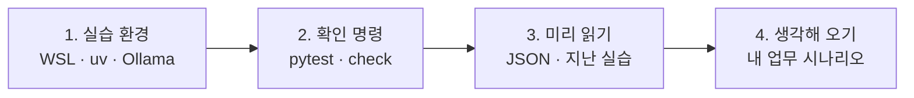

# 64일차 실습 준비 · 수업 전에 미리 해 두면 좋은 것

- 수업일: 2026-10-14 (64일차) · AI 워크플로우 개념 및 구성 요소 이해
- 준비 시간: 약 1시간 (모델 다운로드 포함)
- **수업 전날까지** 1~2절을 끝내 주세요. 3~4절은 시간이 될 때 읽어 오면 수업이 훨씬 쉬워집니다.



---

## 1. 실습 환경 준비 (전날 필수, 약 40분)

오늘 실습은 Windows 11 노트북의 **WSL(Ubuntu)** 에서, LLM은 노트북에서 직접 실행하는 **Ollama**로 진행합니다. API 키는 필요 없습니다.

자세한 순서는 **[사전 준비 안내 (SETUP-WSL-OLLAMA)](../../Last3Mon/64/SETUP-WSL-OLLAMA.md)** 를 따라 하세요. 할 일만 요약하면 다음과 같습니다.

| 순서 | 할 일 | 시간 |
| --- | --- | --- |
| 1 | WSL(Ubuntu) 동작 확인 | 5분 |
| 2 | 노트북 메모리 확인 → 사용할 모델 결정 (8GB: `gemma3:1b`, 16GB 이상: `gemma3:4b`) | 2분 |
| 3 | uv 설치, 수업 저장소 받기 (WSL 홈 `~` 아래) | 10분 |
| 4 | Ollama 설치와 모델 다운로드 | 10~20분 |
| 5 | `~/.bashrc`에 `MINIFLOW_LLM`, `OLLAMA_MODEL` 설정 | 3분 |

> 모델 파일이 1~3GB라서 수업 중에 여러 명이 동시에 받으면 강의실 네트워크가 매우 느려집니다. **다운로드는 꼭 집에서 미리** 해 주세요.

## 2. 준비가 끝났는지 확인 (전날 필수, 5분)

WSL 터미널에서 실습 폴더로 이동해 아래 두 명령을 실행합니다.

```bash
cd ~/<수업 저장소>/Last3Mon/64/workflow-lab
uv run pytest -q          # 12 passed, 1 skipped 가 나오면 성공
uv run miniflow check     # Reply (ollama, ...) 가 나오면 성공
```

| 결과 | 의미 |
| --- | --- |
| 두 명령 모두 성공 | 준비 완료 |
| `pytest`는 성공, `check`가 실패 | Ollama 설정 문제. 안내서 7절(문제 해결) 확인 |
| 둘 다 실패 | uv 또는 저장소 위치 문제. 안내서 3절부터 다시 확인 |

해결이 안 되면 수업 당일 1교시 전에 말씀해 주세요. 그동안은 `export MINIFLOW_LLM=mock`으로 Mock LLM을 써서 실습을 따라올 수 있습니다.

---

## 3. 미리 읽어 오면 좋은 내용 (선택, 약 15분)

### 3.1 JSON 기초: 오늘 워크플로우를 적는 형식

오늘 실습에서는 워크플로우를 **JSON** 파일로 적습니다. JSON은 데이터를 "이름: 값" 짝으로 적는 형식입니다. 지난 실습에서 FastAPI 요청·응답이나 Pydantic 모델로 이미 여러 번 본 형식입니다.

```json
{
  "name": "날씨 안내",
  "inputs": ["city"],
  "nodes": [
    {"id": "start", "type": "input"},
    {"id": "weather", "type": "tool", "tool": "get_weather", "args": {"city": "{{input.city}}"}}
  ],
  "edges": [["start", "weather"]]
}
```

| 기호 | 뜻 | 위 예시에서 |
| --- | --- | --- |
| `{ }` | 객체: "이름": 값 짝의 묶음 | 노드 하나 `{"id": "start", ...}` |
| `[ ]` | 목록: 여러 값을 순서대로 | `"nodes": [ ... ]` 노드 목록 |
| `"이름": 값` | 이름과 값 한 쌍 | `"type": "tool"` |
| `,` | 항목 사이 구분 | 마지막 항목 뒤에는 쓰지 않음 |

자주 하는 실수

- 문자는 반드시 **큰따옴표** `"`로 감쌉니다. 작은따옴표 `'`는 JSON에서 쓸 수 없습니다.
- 마지막 항목 뒤에 쉼표를 붙이면 오류가 납니다. `{"a": 1, "b": 2,}` (X)
- 괄호 `{ }`, `[ ]`의 짝이 맞아야 합니다. VS Code에서 괄호를 클릭하면 짝이 강조됩니다.

### 3.2 지난 실습 떠올리기

오늘 배우는 노드는 모두 지난 3개월 동안 코드로 만들어 본 것들입니다. 아래 표의 실습을 한 번 떠올려 보세요.

| 오늘의 노드 | 지난 실습 | 떠올릴 것 |
| --- | --- | --- |
| LLM 노드 | 10일차 LLM API(OpenAI/Anthropic/Gemini) 호출, 27일차 Structured Output | 프롬프트를 보내고 답을 받는 흐름, 정해진 형식으로 답 받기 |
| Tool 노드 | 29~31일차 Tool Use·MCP (`mini_agent_03_tool`, `mini_agent_03_mcp`) | 외부 기능(날씨 조회 등)을 호출해 결과를 받는 흐름 |
| Memory 노드 | 35·39일차 Memory (`mini_agent_05_memory`) | 사용자 선호·이력을 저장하고 다음 요청에 다시 쓰는 흐름 |
| 실행 순서·병렬 | 48일차 분산 협업 (`mini_multi_agent_04`) | 여러 Agent를 동시에 실행하고 결과를 합치는(Join) 흐름 |
| 로컬 LLM | 8~9월 Ollama 실습 (`llama3.2`, `gemma3:4b`) | 노트북에서 모델을 실행하는 방법 |

### 3.3 용어 미리 보기

| 용어 | 한 줄 뜻 |
| --- | --- |
| 워크플로우 | 업무를 정해진 순서의 단계로 나누어 실행하는 흐름 |
| 노드 | 워크플로우에서 한 가지 일을 하는 단계 하나 |
| 연결(Edge) | 노드 사이의 실행 순서와 데이터가 지나가는 길 |
| 페이로드 | 노드 사이를 오가는 데이터 |
| 실행 기록(Trace) | 실행할 때마다 남는 노드별 입력·출력·시간 기록 |

---

## 4. 생각해 오기 (선택, 5분)

5~6교시 Lab 03에서 **업무 하나를 골라 자동화 시나리오로 분석**합니다. 아래 질문에 대한 답을 하나 생각해 오면 실습 시간을 아낄 수 있습니다.

- 학교·회사·아르바이트·일상에서 **자주 반복하는 일** 중 하나는 무엇인가요?
- 그 일은 어떤 순서로 진행되나요? (예: 메일 확인 → 내용 분류 → 자료 찾기 → 답장)
- 그중 **판단이 필요한 단계**와 **정해진 규칙대로 하는 단계**는 각각 어디인가요?

떠오르지 않으면 수업에서 제시하는 예시 시나리오 5개 중 하나를 골라도 됩니다.

---

## 5. 당일 준비물

- 충전된 노트북과 충전기 (Ollama는 배터리를 많이 사용합니다)
- Windows Terminal (WSL 터미널), VS Code
- 웹 브라우저 (워크플로우 그림 확인용 [Mermaid Live Editor](https://mermaid.live))
- (선택) OpenAI/Anthropic/Gemini 중 가지고 있는 API 키 하나 (예: 10일차에 발급한 Gemini 키) — 로컬 모델과 클라우드 모델을 비교해 볼 수 있습니다

## 확인

- [ ] `uv run pytest -q` → `12 passed, 1 skipped`
- [ ] `uv run miniflow check` → `Reply (ollama, ...)`
- [ ] JSON 기초(3.1)를 읽었다
- [ ] Lab 03에서 분석할 업무 후보를 하나 생각했다
