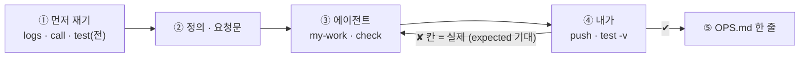
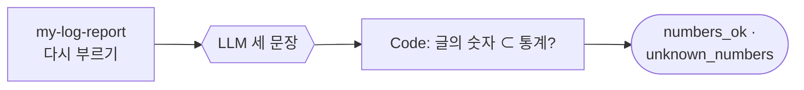
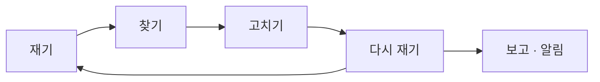

# 77일차 개요 · 실행 로그 분석과 운영 데이터 기반 Workflow 개선

> 노코드 멀티 에이전트 워크플로우 설계 및 운영 · 2026-11-02
> 30장 · 각 장은 가로줄(`---`)로 나뉩니다. 1교시에는 1~6장을 보고, 나머지 장은 각 단계 강의(1 · 3 · 5교시) 때 함께 띄웁니다.
> 숫자는 모두 강사 노트북 실측입니다 (65일차 n8n 2.42.6, 77일차 판 데이터 API의 두 주 실행 기록 666줄, OpenAI `gpt-4.1-mini`(요약 · 헬프데스크 답), 10/31 정답 워크플로우를 학생 순서대로 1회).

| 장 | 범위 | 띄우는 때 |
| --- | --- | --- |
| 1~6 | 표지 · 목표 · 시간표 · 숫자가 다른 두 보고서 · 일하는 순서 · 실습 15개 | 1교시 시작 |
| 7~14 | 1단계 · 실행 기록 읽기와 지표 | 1교시 강의 |
| 15~21 | 2단계 · 문제를 숫자로 찾기 | 3교시 강의 |
| 22~28 | 3단계 · 고치고 다시 재기 | 5교시 강의 |
| 29~30 | 바이브 코딩 · 정리와 예고 (8교시 35분 정리는 [04-STAGE4-WRAPUP](04-STAGE4-WRAPUP.md)) | 7교시 · 8교시 |

---

## 1 / 30 · 표지

**77일차**

# 실행 로그 분석과 운영 데이터 기반 Workflow 개선

감으로 말하지 않고 · 정의된 숫자로 찾고 · 고친 뒤 다시 잰다

노코드 멀티 에이전트 워크플로우 설계 및 운영 · 2026-11-02

---

## 2 / 30 · 오늘 할 수 있게 될 세 가지

| | 목표 | 내용 |
| --- | --- | --- |
| 1 | **잰다** | 실행 기록을 읽고, 정의대로 세는 보고서(실행 · 오류율 · p50 · p95 · 갈래)를 만들고, 경계에서 시험하고, 날짜 · 릴리스 · 단계 · 비용으로 나눈다 |
| 2 | **찾는다** | 실패를 원인으로 묶고, 오류가 아닌 실패를 세고, 이상 시간대와 비교 기준을 정하고, 수와 비율을 나누고, LLM 요약의 숫자를 Code로 확인한다 |
| 3 | **고치고 다시 잰다** | 고칠 곳과 사람을 나눠 고치고, 같은 조건으로 다시 돌리고, SLO로 판정하고, 고친 것의 대가를 찾고, 주간 보고 · SLO 알림을 만든다 |

---

## 3 / 30 · 오늘의 시간표

| 교시 | 시간 | 내용 |
| --- | --- | --- |
| 1 | 09:00~09:50 | 개요 · **1단계 강의** · 실행 기록 읽기와 지표 |
| 2 | 10:00~10:50 | **Lab 01 실습 5개** · 기준 보고서 비교 · 지표 보고서 · 경계 · 날짜별 · 릴리스별 · 단계 · 비용 |
| 3 | 11:00~11:50 | **2단계 강의** · 문제를 숫자로 찾기 |
| 4 | 12:00~12:50 | **Lab 02 실습 5개** · 실패 묶음 · 답 못 한 주제 · 이상 시간대 · 기간 · 다시 묻는 주제 · LLM 요약 |
| - | 13:00~14:00 | 점심 |
| 5 | 14:00~14:50 | **3단계 강의** · 고치고 다시 재기 |
| 6 | 15:00~15:50 | **Lab 03 실습 5개** · 고치기 전 · 후 · SLO · 고친 것의 대가 · 주간 보고 · SLO 알림 |
| 7 | 16:00~16:50 | 바이브 코딩 `tlog`: 요청서 → TODO → SPEC → IMP-PLAN → 만들기 → 설치 |
| 8 | 17:00~17:50 | 발표 · **4단계 정리** (의미 · 효과 · 회사에서 쓰는 법) · 78일차 예고 |

---

## 4 / 30 · 오늘의 출발점: 같은 기록, 다른 숫자

헬프데스크 두 주(10/19~10/30) 실행 기록 666줄과, 팀이 지난달 만든 보고서 `base-report`.

| 질문 | `logs` (그대로 셈) | 팀의 보고서 |
| --- | --- | --- |
| 두 주에 몇 번? | 666 | **602** |
| 오류율? | 0.0315 | **3.488…** |
| 10/26 하루는? | 70 · 오류 16 | **0** · `null` |
| 느린 정도? | p95 2537ms | 평균 1249ms |

그리고 아직 아무도 세지 않은 것: 담당자에게 넘긴 질문 **34건이 모두 와이파이**.

---

## 5 / 30 · 일하는 순서 (오늘은 "재기 → 정의 → 고치기 → 다시 재기")

| 누가 | 무엇을 |
| --- | --- |
| 나 | 기록을 읽고 질문, 정의 정하기, 기준과 비교, 문제의 순서, FAQ(콘텐츠) 고치기 |
| CLI 에이전트 | `AGENTS.md`대로 워크플로우 JSON, `check` |
| `flow.py` | `logs`(기록 훑기), `test --webhook`(기준과 비교), `ops`(오늘 기록 · 더한 FAQ · 알림), `diff` |

---

## 6 / 30 · 실습 15개 (Lab마다 예제 3 · 과제 2)

| | 예제 1 | 예제 2 | 예제 3 | 과제 1 | 과제 2 |
| --- | --- | --- | --- | --- | --- |
| Lab 01 | 손으로 읽기 · 기준 보고서 (에이전트 없이) | 지표 보고서 | 경계에서 재 보기 (에이전트 없이) | 날짜별 · 릴리스별 | 단계별 · 비용 |
| Lab 02 | 실패 묶음 · 답 못 한 주제 | 이상 시간대 | 기간을 바꾸면 (에이전트 없이) | 다시 묻는 주제 | LLM 요약 · 숫자 확인 |
| Lab 03 | 고치기 전 → 고치기 → 고친 뒤 | SLO 판정 | 고친 것의 대가 (에이전트 없이) | 주간 보고 | SLO 알림 |

---

## 7 / 30 · 1단계 · 실행 기록: 운영의 영수증

> 생활 속 예: 계산대 옆 상자에 쌓인 두 주 치 영수증 — 세면 "요즘 장사가 어떤지"를 숫자로 답할 수 있다.

| 관측의 세 가지 | 무엇 | 오늘 |
| --- | --- | --- |
| 로그 | 일어난 일 하나하나 | 실행 기록 666줄 (실행 한 번에 한 줄, 칸이 정해진 JSON) |
| 지표 | 로그를 세고 나눈 숫자 | 실행 · 오류율 · p95 · 답 못 함 |
| 추적 | 한 요청의 단계마다 시간 | `steps.faq_ms` · `steps.answer_ms` |

- 두 주 666건 · 오류 21 (3.2%), 그런데 10/26 하루에 **16건** (22.9%).

---

## 8 / 30 · 지표는 정의다

> 생활 속 예: 알바생 둘이 같은 영수증을 세었는데 답이 다름 — 한 사람은 마지막 날을 빼고 셌다.

| 정해야 할 것 | 오늘의 정의 (AGENTS.md 3절) | 팀의 보고서 |
| --- | --- | --- |
| 기간의 경계 | `from ≤ 날짜 ≤ to` (끝날 포함) | `started_at < to` (끝날 64건 빠짐) |
| 표현 | 비율, 소수 4자리 | 백분율, 끊지 않음 |
| 0건일 때 | 0 | `null` |
| 오류 갈래 | `null` → `"오류"` | 건너뜀 |

- 기준에 오늘 테스트 **0/5**, 정의대로 세는 내 보고서 **5/5** (Lab 01 예제 2). 정의는 한 곳에 — 나머지는 다시 부른다.

---

## 9 / 30 · 백분위: 평균이 숨기는 것

> 생활 속 예: "버스가 평균 10분마다"보다 "열 번 중 아홉 번은 8분 안"이 기다리는 사람에게 쓸모 있다.

| 같은 기록 | 평균 | p50 | p95 |
| --- | --- | --- | --- |
| 1초 × 9 + 10초 × 1 | 1.9초 | 1초 | 10초 |

- 오늘 정의: 오름차순 **`ceil(p × n)`번째** (가장 가까운 순위), 오류 실행 포함. 666건이면 p95 = 633번째.
- 두 주 p50 1205 · p95 2537ms. 둘째 주는 p50이 빨라지고(1252 → 1171) p95는 느려짐(2525 → 2598).

---

## 10 / 30 · 숫자는 Code가 센다

> 생활 속 예: 손님에게 설명은 점원이, 하루 매출 합계는 포스기가.

| 일 | 누가 |
| --- | --- |
| 거르기 · 세기 · 나누기 · 백분위 | Code (거르기는 데이터 API `/logs/query`) |
| 센 결과를 사람의 말로 | LLM (Lab 02 과제 2) |
| LLM 글의 숫자 확인 | Code |

- 내 보고서: `Get logs` → `Compute metrics`(Code 하나) → 응답. 666줄에 **0.1초 안팎**, LLM 없음.
- 갈래의 합 = 실행 수로 자기 검산 (21 + 299 + 17 + 20 = 357).

---

## 11 / 30 · 경계와 0 (Lab 01 예제 3)

> 생활 속 예: 줄자의 끝 눈금 한 칸 — 1m를 잴 땐 상관없어도 1cm를 잴 땐 전부다.

| 경계 | 내 보고서 | 팀의 보고서 |
| --- | --- | --- |
| 하루 (from = to) | ✔ 70 | ✘ 0 |
| 빈 기간 | ✔ 0 · 0 · 0 | ✘ `null` (0 / 0) |
| 주말 · 기간 없음 | ✔ | ✔ (우연히) |
| `source: live` | ✔ 0 | ✘ **666** (거르기를 무시) |

- 6/6 대 2/6. 경계가 문제를 **가려** 우연히 맞는 테스트도 있다.

---

## 12 / 30 · 묶어서 세기 · 표본 크기 (Lab 01 과제 1)

> 생활 속 예: 가계부의 날짜별 칸 — "15일에 한 번 크게 썼다"가 보인다. 새 앱으로 산 날이 이틀뿐이면 아직 모른다.

| 묶음 | 결과 |
| --- | --- |
| 10/26 (월) | 70 · 오류 **16** |
| 10/29 (목) | 97 · 오류 5 |
| 1.0.0 · 1.1.0 | 다시 묻기 4.73% · 7.73% |
| 1.2.0 (카나리) | 62.5%, 그러나 답 **8건** |

- 비율 옆에 늘 건수. 분모는 "답을 준 실행" (402 + 181 + 8 = 591 = 자동 답변).

---

## 13 / 30 · 단계 시간: 어디가 느린가 (Lab 01 과제 2)

> 생활 속 예: 택배 배송 조회의 구간별 시간 — 허브에서 하루를 묵었다면 기사님을 재촉해도 소용없다.

| 단계 p95 | 두 주 | 10/26만 |
| --- | --- | --- |
| FAQ 검색 | **39ms** (646건) | **1000ms** |
| LLM 답 | 2509ms (596건) | 2482ms |

- 평소 느린 것은 LLM, 월요일에는 FAQ 검색 (timeout 1초에 걸림). 거치지 않은 단계(0ms)는 뺀다 — `runs`를 함께.

---

## 14 / 30 · 비용: 질문 하나에 얼마 (Lab 01 과제 2)

> 생활 속 예: 택배비를 상자마다 알아야 한 달 운송비를 잡는다.

| 두 주 | 값 |
| --- | --- |
| LLM 비용 | 0.07836달러 |
| 실행당 | 0.000118달러 |
| LLM 호출 | 596번 (답한 실행마다 한 번) |

- 합계는 예산(75일차), 실행당 비용은 "질문 하나에 얼마". 빈 기간은 0 (나누지 않음).

---

## 15 / 30 · 2단계 · 문제 목록은 원인으로 (Lab 02 예제 1)

> 생활 속 예: 반품 21건을 사유로 묶으면 "사이즈 16 · 불량 5" — 고칠 일은 둘.

| 원인 (노드 · 메시지) | 건수 |
| --- | --- |
| `Search FAQ` · timeout of 1000ms exceeded | **16** |
| `Answer` · 429 Rate limit reached | 5 |

- 오류 21건 = 원인 2개, 맨 위 하나가 76% (파레토). 업계: Sentry 지문 · 오류 묶기.

---

## 16 / 30 · 오류가 아닌 실패 (Lab 02 예제 1)

> 생활 속 예: "찾는 물건 없음" 메모 34장이 모두 같은 물건 — 반품도 결제 오류도 아니라 장부엔 안 남는다.

| | 오류 | 담당자 연결 |
| --- | --- | --- |
| `status` | error | **success** |
| 오류율에 | 잡힘 | 안 잡힘 |
| 두 주 | 21 | **34 — 모두 와이파이** |
| 고칠 곳 | 워크플로우 · 바깥 서비스 | **콘텐츠** (FAQ에 항목이 없음) |

- 업계: 이관율(escalation rate) · 자동 해결률(deflection). 두 주 이관율 5.11%.

---

## 17 / 30 · 이상 시간대 (Lab 02 예제 2)

> 생활 속 예: 시간대별 매출표에서 손님이 충분했는데 9시에만 0건 — 그 시간에 무슨 일이 있었다.

| 묶기 | 비교 기준 | 문턱 |
| --- | --- | --- |
| 시간 (`2026-10-26T09`) | 그 기간 전체 오류율 | 3배 이상 · 5건 이상 · 오류 1건 이상 |

| 이상 시간대 (두 주, 문턱 0.0945) | 실행 · 오류 |
| --- | --- |
| 10/26 (월) 09시 | 16 · **16** |
| 10/29 (목) 15시 | 7 · 5 |

---

## 18 / 30 · 비교 기준이 판정을 바꾼다 (Lab 02 예제 3)

> 생활 속 예: "평소보다 많이 먹었다"의 평소 — 명절 기준이면 적게, 평일 기준이면 많이.

| 기간 | 전체 오류율 | 문턱 (× 3) | 이상 |
| --- | --- | --- | --- |
| 첫 주 | 0 | 0 | 없음 |
| 두 주 | 0.0315 | 0.0945 | 09시 · 15시 |
| 10/26만 | 0.2286 | **0.6858** | 09시 |

- 문턱이 일곱 배 넘게 달라짐. 사건이 기준을 끌어올림 → 보고에 **기준 기간**을 함께.

---

## 19 / 30 · 수와 비율 (Lab 02 과제 1)

> 생활 속 예: 교환하러 다시 온 손님 — 많이 팔린 물건은 다시 오는 수도 많으니 비율로 봐야 나쁜 설명서가 보인다.

| 주제 | 답 | 다시 물음 | 비율 |
| --- | --- | --- | --- |
| 프린터 | 81 | 8 | **9.88%** |
| 비밀번호 | 139 | **9** | 6.47% |

- 실패 목록 셋: 오류 · 답 못 함 · 답했는데 도움 안 됨. 업계: 재문의율 · FCR(한 번에 해결).

---

## 20 / 30 · 글은 LLM, 숫자 확인은 Code (Lab 02 과제 2)

> 생활 속 예: 점장의 세 줄 보고를 본사가 장부 · 계산기로 맞춰 본다.

> 가장 많은 미응답 주제는 와이파이로 17건입니다. 가장 흔한 장애는 Search FAQ 노드에서 발생한 "timeout of 1000ms exceeded" 메시지로 16건입니다. 이상 징후가 가장 심한 시간대는 10월 26일 09시로, 총 16건 중 16건이 오류입니다.

- `numbers_ok: true` — 17 · 1000 · 16 · 10 · 26 · 09 모두 통계에 있음 (×100 · 날짜 · 메시지 속 숫자까지).

---

## 21 / 30 · 원인 × 시간 = 사건 (Lab 02 예제 2)

> 생활 속 예: 사고 경위서 — "월요일 9시 단말기 고장으로 결제 16건 실패" 한 줄.

| 사건 | 언제 | 무엇 | 몇 건 |
| --- | --- | --- | --- |
| ① | 10/26 09시 | FAQ 검색 timeout | 16 / 16 |
| ② | 10/29 15시 | LLM 429 | 5 / 7 |
| (오류 아님) | 두 주 내내 | 와이파이 → 담당자 연결 | 34 |

- 16 + 5 = 21 = 오류 전부 → **두 번의 사건** + 기간 내내의 콘텐츠 문제.

---

## 22 / 30 · 3단계 · 같은 조건으로 다시 돌려 잰다 (Lab 03 예제 1)

> 생활 속 예: 단말기를 고친 뒤 그날과 같은 상황에서 같은 손님 열 명을 다시 받아 본다.

| FAQ 1.2초 느림 · 같은 10개 | 오류 | 갈래 | 한 건 |
| --- | --- | --- | --- |
| `before` (timeout 1초, 와이파이 FAQ 없음) | **10** | 오류 10 | 1.1~2.1초 |
| `after` (timeout 3초 · 재시도 + FAQ-007) | **0** | 자동 답변 10 | 2.3~4.5초 |

| 고칠 곳 | 누가 |
| --- | --- |
| Search FAQ timeout · 재시도 | 에이전트 (워크플로우) |
| 와이파이 FAQ | 나 (`faq/add`, 콘텐츠) |

---

## 23 / 30 · SLO: 숫자로 한 약속 (Lab 03 예제 2)

> 생활 속 예: "빠르게 배달" 대신 "30분 안에, 아니면 할인".

| SLI | SLO | 둘째 주 | 고친 뒤 |
| --- | --- | --- | --- |
| 오류율 | 0.01 | **0.0588** ✘ | 0 |
| p95 | 3000ms | 2598 | **3560** ✘ |
| 답 못 함 | 0.02 | **0.0476** ✘ | 0 |

- 기준은 본문 `slo`로 바꿀 수 있게. 에러 예산 = 목표까지 남은 여유.

---

## 24 / 30 · 고친 것의 대가 (Lab 03 예제 3)

> 생활 속 예: 단말기 대기 시간을 늘려 결제 실패는 사라졌지만 줄이 길어졌다.

| 같은 10개 | FAQ | 오류 | FAQ 단계 p50 | 답 단계 p50 | p95 |
| --- | --- | --- | --- | --- | --- |
| `after` | 느림 | 0 | **1238ms** | 1103ms | 3560ms |
| `normal` | 평소 | 0 | **17ms** | 997ms | 2147ms |

- 늘어난 시간은 모두 FAQ 단계 → timeout은 **완화**(견디기), 근본 해결은 FAQ 검색이 느려지는 원인.

---

## 25 / 30 · 주간 보고: 조립 (Lab 03 과제 1)

> 생활 속 예: 매주 같은 칸으로 채우는 주간 매출 보고서 — 할 일은 정해진 규칙대로.

| 절 | 누가 | 이번 주 |
| --- | --- | --- |
| 숫자 | Code (보고서 두 번) | 요청 309 → 357, 오류율 0% → 5.88% |
| 문제 | Code | 실패 16 · 5, 와이파이 17, 이상 09시 · 15시 |
| 요약 | LLM + 숫자 확인 | 통과 |
| 다음 할 일 | **규칙** | 와이파이 FAQ · timeout · 사용량 한도 |

---

## 26 / 30 · SLO 알림 · 같은 알림은 한 번 (Lab 03 과제 2)

> 생활 속 예: 냉장고 온도 경보 — 한 번 울리고, 10분 안에는 다시 울리지 않되 기록은 남긴다.

| 물은 것 | 결과 |
| --- | --- |
| 둘째 주 | `sent` — `SLO breach: error_rate 0.0588 > 0.01, unanswered_rate 0.0476 > 0.02` |
| 10분 안 다시 | `suppressed` (알림 1개 그대로) |
| 기준 안 | `none` |

---

## 27 / 30 · 개선의 고리

> 생활 속 예: 다이어트 — 같은 체중계 · 같은 시각에 재고, 늘어난 날을 찾고, 줄이고, 다시 잰다.

| 규칙 | 오늘 |
| --- | --- |
| 정의는 한 곳 | `my-log-report`, 나머지는 다시 부름 |
| 같은 조건으로 다시 | 고장 스위치 · 같은 질문 · `tag` |
| 고친 것 말고도 다시 | p95 새 위반 |
| 건수 · 기준 기간을 함께 | 1.2.0 8건, 문턱의 기간 |

---

## 28 / 30 · 가게 장부로 본 오늘 하루

> 생활 속 예: 오늘 만든 것이 모두 동네 가게에 있다 (3단계 8절 표).

| 오늘 | 가게 |
| --- | --- |
| 실행 기록 · 지표 정의 | 영수증 더미 · 장부 쓰는 법 |
| p95 · 경계 | 버스 도착 시간 · 줄자 끝 눈금 |
| 실패 묶음 · 답 못 함 · 다시 묻기 | 반품 사유표 · "찾는 물건 없음" · 교환 손님 |
| 이상 시간대 · 비교 기준 | 매출표의 빈칸 · "평소"의 기준 |
| 요약 + 숫자 확인 | 점장 보고 + 계산기 |
| 다시 돌리기 · SLO · 대가 | 같은 손님 열 명 · 30분 배달 약속 · 길어진 줄 |
| 주간 보고 · SLO 알림 | 주간 매출 보고서 · 냉장고 경보 |

---

## 29 / 30 · 7교시 바이브 코딩 · `tlog`

요청서(운영 담당의 말 ①~⑫) → `Doc/TODO.md` → `SPEC.md` → `IMP-PLAN.md` → 단계별로 → `uv tool install`.

| 오늘 n8n에서 | `tlog`로 터미널에서 |
| --- | --- |
| `my-log-report` (정의 3절) | `tlog summary` — **같은 기간이면 같은 숫자** |
| 실패 묶음 · 이상 시간대 | `tlog problems` |
| SLO 판정 | `tlog slo` — 위반이면 종료 코드 4 (cron · CI에서) |
| 주간 보고 | `tlog weekly --md` (나중 단계) |
| (없음) | 파일 · 데이터 API 둘 다 읽기, 76일차 `tretry` 기록도 |
| (없음) | TUI: 묶음을 고르면 그 실행들 |

- 강사 본: 두 주 · 둘째 주 · 10/26 · 빈 기간에 `tlog summary --json`과 `my-log-report` 응답을 칸마다 비교 → **18칸 중 다른 칸 0개**. 둘째 주 `tlog slo` → 종료 코드 4. 테스트 23개 1.7초 (n8n 없이).

---

## 30 / 30 · 오늘의 정리 · 78일차 예고

| 단계 | 오늘 숫자 |
| --- | --- |
| 재기 | 기준 602 · 0/5 → 정의대로 666 · 5/5, 경계 6/6 대 2/6, 월요일 FAQ p95 1000ms |
| 찾기 | 오류 21 = 원인 2 = 사건 2, 와이파이 34, 문턱 0.0945 ~ 0.6858, 프린터 9.88%, 요약 `numbers_ok` |
| 고치고 다시 재기 | 오류 10 → 0, 대신 p95 3560 > 3000 (FAQ 단계 1238ms · 평소 17ms), 주간 보고 7/7, SLO 알림 `sent` → `suppressed` |

- 8교시 [4단계 정리](04-STAGE4-WRAPUP.md): 의미 · 효과 · 업계 이름 · 면접 · 최종 프로젝트 체크리스트.
- 78일차 (11/3): **데이터 품질 검증 자동화 및 품질 관리 Workflow** — 오늘은 기록을 "믿고" 셌다. 내일은 들어오는 데이터 자체가 맞는지(빠진 칸 · 이상한 값 · 중복)를 규칙으로 검사하고 품질 관문을 세운다.
