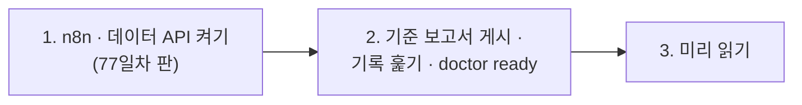

# 77일차 실습 준비 · 수업 전에 미리 해 두면 좋은 것

- 수업일: 2026-11-02 (77일차) · 실행 로그 분석과 운영 데이터 기반 Workflow 개선
- 준비 시간: 약 10분
- 먼저 WSL에서 `cd ~/aio-01d4-stu && git pull`로 오늘 자료를 받습니다 (수강생 저장소: https://gl.isitsoft.kr/publicproj/aio-01d4-stu).
- **수업 전날까지** 1~2절을 끝내 주세요.



---

## 1. n8n과 데이터 API 켜기 (전날 필수, 3분)

오늘은 **77일차 판 데이터 API**(76일차 + 두 주 실행 기록 666줄 · 오늘 실습 기록 · FAQ 더하기)를 씁니다. 같은 이름이라 이 폴더에서 다시 만들면 바뀝니다.

```bash
sudo systemctl disable --now ollama 2>/dev/null   # WSL에 설치한 Ollama가 있으면 끄고 자동 시작도 끔
cd ~/aio-01d4-stu/Last3Mon/65/n8n
docker compose rm -sf ollama                      # Ollama 컨테이너가 있으면 지움 (없으면 그냥 지나감)
docker compose start
cd ~/aio-01d4-stu/Last3Mon/77/data-api
docker compose up -d --force-recreate
sleep 3                                           # 데이터 API가 뜰 때까지
curl -s 'localhost:8800/logs?limit=1'             # {"count": 666, "logs": [ { "execution_id": 5001, … } ]}
```

- **66일차부터 LLM은 OpenAI API 키(`Last3Mon/.env`, Credential `OpenAI (.env)`)만 씁니다.** 오늘 LLM은 Lab 02 과제 2의 요약과 Lab 03 헬프데스크의 답에만 씁니다 (`gpt-4.1-mini`). 지표는 모두 Code가 셉니다. Ollama는 쓰지 않습니다.
- 76일차의 접수 건 · DLQ · 알림 · 고장 스위치는 데이터 API를 새로 띄우면 처음으로 돌아갑니다. 두 주 실행 기록은 늘 그대로입니다.
- 오늘 실습에서 남기는 기록은 한국 시간으로 찍힙니다 (`TZ=KST-9`). 두 주 기록(10/19~10/30)과 날짜가 겹치지 않습니다.
- `network day65-n8n_default not found` → n8n이 켜져 있지 않음. 위 n8n 부분부터 다시.

## 2. 기준 보고서 게시 · 기록 훑기 · 준비 확인 (전날 필수, 3분)

오늘 비교할 **팀의 기준 보고서**를 게시해 둡니다 (만들지 않고 게시만).

```bash
cd ~/aio-01d4-stu/Last3Mon/77
uv run tools/flow.py push reference/baseline-report.json
uv run tools/flow.py logs --from 2026-10-26 --to 2026-10-26 --last 3   # 70 run(s) · errors 16 (22.9%)
uv run tools/flow.py ops --reset
uv run tools/flow.py doctor
```

```text
✔ n8n container day65-n8n-n8n-1
✔ n8n http://localhost:5678
✔ data API http://localhost:8800
✔ dead letter queue /dlq · alerts · fault switch dlq (day 76 data API)
✔ run logs /logs (666 seeded runs) · FAQ additions /faq-extra (day 77 data API)
✔ n8n → http://data-api:8800
✔ credential 'OpenAI (.env)' (openAiCourse0001)
✔ node catalog (for check)
✔ CLI coding agent: codex, claude, agy
ready
```

| ✘ 항목 | 할 일 |
| --- | --- |
| n8n container · data API | 1절 |
| run logs `/logs` | 데이터 API가 예전 판 → 1절 `--force-recreate` · `sleep 3` |
| `! live run log(s) left` · `! FAQ entr(ies) added` · `! fault switch is on` | `uv run tools/flow.py ops --reset` |
| credential | `cd ~/aio-01d4-stu/Last3Mon/65/n8n && bash register-credentials.sh` |
| CLI coding agent | [67일차 준비](../67/00-DAY67-PREP.md) 2절 |

---

## 3. 미리 읽어 오면 좋은 내용 (선택, 약 5분)

### 3.1 같은 기록인데 숫자가 다르다면

"두 주 동안 헬프데스크가 몇 번 실패했나?"를 옆 사람과 각자 세었는데 답이 다르다면, 누가 틀린 걸까요? 마지막 날을 넣었나, 백분율로 썼나, 어디서 반올림했나 — 오늘 첫 실습에서 팀이 쓰던 보고서와 직접 비교합니다.

### 3.2 용어

| 용어 | 한 줄 설명 |
| --- | --- |
| 실행 기록 (run log) | 워크플로우가 한 번 돌 때마다 남기는 한 줄 (언제 · 결과 · 갈래 · 시간 · 실패한 노드) |
| 지표 (metric) · 정의 | 기록을 세고 나눈 숫자 · 무엇을 세고 무엇으로 나누고 몇 자리로 쓰는지 정한 것 |
| p50 · p95 | 짧은 것부터 줄 세웠을 때 절반째 · 95%째 시간 ("100명 중 95명은 이 안") |
| 이관율 | 답을 못 해 사람(담당자)에게 넘긴 비율 |
| 이상 시간대 | 평소(비교 기준)보다 크게 나빴던 시간 |
| SLO | "오류율 1% 이하"처럼 숫자로 정한 서비스 약속 |
| 다시 돌려 보기 (replay) | 고친 뒤 같은 조건 · 같은 질문으로 다시 재기 |

### 3.3 7교시 요청서

[VIBE-REQ-TLOG](../../Last3Mon/77/VIBE-REQ-TLOG.md)를 한 번 읽어 옵니다. 운영 담당이 원하는 것 열두 가지 중 "꼭"은 무엇일까요? 그리고 "n8n 보고서와 같은 숫자"가 왜 중요할까요?

## 4. 당일 준비물

- 충전된 노트북과 충전기, WSL의 Docker, Windows Terminal(WSL) 창 **두 개**, 웹 브라우저
- 숫자를 적을 `my-work/OPS.md` (`cp templates/OPS-ANALYSIS-TEMPLATE.md my-work/OPS.md`)

## 확인

- [ ] `curl -s 'localhost:8800/logs?limit=1'`이 `count 666`
- [ ] `logs --from 2026-10-26 --to 2026-10-26`이 `70 run(s) · errors 16`
- [ ] `uv run tools/flow.py doctor` → 마지막 줄 `ready`
