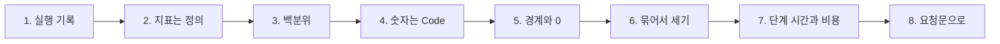

# 1단계 · 실행 기록 읽기와 지표

- 교시: 1교시 강의 (09:00~09:50) · 2교시 [Lab 01](../../Last3Mon/77/LAB-01-Q-READ-AND-MEASURE.md) 실습 5개 (10:00~10:50)
- 이 단계가 끝나면: 실행 기록 한 줄에 무엇이 있는지 읽고, 같은 기록에서 숫자가 달라지는 까닭을 **정의**로 설명하고, 정의대로 세는 보고서(실행 · 오류율 · p50 · p95 · 갈래)를 Code로 만들고, 경계(하루 · 0건 · 거르기)에서 재 보고, 날짜 · 릴리스 · 단계 · 비용으로 나눠 볼 수 있다.
- 숫자: 모두 강사 노트북 실측입니다 (65일차 n8n 2.42.6, 77일차 판 데이터 API의 두 주 실행 기록 666줄, 10/31 실습을 5개로 늘린 뒤 정답 워크플로우를 학생 순서대로 1회). 두 주 기록의 지표는 누가 세어도 같습니다. 출력 전부는 수업 뒤 공개되는 `Last3Mon/77/answers/LAB-TEST-RESULT.md`에 있습니다.
- 실습 가리키기: 이 문서에서 "Lab 01 예제 1"은 2교시 [Lab 01 문서](../../Last3Mon/77/LAB-01-Q-READ-AND-MEASURE.md)의 그 절입니다. 파일 경로(`cases/` · `requests/` · `my-work/` · `reference/`)는 실습 폴더 `~/aio-01d4-stu/Last3Mon/77` 기준입니다.

## 0. 이 시간 (50분)

| 시간 | 절 · 개요 | 하는 일 |
| --- | --- | --- |
| 09:00~09:06 | 개요 1~6장 | 오늘 하루, 두 주 기록 666줄과 팀의 보고서, 실습 15개 |
| 09:06~09:13 | 1 · 개요 7장 | 실행 기록, 로그 · 지표 · 추적 |
| 09:13~09:20 | 2 · 개요 8장 | 같은 기록 다른 숫자, 지표의 정의 |
| 09:20~09:27 | 3 · 4 · 개요 9~10장 | 평균과 p95, 숫자는 Code가 |
| 09:27~09:33 | 5 · 개요 11장 | 경계와 0 |
| 09:33~09:43 | 6 · 7 · 개요 12~14장 | 날짜별 · 릴리스별 · 표본 크기, 단계 시간 · 비용 |
| 09:43~09:50 | 8 · 9 · 확인 질문 | 요청문, 자주 하는 실수 |

### 2교시 Lab 01에서 이어서 하는 것

| 2교시 실습 (시각) | 이 강의의 절 | 실습에서 하는 일 | 쓰는 파일 · 명령 |
| --- | --- | --- | --- |
| 시작 (10:00) | — | 운영 분석표 복사 | `cp templates/OPS-ANALYSIS-TEMPLATE.md my-work/OPS.md` (오늘의 숫자를 모두 여기에) |
| Lab 01 예제 1 (10:00~10:10, 에이전트 없이) | 1 · 2 | 두 주 · 하루를 훑고, 같은 기간을 기준 보고서에 | `logs --from … --to …`, `call base-report requests/two-weeks.json` · `monday.json` → `OPS.md` 1.1 |
| Lab 01 예제 2 (10:10~10:25) | 2 · 3 · 4 | 정의대로 세는 내 보고서 | `my-work/log-report.json` (새로), 테스트 `cases/lab01.json` |
| Lab 01 예제 3 (10:25~10:32, 에이전트 없이) | 5 | 경계에서 두 보고서를 재 보기 | `test cases/lab01-edges.json -v` · `--webhook base-report` → `OPS.md` 1.2 |
| Lab 01 과제 1 (10:32~10:40) | 6 | 날짜별 · 릴리스별 | 테스트 `cases/lab01-challenge.json` |
| Lab 01 과제 2 (10:40~10:50) | 7 | 단계별 p50 · p95 · 비용 | 테스트 `cases/lab01-challenge2.json` |

## 1. 실행 기록: 운영의 영수증 (2교시 Lab 01 예제 1)

### 일반 설명

> **생활 속 예 · 가게의 영수증 더미.** 동네 가게 계산대 옆 상자에 두 주 치 영수증이 쌓여 있습니다. 한 장 한 장에는 언제 · 무엇을 · 얼마에 · 카드였는지 현금이었는지가 적혀 있습니다. "요즘 장사가 어때?"라는 물음에 감으로 답할 수도 있지만, 영수증을 세면 숫자로 답할 수 있습니다. 워크플로우의 **실행 기록**이 이 영수증이고, 오늘은 영수증 더미를 장부(지표)로 만드는 날입니다.

**실행 기록(run log)은 실행 한 번에 한 줄입니다.** 워크플로우가 한 번 돌 때마다 언제 시작했고, 무엇을 받았고, 어느 갈래로 끝났고, 얼마나 걸렸고, 실패했다면 어느 노드에서 무슨 말로 실패했는지를 남깁니다. 사람이 읽는 문장(`"검색 실패"`)이 아니라 **칸이 정해진 JSON**으로 남기는 것을 구조화 로그(structured logging)라고 부릅니다. 칸이 정해져 있어야 셀 수 있습니다.

| 관측의 세 가지 (observability) | 무엇 | 오늘 |
| --- | --- | --- |
| 로그 (logs) | 일어난 일 하나하나의 기록 | 실행 기록 666줄 |
| 지표 (metrics) | 로그를 세고 나눈 숫자 | 실행 · 오류율 · p95 · 답 못 함 |
| 추적 (traces) | 한 요청이 거친 단계마다의 시간 | `steps.faq_ms` · `steps.answer_ms` (7절) |

업계 도구로는 로그를 모으는 Elasticsearch · Loki · CloudWatch Logs, 지표를 그리는 Prometheus · Grafana · Datadog, 추적의 표준인 OpenTelemetry가 있습니다. n8n도 실행마다 Executions 화면에 기록을 남기고, 공개 API(`/api/v1/executions`)로 가져올 수 있습니다. 오늘은 그 기록을 헬프데스크가 직접 남긴 모양으로 데이터 API에 모아 두었습니다.

**기록을 남기는 쪽의 규칙.** 칸 이름과 뜻이 바뀌면 보고서가 깨집니다. 그래서 기록의 모양은 **계약**입니다 (AGENTS.md 2절 "실행 기록 한 줄"). 오류일 때도 같은 모양으로, 갈래마다 같은 칸으로 남깁니다 (Lab 03의 헬프데스크).

### 오늘 실습에서

두 주(10/19~10/30, 평일 10일) 헬프데스크 기록 666줄. 한 줄의 칸은 `started_at` · `status` · `route` · `duration_ms` · `error_node` · `error_message` · `topic` · `release` · `repeat` · `steps` · `cost_usd` · `llm_calls` 등입니다. `logs`로 훑으면 (Lab 01 예제 1):

| 기간 | 실행 | 오류 | 갈래 |
| --- | --- | --- | --- |
| 두 주 | 666 | 21 (3.2%) | 자동 답변 591 · 담당자 연결 34 · 오류 21 · 잠시 후 20 |
| 10/26 (월) 하루 | 70 | **16** (22.9%) | 자동 답변 50 · 오류 16 · 담당자 연결 4 |

- 두 주 오류 21건 중 16건이 하루에 몰려 있습니다. "두 주 오류율 3%"라는 숫자 하나로는 이것이 보이지 않습니다 (6절 · Lab 02).

## 2. 지표는 정의다: 같은 기록, 다른 숫자 (2교시 Lab 01 예제 1 · 2)

### 일반 설명

> **생활 속 예 · 알바생 둘의 다른 장부.** 사장님이 "두 주 동안 몇 건 팔았지?"라고 물었더니 알바생 둘의 답이 다릅니다. 한 사람은 마지막 날 영수증을 빼고 셌고, 다른 사람은 넣고 셌습니다. 둘 다 계산은 정확합니다. **세는 법**이 달랐을 뿐입니다. 그래서 가게는 "마감일도 넣는다, 금액은 원 단위까지" 같은 장부 쓰는 법을 벽에 붙여 둡니다. 그것이 지표의 정의입니다.

**지표 = 정의 + 계산.** "오류율"이라는 이름만으로는 숫자가 하나로 정해지지 않습니다. 정의는 적어도 다섯 가지를 정해야 합니다.

| 정해야 할 것 | 예 | 정하지 않으면 |
| --- | --- | --- |
| 무엇을 세나 (분자) | `status`가 `error`인 실행 | 담당자 연결도 실패로 셀지 사람마다 다름 |
| 무엇으로 나누나 (분모) | 그 기간의 모든 실행 | 답한 것만 · 오류 아닌 것만… |
| 기간의 경계 | `from ≤ 날짜 ≤ to` (끝날 포함) | 끝날이 빠지거나 겹침 |
| 표현 | 비율, 소수 4자리 (0.0315) | 3.15 · 3.149… · 3% |
| 0건일 때 | 0 | `0 / 0` → `NaN` · `null` |

**하나의 출처(single source of truth).** 회사에서 같은 지표가 보고서마다 다르면 회의가 "어느 숫자가 맞나"로 끝납니다. 그래서 데이터 팀은 지표 정의서(metric definitions, 요즘은 "시맨틱 레이어"라고도 부름)를 한 곳에 두고, 모든 보고서가 그 정의를 쓰게 합니다. 오늘 정의서는 AGENTS.md 3절이고, 계산은 `my-log-report` 한 곳입니다. 요약 · 주간 보고 · SLO 알림은 모두 이 보고서를 **다시 불러** 씁니다 (Lab 02 과제 2 · Lab 03 과제).

### 오늘 실습에서

팀이 지난달 만든 기준 보고서 `base-report`와 `logs`를 같은 기간으로 비교했습니다 (Lab 01 예제 1).

| 칸 | `logs` | 기준 보고서 | 정의의 차이 |
| --- | --- | --- | --- |
| 두 주 실행 | 666 | **602** | 기준은 `started_at < to` → 끝날(10/30, 64건)을 뺌 |
| 오류율 | 0.0315 | **3.488…** | 백분율 · 반올림 없음 · 분모 602 |
| 10/26 하루 | 70 · 16 | **0 · `null`** | 끝날을 빼니 하루가 통째로 빠짐, 0 / 0 |
| 느린 정도 | p95 2537ms | 평균 1249.2ms | 평균만 |
| 오류 갈래 | 21 | 없음 | `route: null`을 건너뜀 |

- 기준에 오늘 테스트를 돌리면 **0/5**, 정의대로 세는 내 보고서는 **5/5**입니다 (Lab 01 예제 2). 기준이 "고장"이 아니라 **정의가 다른** 것이라는 점이 중요합니다. 운영 회의에서는 그동안 "두 주 602건"이라고 말해 왔습니다.

## 3. 백분위: 평균이 숨기는 것 (2교시 Lab 01 예제 2)

### 일반 설명

> **생활 속 예 · 버스 도착 시간.** "이 버스는 평균 10분마다 와요"라는 말은, 9번은 5분 만에 오고 1번은 55분 만에 와도 맞습니다. 그 55분을 기다린 사람에게 평균은 아무 의미가 없습니다. "열 번 중 아홉 번은 8분 안에 와요"가 기다리는 사람에게 쓸모 있는 말입니다. 그것이 백분위입니다.

**백분위(percentile).** 값을 작은 것부터 줄 세웠을 때 p%째에 있는 값입니다. p50(중앙값)은 "절반이 이 안", p95는 "100명 중 95명이 이 안", p99는 "100명 중 99명이 이 안"입니다. 응답 시간에서는 평균보다 p95 · p99를 봅니다. 가장 느린 몇 %(꼬리 지연, tail latency)를 겪는 사용자가 불만을 말하기 때문입니다.

| 같은 기록 | 평균 | p50 | p95 |
| --- | --- | --- | --- |
| 1초 × 9건 + 10초 × 1건 | 1.9초 | 1초 | 10초 |

**백분위도 정의가 여럿입니다.** 엑셀의 `PERCENTILE.INC`, NumPy의 기본값은 두 값 사이를 **보간**합니다. 오늘은 가장 가까운 순위(nearest-rank)입니다: n개를 오름차순으로 놓고 `ceil(p × n)`번째 값. 666건이면 p95는 `ceil(632.7)` = 633번째입니다. 보간하면 소수가 나오고, 다른 도구와 1~2ms씩 다릅니다. 그래서 정의서에 **어느 방법**인지까지 씁니다.

**오류 실행도 넣나.** 오늘 정의는 "오류 포함"입니다. 오류로 끝난 실행도 사용자는 그만큼 기다렸기 때문입니다. 성공한 실행만 재는 회사도 있습니다 — 어느 쪽이든 **적어 두는 것**이 중요합니다.

### 오늘 실습에서

| 기간 | p50 | p95 |
| --- | --- | --- |
| 두 주 | 1205ms | 2537ms |
| 첫 주 | 1252ms | 2525ms |
| 둘째 주 | 1171ms | 2598ms |

- 둘째 주는 절반은 더 빨라졌지만(p50 1252 → 1171) 느린 쪽은 더 느려졌습니다(p95 2525 → 2598). 평균 하나로는 이렇게 나눠 말할 수 없습니다.

## 4. 숫자는 Code가 센다 (2교시 Lab 01 예제 2)

### 일반 설명

> **생활 속 예 · 계산기와 점원.** 손님에게 물건을 설명하는 일은 말 잘하는 점원이 잘합니다. 하지만 하루 매출 합계를 점원의 암산에 맡기지는 않습니다. 계산기(포스기)가 셉니다. 점원은 계산기가 낸 숫자를 손님에게 **설명**합니다.

**LLM은 세는 일에 약합니다.** 언어 모델은 다음 글자를 그럴듯하게 이어 쓰는 방식이라, 수백 줄에서 조건에 맞는 줄을 정확히 세거나 나눗셈을 하는 일에서 틀릴 수 있습니다. 그리고 줄이 많을수록 입력 토큰이 늘어 비쌉니다 (75일차). 집계는 Code(또는 SQL)가 정확하게 · 빠르게 · 늘 같게 합니다.

| 일 | 누가 | 까닭 |
| --- | --- | --- |
| 거르기 · 세기 · 나누기 · 백분위 | Code (또는 데이터베이스) | 정확 · 빠름 · 재현 가능 |
| 센 결과를 사람의 말로 | LLM | 문장 · 요약 (Lab 02 과제 2) |
| LLM 글의 숫자가 맞는지 | Code | 지어낸 숫자 찾기 (Lab 02 과제 2) |

**거르기는 데이터 쪽에서.** 기간 · `tag` · `source`로 거르는 일은 데이터 API(`POST /logs/query`)가 합니다. 워크플로우가 전부 가져와 직접 거르면 정의가 두 곳에 생기고(기준 보고서처럼), 기록이 많아지면 느려집니다. 데이터베이스에서 `WHERE`로 거르고 가져오는 것과 같은 원칙입니다.

### 오늘 실습에서

- 내 보고서는 `Get logs`(HTTP, 본문 그대로 넘김) → `Compute metrics`(Code 하나) → 응답, 노드 셋입니다. 666줄을 세는 데 **0.1초 안팎**, LLM은 부르지 않습니다 (Lab 01 예제 2).
- 둘째 주 응답: 357건 · 오류 21 · 0.0588 · p50 1171 · p95 2598, 갈래 21 + 299 + 17 + 20 = 357. 갈래의 합이 `total`과 맞는지 보는 것은 간단한 **자기 검산**입니다 (기준 보고서는 581 ≠ 602).

## 5. 경계와 0: 정의는 끝에서 시험받는다 (2교시 Lab 01 예제 3)

### 일반 설명

> **생활 속 예 · 줄자의 끝 눈금.** 줄자로 1m를 잴 때 끝 눈금 한 칸은 상관없어 보입니다. 하지만 1cm짜리를 재면 그 한 칸이 전부입니다. 장부도 그렇습니다. 두 주를 셀 때는 그럴듯하던 장부가 "오늘 하루만" · "손님이 없던 날"을 물으면 0이나 오류를 냅니다.

**경계값 검사(boundary testing).** 소프트웨어 테스트의 오래된 원칙: 실수는 범위의 **끝**에서 나옵니다. 그래서 테스트에는 보통 경우와 함께 경계 경우를 넣습니다.

| 경계 | 오늘의 질문 | 정의가 없으면 |
| --- | --- | --- |
| 끝날 | from = to (하루) | `<`와 `≤`의 차이로 하루가 통째로 빠짐 |
| 0건 | 기록이 없는 기간 · 주말 | `0 / 0` = `NaN` → JSON `null`, 화면에 빈칸 |
| 거르기 | `source: live`, `tag` | 무시하면 늘 전체 |
| 거를 것 없음 | 기간 비우기 | (보통 우연히 맞음) |

**우연히 맞는 테스트.** 경계가 문제를 **가려서** 맞는 경우가 있습니다. 실행이 없는 주말에는 끝날을 빼든 넣든 0입니다. 그래서 "통과했다"보다 "어느 케이스가 무엇을 시험하나"를 봅니다.

### 오늘 실습에서

같은 케이스 `cases/lab01-edges.json`을 두 보고서에 (Lab 01 예제 3):

| 경계 | 내 보고서 | 기준 보고서 |
| --- | --- | --- |
| 하루 | ✔ 70 · 16 | ✘ 0 |
| 빈 기간 | ✔ 0 · 0 · 0 | ✘ 오류율 · p95 `null` |
| 주말 | ✔ 0 | ✔ 0 (우연) |
| 기간 없음 | ✔ 666 | ✔ 666 (우연) |
| `source: seed` | ✔ 666 | ✘ 602 |
| `source: live` | ✔ 0 | ✘ **666** (`source`를 무시) |

- 내 보고서 6/6, 기준 2/6. `source: live`에 666을 내는 보고서는 Lab 03에서 "오늘 고친 뒤 기록만" 보려 할 때 두 주 전체를 보여 줍니다.

## 6. 묶어서 세기: 날짜별 · 릴리스별, 그리고 표본 크기 (2교시 Lab 01 과제 1)

### 일반 설명

> **생활 속 예 · 가계부의 날짜별 칸.** 한 달 지출이 늘었다는 것만으로는 무엇을 줄일지 모릅니다. 날짜별 칸을 보면 "15일에 한 번 크게 썼다"가 보입니다. 새로 바꾼 장보기 앱도 "그 앱으로 산 날만" 따로 봐야 좋아졌는지 압니다. 그런데 그 앱으로 산 날이 이틀뿐이라면? 아직 판단하기 이릅니다.

**묶어서 세기(group by).** 같은 칸의 값이 같은 줄끼리 모아 각각 셉니다. 지표 대부분은 "무엇으로 묶고 · 무엇을 세고 · 무엇으로 나누나" 세 가지로 정해집니다. SQL의 `GROUP BY`, 엑셀의 피벗 테이블, 대시보드의 "차원(dimension)으로 나누기"가 모두 같은 일입니다.

**분모를 고르기.** "다시 묻는 비율"을 버전의 **답의 질**로 쓰려면 분모는 "답을 준 실행"이어야 합니다. 답을 못 한 실행(담당자 연결 · 오류)을 넣으면 답의 질과 상관없는 것이 섞입니다.

**표본 크기(sample size).** 8건 중 5건은 62.5%지만, 한두 건만 달라도 크게 바뀝니다. 카나리 배포(74일차)처럼 일부 사용자만 받은 버전은 건수가 작습니다. 비율 옆에는 늘 **건수**를 씁니다. 통계에서는 신뢰구간으로 "이 비율이 얼마나 흔들릴 수 있나"를 말하지만, 운영 보고에서는 "건수를 같이 쓰고, 너무 적으면 판단을 미룬다"가 첫걸음입니다.

### 오늘 실습에서

(Lab 01 과제 1)

| 묶음 | 결과 |
| --- | --- |
| 10/26 (월) | 70건 · 오류 16 · 0.2286 |
| 10/29 (목) | 97건 · 오류 5 |
| 그 밖의 날 | 오류 0 (평일 10일, 주말 없음) |
| 1.0.0 | 답 402 · 다시 물음 19 · 4.73% |
| 1.1.0 | 답 181 · 다시 물음 14 · 7.73% |
| 1.2.0 (카나리) | 답 **8** · 다시 물음 5 · 62.5% |

- 둘째 주에 "오류가 늘었다"는 말의 실제는 **월요일 · 목요일 이틀**입니다. 1.2.0의 62.5%는 8건이라 판단을 미룹니다. 402 + 181 + 8 = 591 = 두 주 `자동 답변` 수 (분모가 맞는지 검산).

## 7. 단계 시간과 비용: 어디가 느리고 얼마 들었나 (2교시 Lab 01 과제 2)

### 일반 설명

> **생활 속 예 · 택배의 구간별 시간.** 택배가 늦었을 때 배송 조회를 보면 "집하 → 허브 → 배송" 구간마다 시간이 찍혀 있습니다. 허브에서 하루를 묵었다면 기사님을 재촉해도 소용없습니다. 그리고 택배비가 상자마다 얼마인지 알아야 한 달 운송비를 잡습니다.

**단계(span) 시간.** 한 실행의 전체 시간은 단계 시간의 합입니다. 추적(tracing) 도구는 한 요청이 거친 단계마다 시작 · 끝을 기록해, "전체 2.5초 중 LLM 2.4초"처럼 나눠 보여 줍니다 (OpenTelemetry의 span, Jaeger · Zipkin · Langfuse 같은 LLM 추적 도구). 전체 p95가 나빠졌을 때 **어느 단계가** 늘었는지 보면 고칠 곳이 정해집니다.

**거치지 않은 단계는 뺀다.** 그 단계를 거치지 않은 실행은 0ms로 남습니다. 0을 넣고 백분위를 구하면 단계가 실제보다 빨라 보입니다. 단계마다 "값이 있는 실행만"과 그 수(`runs`)를 함께 씁니다.

**요청당 비용.** LLM은 쓰는 만큼 돈이 듭니다 (75일차). 합계는 예산을, 실행당 비용은 "질문 하나에 얼마"를 말합니다. 클라우드 비용을 팀 · 기능 · 요청 단위로 나눠 보는 일을 업계에서는 FinOps라고 부릅니다.

### 오늘 실습에서

(Lab 01 과제 2)

| 볼 것 | 두 주 | 10/26 (월)만 |
| --- | --- | --- |
| FAQ 단계 p95 | **39ms** (646건) | **1000ms** |
| 답 단계 p50 · p95 | 1179 · 2509ms (596건) | p95 2482ms |
| 비용 · LLM 호출 | 0.07836달러 (실행당 0.000118달러) · 596번 | 0.00645달러 · 50번 |

- 평소 느린 것은 **LLM 답 단계**입니다. 그런데 월요일만 떼어 보면 FAQ 단계 p95가 1000ms — FAQ 검색의 timeout(1초)에 걸린 실행이 p95를 차지했습니다. 같은 지표도 **기간을 나누면 다른 고칠 곳**이 보입니다 (Lab 02 · 03).
- `runs` 646 = 666 − `잠시 후` 20, 596 = 답한 591 + 답 도중 실패 5. 0을 넣었다면 단계 p50이 작게 나왔을 것입니다.

## 8. 요청문(프롬프트)으로 에이전트에게 맡기기

지표 요청문은 "보고서 만들어 줘"가 아니라 **정의**를 적습니다 (AGENTS.md 1절: 에이전트는 먼저 "무엇을 세고 무엇으로 나누는지"를 보여 줌).

| 넣을 것 | 예 |
| --- | --- |
| 파일 · 웹훅 · 이름 | "`my-work/log-report.json`, 웹훅 `my-log-report`, 이름 `77 Log report (my)`" |
| 거르기는 누가 | "웹훅 본문의 `from` · `to` · `tag` · `source`를 `/logs/query`에 그대로, `source` 기본 `all`" |
| 지표와 정의 | "`error_rate` = `errors / total`, 소수 4자리, 0건이면 0" |
| 백분위 방법 | "오름차순 `ceil(p × n)`번째, 오류 실행 포함" |
| 하지 않을 것 | "LLM은 쓰지 않는다" |
| 기대 결과 | "`cases/lab01.json`, 앞의 테스트도 그대로" |

## 9. 자주 하는 실수

| 실수 | 결과 | 바로잡기 |
| --- | --- | --- |
| "p95 구해 줘"만 씀 | 에이전트마다 보간 · 평균 · 다른 순위 | 정의를 요청문에 (`ceil(p × n)`번째) |
| 워크플로우가 직접 날짜를 거름 | `<` · `≤` 실수, 정의가 두 곳 | 데이터 API에 맡김 |
| 백분율로 내고 끊지 않음 | 3.488372…, 다른 보고서와 비교 불가 | 비율, 소수 4자리 |
| 0건을 생각하지 않음 | `null` · `NaN`, 다음 계산이 깨짐 | 0건이면 0 |
| 오류를 갈래에서 빼먹음 | 갈래의 합 ≠ 실행 수 | `null` → `"오류"`, 합으로 검산 |
| 비율만 보고 건수를 안 봄 | 8건의 62.5%로 버전을 판단 | 건수를 함께 |
| 단계 값 0을 그대로 넣음 | 단계가 빨라 보임 | 값이 있는 실행만, `runs`를 함께 |
| LLM에게 기록을 주고 세게 함 | 틀리고 비쌈 | 세는 일은 Code |

## 확인 질문

1. 기준 보고서는 두 주를 602건, 내 보고서는 666건이라고 합니다. 어느 쪽이 "맞나요"?

둘 다 자기 정의로는 정확합니다. 기준은 `started_at < to`로 끝날을 뺐고(64건), 내 보고서는 끝날을 포함합니다. "맞는 숫자"는 팀이 합의한 정의(AGENTS.md 3절)를 따른 숫자이고, 그래서 정의서를 한 곳에 두고 모든 보고서가 그것을 씁니다. 회의에서 숫자가 다르면 먼저 정의를 맞춥니다.

2. 응답 시간을 평균 대신 p95로 보는 까닭은? p95를 "구해 줘"라고만 요청하면 무엇이 문제인가요?

평균은 아주 느린 몇 건에 끌려가고, 대부분이 겪는 시간과 가장 느린 쪽을 나눠 말하지 못합니다. p95는 "100명 중 95명은 이 안"이라 사용자 경험에 가깝습니다. 다만 백분위는 계산 방법(가장 가까운 순위 · 보간)이 여럿이라, 방법을 정하지 않으면 도구마다 값이 1~2ms씩 다릅니다.

3. 경계 테스트에서 기준 보고서가 주말 · 기간 없음 케이스를 통과했습니다. 그러면 그 부분은 맞게 만든 것인가요?

아닙니다. 실행이 없는 주말은 끝날을 넣든 빼든 0이고, 기간이 없으면 거를 것이 없어 끝날 문제가 드러나지 않습니다. 경계가 문제를 가려서 **우연히** 맞은 것입니다. 하루 · 빈 기간 · `source` 케이스가 같은 정의를 시험해 ✘를 냈습니다.

4. 1.2.0의 다시 묻는 비율이 62.5%입니다. 1.2.0을 바로 되돌려야 하나요?

8건으로는 판단하기 이릅니다. 한두 건만 달라도 비율이 크게 바뀝니다. 비율과 함께 건수를 보고하고, 카나리 비율을 늘려 건수를 모으거나, 다시 물은 다섯 건의 내용을 직접 읽어 봅니다. 분모를 "답을 준 실행"으로 정한 것도 함께 말합니다.

5. 두 주 전체 p95 2537ms 중 FAQ 단계는 39ms입니다. 그런데 Lab 02 · 03에서는 FAQ 검색을 고칩니다. 왜인가요?

평소에는 LLM 답 단계가 느리지만, **월요일만** 보면 FAQ 단계 p95가 1000ms입니다 — FAQ 검색이 느려 timeout에 걸린 실행이 그날 오류 16건이었습니다. 두 주 전체의 숫자가 하루의 사건을 가렸습니다. 고칠 곳은 기간을 나눠 보고 정합니다.

