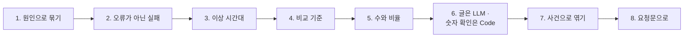

# 2단계 · 문제를 숫자로 찾기

- 교시: 3교시 강의 (11:00~11:50) · 4교시 [Lab 02](../../Last3Mon/77/LAB-02-Q-FIND-PROBLEMS.md) 실습 5개 (12:00~12:50)
- 이 단계가 끝나면: 실패를 원인(노드 · 메시지)으로 묶어 고칠 일의 수와 순서를 정하고, 오류율에 안 잡히는 실패(답 못 함)를 따로 세고, 평소와 다른 시간대를 정의(묶기 · 비교 기준 · 문턱)로 찾고, 비교 기준이 판정을 바꾼다는 것을 재고, 수와 비율을 나눠 보고, LLM 요약의 숫자를 Code로 확인할 수 있다.
- 숫자: 모두 강사 노트북 실측입니다 (10/31, 정답 워크플로우를 학생 순서대로 1회). 두 주 기록의 숫자는 누가 세어도 같습니다. 출력 전부는 수업 뒤 공개되는 `Last3Mon/77/answers/LAB-TEST-RESULT.md`에 있습니다.
- 실습 가리키기: "Lab 02 예제 1"은 4교시 [Lab 02 문서](../../Last3Mon/77/LAB-02-Q-FIND-PROBLEMS.md)의 그 절입니다.

## 0. 이 시간 (50분)

| 시간 | 절 · 개요 | 하는 일 |
| --- | --- | --- |
| 11:00~11:08 | 1 · 개요 15장 | 오류 21건 = 원인 둘, 묶기와 파레토 |
| 11:08~11:14 | 2 · 개요 16장 | 오류가 아닌 실패, 답 못 함 34건 |
| 11:14~11:24 | 3 · 4 · 개요 17~18장 | 이상 탐지의 세 가지, 비교 기준과 기간 |
| 11:24~11:30 | 5 · 개요 19장 | 수와 비율, 다시 묻는 주제 |
| 11:30~11:40 | 6 · 7 · 개요 20~21장 | LLM 요약과 숫자 확인, 사건 타임라인 |
| 11:40~11:50 | 8 · 9 · 확인 질문 | 요청문, 자주 하는 실수 |

### 4교시 Lab 02에서 이어서 하는 것

| 4교시 실습 (시각) | 이 강의의 절 | 실습에서 하는 일 | 쓰는 파일 · 명령 |
| --- | --- | --- | --- |
| Lab 02 예제 1 (12:00~12:12) | 1 · 2 | 실패 묶음 · 답 못 한 주제 | `my-work/log-report.json`에 더함, 테스트 `cases/lab02.json` (0/6 → 3/6) → `OPS.md` 3.1 |
| Lab 02 예제 2 (12:12~12:22) | 3 · 7 | 이상 시간대 | 테스트 `cases/lab02.json` 6/6, `call my-log-report requests/two-weeks.json` |
| Lab 02 예제 3 (12:22~12:28, 에이전트 없이) | 4 | 기간을 바꾸면 문턱 · 이상이 바뀐다 | `test cases/lab02-periods.json -v` → `OPS.md` 3.2 |
| Lab 02 과제 1 (12:28~12:38) | 5 | 답했는데 다시 묻는 주제 | 테스트 `cases/lab02-challenge.json` → `OPS.md` 3.3 |
| Lab 02 과제 2 (12:38~12:50) | 6 | LLM 세 문장 요약 · 숫자 확인 | `my-work/log-summary.json` (새로), 테스트 `cases/lab02-challenge2.json` → `OPS.md` 3.4 |

## 1. 문제 목록은 원인으로 묶는다 (4교시 Lab 02 예제 1)

### 일반 설명

> **생활 속 예 · 반품 사유표.** 가게에 반품이 21건 들어왔을 때 한 건씩 보면 21가지 일입니다. 사유로 묶으면 "사이즈가 안 맞음 16건, 불량 5건" — 고칠 일은 둘이고, 사이즈 표를 먼저 고치면 반품 대부분이 사라집니다. 고치는 단위는 "건"이 아니라 "사유(원인)"입니다.

**오류 묶기(error grouping).** 같은 원인의 실패는 한 번 고치면 함께 사라집니다. 그래서 운영 도구는 오류를 "지문(fingerprint)"으로 묶어 보여 줍니다 — Sentry는 스택 · 메시지로, Datadog · CloudWatch는 오류 종류 · 서비스로 묶습니다. 오늘은 (`error_node`, `error_message`) 두 칸이 지문입니다.

**파레토(80/20).** 현장의 문제는 대개 몇 개의 원인이 대부분을 차지합니다. 묶어서 많은 순으로 놓으면 맨 위 한두 줄이 대부분입니다. 그 줄부터 고치면 같은 노력으로 가장 많이 줄어듭니다.

| 보기 | 일의 수 | 순서 |
| --- | --- | --- |
| 건마다 | 21 | 정할 수 없음 |
| 원인마다 | 2 | 많은 순 (16 → 5) |

### 오늘 실습에서

(Lab 02 예제 1, 두 주)

| 묶음 | 건수 | 고칠 곳 |
| --- | --- | --- |
| `Search FAQ` · `timeout of 1000ms exceeded` | **16** | 워크플로우 (FAQ 검색 timeout · 재시도) |
| `Answer` · `429 Rate limit reached for requests` | 5 | LLM 사용량 한도 · 대체 경로 (75 · 72일차) |

- 오류 21건 = 원인 2개. 16건의 timeout이 76%입니다.

## 2. 오류가 아닌 실패: 답하지 못한 질문 (4교시 Lab 02 예제 1)

### 일반 설명

> **생활 속 예 · "찾는 물건 없음" 메모.** 손님이 "와이파이 공유기 있어요?" 하고 빈손으로 돌아간 일은 반품도 결제 오류도 아니라 장부의 어디에도 안 남습니다. 그런데 그런 손님이 34명이고 모두 같은 물건을 찾았다면, 그것을 들여놓는 것이 가장 큰 일입니다. 계산대 옆에 "찾는 물건 없음" 메모를 따로 모아야 보입니다.

**성공으로 끝난 실패.** 워크플로우는 정상적으로 "모르겠으니 사람에게 넘긴다"를 했습니다. `status`는 `success`라 오류율에 잡히지 않습니다. 하지만 사용자는 답을 못 받았고 담당자 일이 늘었습니다. 이런 실패는 **따로 정의하고 세야** 보입니다.

| 업계의 이름 | 뜻 | 오늘 |
| --- | --- | --- |
| 자동 해결률 (deflection rate, containment rate) | 사람 없이 끝난 비율 | `자동 답변` / 전체 |
| 상담원 이관율 (escalation · handoff rate) | 사람에게 넘긴 비율 | `담당자 연결` / 전체 = `unanswered_rate` (Lab 03) |
| 대체 응답 비율 (fallback rate) | "모르겠습니다"로 답한 비율 | `잠시 후` 등 |

챗봇 · 콜센터 · 헬프데스크에서는 오류율보다 이관율을 더 중요하게 봅니다. 사용자에게는 둘 다 실패이기 때문입니다.

**고칠 곳이 다르다.** 오류 묶음은 대개 워크플로우나 바깥 서비스를 고치고, 답 못 한 주제는 대개 **콘텐츠**(FAQ · 문서)를 고칩니다. 같은 문제 목록 안에서도 고칠 사람이 다릅니다 (3단계 2절).

### 오늘 실습에서

- 담당자 연결 34건이 **모두 와이파이** 주제였습니다 (Lab 02 예제 1). `curl -s 'localhost:8800/faq?q=와이파이'`의 `results`가 비어 있습니다 — FAQ에 와이파이 항목이 없습니다.
- 건수로는 오류(21)보다 많지만 오류율(3.15%)에는 하나도 안 잡혔습니다. 두 주 이관율은 34 / 666 = 5.11%입니다.

## 3. 이상 시간대: 평소와 크게 다른 시간 (4교시 Lab 02 예제 2)

### 일반 설명

> **생활 속 예 · 시간대별 매출표의 빈칸.** 평소 시간당 10건씩 팔리던 가게가 9시에만 0건이라면 그 시간에 무슨 일(카드 단말기 고장?)이 있었던 것입니다. 손님이 1명뿐인 새벽 시간의 0건은 이상하지 않습니다. "손님이 충분히 있었는데 평소보다 훨씬 나빴던 시간"만 골라야 진짜 사건입니다.

**이상 탐지(anomaly detection)의 세 가지.** 무엇으로 묶나(시간), 평소는 무엇인가(비교 기준, baseline), 얼마나 달라야 이상인가(문턱, threshold). 셋 다 사람이 정하는 정의입니다.

| 방법 | 평소 | 이상 | 쓰는 곳 |
| --- | --- | --- | --- |
| 배수 문턱 (오늘) | 기간 전체 오류율 | 그 3배 이상 · 5건 이상 · 오류 1건 이상 | 간단한 보고서 |
| 고정 문턱 | 정해 둔 값 (SLO) | 넘으면 | 알림 (3단계) |
| 통계 (z-점수 · 이동 평균 · EWMA) | 최근 평균과 흔들림 | 평균에서 크게 벗어남 | 모니터링 도구 |
| 계절성 모델 | 같은 요일 · 같은 시간 | 예측에서 벗어남 | Datadog · CloudWatch의 이상 탐지 |

**배수 문턱을 풀어 말하면: "평소의 3배 넘게 나빴던 시간, 단 실행이 너무 적은 시간은 빼고."**

1. **평소를 정한다** — 기간 전체 오류율. 두 주면 21 / 666 = 0.0315 (3.15%).
2. **문턱을 정한다** — 평소의 3배. 0.0315 × 3 = **0.0945 (9.45%)**. 평소의 "몇 배"로 선을 그어서 배수 문턱이라고 부릅니다.
3. **세 조건을 모두 맞는 시간만 이상으로 고른다.**

| 조건 | 없으면 생기는 일 |
| --- | --- |
| 오류율이 문턱(3배) 이상 | 기준선이 없어 어느 시간이 "나쁜지" 정할 수 없음 |
| 실행 5건 이상 (최소 건수) | 새벽에 1건 돌고 1건 실패한 시간도 100%로 잡힘 — 사건이 아니라 운 |
| 오류 1건 이상 | 오류 0인 기간(첫 주)은 문턱도 0이라 모든 시간이 "0 ≥ 0"으로 걸림 |

- 계산과 설명이 쉬워("평소의 3배") 주간 보고서 같은 **간단한 보고서**에 맞습니다. 대신 요일 · 시간대마다 원래 다른 평소(월요일 아침은 늘 바쁨)는 보지 못합니다 — 그것은 표 아래 칸의 통계 · 계절성 방법(모니터링 도구)이 합니다.

**최소 건수.** 1건 중 1건 실패도 오류율 100%입니다. 표본이 작은 시간을 빼야 진짜 이상이 남습니다 (1단계 6절의 표본 크기와 같은 질문).

### 오늘 실습에서

(Lab 02 예제 2, 두 주, 전체 오류율 0.0315 → 문턱 0.0945)

| 이상 시간대 | 실행 · 오류 | 오류율 |
| --- | --- | --- |
| 10/26 (월) 09시 | 16 · **16** | 100% |
| 10/29 (목) 15시 | 7 · 5 | 71.4% |

- 첫 주는 오류 0건이라 `[]`.

## 4. 비교 기준을 고르는 일 (4교시 Lab 02 예제 3)

### 일반 설명

> **생활 속 예 · "평소보다 많이 먹었다"의 평소.** 명절 연휴 동안 먹은 양을 기준으로 하면 오늘 저녁은 "적게" 먹은 것이고, 평일 기준이면 "많이" 먹은 것입니다. "평소보다"라는 말은 평소를 언제로 잡느냐에 달렸습니다.

**비교 기준이 판정을 바꾼다.** 같은 규칙("기간 전체 오류율의 3배")이라도 기간이 바뀌면 "전체"가 바뀌고 문턱도 바뀝니다. 특히 기간이 짧으면 그 안의 사건 하나가 기준 자체를 끌어올립니다 — 하루 오류의 대부분이 한 시간에 몰리면 그날 전체 오류율이 높아져 문턱도 높아집니다.

| 비교 기준 | 좋은 점 | 조심할 것 |
| --- | --- | --- |
| 그 기간 전체 (오늘) | 쉬움 | 기간에 따라 판정이 바뀜, 사건이 기준을 끌어올림 |
| 지난 기간 같은 시간 | 요일 · 시간대의 차이를 맞춤 | 지난 기간에도 사건이 있었으면 |
| 고정 기준 (SLO) | 늘 같은 잣대 | 정할 사람이 필요 (3단계) |

**보고의 규칙.** 이상을 말할 때는 "어느 기간을 기준으로 했나"를 함께 씁니다. 회의에서 누구는 "이번 주", 누구는 "어제"를 기준으로 말하면 같은 보고서로도 다른 결론이 나옵니다.

### 오늘 실습에서

(Lab 02 예제 3, `cases/lab02-periods.json` 5/5)

| 기간 | 전체 오류율 | 문턱 (× 3) | 이상 시간대 |
| --- | --- | --- | --- |
| 첫 주 | 0 | 0 | 없음 |
| 둘째 주 | 0.0588 | 0.1764 | 09시 · 15시 |
| 10/26 (월)만 | **0.2286** | **0.6858** | 09시 |
| 10/29 (목)만 | 0.0515 | 0.1545 | 15시 |
| 두 주 | 0.0315 | 0.0945 | 09시 · 15시 |

- 문턱이 0.0945에서 0.6858까지 일곱 배 넘게 달라졌습니다. 이번 기록은 두 사건이 워낙 뚜렷해(100% · 71%) 사라지지 않았지만, 오류율 30%쯤인 시간이 있었다면 두 주 기준으로는 이상, 월요일 기준으로는 아니었을 것입니다.

## 5. 수와 비율: 답했는데 다시 묻는 주제 (4교시 Lab 02 과제 1)

### 일반 설명

> **생활 속 예 · 교환하러 다시 온 손님.** 물건을 팔았는데 손님이 같은 날 다시 와서 "설명대로 했는데 안 돼요"라고 한다면, 판 것은 맞지만 설명서가 나쁜 것입니다. 많이 팔린 물건은 다시 오는 손님 **수**도 많으니, 몇 명 중 몇 명이 다시 왔는지 **비율**로 봐야 어느 설명서가 나쁜지 압니다.

**재문의율(repeat contact rate).** 같은 사람이 짧은 시간 안에 같은 주제를 다시 묻는 비율입니다. 콜센터 업계는 반대로 "한 번에 해결한 비율"(FCR, First Contact Resolution)을 핵심 지표로 씁니다. 답은 했지만 도움이 안 된 것을 잡아내는 지표입니다.

| 정렬 | 답하는 질문 | 고칠 사람 |
| --- | --- | --- |
| 수 (`repeats`) | 다시 물어서 생긴 일이 가장 많은 곳 | 담당자 · 운영 |
| 비율 (`repeat_rate`) | 답의 질이 가장 나쁜 곳 | FAQ · 콘텐츠 |

**세 가지 실패 목록.** 오늘 Lab 02에서 실패를 세 가지로 나눴습니다: 오류(`failures`), 답 못 함(`unanswered_topics`), 답했는데 도움이 안 됨(`repeat_topics`). 사용자에게는 셋 다 실패이고, 고칠 곳은 각각 다릅니다.

### 오늘 실습에서

(Lab 02 과제 1, 두 주)

| 주제 | 답 | 다시 물음 | 비율 |
| --- | --- | --- | --- |
| 프린터 | 81 | 8 | **9.88%** (1위) |
| 비밀번호 | 139 | **9** (수 1위) | 6.47% |
| VPN | 124 | 8 | 6.45% |
| 접수 현황 · 메일 · 설치 | 96 · 90 · 61 | 6 · 5 · 2 | 6.25% · 5.56% · 3.28% |

- 수로는 비밀번호, 비율로는 프린터. 답의 질을 고친다면 프린터 FAQ부터입니다. 와이파이는 답을 못 했으니 이 표에 없습니다.

## 6. 글은 LLM, 숫자 확인은 Code (4교시 Lab 02 과제 2)

### 일반 설명

> **생활 속 예 · 점장의 세 줄 보고와 계산기.** 점장이 본사에 "이번 주 반품 21건, 대부분 월요일 오전"이라고 세 줄로 보고합니다. 본사는 그 숫자를 장부와 계산기로 맞춰 봅니다. 말솜씨가 좋아도 숫자가 장부에 없으면 믿을 수 없습니다.

**LLM은 숫자를 지어낼 수 있습니다.** 그럴듯한 글을 쓰는 능력 때문에, 통계에 없는 숫자("약 20건", "6%")나 짐작한 원인("서버 과부하로")을 자연스럽게 섞을 수 있습니다 (환각, hallucination). 운영 보고에 들어가는 숫자는 틀리면 결정을 틀리게 합니다.

**근거 확인(grounding check).** LLM에게는 **계산된 통계만** 주고, 돌아온 글의 숫자를 Code가 통계와 대조합니다. 71일차 답 검사("답의 숫자가 규정에 있나")와 같은 생각입니다.

| 단계 | 누가 | 오늘 |
| --- | --- | --- |
| 통계 | Code | `my-log-report`를 **다시 불러** 받음 (정의는 한 곳) |
| 글 | LLM | 세 문장, 통계에 있는 숫자만, 원인 짐작 금지 |
| 대조 | Code | 글의 숫자 ⊂ 통계의 숫자 (값 · ×100 · 날짜 · 시간 · 메시지 속 숫자) → `numbers_ok` · `unknown_numbers` |

**표현이 다른 같은 숫자.** 0.0588은 글에서 5.88%로, `2026-10-26T09`는 "10월 26일 09시"로 쓰입니다. "있는 숫자" 목록에 비율의 ×100과 날짜 · 시간의 숫자를 넣어야 맞는 글이 틀렸다고 나오지 않습니다.

### 오늘 실습에서

둘째 주 요약 (Lab 02 과제 2, LLM 한 번, 1.7~3.4초):

> 가장 많은 미응답 주제는 와이파이로 17건입니다. 가장 흔한 장애는 Search FAQ 노드에서 발생한 "timeout of 1000ms exceeded" 메시지로 16건입니다. 이상 징후가 가장 심한 시간대는 10월 26일 09시로, 총 16건 중 16건이 오류입니다.

- 숫자 17 · 1000 · 16 · 10 · 26 · 09가 모두 통계(값 · 메시지 · 시간 글자)에 있어 `numbers_ok: true`, `unknown_numbers: []`. 둘째 주는 와이파이 17건입니다 (두 주로는 34).

## 7. 원인과 시간을 엮어 사건으로 (4교시 Lab 02 예제 2)

### 일반 설명

> **생활 속 예 · 사고 경위서.** 가게에 문제가 생기면 "몇 시에 · 무엇이 · 몇 건 · 왜"를 한 장에 적습니다. 반품 사유표(무엇)와 시간대별 매출표(언제)를 나란히 놓으면 "월요일 9시 단말기 고장으로 결제 16건 실패"라는 한 줄이 나옵니다.

**사건 타임라인.** 원인 묶음은 "무엇이", 이상 시간대는 "언제"를 말합니다. 둘을 맞춰 보면 문제가 기간 내내 조금씩인지, **한 번의 사건**인지가 보입니다. 장애 회고(postmortem)의 첫 장이 바로 이 타임라인입니다 (76일차 런북).

### 오늘 실습에서

| 사건 | 언제 | 무엇이 | 몇 건 |
| --- | --- | --- | --- |
| ① | 10/26 (월) 09시 | `Search FAQ` timeout (1초) | 16 / 16 |
| ② | 10/29 (목) 15시 | `Answer` 429 (사용량 한도) | 5 / 7 |
| (오류 아님) | 두 주 내내 | 와이파이 질문 → 담당자 연결 | 34 |

- 16 + 5 = 21 = 두 주 오류 전부. 오류는 **두 번의 사건**이었고, 답 못 함은 **기간 내내** 이어진 콘텐츠 문제입니다. 3단계에서 ①과 와이파이를 고칩니다.

## 8. 요청문(프롬프트)으로 에이전트에게 맡기기

문제 찾기 요청문은 "문제를 찾아 줘"가 아니라 **묶는 칸 · 조건 · 순서**를 적습니다.

| 넣을 것 | 예 |
| --- | --- |
| 무엇을 거르나 | "`status`가 `error`인 실행만", "`route`가 `담당자 연결`인 실행만" |
| 무엇으로 묶나 | "(`error_node`, `error_message`)", "`topic`", "`started_at` 앞 13자" |
| 문턱 | "5건 이상 · 그 기간 전체 오류율의 3배 이상 · 오류 1건 이상" |
| 순서 | "많은 순", "시간순", "`repeat_rate` 높은 순, 같으면 `repeats` 많은 순" |
| LLM에게 줄 것 · 하지 말 것 | "통계 중 다섯 칸만 JSON으로, 세 문장, 통계에 있는 숫자만, 원인 짐작 금지" |
| 확인 | "글의 숫자가 통계에 없으면 `unknown_numbers`에" |

## 9. 자주 하는 실수

| 실수 | 결과 | 바로잡기 |
| --- | --- | --- |
| 오류를 건마다 봄 | 고칠 순서를 못 정함 | 원인으로 묶고 많은 순 |
| 오류율만 봄 | 답 못 함 34건을 놓침 | 오류가 아닌 실패를 따로 정의 |
| 이상의 최소 건수를 안 둠 | 1건짜리 시간이 100%로 뜸 | 5건 이상 |
| 비교 기준을 안 적음 | 같은 보고서로 다른 결론 | 기간을 함께 보고 |
| 수로만 정렬 | 인기 주제가 "나쁜 주제"로 보임 | 비율과 건수를 나란히 |
| LLM에게 기록을 줌 | 비싸고 틀림 | 계산된 통계만 |
| 요약이 지표를 다시 계산 | 정의가 두 벌, 숫자가 어긋남 | `my-log-report`를 다시 부름 |
| 숫자 확인에 ×100 · 날짜를 안 넣음 | 맞는 글도 `numbers_ok: false` | "있는 숫자"를 넓게 |

## 확인 질문

1. 오류 21건을 원인으로 묶었더니 둘이었습니다. 묶는 칸을 `error_node` 하나로만 하면 무엇을 놓칠 수 있나요?

같은 노드에서 다른 까닭으로 실패한 것(예: `Answer`의 429와 timeout)이 한 묶음이 됩니다. 고칠 방법이 다른데 같은 문제로 보입니다. 그래서 노드와 메시지를 함께 지문으로 씁니다. 반대로 메시지에 매번 바뀌는 값(요청 id 등)이 들어 있으면 묶음이 쪼개지므로, 그럴 때는 메시지를 다듬어 묶습니다.

2. 와이파이 34건은 오류율에 하나도 안 잡혔습니다. 그런데 왜 문제 목록 1위로 둘 수 있나요?

사용자에게는 답을 못 받은 실패이고, 건수로는 오류(21)보다 많으며, 담당자의 일을 늘립니다. 그리고 FAQ에 항목이 없다는 분명한 원인이 있어 고치기도 쉽습니다. 오류율은 "워크플로우가 고장 났나"를, 이관율은 "사용자가 답을 받았나"를 말합니다.

3. 같은 보고서인데 "월요일만" 물으면 문턱이 0.6858, "두 주"로 물으면 0.0945입니다. 어느 쪽이 맞나요?

둘 다 정의대로입니다. 비교 기준(그 기간 전체 오류율)이 기간마다 다를 뿐입니다. 짧은 기간은 사건 하나가 기준을 끌어올려 이상을 덜 잡습니다. 그래서 이상을 보고할 때 기준 기간을 함께 쓰고, 늘 같은 잣대가 필요하면 고정 기준(SLO, 3단계)을 씁니다.

4. LLM 요약이 "와이파이 질문이 약 20건"이라고 썼습니다. 숫자 확인은 어떻게 되고, 어떻게 고치나요?

20은 통계에 없으므로 `unknown_numbers: ["20"]`, `numbers_ok: false`가 됩니다. 지시문에 "통계에 있는 숫자만, 다른 숫자를 더하지 말 것"을 더하고, LLM에게 주는 통계를 필요한 칸으로 줄이고, `temperature`를 0으로 둡니다. 그래도 틀리면 그 요약은 쓰지 않고 표만 보냅니다 — 확인을 통과하지 못한 숫자는 보고에 넣지 않습니다.

5. 오류 21건이 09시 16건 · 15시 5건으로 나뉜다는 것은 무엇을 뜻하나요?

오류가 두 주 내내 조금씩 난 것이 아니라 두 번의 사건이었다는 뜻입니다. 원인 묶음과 맞추면 09시는 FAQ 검색 timeout, 15시는 LLM 429입니다. 사건마다 원인이 하나라 고칠 곳이 분명하고, 다음에 같은 시간대에 같은 일이 생기는지 지켜볼 수 있습니다.

