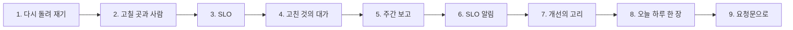
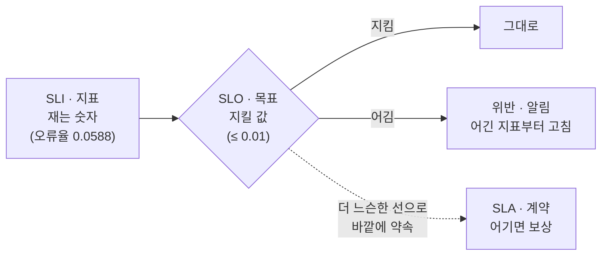
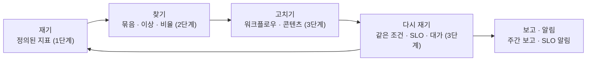

# 3단계 · 고치고 다시 재기

- 교시: 5교시 강의 (14:00~14:50) · 6교시 [Lab 03](../../Last3Mon/77/LAB-03-Q-IMPROVE-AND-REMEASURE.md) 실습 5개 (15:00~15:50)
- 이 단계가 끝나면: 찾은 문제를 고칠 곳(워크플로우 · 콘텐츠)과 사람으로 나누고, 같은 조건 · 같은 질문으로 다시 돌려 고친 효과를 재고, SLO로 "약속을 지켰나"를 판정하고, 고친 것의 대가(새로 나빠진 지표)를 단계 시간으로 찾고, 만든 보고서를 조립해 주간 보고를 만들고, SLO를 어기면 알림을 남기되 같은 알림을 되풀이하지 않을 수 있다.
- 숫자: 모두 강사 노트북 실측입니다 (10/31, 정답 워크플로우를 학생 순서대로 1회). 오늘 실습에서 새로 남긴 기록(`source: live`)의 시간은 실행마다 조금씩 다릅니다. 출력 전부는 수업 뒤 공개되는 `Last3Mon/77/answers/LAB-TEST-RESULT.md`에 있습니다.
- 실습 가리키기: "Lab 03 예제 1"은 6교시 [Lab 03 문서](../../Last3Mon/77/LAB-03-Q-IMPROVE-AND-REMEASURE.md)의 그 절입니다.

## 0. 이 시간 (50분)

| 시간 | 절 · 개요 | 하는 일 |
| --- | --- | --- |
| 14:00~14:09 | 1 · 2 · 개요 22장 | 다시 돌려 재기, 워크플로우와 콘텐츠 |
| 14:09~14:17 | 3 · 개요 23장 | SLI · SLO · 위반, 에러 예산 |
| 14:17~14:24 | 4 · 개요 24장 | 고친 것의 대가: 오류 0 대신 p95 3560 |
| 14:24~14:32 | 5 · 6 · 개요 25~26장 | 주간 보고 조립, SLO 알림과 알림 피로 |
| 14:32~14:42 | 7 · 8 · 개요 27~28장 | 재기 → 찾기 → 고치기 → 다시 재기, 오늘 하루 한 장 |
| 14:42~14:50 | 9 · 10 · 확인 질문 | 요청문, 자주 하는 실수 |

### 6교시 Lab 03에서 이어서 하는 것

| 6교시 실습 (시각) | 이 강의의 절 | 실습에서 하는 일 | 쓰는 파일 · 명령 |
| --- | --- | --- | --- |
| Lab 03 예제 1 (15:00~15:14) | 1 · 2 | 고치기 전(`before`) → timeout · 재시도 + 와이파이 FAQ → 고친 뒤(`after`) | `my-work/helpdesk.json` (제공 파일을 복사), `requests/faq-wifi.json`, 테스트 `replay-before` · `replay-after` · `lab03` → `OPS.md` 4.1 |
| Lab 03 예제 2 (15:14~15:22) | 3 | SLO 판정 | `my-work/log-report.json`에 더함, 테스트 `cases/lab03-slo.json` → `OPS.md` 5절 |
| Lab 03 예제 3 (15:22~15:28, 에이전트 없이) | 4 | 평소 FAQ로 같은 10개(`normal`), 단계 시간으로 비교 | `test cases/replay-normal.json -v`, `test cases/lab03-cost.json -v` → `OPS.md` 4.2 |
| Lab 03 과제 1 (15:28~15:40) | 5 | 주간 보고 | `my-work/weekly.json` (새로), 테스트 `cases/lab03-challenge.json` → `OPS.md` 6절 |
| Lab 03 과제 2 (15:40~15:50) | 6 | SLO를 어기면 알림 · 10분 안 같은 알림은 `suppressed` | `my-work/slo-alert.json` (새로), 테스트 `cases/lab03-challenge2.json`, `ops --reset` |

## 1. 고친 효과는 다시 돌려 재야 안다 (6교시 Lab 03 예제 1)

### 일반 설명

> **생활 속 예 · 같은 손님 열 명으로 다시.** 월요일 아침 카드 단말기가 느려 결제가 줄줄이 실패했습니다. 단말기 설정을 바꾼 뒤 "이제 됐겠지"가 아니라, 그날과 **같은 상황**(단말기가 느림)에서 **같은 손님 열 명**을 다시 받아 봐야 정말 나아졌는지 압니다. 단말기가 멀쩡한 날 재면 고친 덕인지 운인지 모릅니다.

**다시 돌려 보기(replay).** 운영 기록으로 문제를 찾았다면, 그 상황을 다시 만들어 고치기 전과 후를 **같은 조건 · 같은 입력**으로 잽니다. 조건이 하나라도 다르면 차이가 고친 덕인지 알 수 없습니다.

| 방법 | 무엇을 같게 | 쓰는 곳 |
| --- | --- | --- |
| 다시 돌리기 (오늘) | 상황(고장 스위치) · 질문 10개 | 고친 직후 확인, 회귀 테스트 |
| 기록 재생 (traffic replay) | 실제로 들어왔던 요청 | 큰 변경 전 (GoReplay 등) |
| A/B · 카나리 | 같은 시간대의 사용자를 나눔 | 실제 효과 (74일차) |

**태그로 나누기.** 고치기 전 · 후 기록을 `tag`(`before` · `after`)로 나눠 남기면, 같은 보고서에 `tag`만 바꿔 물어 비교합니다. 두 주 기록(`seed`)과 섞이지 않게 `source: live`도 함께.

**"200이 왔다"와 "됐다"는 다르다.** 헬프데스크는 실패해도 "담당자에게 연결합니다"로 200을 줍니다. 그래서 고치기 전 테스트(`replay-before`)는 200만 보고 10/10입니다. 됐는지는 **기록**과 **보고서**로 봅니다 (76일차: 사용자가 본 것과 실제로 일어난 일).

### 오늘 실습에서

(Lab 03 예제 1, FAQ 1.2초 느림, 같은 질문 10개)

| 기록 | 헬프데스크 | 오류 | 갈래 | 한 건 시간 |
| --- | --- | --- | --- | --- |
| `before` | 제공 (timeout 1초, 와이파이 FAQ 없음) | **10** / 10 | 오류 10 | 1.1~2.1초 |
| `after` | 고친 뒤 (timeout 3초 · 재시도 + FAQ-007) | **0** / 10 | 자동 답변 10 | **2.3~4.5초** |

- `cases/lab03.json`: 고치기 전 3/4 → 고친 뒤 4/4. 고치기 전 "답하지 못한 주제 없음"은 고친 뒤 기록이 0건이라 **우연히** ✔였습니다 (1단계 5절의 경계).

## 2. 고칠 곳과 고칠 사람이 다르다 (6교시 Lab 03 예제 1)

### 일반 설명

> **생활 속 예 · 단말기 설정과 들여놓을 물건.** 단말기의 "기다리는 시간" 설정은 매장 직원이 바꾸고, 손님이 계속 찾던 와이파이 공유기는 구매 담당이 들여놓습니다. 둘 중 하나만 하면 문제의 절반이 남습니다. 문제 목록에는 "누가 고치나"가 함께 있어야 합니다.

**문제마다 주인(owner).** 운영 데이터로 찾은 문제는 대개 여러 팀에 걸칩니다. 워크플로우 설정(개발 · 운영), 콘텐츠(FAQ · 문서 담당), 바깥 서비스(데이터 API · LLM 공급자), 사용량 한도(예산 담당). 문제 목록의 "고칠 곳 · 누가" 칸이 이것을 정합니다 (Lab 02 예제 1의 `OPS.md` 3.1).

| 문제 (Lab 02) | 고칠 곳 | 누가 | 오늘 |
| --- | --- | --- | --- |
| FAQ 검색 timeout (16건) | 워크플로우 Search FAQ | 에이전트 (요청문) | timeout 3000 · 재시도 2 |
| 와이파이 FAQ 없음 (34건) | 데이터 (FAQ) | 사람 (`faq/add`) | FAQ-007 더하기 |
| LLM 429 (5건) | 사용량 한도 · 대체 경로 | 예산 · 운영 (75 · 72일차) | 오늘은 보고서의 "다음 할 일"로 |

**워크플로우가 콘텐츠를 고치지 않는다.** 워크플로우 안에서 FAQ를 더하지 않습니다 (AGENTS.md 9절). 무엇을 답할지 정하는 것은 사람의 결정이고, 기록(누가 · 언제 더했나)이 남아야 합니다.

### 오늘 실습에서

- 두 고침이 다 필요했습니다: timeout만 늘렸다면 와이파이 질문 5개는 FAQ에 없어 `담당자 연결`, FAQ만 더했다면 1초에 끊겨 10개 모두 오류였을 것입니다 (Lab 03 예제 1).

## 3. SLO: 숫자로 한 약속 (6교시 Lab 03 예제 2)

### 일반 설명

> **생활 속 예 · "30분 안에 배달" 약속.** 피자 가게가 "빠르게 배달합니다"라고만 하면 늦어도 할 말이 없습니다. "30분 안에, 아니면 할인"이라고 **숫자로 약속**하면 매일 지켰는지가 분명해집니다. 그리고 "한 달에 몇 번까지는 늦어도 된다"는 여유도 정할 수 있습니다.

**SLI · SLO · SLA.** 구글의 SRE(Site Reliability Engineering)가 널리 퍼뜨린 말입니다.

| 말 | 뜻 | 오늘 |
| --- | --- | --- |
| SLI (지표) | 사용자가 겪는 품질을 재는 숫자 | `error_rate` · `p95_ms` · `unanswered_rate` |
| SLO (목표) | 지표마다 지킬 값 | 0.01 · 3000ms · 0.02 |
| SLA (계약) | 못 지키면 보상하는 바깥 약속 | (오늘은 없음) |
| 에러 예산 (error budget) | 목표까지 남은 여유 (1 − 0.99 = 1%) | 예산을 다 쓰면 새 기능보다 안정을 먼저 |

**셋을 다시 풀어 보면.** 세 말 모두 "서비스 수준(Service Level)"으로 시작하고, 끝 글자만 다릅니다.

| 약자 | 풀이 | 우리말 | 묻는 것 | 피자 가게로 |
| --- | --- | --- | --- | --- |
| **SLI** | Service Level **Indicator** | 서비스 수준 **지표** | 무엇을 재나? | 주문부터 도착까지 걸린 시간 (분) |
| **SLO** | Service Level **Objective** | 서비스 수준 **목표** | 얼마면 잘한 것인가? | "주문의 99%는 30분 안에" |
| **SLA** | Service Level **Agreement** | 서비스 수준 **협약(계약)** | 못 지키면 어떻게 하나? | "30분이 넘으면 다음 주문 할인" |

- **SLI는 숫자, SLO는 선, SLA는 약속서.** SLI가 없으면 SLO를 확인할 수 없고, SLO 없이 SLA를 맺으면 지킬 수 있는지 모른 채 약속하는 셈입니다. 순서는 늘 SLI → SLO → (필요하면) SLA입니다.
- **누구와의 약속인가.** SLO는 **팀 안**의 목표라, 어기면 고칠 일이 생깁니다. SLA는 고객 · 다른 회사 같은 **바깥**과의 계약이라, 어기면 돈 · 할인 같은 보상이 따릅니다. 그래서 SLA는 SLO보다 **느슨하게** 잡습니다 (예: 팀 목표 99.9%, 고객 계약 99.5%). SLO를 먼저 어기면 SLA를 어기기 전에 고칠 시간이 생깁니다.
- **SLI는 사용자가 겪는 것으로.** 서버의 CPU 사용률보다 "답을 받았나(오류율) · 얼마나 기다렸나(p95) · 쓸모 있는 답이었나(답 못 함)"가 좋은 SLI입니다. 오늘의 세 지표가 모두 그렇습니다. 평균 대신 p95를 쓰는 까닭은 1단계 3절과 같습니다.
- **에러 예산은 SLO의 뒷면.** "오류율 1% 이하"는 "100건 중 1건까지는 실패해도 된다"와 같은 말입니다. 그 1건이 에러 예산이고, 다 쓰면 새 기능보다 안정을 먼저 합니다.
- 사내 헬프데스크인 오늘 실습에는 SLA가 없습니다 (돈을 받는 바깥 고객이 없음). 80~82일차 단위 프로젝트 · 최종 프로젝트에서 "고객에게 약속한다면 얼마로?"를 정해 볼 수 있습니다.

**SLO가 바꾸는 것.** 지표만 있으면 "오류율 5.88%, 나쁜가?"를 매번 토론합니다. SLO가 있으면 "1% 약속을 어겼다, 어긴 지표부터 고친다"로 정해집니다. 기준은 사용자 · 팀장 · 비용(75일차)이 함께 정하고, 바뀔 수 있게 본문으로 덮어쓸 수 있게 둡니다.

### 오늘 실습에서

(Lab 03 예제 2, `cases/lab03-slo.json` 0/4 → 4/4)

| 기간 · 기록 | 오류율 | p95 | 답 못 함 | `breaches` |
| --- | --- | --- | --- | --- |
| 첫 주 | 0 | 2525 | 0.055 | `unanswered_rate` |
| 첫 주 · 답 못 함 기준 0.06 | 0 | 2525 | 0.055 | 없음 (`ok: true`) |
| 둘째 주 | 0.0588 | 2598 | 0.0476 | `error_rate`, `unanswered_rate` |
| 고친 뒤 (`after`) | 0 | **3560** | 0 | **`p95_ms`** |

- 둘째 주의 위반 둘은 Lab 02의 문제 둘(timeout · 와이파이)과 맞습니다. 고친 뒤 두 약속은 지켰지만 **새 약속(p95)을 어겼습니다** (4절).

## 4. 고친 것의 대가 (6교시 Lab 03 예제 3)

### 일반 설명

> **생활 속 예 · 단말기 대기 시간을 늘린 대가.** 단말기가 느린 날 "기다리는 시간"을 늘렸더니 결제 실패는 사라졌지만, 손님마다 계산이 1초씩 길어져 줄이 늘었습니다. 단말기가 정상인 날에는 기다릴 일이 없어 빠릅니다. 고친 것이 문제를 **없앤** 것인지, 다른 곳으로 **옮긴** 것인지 구분해야 합니다.

**모든 고침에는 대가(trade-off)가 있습니다.** timeout을 늘리면 실패는 줄지만 느린 날 사용자는 더 기다립니다 (72일차). 재시도를 늘리면 성공은 늘지만 부하와 시간이 늘고 (76일차), 캐시는 빠르지만 낡은 답을 줄 수 있습니다 (75일차). 그래서 고친 뒤에는 고친 지표만이 아니라 **다른 지표도** 다시 봅니다.

| 조치 | 무엇을 하나 | 이름 |
| --- | --- | --- |
| timeout을 늘림 (오늘) | 느린 바깥을 **견딤** | 완화 (mitigation) |
| FAQ 검색을 빠르게 | 느려지는 **원인**을 없앰 | 근본 해결 (fix) |

장애 대응에서는 먼저 완화로 사용자 피해를 줄이고, 원인 해결은 담당 팀의 일로 넘겨 추적합니다 (76일차 런북). 보고서에는 둘을 나눠 적습니다.

**단계 시간으로 증명.** "느려진 것은 FAQ를 기다렸기 때문"이라는 말은 짐작입니다. 단계 시간(1단계 7절)으로 FAQ 단계만 늘었고 답 단계는 그대로인 것을 보이면 증명이 됩니다.

### 오늘 실습에서

(Lab 03 예제 3, 같은 질문 10개, `-v` 응답에서 읽은 값)

| 기록 | FAQ | 오류 | FAQ 단계 p50 | 답 단계 p50 | 전체 p95 | SLO |
| --- | --- | --- | --- | --- | --- | --- |
| `before` | 느림 | 10 | 1043ms | — | 1098ms | `error_rate` 어김 |
| `after` | 느림 | 0 | **1238ms** | 1103ms | **3560ms** | `p95_ms` 어김 |
| `normal` | 평소 | 0 | **17ms** | 997ms | 2147ms | 지킴 |

- 늘어난 시간은 모두 FAQ 단계입니다 (답 단계 1103 · 997ms로 비슷). FAQ가 평소대로면 같은 헬프데스크가 SLO를 지킵니다. 진짜 고칠 곳은 FAQ 검색이 느려지는 원인입니다.

## 5. 주간 보고: 만든 것을 조립한다 (6교시 Lab 03 과제 1)

### 일반 설명

> **생활 속 예 · 주간 매출 보고서.** 가게 점장은 매주 "지난주 · 이번 주 매출표, 문제 세 가지, 세 줄 요약, 다음 주 할 일"을 본사에 보냅니다. 매주 같은 칸에 같은 방식으로 채우니 본사는 표만 보고도 비교합니다. "할 일"은 정해진 규칙(재고가 없으면 주문, 단말기 고장이면 수리 요청)대로 씁니다.

**운영 리뷰(operations review).** 많은 회사가 매주 같은 모양의 지표 보고로 회의를 합니다 (아마존의 WBR, Weekly Business Review가 잘 알려져 있습니다). 핵심은 **같은 모양 · 같은 정의 · 지난 기간과 나란히**입니다. 매주 다른 모양이면 비교가 안 됩니다.

**조립(composition).** 주간 보고는 새로 계산하지 않고 테스트로 확인한 부품(이번 주 보고서 · 지난주 보고서 · 요약)을 부릅니다. 정의는 늘 한 곳이고, 보고서를 고치면 주간 보고도 함께 바뀝니다.

| 절 | 누가 쓰나 | 까닭 |
| --- | --- | --- |
| 숫자 표 | Code | 보고서 그대로, 사람이 읽게 `5.88%` |
| 문제 | Code | 실패 · 답 못 한 주제 · 이상 시간대 |
| 요약 | LLM (+ 숫자 확인) | 사람의 말로, 확인 결과를 함께 |
| 다음 할 일 | 규칙 | "답 못 함 1위 주제 → FAQ 추가"처럼 정해진 연결은 늘 같게 |

### 오늘 실습에서

(Lab 03 과제 1, `cases/lab03-challenge.json` 7/7, 2~4초)

| 지표 | 지난주 | 이번 주 |
| --- | --- | --- |
| 요청 | 309 | 357 |
| 오류율 | 0% | 5.88% |
| p95 | 2525ms | 2598ms |
| 답 못 함 | 5.5% | 4.76% |
| SLO | 못 지킴 unanswered_rate | 못 지킴 error_rate, unanswered_rate |

- 문제 다섯 줄(실패 16 · 5, 와이파이 17, 이상 시간대 둘), 숫자 확인을 통과한 요약, 규칙이 쓴 할 일 셋(와이파이 FAQ · timeout · 사용량 한도). 할 일 셋이 바로 Lab 03 예제 1에서 한 일과 남은 일입니다.

## 6. SLO를 어기면 알린다, 같은 알림은 한 번 (6교시 Lab 03 과제 2)

### 일반 설명

> **생활 속 예 · 냉장고 온도 경보.** 가게 냉장고가 기준 온도를 넘으면 경보가 울려야 합니다. 하지만 1분마다 계속 울리면 직원은 곧 꺼 버립니다. 그래서 "한 번 울리고, 10분 안에는 다시 울리지 않되, 기록에는 남긴다"로 정합니다.

**지표 → 판정 → 알림.** 보고서는 "얼마나", SLO는 "지켰나", 알림은 "누가 지금 알아야 하나"입니다. 셋을 이으면 매주 보고서를 열지 않아도 약속이 깨진 순간 압니다. 모니터링 도구(Prometheus Alertmanager · Grafana · Datadog)의 알림 규칙이 같은 모양입니다: 조건(위반) → 같은 알림 묶기 · 반복 간격(repeat interval) → 보냄.

**알림 피로와 억제.** 같은 원인으로 알림이 계속 오면 사람은 알림을 읽지 않게 됩니다 (76일차). 같은 이유의 알림이 정해진 시간 안에 있으면 보내지 않고(`suppressed`), 보내지 않았다는 사실은 결과에 남깁니다. 더 나아가면 SRE 책의 **소진율 알림**(burn-rate alert: 에러 예산을 빨리 쓰고 있을 때만 알림)이 있습니다.

**메시지에 숫자를.** "SLO 위반"만으로는 할 일을 모릅니다. 어느 지표가 · 얼마로 · 기준이 얼마인데 넘었는지를 한 줄에 씁니다.

### 오늘 실습에서

(Lab 03 과제 2, `cases/lab03-challenge2.json` 6/6)

| 순서 | 물은 것 | 결과 |
| --- | --- | --- |
| 1 | 둘째 주 | `sent` — `[high] slo · SLO breach: error_rate 0.0588 > 0.01, unanswered_rate 0.0476 > 0.02` |
| 2 | 둘째 주 다시 (10분 안) | `suppressed`, 알림은 1개 그대로 |
| 3 | 첫 주 · 답 못 함 기준 0.06 | `none` |

- 1.0초 · 0.3초로 빠릅니다 (보고서 0.1초 + 알림 읽고 쓰기). 정기 실행(Schedule 트리거)으로 10분마다 돌려도 부담이 없습니다 — 79일차 Ops Assistant로 이어집니다.

## 7. 개선의 고리: 재기 → 찾기 → 고치기 → 다시 재기

### 일반 설명

> **생활 속 예 · 다이어트 기록.** 체중계에 매일 오르고(재기), 늘어난 날의 식단을 보고(찾기), 야식을 줄이고(고치기), 다음 주에 같은 체중계 · 같은 시각에 다시 잽니다(다시 재기). 다른 체중계로 재거나 재지 않으면 줄인 효과를 모릅니다.

**PDCA · 데이터 기반 개선.** 품질 관리의 오래된 고리 Plan → Do → Check → Act, SRE의 "측정할 수 없으면 개선할 수 없다", 제품 팀의 "만들기 → 재기 → 배우기"(Build-Measure-Learn)는 모두 같은 모양입니다. 오늘 하루가 이 고리 한 바퀴였습니다.

**고리를 지키는 규칙.**

| 규칙 | 오늘 |
| --- | --- |
| 정의는 한 곳 | `my-log-report` · AGENTS.md 3절, 나머지는 다시 부름 |
| 같은 조건으로 다시 | 고장 스위치 · 같은 질문 10개 · `tag` |
| 고친 것 말고도 다시 본다 | p95가 새로 어김 |
| 숫자에 건수 · 기준 기간을 함께 | 1.2.0 8건, 문턱의 기간 |
| 사람에게 가는 것은 줄이되 기록은 남긴다 | `suppressed` |

## 8. 가게 장부로 본 오늘 하루

| 오늘 만든 것 | 가게에서는 | 이 문서 |
| --- | --- | --- |
| 실행 기록 666줄 | 계산대 옆 영수증 더미 | 1단계 1절 |
| 지표 정의 (AGENTS.md 3절) | 벽에 붙인 장부 쓰는 법 | 1단계 2절 |
| p50 · p95 | "열 번 중 아홉 번은 8분 안" 버스 시간 | 1단계 3절 |
| 경계 테스트 | 줄자의 끝 눈금 | 1단계 5절 |
| 날짜별 · 릴리스별 · 단계별 | 가계부 날짜별 칸 · 택배 구간별 시간 | 1단계 6 · 7절 |
| 실패 묶음 | 반품 사유표 | 2단계 1절 |
| 답 못 한 주제 | "찾는 물건 없음" 메모 | 2단계 2절 |
| 이상 시간대 · 비교 기준 | 시간대별 매출표의 빈칸 · "평소"의 기준 | 2단계 3 · 4절 |
| 다시 묻는 주제 | 교환하러 다시 온 손님 | 2단계 5절 |
| LLM 요약 + 숫자 확인 | 점장의 세 줄 보고와 계산기 | 2단계 6절 |
| 고치기 전 · 후 다시 돌리기 | 같은 손님 열 명으로 다시 | 3단계 1절 |
| timeout + FAQ 더하기 | 단말기 설정 + 들여놓을 물건 | 3단계 2절 |
| SLO | "30분 안에 배달" 약속 | 3단계 3절 |
| 고친 것의 대가 | 단말기 대기 시간을 늘려 길어진 줄 | 3단계 4절 |
| 주간 보고 | 주간 매출 보고서 | 3단계 5절 |
| SLO 알림 | 냉장고 온도 경보 | 3단계 6절 |

## 9. 요청문(프롬프트)으로 에이전트에게 맡기기

고치기 · 판정 · 보고 요청문은 **바꿀 곳만 · 기준 · 조립할 부품**을 적습니다.

| 넣을 것 | 예 |
| --- | --- |
| 바꿀 곳만 | "Search FAQ 노드만, 다른 노드와 로그 모양은 그대로" |
| 설정의 자리 | "`retryOnFail` · `maxTries` · `waitBetweenTries`는 `parameters` 밖, 노드 바로 아래" |
| 기준과 덮어쓰기 | "기본 limits, 본문 `slo`가 있으면 그 값으로", "지표가 기준보다 크면 위반" |
| 부품을 부르기 | "`my-log-report`를 두 번(이번 주 · 지난주), `my-log-summary`를 한 번 부른다" |
| 누가 무엇을 | "할 일은 LLM이 아니라 규칙으로" |
| 알림의 양 | "10분(600초) 안 같은 `reason`이 있으면 `suppressed`" |
| 기대 결과 | "`cases/replay-after.json` · `lab03.json`, 앞의 테스트도 그대로" |

## 10. 자주 하는 실수

| 실수 | 결과 | 바로잡기 |
| --- | --- | --- |
| 고친 뒤를 다른 조건에서 잼 | 고친 덕인지 운인지 모름 | 같은 고장 스위치 · 같은 질문 · `tag` |
| "200이 왔다"를 "됐다"로 | 실패 10건을 놓침 | 기록 · 보고서로 확인 |
| 워크플로우로 콘텐츠를 고치려 함 | FAQ에 없는 답은 못 함 | 고칠 곳 · 사람을 나눔 |
| 고친 지표만 다시 봄 | p95 위반을 놓침 | SLO 전체를 다시 |
| timeout을 늘린 것을 "해결"로 보고 | 원인이 남음 | 완화와 근본 해결을 나눠 적음 |
| 주간 보고에서 지표를 다시 계산 | 정의가 두 벌 | 부품을 부름 |
| 할 일까지 LLM에게 | 매주 다른 말 | 정해진 연결은 규칙 |
| 알림을 매번 보냄 | 알림 피로 | 같은 이유는 10분에 한 번, `suppressed`를 기록 |

## 확인 질문

1. 고치기 전 테스트(`replay-before`)가 10/10인데, 왜 "10건 모두 실패"라고 하나요?

헬프데스크는 실패해도 "담당자에게 연결합니다"로 200을 줍니다. 테스트는 200만 확인했고, 실제로 무슨 일이 있었는지는 기록에 남았습니다: 10건 모두 `error` · `Search FAQ` · 약 1030ms. 사용자에게 보인 것(200)과 실제(오류)를 나눠 보는 까닭입니다. 고친 뒤 테스트(`replay-after`)는 `route: 자동 답변`까지 확인합니다.

2. timeout을 3초로 늘렸더니 오류는 0이 되었는데 SLO를 어겼습니다. 고친 것이 잘못인가요?

잘못이 아니라 대가입니다. 실패 대신 늦은 답을 주는 **완화**였고, 그 대가로 느린 날 p95가 3560ms가 되었습니다. 단계 시간으로 보면 늘어난 시간은 모두 FAQ 단계(1238ms)이고, FAQ가 평소대로면 같은 헬프데스크가 SLO를 지킵니다(p95 2147ms). 보고서에 "완화함 · 원인(FAQ 검색이 느려짐)은 담당 팀에"를 나눠 적습니다.

3. 첫 주의 답 못 함(5.5%)이 SLO를 어겼는데, 기준을 6%로 바꾸면 지킨 것이 됩니다. 기준을 바꾸면 되지 않나요?

숫자 하나를 바꾸는 일이지만 약속을 바꾸는 일입니다. 누가(사용자 · 팀장) · 왜(사람 손이 남는다 · 비용) 바꾸는지가 기록돼야 합니다. 오늘 보고서는 본문 `slo`로 기준을 바꿔 "새 기준이면?"을 물을 수 있게 했지만, 문제(와이파이 FAQ 없음)를 고치지 않고 기준만 올리면 사용자의 실패는 그대로입니다.

4. 주간 보고의 "다음 할 일"을 LLM에게 맡기지 않은 까닭은?

"답 못 함 1위 주제 → FAQ에 추가", "Search FAQ 실패 → timeout 점검"처럼 문제에서 할 일로 가는 연결이 정해져 있으면 규칙이 매주 같게 씁니다. LLM은 같은 문제에도 매주 다른 말을 쓸 수 있고, 없는 할 일을 지어낼 수 있습니다. LLM은 요약처럼 사람의 말이 필요한 곳에만, 숫자 확인과 함께 씁니다.

5. SLO 알림이 같은 기간을 10분 안에 다시 확인했을 때 `suppressed`를 돌려줍니다. 그냥 아무것도 안 하면 안 되나요?

확인했다는 사실과 왜 보내지 않았는지가 남아야 합니다. 나중에 "그때 알림이 왜 안 왔나"를 물었을 때 `suppressed`(10분 안 같은 알림이 있었음)가 답이 됩니다. 사람에게 가는 알림은 줄이되 기록은 줄이지 않습니다 (76일차 알림 폭주 막기와 같음).

