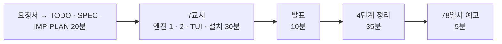

# 7·8교시 · 바이브 코딩 (`tlog`)

- 교시: 7교시 16:00~16:50 (각자 만들기), 8교시 17:00~17:50 (발표 10분 · [4단계 정리](04-STAGE4-WRAPUP.md) 35분 · 예고 5분)
- 과제: [VIBE-REQ-TLOG](../../Last3Mon/77/VIBE-REQ-TLOG.md)(요청서, 요청의 말 ①~⑫) → [VIBE-Q-TLOG](../../Last3Mon/77/VIBE-Q-TLOG.md)의 8단계: `Doc/TODO.md` → `Doc/SPEC.md` → `Doc/IMP-PLAN.md`(엔진 · TUI 단계) → 단계별 구현 → 확인 → `uv tool install` → 다른 폴더에서 사용 → 수업 뒤 `VIBE-A-TLOG.md` 공개
- 요구 14개(R1~R14). 50분 안에는 **엔진 1단계(R1 · R2 · R5 · R12 · R13) + 엔진 2단계(R3 · R4 · R7) + TUI 1단계(R11) + 설치(R14)**, 나머지(R6 단계 · 비용, R8 비교, R9 tretry 기록, R10 주간 보고)는 IMP-PLAN의 다음 단계로 집에서.
- 72일차 `tbench`부터 76일차 `tretry`와 같은 흐름입니다: 사람의 말(요청서)을 **확인할 수 있는 요구**로 바꾸는 일을 학생이 먼저 하고, VIBE-Q는 그 다음 단계(비교 대상)로 씁니다. 에이전트에게는 처음 요청 한 번과 "확인했고 commit 했어. 다음 단계." 한 줄만 씁니다.
- 오늘은 `tlog`: 실행 기록(파일 · 데이터 API)을 오늘 Lab의 정의 그대로 세어 **n8n `my-log-report`와 같은 숫자**를 내고, 실패 묶음 · 이상 시간대 · SLO 판정(종료 코드)을 보여 주고, TUI로 묶음을 골라 그 실행들을 보는 도구. 오늘 n8n 워크플로우로 한 일을 **터미널 어디서나.**

> **생활 속 예 · 주머니 속 계산기와 장부.** 오늘 가게 장부(n8n 보고서)를 만들었습니다. 사장님이 밤에 집에서 "어제 몇 시에 문제가 있었지?"를 보려면 가게 컴퓨터를 켜야 합니다. 같은 장부 쓰는 법으로 **주머니 속 계산기**에서도 같은 숫자가 나오면 어디서든 볼 수 있습니다. `tlog`는 그 계산기이고, 핵심은 "같은 숫자"입니다.

> 이 문서는 7 · 8교시 진행 문서입니다. 8교시의 정리 35분은 [04-STAGE4-WRAPUP](04-STAGE4-WRAPUP.md)으로 합니다.

## 1. 7교시 · 각자 만들기 (50분)

| 시간 | 단계 | 확인 |
| --- | --- | --- |
| 16:00~16:09 | 0 준비 · 1 요청서 → `Doc/TODO.md` (에이전트 없이) | 할 일 ①~⑫ · 꼭 / 나중 |
| 16:09~16:15 | 2 `Doc/SPEC.md` → VIBE-Q 요구 표(R1~R14)와 비교 · commit | 요구마다 확인 방법 (두 주 666 · 21 · 0.0315 · 1205 · 2537, 종료 코드) |
| 16:15~16:20 | 3 `Doc/IMP-PLAN.md` (엔진 1~3단계 · TUI 1단계 · 설치) · commit | 단계마다 체크리스트 |
| 16:20~16:44 | 4 구현: 엔진 1단계 → 엔진 2단계 → TUI 1단계, 막히면 5 문제 해결 팁 | 단계마다 `pytest` · 직접 실행 · commit |
| 16:44~16:50 | 6 확인 · 7 `uv tool install --editable .` · 8 다른 폴더에서 `tlog` | `tlog summary --url http://localhost:8800 --from 2026-10-26 --to 2026-10-30` = `my-log-report`의 숫자 |

| 볼 것 | 막혔을 때 한마디 |
| --- | --- |
| TODO · SPEC 없이 VIBE-Q를 통째로 붙여 넣었나 | "요청서로 Doc/TODO.md부터. 666이 SPEC에 없으면 맞았는지 모릅니다" |
| IMP-PLAN이 한 덩어리 · 첫 요청에 14개 | "엔진 1단계만. 단계마다 확인 · 체크 · commit" |
| 숫자가 n8n과 다름 | "어느 칸이 얼마로 다른지 붙여 주고, AGENTS.md 3절 정의 그대로 (끝날 포함 · `ceil(p × n)` · 4자리)" |
| 두 주가 602 | "끝날 포함" — 오늘 Lab 01 예제 1의 팀 보고서와 같은 실수 |
| 빈 기간에 오류 · `null` | "0건이면 0" |
| 세는 코드가 cli · 화면에 흩어짐 | "metrics.py 한 곳, 나머지는 부르기만" |
| 테스트가 진짜 API를 부름 | "가짜 서버(http.server)와 두 주 사본으로" |
| `slo`가 늘 0 | "크면 위반, 위반이면 종료 코드 4" |
| 실행해 보지 않고 다음 요청 | "에이전트가 됐다고 해도 직접 `uv run tlog …; echo $?`" |

정답 예(R1~R14를 모두 넣은 `tlog`와 정답본 `VIBE-A-TLOG.md`)는 수업 뒤 공개됩니다.

## 2. 8교시 · 발표 (10분)

- 1~2명. **`tlog summary --json`과 `my-log-report`의 숫자가 같다는 것을 보여 줄 수 있는 사람**, `tlog slo`의 종료 코드 4를 보여 줄 수 있는 사람을 먼저 고릅니다.
- 3분 발표 · 2분 질문: **내 SPEC과 VIBE-Q가 달랐던 곳** / IMP-PLAN을 어떻게 나눴나 / 처음 요청 · 고쳐 달라는 요청문 / 에이전트가 틀린 곳(숫자가 달랐던 칸) / 시연.

## 3. 강사 정리 (8교시 4단계 정리 안에서)

| | n8n (오늘 Lab) | tlog |
| --- | --- | --- |
| 읽기 | `Get logs` → `POST /logs/query` | `--url` (같은 API) · `--file` (같은 규칙으로 거름) (R1) |
| 지표 | `my-log-report` Code 노드 | `metrics.summary` — 같은 정의, 같은 반올림 (R2 · R5) |
| 문제 찾기 | `failures` · `unanswered_topics` · `anomalies` · `repeat_topics` | `tlog problems` (R3 · R4) |
| 단계 · 비용 | Lab 01 과제 2 | `steps` · `cost_usd` (R6) |
| SLO | Lab 03 예제 2 · 과제 2 (알림) | `tlog slo` · 종료 코드 4 (R7) |
| 주간 보고 | `my-weekly` (+ LLM 요약) | `tlog weekly` (LLM 없음) (R10) |
| 다른 기록 | — | 76일차 tretry 기록 (R9) |

- 풀이 거리: 강사 본은 두 주 · 둘째 주 · 10/26 · 빈 기간 네 번 모두 `my-log-report`와 **18칸 중 다른 칸 0개**였습니다. 반올림을 Python `round`로 했다면 정확히 반에 걸린 값에서 달라질 수 있었고, 끝날을 빼면 602가 나옵니다. "같은 정의를 두 곳에 쓰면 반드시 어긋난다 — 그래서 n8n 안에서는 다시 부르고, 밖에서는 테스트로 같은 숫자를 확인한다."

## 4. 강사 바이브 코딩 (시간이 남으면 · 수업 뒤, 15분)

| 주제 | 요청문 요지 | 보여 줄 것 |
| --- | --- | --- |
| n8n 실행 기록 읽기 | "n8n 공개 API `/api/v1/executions`에서 실행 기록을 가져와 같은 모양으로 바꾸는 읽기 층을 하나 더. 키는 환경 변수 `N8N_API_KEY`" | 읽는 층만 늘고 세는 곳은 그대로 |
| 기준 기간 이상 탐지 | "anomalies의 평소를 '지난주 같은 시간'으로 바꾸는 `--baseline last-week` 옵션" | Lab 02 예제 3의 다른 비교 기준 |
| cron SLO | "tlog slo 를 매일 03:00에, 종료 코드 4면 76일차 알림 API에 high 알림" | n8n 밖의 SLO 알림 (Lab 03 과제 2와 같은 모양) |

걸린 시간과 결과를 `Last3Mon/77/VIBE-A-TLOG.md`에 적어 둡니다.

## 5. 보충 · 팁 (읽을거리, 4단계 정리 7절과 함께)

| 팁 | 설명 |
| --- | --- |
| 요청서 → 요구가 먼저 | 확인 방법(기대 숫자 · 종료 코드 · JSON 칸)이 있는 요구가 있어야 에이전트의 "완료"를 판단할 수 있음 |
| 기대 숫자는 이미 있다 | 오늘 `cases/*.json`의 숫자를 SPEC과 테스트에 그대로 |
| 정의는 한 곳 | 세는 함수는 `metrics.py`에만, 화면 · JSON · SLO는 부르기만 |
| 읽는 층을 나눈다 | 기록 모양이 늘어도(tretry · n8n API) 세는 곳은 그대로 |
| 반올림도 정의 | 다른 언어와 숫자를 맞출 때는 반올림 방법까지 |
| 종료 코드로 말한다 | 0 · 1 · 2 · 4 — cron · CI가 다음 일을 정함 |
| 단계마다 `git commit` | 에이전트가 망가뜨려도 돌아갈 곳 |

## 6. 78일차 예고 (5분)

- 오늘: 실행 기록을 정의대로 세고 · 문제를 찾고 · 고친 뒤 다시 쟀습니다. 다음 수업(78일차, 11/3): **데이터 품질 검증 자동화 및 품질 관리 Workflow** — 오늘은 기록을 "믿고" 셌습니다. 내일은 들어오는 데이터 자체가 맞는지(빠진 칸 · 이상한 값 · 중복)를 규칙으로 검사하고 품질 관문을 세웁니다.
- 바이브 코딩: 오늘 `tlog`는 지우지 마세요. 79일차 `tops`에서 씁니다.

## 확인 (강사)

- [ ] 16:00 요청서 → TODO(에이전트 없이) → SPEC → IMP-PLAN 20분을 지켰다, 16:20부터 엔진 1단계.
- [ ] 7교시 시작 전 n8n에 `my-log-report`(Lab 03 예제 2까지)가 게시돼 있어 숫자 비교를 할 수 있다.
- [ ] 수업 뒤: 요청이 있을 때 학생 저장소에 정답(LAB-A · `answers/` · VIBE-A · `tlog/`)을 올린다.
- [ ] 발표자 1~2명, 강사 정리 표, 팁, 예고.
- [ ] 수업이 끝날 때 학생들의 데이터 API가 처음 상태인지 (`ops --reset`, `doctor`).
