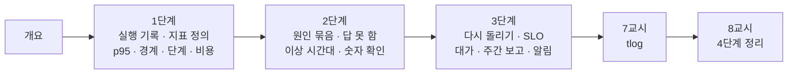

# 77일차 · 실행 로그 분석과 운영 데이터 기반 Workflow 개선 (바이브 코딩)

- 일자: 2026-11-02 (77일차)
- 교과목: 노코드 멀티 에이전트 워크플로우 설계 및 운영
- 단원: AI 워크플로우 운영 및 관리 역량 강화
- 학습 내용: 실행 로그 분석, 운영 데이터 기반 Workflow 개선
- 실습 폴더: [Last3Mon/77](../../Last3Mon/77/README.md)
- 실습 환경: 65일차 n8n 2.42.6 + OpenAI API(`gpt-4.1-mini`, 요약 · 헬프데스크 답) + 77일차 데이터 API(76일차 + 두 주 실행 기록 666줄 · 오늘 실습 기록 · FAQ 더하기) + **CLI 코딩 에이전트**
- **실습 준비: [00-DAY77-PREP.md](00-DAY77-PREP.md) (수업 전날까지 1~2절 완료)**
- 수업 형식: 1 · 3 · 5교시 강의, 2 · 4 · 6교시 실습 5개씩 (예제 3 · 과제 2), 7교시 바이브 코딩, 8교시 발표 · 4단계 정리

## 오늘의 시간표

| 교시 | 시간 | 내용 | 자료 |
| --- | --- | --- | --- |
| 1 | 09:00~09:50 | 개요 · 1단계 강의 · 실행 기록 읽기와 지표 | [개요](00-DAY77-OVERVIEW.md) 1~14장, [1단계](01-STAGE1-READ-THE-LOG.md) |
| 2 | 10:00~10:50 | Lab 01 실습 5개 (기준 보고서 비교 · 지표 보고서 · 경계 · 날짜별 · 릴리스별 · 단계 · 비용) | [Lab 01](../../Last3Mon/77/LAB-01-Q-READ-AND-MEASURE.md) |
| 3 | 11:00~11:50 | 2단계 강의 · 문제를 숫자로 찾기 | 개요 15~21장, [2단계](02-STAGE2-FIND-PROBLEMS.md) |
| 4 | 12:00~12:50 | Lab 02 실습 5개 (실패 묶음 · 답 못 한 주제 · 이상 시간대 · 기간 · 다시 묻는 주제 · LLM 요약) | [Lab 02](../../Last3Mon/77/LAB-02-Q-FIND-PROBLEMS.md) |
| - | 13:00~14:00 | 점심 |  |
| 5 | 14:00~14:50 | 3단계 강의 · 고치고 다시 재기 | 개요 22~28장, [3단계](03-STAGE3-IMPROVE-AND-REMEASURE.md) |
| 6 | 15:00~15:50 | Lab 03 실습 5개 (고치기 전 · 후 · SLO · 고친 것의 대가 · 주간 보고 · SLO 알림) | [Lab 03](../../Last3Mon/77/LAB-03-Q-IMPROVE-AND-REMEASURE.md) |
| 7 | 16:00~16:50 | 바이브 코딩 `tlog`: 요청서 → TODO → SPEC → IMP-PLAN → 만들기 → 설치 | [VIBE-REQ-TLOG](../../Last3Mon/77/VIBE-REQ-TLOG.md), [진행](05-VIBE-CODING.md) |
| 8 | 17:00~17:50 | 발표 · **4단계 정리** (의미 · 효과 · 회사에서 쓰는 법) · 78일차 예고 | [4단계 정리](04-STAGE4-WRAPUP.md), [진행](05-VIBE-CODING.md) |

## 자료 목록

| 파일 | 내용 |
| --- | --- |
| `00-DAY77-PREP.md` | 실습 준비: n8n · 77일차 판 데이터 API 켜기, 기준 보고서(`base-report`) 게시, 기록 훑기, `flow.py doctor` (수업 전) |
| `00-DAY77-OVERVIEW.md` | 개요 30장 (PPT 대신 Markdown, 가로줄로 장 구분) |
| `01-STAGE1-READ-THE-LOG.md` | 실행 기록 · 관측의 세 가지, 지표는 정의, 백분위, 숫자는 Code, 경계와 0, 묶어서 세기 · 표본 크기, 단계 시간 · 비용 |
| `02-STAGE2-FIND-PROBLEMS.md` | 원인으로 묶기 · 파레토, 오류가 아닌 실패(이관율), 이상 탐지, 비교 기준, 수와 비율(재문의율), LLM 요약과 숫자 확인, 사건 타임라인 |
| `03-STAGE3-IMPROVE-AND-REMEASURE.md` | 다시 돌려 재기, 고칠 곳과 주인, SLI · SLO · 에러 예산, 고친 것의 대가(완화와 근본 해결), 주간 보고 조립, SLO 알림, 개선의 고리, 가게 장부로 본 하루 |
| `04-STAGE4-WRAPUP.md` | 8교시 35분: 오늘의 의미 · 효과 숫자 · 업계 이름 · 산업별 응용 · 지표 정의서 · 면접 · 최종 프로젝트 체크리스트 |
| `05-VIBE-CODING.md` | 7 · 8교시 바이브 코딩 진행 (tlog), 발표, 강사 정리, 강사 바이브 코딩, 팁, 예고 |
