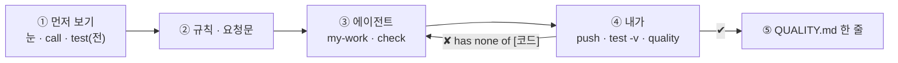
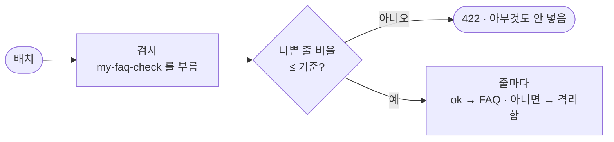
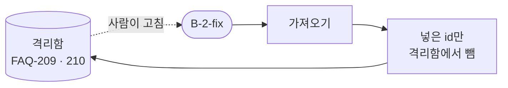

# 78일차 개요 · 데이터 품질 검증 자동화와 품질 관리 Workflow

> 노코드 멀티 에이전트 워크플로우 설계 및 운영 · 2026-11-03
> 30장 · 각 장은 가로줄(`---`)로 나뉩니다. 1교시에는 1~6장을 보고, 나머지 장은 각 단계 강의(1 · 3 · 5교시) 때 함께 띄웁니다.
> 숫자는 모두 강사 노트북 실측입니다 (65일차 n8n 2.42.6, 78일차 판 데이터 API의 FAQ 배치 셋 · 직원 CSV · 접수 건, OpenAI `gpt-4.1-mini`(LLM 검사, temperature 0), 11/01 정답 워크플로우를 학생 순서대로 1회).

| 장 | 범위 | 띄우는 때 |
| --- | --- | --- |
| 1~6 | 표지 · 목표 · 시간표 · 같은 배치, 다른 판정 · 일하는 순서 · 실습 15개 | 1교시 시작 |
| 7~14 | 1단계 · 품질 규칙 | 1교시 강의 |
| 15~21 | 2단계 · 품질 게이트 | 3교시 강의 |
| 22~28 | 3단계 · 품질 관리 | 5교시 강의 |
| 29~30 | 바이브 코딩 · 정리와 예고 (8교시 35분 정리는 [04-STAGE4-WRAPUP](04-STAGE4-WRAPUP.md)) | 7교시 · 8교시 |

---

## 1 / 30 · 표지


**78일차**

# 데이터 품질 검증 자동화와 품질 관리 Workflow

규칙은 말로 정하고 · 나쁜 데이터는 막고 알리고 · 고치는 것은 사람이

<sub>노코드 멀티 에이전트 워크플로우 설계 및 운영 · 2026-11-03</sub>

---

## 2 / 30 · 오늘 할 수 있게 될 세 가지

| | 목표 | 내용 |
| --- | --- | --- |
| 1 | **규칙을 세운다** | 나쁜 데이터를 눈으로 찾고, 규칙과 오류 코드로 바꾸고, 경계에서 시험하고, 이미 있는 데이터와 맞춰 보고, 보낸 사람에게 고칠 것을 돌려준다 |
| 2 | **막는다** | 검사를 불러 나쁜 배치는 거절하고 나쁜 줄은 격리하고, 규칙으로 못 잡는 것은 LLM에게, 기준의 대가를 재고, 기록 · 알림을 남기고, LLM 호출을 숫자로 본다 |
| 3 | **관리한다** | 규칙을 스키마(데이터)로 꺼내 넓히고, 고친 줄을 다시 넣어 격리함을 비우고, 새 스키마로 늘리고, 품질 보고서 · 데이터셋별 품질을 본다 |

---

## 3 / 30 · 오늘의 시간표

| 교시 | 시간 | 내용 |
| --- | --- | --- |
| 1 | 09:00~09:50 | 개요 · **1단계 강의** · 품질 규칙 |
| 2 | 10:00~10:50 | **Lab 01 실습 5개** · 눈으로 · 기준 검사 · 검사 워크플로우 · 경계 · 이미 있는 데이터 · 고침 목록 |
| 3 | 11:00~11:50 | **2단계 강의** · 품질 게이트 |
| 4 | 12:00~12:50 | **Lab 02 실습 5개** · 배치 게이트 · 격리 · LLM 검사 · 기준을 바꾸면 · 기록 · 알림 · LLM 호출 수 |
| - | 13:00~14:00 | 점심 |
| 5 | 14:00~14:50 | **3단계 강의** · 품질 관리 |
| 6 | 15:00~15:50 | **Lab 03 실습 5개** · 스키마 검사 · 고쳐서 다시 · 새 스키마 · 품질 보고서 · 데이터셋별 |
| 7 | 16:00~16:50 | 바이브 코딩 `tcheck`: 요청서 → TODO → SPEC → IMP-PLAN → 만들기 → 설치 |
| 8 | 17:00~17:50 | 발표 · **4단계 정리** (의미 · 효과 · 회사에서 쓰는 법) · 79일차 예고 |

---

## 4 / 30 · 오늘의 출발점: 같은 배치, 다른 판정

77일차에 와이파이 FAQ 한 줄이 답 못 한 질문 34건을 풀었습니다. 그래서 콘텐츠 담당자가 FAQ를 배치로 보내기 시작했습니다. 첫 배치 B-1, 13줄.

| 질문 | 규칙표를 들고 눈으로 | 팀의 기준 검사 · 가져오기 |
| --- | --- | --- |
| 넣어도 되는 줄? | **2줄** (분명히 나쁜 8 · 판단 보류 3) | **10줄** 통과 |
| 개인 전화번호 FAQ-109 | 나쁨 | 통과 |
| 바깥 링크 FAQ-110 | 나쁨 | 통과 |
| 실제로 FAQ에 들어간 것 | — | **12줄** (FAQ-003이 둘, 전화번호 · 단축 링크까지) |

나쁜 FAQ는 **답을 못 하는 것보다 나쁩니다** — 틀린 답을 자신 있게 보여 줍니다.

---

## 5 / 30 · 일하는 순서 (오늘은 "규칙 → 요청문 → 검사 → 확인")



| 누가 | 무엇을 |
| --- | --- |
| 나 | 나쁜 데이터를 찾고 규칙으로 정하기, 기준 정하기, 나쁜 데이터를 **고치기** |
| CLI 에이전트 | `AGENTS.md`대로 워크플로우 JSON, `check` |
| `flow.py` | `test --webhook`(기준과 비교), `quality`(FAQ · 격리함 · 기록 · 알림), `diff` |

---

## 6 / 30 · 실습 15개 (Lab마다 예제 3 · 과제 2)

| | 예제 1 | 예제 2 | 예제 3 | 과제 1 | 과제 2 |
| --- | --- | --- | --- | --- | --- |
| Lab 01 | 눈으로 검사 · 기준 검사 (에이전트 없이) | 검사 워크플로우 | 경계에서 재 보기 (에이전트 없이) | 이미 있는 데이터 | 고침 목록 |
| Lab 02 | 배치 게이트 · 격리 | LLM 검사 | 기준을 바꾸면 (에이전트 없이) | 품질 기록 · 알림 | LLM 호출 수 · 늘 같은가 |
| Lab 03 | 스키마 검사 | 고쳐서 다시 넣기 | 스키마만 바꾸면 (에이전트 없이) | 품질 보고서 | 데이터셋별 품질 |

---

## 7 / 30 · 1단계 · 데이터 품질이란

> 생활 속 예: 식당 주방의 아침 식재료 검수 — 상자가 비어 있지 않다고 받는 게 아니라, 라벨 · 온도 · 날짜 · 주문한 물건인지를 본다.

| 품질 차원 (업계에서 쓰는 말) | 뜻 | 오늘 B-1에서 |
| --- | --- | --- |
| 완전성 (completeness) | 빠진 칸이 없나 | 빈 제목 · 빈 답 · 빈 키워드 |
| 유효성 (validity) | 형식 · 길이 · 값의 범위 | id 두 자리 · 300자 넘는 답 |
| 고유성 (uniqueness) | 겹치지 않나 | 같은 배치에 FAQ-102가 둘 |
| 일관성 (consistency) | 이미 있는 데이터와 맞나 | 이미 있는 FAQ-003 · 같은 제목 |
| 정확성 (accuracy) | 내용이 맞나 | 토너 제목에 메일함 답 (LLM) |
| 안전 (보안 · 개인정보) | 내보내도 되나 | 개인 휴대전화 · 단축 링크 |

---

## 8 / 30 · 규칙은 말이 먼저

> 생활 속 예: 벽에 붙은 검수 기준표 — "라벨 없는 고기는 반품, 냉장품은 5도 이하". 주방장이 바뀌어도 판정이 같다.

| | 기준 검사 (`base-faq-check`) | 오늘의 규칙 (AGENTS.md 3절) |
| --- | --- | --- |
| 규칙 수 | 3 (빈 값만) | 10 (+ 과제에서 이미 있는 데이터 · LLM) |
| B-1 통과 | 10/13 | **5/13** — 눈으로 찾은 8줄과 같은 줄이 나쁨 |
| 목록이 아닌 본문 | 500 (Code가 터짐) | **400** |
| `lab01` 테스트 | 1/5 | **5/5** |

- 기준이 틀린 계산을 한 게 아니라 **규칙이 없었습니다.** 규칙을 요청문에 적으면 에이전트도 같은 판정을 냅니다.

---

## 9 / 30 · 오류 코드: 기계와 사람이 함께 읽는다

> 생활 속 예: 반품 상자에 붙이는 사유 스티커 — "온도"라고 짧게 붙여 두면 월말에 셀 수 있고, 납품업체에는 사유서로 풀어 쓴다.

| 같은 줄 | 코드 (기계가 셈) | 말 (사람이 고침, 과제 2) |
| --- | --- | --- |
| FAQ-103 | `title_missing` | 제목을 써 주세요 |
| FAQ-109 | `pii` | 개인 전화번호 · 메일 주소를 빼고 IT 포털 안내로 바꿔 주세요 |
| FAQ-003 | `exists_id` | 이미 있는 id입니다. 새 id를 쓰거나 … |

- 코드는 짧고 바뀌지 않음 → `codes`로 세고 Lab 03 보고서의 "가장 흔한 문제"가 됩니다. 말은 표 하나에서 — LLM으로 만들지 않습니다.

---

## 10 / 30 · 규칙은 Code가 확인한다

> 생활 속 예: 온도는 온도계가, 무게는 저울이 — 주방장의 감으로 재지 않는다.

| 판정 | 누가 | 까닭 |
| --- | --- | --- |
| 빈 값 · 길이 · 형식 · 중복 · 전화번호 형식 | **Code** | 정해진 답, 늘 같게, 0.1초 |
| 이미 있는 데이터 | Code + 데이터 API | 목록을 읽어 비교 |
| 답이 질문에 맞나 | **LLM** (Lab 02) | 뜻은 규칙으로 못 잼 |

- 13줄 검사 0.1초, LLM 없음. LLM에게 "이 FAQ 괜찮아?"를 물으면 날마다 판정이 다를 수 있고 줄마다 돈이 듭니다 (75일차).

---

## 11 / 30 · 경계에서 재 보기 (Lab 01 예제 3)

> 생활 속 예: 냉장고 온도 딱 5도 — 4도와 8도는 누구나 판정하지만, 5도와 5.1도는 기준표의 말("이하")이 정한다.

| 경계 | 규칙의 말 | 내 검사 | 기준 |
| --- | --- | --- | --- |
| 제목 40자 · 41자 | 40자 **넘으면** | ✔ 통과 · 막음 | ✘ 둘 다 통과 |
| 공백만 있는 제목 | 공백 = 빈 값 | ✔ 막음 | ✘ 통과 |
| `01012345678` · `02-123-4567` | 하이픈 **없어도** 휴대전화 | ✔ 막음 · 통과 | ✘ 둘 다 통과 |
| `intra.example.com.evil.io` | 호스트가 **정확히** | ✔ 막음 | ✘ 통과 |

- **6/6 대 0/6.** 강사의 첫 판도 `evil.io`를 통과시켰습니다 — "앞이 같나"만 보고 "끝나나"를 안 봄.

---

## 12 / 30 · 이미 있는 데이터와 맞춰 보기 (Lab 01 과제 1)

> 생활 속 예: 상자를 받기 전에 냉장고를 연다 — 어제 받은 우유가 그대로면 같은 칸에 넣지 않는다.

| 줄 | 배치 안만 보면 | 이미 있는 FAQ와 맞추면 |
| --- | --- | --- |
| FAQ-003 "VPN 접속 오류 (새 판)" | 통과 | `exists_id` (오류) |
| FAQ-112 "VPN 접속 오류" | 통과 | `same_title` (오류) + `keyword_used:vpn` (**경고**) |
| B-1 통과 | 5줄 | **3줄** |

- 오류는 막고, 경고는 알리고 통과. 모든 것을 막으면 아무것도 못 넣고, 다 통과시키면 검사가 의미 없습니다 (참조 무결성).

---

## 13 / 30 · 보낸 사람에게 돌려준다 (Lab 01 과제 2)

> 생활 속 예: 반품 사유서 — "3번 상자 · 라벨 없음". 다음 납품이 나아지는 것은 사유서 덕분이다.

```text
"message": "B-1: 13줄 중 3줄 통과, 10줄 고칠 것"
{"row": 3, "id": "FAQ-103", "codes": ["title_missing"], "fix": ["제목을 써 주세요"]}
{"row": 9, "id": "FAQ-109", "codes": ["pii"], "fix": ["개인 전화번호 · 메일 주소를 빼고 IT 포털 안내로 바꿔 주세요"]}
```

- 업계 이름: **데이터 계약**(data contract) — 보내는 쪽과 받는 쪽이 모양 · 규칙을 미리 약속하고, 어기면 이유와 함께 돌려보냄.
- 워크플로우는 **고쳐 주지 않습니다.** 빈 제목을 짐작해 채우면 틀린 FAQ가 "검사를 통과한 FAQ"가 됩니다.

---

## 14 / 30 · 1단계 정리 · 규칙

| 정한 것 | 오늘 |
| --- | --- |
| 무엇이 나쁜가 | 차원 여섯 · 코드 열둘 (AGENTS.md 3절) |
| 경계의 말 | 넘으면 · 공백 · 형식 · 정확히 |
| 막을 것 · 알릴 것 | 오류 vs 경고 |
| 누구에게 무엇을 | 기계에는 코드, 사람에게는 말 |

- 숫자: 기준 1/5 → 5/5, 경계 6/6 대 0/6, B-1 통과 10 → 5 → 3, 고침 목록 10줄.

---

## 15 / 30 · 2단계 · 검사와 게이트는 다른 일

> 생활 속 예: 검수(무엇이 상했나)와 반품 결정(그래서 트럭을 돌려보내나)은 다른 일이다.



- 규칙을 다시 쓰지 않고 **검사를 부릅니다** — 규칙은 한 벌 (77일차 요약이 보고서를 부른 것처럼).

---

## 16 / 30 · 배치 게이트 · 줄 게이트 · 격리 (Lab 02 예제 1)

> 생활 속 예: 열에 일곱이 상했으면 트럭째 반품, 대부분 괜찮으면 좋은 것만 냉장고에, 이상한 것은 보류 칸에 사유를 붙여.

| 배치 | 기준 가져오기 | 내 가져오기 |
| --- | --- | --- |
| B-1 (나쁜 줄 10/13) | 12줄 넣음 | **422** · 0.7692 > 0.3 |
| B-2 (메일 주소 1) | 10줄 넣음 | 9줄 · FAQ-209 격리 · `score` 0.9 |
| B-3 (답 "짧") | 6줄 넣음 | 5줄 · FAQ-305 격리 |

- 격리함 = 버리지 않고 **이유와 함께** 보관 (76일차 DLQ와 같은 생각). 업계 이름: quarantine · dead-letter.

---

## 17 / 30 · LLM 검사 · 뜻은 LLM이 (Lab 02 예제 2)

> 생활 속 예: 무게 · 온도는 기준표로, "주문한 맛이 맞나"는 주방장이 한 숟가락 — 단, 이미 상한 것은 맛보지 않는다.

| | 규칙만 | + LLM |
| --- | --- | --- |
| FAQ-210 "모니터 밝기" · 답은 연차 휴가 | 넣음 | **격리** `llm_mismatch` |
| B-2 결과 | 9줄 · 0.9 | 8줄 · 0.8 |
| B-2 시간 | 1.4초 | **9.3초** (규칙을 통과한 9줄 × 1번) |

- 판정을 읽을 수 없으면 **넣지 않음** (fail-closed, 73일차). LLM이 막은 줄은 FAQ-210 **하나** — 드문 줄을 위해 줄마다 1초.

---

## 18 / 30 · 기준은 고르는 값 (Lab 02 예제 3)

> 생활 속 예: 반품 기준을 "열에 여덟까지"로 풀면 보류 칸이 넘치고, "하나도 안 돼"로 조이면 트럭이 다 돌아간다.

| 배치 | 기준 | 결과 |
| --- | --- | --- |
| B-1 | 0.3 | 거절 |
| B-1 | 0.8 | 받음 — 넣음 **2** · 격리 **11** (사람이 11줄을 봄) |
| B-2 | 0.05 | 거절 — 멀쩡한 9줄도 돌아감 |
| B-2 | 0.1 | 받음 — **같으면 통과** |

- 앞 배치가 넣은 FAQ가 다음 배치의 판정을 바꿉니다 (`same_title` · `exists_id`) — 실험은 하나씩 떼어서.

---

## 19 / 30 · 품질 기록 · 알림 (Lab 02 과제 1)

> 생활 속 예: 검수 일지와 사장님 호출 — 일지가 쌓여야 "요즘 그 업체가 나빠졌다"를 말하고, 트럭째 반품한 날은 바로 전화한다.

| 배치 | 응답 | 기록 | 알림 |
| --- | --- | --- | --- |
| B-1 | 422 | `rejected: true` · 0 | `batch_rejected` |
| B-2 | 200 · 0.8 | 8 · 2 · 0.8 | `low_quality` (0.9 미만) |

- 거절도 기록해야 보고서에 "가장 나쁜 배치"가 생깁니다. 알림은 곁가지 — 응답은 그대로 (`Result again`).

---

## 20 / 30 · LLM을 몇 번 · 늘 같은가 (Lab 02 과제 2)

> 생활 속 예: "오늘 맛보기 몇 번 했지? 상한 것까지 맛본 건 아니지? 어제와 오늘 판정이 같나?"

| 배치 | 줄 | `llm_calls` | 세 번 |
| --- | --- | --- | --- |
| B-1 (거절) | 13 | **0** | 같음 |
| B-2 | 10 | **9** | FAQ-210만 · 9.4 · 8.1 · 7.6초 |
| B-3 | 6 | **5** | 같음 |

- `--repeat`로 같은 배치를 연달아 보내면 2/6 — 판정이 흔들린 게 아니라 이미 넣은 FAQ 때문에 `exists_id`. "늘 같은가"는 **처음 상태에서** 세 번.

---

## 21 / 30 · 2단계 정리 · 게이트

| 정한 것 | 오늘 |
| --- | --- |
| 배치 · 줄의 두 관문 | 0.3 · `ok` |
| 버리지 않기 | 격리함 + 이유 |
| LLM은 어디에 | 규칙을 통과한 줄에만, 모르면 넣지 않음 |
| 기준의 대가 | 거절 ↔ 격리 ↔ 사람의 일 |
| 남기기 | 품질 기록 · 알림 · `llm_calls` |

- 숫자: 기준 0/6 → 5/6 → 6/6, B-1 12줄 → 0줄, FAQ-210 격리, 격리 13, LLM 9 · 5 · 0.

---

## 22 / 30 · 3단계 · 스키마: 규칙을 데이터로

> 생활 속 예: 품목마다 다른 검수 카드 — 채소 · 고기 · 생선마다 주방장을 두지 않고, 카드를 바꿔 들면 한 사람이 다 검수한다.

```json
{"name": "employee", "key": "email", "fields": {
  "dept": {"type": "enum", "required": true, "values": ["영업팀", "재무팀", "인사팀", "개발팀", "IT팀", "총무팀"]},
  "joined": {"type": "date", "required": true}, "phone": {"type": "phone", "required": false}, …}}
```

- 직원 CSV 9줄 → **4줄 통과** (메일 형식 · `마케팅팀` · `2026-13-01` · 이름 빈칸 · 메일 중복). 같은 워크플로우로 FAQ B-3 → 5/6.
- 업계 이름: JSON Schema · 테이블 정의 · Great Expectations의 "기대값".

---

## 23 / 30 · 스키마로 되는 것 · 안 되는 것

> 생활 속 예: 검수 카드에는 무게 · 온도 · 라벨 칸이 있지만, "이 납품업체와 이미 계약한 품목인가"는 장부를 봐야 안다.

| 규칙 | 스키마로 | 따로 |
| --- | --- | --- |
| 필수 · 길이 · 형식 · 목록 · 날짜 · 중복 | ✔ | |
| 답 안의 개인정보 · 바깥 링크 | | Code (Lab 01) |
| 이미 있는 데이터 | | Code + 데이터 API |
| 답이 질문에 맞나 | | LLM |

- 모양은 스키마로 **넓게**, 그 데이터만의 규칙은 Code로 **깊게**.

---

## 24 / 30 · 되돌림 고리 (Lab 03 예제 2)

> 생활 속 예: 라벨을 붙여 다시 가져온 고기를 받았으면 보류 칸의 옛 쪽지를 뗀다 — 안 떼면 내일 또 전화한다.



| | 고치기 전 | 고친 뒤 |
| --- | --- | --- |
| 넣기 | 2줄 · `score` 1 | 같음 |
| 격리함 | **2** (해결된 줄이 남음) | **0** |

---

## 25 / 30 · 스키마만 바꾸면 (Lab 03 예제 3)

> 생활 속 예: 디저트를 시작해 생크림이 들어온다 — 주방장을 새로 뽑지 않고 "생크림 카드" 한 장.

| 접수 건 9줄 | FAQ 검사 | 스키마 검사 (고치지 않음) |
| --- | --- | --- |
| 통과 | 0줄 (칸이 달라 모두 나쁨) | **2줄** |
| 이유 | `id_format` · `answer_missing` 9 | `T-12` · `urgent` · **2월 30일** · 3자 제목 · 연락처 형식 · 중복 · 요청자 빈칸 |

- 워크플로우를 한 줄도 고치지 않았습니다 — `ticket.json` 한 장. 그래서 **스키마 변경 = 규칙 변경**, 리뷰가 필요 (74일차 관문).

---

## 26 / 30 · 품질 보고서 · 품질도 정의가 먼저 (Lab 03 과제 1)

> 생활 속 예: 월말 검수 일지 정리 — "이번 달 어땠어?"에 늘 같은 방식으로 답한다.

| 칸 | 값 | 정한 것 |
| --- | --- | --- |
| 배치 · 평균 | 4 · **0.6583** | 거절(0)도 넣음 (빼면 0.8778) |
| 가장 나쁜 배치 | B-1 | 같으면 먼저 나온 것 |
| 가장 흔한 문제 | `pii` 2 | 같으면 코드 글자순 |
| 추세 | 좋아짐 | 마지막 − 첫 > 0.05 |

- 함정: 추세가 "13줄 거절 → 고친 2줄"을 비교한 것 — 숫자는 정의대로지만 **무엇을 비교했는지** 함께 말한다.

---

## 27 / 30 · 데이터셋별 · 평균이 가리는 것 (Lab 03 과제 2)

> 생활 속 예: 한 달 평균은 "괜찮다"인데 업체별로 나누면 생선 가게만 절반이 반품 — 전화할 곳은 생선 가게.

| 데이터셋 | 평균 | 가장 흔한 문제 |
| --- | --- | --- |
| employee (HR-1) | 0.4444 | `bad_format:email` |
| ticket (TK-1) | **0.2222** ← 가장 손볼 곳 | `bad_format:contact` |
| faq (B-3) | 0.8333 | `answer_too_short` |
| 전체 | 0.5 | — |

- 검사도 같은 모양으로 기록하니 보고서를 고치지 않고 셋이 보임. 섞은 추세는 뜻이 없음 — 추세는 데이터셋 안에서.

---

## 28 / 30 · 식당 주방으로 본 오늘 하루

> 생활 속 예: 오늘 만든 것이 모두 식당 주방에 있다 (3단계 8절 표).

| 오늘 | 주방 |
| --- | --- |
| 품질 규칙 · 오류 코드 | 검수 기준표 · 반품 사유 스티커 |
| 경계 | 냉장고 온도 딱 5도 |
| 이미 있는 데이터 · 고침 목록 | 냉장고 먼저 열기 · 반품 사유서 |
| 배치 게이트 · 격리 · 기준 | 트럭째 반품 · 보류 칸 · 반품 기준 |
| LLM 검사 · 호출 수 | 맛보기 · 맛보기 횟수 |
| 품질 기록 · 알림 | 검수 일지 · 사장님 호출 |
| 스키마 · 새 스키마 · 되돌림 | 품목별 검수 카드 · 생크림 카드 · 보류 칸 쪽지 떼기 |
| 보고서 · 데이터셋별 | 월말 일지 정리 · 업체별 성적표 |

---

## 29 / 30 · 7교시 바이브 코딩 · `tcheck`

요청서(인사팀 · 콘텐츠 담당의 말 ①~⑫) → `Doc/TODO.md` → `SPEC.md` → `IMP-PLAN.md` → 단계별로 → `uv tool install`.

| 오늘 n8n에서 | `tcheck`로 터미널에서 (보내기 전에) |
| --- | --- |
| `my-check` (스키마) | `tcheck check` — **같은 배치면 같은 판정** |
| 배치 게이트 | `tcheck gate --max-invalid 0.3` — 거절이면 종료 코드 4 |
| 격리 | `--out` 깨끗한 줄 · `--rejects` 나쁜 줄 + 이유 |
| 내용 규칙 · 고침 목록 · 품질 기록 | `--content answer` · `--fix` · `--log` (나중 단계) |
| (없음) | CSV · JSON · 요청 파일, TUI 탭 · 거르기 · 내보내기 |

- 강사 본: 직원 · 접수 건 · FAQ B-3의 `rows` · `codes`가 `my-check` 응답과 **모두 같음**, 직원 `tcheck gate` → 종료 코드 4, 테스트 22개 3초 (n8n 없이).

---

## 30 / 30 · 오늘의 정리 · 79일차 예고

| 단계 | 오늘 숫자 |
| --- | --- |
| 규칙 | 기준 10/13 통과 · 1/5 → 규칙대로 5/13 · 5/5, 경계 6/6 대 0/6, 이미 있는 데이터 3/13, 고침 목록 10줄 |
| 게이트 | 기준 가져오기 12줄 넣음 → B-1 거절 · B-2 9줄 · LLM이 FAQ-210, 기준 0.8이면 격리 11, LLM 호출 9 · 5 · 0 |
| 관리 | 직원 4/9 · 접수 건 2/9 (워크플로우 그대로), 격리 2 → 0, 평균 0.6583, ticket 0.2222가 가장 손볼 곳 |

- 8교시 [4단계 정리](04-STAGE4-WRAPUP.md): 의미 · 효과 · 업계 이름 · 면접 · 최종 프로젝트 체크리스트.
- 79일차 (11/4): **운영 데이터 기반 Workflow Ops Assistant** — 77일차 실행 기록 · 78일차 품질 기록 · 76일차 알림을 한데 모아, 운영자가 "지금 무엇이 문제야?"라고 물으면 숫자로 답하는 도우미를 만든다.
