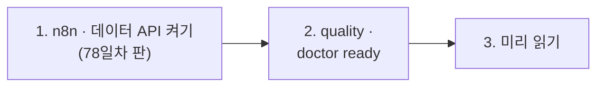

# 78일차 실습 준비 · 수업 전에 미리 해 두면 좋은 것

- 수업일: 2026-11-03 (78일차) · 데이터 품질 검증 자동화와 품질 관리 Workflow
- 준비 시간: 약 10분
- 먼저 WSL에서 `cd ~/aio-01d4-stu && git pull`로 오늘 자료를 받습니다 (수강생 저장소: https://gl.isitsoft.kr/publicproj/aio-01d4-stu).
- **수업 전날까지** 1~2절을 끝내 주세요.



---

## 1. n8n과 데이터 API 켜기 (전날 필수, 3분)

오늘은 **78일차 판 데이터 API**(77일차 + 격리함 · 스키마 · 품질 기록)를 씁니다. 같은 이름이라 이 폴더에서 다시 만들면 바뀝니다.

```bash
sudo systemctl disable --now ollama 2>/dev/null   # WSL에 설치한 Ollama가 있으면 끄고 자동 시작도 끔
cd ~/aio-01d4-stu/Last3Mon/65/n8n
docker compose rm -sf ollama                      # Ollama 컨테이너가 있으면 지움 (없으면 그냥 지나감)
docker compose start
cd ~/aio-01d4-stu/Last3Mon/78/data-api
docker compose up -d --force-recreate
curl -s localhost:8800/schemas/employee | head -c 80     # {"name": "employee", "key": "email", ...
```

- **66일차부터 LLM은 OpenAI API 키(`Last3Mon/.env`, Credential `OpenAI (.env)`)만 씁니다.** Ollama는 쓰지 않습니다.
- `network day65-n8n_default not found` → n8n이 켜져 있지 않음. 위 n8n 부분부터 다시.

## 2. 상태 보기와 준비 확인 (전날 필수, 3분)

```bash
cd ~/aio-01d4-stu/Last3Mon/78
uv run tools/flow.py push reference/baseline-faq-check.json reference/baseline-faq-import.json   # 팀의 기준 (Lab 01 · 02에서 비교용)
uv run tools/flow.py quality
uv run tools/flow.py doctor
```

```text
FAQ: 6  (nothing added)
quarantine: 0
quality log: 0
alerts: 0
...
✔ schemas faq · employee · ticket, quarantine, quality log (day 78 data API)
✔ credential 'OpenAI (.env)' (openAiCourse0001)
✔ CLI coding agent: codex, claude, agy
ready
```

| ✘ 항목 | 할 일 |
| --- | --- |
| n8n container · data API | 1절 |
| schemas | 데이터 API가 예전 판 → 1절 `--force-recreate` |
| credential | `cd ~/aio-01d4-stu/Last3Mon/65/n8n && bash register-credentials.sh` |
| CLI coding agent | [67일차 준비](../67/00-DAY67-PREP.md) 2절 |

---

## 3. 미리 읽어 오면 좋은 내용 (선택, 약 5분)

### 3.1 "AI가 틀린 답을 자신 있게 했어요"

77일차에 FAQ 한 줄이 문제를 풀었습니다. 그런데 그 FAQ가 틀렸다면? 답을 못 하는 헬프데스크보다 **틀린 답을 하는** 헬프데스크가 더 위험합니다. 워크플로우가 믿고 쓰는 데이터는 들어오는 곳에서 검사해야 합니다. `requests/faq-batch-1.json`을 열어 넣으면 안 되는 줄을 찾아보세요.

### 3.2 용어

| 용어 | 한 줄 설명 |
| --- | --- |
| 품질 규칙 | "깨끗하다"를 누가 봐도 같게 판단하는 규칙 (예: 답 10자 이상) |
| 오류 코드 | 줄이 걸린 이유를 짧은 이름으로 (`pii`, `bad_format:email`) |
| 게이트 | 기준을 넘지 못하면 들여보내지 않는 곳 (74일차 릴리스 게이트와 같은 생각) |
| 격리함 | 나쁜 줄을 버리지 않고 이유와 함께 두는 곳 (76일차 DLQ와 같은 생각) |
| 스키마 | 데이터의 모양(필드 · 타입 · 필수)을 적은 문서 |
| 경계 | 기준선 바로 위 · 아래의 값 (딱 40자, 공백만, 하이픈 없는 번호) |
| 기준 검사 · 기준 가져오기 | 팀이 지난달 급히 만든 워크플로우 (`base-faq-check` · `base-faq-import`) — 오늘 내 것과 비교할 상대 |

## 4. 당일 준비물

- 충전된 노트북과 충전기, WSL의 Docker, Windows Terminal(WSL) 창 **두 개**, 웹 브라우저
- 77일차 `~/vibe/tlog` (지우지 않기, 79일차에 씀)
- 7교시 [요청서](../../Last3Mon/78/VIBE-REQ-TCHECK.md)를 미리 한 번 읽어 오면 좋습니다

## 확인

- [ ] `curl -s localhost:8800/schemas/employee`에 `"key": "email"`
- [ ] `flow.py push`로 `base-faq-check` · `base-faq-import` 게시
- [ ] `flow.py quality`가 FAQ 6 · 격리 0을 보여 줌
- [ ] `uv run tools/flow.py doctor` → 마지막 줄 `ready`
