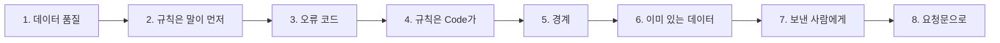

# 1단계 · 품질 규칙

- 교시: 1교시 강의 (09:00~09:50) · 2교시 [Lab 01](../../Last3Mon/78/LAB-01-Q-QUALITY-RULES.md) 실습 5개 (10:00~10:50)
- 이 단계가 끝나면: 들어오는 데이터의 "나쁨"을 품질 차원으로 나눠 말하고, 그것을 **말로 정한 규칙과 오류 코드**로 바꾸고, 규칙을 Code로 확인하는 검사를 만들고, 경계(딱 기준선 · 공백 · 꼴 · 비슷한 주소)에서 재 보고, 이미 있는 데이터와 맞춰 보고, 보낸 사람에게 고칠 것을 돌려줄 수 있다.
- 숫자: 모두 강사 노트북 실측입니다 (65일차 n8n 2.42.6, 78일차 판 데이터 API, FAQ 배치 B-1 13줄 · B-2 10줄 · 경계 배치 10줄, 11/01 실습을 5개로 늘린 뒤 정답 워크플로우를 학생 순서대로 1회). 규칙 판정은 누가 돌려도 같습니다. 출력 전부는 수업 뒤 공개되는 `Last3Mon/78/answers/LAB-TEST-RESULT.md`에 있습니다.
- 실습 가리키기: 이 문서에서 "Lab 01 예제 1"은 2교시 [Lab 01 문서](../../Last3Mon/78/LAB-01-Q-QUALITY-RULES.md)의 그 절입니다. 파일 경로(`cases/` · `requests/` · `my-work/` · `reference/`)는 실습 폴더 `~/aio-01d4-stu/Last3Mon/78` 기준입니다.

## 0. 이 시간 (50분)

| 시간 | 절 · 개요 | 하는 일 |
| --- | --- | --- |
| 09:00~09:06 | 개요 1~6장 | 오늘 하루, 같은 배치 다른 판정, 실습 15개 |
| 09:06~09:13 | 1 · 개요 7장 | 데이터 품질의 차원 |
| 09:13~09:20 | 2 · 3 · 개요 8~9장 | 규칙은 말이 먼저, 오류 코드 |
| 09:20~09:26 | 4 · 개요 10장 | 규칙은 Code가 |
| 09:26~09:33 | 5 · 개요 11장 | 경계 |
| 09:33~09:43 | 6 · 7 · 개요 12~14장 | 이미 있는 데이터 · 오류와 경고, 고침 목록 · 데이터 계약 |
| 09:43~09:50 | 8 · 9 · 확인 질문 | 요청문, 자주 하는 실수 |

### 2교시 Lab 01에서 이어서 하는 것

| 2교시 실습 (시각) | 이 강의의 절 | 실습에서 하는 일 | 쓰는 파일 · 명령 |
| --- | --- | --- | --- |
| 시작 (10:00) | — | 품질 규칙표 복사 | `cp templates/QUALITY-RULES-TEMPLATE.md my-work/QUALITY.md` (오늘의 판정을 모두 여기에) |
| Lab 01 예제 1 (10:00~10:10, 에이전트 없이) | 1 · 2 | B-1을 눈으로 검사, 같은 배치를 기준 검사에 | `call base-faq-check requests/faq-batch-1.json` → `QUALITY.md` 1절 |
| Lab 01 예제 2 (10:10~10:25) | 2 · 3 · 4 | 규칙대로 판정하는 내 검사 | `my-work/faq-check.json` (새로), 테스트 `cases/lab01.json` (전: `--webhook base-faq-check`) |
| Lab 01 예제 3 (10:25~10:32, 에이전트 없이) | 5 | 경계에서 두 검사를 재 보기 | `test cases/lab01-edges.json -v` · `--webhook base-faq-check` → `QUALITY.md` 3절 |
| Lab 01 과제 1 (10:32~10:40) | 6 | 이미 있는 FAQ와 맞춰 보기 | 테스트 `cases/lab01-challenge.json` |
| Lab 01 과제 2 (10:40~10:50) | 7 | 보낸 사람에게 돌려줄 고침 목록 | 테스트 `cases/lab01-challenge2.json` → `QUALITY.md` 4절 |

## 1. 데이터 품질: 무엇이 "나쁜" 데이터인가 (2교시 Lab 01 예제 1)

### 일반 설명

> **생활 속 예 · 식당 주방의 아침 검수.** 아침마다 납품 트럭이 오면 주방장이 상자를 엽니다. 무른 채소, 라벨 없는 고기, 주문하지 않은 물건, 유통기한이 지난 우유를 골라냅니다. "상자가 비어 있지 않으면 받는다"로는 식당이 망합니다. 워크플로우가 믿고 쓰는 데이터(오늘은 FAQ)가 이 식재료이고, 오늘은 검수를 자동으로 하는 날입니다.

**데이터 품질(data quality)은 "이 데이터를 믿고 써도 되나"입니다.** 77일차까지는 실행 기록을 **믿고** 셌습니다. 그런데 워크플로우가 읽는 데이터(FAQ · 직원 목록 · 접수 건)가 틀리면, 워크플로우는 틀린 답을 **자신 있게** 냅니다 — 답을 못 하는 것보다 나쁩니다. 업계에서는 "나쁨"을 몇 가지 **차원**으로 나눠 말합니다.

| 차원 | 묻는 것 | 예 |
| --- | --- | --- |
| 완전성 (completeness) | 꼭 있어야 할 칸이 있나 | 빈 제목 · 빈 답 |
| 유효성 (validity) | 꼴 · 길이 · 값의 범위가 맞나 | id 꼴, 300자 넘는 답, 없는 날짜 |
| 고유성 (uniqueness) | 겹치지 않나 | 같은 id가 둘 |
| 일관성 (consistency) | 다른 데이터와 맞나 | 이미 있는 id · 같은 제목 |
| 정확성 (accuracy) | 내용이 사실 · 질문과 맞나 | 토너 제목에 메일함 답 |
| 적시성 (timeliness) | 지금도 맞나 | 지난 정책의 답 (오늘은 다루지 않음) |

여기에 FAQ처럼 **사람에게 그대로 보여 주는** 데이터는 안전(개인정보 · 위험한 링크)도 품질입니다. 업계 도구로는 Great Expectations · Soda · dbt tests · Deequ 같은 "데이터 검사" 도구가 있고, 데이터 파이프라인(ETL)의 한 단계로 검사를 둡니다. 오늘은 n8n 워크플로우로 같은 일을 합니다.

### 오늘 실습에서

B-1 13줄을 AGENTS.md 3절 규칙표를 들고 눈으로 읽으면 (Lab 01 예제 1):

| 판정 | 줄 | 차원 |
| --- | --- | --- |
| 분명히 나쁨 (8) | FAQ-103 빈 제목 · FAQ-105 빈 답 · FAQ-108 빈 키워드 | 완전성 |
| | FAQ-10 id 두 자리 · FAQ-106 300자 넘는 답 | 유효성 |
| | 둘째 FAQ-102 | 고유성 |
| | FAQ-109 개인 휴대전화 · FAQ-110 단축 링크 | 안전 |
| 판단 보류 (3) | FAQ-003 · FAQ-112 (이미 있는 FAQ와 겹침), FAQ-113 (답이 다른 이야기) | 일관성 · 정확성 |
| 좋음 (2) | FAQ-101 · FAQ-102 | |

- 같은 배치를 팀의 기준 검사에 보내면 **10줄 통과** — 빈 값 셋만 잡았습니다 (2절).

## 2. 규칙은 말이 먼저: 같은 배치, 다른 판정 (2교시 Lab 01 예제 1 · 2)

### 일반 설명

> **생활 속 예 · 벽에 붙은 검수 기준표.** 주방장마다 보는 눈이 다르면 같은 상자가 어떤 날은 받히고 어떤 날은 반품됩니다. 그래서 식당은 "라벨 없는 고기는 반품, 냉장품은 5도 이하"처럼 기준표를 벽에 붙입니다. 사람이 바뀌어도 판정이 같아지는 것은 기준표 덕분입니다.

**검사 = 규칙 + 판정.** "나쁜 FAQ를 걸러 줘"라는 말만으로는 판정이 하나로 정해지지 않습니다. 77일차의 "지표는 정의가 먼저"와 같습니다. 규칙은 적어도 이것을 정해야 합니다.

| 정해야 할 것 | 예 | 정하지 않으면 |
| --- | --- | --- |
| 무엇을 보나 | 제목 · 답 · 키워드 · id | 한두 칸만 봄 |
| 꼴 · 범위 | `FAQ-` + 숫자 3자리, 답 10~300자 | 사람마다 다름 |
| 경계 | 40자 **넘으면**, 공백은 빈 값 | 딱 기준선의 줄이 날마다 다르게 |
| 판정의 단위 | 줄마다 · 배치마다 | "B-1은 나쁘다"로 끝남 |
| 오류와 경고 | 막을 것 · 알릴 것 (6절) | 모든 것을 막거나 모두 통과 |

규칙이 요청문에 없으면 에이전트도 자기 방식으로 판정합니다 — 오늘 팀의 기준 검사처럼요.

### 오늘 실습에서

| | 기준 검사 (`base-faq-check`) | 내 검사 (`my-faq-check`, Lab 01 예제 2) |
| --- | --- | --- |
| 규칙 | 빈 제목 · 빈 답 · 빈 키워드 | AGENTS.md 3절 열 가지 |
| B-1 | 13줄 중 **10줄** 통과 | **5줄** 통과 — 눈으로 찾은 8줄과 같은 줄이 나쁨 |
| B-2 | 10줄 모두 통과 | 9줄 (FAQ-209 메일 주소), 사내 링크 FAQ-207은 통과 |
| `items`가 목록이 아님 | **500** (Code가 터짐) | **400** `{"error": "items must be a list"}` |
| `cases/lab01.json` | **1/5** | **5/5** |

- 기준이 틀린 계산을 한 것이 아니라 **규칙이 셋뿐**이었습니다. "버그 찾기"가 아니라 "규칙을 정해 그대로 대기"가 고치는 일입니다.

## 3. 오류 코드: 기계와 사람이 함께 읽는다 (2교시 Lab 01 예제 2)

### 일반 설명

> **생활 속 예 · 반품 사유 스티커.** 주방장은 반품 상자에 "온도" · "라벨"처럼 짧은 스티커를 붙입니다. 월말에 스티커를 세면 "이번 달 반품의 절반이 온도"가 보입니다. 납품업체에는 스티커를 풀어 쓴 사유서를 보냅니다. 짧은 표시와 긴 설명을 나눠 두는 것입니다.

**줄마다 이유를 코드로 붙입니다.** "B-1은 나쁘다"로는 아무도 고칠 수 없습니다. "FAQ-109는 `pii`"라고 해야 그 줄을 고칩니다. 코드는 짧고 바뀌지 않는 영어(`title_missing` · `pii`)로 정해 두고, 사람이 읽는 말은 따로 붙입니다 (7절). 코드가 같아야 배치마다 몇 번 나왔는지 세고(`codes`), 품질 보고서에서 "가장 흔한 문제"를 고를 수 있습니다 (3단계).

| 코드의 성질 | 까닭 |
| --- | --- |
| 짧고 정해진 이름 | 기계가 셈 · 비교 (`codes.pii`) |
| 한 줄에 여럿 | 제목도 비고 키워드도 비면 둘 다 |
| 판정과 따로 | `ok`는 `errors`가 비었을 때만 — 규칙을 더해도 판정 방식은 그대로 |

### 오늘 실습에서

B-1을 내 검사로 보면 `codes`에 여덟 가지가 1건씩입니다: `title_missing` · `id_format` · `answer_missing` · `answer_too_long` · `duplicate_in_batch` · `keywords_missing` · `pii` · `external_link`. 결과의 `rows`는 들어온 줄과 같은 순서 · 같은 수입니다 (AGENTS.md 4절) — 테스트가 `rows.8.errors`처럼 줄 번호로 봅니다.

## 4. 규칙은 Code가 확인한다 (2교시 Lab 01 예제 2)

### 일반 설명

> **생활 속 예 · 온도는 온도계로.** 냉장고 온도를 주방장의 손등으로 재지 않습니다. 온도계는 누가 들어도 같은 숫자를 줍니다. 대신 "이 소스, 맛이 맞나?"는 온도계로 잴 수 없어 사람이 맛봅니다.

**정해진 답이 있는 판정은 Code로.** 빈 값 · 길이 · 꼴(정규식) · 중복 · 전화번호 꼴은 같은 줄에 늘 같은 판정이 나와야 합니다. Code는 그렇게 하고, 빠르고(13줄 0.1초), 돈이 들지 않습니다. LLM에게 "이 FAQ 괜찮아?"를 물으면 그럴듯하지만, 날마다 판정이 다를 수 있고 줄마다 비용 · 시간이 듭니다 (75일차). LLM은 규칙으로 알 수 없는 것(답이 질문에 맞나)에만 씁니다 — 2단계에서.

| 판정 | 누가 |
| --- | --- |
| 꼴 · 길이 · 빈 값 · 중복 · 전화 · 링크 | Code |
| 이미 있는 데이터와 겹침 | Code + 데이터 API (6절) |
| 뜻 (답이 질문에 맞나) | LLM (2단계) |
| 고치기 | 사람 |

### 오늘 실습에서

내 검사는 `Check webhook` → `Is a list?`(IF) → `Check rows`(Code 하나) → `Send result`. Code에 들어가기 **전에** 모양을 봅니다: `items`가 목록이 아니면 400으로 돌려보내야 부른 쪽이 "내 본문이 틀렸다"를 압니다. 기준 검사처럼 Code 안에서 터지면 500 — "서버가 고장났다"로 읽힙니다.

## 5. 경계: 규칙은 기준선에서 시험받는다 (2교시 Lab 01 예제 3)

### 일반 설명

> **생활 속 예 · 냉장고 온도 딱 5도.** 기준표에 "냉장품 5도 이하"라고 적혀 있습니다. 4도와 8도는 누구나 판정합니다. 하지만 딱 5도는? "이하"라는 한 글자가 정합니다. 온도계 없이 "차갑네"로 판정하면 5.1도도 받습니다.

**경계(edge)는 기준선 바로 위 · 아래 · 위에 있는 값입니다.** 검사의 실수는 대부분 경계에서 나옵니다. 보통 줄(빈 제목, 아주 긴 답)만 시험하면 "잘 된다"고 믿게 됩니다. 규칙에는 경계의 **말**이 들어가야 합니다.

| 경계 | 정해야 할 말 | 말이 없으면 |
| --- | --- | --- |
| 딱 기준 길이 | "넘으면" / "이상이면" | 40자 제목이 막히거나 41자가 들어감 |
| 공백만 있는 값 | "공백은 빈 값" | `"   "`가 "있음"으로 통과 |
| 꼴의 변형 | "하이픈 · 점 · 공백이 없어도" | `01012345678`이 그대로 나감 |
| 비슷한 주소 | "호스트가 **정확히**" | `intra.example.com.evil.io`가 사내 주소로 (피싱이 쓰는 수법, 73일차) |

### 오늘 실습에서

경계 배치(`requests/faq-edges.json`, 10줄)를 두 검사에 (Lab 01 예제 3):

| 경계 | 내 검사 | 기준 |
| --- | --- | --- |
| 40자 · 41자 제목 | ✔ 통과 · `title_too_long` | ✘ 둘 다 통과 |
| 공백만 있는 제목 | ✔ `title_missing` | ✘ 통과 |
| 10자 · 9자 답 | ✔ 통과 · `answer_too_short` | ✘ 둘 다 통과 |
| `01012345678` · `02-123-4567` | ✔ `pii` · 통과 | ✘ 둘 다 통과 |
| 사내 주소 · `evil.io` | ✔ 통과 · `external_link` | ✘ 둘 다 통과 |
| `faq-410` | ✔ `id_format` | ✘ 통과 |

- **6/6 대 0/6.** 강사의 첫 판도 `evil.io`를 통과시켰습니다 — 정규식이 "뒤에 `intra.example.com`이 오나"만 보고 거기서 **끝나는지**는 보지 않았기 때문입니다. 테스트에 경계 줄을 넣어 두면 이런 실수를 미리 잡습니다.

## 6. 이미 있는 데이터: 오류와 경고 (2교시 Lab 01 과제 1)

### 일반 설명

> **생활 속 예 · 냉장고를 먼저 연다.** 납품 상자만 보면 멀쩡한 우유입니다. 그런데 냉장고에 어제 받은 우유가 그대로라면 같은 칸에 넣으면 안 됩니다. 반면 "같은 회사 제품"인 것은 흔하고 괜찮습니다 — 알아만 두면 됩니다.

**들어오는 데이터만이 아니라 이미 있는 데이터와의 관계도 봅니다.** 데이터베이스에서는 참조 무결성(referential integrity) · 유일 제약(unique constraint)이라고 부릅니다. 같은 id로 들어오면 기존 데이터를 덮어쓰거나 두 벌이 되고, 같은 제목이 둘이면 검색이 어느 답을 줄지 모릅니다.

그리고 **막을 것과 알릴 것**을 나눕니다. 모든 것을 오류로 막으면 아무것도 들어가지 못하고, 모두 통과시키면 검사가 의미 없습니다.

| | 오류 (`errors`) | 경고 (`warnings`) |
| --- | --- | --- |
| 뜻 | 들어가면 안 됨 | 사람이 보고 판단 |
| 판정 | `ok: false` | `ok`에 영향 없음 |
| 예 | 이미 있는 id · 같은 제목 | 이미 쓰는 키워드 |

### 오늘 실습에서

검사 앞에 `Get FAQ`(`GET /faq-all`, 처음 6개 + 오늘 더한 것)를 두면 (Lab 01 과제 1): FAQ-003 `exists_id`, FAQ-112 `same_title` + 경고 `keyword_used:vpn`, B-1 통과 5 → **3**줄. 테스트가 막 더한 FAQ-201도 `exists_id` — "이미 있는 데이터"는 파일이 아니라 **지금** 데이터 API에 있는 것입니다.

## 7. 보낸 사람에게: 고침 목록 · 데이터 계약 (2교시 Lab 01 과제 2)

### 일반 설명

> **생활 속 예 · 반품 사유서.** "안 받아요"만 말하면 납품업체는 무엇이 잘못됐는지 모릅니다. "3번 상자 · 라벨 없음, 7번 상자 · 냉장 온도 9도"라고 적어 주면 다음 납품이 나아집니다.

**검사의 결과는 기계와 사람이 둘 다 읽습니다.** 다음 워크플로우(가져오기)는 `rows` · `codes`를 읽고, 보낸 사람(콘텐츠 담당자)은 사람의 말을 읽습니다. 고칠 것이 코드마다 정해져 있으면 표 하나로 충분합니다 — LLM으로 만들면 같은 코드에 날마다 다른 말이 나오고 돈이 듭니다.

업계에서는 보내는 쪽과 받는 쪽이 데이터의 모양 · 규칙을 미리 약속하는 것을 **데이터 계약**(data contract)이라고 부릅니다. 약속을 어긴 데이터는 받지 않고 **이유와 함께** 돌려보냅니다. 오늘의 AGENTS.md 3절이 작은 데이터 계약이고, 고침 목록이 돌려보내는 이유입니다.

그리고 워크플로우는 **고쳐 주지 않습니다.** 빈 제목을 짐작해 채우면 틀린 FAQ가 "검사를 통과한 FAQ"로 들어가고, 아무도 그 사실을 모릅니다.

### 오늘 실습에서

결과에 `fix_list` · `message`를 더하면 (Lab 01 과제 2): B-1 → `"B-1: 13줄 중 3줄 통과, 10줄 고칠 것"`, 고칠 줄 10개(3째 FAQ-103 "제목을 써 주세요" … 12째 FAQ-112 "같은 제목의 FAQ가 이미 있습니다 …"), B-2 → FAQ-209 하나. `row`는 1부터, 줄 순서 그대로 — 보낸 사람이 자기 파일에서 바로 찾게.

## 8. 요청문(프롬프트)으로 에이전트에게 맡기기

검사 요청문은 "나쁜 FAQ를 걸러 줘"가 아니라 **규칙**을 적습니다 (AGENTS.md 1절: 에이전트는 먼저 "무엇을 보고 어떤 코드를 붙이는지"를 표로 보여 줌).

| 넣을 것 | 예 |
| --- | --- |
| 파일 · 웹훅 · 이름 | "`my-work/faq-check.json`, 웹훅 `my-faq-check`, 이름 `78 FAQ check (my)`" |
| 모양이 틀린 본문 | "`items`가 목록이 아니면 400" |
| 규칙과 경계 | "AGENTS.md 3절 규칙대로, 공백만 있는 값은 빈 값, 글자 수는 앞뒤 공백을 뺀 뒤" |
| 헷갈리는 규칙 | "pii는 하이픈 없는 휴대전화도, external_link는 호스트가 정확히 intra.example.com이 아니면" |
| 결과 모양 · 하지 않을 것 | "`rows`는 들어온 순서 그대로, LLM은 쓰지 않는다" |
| 기대 결과 | "`cases/lab01.json`, 앞의 테스트도 그대로" |

## 9. 자주 하는 실수

| 실수 | 결과 | 바로잡기 |
| --- | --- | --- |
| "나쁜 FAQ 걸러 줘"만 씀 | 에이전트마다 다른 규칙 | 규칙 표를 요청문에 |
| 공백을 값으로 봄 | `"   "` 제목이 통과 | 앞뒤 공백을 뺀 뒤 판정 |
| `>`와 `>=`를 섞음 | 딱 40자 제목이 막힘 | "넘으면"을 말로 |
| 전화번호를 `010-` 꼴만 찾음 | `01012345678`이 나감 | 구분자가 없어도 되는 꼴 |
| 주소를 "앞이 같나"로 봄 | `evil.io`가 통과 | 호스트가 정확히 · 끝나는지까지 |
| Code 안에서 본문 모양을 봄 | 500 | Code 앞에 IF → 400 |
| 겹치는 키워드도 오류로 | 넣을 수 있는 FAQ가 없음 | 오류와 경고를 나눔 |
| 나쁜 줄을 고쳐서 넣음 | 틀린 데이터가 "통과"로 | 고침 목록을 돌려주고 사람이 고침 |
| 규칙을 LLM에게 판정시킴 | 날마다 다르고 비쌈 | 규칙은 Code, 뜻만 LLM |

## 확인 질문

1. 기준 검사는 B-1을 10줄 통과, 내 검사는 5줄 통과라고 합니다. 기준 검사가 "틀린" 건가요?

계산은 맞습니다. 기준은 빈 값 세 가지만 보는 **규칙**으로 판정했고, 그 규칙대로라면 10줄이 통과입니다. 문제는 그 규칙으로 FAQ에 개인 전화번호와 단축 링크가 들어간다는 것입니다. 무엇을 막을지는 팀이 정하고(AGENTS.md 3절), 모든 검사가 그 규칙을 씁니다.

2. 오류 이유를 "제목이 비었어요" 같은 문장 대신 `title_missing` 같은 코드로 붙이는 까닭은?

코드는 짧고 바뀌지 않아 기계가 셀 수 있습니다 (`codes`, 품질 보고서의 가장 흔한 문제). 문장은 사람마다 · 날마다 달라 셀 수 없습니다. 사람에게 보여 줄 말은 코드마다 표로 정해 따로 붙입니다 (과제 2).

3. 경계 테스트에서 기준 검사가 0/6이었습니다. 보통 배치(B-1)에서는 1/5를 맞혔는데, 경계에서는 왜 하나도 못 맞혔나요?

경계 배치의 줄은 빈 값이 아닌 것들입니다 (41자 · 공백 · 하이픈 없는 번호 · 비슷한 주소 · 소문자 id). 기준이 가진 규칙(빈 값)에 걸릴 줄이 하나도 없으니 모두 통과입니다. 보통 배치에서 맞힌 1/5는 "빈 값" 케이스가 마침 기준의 규칙과 같았기 때문입니다.

4. 이미 쓰는 키워드(`vpn`)를 오류가 아니라 경고로 둔 까닭은?

키워드가 겹치는 것은 흔하고 나쁘지 않습니다 (VPN 관련 FAQ가 여럿일 수 있음). 오류로 막으면 새 FAQ를 거의 넣을 수 없습니다. 반면 같은 id · 같은 제목은 덮어쓰거나 검색이 헷갈리므로 막습니다. 막을 것과 알릴 것을 나누는 것도 규칙입니다.

5. 고침 목록을 만들 수 있다면, 워크플로우가 아예 고쳐서 넣으면 더 편하지 않나요?

빈 제목을 워크플로우가 짐작해 채우면, 틀린 내용이 "검사를 통과한 FAQ"로 들어가고 아무도 모릅니다. 보낸 사람도 무엇이 틀렸는지 배우지 못해 다음 배치도 같습니다. 워크플로우는 막고 알리고, 고치는 것은 사람입니다 (오늘의 원칙). 공백 정리처럼 뜻이 바뀌지 않는 "다듬기"와 내용을 바꾸는 "고치기"는 다릅니다.

