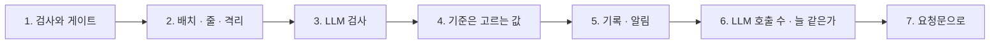
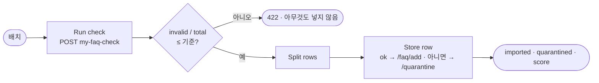

# 2단계 · 품질 게이트

- 교시: 3교시 강의 (11:00~11:50) · 4교시 [Lab 02](../../Last3Mon/78/LAB-02-Q-QUALITY-GATE.md) 실습 5개 (12:00~12:50)
- 이 단계가 끝나면: 검사(무엇이 나쁜가)와 게이트(그래서 무엇을 하나)를 나누고, 나쁜 배치는 통째로 거절 · 나쁜 줄은 이유와 함께 격리하는 가져오기를 만들고, 규칙으로 못 잡는 줄만 LLM에게 묻고, 거절 기준의 대가를 재고, 배치마다 품질 기록 · 알림을 남기고, LLM 호출을 숫자로 볼 수 있다.
- 숫자: 모두 강사 노트북 실측입니다 (65일차 n8n 2.42.6, 78일차 판 데이터 API, FAQ 배치 B-1 · B-2 · B-3, OpenAI `gpt-4.1-mini` temperature 0, 11/01 정답 워크플로우를 학생 순서대로 1회 · Lab 02 과제 2는 세 번). 규칙 판정은 늘 같고, 시간과 LLM 판정은 실행마다 다를 수 있습니다.
- 실습 가리키기: 이 문서에서 "Lab 02 예제 1"은 4교시 [Lab 02 문서](../../Last3Mon/78/LAB-02-Q-QUALITY-GATE.md)의 그 절입니다. 파일 경로는 실습 폴더 `~/aio-01d4-stu/Last3Mon/78` 기준입니다.

## 0. 이 시간 (50분)

| 시간 | 절 · 개요 | 하는 일 |
| --- | --- | --- |
| 11:00~11:08 | 1 · 개요 15장 | 검사와 게이트, 기준 가져오기가 넣은 것 |
| 11:08~11:17 | 2 · 개요 16장 | 배치 게이트 · 줄 게이트 · 격리함 |
| 11:17~11:26 | 3 · 개요 17장 | LLM 검사, 규칙을 통과한 줄만, fail-closed |
| 11:26~11:33 | 4 · 개요 18장 | 기준을 바꾸면 |
| 11:33~11:42 | 5 · 6 · 개요 19~21장 | 품질 기록 · 알림, LLM 호출 수 · 늘 같은가 |
| 11:42~11:50 | 7 · 8 · 확인 질문 | 요청문, 자주 하는 실수 |

### 4교시 Lab 02에서 이어서 하는 것

| 4교시 실습 (시각) | 이 강의의 절 | 실습에서 하는 일 | 쓰는 파일 · 명령 |
| --- | --- | --- | --- |
| Lab 02 예제 1 (12:00~12:12) | 1 · 2 | 기준 가져오기에 먼저, 그다음 게이트 · 격리 | `test cases/lab02.json --webhook base-faq-import -v`, `my-work/faq-import.json` (새로) → `lab02` 5/6, `quality` |
| Lab 02 예제 2 (12:12~12:22) | 3 | LLM 검사 (통과한 줄만) | 같은 파일 → `lab02` 6/6 |
| Lab 02 예제 3 (12:22~12:28, 에이전트 없이) | 4 | 기준 0.8 · 0.05 · 0.1 | `test cases/lab02-gate.json -v`, `quality` → `QUALITY.md` 5절 |
| Lab 02 과제 1 (12:28~12:38) | 5 | 품질 기록 · 알림 | 테스트 `cases/lab02-challenge.json` → `QUALITY.md` 7절 |
| Lab 02 과제 2 (12:38~12:50) | 6 | `llm_calls`, 세 번 돌리기 | 테스트 `cases/lab02-challenge2.json` × 3 → `QUALITY.md` 6절 |

## 1. 검사와 게이트는 다른 일 (4교시 Lab 02 예제 1)

### 일반 설명

> **생활 속 예 · 검수와 반품 결정.** 주방장이 "이 상자는 일곱 개가 상했네"라고 보는 것(검수)과, "그러니 트럭째 돌려보내자"고 정하는 것(결정)은 다른 일입니다. 같은 검수 결과로도 식당마다 결정이 다를 수 있습니다.

**검사(validation)는 판정을, 게이트(gate)는 그 판정으로 할 일을 정합니다.** 검사는 Lab 01에서 만들었습니다. 게이트는 그 결과를 읽어 넣을지 · 막을지 · 격리할지를 정합니다. 둘을 나누면 검사를 고칠 때 게이트를, 게이트 기준을 바꿀 때 검사를 건드리지 않습니다. 업계에서는 데이터 파이프라인의 **품질 관문**(quality gate) · 74일차 배포 관문(release gate)과 같은 모양입니다.

**규칙은 한 벌.** 게이트 안에 규칙을 다시 쓰면, 규칙을 고칠 때 두 곳을 고쳐야 하고 언젠가 어긋납니다. 77일차 요약이 보고서를 **불렀듯이**, 가져오기는 검사 웹훅을 부릅니다.

### 오늘 실습에서

먼저 팀이 쓰던 기준 가져오기(`base-faq-import`)에 같은 테스트를 돌리면 **0/6** (Lab 02 예제 1). 기준은 검사 없이 모든 줄을 `/faq/add`로 보냅니다.

| 배치 | 기준 가져오기가 넣은 것 |
| --- | --- |
| B-1 | 13줄 중 **12줄** — 빈 제목 · 개인 전화번호 · 단축 링크 · 이미 있는 FAQ-003과 같은 id까지 (빈 답 하나만 데이터 API가 막음) |
| B-2 | 10줄 모두 — 메일 주소 · 다른 답까지 |
| B-3 | 6줄 모두 — 답 "짧"까지 |

- 기준의 `score`는 0.9231 · 1 — "잘 들어갔다"처럼 보이는 숫자가 실제로는 나쁜 줄을 넣은 수입니다.

## 2. 배치 게이트 · 줄 게이트 · 격리함 (4교시 Lab 02 예제 1)

### 일반 설명

> **생활 속 예 · 트럭째 반품과 보류 칸.** 상자 열에 일곱이 상했으면 하나씩 골라내느니 트럭째 돌려보냅니다 (다시 받는 게 빠름). 대부분 괜찮으면 좋은 것만 냉장고에 넣고, 이상한 것은 **보류 칸**에 사유 쪽지를 붙여 둡니다. 버리지 않습니다 — 업체가 바꿔 오면 확인해야 하니까요.

**게이트는 두 겹입니다.**

| 관문 | 기준 | 넘지 못하면 |
| --- | --- | --- |
| 배치 게이트 | 나쁜 줄 비율 ≤ 기준 (오늘 기본 0.3, 같으면 통과) | 배치 전체 거절 — 422, 아무것도 넣지 않음 |
| 줄 게이트 | 그 줄의 `ok` | 그 줄만 격리함으로 |

**격리(quarantine)는 버리지 않는 것입니다.** 넣지 않은 줄을 원래 내용(`row`)과 이유(`errors`)와 함께 보관합니다. 버리면 무엇이 왜 빠졌는지 모르고, 고친 뒤 다시 넣을 수도 없습니다. 76일차의 DLQ(dead-letter queue, 실패한 요청을 두는 곳)와 같은 생각이고, 데이터 파이프라인에서는 quarantine table · error table이라고 부릅니다.

**응답 코드.** 400은 "모양이 틀렸다"(읽을 수 없음), 422는 "읽었지만 받을 수 없다"(내용이 나쁨)입니다. 부른 쪽이 다음에 할 일이 다르기 때문에 나눕니다.

### 오늘 실습에서

| 배치 | 내 가져오기 (Lab 02 예제 1) |
| --- | --- |
| B-1 (나쁜 줄 10/13) | **422** `invalid_ratio` 0.7692 > `max_invalid_ratio` 0.3, 아무것도 넣지 않음 |
| B-2 | 9줄 넣고 FAQ-209 격리 (`pii`), `score` 0.9 |
| B-3 | 5줄 넣고 FAQ-305 격리 (`answer_too_short`) |

- 넣기와 격리를 IF로 두 갈래로 나눴다가 Merge로 합치면, LLM 검사를 더한 뒤 격리 수가 틀립니다 (수업 준비 때 겪음). HTTP 노드 **하나**가 주소를 표현식으로 고르게 하면 갈래가 필요 없습니다 (AGENTS.md 5절).
- FAQ-210(답이 다른 이야기)은 규칙을 모두 통과해 아직 들어갑니다 → `lab02` 5/6. 3절에서 막습니다.

## 3. LLM 검사: 뜻은 LLM이, 통과한 줄에만 (4교시 Lab 02 예제 2)

### 일반 설명

> **생활 속 예 · 한 숟가락 맛보기.** 무게 · 온도 · 유통기한은 기준표로 잽니다. "주문한 맛이 맞나"는 주방장이 맛봅니다. 그런데 이미 상한 것까지 맛보지는 않습니다 — 기준표에서 떨어진 것은 맛볼 필요가 없습니다.

**규칙으로 알 수 없는 것만 LLM에게.** "답이 제목의 질문에 답하나?"는 정해진 답이 없는 판정이라 규칙(Code)으로 쓰기 어렵습니다. LLM은 이런 뜻의 판정을 잘합니다. 다만 세 가지를 지킵니다.

| 원칙 | 까닭 |
| --- | --- |
| **규칙을 통과한 줄에만** | 규칙에 걸린 줄은 이미 격리 — LLM에 물어도 결과가 같고 돈 · 시간만 듦 (75일차) |
| **JSON으로만 답하게** | `{"match": true/false, "reason"}` — Code가 읽음 |
| **읽을 수 없으면 넣지 않음** (fail-closed) | LLM이 멈추거나 이상한 말을 한 날 모든 줄이 검사 없이 들어가지 않게 (73일차) |

업계에서는 "LLM-as-a-judge"라고 부르고, RAG 품질 평가 · 콘텐츠 검수에 씁니다. 판정의 근거(`reason`)를 함께 남겨 사람이 다시 볼 수 있게 합니다.

### 오늘 실습에서

| | 규칙만 (예제 1) | + LLM (예제 2) |
| --- | --- | --- |
| FAQ-210 "모니터 밝기 조절" · 답은 연차 휴가 | 넣음 | 격리 `llm_mismatch` |
| B-2 | 9줄 · `score` 0.9 | 8줄 · 0.8 |
| B-3 | 5줄 | 5줄 (FAQ-305는 규칙에서 이미 격리, LLM에 가지 않음) |
| B-2 시간 | 1.4초 | **9.3초** (규칙을 통과한 9줄 × LLM 한 번) |

- LLM이 막은 줄은 FAQ-210 **하나**뿐입니다. 드문 한 줄을 위해 줄마다 1초쯤을 씁니다. 가져오기(배치를 보낼 때 한 번)라 괜찮다고 판단했지만, 직원이 기다리는 헬프데스크 답이라면 다른 판단이 필요합니다.

## 4. 기준은 고르는 값 (4교시 Lab 02 예제 3)

### 일반 설명

> **생활 속 예 · 반품 기준을 풀면, 조이면.** "열에 셋까지 골라 받는다"를 "열에 여덟까지"로 풀면 트럭을 돌려보내는 일은 줄지만 보류 칸이 넘치고 주방장이 하루 종일 골라냅니다. "하나도 안 된다"로 조이면 보류 칸은 비지만 거의 모든 트럭이 돌아가 재료가 모자랍니다.

**기준 하나가 두 실수를 맞바꿉니다.** 통계에서는 1종 오류(괜찮은 것을 막음)와 2종 오류(나쁜 것을 받음)라고 부릅니다. 기준은 **맞고 틀리는 값이 아니라 고르는 값**이고, 팀이 정해 적어 둡니다. 77일차 SLO 기준 · 이상 시간대 문턱과 같습니다.

| 기준 | 잘못 받는 일 | 잘못 돌려보내는 일 | 누구의 일이 느나 |
| --- | --- | --- | --- |
| 느슨하게 | 늘어남 | 줄어듦 | 격리함을 보는 사람 |
| 엄하게 | 줄어듦 | 늘어남 | 다시 보내는 사람, FAQ가 늦게 열림 |

기준을 바꿀 때마다 워크플로우를 고치지 않으려면 기준을 **입력**으로 받습니다 (`max_invalid_ratio`, 없으면 0.3).

### 오늘 실습에서

같은 가져오기에 기준만 바꿔 (Lab 02 예제 3, 에이전트 없이):

| 배치 | 기준 | 결과 |
| --- | --- | --- |
| B-1 | 0.3 | 거절 (0.7692) |
| B-1 | 0.8 | 받음 — 넣음 **2** · 격리 **11** · `score` 0.1538 |
| B-2 | 0.05 | 거절 (0.1) — 멀쩡한 9줄도 돌아감 |
| B-2 | 0.1 | 받음 — 딱 같으면 통과 |

- 실험을 하나씩 떼어 봐야 합니다: B-1을 받으면 FAQ-102 "회의실 예약"이 들어가 B-2의 FAQ-201이 `same_title`로 나빠지고, B-2를 넣은 뒤 다시 보내면 9줄이 `exists_id`입니다 (수업 준비 때 둘 다 겪음). **앞 배치가 넣은 데이터가 다음 배치의 판정을 바꿉니다.**
- 강사는 0.3을 그대로 두었습니다: "열에 셋까지는 골라 받고, 그보다 나쁘면 돌려보내 고치게 한다."

## 5. 품질 기록 · 알림 (4교시 Lab 02 과제 1)

### 일반 설명

> **생활 속 예 · 검수 일지와 사장님 호출.** 주방장은 상자마다 일지에 "몇 개 받음 · 몇 개 반품 · 이유"를 적습니다. 일지가 쌓여야 "요즘 그 업체가 나빠졌다"를 말할 수 있습니다. 트럭째 반품한 날은 사장님께 바로 전화합니다.

**품질은 한 번 재고 끝나지 않습니다 — 기록이 쌓여야 관리됩니다.** 배치마다 같은 모양으로 한 줄(배치 · 데이터셋 · 줄 수 · 통과 · 격리 · 거절 · 점수 · 코드)을 남기면 3단계에서 추세 · 가장 나쁜 배치 · 가장 흔한 문제를 셉니다. 거절한 배치도 **반드시** 기록합니다 — 빼면 가장 나쁜 배치가 보고서에서 사라집니다.

**알림은 사람이 할 일이 있을 때만** (76일차). 거절(보낸 사람에게 알려야 함) · 낮은 점수(격리함을 봐야 함)일 때 보냅니다. 그리고 알림을 보내도 **부른 쪽이 받는 결과는 그대로**입니다 — 알림은 곁가지.

### 오늘 실습에서

| 배치 | 응답 | 품질 기록 | 알림 |
| --- | --- | --- | --- |
| B-1 | 422 | `rejected: true` · `score` 0 | `batch_rejected` |
| B-2 | 200 · 0.8 | `valid` 8 · `quarantined` 2 · 0.8 | `low_quality` (0.9 미만) |

- HTTP 노드(`Log quality` · `Alert low score`)의 출력은 데이터 API의 응답(`{"stored": 1}`)이라, 끝에 `Result again`이 가져오기 결과를 다시 꺼내 응답합니다. 그래서 `lab02` 6/6이 그대로입니다.

## 6. LLM 호출 수 · 늘 같은가 (4교시 Lab 02 과제 2)

### 일반 설명

> **생활 속 예 · 맛보기 횟수와 맛보는 사람.** 사장님이 묻습니다: "오늘 맛보기를 몇 번 했지? 상한 것까지 맛본 건 아니지?" 그리고 "어제 맛본 사람과 오늘 맛본 사람의 판정이 같나?"

**LLM 비용은 호출 수로 말합니다.** 시간은 매번 다르지만(같은 9번이 7.6~9.4초) 호출 수는 정해집니다. 호출당 비용을 알면(75일차) 배치의 비용이 바로 나옵니다.

**"늘 같은가"는 재 봐야 압니다.** temperature 0이어도 LLM 판정이 늘 같다는 보증은 없습니다. 같은 입력을 **같은 처음 상태**에서 여러 번 돌려 판정이 같은지 봅니다 (72일차 반복 시험). 그리고 같은 배치를 처음 상태로 되돌리지 않고 다시 보내면 **데이터가 바뀐 것**이지 판정이 흔들린 것이 아닙니다 — 둘을 구분해야 합니다.

### 오늘 실습에서

| 배치 | 줄 | `llm_calls` | 세 번 |
| --- | --- | --- | --- |
| B-1 (거절) | 13 | **0** | 같음 |
| B-2 | 10 | **9** (= 10 − FAQ-209) | FAQ-210만 막음 · 9.4 · 8.1 · 7.6초 |
| B-3 | 6 | **5** (= 6 − FAQ-305) | 넣음 5 |

- `--no-before --repeat 2`(처음 상태로 되돌리지 않고 연달아)는 **2/6**: 앞 실행이 넣은 FAQ 때문에 B-2 · B-3이 `exists_id`로 거절되고 LLM은 0번. 같은 배치를 두 번 보내도 FAQ가 두 벌 생기지 않는다는 확인이기도 합니다.

## 7. 요청문(프롬프트)으로 에이전트에게 맡기기

가져오기 요청문은 "검사해서 넣어 줘"가 아니라 **관문과 갈래**를 적습니다.

| 넣을 것 | 예 |
| --- | --- |
| 부를 검사 | "규칙을 다시 쓰지 말고 `my-faq-check`를 부른다 (neverError, timeout 30000)" |
| 배치 게이트 | "`invalid / total`이 기준 이하일 때만, 기준은 본문 `max_invalid_ratio`, 없으면 0.3, 넘으면 422" |
| 줄 게이트 · 격리 | "ok면 `/faq/add`, 아니면 `/quarantine {items: [{batch, row, errors}]}` — HTTP 노드 하나에서" |
| LLM 검사 | "규칙을 통과한 줄만, JSON으로만, 읽을 수 없으면 match false, onError continueRegularOutput" |
| 기록 · 알림 | "거절도 기록, 거절 · 0.9 미만이면 알림, 응답은 같은 결과" |
| 기대 결과 | "`cases/lab02.json`, 앞의 테스트도 그대로" |

## 8. 자주 하는 실수

| 실수 | 결과 | 바로잡기 |
| --- | --- | --- |
| 가져오기 안에 규칙을 다시 씀 | 검사와 어긋남 | 검사 웹훅을 부름 |
| 나쁜 줄을 버림 | 무엇이 빠졌는지 모름 · 다시 못 넣음 | 이유와 함께 격리 |
| 넣기 · 격리를 IF로 갈랐다 합침 | LLM 뒤 격리 수가 틀림 | HTTP 노드 하나 |
| 모든 줄을 LLM에 | 비용 · 시간 | 규칙을 통과한 줄만 |
| LLM 판정을 읽을 수 없으면 넣음 | LLM이 멈춘 날 검사 없이 들어감 | fail-closed |
| 기준을 IF에 숫자로 박음 | 바꿀 때마다 워크플로우 수정 | 입력(`max_invalid_ratio`)으로 |
| 거절을 기록하지 않음 | 가장 나쁜 배치가 보고서에서 사라짐 | 두 갈래 모두 기록 |
| 알림 노드의 출력으로 응답 | 부른 쪽이 `{"stored": 1}`을 받음 | 결과를 다시 꺼냄 |
| `--repeat`로 "늘 같은가"를 봄 | 이미 넣은 데이터로 거절 | 처음 상태에서 따로 세 번 |

## 확인 질문

1. 기준 가져오기의 B-1 `score`는 0.9231, 내 가져오기는 422(거절)입니다. 점수가 높은 기준이 더 좋은 것 아닌가요?

기준의 점수는 "넣은 줄 / 전체 줄"인데, 넣은 12줄에 개인 전화번호 · 단축 링크 · 빈 제목이 들어 있습니다. 검사 없는 점수는 품질이 아니라 **양**입니다. 점수는 같은 규칙으로 판정한 뒤에야 품질을 말합니다.

2. 400과 422를 나누는 까닭은?

400은 본문의 모양이 틀려 읽을 수조차 없다는 뜻(`items`가 목록이 아님)이고, 422는 읽었지만 내용이 기준을 넘어 받을 수 없다는 뜻입니다. 부른 쪽은 400이면 보내는 코드를, 422면 보내는 데이터를 고칩니다.

3. LLM 검사를 모든 줄에 하면 더 안전하지 않나요?

규칙에 걸린 줄은 이미 격리되므로 LLM이 무엇이라 하든 결과가 같습니다. 같은 결과에 돈과 시간만 씁니다 (B-1 13줄 · B-2 10줄 대신 0 · 9번). 더 안전해지려면 오히려 "LLM 판정을 읽을 수 없으면 넣지 않는다"(fail-closed)를 지켜야 합니다.

4. 기준을 0.8로 풀었더니 B-1을 받았습니다. 넣은 줄은 2줄뿐인데 무엇이 나빠졌나요?

격리함에 11줄이 쌓였습니다. 사람이 11줄을 하나씩 열어 고칠지 정해야 합니다. 거절했다면 콘텐츠 담당자가 고침 목록(Lab 01 과제 2)을 받아 한 번에 고쳐 다시 보냈을 일입니다. 기준을 푼 대가는 "격리함을 보는 사람의 일"입니다.

5. `--repeat 2`로 돌렸더니 두 번째에 B-2가 거절됐습니다. LLM 판정이 흔들린 건가요?

아닙니다. 첫 실행이 FAQ-201~208을 넣었기 때문에, 같은 배치를 다시 보내면 그 8줄이 `exists_id`가 되어 나쁜 줄이 9/10, 거절입니다. 거절이니 LLM은 한 번도 부르지 않았습니다 (`llm_calls` 0). "늘 같은가"를 보려면 매번 처음 상태(테스트의 `before`)에서 돌립니다.

