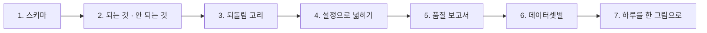
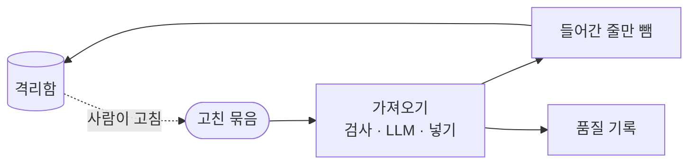

# 3단계 · 품질 관리

- 교시: 5교시 강의 (14:00~14:50) · 6교시 [Lab 03](../../Last3Mon/78/LAB-03-Q-QUALITY-MANAGEMENT.md) 실습 5개 (15:00~15:50)
- 이 단계가 끝나면: FAQ에 박힌 규칙을 **스키마**(규칙을 적은 데이터)로 꺼내 다른 데이터에도 쓰고, 스키마로 되는 규칙과 안 되는 규칙을 나누고, 격리된 줄이 고쳐져 돌아오면 격리함을 비우는 되돌림 고리를 만들고, 새 데이터셋을 워크플로우를 고치지 않고 늘리고, 품질 기록으로 보고서 · 데이터셋별 품질을 정의대로 말할 수 있다.
- 숫자: 모두 강사 노트북 실측입니다 (65일차 n8n 2.42.6, 78일차 판 데이터 API의 스키마 셋 `faq` · `employee` · `ticket`, 직원 CSV 9줄 · 접수 건 9줄 · FAQ 배치, 11/01 정답 워크플로우를 학생 순서대로 1회).
- 실습 가리키기: 이 문서에서 "Lab 03 예제 1"은 6교시 [Lab 03 문서](../../Last3Mon/78/LAB-03-Q-QUALITY-MANAGEMENT.md)의 그 절입니다. 파일 경로는 실습 폴더 `~/aio-01d4-stu/Last3Mon/78` 기준입니다.

## 0. 이 시간 (50분)

| 시간 | 절 · 개요 | 하는 일 |
| --- | --- | --- |
| 14:00~14:10 | 1 · 개요 22장 | 스키마: 규칙을 데이터로 |
| 14:10~14:16 | 2 · 개요 23장 | 스키마로 되는 것 · 안 되는 것 |
| 14:16~14:22 | 3 · 개요 24장 | 격리 → 고침 → 다시 → 빼기 |
| 14:22~14:28 | 4 · 개요 25장 | 새 스키마, 스키마 변경 = 규칙 변경 |
| 14:28~14:40 | 5 · 6 · 개요 26~27장 | 품질 보고서의 정의, 데이터셋별 · 평균이 가리는 것 |
| 14:40~14:50 | 7 · 8 · 확인 질문 | 하루 정리 표, 자주 하는 실수 |

### 6교시 Lab 03에서 이어서 하는 것

| 6교시 실습 (시각) | 이 강의의 절 | 실습에서 하는 일 | 쓰는 파일 · 명령 |
| --- | --- | --- | --- |
| Lab 03 예제 1 (15:00~15:14) | 1 · 2 | FAQ 검사에 직원 CSV(전), 스키마 검사 | `call my-faq-check requests/employees-new.json`, `my-work/check.json` (새로) → `lab03` 4/4, `QUALITY.md` 8절 |
| Lab 03 예제 2 (15:14~15:22) | 3 | 고친 줄을 격리함에서 빼기 | `my-work/faq-import.json` 고치기, `test cases/lab03-fix.json -v` (전 3/4 → 4/4) |
| Lab 03 예제 3 (15:22~15:28, 에이전트 없이) | 4 | 새 스키마 `ticket` | `call my-faq-check requests/tickets-new.json`, `test cases/lab03-schema.json -v` |
| Lab 03 과제 1 (15:28~15:40) | 5 | 품질 보고서 | `my-work/quality-report.json` (새로), 테스트 `cases/lab03-challenge.json` → `QUALITY.md` 9절 |
| Lab 03 과제 2 (15:40~15:50) | 6 | 검사도 기록 · 데이터셋별 | 두 파일 고치기, 테스트 `cases/lab03-challenge2.json` |

## 1. 스키마: 규칙을 데이터로 (6교시 Lab 03 예제 1)

### 일반 설명

> **생활 속 예 · 품목마다 다른 검수 카드.** 채소는 무른 곳, 고기는 온도와 라벨, 생선은 눈 색을 봅니다. 품목마다 주방장을 따로 두지 않고 품목마다 **검수 카드**를 만들어 두면, 한 사람이 카드를 바꿔 들고 무엇이든 검수합니다. 새 품목이 오면 카드를 한 장 더 만듭니다.

**스키마(schema)는 데이터의 모양을 적은 데이터입니다.** 어떤 칸이 있고, 칸마다 타입(글자 · 숫자 · 날짜 · 메일 · 목록 중 하나)은 무엇이고, 꼭 있어야 하는지, 길이나 범위는 어떤지를 적습니다. 검사 프로그램은 칸 이름을 미리 알 필요가 없고 **타입마다** 판정합니다: "이 칸의 타입은 메일이니 메일 형식인지", "이 칸은 정해진 목록이니 목록 안의 값인지". 그러면 데이터 종류가 늘어도 검사 프로그램은 그대로이고 스키마만 늘어납니다.

| 업계에서 | 같은 생각 |
| --- | --- |
| JSON Schema · OpenAPI | API 요청 · 응답의 모양 |
| 데이터베이스 테이블 정의 | `NOT NULL` · `CHECK` · `UNIQUE` |
| Great Expectations · Soda · dbt tests | 데이터셋마다 "기대값" 목록 |
| pydantic · zod | 프로그램 안의 데이터 모델 (스키마를 코드로 씀) |

**CSV.** 회사 데이터는 표 파일(CSV)로 많이 옵니다. 첫 줄이 열 이름이고, 값은 모두 **글자**입니다. 그래서 날짜 · 메일도 "글자의 형식"으로 판정하고, 오류를 알려 줄 때 줄 번호는 사람이 세는 번호(열 이름 줄을 빼고 1부터)로 돌려줍니다.

### 오늘 실습에서

Lab 01의 FAQ 검사에 인사팀의 직원 CSV를 보내면 400 (`items`가 없음) — FAQ의 칸 이름과 규칙이 Code에 박혀 있습니다 (Lab 03 예제 1 고치기 전). 스키마 검사 `my-check`는 `GET /schemas/employee`를 읽어:

| 줄 | 값 | 코드 | 스키마의 규칙 |
| --- | --- | --- | --- |
| 3 | `minsu.kang@example` | `bad_format:email` | `email` |
| 4 | `마케팅팀` | `not_allowed:dept` | `enum` 여섯 팀 |
| 5 | `2026-13-01` | `bad_format:joined` | `date` — 실제 있는 날 |
| 6 | 이름 빈칸 | `missing:name` | `required` |
| 8 | 7째와 같은 메일 | `duplicate_in_batch` | `key: email` |

- 9줄 중 **4줄** 통과. 빈 전화(2째)와 사무실 번호(7째)는 통과 — 선택 칸은 비면 형식을 보지 않습니다. 같은 워크플로우로 `schema: faq` B-3 → 6줄 중 5줄 (FAQ-305 `too_short:answer`).

## 2. 스키마로 되는 것 · 안 되는 것 (6교시 Lab 03 예제 1)

### 일반 설명

> **생활 속 예 · 검수 카드에 없는 칸.** 카드에는 무게 · 온도 · 라벨 칸이 있습니다. 하지만 "이 업체와 이미 계약한 품목인가"는 장부를 봐야 알고, "맛이 맞나"는 맛봐야 압니다. 카드가 할 일과 다른 사람이 할 일이 나뉩니다.

**스키마는 모양을 넓게, 프로그램 · LLM은 그 데이터만의 규칙을 깊게 봅니다.** 스키마로는 거의 모든 데이터의 기본 모양(필수 · 길이 · 형식 · 목록 · 날짜 · 중복)을 볼 수 있습니다. 그러나 데이터마다 다른 규칙 — 글 안에 개인정보가 섞였나, 이미 있는 데이터와 겹치나, 내용이 맞나 — 은 스키마의 타입으로 적기 어렵습니다. 그래서 둘 중 하나를 고르는 것이 아니라 **층을 나눕니다.**

| 층 | 무엇을 보나 | 어디에 둠 |
| --- | --- | --- |
| 스키마 검사 | 모양 (필수 · 길이 · 형식 · 목록 · 중복) | 모든 데이터셋이 함께 쓰는 검사 하나 |
| 데이터별 규칙 (Code) | 그 데이터만의 내용 규칙, 이미 있는 데이터와의 관계 | 그 데이터의 검사 |
| LLM | 뜻 (내용이 맞나) | 규칙을 통과한 줄에만 |
| 사람 | 고치기, 기준 정하기 | 보낸 사람 · 팀 |

### 오늘 실습에서

FAQ를 `my-check`(`schema: faq`)로만 보면 B-3에서 Lab 01의 검사와 판정이 같았습니다 — B-3에는 개인정보 · 링크 · 이미 있는 FAQ가 없었기 때문입니다. B-2를 스키마로만 보면 FAQ-209(메일 주소)가 **통과**합니다. 그래서 FAQ는 Lab 01의 검사를 계속 쓰고, `QUALITY.md` 8절에 이 경계를 적습니다.

## 3. 되돌림 고리: 격리 → 고침 → 다시 → 빼기 (6교시 Lab 03 예제 2)

### 일반 설명

> **생활 속 예 · 보류 칸의 쪽지 떼기.** 업체가 라벨을 붙여 다시 가져온 고기를 냉장고에 넣었습니다. 그런데 보류 칸의 옛 상자에 "라벨 없음" 쪽지가 그대로라면, 다음 날 아침 주방장은 "아직 해결 안 됐네" 하고 또 전화합니다.

**격리함은 "사람이 볼 일"의 목록입니다.** 이미 해결된 줄이 그대로 남아 있으면 목록을 믿을 수 없고, 사람은 같은 일을 또 봅니다. 그래서 고쳐서 다시 넣은 줄은 격리함에서 뺍니다. 다만 **실제로 들어간 줄만** 뺍니다 — 고쳤는데 또 틀린 줄은 다시 사람에게 가야 합니다.

이 고리(격리 → 사람이 고침 → 다시 넣음 → 격리함에서 빼기)가 품질 관리의 한 바퀴입니다. 76일차 DLQ의 재처리(replay)와 같은 모양이고, 고리가 끊기면(빼지 않음 · 다시 넣지 않음) 격리함은 쌓이기만 합니다.

### 오늘 실습에서

| | 고치기 전 (Lab 02 과제 2까지) | 고친 뒤 (`Release fixed`) |
| --- | --- | --- |
| B-2-fix 두 줄 넣기 | 됨 · `score` 1 · FAQ 16 | 같음 |
| 격리함 | **2** (해결된 FAQ-209 · 210이 남음) | **0** |
| 품질 기록 | B-2 0.8 → B-2-fix 1 | 같음 |

- 고친 배치의 이름이 `B-2-fix`라 "같은 배치 · 같은 id면 바꿈"에도 걸리지 않습니다. 격리함을 비우는 일은 저절로 되지 않습니다.

## 4. 설정으로 넓히기: 스키마만 바꾸면 (6교시 Lab 03 예제 3)

### 일반 설명

> **생활 속 예 · 생크림 카드 한 장.** 식당이 디저트를 시작해 생크림이 들어옵니다. 주방장을 새로 뽑지 않고 "생크림 카드"를 한 장 더 만들면 내일부터 같은 사람이 검수합니다. 단, 카드에 "냉장 3도 이하"를 잘못 "30도"로 쓰면 그날부터 상한 크림이 들어옵니다.

**규칙을 데이터로 두면, 새 데이터셋은 설정 한 장입니다** (configuration over code). 새 종류의 데이터가 생겨도 프로그램을 고쳐 다시 배포하지 않고, 스키마 파일 한 장만 더합니다. 70일차의 설정 표와 같은 생각입니다.

그만큼 **스키마를 바꾸는 것은 규칙을 바꾸는 것**입니다. 한 글자 실수("3"을 "30"으로)가 그날부터 나쁜 데이터를 통과시킵니다. 그래서 스키마 파일도 프로그램처럼 저장소에 두고, 리뷰와 테스트를 거쳐 바꿉니다 (74일차 배포 관문과 같은 생각). 업계에서는 스키마 레지스트리(schema registry)로 스키마의 버전을 관리하고, 바뀐 스키마가 예전 데이터와 맞는지 확인합니다.

### 오늘 실습에서

데이터 API에 세 번째 스키마 `ticket`이 있습니다. 예제 1의 `my-check`를 고치지 않고 접수 건 9줄을 보내면 (Lab 03 예제 3):

| | FAQ 검사 (`my-faq-check`) | 스키마 검사 (`my-check`, 그대로) |
| --- | --- | --- |
| 통과 | **0줄** — 칸이 달라 모두 `id_format` · `answer_missing` | **2줄** |
| 이유 | 9줄 모두 같은 세 코드 + 빈 id 중복 8 | `T-12` · `urgent` · **2026-02-30** · 3자 제목 · `010-12-3456` · 중복 · 요청자 빈칸 — 줄마다 다름 |

- 선택 칸 `contact`가 없는 9째 줄은 통과, 있는데 형식이 잘못된 6째 줄은 `bad_format:contact`. "없어도 된다"와 "아무거나 돼도 된다"는 다릅니다.

## 5. 품질 보고서: 품질도 정의가 먼저 (6교시 Lab 03 과제 1)

### 일반 설명

> **생활 속 예 · 월말 검수 일지 정리.** 사장님이 묻습니다: "이번 달 납품은 어땠어? 제일 나빴던 날은? 반품 이유는 뭐가 제일 많았어? 나아지고 있어?" 일지를 넘기며 말로 답하면 사람마다 답이 다릅니다.

**품질 지표도 77일차 지표처럼 정의가 먼저입니다.** "품질이 좋아졌다"를 말하려면, 무엇을 어떻게 세는지가 먼저 정해져야 합니다. 업계에서는 데이터 품질 점수 · 데이터 품질 대시보드라고 부르고, 데이터 관측(data observability) 도구(Monte Carlo · Bigeye 등)가 같은 일을 합니다. 정해야 할 것은 이렇습니다.

| 정해야 할 것 | 질문 | 정하지 않으면 |
| --- | --- | --- |
| 거절한 묶음을 평균에 넣나 | 받은 데이터의 품질인가, 보내온 데이터의 품질인가 | 같은 기록에서 서로 다른 평균이 나옴 |
| 같은 값이면 무엇을 먼저 | "가장 나쁜 묶음"이 둘이면? | 실행할 때마다 순서가 바뀜 |
| 추세 | 무엇과 무엇을 비교하나, 얼마나 바뀌어야 "좋아짐"인가 | "좋아진 것 같다" |
| 기록이 0건이면 | 평균은 0인가, "모름"인가 | 다음 계산이 깨짐 |

숫자는 프로그램이 세고, 그 숫자를 **무엇과 무엇을 비교했는지와 함께** 말하는 것은 사람의 일입니다.

### 오늘 실습에서

테스트가 B-1(거절) · B-2 · B-3 · B-2-fix를 차례로 가져온 기록 네 줄 (Lab 03 과제 1):

| 칸 | 값 |
| --- | --- |
| `avg_score` | **0.6583** = (0 + 0.8 + 0.8333 + 1) / 4 |
| `worst_batch` | B-1 · 거절 1 |
| `top_codes` 1위 | `pii` 2 (B-1 FAQ-109 전화 + B-2 FAQ-209 메일) |
| `trend` | 좋아짐 (0 → 1) |

- `trend`의 함정: 13줄짜리 거절 배치와 고친 2줄짜리 배치를 같은 무게로 비교한 것입니다. 숫자는 정의대로 맞지만, 회의에서는 "첫 배치는 거절, 마지막은 고친 두 줄"을 함께 말합니다 (77일차 표본 크기와 같은 이야기).

## 6. 데이터셋별: 평균이 가리는 것 (6교시 Lab 03 과제 2)

### 일반 설명

> **생활 속 예 · 업체별 성적표.** 한 달 평균만 보면 "괜찮다"인데 업체별로 나누면 채소 가게는 늘 좋고 생선 가게만 절반이 반품입니다. 사장님이 전화할 곳은 생선 가게입니다.

**같은 기록 모양을 쓰면 여러 데이터의 품질을 한 보고서에서 봅니다.** 검사하는 곳이 여럿이어도(가져오기 · 스키마 검사 · 다른 팀의 검사) 같은 모양으로 기록을 남기면, 보고서는 고치지 않고도 데이터셋마다 나눠 셀 수 있습니다.

그리고 **전체 평균은 나눠 봐야 할 것을 가립니다.** 평균이 괜찮아도 데이터셋 하나만 유난히 나쁠 수 있습니다 — 77일차에 두 주 오류율이 월요일 아침 한 시간을 가렸던 것과 같습니다. 통계에서는 이것을 집계가 가리는 문제(심하면 심슨의 역설)라고 부릅니다. 그래서 "어디를 먼저 손볼까"는 나눠서 봅니다.

**추세는 같은 데이터셋 안에서만** 말합니다. 서로 다른 데이터셋을 이어 놓고(직원 목록 다음에 FAQ) "좋아졌다"고 하면 뜻이 없습니다.

### 오늘 실습에서

| 데이터셋 | 기록 | `avg_score` | `top_code` |
| --- | --- | --- | --- |
| employee | HR-1 | 0.4444 (4/9) | `bad_format:email` |
| ticket | TK-1 | **0.2222** (2/9) → `worst_dataset` | `bad_format:contact` |
| faq | B-3 | 0.8333 (5/6) | `answer_too_short` |
| 전체 | | 0.5 | |

- 전체 0.5는 "절반쯤 괜찮다"지만 나누면 접수 건이 가장 손볼 곳 — 헬프데스크 팀에 "옮기기 전에 일곱 줄을 고쳐 달라"고 말할 근거입니다. `top_code`는 1건씩 같은 수 중 글자순 첫째라는 것도 함께 말합니다.
- 전체 `trend`가 `좋아짐`(0.4444 → 0.8333)으로 나오지만 직원과 FAQ를 비교한 것이라 버립니다.

## 7. 식당 주방으로 본 오늘 하루

| 오늘 | 식당 주방 | 단계 |
| --- | --- | --- |
| 데이터 품질 · 차원 | 아침 식재료 검수 | 1 |
| 품질 규칙 · 오류 코드 | 검수 기준표 · 반품 사유 스티커 | 1 |
| 경계 | 냉장고 온도 딱 5도 | 1 |
| 이미 있는 데이터 · 오류와 경고 | 냉장고 먼저 열기 | 1 |
| 고침 목록 · 데이터 계약 | 반품 사유서 | 1 |
| 배치 게이트 · 격리함 | 트럭째 반품 · 보류 칸 | 2 |
| LLM 검사 | 한 숟가락 맛보기 (상한 것은 안 맛봄) | 2 |
| 기준을 바꾸면 | 반품 기준을 풀면 · 조이면 | 2 |
| 품질 기록 · 알림 | 검수 일지 · 사장님 호출 | 2 |
| LLM 호출 수 · 늘 같은가 | 맛보기 횟수 · 맛보는 사람 | 2 |
| 스키마 · 새 스키마 | 품목별 검수 카드 · 생크림 카드 | 3 |
| 되돌림 고리 | 보류 칸의 쪽지 떼기 | 3 |
| 품질 보고서 · 데이터셋별 | 월말 일지 정리 · 업체별 성적표 | 3 |

## 8. 자주 하는 실수

| 실수 | 결과 | 바로잡기 |
| --- | --- | --- |
| 필드 이름을 검사 코드에 씀 | 새 데이터셋마다 워크플로우 수정 | 스키마의 `fields`를 돌며 타입마다 |
| 날짜를 형식(`YYYY-MM-DD`)만 봄 | 13월 · 2월 30일이 통과 | 실제 있는 날인지 |
| 빈 선택 칸에 형식 검사 | 멀쩡한 줄이 `bad_format` | 비었으면 `required`만 |
| 스키마만으로 FAQ를 검사 | 메일 주소 FAQ가 통과 | 내용 규칙은 Code로 따로 |
| 고친 줄을 넣고 격리함을 그대로 | 해결된 일이 "할 일"로 남음 | 넣은 id만 뺌 |
| 스키마를 리뷰 없이 바꿈 | 규칙이 몰래 바뀜 | 스키마도 저장소 · 리뷰 · 테스트 |
| 거절을 평균에서 뺌 (말없이) | 품질이 좋아 보임 | 정의를 정하고 함께 말함 |
| 전체 평균 · 섞은 추세만 봄 | 손볼 데이터셋이 가려짐 | 데이터셋별로, 추세는 그 안에서 |

## 확인 질문

1. 스키마 검사를 만들었으니 Lab 01의 FAQ 검사는 지워도 되나요?

아닙니다. 스키마는 모양(필수 · 길이 · 형식 · 중복)을 보고, FAQ 검사는 FAQ만의 내용 규칙(답 안의 개인정보 · 바깥 링크)과 이미 있는 FAQ와의 관계를 봅니다. B-2를 스키마로만 보면 메일 주소 FAQ-209가 통과합니다. 모양은 스키마로 넓게, 내용은 Code로 깊게.

2. 고친 배치를 다시 넣었는데 격리함에서 빼지 않으면 무엇이 문제인가요? 넣기는 됐잖아요.

격리함은 "사람이 볼 일"의 목록입니다. 해결된 FAQ-209 · 210이 남아 있으면 다음 사람이 또 고치려 하거나, 목록 전체를 믿지 않게 됩니다. 넣은 줄만 빼고, 또 틀린 줄은 남겨 다시 사람에게 보냅니다.

3. 새 스키마를 더할 때 워크플로우를 고치지 않아도 된다면, 스키마는 누구나 바꿔도 되나요?

반대입니다. 워크플로우를 고치지 않고 판정이 바뀐다는 것은, 스키마 한 줄이 곧 규칙이라는 뜻입니다. `min: 4`를 `min: 40`으로 잘못 쓰면 그날부터 모든 접수 건이 막힙니다. 스키마도 코드처럼 저장소에 두고 리뷰 · 테스트를 거쳐 바꿉니다.

4. 품질 보고서의 평균은 0.6583입니다. 거절된 B-1을 빼면 0.8778인데, 어느 쪽을 보고해야 하나요?

무엇을 보고 싶은지에 따라 정하고, 정의에 적어 둡니다. 오늘은 콘텐츠 담당자가 **보내오는** 배치의 품질을 보므로 거절도 넣습니다(0.6583). "받은 배치의 품질"이 궁금하면 뺀 숫자(0.8778)를 따로 말합니다. 정하지 않고 그때그때 고르면 숫자를 비교할 수 없습니다.

5. 데이터셋별로 나누니 접수 건이 0.2222로 가장 나쁩니다. 그런데 기록이 한 배치씩뿐입니다. 이 결론을 믿어도 되나요?

"이번 배치는 접수 건이 가장 나쁘다"까지는 말할 수 있습니다. "접수 건 데이터가 늘 나쁘다"는 배치가 쌓여야 말할 수 있습니다 (77일차 표본 크기). 9줄 중 7줄이 줄마다 다른 이유로 나쁘다는 것은 옮기기 전에 원본을 손봐야 한다는 신호로는 충분합니다.

