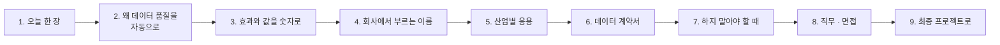

# 4단계 · 정리: 오늘 한 일의 의미 · 효과 · 실전 응용

- 교시: 8교시 17:10~17:45 (35분, 바이브 코딩 발표 10분 뒤) · 자료: 이 문서 + [개요](00-DAY78-OVERVIEW.md) 30장
- 이 시간이 끝나면: 오늘 1~3단계에서 한 일이 **무엇을 위한 것이었는지**, 숫자로 **무엇이 달라졌고 무엇을 치렀는지**, 회사에서는 같은 생각을 **어떤 이름과 도구로** 쓰는지 말할 수 있고, 최종 프로젝트에 무엇을 가져갈지 정할 수 있다.
- 숫자: 오늘 교안의 실측(강사 노트북, 11/01 정답 워크플로우 1회)입니다. "예시"라고 적은 계산은 가정을 둔 어림입니다.

## 0. 이 시간 (35분)

| 시간 | 절 | 하는 일 |
| --- | --- | --- |
| 17:10~17:15 | 1 · 2 | 오늘 한 장, 왜 데이터 품질을 자동으로 |
| 17:15~17:20 | 3 | 오늘 숫자로 본 효과와 값, 한 달로 보면 (예시) |
| 17:20~17:28 | 4 · 5 | 같은 생각의 업계 이름 · 도구, 산업별 응용 예 |
| 17:28~17:33 | 6 · 7 | 데이터 계약서, 하지 말아야 할 때 |
| 17:33~17:40 | 8 · 9 | 직무와 면접 질문, 최종 프로젝트 체크리스트 |
| 17:40~17:45 | 10 · 토론 | 다음 일차와의 연결, 질문 둘 |

## 1. 오늘 한 장

| 단계 | 한 일 | 오늘 숫자 |
| --- | --- | --- |
| 1단계 · 품질 규칙 | 눈으로 · 기준 검사, 규칙대로 판정하는 검사, 경계, 이미 있는 데이터, 고침 목록 | 기준 **10/13 통과 · 1/5** → 규칙대로 **5/13 · 5/5**, 경계 6/6 대 **0/6**, 이미 있는 데이터까지 3/13, 고침 목록 10줄 |
| 2단계 · 품질 게이트 | 배치 게이트 · 격리, LLM 검사, 기준을 바꾸면, 기록 · 알림, LLM 호출 수 | 기준 가져오기 **12줄 넣음 · 0/6** → B-1 거절 · B-2 9줄 → LLM이 FAQ-210을 막아 8줄 · 6/6, 기준 0.8이면 격리 **11**, LLM 호출 9 · 5 · 0 |
| 3단계 · 품질 관리 | 스키마 검사, 고쳐서 다시, 새 스키마, 품질 보고서, 데이터셋별 | 직원 CSV 4/9, 격리 2 → 0, 접수 건 2/9 (**워크플로우 그대로**), 평균 0.6583, ticket **0.2222** |

## 2. 왜 데이터 품질을 자동으로

> **생활 속 예 · 식당의 검수.** 장사가 잘되는 식당은 손님이 "맛이 이상해요"라고 하기 전에 아침 검수에서 상한 재료를 골라냅니다. 손님이 알아챘을 때는 이미 늦습니다 — 접시는 나갔고 믿음은 깎였습니다. 그리고 검수가 주방장 한 사람의 눈에만 있으면, 그 사람이 쉬는 날 상한 재료가 들어옵니다. 그래서 기준표 · 반품 칸 · 일지를 둡니다. 3단계 7절의 "식당 주방으로 본 오늘 하루" 표도 함께 봅니다.

| 사람이 눈으로만 검사하면 | 규칙 · 게이트 · 기록으로 하면 |
| --- | --- |
| 바쁜 날 놓침 (기준 검사 10/13 통과) | 같은 배치에 늘 같은 판정 (5/13) |
| "이 정도면 괜찮겠지" — 경계가 그날 기분 | 40자 넘으면 · 공백은 빈 값 · 호스트가 정확히 |
| 나쁜 FAQ가 직원 화면에 (전화번호 · 단축 링크) | 거절 · 격리, 넣지 않음 |
| 고칠 것을 말로 전달 | 고침 목록 (줄 · 코드 · 말) |
| 새 데이터마다 사람을 새로 | 스키마 한 장 |
| "요즘 품질 어때?"에 감으로 | 품질 기록 → 평균 · 가장 나쁜 배치 · 흔한 문제 · 데이터셋별 |

**오늘의 원칙 세 줄**: 규칙은 Code가, 뜻은 LLM이, 고치는 것은 사람이. 워크플로우는 나쁜 데이터를 고쳐서 넣지 않고 **막고 알리고 기록합니다.**

## 3. 효과와 값을 숫자로

### 3.1 오늘 실측 전 · 후

| 무엇 | 전 (팀의 기준) | 후 | 바꾼 것 |
| --- | --- | --- | --- |
| B-1 13줄 판정 | 10줄 통과 | 5줄 → 이미 있는 데이터까지 3줄 | 규칙 3 → 10 (+ 이미 있는 데이터) |
| 경계 10줄 | 10줄 통과 (0/6) | 4줄 통과 (6/6) | 경계의 말 |
| B-1이 FAQ에 | **12줄** (전화번호 · 단축 링크 · 같은 id) | **0줄** · 422 | 배치 게이트 |
| B-2가 FAQ에 | 10줄 (메일 주소 · 다른 답) | 8줄, 2줄은 이유와 함께 격리 | 줄 게이트 + LLM 검사 |
| 나쁜 줄의 행방 | 모름 (격리함 0) | 격리함 + 이유, 고치면 빼기 | 격리 · 되돌림 고리 |
| 직원 · 접수 건 | 검사 못 함 (400) | 4/9 · 2/9 | 스키마 |
| 새 데이터셋 | 워크플로우를 하나 더 | 스키마 파일 한 장 | 규칙을 데이터로 |
| "품질 어때?" | 감 | 0.6583 · B-1 · `pii` · ticket 0.2222 | 품질 기록 · 보고서 |

**치른 값**:

- **시간**: LLM 검사로 B-2 가져오기가 1.4초 → 9.3초. 가져오기라 괜찮았지만, 사람이 기다리는 곳에서는 다른 판단이 필요합니다.
- **사람의 일**: 격리함은 누군가 봐야 합니다. 기준을 0.8로 풀면 11줄. 기준은 그 일의 양을 정하는 값입니다.
- **규칙을 지키는 일**: 규칙(AGENTS.md · 스키마)을 바꾸면 모든 판정이 바뀝니다. 바꿀 때는 누가 · 왜를 남기고 테스트(경계 포함)를 함께 고칩니다.
- **오탐 · 미탐**: `01012345678`은 잡지만 `010 1234 5678`처럼 띄어 쓴 변형이나 이미지 속 번호는 못 잡습니다. 규칙은 완벽하지 않고, 그래서 기록과 사람의 검토가 함께 갑니다.

### 3.2 한 달로 보면 (예시)

가정: 콘텐츠 담당자가 하루 한 배치(10~13줄), 한 달 평일 20배치, 나쁜 FAQ 한 줄이 들어가면 직원 문의 5건이 틀린 답을 받고, 그중 1건이 담당자 확인(5분)으로 이어짐.

| | 검사 없이 (기준 가져오기, 오늘 비율) | 게이트 뒤 (예시) |
| --- | --- | --- |
| 들어가는 나쁜 줄 | B-1에서 12줄 중 약 9줄 · B-2에서 2줄 → 배치당 수 줄 | 거의 0 (규칙 · LLM에 걸리는 것) |
| 틀린 답 · 담당자 시간 | 한 달 수십 줄 × 5건 → 담당자 확인 수십 번 | 격리함을 보는 시간 (하루 몇 분) |
| LLM 비용 | 0 | 규칙을 통과한 줄만 — 한 배치 5~9번 |

- 숫자는 가정입니다. 그래도 **나쁜 데이터 한 줄의 값(틀린 답 · 사람의 시간 · 개인정보 사고)과 막는 값(시간 · LLM 호출 · 격리함)을 같은 표에서 말할 수 있다**는 것이 오늘 만든 기록의 효과입니다. 개인정보 한 줄은 횟수로 셀 수 없는 비용입니다.

## 4. 회사에서는 같은 생각을 이렇게 부른다

| 오늘 한 것 | 업계 이름 | 쓰는 도구 · 표준 (예) |
| --- | --- | --- |
| 품질 차원 | data quality dimensions (완전성 · 유효성 · 고유성 · 일관성 · 정확성 · 적시성) | DAMA-DMBOK, ISO 8000 |
| 품질 규칙 · 오류 코드 | data validation rules, expectations | Great Expectations · Soda · Deequ · dbt tests |
| 경계 테스트 | boundary value testing | 단위 테스트 · property-based testing (Hypothesis) |
| 이미 있는 데이터와 맞추기 | referential integrity, unique constraint | 데이터베이스 제약 · dbt `relationships` · `unique` |
| 고침 목록 · 규칙 약속 | data contract, validation report | Data Contract Specification, 스키마 레지스트리 |
| 배치 게이트 · 품질 관문 | quality gate, circuit breaker | Airflow · Dagster 센서, CI의 데이터 테스트 |
| 격리함 · 되돌림 | quarantine table, dead-letter queue, replay | Kafka DLQ · Delta Lake quarantine |
| LLM 검사 | LLM-as-a-judge, content moderation | OpenAI moderation · 사내 평가기 |
| 기준의 대가 | precision / recall, 1종 · 2종 오류 | 혼동 행렬, 임계값 조정 |
| 품질 기록 · 보고서 | data quality score, data observability | Monte Carlo · Bigeye · Soda Cloud |
| 스키마 | JSON Schema · OpenAPI · table schema | pydantic · zod · Avro · Protobuf |
| 새 스키마로 넓히기 | configuration over code, schema registry | Confluent Schema Registry |
| `tcheck` | 데이터 검사 CLI · pre-commit 검사 | `csvkit` · `great_expectations checkpoint` · pre-commit 훅 |

- 오늘은 n8n 워크플로우 · 작은 데이터 API · `flow.py`로 직접 만들었습니다. 회사에서는 위 도구가 대신하는 경우가 많습니다. 그래도 **무엇이 나쁜지(규칙), 어디서 막을지(관문), 얼마나 막을지(기준), 누가 고칠지(주인)**는 오늘처럼 사람이 정합니다.

## 5. 산업별 응용 (예)

아래는 오늘 한 일을 다른 업무에 옮긴 예입니다 (실제 특정 회사의 사례가 아니라 흔한 모양).

| 업무 | 오늘의 무엇을 | 이렇게 |
| --- | --- | --- |
| 고객센터 챗봇 · FAQ (오늘) | 규칙 · LLM 검사 · 고침 목록 | 콘텐츠 팀이 올리는 답에 개인정보 · 링크 · 질문과 맞나 검사, 반려 사유를 자동으로 |
| 쇼핑몰 상품 등록 | 스키마 · 배치 게이트 | 판매자가 올린 상품 CSV를 가격 · 재고 · 카테고리 스키마로, 나쁜 줄이 많으면 통째로 반려 |
| 인사 · 회계 데이터 이관 | 스키마 · 격리 · 되돌림 | 새 시스템으로 옮길 때 나쁜 줄을 격리하고 담당 부서가 고쳐 다시 |
| RAG · 지식 검색 | 품질 게이트 · 중복 · 이미 있는 데이터 | 문서를 색인하기 전에 빈 문서 · 중복 · 개인정보 · 오래된 판을 막음 (80~82일차 단위 프로젝트) |
| 데이터 파이프라인 · ETL | 품질 기록 · 데이터셋별 | 밤마다 적재한 테이블의 품질 점수, 떨어지면 알림, 테이블별 성적표 |
| 의료 · 금융 (규제) | 데이터 계약 · 감사 | 들어온 데이터의 판정과 이유를 모두 기록, 누가 언제 고쳤는지 |

**토론 거리**: 내 회사(또는 가고 싶은 회사)의 데이터 하나를 골라, "스키마 다섯 칸과 막을 규칙 셋을 정한다면?"을 정해 봅니다.

## 6. 데이터 계약서 (최종 프로젝트용 틀)

오늘의 AGENTS.md 3절이 데이터 계약서였습니다. 최종 프로젝트에서도 데이터마다 이 틀로 한 장을 씁니다.

| 칸 | 타입 · 형식 | 필수 | 규칙 (코드) | 위반이면 |
| --- | --- | --- | --- | --- |
| `id` | `pattern ^FAQ-\d{3}$` | ✔ | `bad_format:id`, 중복 `duplicate_in_batch`, 이미 있음 `exists_id` | 격리 |
| `title` | `string` ≤ 40 | ✔ | `missing:title` · `too_long:title`, 같은 제목 `same_title` | 격리 |
| `answer` | `string` 10~300 | ✔ | 개인정보 `pii` · 바깥 링크 `external_link` · 뜻 `llm_mismatch` | 격리 |
| 배치 | — | — | 나쁜 줄 비율 > 0.3 | 거절 + 알림 + 고침 목록 |
| 기록 | `{batch, dataset, total, valid, quarantined, rejected, score, codes}` | — | score < 0.9 | 알림 |

- 계약이 없으면 품질을 말할 수 없습니다. **규칙과 그 말이 있어야 "좋아졌다"고 말할 수 있습니다.**

## 7. 하지 말아야 할 때 (흔한 실수)

| 하기 쉬운 일 | 왜 위험한가 | 대신 |
| --- | --- | --- |
| 규칙 없이 "나쁜 것 걸러 줘" | 판정이 사람 · 에이전트마다 다름 | 규칙 표 · 코드 |
| 경계의 말을 안 정함 | 딱 기준선의 줄이 날마다 다르게 | 넘으면 · 공백 · 형식 · 정확히 |
| 나쁜 데이터를 고쳐서 넣음 | 틀린 것이 "통과"로, 원인이 숨음 | 막고 알리고, 사람이 고침 |
| 나쁜 줄을 버림 | 무엇이 빠졌는지 모름 | 격리 + 이유 |
| 모든 것을 LLM에게 판정 | 늘 같지 않고 비쌈 | 규칙은 Code, 뜻만 LLM, 통과한 줄에만 |
| LLM을 모르면 통과 | LLM이 멈춘 날 검사 없이 | fail-closed |
| 기준을 아무렇게 | 격리함 폭발 또는 모두 반려 | 대가를 재고 팀이 정해 적음 |
| 스키마를 몰래 바꿈 | 규칙이 바뀐 줄 모름 | 저장소 · 리뷰 · 테스트 |
| 평균 하나로 보고 | 손볼 데이터셋이 가려짐 | 데이터셋별, 추세는 그 안에서 |

## 8. 직무와 면접

오늘 한 일은 다음 직무들이 날마다 하는 일입니다: **데이터 엔지니어 · 분석 엔지니어, 데이터 품질 · 거버넌스 담당, 백엔드 · 플랫폼 엔지니어, AI · LLM 애플리케이션 엔지니어(RAG 데이터 준비), 콘텐츠 · CS 운영, 업무 자동화(n8n · RPA) 개발자.** 채용 공고의 "데이터 품질 관리", "데이터 검증 · 정합성", "ETL · 파이프라인 모니터링", "데이터 거버넌스", "스키마 설계"가 오늘 내용입니다.

면접에서 흔히 받는 질문과 오늘 숫자로 답하는 법:

1. "데이터 품질을 어떻게 정의하고 측정하나요?"

품질 차원(완전성 · 유효성 · 고유성 · 일관성 · 정확성)으로 나누고, 차원마다 규칙과 오류 코드를 정했습니다. 줄마다 코드를 붙이고 배치마다 통과 비율을 점수로 기록했습니다. 오늘 FAQ 배치 B-1은 13줄 중 3줄만 통과했고, 가장 흔한 문제는 개인정보(`pii`)였습니다. 데이터셋별로 나누니 접수 건이 0.2222로 가장 나빴습니다.

2. "나쁜 데이터가 들어오면 어떻게 하나요? 고쳐서 넣으면 안 되나요?"

두 관문을 둡니다. 나쁜 줄 비율이 기준(0.3)을 넘으면 배치를 통째로 거절하고 고침 목록과 함께 돌려보내고, 넘지 않으면 좋은 줄만 넣고 나쁜 줄은 이유와 함께 격리합니다. 고쳐서 넣지 않는 까닭은, 틀린 내용이 "검사를 통과한 데이터"가 되고 원인(보내는 쪽)이 그대로 남기 때문입니다. 고쳐 돌아온 줄은 다시 검사해 넣고 격리함에서 뺍니다.

3. "LLM을 데이터 검사에 쓴다면 무엇을 조심하나요?"

규칙으로 판정할 수 있는 것은 Code로 하고, 뜻(답이 질문에 맞나)만 LLM에게, 그것도 규칙을 통과한 줄에만 묻습니다. 오늘 B-2는 10줄 중 9줄만 물었고, LLM이 막은 줄은 하나였습니다. 판정을 읽을 수 없으면 넣지 않고(fail-closed), 호출 수를 기록해 비용을 말하고, 같은 처음 상태에서 여러 번 돌려 판정이 같은지 봤습니다.

4. "검사 기준(임계값)은 어떻게 정하나요?"

기준을 바꿔 가며 대가를 쟀습니다. 0.3이면 B-1을 거절, 0.8로 풀면 받지만 격리함에 11줄이 쌓이고, 0.05로 조이면 B-2가 한 줄 때문에 거절됩니다. 거절(보내는 쪽의 일)과 격리(검토하는 쪽의 일)를 맞바꾸는 값이라, 팀이 일의 양을 보고 정해 적어 둡니다. 경계("같으면 통과")도 말로 정합니다.

5. "새로운 데이터셋이 생기면 검사를 어떻게 늘리나요?"

규칙을 코드가 아니라 스키마로 둡니다. 검사 코드는 칸 이름을 모르고 타입마다 판정하므로, 오늘 접수 건(`ticket`) 스키마 한 장을 더하자 워크플로우를 고치지 않고 9줄을 검사했습니다. 대신 스키마 변경이 곧 규칙 변경이라 저장소에 두고 리뷰 · 테스트를 거칩니다. 데이터마다 다른 내용 규칙(개인정보 등)은 Code로 따로 둡니다.

## 9. 최종 프로젝트로 가져갈 것

최종 프로젝트(85일차~)의 워크플로우에 아래를 넣으면 "들어오는 데이터를 믿을 수 있는 프로젝트"가 됩니다.

- [ ] 데이터마다 계약서 한 장 (6절 틀): 칸 · 타입 · 필수 · 규칙 코드 · 위반이면
- [ ] 검사 웹훅 하나 (규칙은 한 곳), 줄마다 코드, 목록이 아니면 400
- [ ] 경계 테스트 (딱 기준선 · 공백 · 형식의 변형 · 비슷한 값)
- [ ] 가져오기 게이트: 배치 거절(기준은 입력으로) · 줄 격리 + 이유, LLM은 통과한 줄에만 · fail-closed
- [ ] 고침 목록을 보낸 사람에게, 고쳐 돌아오면 격리함 비우기
- [ ] 스키마로 모양을 넓게, 데이터만의 규칙은 Code로
- [ ] 품질 기록 (같은 모양) · 보고서 (평균 · 최저 · 흔한 문제 · 데이터셋별), 거절 · 낮은 점수 알림, `QUALITY.md`

## 10. 다음 일차와의 연결

| 일차 | 오늘의 무엇을 잇나 |
| --- | --- |
| 79 | 운영 데이터 기반 Ops Assistant(`tops`) — 77일차 실행 기록 · 오늘의 품질 기록 · 76일차 알림을 모아 "지금 무엇이 문제야?"에 숫자로 답하는 도우미, `tlog` · `tcheck`의 결과까지 |
| 80~82 | 단위 프로젝트 — RAG 지식 문서를 색인하기 전에 오늘의 품질 관문, 팀 워크플로우에 9절 체크리스트 |

## 토론 (5분)

1. 오늘 "고치는 것은 사람"을 여러 번 했습니다. 공백을 지우는 것처럼 워크플로우가 "다듬어도 되는" 것과 "고치면 안 되는" 것의 경계는 어디일까요?
2. B-1을 거절할까요, 기준을 풀어 2줄이라도 받을까요? 와이파이 FAQ처럼 그 배치에 **급한** 한 줄이 있다면 결정이 바뀌나요?

## 정리

- [ ] 데이터 품질은 차원으로 나눠 말하고, **규칙과 오류 코드**로 판정한다 (기준 10/13 vs 규칙 5/13)
- [ ] 경계의 말을 정하고 경계에서 시험한다 (6/6 vs 0/6)
- [ ] 검사와 게이트를 나눈다: 배치 거절 · 줄 격리 + 이유, 고치지 않고 돌려준다
- [ ] 규칙은 Code, 뜻은 LLM(통과한 줄에만 · fail-closed), 고치는 것은 사람
- [ ] 기준은 고르는 값 — 대가를 재고 적어 둔다
- [ ] 규칙을 스키마로 꺼내 넓히고, 품질을 기록 · 보고서 · 데이터셋별로 관리한다
- [ ] 최종 프로젝트에 체크리스트 7개를 가져간다
