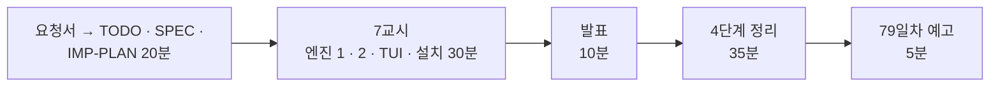

# 7·8교시 · 바이브 코딩 (`tcheck`)

- 교시: 7교시 16:00~16:50 (각자 만들기), 8교시 17:00~17:50 (발표 10분 · [4단계 정리](04-STAGE4-WRAPUP.md) 35분 · 예고 5분)
- 과제: [VIBE-REQ-TCHECK](../../Last3Mon/78/VIBE-REQ-TCHECK.md)(요청서, 요청의 말 ①~⑫) → [VIBE-Q-TCHECK](../../Last3Mon/78/VIBE-Q-TCHECK.md)의 8단계: `Doc/TODO.md` → `Doc/SPEC.md` → `Doc/IMP-PLAN.md`(엔진 · TUI 단계) → 단계별 구현 → 확인 → `uv tool install` → 다른 폴더에서 사용 → 수업 뒤 `VIBE-A-TCHECK.md` 공개
- 요구 14개(R1~R14). 50분 안에는 **엔진 1단계(R1 · R2 · R3 · R4 · R12 · R13) + 엔진 2단계(R5 · R6 · R7) + TUI 1단계(R11) + 설치(R14)**, 나머지(R8 내용 규칙, R9 고침 목록, R10 품질 기록)는 IMP-PLAN의 다음 단계로 집에서.
- 72일차 `tbench`부터 77일차 `tlog`와 같은 흐름입니다: 사람의 말(요청서)을 **확인할 수 있는 요구**로 바꾸는 일을 학생이 먼저 하고, VIBE-Q는 그 다음 단계(비교 대상)로 씁니다. 에이전트에게는 처음 요청 한 번과 "확인했고 commit 했어. 다음 단계." 한 줄만 씁니다.
- 오늘은 `tcheck`: CSV · JSON(오늘 요청 파일 모양 포함)을 데이터 API의 스키마로 검사해 **n8n `my-check`와 같은 판정**을 내고, 깨끗한 줄 · 나쁜 줄을 따로 내보내고, 배치 게이트를 종료 코드로 알리고, TUI로 탭을 나눠 보는 도구. 오늘 n8n 워크플로우로 한 일을 **보내기 전에, 내 노트북에서.**

> **생활 속 예 · 주머니에 넣는 검수 카드.** 오늘 주방(n8n)에 검수 기준표와 반품 칸을 만들었습니다. 납품업체가 "보내기 전에 창고에서 미리 검수하고 싶다"고 합니다. 같은 검수 카드를 **주머니에 넣어** 창고에서 쓰게 하면 됩니다. 핵심은 창고와 주방의 판정이 "같다"는 것입니다.

> 이 문서는 7 · 8교시 진행 문서입니다. 8교시의 정리 35분은 [04-STAGE4-WRAPUP](04-STAGE4-WRAPUP.md)으로 합니다.

## 1. 7교시 · 각자 만들기 (50분)

| 시간 | 단계 | 확인 |
| --- | --- | --- |
| 16:00~16:09 | 0 준비 · 1 요청서 → `Doc/TODO.md` (에이전트 없이) | 할 일 ①~⑫ · 꼭 / 나중 |
| 16:09~16:15 | 2 `Doc/SPEC.md` → VIBE-Q 요구 표(R1~R14)와 비교 · commit | 요구마다 확인 방법 (직원 4/9 · 접수 건 2/9 · 줄마다 코드, 종료 코드) |
| 16:15~16:20 | 3 `Doc/IMP-PLAN.md` (엔진 1~3단계 · TUI 1단계 · 설치) · commit | 단계마다 체크리스트 |
| 16:20~16:44 | 4 구현: 엔진 1단계 → 엔진 2단계 → TUI 1단계, 막히면 5 문제 해결 팁 | 단계마다 `pytest` · 직접 실행 · commit |
| 16:44~16:50 | 6 확인 · 7 `uv tool install --editable .` · 8 다른 폴더에서 `tcheck` | `tcheck check …/employees-new.json --url http://localhost:8800` = `my-check`의 판정 |

| 볼 것 | 막혔을 때 한마디 |
| --- | --- |
| TODO · SPEC 없이 VIBE-Q를 통째로 붙여 넣었나 | "요청서로 Doc/TODO.md부터. 직원 4/9가 SPEC에 없으면 맞았는지 모릅니다" |
| IMP-PLAN이 한 덩어리 · 첫 요청에 14개 | "엔진 1단계만. 단계마다 확인 · 체크 · commit" |
| 판정이 n8n과 다름 | "어느 줄 · 어느 코드가 다른지 붙여 주고, AGENTS.md 3절 스키마 표 그대로" |
| 필드 이름이 코드에 (`if name == "email"`) | "스키마의 fields를 돌며 type마다" — 오늘 Lab 03 예제 3 |
| `2026-02-30` · `2026-13-01`이 통과 | "실제 있는 날짜인지까지" |
| 빈 전화번호가 `bad_format` | "선택 칸은 비었으면 형식을 보지 않음" |
| 테스트가 진짜 API를 부름 | "가짜 서버(http.server)와 스키마 · n8n 결과 사본으로" |
| `gate`가 늘 0 | "넘으면 거절, 거절이면 종료 코드 4, 같으면 통과" |
| 실행해 보지 않고 다음 요청 | "에이전트가 됐다고 해도 직접 `uv run tcheck …; echo $?`" |

정답 예(R1~R14를 모두 넣은 `tcheck`와 정답본 `VIBE-A-TCHECK.md`)는 수업 뒤 공개됩니다.

## 2. 8교시 · 발표 (10분)

- 1~2명. **`tcheck check --json`과 `my-check`의 판정이 같다는 것을 보여 줄 수 있는 사람**, `tcheck gate`의 종료 코드 4를 보여 줄 수 있는 사람을 먼저 고릅니다.
- 3분 발표 · 2분 질문: **내 SPEC과 VIBE-Q가 달랐던 곳** / IMP-PLAN을 어떻게 나눴나 / 처음 요청 · 고쳐 달라는 요청문 / 에이전트가 틀린 곳(판정이 달랐던 줄) / 시연.

## 3. 강사 정리 (8교시 4단계 정리 안에서)

| | n8n (오늘 Lab) | tcheck |
| --- | --- | --- |
| 읽기 | 웹훅 본문 (`items` · `csv`) | 파일: `.csv` · JSON 목록 · `{"items"}` · 요청 파일 (R1) |
| 규칙 | `my-check`의 `Check rows` (스키마) | `checks.check` — 같은 타입 판정, 같은 코드 (R2 · R3 · R4) |
| 내용 규칙 | `my-faq-check` (Lab 01) | `--content answer` (R8) |
| 게이트 | `my-faq-import`의 `Batch ok?` (Lab 02) | `tcheck gate` · 종료 코드 4 (R7) |
| 격리 | `/quarantine` | `--out` · `--rejects` (R6) |
| 고침 목록 | Lab 01 과제 2 | `--fix` (R9) |
| 품질 기록 | Lab 03 과제 2 | `--log` (R10) |

- 풀이 거리: 강사 본은 직원 HR-1 · 접수 건 TK-1 · FAQ B-3에서 `rows` · `codes` · `valid`가 `my-check`와 **하나도 다르지 않았습니다.** Python `re`의 `\w`는 한글도 맞아 메일 판정이 JavaScript와 다를 수 있었고(`re.ASCII`), 날짜를 형식만 보면 2월 30일이 통과합니다. "같은 규칙을 두 곳에 쓰면 반드시 어긋난다 — 그래서 n8n 안에서는 검사를 다시 부르고, 밖에서는 테스트로 같은 판정을 확인한다."
- 같은 FAQ B-1을 `tcheck --schema faq --content answer`로 보면 Lab 01 예제 2의 8줄과 같은 줄이 나쁩니다 — 코드 이름만 다릅니다 (`title_missing` ↔ `missing:title`).

## 4. 강사 바이브 코딩 (시간이 남으면 · 수업 뒤, 15분)

| 주제 | 요청문 요지 | 보여 줄 것 |
| --- | --- | --- |
| pre-commit 훅 | "저장소에 `faq/*.json`을 커밋할 때 `tcheck gate --schema faq --content answer`가 4면 커밋을 막는 pre-commit 훅" | 보내기 전 검사를 개발 흐름에 |
| 스키마 버전 비교 | "`tcheck diff-schema old.json new.json`: 같은 파일로 두 스키마의 판정이 달라지는 줄" | 스키마 변경 = 규칙 변경, 리뷰 근거 |
| 이미 있는 데이터 | "`--existing http://localhost:8800/faq-all`로 `exists_id` · `same_title`" | Lab 01 과제 1을 도구로 |

걸린 시간과 결과를 `Last3Mon/78/VIBE-A-TCHECK.md`에 적어 둡니다.

## 5. 보충 · 팁 (읽을거리, 4단계 정리 7절과 함께)

| 팁 | 설명 |
| --- | --- |
| 요청서 → 요구가 먼저 | 확인 방법(기대 판정 · 종료 코드 · JSON 칸)이 있는 요구가 있어야 에이전트의 "완료"를 판단할 수 있음 |
| 기대 판정은 이미 있다 | 오늘 `cases/lab03.json` · `lab03-schema.json`의 판정을 SPEC과 테스트에 그대로 |
| n8n의 답을 사본으로 | `call my-check`의 응답을 `tests/data/`에 두면 n8n 없이도 "같은가"를 시험 |
| 규칙은 한 곳 | 판정 함수는 `checks.py`에만, JSON · 파일 · 게이트 · 화면은 부르기만 |
| 필드 이름을 코드에 쓰지 않기 | 스키마가 늘어도 코드는 그대로 |
| 정규식도 정의 | 다른 언어와 판정을 맞출 때는 `\w` · `\d`의 뜻까지 |
| 종료 코드로 말한다 | 0 · 1 · 2 · 4 — 스크립트 · pre-commit · CI가 다음 일을 정함 |
| 단계마다 `git commit` | 에이전트가 망가뜨려도 돌아갈 곳 |

## 6. 79일차 예고 (5분)

- 오늘: 들어오는 데이터를 규칙으로 검사하고 · 막고 · 격리하고 · 기록했습니다. 다음 수업(79일차, 11/4): **운영 데이터 기반 Workflow Ops Assistant 구현** — 77일차 실행 기록, 오늘의 품질 기록, 76일차 알림을 한데 모아, 운영자가 "지금 무엇이 문제야?"라고 물으면 숫자로 답하는 도우미를 만듭니다.
- 바이브 코딩: 오늘 `tcheck`와 77일차 `tlog`는 지우지 마세요. 79일차 `tops`에서 씁니다.

## 확인 (강사)

- [ ] 16:00 요청서 → TODO(에이전트 없이) → SPEC → IMP-PLAN 20분을 지켰다, 16:20부터 엔진 1단계.
- [ ] 7교시 시작 전 n8n에 `my-check`(Lab 03 예제 1 이상)가 게시돼 있어 판정 비교를 할 수 있다.
- [ ] 수업 뒤: 요청이 있을 때 학생 저장소에 정답(LAB-A · `answers/` · VIBE-A · `tcheck/`)을 올린다.
- [ ] 발표자 1~2명, 강사 정리 표, 팁, 예고.
- [ ] 수업이 끝날 때 학생들의 데이터 API가 처음 상태인지 (`quality --reset`, `doctor`).
