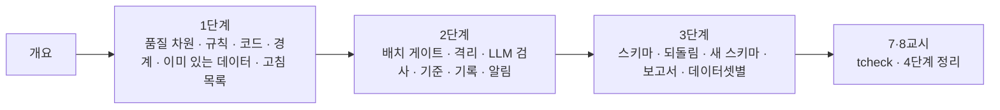

# 78일차 · 데이터 품질 검증 자동화와 품질 관리 Workflow (바이브 코딩)

- 일자: 2026-11-03 (78일차)
- 교과목: 노코드 멀티 에이전트 워크플로우 설계 및 운영
- 단원: AI 워크플로우 운영 및 관리 역량 강화
- 학습 내용: 데이터 품질 검증 자동화 및 품질 관리 Workflow 적용
- 실습 폴더: [Last3Mon/78](../../Last3Mon/78/README.md)
- 실습 환경: 65일차 n8n 2.42.6 + OpenAI API(`gpt-4.1-mini`) + 78일차 데이터 API(격리함 · 스키마 · 품질 기록) + **CLI 코딩 에이전트**
- **실습 준비: [00-DAY78-PREP.md](00-DAY78-PREP.md) (수업 전날까지 1~2절 완료)**

## 오늘의 시간표

| 교시 | 시간 | 내용 | 자료 |
| --- | --- | --- | --- |
| 1 | 09:00~09:50 | 오늘의 개요 · 1단계 · 품질 규칙 | [개요](00-DAY78-OVERVIEW.md), [1단계](01-STAGE1-QUALITY-RULES.md) |
| 2 | 10:00~10:50 | Lab 01 실습 5개 (눈으로 · 기준 검사, 검사 워크플로우, 경계, 이미 있는 데이터, 고침 목록) | [Lab 01](../../Last3Mon/78/LAB-01-Q-QUALITY-RULES.md) |
| 3 | 11:00~11:50 | 2단계 · 품질 게이트 | [2단계](02-STAGE2-QUALITY-GATE.md) |
| 4 | 12:00~12:50 | Lab 02 실습 5개 (배치 게이트 · 격리, LLM 검사, 기준을 바꾸면, 기록 · 알림, LLM 호출 수) | [Lab 02](../../Last3Mon/78/LAB-02-Q-QUALITY-GATE.md) |
| - | 13:00~14:00 | 점심 |  |
| 5 | 14:00~14:50 | 3단계 · 품질 관리 | [3단계](03-STAGE3-QUALITY-MANAGEMENT.md) |
| 6 | 15:00~15:50 | Lab 03 실습 5개 (스키마 검사, 고쳐서 다시, 새 스키마, 품질 보고서, 데이터셋별) | [Lab 03](../../Last3Mon/78/LAB-03-Q-QUALITY-MANAGEMENT.md) |
| 7 | 16:00~16:50 | 바이브 코딩 · `tcheck` (요청서 → TODO → SPEC → IMP-PLAN → 만들기 → 설치) | [요청서](../../Last3Mon/78/VIBE-REQ-TCHECK.md), [VIBE-Q-TCHECK](../../Last3Mon/78/VIBE-Q-TCHECK.md), [진행](05-VIBE-CODING.md) |
| 8 | 17:00~17:50 | 바이브 코딩 발표 · **4단계 정리** (의미 · 효과 · 실전 응용) · 79일차 예고 | [4단계 정리](04-STAGE4-WRAPUP.md), [진행](05-VIBE-CODING.md) |

## 자료 목록

| 파일 | 내용 |
| --- | --- |
| `00-DAY78-PREP.md` | 실습 준비: n8n · 78일차 판 데이터 API 켜기, 기준 둘 게시, `flow.py quality` · `doctor` (수업 전) |
| `00-DAY78-OVERVIEW.md` | 개요 30장 (PPT 대신 Markdown, 가로줄로 장 구분, 장마다 생활 속 예) |
| `01-STAGE1-QUALITY-RULES.md` | 데이터 품질의 차원, 규칙은 말이 먼저, 오류 코드, 규칙은 Code가, 경계, 이미 있는 데이터 · 오류와 경고, 고침 목록 · 데이터 계약 |
| `02-STAGE2-QUALITY-GATE.md` | 검사와 게이트, 배치 · 줄 게이트 · 격리함, LLM 검사(통과한 줄만 · fail-closed), 기준은 고르는 값, 기록 · 알림, LLM 호출 수 · 늘 같은가 |
| `03-STAGE3-QUALITY-MANAGEMENT.md` | 스키마, 스키마로 되는 것 · 안 되는 것, 되돌림 고리, 설정으로 넓히기, 품질 보고서의 정의, 데이터셋별, 식당 주방으로 본 하루 |
| `04-STAGE4-WRAPUP.md` | 8교시 4단계 정리 35분: 의미 · 효과 · 업계 이름 · 산업별 응용 · 데이터 계약서 · 면접 · 최종 프로젝트 체크리스트 |
| `05-VIBE-CODING.md` | 7·8교시 바이브 코딩 진행 (`tcheck`), 발표, 강사 정리, 추가 바이브 코딩, 팁 |
