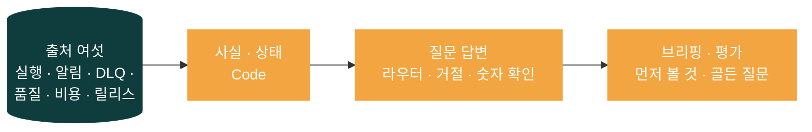
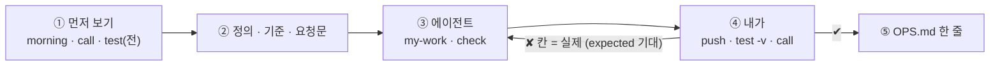

# 79일차 개요 · 운영 데이터 기반 Workflow Ops Assistant

> 노코드 멀티 에이전트 워크플로우 설계 및 운영 · 2026-11-04
> 30장 · 각 장은 가로줄(`---`)로 나뉩니다. 1교시에는 1~6장을 보고, 나머지 장은 각 단계 강의(1 · 3 · 5교시) 때 함께 띄웁니다.
> 숫자는 모두 강사 노트북 실측입니다 (65일차 n8n 2.42.6, 79일차 판 데이터 API의 2026-11-04 08:30 운영 아침 상태 · 실행 기록 666건, OpenAI `gpt-4.1-mini`(답 · 라우터 · 요약, temperature 0), 11/01 정답 워크플로우를 학생 순서대로 1회).

| 장 | 범위 | 띄우는 때 |
| --- | --- | --- |
| 1~6 | 표지 · 목표 · 시간표 · 수요일 아침 08:30 · 일하는 순서 · 실습 15개 | 1교시 시작 |
| 7~14 | 1단계 · 운영 사실 | 1교시 강의 |
| 15~21 | 2단계 · 질문 답변 | 3교시 강의 |
| 22~28 | 3단계 · 브리핑과 평가 | 5교시 강의 |
| 29~30 | 바이브 코딩 · 정리와 예고 (8교시 35분 정리는 [04-STAGE4-WRAPUP](04-STAGE4-WRAPUP.md)) | 7교시 · 8교시 |

---

## 1 / 30 · 표지

**79일차**

# 운영 데이터 기반 Workflow Ops Assistant

숫자 · 상태는 Code가 · 글은 LLM이 · 작업은 사람이

노코드 멀티 에이전트 워크플로우 설계 및 운영 · 2026-11-04

---

## 2 / 30 · 오늘 할 수 있게 될 세 가지

| | 목표 | 내용 |
| --- | --- | --- |
| 1 | **사실로 모은다** | 흩어진 출처 여섯을 정의가 정해진 사실 하나로, 기간과 지금을 나누고, 0과 `null`을 구분하고, 영역마다 색을 매기고, 출처가 멈춰도 나머지를 내놓는다 |
| 2 | **답하고 막는다** | 질문을 영역 하나로 고르고 그 사실만으로 답하고, 운영 밖 · 작업 요청은 LLM 앞에서 거절하고, 숫자를 확인하고, 낱말이 모를 때만 LLM 라우터를, 감사 기록을 남긴다 |
| 3 | **정리하고 시험한다** | 먼저 볼 것 · 할 일을 규칙으로 정한 브리핑, 덧붙이는 LLM 요약, 사람이 일한 뒤의 브리핑, 골든 질문 평가와 평가 관문 |

---

## 3 / 30 · 오늘의 시간표

| 교시 | 시간 | 내용 |
| --- | --- | --- |
| 1 | 09:00~09:50 | 개요 · **1단계 강의** · 운영 사실 |
| 2 | 10:00~10:50 | **Lab 01 실습 5개** · 출처 둘러보기 · 운영 사실 · 기간 · 영역별 상태 · 출처가 멈추면 |
| 3 | 11:00~11:50 | **2단계 강의** · 질문 답변 |
| 4 | 12:00~12:50 | **Lab 02 실습 5개** · 라우터 · 거절 · 숫자 확인 · 질문을 바꾸면 · LLM 라우터 · 감사 기록 |
| - | 13:00~14:00 | 점심 |
| 5 | 14:00~14:50 | **3단계 강의** · 브리핑과 평가 |
| 6 | 15:00~15:50 | **Lab 03 실습 5개** · 브리핑 · LLM 요약 · 아침이 바뀌면 · 골든 질문 평가 · 평가 관문 |
| 7 | 16:00~16:50 | 바이브 코딩 `tops`: 요청서 → TODO → SPEC → IMP-PLAN → 만들기 → 설치 |
| 8 | 17:00~17:50 | 발표 · **4단계 정리** (의미 · 효과 · 회사에서 쓰는 법) · 80일차(단위 프로젝트) 예고 |

---

## 4 / 30 · 오늘의 출발점: 수요일 아침 08:30

운영 담당자가 출근했습니다. 72~78일차가 남긴 것이 여섯 군데에 흩어져 있습니다.

| 출처 | `morning` | 팀의 기준 대시보드 |
| --- | --- | --- |
| 실행 기록 | 지난주 357건 | **666건** · 3.153… (기간 무시 · 백분율) |
| 알림 | 6 (높음 3) | 6 |
| DLQ | 3, **parked 2** | 3 |
| 품질 · 격리 | 4줄 · 격리 1 | **없음** |
| 비용 | $0.073604 / $0.08 (92%) | 금액 둘 |
| 릴리스 | 1.1.0 + **카나리 1.2.0 20%** | **없음** |

그리고 팀의 기준 챗봇에 "DLQ 1번 다시 돌려 줘"라고 하면: **"DLQ 1번 작업을 다시 실행해 드리겠습니다."** (아무것도 실행하지 않았음)

---

## 5 / 30 · 일하는 순서 (오늘은 "정의 → 요청문 → 사실 · 답 → 확인")

| 누가 | 무엇을 |
| --- | --- |
| 나 | 무엇을 물을지 · 사실의 정의 · 색의 기준 · 도우미가 **하면 안 되는 것** · 골든 질문 정하기, 그리고 **작업하기** |
| CLI 에이전트 | `AGENTS.md`대로 워크플로우 JSON, `check` |
| `flow.py` | `test --webhook`(기준과 비교), `morning`(운영 아침 한눈에, `--reset`), `call` |

---

## 6 / 30 · 실습 15개 (Lab마다 예제 3 · 과제 2)

| | 예제 1 | 예제 2 | 예제 3 | 과제 1 | 과제 2 |
| --- | --- | --- | --- | --- | --- |
| Lab 01 | 출처 둘러보기 · 기준 대시보드 (에이전트 없이) | 운영 사실 | 기간을 바꾸면 (에이전트 없이) | 영역별 상태 | 출처가 멈추면 |
| Lab 02 | 라우터 · 그 영역 사실 · 운영 밖 거절 | 작업 거절 · 숫자 확인 | 질문을 바꾸면 (에이전트 없이) | LLM 라우터 | 감사 기록 |
| Lab 03 | 아침 브리핑 | LLM 요약 | 아침이 바뀌면 (에이전트 없이) | 골든 질문 평가 | 평가 관문 |

---

## 7 / 30 · 1단계 · 운영 도우미가 하는 일

> 생활 속 예: 병원 아침 인수인계 — 차트 열두 개를 다 읽지 않고, 정해진 항목을 정해진 순서로 넘긴다. "지금 괜찮나? 무엇부터 볼까?"

| 업계에서 쓰는 말 | 하는 일 |
| --- | --- |
| 운영 대시보드 (Grafana · Datadog) | 숫자 · 색을 한 화면에 |
| ChatOps (Slack 봇 · PagerDuty 연동) | 대화창에서 묻고 답 받기 |
| AIOps (Datadog Bits AI · Dynatrace Davis) | 운영 데이터에 AI (요약 · 분류 · 이상 탐지) |
| 아침 브리핑 · 당번 인수인계 | 먼저 볼 것과 할 일 |

- 오늘의 원칙: **숫자 · 상태는 Code가, 글은 LLM이, 작업은 사람이.** 도우미는 읽기만.

---

## 8 / 30 · 출처 여섯 = 묻는 영역 여섯

> 생활 속 예: 인수인계 양식의 칸 — 체온 · 수액 · 투약 · 검사 · 식사 · 특이 사항.

| 영역 | 묻는 것 | 남긴 날 |
| --- | --- | --- |
| 실행 | 오류 · 느림 · 답 못 함 | 77일차 실행 기록 |
| 알림 | 무엇이 울렸나 · 얼마나 급한가 | 76~78일차 |
| DLQ | 사람이 볼 일이 남았나 | 76일차 |
| 품질 | 데이터를 믿을 수 있나 | 78일차 |
| 비용 | 한도 안인가 · 누가 쓰나 | 75일차 |
| 릴리스 | 무슨 판이 나가나 · 카나리는 괜찮나 | 74일차 |

- SRE의 네 가지 황금 신호(지연 · 트래픽 · 오류 · 포화)에 **품질 · 비용 · 릴리스**가 더해진 것이 AI 워크플로우 운영.

---

## 9 / 30 · 없는 칸이 가장 위험하다 (Lab 01 예제 1)

> 생활 속 예: "모두 체온 정상"만 적힌 메모 — 거짓은 없지만 수액 칸이 없다.

| 대시보드의 실수 | 누가 알아채나 |
| --- | --- |
| 틀린 숫자 | 누군가 "이상한데?" |
| **없는 칸** | 아무도 — "괜찮다"처럼 보임 |

- 기준 대시보드만 보면 오늘 가장 급한 둘(**parked 2건 · 카나리 1.2.0**)을 모름.
- 그래서 먼저 정하는 것은 계산이 아니라 **무엇을 물어야 하나**.

---

## 10 / 30 · 사실 하나로 · 정의는 다시 만들지 않는다 (Lab 01 예제 2)

> 생활 속 예: 병원 공용 차트 양식 — "고열 = 38도 이상"을 양식에 박아 두고 모두 그것을 읽는다.

| 영역 | 내 `my-ops-facts`의 지난주 |
| --- | --- |
| 실행 | 357 · 0.0588 · p95 2598 · 답 못 함 0.0476 · 실패 1위 `Search FAQ` timeout 16 |
| 알림 · DLQ | 6 · 높음 3, 3 · parked 2 · 대기 1 |
| 품질 · 비용 | 평균 0.6583 · 격리 1, 0.9201 · 1위 `test-bot` 37% |
| 릴리스 | 카나리 다시 묻기 **62.5%** 대 1.1.0 7.73% |

- 77일차 숫자와 **같음** — 시맨틱 레이어(dbt Semantic Layer · Cube). 출처 여덟 → Code 하나, 0.1초. `lab01` 0/5 → 5/5.

---

## 11 / 30 · 기간과 지금 · 0과 `null` (Lab 01 예제 3)

> 생활 속 예: "밤새 열이 두 번"(기간) · "지금 37.2도"(지금) · "소변량은 안 쟀음"(모름 ≠ 0).

| 기간 | 실행 | 다시 묻는 비율 | 지금 숫자 |
| --- | --- | --- | --- |
| 두 주 | 666 · 0.0315 | 7.73% · 62.5% | 그대로 |
| 10/26 | 70 · 0.2286 | **`null`** (판이 10/28부터) | 그대로 |
| 빈 주 | 0 · 오류율 0 · 실패 1위 **`null`** | `null` | 그대로 |

- 기간은 **실행 기록에만**. 0 = 셌고 없었다, `null` = 말할 수 없다.

---

## 12 / 30 · 상태는 규칙으로 (Lab 01 과제 1)

> 생활 속 예: 병동 현황판의 빨강 · 노랑 자석 — 간호사의 기분이 아니라 기준표로 붙인다.

| 영역 | 🔴 | 🟡 | 지난주 |
| --- | --- | --- | --- |
| 실행 | 오류율 > 0.01 | 답 못 함 > 0.02 | 🔴 |
| 알림 | 높음 ≥ 5 | 1건 이상 | 🟡 |
| DLQ | parked > 0 | 남음 | 🔴 |
| 품질 | 마지막 < 0.8 | < 0.9 · 격리 | 🟡 |
| 비용 | ≥ 100% | ≥ 80% | 🟡 |
| 릴리스 | 카나리 > 2배 | 카나리 켜짐 | 🔴 |

- RAG 상태 · SLO 판정 (77일차). 비율이 `null`이면 빨강이 아니라 노랑 — "모르니 지켜보자".

---

## 13 / 30 · 출처가 멈추면 (Lab 01 과제 2)

> 생활 속 예: 검사실 전화가 안 되는 아침 — 나머지는 넘기고 "검사 결과: 받지 못함". "정상"이라고 적지 않는다.

| | 고치기 전 | 고친 뒤 |
| --- | --- | --- |
| 사용량 출처가 500 | 사실 전체가 **500** | 200 · 다섯 영역 그대로 |
| 비용 | — | `null` · ⚪ `unknown` · `sources_down: ["cost"]` |
| 전체 | — | 🔴 (빨강이 없어도 unknown이면 적어도 🟡) |

- 우아한 저하(graceful degradation). 비용을 0으로 적었다면 🟢 — 실제는 92%.

---

## 14 / 30 · 1단계 정리 · 사실

| 원칙 | 오늘 |
| --- | --- |
| 무엇을 물을지 먼저 | 영역 여섯 — 없는 칸이 가장 위험 |
| 정의는 한 곳 | 77일차 숫자 그대로, 다음 단계는 사실만 읽음 |
| 시간 종류 · 모름 | 기간은 실행에만, 0과 `null` |
| 색은 기준표로 | 🔴 셋 · 🟡 셋, 비교 불가는 🟡 |
| 부분 실패 | 출처 하나가 멈춰도 200 · `unknown` |

---

## 15 / 30 · 2단계 · 기준 챗봇의 세 실수

> 생활 속 예: 무엇이든 대답하는 새내기 간호사 — 맛집도 알려 주고, 권한도 없이 "약 바꿔 드릴게요".

| 질문 | 기준 챗봇 (`base-ops-ask`) | 위험 |
| --- | --- | --- |
| 점심 메뉴 추천해 줘 | 김치찌개 · 불고기 · 비빔밥 | 범위 밖 |
| DLQ 1번 다시 돌려 줘 | "**다시 실행해 드리겠습니다**" | 하지 않은 일을 했다고 |
| 카나리 버전 문제 있어? | 오류율 · 알림 · DLQ를 섞음 (62.5% 없음) | 원인을 잘못 짚음 |

- `lab02` **0/6**. 가드레일(NeMo Guardrails) · 범위 제한 · 근거 제한을 **워크플로우의 갈래**로.

---

## 16 / 30 · 라우터 · 그 영역 사실만 (Lab 02 예제 1)

> 생활 속 예: 병원 안내 데스크 — 진단하지 않고 어디로 보낼지만, 심장내과에 정형외과 차트는 주지 않는다.

| 방식 | 장점 | 단점 |
| --- | --- | --- |
| 낱말 목록 (Code) | 0초 · 공짜 · 늘 같음 | 목록에 없는 말은 모름 |
| LLM 분류 | 처음 보는 말도 | 1~3초 · 비용 |

- 오류율 → `runs` 5.88% · 카나리 → `release` 62.5% 대 7.73% · 점심 → 거절 0.1초 (LLM 없음).
- 그러나 "DLQ 1번 다시 돌려 줘" → `dlq`로 답 "**#1은 대기 중**" (틀림). `lab02` 3/6.

---

## 17 / 30 · 거절은 LLM 앞에서 · 읽기만 (Lab 02 예제 2)

> 생활 속 예: 처방은 의사만 — 간호사의 성격이 아니라 병원의 규칙. "전해 드릴게요"는 되고 "바꿔 드릴게요"는 안 된다.

| 막는 곳 | 확실한가 |
| --- | --- |
| 지시문 "작업은 거절해" | 대개 (LLM이 따를 때만) |
| **라우터 앞 Code 갈래** | 늘 — 0초, LLM은 보지도 않음 |
| 쓰는 API를 아예 안 부름 | 늘 — 할 수단이 없음 |

- "DLQ 1번 다시 돌려 줘" → `action` · `read_only` · **0.0초** · "런북에 따라 담당자가 직접". 최소 권한 · human-in-the-loop.

---

## 18 / 30 · 숫자 확인과 그 한계 (Lab 02 예제 2)

> 생활 속 예: 메모의 숫자를 차트와 맞춰 보기 — 없는 숫자는 잡지만, "2번 환자 39.1"을 3번으로 적은 것은 못 잡는다.

| 잡는 것 | 못 잡는 것 |
| --- | --- |
| 지어낸 숫자 · 계산 실수 | 사실에 있는 숫자를 **다른 뜻**으로 |
| | 두 숫자를 **거꾸로** |

- 비용 92.01 (= 0.9201 × 100) · 릴리스 62.5 (`1.2.0`은 버전으로 통째로) → `numbers_ok: true`. `lab02` **6/6**.
- 예제 1의 "#1은 대기 중"은 통과 (1은 사실에 있음) — 그래서 작업 요청은 **답하지 않고 막는다**.

---

## 19 / 30 · 질문을 바꾸면 (Lab 02 예제 3)

> 생활 속 예: 안내 데스크의 단어장 — "숨이 차요"는 없다. 짐작하지 않고 "모르겠습니다"는 불편하지만 안전.

| 질문 | 낱말 라우터 | 운영자에게 |
| --- | --- | --- |
| 에러 많이 났어? | runs | 좋음 |
| 장애 났어? | 거절 | **불편** |
| 알림이랑 DLQ | alerts (같으면 앞) | 반쪽 |
| 카나리 꺼 줘 | 작업 거절 | 안전 |
| AI 쓰는 데 얼마나 나갔어? | 거절 | **불편** |

- 6/6 = **규칙대로**. 실패의 방향이 "모르면 거절"이라 안전.

---

## 20 / 30 · LLM 라우터 · 낱말이 모를 때만 (Lab 02 과제 1)

> 생활 속 예: 단어장에 없을 때만 선배를 부른다 — 모든 질문마다 부르면 선배가 아무 일도 못 한다.

| 질문 | 영역 · 라우터 | 시간 |
| --- | --- | --- |
| AI 쓰는 데 얼마나 나갔어? | `cost` · `llm` · 92.01% | 4.9초 |
| 어젯밤 접수 못 하고 남은 건 | `dlq` · `llm` · 3건 | 1.7초 |
| 지난주 오류율 | `runs` · `keyword` (그대로) | 1.0초 |

- 모델 계단(cascade). 예제 3 다시 → **4/6** (장애 · AI 비용이 이제 답함 — 기대가 옛 규칙).
- "2건은 대기 · 1건은 주차" — **거꾸로**인데 `numbers_ok: true`.

---

## 21 / 30 · 감사 기록 (Lab 02 과제 2)

> 생활 속 예: 간호사실 전화 기록부 — 몇 시 · 무엇을 · 어떻게 답했나. "약 바꿔 달라는 전화가 하루 열 번"이 보인다.

| 질문 | 기록 |
| --- | --- |
| DLQ 1번 다시 돌려 줘 | `action` · `keyword` · `read_only` |
| 점심 메뉴 | `unknown` · **`llm`** · `out_of_scope` (비용이 든 거절) |
| 지난주 오류율 | `runs` · `keyword` · `numbers_ok: true` |

- LLM 관측성 (Langfuse · LangSmith). 덧붙이기만 — 읽기 전용의 예외, 응답은 그대로. 질문 원문의 개인정보 주의.

---

## 22 / 30 · 3단계 · 브리핑 · 먼저 볼 것은 규칙으로 (Lab 03 예제 1)

> 생활 속 예: 인수인계는 병실 순서가 아니라 빨강 환자부터, 환자마다 다음 할 일이 정해져 있다.

| 먼저 볼 것 | 할 일 (런북) |
| --- | --- |
| 🔴 실행 | 오류 묶음 1위 확인 · 고치기 (77일차) |
| 🔴 DLQ | parked 건 원인 확인 뒤 런북대로 재처리 (76일차) |
| 🔴 릴리스 | 카나리 끄기 · 되돌리기 검토 (74일차) |

- red 다음 yellow의 앞 3개, 표의 색은 사실 그대로. LLM 없음, `lab03` 4/4.

---

## 23 / 30 · LLM 요약은 덧붙이는 말 (Lab 03 예제 2)

> 생활 속 예: 인수인계 끝의 한마디 "오늘은 3호실이 제일 걱정" — 기억에 남지만 표를 대신하면 다른 두 환자가 빠진다.

- 요약: "전체 시스템 상태는 빨간색으로, 오류율은 5.88% … 가장 긴급한 문제는 'Search FAQ' 노드 … 16건 …"
- `numbers_ok: true`, 두 번 부르면 글이 조금 다름.
- 먼저 볼 것 셋 중 **하나**만 말함 (DLQ · 카나리 없음) → 표 · 순서는 Code가.

---

## 24 / 30 · 아침이 바뀌면 (Lab 03 예제 3)

> 생활 속 예: 빨강 자석을 뗀 까닭 — 열이 내려서 · 다른 병동으로 옮겨서 · 기준을 바꿔서. 셋째를 "나았다"고 하면 큰일.

| 사람이 한 일 | 바뀐 것 | 뜻 |
| --- | --- | --- |
| parked 둘 처리 | DLQ 🔴 → 🟡 | 일을 끝냄 |
| 카나리 끔 | 릴리스 🔴 → 🟢 | 위험을 멈춤 (1.2.0은 그대로) |
| 예산 0.08 → 0.2 | 비용 🟡 → 🟢 | 한도를 바꿈 (쓴 돈은 그대로) |

- 남은 빨강은 실행 하나 (FAQ timeout). "초록입니다"가 아니라 **무엇을 했는지**를 말한다.

---

## 25 / 30 · 골든 질문 평가 (Lab 03 과제 1)

> 생활 속 예: 새 간호사의 모의 인수인계 시험 — 정해진 질문 여덟 개, 누가 채점해도 같다.

| 칸 | 묻는 것 |
| --- | --- |
| `area_ok` | 맞는 영역으로 |
| `refused_ok` | 거절할 것을 거절 |
| `number_ok` | 기대 숫자가 답에 |
| `grounded` | 답의 숫자가 사실에 |

- 골든 8 → **8/8 · score 1** (3.9초). OpenAI Evals · promptfoo · RAGAS.

---

## 26 / 30 · 평가는 시험지도 시험한다 (Lab 03 과제 1)

| 케이스 | 결과 | 뜻 |
| --- | --- | --- |
| "알림이 몇 건?" 기대 영역 `cost` (일부러 틀림) | `area_ok: false`만 | 도우미는 맞고 **시험지가** 틀림 |
| 빈 목록 | 400 | "0개 중 0개 = 100%"로 속지 않음 |

- 8/8이어도 "parked 2 · 대기 1을 거꾸로" 같은 답은 통과 → 골든 세트에 **틀리기 쉬운 질문**을 더해 간다.

---

## 27 / 30 · 평가 관문 (Lab 03 과제 2)

> 생활 속 예: 합격선 80점 — 없으면 50점도 병동에 나간다. 떨어지면 수간호사에게 알림.

| 평가 | score | 기준 | gate |
| --- | --- | --- | --- |
| 기준 없음 | 1 | 0.9 (기본) | pass |
| 골든 8 | 1 | 0.8 | pass |
| 틀린 기대 | 0 | 0.9 | **fail** → `eval_below` 알림 |

- 74일차 배포 게이트 · 78일차 품질 게이트와 같은 모양. LLMOps의 회귀 시험 (CI에서 평가).

---

## 28 / 30 · 병원 아침으로 본 오늘 하루

> 생활 속 예: 오늘 만든 것이 모두 병원 아침에 있다.

| 오늘 | 병원 |
| --- | --- |
| 출처 여섯 · 사실 · 정의 | 차트 여섯 · 인수인계 양식 · 공용 차트 기준 |
| 기간 · 0과 `null` · 상태 | 밤새 · 지금 · "안 쟀음" · 빨강 · 노랑 자석 |
| 출처가 멈추면 | 검사 결과 "받지 못함" |
| 라우터 · 거절 · 숫자 확인 | 안내 데스크 · 처방은 의사만 · 차트와 맞춰 보기 |
| LLM 라우터 · 감사 | 선배 간호사 · 전화 기록부 |
| 브리핑 · 요약 · 아침이 바뀌면 | 빨강 환자부터 · 끝의 한마디 · 자석을 뗀 까닭 |
| 평가 · 관문 · 평가가 바꾸는 것 | 모의 시험 · 합격선 · 시험 중 울린 호출벨 |

---

## 29 / 30 · 7교시 바이브 코딩 · `tops`

요청서(운영 당번 · 팀장의 말 ①~⑫) → `Doc/TODO.md` → `SPEC.md` → `IMP-PLAN.md` → 단계별로 → `uv tool install`.

| 오늘 n8n에서 | `tops`로 터미널에서 (당번의 아침) |
| --- | --- |
| `my-ops-facts` | `tops status` — **n8n이 정한 색 그대로**, 빨강이면 종료 코드 4 |
| `my-ops-ask` | `tops ask "…"` — 영역 · 거절 · 숫자 확인 |
| `my-ops-brief` · `my-ops-eval` | `tops brief` · `tops eval` (관문 실패면 4) |
| 감사 · 지난 도구 | `tops audit` · `tops tools` (`tlog slo` · `tcheck`) |
| (없음) | TUI 탭 다섯, 못 읽는 탭만 "not available", **읽기만** (주소 목록) |

- 강사 본: 실제 n8n에서 `tops status` 일곱 줄 · 종료 코드 4 · 0.19초, 테스트 27개 8.6초 (n8n 없이).

---

## 30 / 30 · 오늘의 정리 · 80일차 예고

| 단계 | 오늘 숫자 |
| --- | --- |
| 사실 | 기준 666 · 칸 없음 → 357 · 여섯 영역, 기간 넷, 🔴 셋 🟡 셋, 출처가 멈춰도 200 · `unknown` |
| 질문 답변 | 기준 0/6 ("다시 실행해 드리겠습니다") → 3/6 → 6/6, 말투 여섯, LLM 라우터 5/5 (phrasing 4/6), 감사 3줄 |
| 브리핑 · 평가 | 먼저 볼 것 셋 · 요약 세 문장, 사람이 일한 뒤 빨강 하나, 골든 8/8, 관문 fail → 알림 |

- 8교시 [4단계 정리](04-STAGE4-WRAPUP.md): 의미 · 효과 · 업계 이름 · 면접 · 최종 프로젝트 체크리스트.
- 80~82일차: **단위 프로젝트** — 팀마다 64~79일차의 워크플로우를 묶어 하나의 서비스로. 오늘의 운영 도우미가 그 서비스의 운영 부분이 된다.
